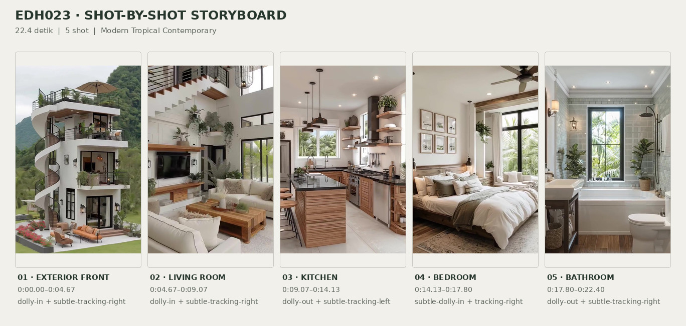
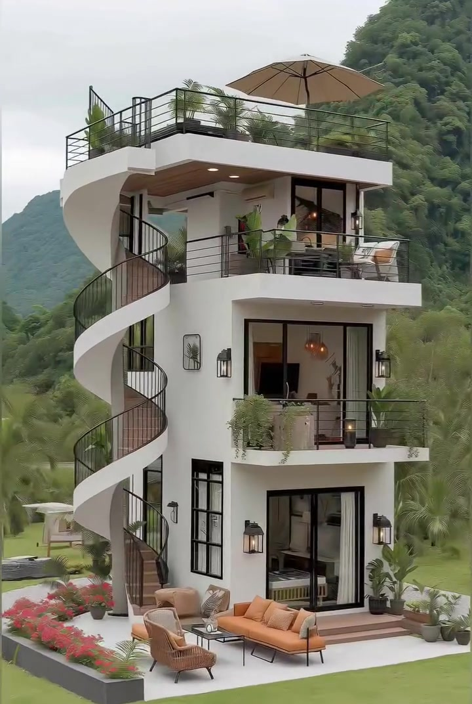
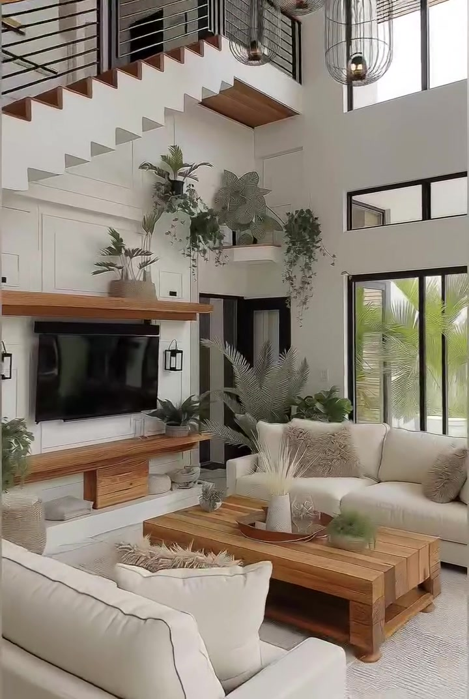
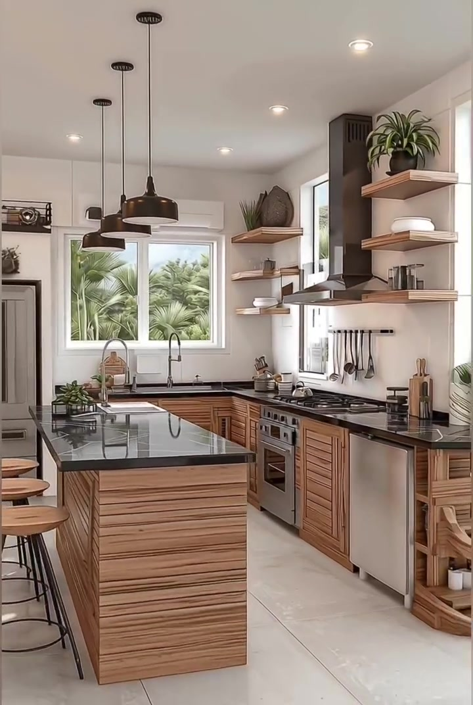
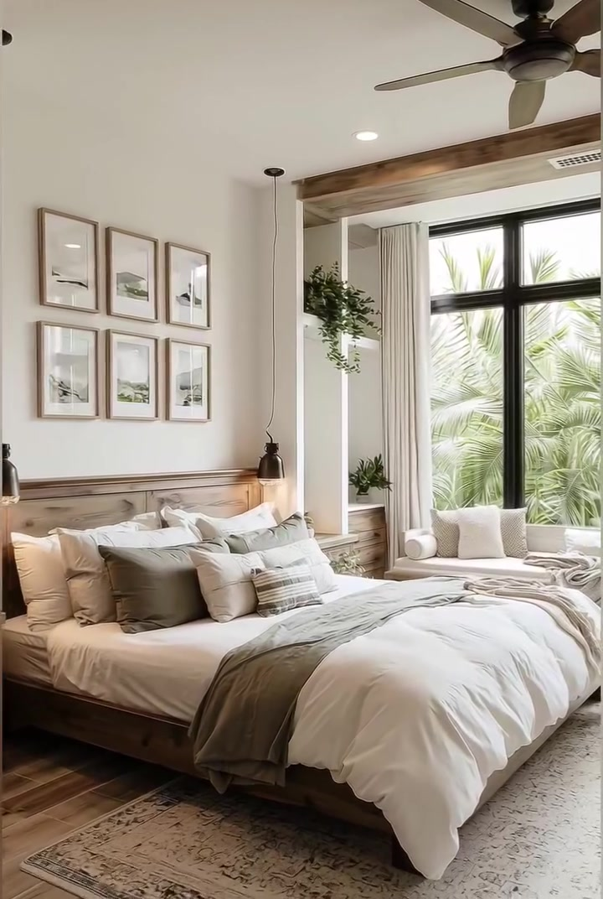
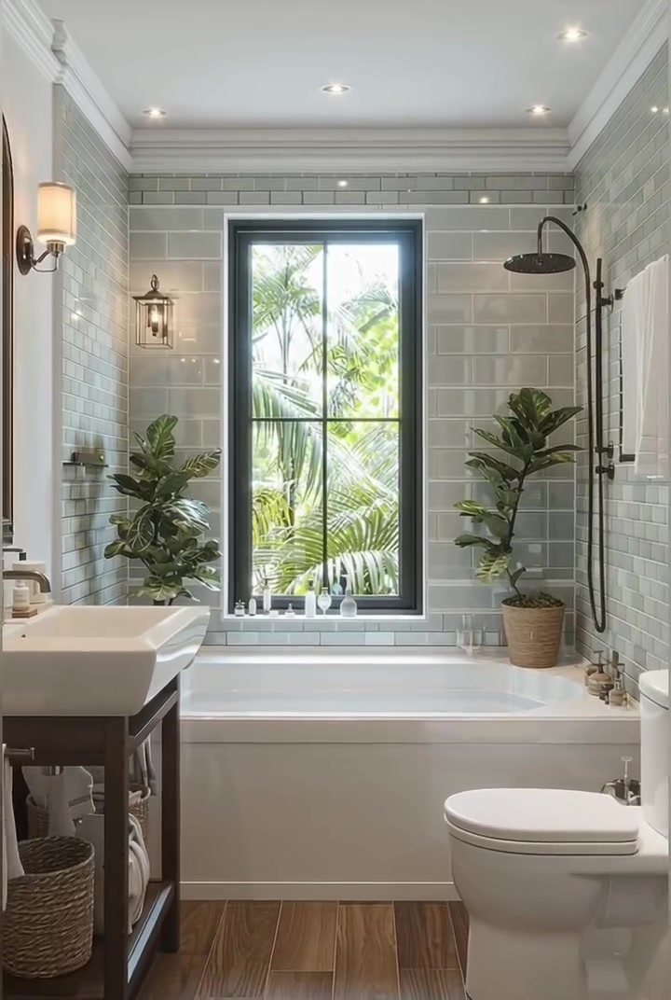

# edh023 — Modern Tropical Contemporary

<!-- homeku_request_id: edh023-20261104-1412 -->

<!-- homeku_detail_narratives: chat-reviewed -->

**Sumber data:** [analysis.yaml](analysis.yaml) · **Status:** draft · **Diverifikasi manusia:** Tidak

## 1. Informasi Video

| Informasi | Nilai |
|---|---|
| ID | edh023 |
| File asli | edh023.mp4 |
| Durasi | 22.4 |
| Resolusi | 720x1072 |
| FPS | 30 |
| Rasio | 45:67 |
| Jumlah shot | 5 |

## 2. Storyboard Gabungan

## 3. Identitas Desain

| Aspek | Hasil analisis |
|---|---|
| Gaya utama | modern tropical contemporary |
| Wilayah terkait gaya desain | asia, oceania |
| Pengaruh gaya | modern minimalist, resort inspired, warm contemporary interior, subtle industrial accents |
| Ciri eksterior | white smooth plaster appearance facade, flat roof and cantilevered balconies, external curved spiral stair, black metal railings, black framed full height glazing, warm wood tone soffits, open rooftop terrace |
| Gaya interior | warm modern, tropical contemporary, natural wood accents, neutral soft furnishings, black metal accents |
| Confidence gaya | medium |

## 4. Ukuran & Proporsi Bangunan

| Aspek | Estimasi visual |
|---|---|
| Ukuran yang terlihat | medium |
| Bentuk bangunan | narrow rectangular vertical mass with curved external stair |
| Skala vertikal | three story with rooftop terrace |
| Tapak bangunan | compact |
| Perkiraan luas lantai | 110–190 m² |
| Confidence | low |

> Luas adalah perkiraan visual, bukan ukuran terukur.

## 5. Warna, Pencahayaan, dan Atmosfer

| Warna dominan | HEX (perkiraan) |
|---|---|
| warm white | #F0EEE8 |
| honey wood | #AA7A53 |
| charcoal black | #292D2C |
| soft sage green | #76846F |
| caramel tan | #B98564 |
| pale gray tile | #BFC4C0 |

| Aspek | Hasil analisis |
|---|---|
| Pencahayaan | diffused overcast daylight exterior, soft window daylight interior, warm interior accent lights, recessed ceiling lights |
| Lingkungan | vegetated mountain valley, tropical palms around house, manicured green lawn, red pink flower bed |
| Musim yang tampak | Tidak diketahui |
| Mood | lush, airy, calm, cozy, resort like |

## 6. Struktur dan Timeline Video

**Jenis:** architectural home tour · **Tempo:** slow · **Transisi:** straight cuts between five continuous shots

| Shot | Waktu (detik) | Durasi | Area/Scene | Gerakan Kamera |
|---|---|---|---|---|
| Shot 01 | 0.0–4.67 | 4.67 | exterior front | dolly in, subtle tracking right |
| Shot 02 | 4.67–9.07 | 4.40 | living room | dolly in, subtle tracking right |
| Shot 03 | 9.07–14.13 | 5.06 | kitchen | dolly out, subtle tracking left |
| Shot 04 | 14.13–17.8 | 3.67 | bedroom | subtle dolly in, tracking right |
| Shot 05 | 17.8–22.4 | 4.60 | bathroom | dolly out, subtle tracking right |

## 7. Analisis per Shot

### Shot 01 — exterior front

**Waktu:** 0.0–4.67 detik

| Komponen | Pengamatan |
|---|---|
| Fokus utama | three story white house with external spiral stair and rooftop |
| Framing awal → akhir | wide full building and landscape → medium wide front facade and rooftop |
| Sudut pandang | slightly elevated front three quarter |
| Gerakan kamera | dolly in, subtle tracking right |
| Kecepatan kamera | slow |
| Pencahayaan | soft overcast daylight |
| Transisi keluar | hard cut |

**Detail yang terlihat**

**Arsitektur**

Fasad rumah tampak ramping, menjulang tiga lantai, dengan permukaan menyerupai plester putih. Pelat rooftop datar memiliki overhang putih yang lebar. Di sisi kiri, tangga spiral luar melengkung menyusuri fasad, dengan pagar logam gelap dan anak tangga bernuansa kayu. Teras atap dan balkon memakai railing logam hitam horizontal; bagian bawah pelat atap dan balkon tampak berfinishing warna kayu hangat, dengan lampu tanam bercahaya hangat di bawah overhang paling atas. Balkon\-balkon depan berupa pelat putih menjorok yang bertumpuk. Pintu kaca besar berbingkai hitam terlihat di beberapa lantai, sedangkan jendela tinggi yang sempit berada di kiri bawah. Lampu dinding gelap terpasang di samping bukaan kaca lantai dasar, dan beberapa anak tangga rendah berwarna cokelat berada di depan pintu lantai dasar.

**Furnitur dan properti**

Di rooftop terlihat payung luar ruang besar berwarna tan. Teras lantai dasar memiliki sofa luar ruang karamel, kursi\-kursi berlengan warna tan di dekatnya, dan meja kopi rendah berwarna gelap di antara tempat duduk. Di balkon atas terdapat meja dan kursi luar ruang berwarna gelap. Beberapa pot tanaman hijau ditempatkan di sepanjang rooftop dan balkon, sementara tanaman hijau menjuntai melewati tepi depan balkon tengah.

**Lingkungan**

Lereng gunung yang tertutup pepohonan hijau rapat berada di belakang rumah, dengan punggungan gunung berwarna biru kehijauan yang lebih jauh di sisi kiri. Pohon\-pohon palem tinggi mengelilingi bagian bawah bangunan. Di depan patio tampak halaman rumput hijau terpangkas dan bedeng bunga persegi panjang berbingkai gelap berisi bunga merah serta merah muda pada sisi kiri depan. Jalur kerikil abu\-abu terang berada di kiri rumah, sementara semak kecil dan tanaman dalam pot tersebar di tepi patio. Langit di atas pegunungan tampak pucat dan berawan.

**Catatan pengamatan:** Rumah bertingkat terlihat utuh; kamera mendekat dan bergeser sedikit ke kanan. Atap datar merupakan rooftop terbuka, bukan atap pelana.

**Confidence:** Kamera medium · Detail visual high

### Shot 02 — living room

**Waktu:** 4.67–9.07 detik

| Komponen | Pengamatan |
|---|---|
| Fokus utama | television wall and cream sofa seating area |
| Framing awal → akhir | wide double height living room → close view of television wall |
| Sudut pandang | eye level slightly upward to stair |
| Gerakan kamera | dolly in, subtle tracking right |
| Kecepatan kamera | slow |
| Pencahayaan | soft window daylight with warm wall and pendant lights |
| Transisi keluar | hard cut |

**Detail yang terlihat**

**Arsitektur**

Ruang keluarga memiliki dinding putih yang menjulang setinggi dua tingkat, dengan lis panel persegi panjang pada dinding di belakang televisi. Pada bagian atas tampak tangga beranak tangga bernuansa kayu, sisi bawah putih, serta railing logam hitam. Ada jendela horizontal kecil berbingkai hitam di bagian tinggi dinding kanan, jendela besar berbingkai hitam di kanan area duduk, dan bukaan interior bertrim hitam di samping area TV. Lantainya berupa ubin putih dengan corak abu\-abu samar. Lampu gantung bersangkar hitam berada di dekat tangga atas, sedangkan lampu dinding hitam kecil berada di sekitar dinding media. Rak putih di bagian tinggi dinding menampung tanaman yang sebagian menjuntai.

**Furnitur dan properti**

Dua sofa berlapis kain krem menghadap meja kopi rendah besar berbentuk persegi panjang dari kayu hangat. Di bawahnya ada karpet netral terang, dan sofa dihiasi bantal bertekstur warna beige serta abu\-abu. Televisi layar datar hitam dipasang pada dinding, dengan konsol media kayu melayang berlaci di bawahnya serta ambalan kayu tebal di atasnya. Sebuah vas terang berisi tangkai dekorasi kering berwarna beige berada di atas meja kopi. Tanaman pot kecil menghiasi konsol media dan rak tinggi; keranjang kecil serta benda dekoratif tersusun di bawah konsol.

**Lingkungan**

Melalui jendela di sisi kanan area duduk terlihat daun\-daun palem hijau.

**Catatan pengamatan:** Awal shot memperlihatkan sofa dan tangga atas; akhir shot memusat pada TV dan konsol. Tidak terlihat perapian.

**Confidence:** Kamera medium · Detail visual high

### Shot 03 — kitchen

**Waktu:** 9.07–14.13 detik

| Komponen | Pengamatan |
|---|---|
| Fokus utama | wood cabinet kitchen with black countertops and central island |
| Framing awal → akhir | medium close stove and hood → wide l shaped kitchen with island |
| Sudut pandang | eye level three quarter from island side |
| Gerakan kamera | dolly out, subtle tracking left |
| Kecepatan kamera | slow |
| Pencahayaan | bright diffused window daylight with recessed and pendant lights |
| Transisi keluar | hard cut |

**Detail yang terlihat**

**Arsitektur**

Dapur memiliki dinding dan plafon putih dengan lampu sorot tanam, serta lantai ubin berukuran besar berwarna terang. Bagian bawah kabinet memakai panel kayu hangat berpola bilah, sedangkan permukaan meja kerja dan island berwarna hitam dengan urat putih tipis. Rak\-rak kayu terbuka mengapit area memasak, dengan cerobong pengisap asap berwarna gelap di atas kompor. Jendela berbingkai hitam terpasang di dinding belakang tepat di atas wastafel. Meja kerja membentuk susunan L pada sisi belakang dan kanan, dengan island persegi panjang di tengah yang memiliki sisi berbilah kayu dan permukaan hitam.

**Furnitur dan properti**

Kompor gas stainless dengan oven berada tepat di bawah cerobong pengisap asap. Di dinding dekat kompor terdapat rel hitam berisi alat\-alat masak gantung. Mesin pencuci piring stainless berada di kanan kompor, dan lemari es tinggi stainless berada di bagian kiri belakang. Keran wastafel berleher angsa berwarna gelap tampak di bawah jendela belakang. Tiga lampu gantung berkubah gelap berjajar di atas island, sedangkan dua bangku bar dudukan kayu bundar berada di kiri island. Rak terbuka menampung mangkuk putih bertumpuk, stoples keramik, dan keranjang anyaman; rak kayu atas juga berisi tanaman pot hijau. Beberapa talenan kayu berdiri dekat meja kerja sisi kanan.

**Lingkungan**

Rumpun daun palem yang rapat terlihat melalui jendela belakang dapur. Tumbuhan hijau lain juga tampak melalui jendela samping.

**Catatan pengamatan:** Gerak menjauh membuka komposisi dari kompor dan cooker hood menuju island, kursi bar, kulkas, serta area wastafel.

**Confidence:** Kamera high · Detail visual high

### Shot 04 — bedroom

**Waktu:** 14.13–17.8 detik

| Komponen | Pengamatan |
|---|---|
| Fokus utama | large neutral bed with black framed window and window bench |
| Framing awal → akhir | wide bedroom with left wall art and window → medium wide bed and window seat |
| Sudut pandang | eye level three quarter toward window |
| Gerakan kamera | subtle dolly in, tracking right |
| Kecepatan kamera | slow |
| Pencahayaan | soft daylight from large right window with recessed lights |
| Transisi keluar | hard cut |

**Detail yang terlihat**

**Arsitektur**

Kamar tidur memiliki dinding putih gading dan plafon putih, dengan lantai papan berpenampilan kayu hangat. Jendela besar di kanan berbingkai hitam dengan pembagi kaca vertikal dan horizontal, serta balok dekoratif bernuansa kayu di bagian atasnya. Gorden panjang warna krem mengapit jendela. Bangku jendela built\-in berwarna kayu berada tepat di bawahnya, sementara lampu sorot tanam putih terlihat di plafon.

**Furnitur dan properti**

Tempat tidur platform kayu berukuran besar memiliki headboard kayu senada. Sprei dan duvet putih dipadukan dengan selimut lempar abu kehijauan di bagian kaki, serta lapisan bantal krem, taupe, abu kehijauan, dan bantal bermotif garis. Meja samping kecil dari kayu berada di kedua sisi tempat tidur, masing\-masing ditemani lampu gantung samping ranjang berwarna gelap. Enam bingkai gambar lanskap kecil tersusun dua baris, masing\-masing tiga, di dinding kiri. Di plafon ada kipas gelap dengan bilah bernuansa kayu. Karpet beige terang berpola pudar berada di bawah ranjang. Bangku jendela memiliki bantalan krem dan bantal\-bantal netral. Tanaman hijau menjuntai tergantung di kiri jendela, dan tanaman pot kecil lainnya menghiasi area dekat bangku jendela.

**Lingkungan**

Daun\-daun palem hijau yang rapat tampak melalui kaca jendela kamar tidur.

**Catatan pengamatan:** Kamera perlahan bergerak ke kanan dan mendekat, sehingga enam bingkai di dinding kiri semakin terpotong dan tempat tidur lebih dominan.

**Confidence:** Kamera medium · Detail visual high

### Shot 05 — bathroom

**Waktu:** 17.8–22.4 detik

| Komponen | Pengamatan |
|---|---|
| Fokus utama | white bathtub under black framed window with vanity and toilet |
| Framing awal → akhir | medium vanity bathtub and window → wide view bathtub vanity and toilet |
| Sudut pandang | eye level front toward bathtub wall |
| Gerakan kamera | dolly out, subtle tracking right |
| Kecepatan kamera | slow |
| Pencahayaan | bright window daylight with warm sconces and recessed spotlights |
| Transisi keluar | end of video |

**Detail yang terlihat**

**Arsitektur**

Dinding kamar mandi dilapisi ubin persegi panjang berkilau abu\-abu pucat dengan garis nat gelap, sementara tepi plafon memakai lis mahkota putih. Jendela besar berbingkai hitam berada tepat di atas bathtub putih built\-in berbentuk persegi panjang. Lantainya berpola papan cokelat hangat menyerupai kayu; plafon putih memiliki lampu sorot tanam. Di kiri terlihat cermin tinggi melengkung pada bagian atas dengan bingkai gelap, di atas vanity bernuansa kayu gelap yang memiliki rak terbuka di bawahnya. Pada dinding kanan terdapat pipa shower gelap dengan kepala pancuran bundar di atas, kloset putih di kanan bathtub, serta palang handuk gelap dengan handuk putih. Lampu dinding bernuansa logam hangat terpasang dekat cermin dan jendela.

**Furnitur dan properti**

Wastafel putih berbentuk kotak berdiri di atas vanity gelap, dengan keran logam gelap di sebelah kiri bak. Di rak vanity terdapat keranjang penyimpanan anyaman dan handuk terang yang dilipat. Botol sabun pompa serta perlengkapan mandi kecil berada di dekat wastafel. Lampu dinding model lentera berwarna gelap berada di kiri jendela. Tanaman hijau berdaun lebar dalam pot ditempatkan dekat kedua sisi bathtub, sementara botol\-botol kecil tersusun di ambang jendela.

**Lingkungan**

Daun palem hijau berukuran besar terlihat melalui jendela kamar mandi.

**Catatan pengamatan:** Pergerakan mundur menampakkan keseluruhan bak, shower di kanan, toilet dan lantai kayu tampilan. Bahan lantai tidak dapat dipastikan dari citra.

**Confidence:** Kamera high · Detail visual high

## 8. Kualitas dan Ketidakpastian Analisis

| Parameter | Hasil |
|---|---|
| Status | draft |
| Verifikasi manusia | Tidak |
| Ketepatan timestamp | frame aligned 30fps |
| Ketidakpastian | camera movements inferred from screen motion, visible surface materials not physically verified, rear building depth and floor area not measurable, design style region is association not actual location, actual season and location unknown |

**Catatan:** Batas shot diperiksa pada pergantian frame 30 FPS. Estimasi luas merupakan perkiraan visual berkeyakinan rendah. Sumber chat dan GitHub memiliki Git blob SHA yang sama: d4af4f31cc0d22e8be0a7763b8711bc320f8b728.

---

*Laporan ini diturunkan dari [analysis.yaml](analysis.yaml).*
