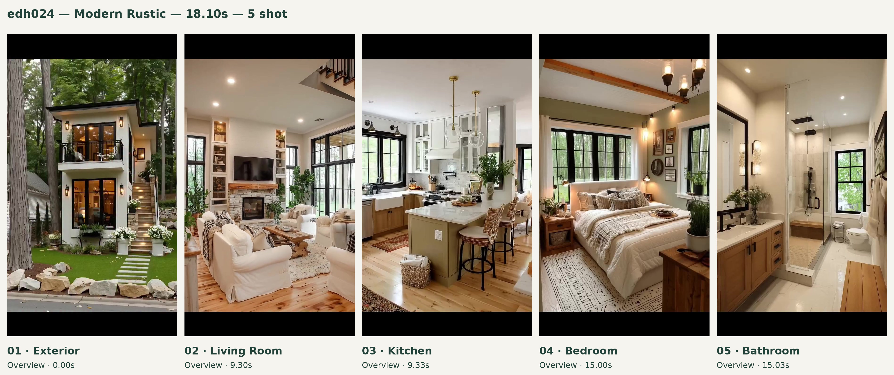
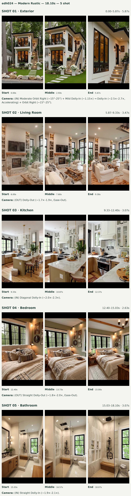
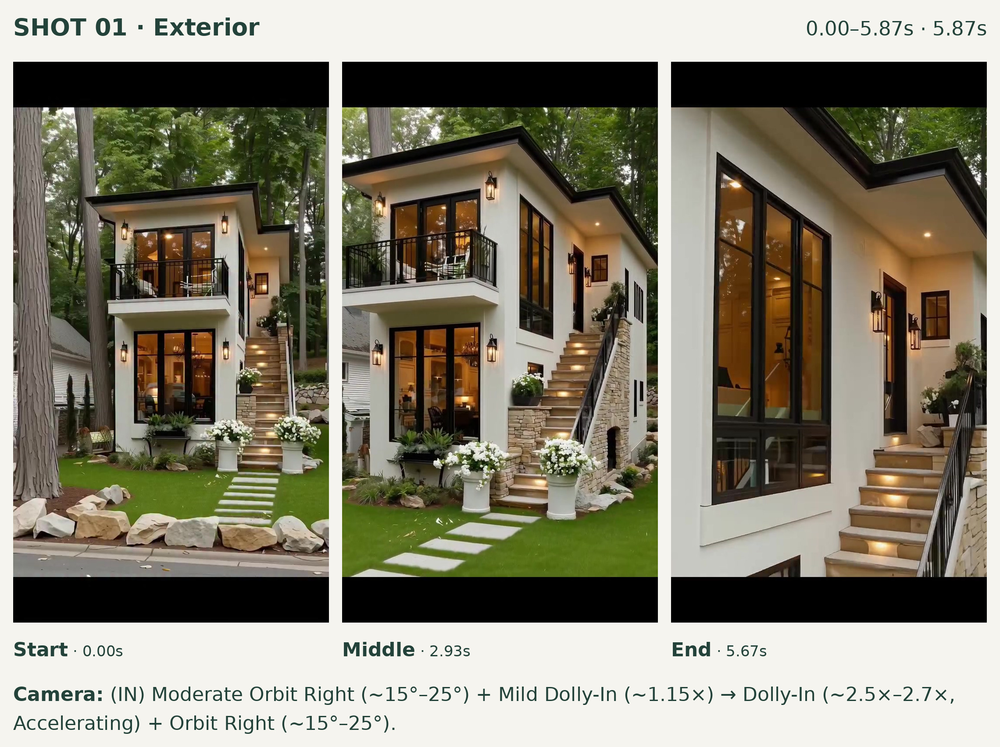
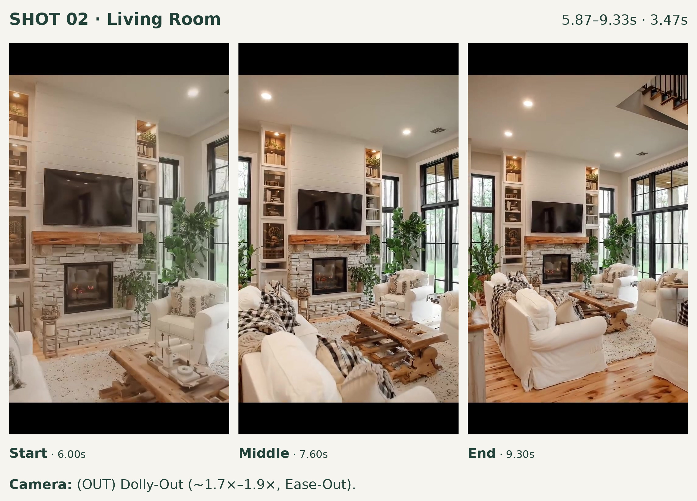
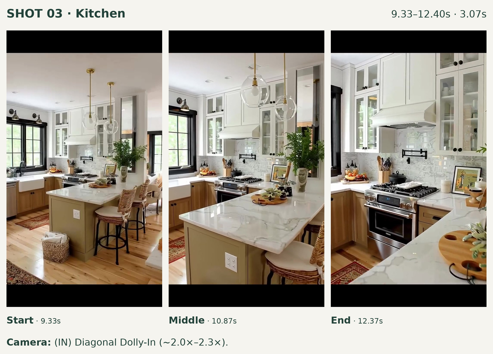
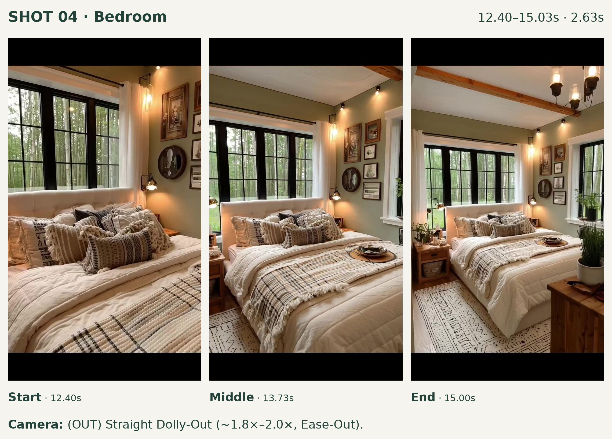
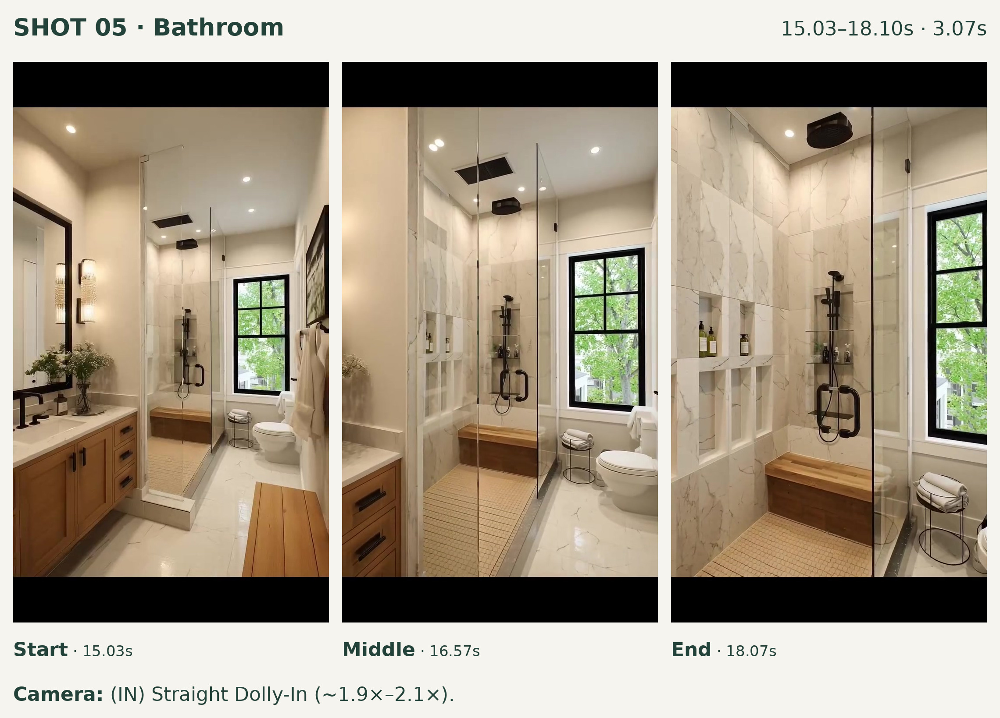

# edh024 — Rumah Dua Tingkat Modern Rustic dengan Aksen Kayu dan Kaca Hitam

## 1. Profil desain

- **Nama desain:** Rumah Dua Tingkat Modern Rustic dengan Aksen Kayu dan Kaca Hitam
- **Tipe rumah:** Detached House
- **Gaya utama:** **Modern Rustic**
- **Pengaruh gaya:** Modern Cottage
- **Gaya interior:** Modern Farmhouse; Warm Transitional
- **Susunan ruang utama:** Ruang keluarga, dapur, kamar tidur, kamar mandi tampil terpisah oleh cut; denah dan konektivitas tidak terbukti.
- **Ciri khas:** Tangga luar bercahaya, balkon kaca/railing gelap, perapian batu dan jendela hitam berulang.
- **Material utama:** Permukaan putih, batu bertekstur, kayu bernada madu, bingkai hitam; bahan fisik tidak teruji.
- **Pencahayaan:** Cahaya alami dari bukaan besar, lampu hangat pada fasad, rak, dan kamar tidur serta downlight interior.
- **Atmosfer:** Hangat, tenang, kontras cahaya alami dan aksen kayu.
- **Lingkungan:** Rumput, jalur batu pijak, pepohonan tinggi dan pemandangan hijau dari jendela.

### Palet warna

| Peran | Warna | HEX |
| --- | --- | --- |
| Dominan | Putih gading | `#E5DFD2` |
| Pendamping | Krem hangat | `#CFC2AD` |
| Pendamping | Kayu madu | `#A67B50` |
| Aksen | Hitam arang | `#252522` |
| Aksen | Hijau zaitun | `#777A5F` |
| Pendamping | Taupe batu | `#A99D8C` |

## 2. Ukuran & proporsi

| Aspek | Estimasi visual |
| --- | --- |
| **Ukuran rumah** | medium |
| **Bentuk bangunan** | Massa dua tingkat bertumpuk dengan balkon depan dan tangga luar di kanan. |
| **Lantai & bentuk atap** | Dua tingkat tampak pada fasad; railing atas terlihat di ruang keluarga. · Atap landai dengan overhang dan lis gelap, bentuk penuh tidak terlihat. |
| **Tapak bangunan** | Massa kompak, relatif sempit dengan kedalaman ke belakang. |
| **Proporsi utama** | Vertikal dua tingkat, bukaan tinggi dan balkon menonjol. |
| **Perkiraan luas lantai** | **90–150 m²** |

## 3. Shot Timeline

Durasi 18.10s · 5 shot.

**Camera Pattern:** IN – OUT – IN – OUT – IN.

| Shot | Time (s) | Duration | Area/Scene | Camera Movement |
| --- | --- | --- | --- | --- |
| 01 | 0.00–5.87 | 5.87s | Exterior | Moderate Orbit Right (~15°–25°) + Mild Dolly-In (~1.15×) → Dolly-In (~2.5×–2.7×, Accelerating) + Orbit Right (~15°–25°). |
| 02 | 5.87–9.33 | 3.47s | Living Room | Dolly-Out (~1.7×–1.9×, Ease-Out). |
| 03 | 9.33–12.40 | 3.07s | Kitchen | Diagonal Dolly-In (~2.0×–2.3×). |
| 04 | 12.40–15.03 | 2.63s | Bedroom | Straight Dolly-Out (~1.8×–2.0×, Ease-Out). |
| 05 | 15.03–18.10 | 3.07s | Bathroom | Straight Dolly-In (~1.9×–2.1×). |

## 4. Overview

**Shot 01 · Exterior · 0.00s**

> Dari halaman depan dekat tepi jalur, kamera melihat serong ringan ke fasad dua tingkat; balkon, tangga kanan, rumput, batu dan pepohonan masuk bingkai.

**Shot 02 · Living Room · 9.30s**

> Dari belakang area duduk kamera menghadap perapian/TV; sofa, meja kayu, rak, jendela tinggi dan bagian railing atas terlihat dalam wide.

**Shot 03 · Kitchen · 9.33s**

> Dari sisi luar area kerja menghadap serong ke island dan kabinet kompor; jendela kiri, dua bangku, pendant dan lantai kayu terlihat.

**Shot 04 · Bedroom · 15.00s**

> Dari kaki ranjang menghadap ke kepala ranjang dan jendela hitam di belakang; wide akhir menampilkan dua sisi ranjang, karpet, balok plafon dan kabinet foreground.

**Shot 05 · Bathroom · 15.03s**

> Dari pintu/area depan menghadap shower di belakang; vanity kiri, kaca shower, toilet kanan dan jendela terlihat dalam wide vertikal.

## 5. Storyboard

## 6. Shot Details

### Shot 01 · Exterior

**Time:** 0.00–5.87s · **Duration:** 5.87s

#### **A. Desain area**

**Arsitektur**

> Massa dua tingkat berwarna gading dengan atap landai berlis hitam dan overhang, balkon depan ber-railing hitam, jendela tinggi berbingkai hitam dan tangga luar di kanan menuju pintu atas. Dinding sisi tangga bertekstur batu.

**Furnitur & dekorasi**

> Pot putih berbunga di kaki tangga, tanaman di balkon, lampu dinding hangat mengapit bukaan.

**Lingkungan**

> Rumput hijau dengan batu pijak persegi menuju tangga, batu alam di tepi halaman serta pohon tinggi di sekitar rumah.

#### **B. Framing & Lighting**

- **Fokus:** Fasad lalu pintu atas
- **Camera Start:** Di tepi halaman depan · Menghadap fasad dan sisi kanan · oblique · Setinggi mata, perkiraan · Hampir datar
- **Framing:** Wide vertikal menampilkan rumah dan halaman → Close pada tangga kanan dan jendela samping sebelum kabut
- **Lighting:** Cahaya alami teduh dan lampu fasad hangat
- **Foreground dan kedalaman:** Batu tepi rumput dan pohon · Jalur, fasad, pepohonan membentuk lapisan
- **Reveal:** Sisi tangga semakin terbuka
- **Kesesuaian gerak:** Orbit kanan membuka sisi; dolly-in menuju pintu.

#### **C. Camera Movement**

Kamera mulai dari depan rumah, melengkung ke kanan sambil mendekat ringan; pendekatan semakin dominan menuju tangga sisi kanan. Akhir tertutup kabut transisi.

**Tempo:** Awal relatif tenang; pembesaran dan sapuan relatif meningkat jelas sekitar F60–170, terutama akhir. Tempo keseluruhan moderate dengan bagian akhir lebih cepat; perubahan proyeksi dapat ikut memperkuat kesan akselerasi.

**Movement Timeline**

| Time (s) | Area & fokus | Camera Movement | Tempo |
| --- | --- | --- | --- |
| 0.00–2.00 | Exterior · Fasad depan dan sisi tangga | Moderate Orbit Right (~15°–25°) + Mild Dolly-In (~1.15×) | Awal relatif tenang; pembesaran dan sapuan relatif meningkat jelas sekitar F60–170, terutama akhir. Tempo keseluruhan moderate dengan bagian akhir lebih cepat; perubahan proyeksi dapat ikut memperkuat kesan akselerasi. |
| 2.00–5.87 | Exterior · Tangga samping dan pintu masuk | Dolly-In (~2.5×–2.7×, Accelerating) + Orbit Right (~15°–25°) | Awal relatif tenang; pembesaran dan sapuan relatif meningkat jelas sekitar F60–170, terutama akhir. Tempo keseluruhan moderate dengan bagian akhir lebih cepat; perubahan proyeksi dapat ikut memperkuat kesan akselerasi. |

**Camera:** Moderate Orbit Right (~15°–25°) + Mild Dolly-In (~1.15×) → Dolly-In (~2.5×–2.7×, Accelerating) + Orbit Right (~15°–25°).

---

### Shot 02 · Living Room

**Time:** 5.87–9.33s · **Duration:** 3.47s

#### **A. Desain area**

**Arsitektur**

> Dinding perapian batu terang dengan mantel kayu dan TV di tengah, rak vertikal kiri-kanan; bukaan kaca tinggi berbingkai hitam di kanan, railing atas terlihat pada akhir. Lantai tampak papan kayu.

**Furnitur & dekorasi**

> Sofa dan kursi berlapis putih mengarah ke meja kopi kayu rendah dan perapian; karpet krem, bantal pola, tanaman tinggi, rak berisi dekorasi.

**Lingkungan**

> Cahaya dari bukaan kanan; lanskap hijau tampak melalui kaca, detail luar terbatas.

#### **B. Framing & Lighting**

- **Fokus:** Perapian dan TV
- **Camera Start:** Dekat area duduk · Menghadap perapian dan TV · frontal · Setinggi mata, perkiraan · Hampir datar
- **Production Start:** F180 · 6.00s · Pandangan interior dari depan area duduk mengarah ke TV dan perapian, framing medium-wide vertikal; rak dan jendela kanan terlihat, meja serta kursi menjadi foreground. Kabut transisi sudah cukup hilang untuk acuan produksi, dengan sedikit sisa perbedaan kontras terhadap F181.
- **Framing:** Awal tertutup kabut; komposisi TV dan perapian → Wide sofa, meja, perapian dan bukaan tinggi
- **Lighting:** Cahaya alami kanan dan rak bercahaya
- **Foreground dan kedalaman:** Meja, kursi dan sofa · Meja di depan perapian, jendela di samping
- **Reveal:** Area duduk dan railing atas terbuka
- **Kesesuaian gerak:** Dolly-out memperluas cakupan ruang.

#### **C. Camera Movement**

Mulai tertutup kabut lalu mundur membuka ruang duduk, sofa, lantai, jendela dan sedikit railing atas.

**Tempo:** Mundur stabil pada awal dan tengah bersih, mereda menjelang F279; efek kabut awal bukan akselerasi kamera.

**Camera:** Dolly-Out (~1.7×–1.9×, Ease-Out).

---

### Shot 03 · Kitchen

**Time:** 9.33–12.40s · **Duration:** 3.07s

#### **A. Desain area**

**Arsitektur**

> Kabinet bawah tampak kayu dan kabinet atas putih termasuk pintu kaca, kompor dengan hood di dinding belakang, jendela hitam di sisi kiri. Island ber-countertop putih bermotif urat dan dasar zaitun/taupe.

**Furnitur & dekorasi**

> Dua bangku anyaman dengan kaki gelap pada sisi island; lampu gantung kaca bening, tray kayu dan tanaman. Kompor/range dan hood putih terpusat di kabinet belakang.

**Lingkungan**

> Bukaan kiri memberi cahaya alami dan pandangan hijau terbatas; pendant dan downlight mendukung pencahayaan kerja.

#### **B. Framing & Lighting**

- **Fokus:** Kompor dan hood
- **Camera Start:** Sisi luar island · Serong ke kompor dan kabinet · oblique · Setinggi mata, perkiraan · Sedikit melihat permukaan meja
- **Framing:** Wide island, bangku dan kabinet → Medium-close range dan countertop
- **Lighting:** Cahaya jendela kiri dan lampu gantung
- **Foreground dan kedalaman:** Island dan tray · Island di depan kabinet belakang
- **Reveal:** Detail kompor dan kabinet membesar
- **Kesesuaian gerak:** Diagonal dolly-in melewati sisi island.

#### **C. Camera Movement**

Kamera mendekati area memasak melalui sisi kiri island; kompor dan hood menjadi pusat framing, sementara island dan stool keluar ke kanan/bawah.

**Tempo:** Perubahan skala makin cepat pada bagian akhir; sebagian dapat muncul dari kedekatan perspektif sehingga akselerasi badan tidak dipastikan.

**Camera:** Diagonal Dolly-In (~2.0×–2.3×).

---

### Shot 04 · Bedroom

**Time:** 12.40–15.03s · **Duration:** 2.63s

#### **A. Desain area**

**Arsitektur**

> Jendela lebar berbingkai hitam di belakang kepala ranjang, jendela sisi kanan, dinding zaitun dengan susunan artwork, plafon putih dengan balok kayu terlihat pada akhir.

**Furnitur & dekorasi**

> Ranjang besar dengan headboard berlapis, seprai krem dan selimut kotak, bantal dekoratif, meja samping kayu, lampu dinding, chandelier dan kabinet rendah foreground.

**Lingkungan**

> Pepohonan terlihat lewat jendela belakang; cahaya alami lembut berpadu lampu dinding hangat.

#### **B. Framing & Lighting**

- **Fokus:** Ranjang
- **Camera Start:** Dekat kaki ranjang · Menghadap kepala ranjang dan jendela · oblique · Setinggi mata, perkiraan · Sedikit menunduk ke kasur
- **Framing:** Medium dekat bantal dan ranjang → Wide ranjang, karpet, balok, kabinet
- **Lighting:** Cahaya alami dan lampu dinding hangat
- **Foreground dan kedalaman:** Selimut dan bagian kaki ranjang · Ranjang di depan jendela, kabinet di depan
- **Reveal:** Lantai dan plafon terbuka
- **Kesesuaian gerak:** Dolly-out membuka volume kamar.

#### **C. Camera Movement**

Kamera mundur dari detail bantal dan selimut menjadi tampilan bed, jendela, ceiling beam dan kabinet depan yang lebih luas.

**Tempo:** Perubahan framing hampir dua kali dalam 2.63 detik; laju visual paling terasa di tengah, kemudian mereda mendekati akhir.

**Camera:** Straight Dolly-Out (~1.8×–2.0×, Ease-Out).

---

### Shot 05 · Bathroom

**Time:** 15.03–18.10s · **Duration:** 3.07s

#### **A. Desain area**

**Arsitektur**

> Walk-in shower berpembatas kaca bening, dinding putih bermotif urat, ceruk vertikal, lantai shower berpola papan dan bangku kayu di belakang. Jendela hitam di kanan, ambang shower rendah.

**Furnitur & dekorasi**

> Vanity kayu dengan countertop terang dan cermin hitam di kiri, toilet putih di kanan, shower hitam dengan rain head, hand shower, serta bangku kayu dan stool kecil.

**Lingkungan**

> Cahaya alami dari jendela dengan vegetasi terlihat, lampu vanity dan downlight memberi pencahayaan merata.

#### **B. Framing & Lighting**

- **Fokus:** Perangkat shower
- **Camera Start:** Dekat pintu/vanity · Menghadap walk-in shower · frontal · Setinggi mata, perkiraan · Hampir datar
- **Framing:** Wide vanity, shower, toilet dan jendela → Medium-close shower dan bangku
- **Lighting:** Cahaya jendela dan downlight
- **Foreground dan kedalaman:** Vanity kiri dan ambang · Kaca membagi lapis depan dan shower belakang
- **Reveal:** Detail shower, ceruk, bangku membesar
- **Kesesuaian gerak:** Dolly-in menuju shower.

#### **C. Camera Movement**

Kamera maju dari pintu/area vanity menuju shower, kaca dan bench; vanity keluar ke kiri dan jendela kanan terpotong di akhir.

**Tempo:** Pendekatan halus konsisten, sedikit peningkatan skala visual menuju akhir; percepatan fisik tidak terisolasi dari perspektif.

**Camera:** Straight Dolly-In (~1.9×–2.1×).
