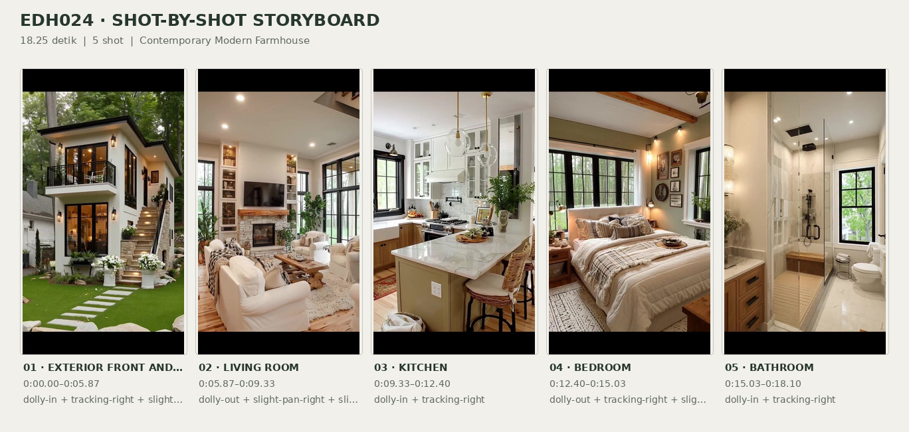
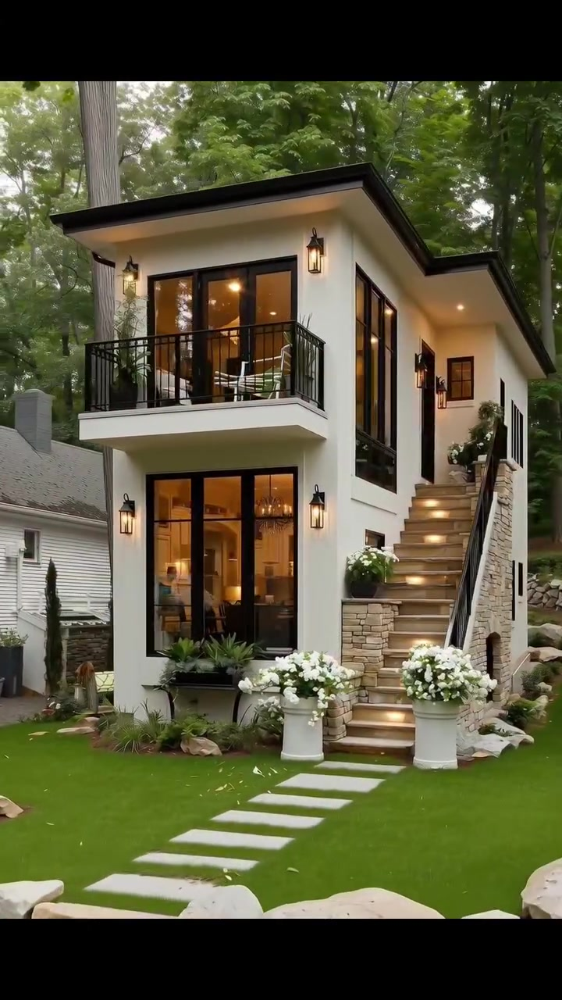
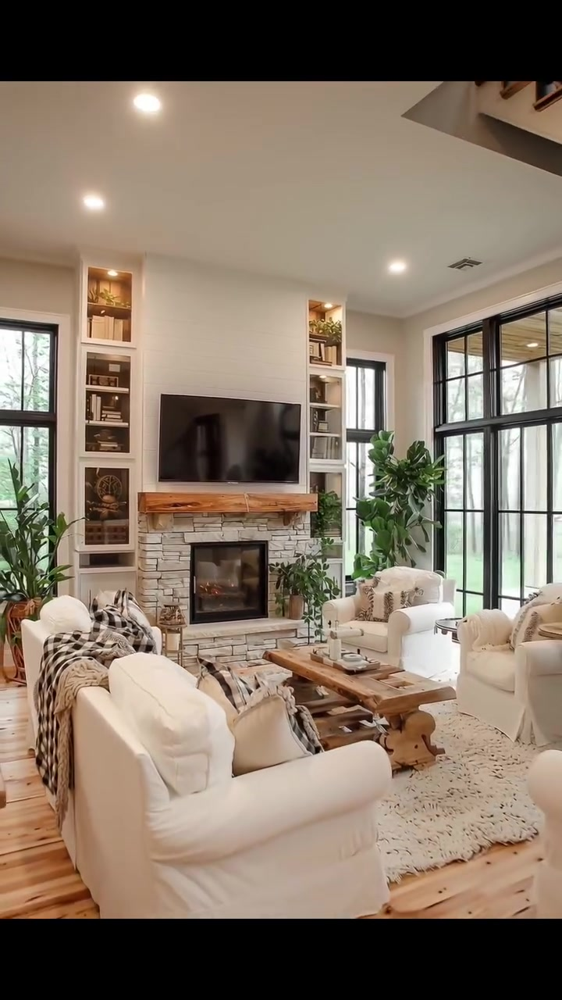
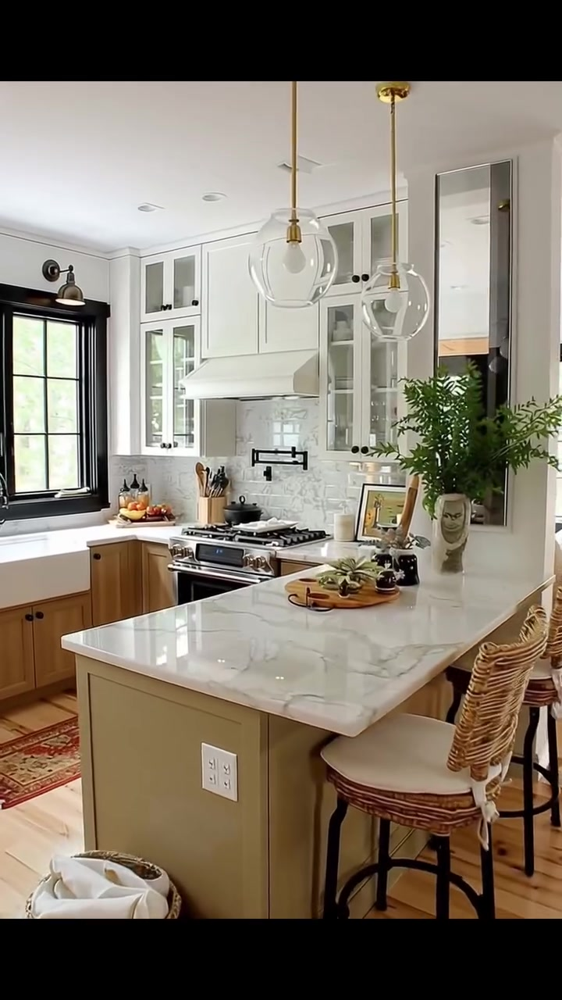
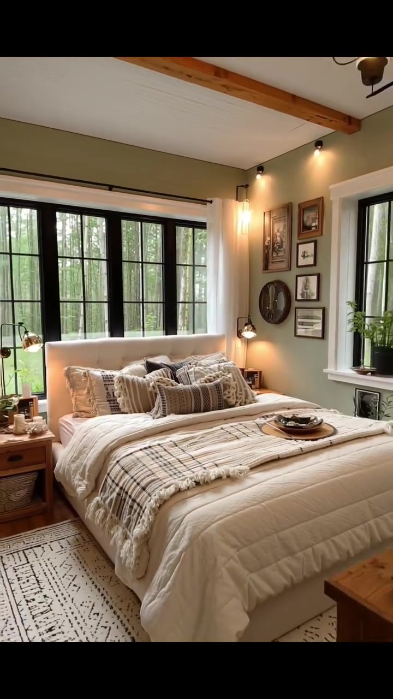
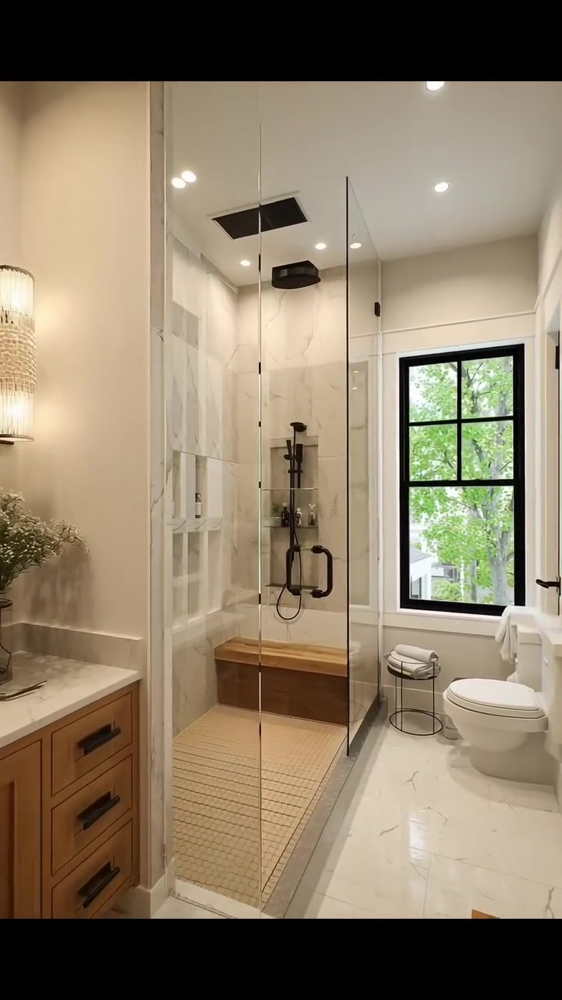

# edh024 — Contemporary Modern Farmhouse

<!-- homeku_request_id: edh024-20261104-owner-approved -->

<!-- homeku_detail_narratives: chat-reviewed -->

**Sumber data:** [analysis.yaml](analysis.yaml) · **Status:** draft · **Diverifikasi manusia:** Tidak

## 1. Informasi Video

| Informasi | Nilai |
|---|---|
| ID | edh024 |
| File asli | edh024.mp4 |
| Durasi | 18.25 |
| Resolusi | 720x1280 |
| FPS | 30 |
| Rasio | 9:16 |
| Jumlah shot | 5 |

## 2. Storyboard Gabungan

## 3. Identitas Desain

| Aspek | Hasil analisis |
|---|---|
| Gaya utama | contemporary modern farmhouse |
| Wilayah terkait gaya desain | north america |
| Pengaruh gaya | contemporary cottage, rustic modern interior |
| Ciri eksterior | off white smooth wall finish, dark low slope roof edges with wide overhangs, black grid framed tall glazing, projecting upper balcony with black metal railing, exterior stairway to upper recessed entrance, stone appearance clad stair base, warm lantern sconces and stair lights |
| Gaya interior | modern farmhouse, warm rustic neutral decor, black metal accents |
| Confidence gaya | medium |

## 4. Ukuran & Proporsi Bangunan

| Aspek | Estimasi visual |
|---|---|
| Ukuran yang terlihat | medium |
| Bentuk bangunan | narrow elongated |
| Skala vertikal | two level appearance |
| Tapak bangunan | compact |
| Perkiraan luas lantai | 75–130 m² |
| Confidence | low |

> Luas adalah perkiraan visual, bukan ukuran terukur.

## 5. Warna, Pencahayaan, dan Atmosfer

| Warna dominan | HEX (perkiraan) |
|---|---|
| warm white | #F2F0E9 |
| matte charcoal black | #252522 |
| natural honey wood | #B58A5F |
| muted sage olive | #9B9B83 |
| cream beige | #E5D8C7 |
| gray beige stone | #CBC3B5 |

| Aspek | Hasil analisis |
|---|---|
| Pencahayaan | soft outdoor daylight, warm exterior lantern lighting, warm interior recessed lights, natural light through large windows |
| Lingkungan | wooded residential setting, green lawn and ornamental planting, neighboring light siding house visible left, stone retaining wall visible right |
| Musim yang tampak | green leafy season appearance |
| Mood | warm, cozy, calm, nature connected |

## 6. Struktur dan Timeline Video

**Jenis:** architectural home tour · **Tempo:** moderate · **Transisi:** hard cuts between five scenes

| Shot | Waktu (detik) | Durasi | Area/Scene | Gerakan Kamera |
|---|---|---|---|---|
| Shot 01 | 0.0–5.867 | 5.87 | exterior front and stairway | dolly in, tracking right, slight tilt up |
| Shot 02 | 5.867–9.333 | 3.47 | living room | dolly out, slight pan right, slight tilt up |
| Shot 03 | 9.333–12.4 | 3.07 | kitchen | dolly in, tracking right |
| Shot 04 | 12.4–15.033 | 2.63 | bedroom | dolly out, tracking right, slight tilt up |
| Shot 05 | 15.033–18.1 | 3.07 | bathroom | dolly in, tracking right |

## 7. Analisis per Shot

### Shot 01 — exterior front and stairway

**Waktu:** 0.0–5.867 detik

| Komponen | Pengamatan |
|---|---|
| Fokus utama | white two level house with balcony and external staircase |
| Framing awal → akhir | wide frontal three quarter exterior view → close up right side stairway and entry |
| Sudut pandang | eye level slight upward angle |
| Gerakan kamera | dolly in, tracking right, slight tilt up |
| Kecepatan kamera | slow |
| Pencahayaan | soft daylight with warm exterior accent lights |
| Transisi keluar | hard cut to living room |

**Detail yang terlihat**

**Arsitektur**

Bangunan dua tingkat berwarna putih gading tampak memiliki massa yang ramping, dinding luar berfinishing halus, tepi atap berwarna gelap dengan kemiringan rendah, serta teritisan yang lebar. Bukaan kaca tinggi berbingkai hitam terdapat pada tingkat bawah dan atas sisi kiri, dengan balkon menjorok ke depan berpagar besi hitam vertikal. Di samping tangga kanan terdapat jendela tinggi bersekat hitam, sementara beberapa jendela lebih sempit terlihat pada dinding samping kanan. Tangga luar di sisi kanan naik menuju pintu masuk gelap yang agak masuk ke dalam di bawah naungan atap. Anak tangganya berpenampilan kayu dengan lampu hangat terintegrasi, dan tepi luarnya menggunakan pegangan besi hitam. Bagian penopang tangga dan dinding planter berpenampilan susunan batu krem; ada pula ceruk lengkung kecil di bagian penopang. Lampu dinding berbentuk lentera hitam mengapit beberapa bukaan dan pintu masuk, serta sebuah lampu tanam plafon menerangi bordes atas.

**Furnitur dan properti**

Di balkon atas terlihat kursi luar ruang berwarna terang, meja bundar kecil di antaranya, dan tanaman dalam pot gelap di tepi balkon. Pada kaki tangga berdiri dua pot tinggi putih berisi bunga putih; pot bunga putih lain tampak di area tangga dan bordes. Sebuah kotak tanaman gelap berisi tanaman hijau memanjang di bawah jendela lantai bawah, sementara kursi\-kursi kecil berpenampilan kayu berada di area samping kiri rumah.

**Lingkungan**

Batang\-batang pohon yang sangat tinggi membingkai bangunan, dengan kanopi daun hijau rapat di belakang atap. Bagian depan berupa rumput hijau yang rapi, dipotong oleh jalur pijakan batu terang berbentuk persegi panjang menuju tangga. Batu\-batu besar tidak beraturan berwarna krem berjajar pada tepi depan halaman, dan tanaman hias rendah serta rumpun rumput tumbuh di sekitar kaki bangunan. Di kiri terlihat bangunan tetangga berdinding panel terang, sedangkan di sisi kanan tampak dinding penahan tanah dari susunan batu pada permukaan lahan yang lebih tinggi.

**Catatan pengamatan:** Kamera bergerak mendekat dan ke kanan; material dinding, batu, dan anak tangga dinilai berdasarkan penampakan, bukan pengujian bahan.

**Confidence:** Kamera medium · Detail visual high

### Shot 02 — living room

**Waktu:** 5.867–9.333 detik

| Komponen | Pengamatan |
|---|---|
| Fokus utama | living room fireplace wall with tv and white seating |
| Framing awal → akhir | medium view centered on fireplace wall → wide view including sofa chairs windows and partial upper railing |
| Sudut pandang | eye level interior |
| Gerakan kamera | dolly out, slight pan right, slight tilt up |
| Kecepatan kamera | slow |
| Pencahayaan | daylight from large windows mixed with warm shelf and ceiling lights |
| Transisi keluar | hard cut to kitchen |

**Detail yang terlihat**

**Arsitektur**

Ruang keluarga berpusat pada dinding perapian berlapis panel horizontal putih dengan sekeliling tungku berpenampilan batu susun abu\-krem, kotak api hitam berkaca dengan nyala terlihat, serta mantel kayu tebal di atasnya. Rak pajang built\-in putih mengapit perapian di kedua sisi dan memiliki titik lampu hangat pada beberapa kompartemen atas. Jendela tinggi bersekat hitam berada di dekat area perapian, sementara bukaan kaca bersekat hitam yang lebih lebar mengisi dinding kanan. Lantai berupa papan berpenampilan kayu terang; dinding dicat krem muda, plafon rata berwarna putih dengan lampu tanam. Di akhir shot terlihat sebagian railing hitam pada area lantai atau tangga di pojok kanan atas.

**Furnitur dan properti**

Televisi layar datar hitam berukuran besar terpasang di atas mantel. Sofa besar berlapis kain putih berada di kiri depan dengan selimut motif kotak hitam\-krem, sedangkan dua kursi berlengan putih berada di sisi kanan meja kopi. Meja kopi tengah dibuat dari papan kayu tebal berkesan rustic, berdiri di atas karpet krem bercorak gelap halus. Bantal bertekstur dan selimut rajut krem tersebar pada tempat duduk. Buku, dekorasi kecil, dan tanaman menghiasi rak; tanaman berdaun lebar yang tinggi berada di sisi kaca kanan, dengan beberapa pot hijau lebih kecil dekat perapian dan jendela kiri. Di atas meja kopi ada nampan dengan benda\-benda dekoratif kecil. Meja samping bundar terlihat di dekat salah satu kursi kanan, dan dekorasi berbentuk lentera berdiri di kiri perapian.

**Lingkungan**

Melalui jendela\-jendela bersekat hitam terlihat pepohonan berdaun hijau serta permukaan tanah hijau di luar.

**Catatan pengamatan:** Kamera melebar ke kanan, memperlihatkan lebih banyak tempat duduk dan sedikit railing pada bagian atas bingkai.

**Confidence:** Kamera medium · Detail visual high

### Shot 03 — kitchen

**Waktu:** 9.333–12.4 detik

| Komponen | Pengamatan |
|---|---|
| Fokus utama | white and wood kitchen with veined island and stainless range |
| Framing awal → akhir | wide view of island sink and cooking wall → medium close view of range cabinets and island counter |
| Sudut pandang | eye level slight downward angle at counter |
| Gerakan kamera | dolly in, tracking right |
| Kecepatan kamera | slow |
| Pencahayaan | bright window daylight and ceiling lights |
| Transisi keluar | hard cut to bedroom |

**Detail yang terlihat**

**Arsitektur**

Dapur memakai kabinet atas putih bergaya shaker yang hampir mencapai plafon, termasuk beberapa pintu kabinet berkaca dengan knop gelap. Kabinet bawah berpenampilan kayu terang, sementara sisi island berwarna hijau\-abu zaitun redup dengan stopkontak putih. Bidang meja island tampak seperti batu putih berurat abu\-abu; backsplash berupa ubin putih bermotif marmer abu muda. Tudung kompor putih besar berada di atas area memasak, dengan pipa pengisi panci hitam terpasang pada dinding backsplash. Bak cuci tipe apron\-front putih terletak di bawah jendela kiri. Jendela\-jendela bersekat hitam tampak pada sisi kiri dan kanan; lantai berpenampilan papan kayu warna madu. Dua lampu gantung berbentuk bola kaca bening dengan batang berwarna kuningan menggantung di atas island, dan lampu tanam tersebar pada plafon putih.

**Furnitur dan properti**

Dua kursi tinggi di sisi island memiliki sandaran anyaman cokelat dan dudukan krem. Di bawah tudung kompor terdapat kompor gas multi\-tungku dan oven berfinishing logam; keran melengkung hitam terpasang di bak cuci. Di atas island ada talenan saji bundar kayu dengan sukulen kecil, serta rangkaian daun hijau tinggi dalam vas dekoratif pada sisi kanan. Buah\-buahan dan botol kaca tersusun di meja belakang kiri, sendok\-spatula kayu berada dalam wadah dekat kompor, dan panci kecil gelap bertutup ada di atas kompor. Cetakan gambar berbingkai bersandar di permukaan meja kanan. Keranjang anyaman berada di lantai dekat ujung island, karpet berpola merah karat di area bak cuci, dan lampu dinding logam gelap terpasang di atas jendela kiri.

**Lingkungan**

Dedaunan hijau tampak samar melalui jendela dapur.

**Catatan pengamatan:** Penampakan permukaan meja menyerupai batu bermotif marmer; jenis batu sebenarnya tidak dapat diverifikasi.

**Confidence:** Kamera medium · Detail visual high

### Shot 04 — bedroom

**Waktu:** 12.4–15.033 detik

| Komponen | Pengamatan |
|---|---|
| Fokus utama | cream upholstered bed beneath large black grid window |
| Framing awal → akhir | close view of bedding and window → wide view of full bed ceiling beam bedside tables and right window |
| Sudut pandang | eye level interior |
| Gerakan kamera | dolly out, tracking right, slight tilt up |
| Kecepatan kamera | slow |
| Pencahayaan | daylight from black framed windows with warm bedside and ceiling lamps |
| Transisi keluar | hard cut to bathroom |

**Detail yang terlihat**

**Arsitektur**

Di sisi kanan tempat tidur terdapat dinding aksen berwarna hijau zaitun sage. Jendela besar bersekat hitam membentang tepat di belakang kepala tempat tidur, dengan jendela hitam lain yang lebih sempit pada dinding kanan. Tirai putih panjang tergantung pada batang gelap. Plafon tampak berpanel putih dengan balok berpenampilan kayu terekspos; trim jendela putih dan permukaan dinding lain bernuansa terang. Lampu dinding hangat dan lampu sorot kecil pada bagian atas dinding menerangi ruangan, sedangkan lantainya berpenampilan papan kayu pucat.

**Furnitur dan properti**

Tempat tidur besar memakai headboard berlapis kain krem, duvet tebal putih\-krem, serta banyak bantal bertumpuk dengan tekstur dan motif krem, beige, dan hitam. Selimut kotak krem\-hitam berumbai melintang di bagian kaki kasur. Meja samping berpenampilan kayu alami ada di kedua sisi, disertai lampu baca logam gelap yang dapat diarahkan. Dinding aksen kanan dihiasi komposisi gambar berbingkai dalam berbagai ukuran bersama cermin bundar berbingkai gelap. Karpet berpola putih\-krem berada di bawah kasur; di depan kanan terdapat kabinet kayu kecil dengan tanaman berdaun ramping dalam pot. Sebuah lampu gantung dengan beberapa kap kaca tampak pada sudut atas kanan, dan nampan bundar gelap berisi benda kecil diletakkan di atas kasur.

**Lingkungan**

Batang\-batang pohon tinggi dan daun hijau terlihat melalui jendela di belakang headboard; pemandangan vegetasi berhutan juga muncul melalui jendela samping kanan.

**Catatan pengamatan:** Kamar diperlihatkan dari detail tekstil hingga komposisi penuh; jenis material headboard dan balok adalah penampakan visual.

**Confidence:** Kamera medium · Detail visual high

### Shot 05 — bathroom

**Waktu:** 15.033–18.1 detik

| Komponen | Pengamatan |
|---|---|
| Fokus utama | glass enclosed marble appearance shower with wood bench |
| Framing awal → akhir | wide view of vanity shower toilet and window → medium close view of shower wall fixtures and window |
| Sudut pandang | eye level interior |
| Gerakan kamera | dolly in, tracking right |
| Kecepatan kamera | slow |
| Pencahayaan | daylight from right window and warm interior spotlights |
| Transisi keluar | end of video |

**Detail yang terlihat**

**Arsitektur**

Kamar mandi berdinding krem\-beige dan berplafon putih menempatkan shower walk\-in berdinding kaca bening di bagian tengah kiri, dengan pegangan pintu hitam. Dinding shower memakai ubin besar putih berurat abu\-abu menyerupai marmer, sedangkan lantai area basah berubin mosaik kotak kecil beige. Beberapa ceruk persegi panjang tertanam pada dinding kiri dan rak ceruk lain berada di belakang perlengkapan mandi. Kepala shower hujan besar berwarna hitam terpasang di atas; shower genggam dan kontrolnya juga berfinishing hitam. Bangku built\-in berpenampilan kayu berada di bagian belakang shower. Sebuah jendela bersekat hitam terpasang di kanan shower; lantai utama menggunakan ubin besar putih berurat abu. Kabinet vanity di kiri berpenampilan kayu hangat, dengan top meja batu terang dan wastafel putih. Di atasnya terdapat cermin tinggi berbingkai gelap, lampu dinding vertikal bercahaya hangat di sisinya, dan beberapa lampu tanam pada plafon.

**Furnitur dan properti**

Keran wastafel berwarna hitam matte; di atas vanity terdapat vas kaca berisi bunga putih kecil dan dispenser sabun berwarna gelap. Handuk\-handuk putih terlipat rapi pada bangku kawat hitam kecil di samping kloset putih yang terletak di kanan bawah jendela. Handuk putih lain tergantung di dinding kanan, di bawah gambar berbingkai. Pada bagian awal terlihat pula bangku kayu terang di tepi kanan depan. Botol\-botol perlengkapan mandi disimpan di relung rak shower.

**Lingkungan**

Dari jendela kamar mandi tampak daun pohon hijau di luar, dengan sebagian struktur bangunan berwarna terang terlihat lebih rendah di dekat bingkai jendela.

**Catatan pengamatan:** Finishing ubin bermotif marmer dan bangku bermotif kayu dijelaskan sebagai penampakan, bukan kepastian bahan; tidak terlihat bathtub.

**Confidence:** Kamera medium · Detail visual high

## 8. Kualitas dan Ketidakpastian Analisis

| Parameter | Hasil |
|---|---|
| Status | draft |
| Verifikasi manusia | Tidak |
| Ketepatan timestamp | estimated |
| Ketidakpastian | actual building location not known, common region is stylistic association only, total floor area 75 to 130 m2 is low confidence visual estimate, exact wall stone flooring and counter materials unverified, architectural level count and full footprint partially obscured, season not determinable from green foliage alone, camera movements inferred from framing changes, final visible frame ends before container audio duration |

**Catatan:** Lima shot dan rinciannya diamati dari awal hingga akhir. Batas cut terdeteksi sekitar 5,867; 9,333; 12,400; 15,033 detik. Estimasi luas bukan pengukuran dan tidak ada bukti lokasi geografis rumah.

---

*Laporan ini diturunkan dari [analysis.yaml](analysis.yaml).*
