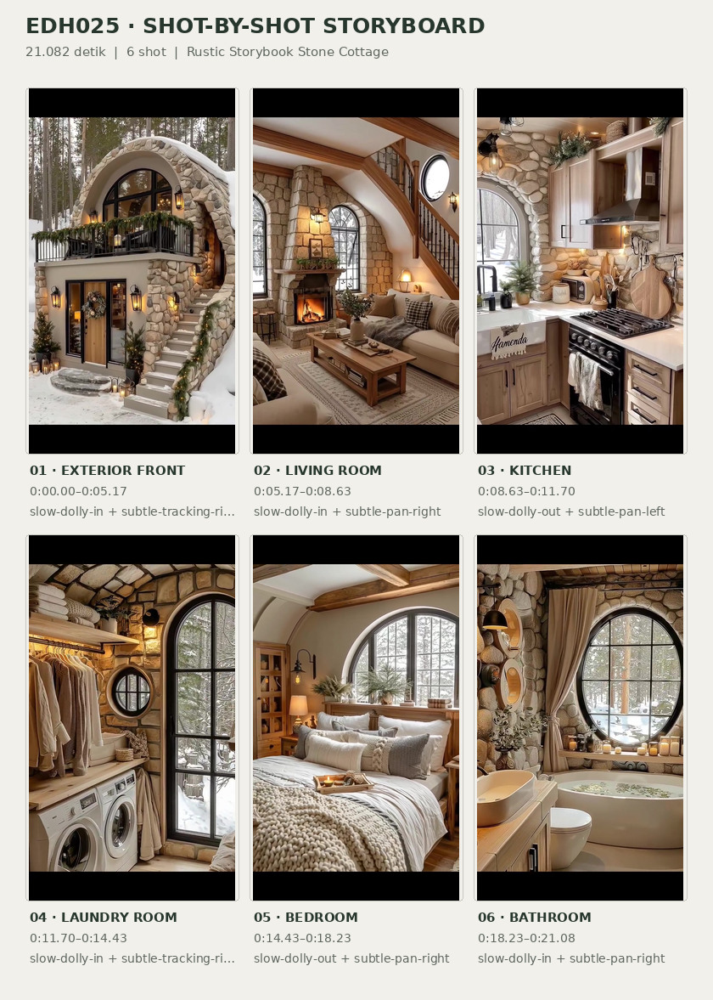
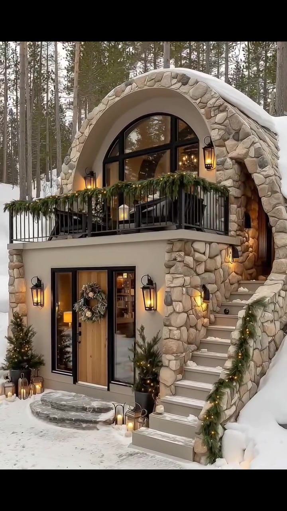
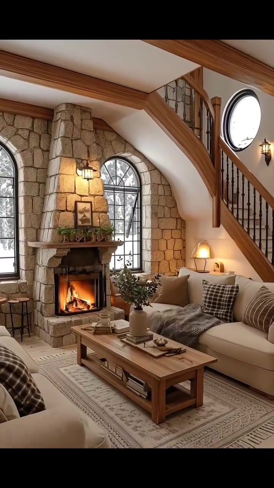
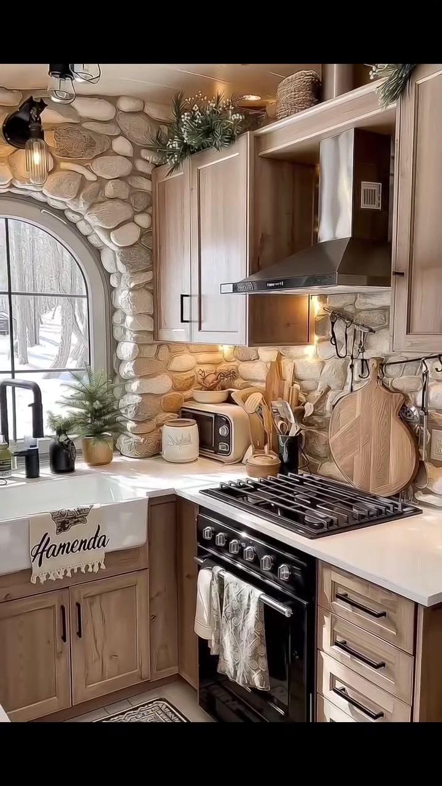
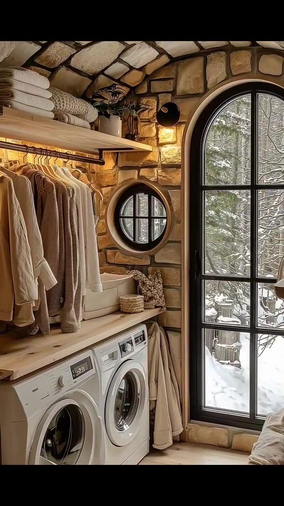
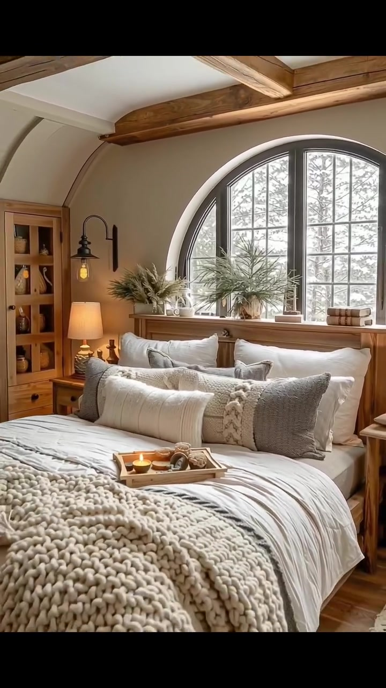
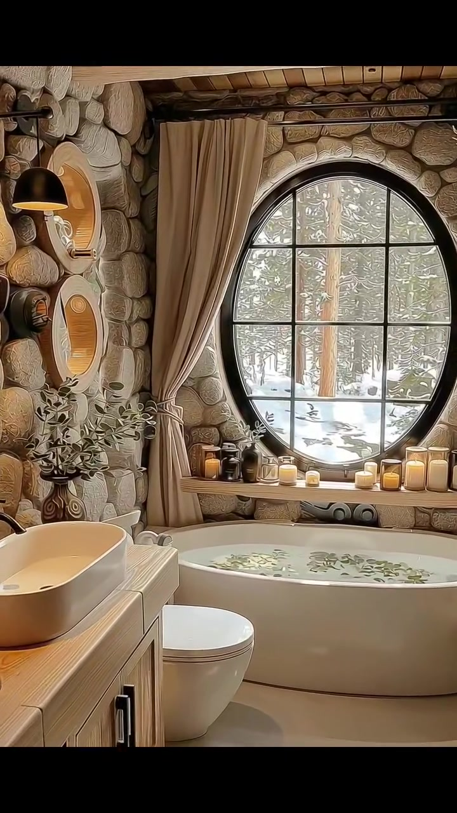

# edh025 — Rustic Storybook Stone Cottage

<!-- homeku_request_id: edh025-20261104-v14 -->

<!-- homeku_detail_narratives: chat-reviewed -->

**Sumber data:** [analysis.yaml](analysis.yaml) · **Status:** draft · **Diverifikasi manusia:** Tidak

## 1. Informasi Video

| Informasi | Nilai |
|---|---|
| ID | edh025 |
| File asli | edh025.mp4 |
| Durasi | 21.082 |
| Resolusi | 720x1280 |
| FPS | 30 |
| Rasio | 9:16 |
| Jumlah shot | 6 |

## 2. Storyboard Gabungan

## 3. Identitas Desain

| Aspek | Hasil analisis |
|---|---|
| Gaya utama | rustic storybook stone cottage |
| Wilayah terkait gaya desain | europe, north america |
| Pengaruh gaya | rustic cabin, storybook architecture, warm scandinavian interior accents |
| Ciri eksterior | curved stone framed roof, black framed arched upper window, small upper balcony with metal railing, light stone cladding and cream rendered wall, exterior stair to upper level, snow on roof and stairs |
| Gaya interior | warm rustic, cozy cottage, natural wood and stone finishes, soft neutral textiles |
| Confidence gaya | medium |

## 4. Ukuran & Proporsi Bangunan

| Aspek | Estimasi visual |
|---|---|
| Ukuran yang terlihat | small |
| Bentuk bangunan | compact two level arched frontage |
| Skala vertikal | two levels apparent |
| Tapak bangunan | compact |
| Perkiraan luas lantai | 60–115 m² |
| Confidence | low |

> Luas adalah perkiraan visual, bukan ukuran terukur.

## 5. Warna, Pencahayaan, dan Atmosfer

| Warna dominan | HEX (perkiraan) |
|---|---|
| warm cream | #E7DCCB |
| light stone beige | #B9A48A |
| natural wood brown | #956F4A |
| charcoal black | #292B29 |
| snow white | #EDF0ED |
| evergreen forest | #3D503D |

| Aspek | Hasil analisis |
|---|---|
| Pencahayaan | diffuse cold daylight, warm amber wall lanterns, warm lamps and fireplace, window light on neutral interiors |
| Lingkungan | snow covered conifer forest, woodland cottage exterior, warm enclosed stone and wood interior |
| Musim yang tampak | snowy winter like |
| Mood | cozy, quiet, rustic, warm interior cold exterior |

## 6. Struktur dan Timeline Video

**Jenis:** architectural home tour · **Tempo:** slow · **Transisi:** straight hard cuts between slow moving shots

| Shot | Waktu (detik) | Durasi | Area/Scene | Gerakan Kamera |
|---|---|---|---|---|
| Shot 01 | 0–5.167 | 5.17 | exterior front | slow dolly in, subtle tracking right |
| Shot 02 | 5.167–8.633 | 3.47 | living room | slow dolly in, subtle pan right |
| Shot 03 | 8.633–11.7 | 3.07 | kitchen | slow dolly out, subtle pan left |
| Shot 04 | 11.7–14.433 | 2.73 | laundry room | slow dolly in, subtle tracking right |
| Shot 05 | 14.433–18.233 | 3.80 | bedroom | slow dolly out, subtle pan right |
| Shot 06 | 18.233–21.082 | 2.85 | bathroom | slow dolly in, subtle pan right |

## 7. Analisis per Shot

### Shot 01 — exterior front

**Waktu:** 0–5.167 detik

| Komponen | Pengamatan |
|---|---|
| Fokus utama | two level stone cottage with arched upper facade |
| Framing awal → akhir | medium wide front three quarter view → closer front three quarter view |
| Sudut pandang | eye level slightly elevated front left |
| Gerakan kamera | slow dolly in, subtle tracking right |
| Kecepatan kamera | slow |
| Pencahayaan | cool diffuse daylight with warm exterior lanterns |
| Transisi keluar | cut |

**Detail yang terlihat**

**Arsitektur**

Rumah tampak kompak dengan dua tingkat dan garis atap depan berbentuk lengkungan tinggi. Batu berwarna krem muda dengan bentuk tak beraturan membingkai lengkungan atas dan sisi kanan bangunan; tepi atap melengkung yang turun ke kanan tertutup salju. Di bagian atas terdapat jendela setengah lingkaran berbingkai hitam serta balkon depan dengan pagar logam gelap. Dinding bawah tampak berplester krem pucat, dengan pintu masuk kayu terang bergaris vertikal dan gagang gelap di tengah, diapit bidang kaca tinggi berbingkai hitam. Sebuah pintu bernuansa kayu di kanan atas dicapai melalui tangga batu berwarna terang di sisi kanan. Penyangga balkon dan sudut kanan memakai susunan batu kasar yang cerah; di depan pintu ada satu pijakan batu abu\-abu tak beraturan. Lentera dinding logam gelap yang menyala terpasang pada fasad bawah dan lengkungan atas, sedangkan rangkaian hijau dengan lampu kecil hangat menghiasi balkon dan sisi tangga.

**Furnitur dan properti**

Tempat duduk luar ruang berwarna gelap tampak di balik pagar balkon atas, dengan pot\-pot berdaun hijau di sepanjang balkon. Pintu masuk kayu dihiasi karangan bunga bundar. Di dekat pintu bawah terdapat sepasang tanaman evergreen kecil dalam pot serta kelompok lentera kecil yang diletakkan di atas salju.

**Lingkungan**

Di belakang rumah terlihat pepohonan konifer tinggi yang rapat dan berbatang lurus, dengan batang pohon bersalju di sisi kiri. Lapisan salju putih tebal menutupi halaman depan dan tanah sekitarnya, membentuk gundukan di sisi kanan rumah. Salju juga tertahan pada tepi atap, anak tangga, dan bidang\-bidang batu.

**Catatan pengamatan:** Fasad terlihat dari kiri depan; kedalaman, denah, dan kondisi struktur asli tidak dapat ditentukan.

**Confidence:** Kamera high · Detail visual high

### Shot 02 — living room

**Waktu:** 5.167–8.633 detik

| Komponen | Pengamatan |
|---|---|
| Fokus utama | lit stone fireplace and cream seating area |
| Framing awal → akhir | wide interior view → closer medium view of fireplace and sofa |
| Sudut pandang | eye level three quarter |
| Gerakan kamera | slow dolly in, subtle pan right |
| Kecepatan kamera | slow |
| Pencahayaan | soft cool daylight from arched windows and warm fire and lamps |
| Transisi keluar | cut |

**Detail yang terlihat**

**Arsitektur**

Bagian belakang ruang keluarga didominasi cerobong/perapian tinggi berlapis batu kasar krem, dengan kotak perapian logam hitam dan api jingga yang tampak menyala. Dinding di belakangnya juga berlapis batu berukuran tak beraturan. Di kedua sisi perapian terlihat jendela tinggi melengkung dengan kisi hitam. Langit\-langit krem yang miring dipotong balok kayu hangat terekspos; tangga kayu berpagar batang vertikal gelap naik di sisi kanan, di bawah jendela bundar kecil berbingkai gelap. Lantainya berupa papan berpenampilan kayu pucat, dan lampu dinding hangat terpasang di atas perapian.

**Furnitur dan properti**

Sofa besar berlapis kain krem terletak di kanan perapian, sedangkan kursi berlengan senada tampak sebagian di sudut kiri depan. Meja kopi kayu persegi panjang berada di depan sofa, di atas karpet berpola geometris netral. Area duduk dilengkapi bantal abu\-abu dan motif kotak cokelat, serta selimut abu\-abu arang yang terhampar di sofa. Di meja ada vas keramik berisi ranting hijau, beberapa buku, dan nampan kecil. Lampu meja hangat terletak dekat sisi kanan sofa, sementara hiasan dan tanaman kecil tersusun pada mantel perapian. Lentera lantai yang menyala terlihat di dekat kursi kiri.

**Lingkungan**

Melalui jendela\-jendela lengkung yang tinggi tampak batang pepohonan di luar ruangan yang tertutup salju.

**Catatan pengamatan:** Kamera bergerak ke arah perapian; lantai dan material bernuansa kayu/batu dideskripsikan sesuai penampakan, bukan identifikasi bahan pasti.

**Confidence:** Kamera high · Detail visual high

### Shot 03 — kitchen

**Waktu:** 8.633–11.7 detik

| Komponen | Pengamatan |
|---|---|
| Fokus utama | compact wood and stone kitchen range and sink |
| Framing awal → akhir | medium close kitchen view → wider kitchen corner view |
| Sudut pandang | eye level oblique corner view |
| Gerakan kamera | slow dolly out, subtle pan left |
| Kecepatan kamera | slow |
| Pencahayaan | cool daylight through window with warm under cabinet and ceiling lights |
| Transisi keluar | cut |

**Detail yang terlihat**

**Arsitektur**

Dapur berbentuk sudut L ini memiliki dinding batu terang tak beraturan di sekitar jendela lengkung berkisi hitam. Kabinet atas dan bawah berpenampilan kayu alami terang, dengan permukaan meja putih berpenampilan batu. Wastafel bergaya farmhouse dengan panel depan putih berada tepat di bawah jendela dan memakai keran tinggi melengkung berwarna hitam. Kompor gas hitam ditempatkan di antara kabinet bawah, dinaungi tudung pengisap logam bersudut warna perak di bawah kabinet atas. Lampu tugas hangat menerangi area meja dan kompor. Lantai berpenampilan kayu pucat diberi runner berpola sempit, sementara lampu plafon logam gelap tampak di bagian kiri.

**Furnitur dan properti**

Di atas meja sebelah kiri kompor terdapat oven meja kecil krem, talenan\-talenan kayu yang disandarkan, serta perkakas kayu di dalam wadah. Sejumlah tanaman hijau dalam pot berada dekat jendela dapur. Kain lap pucat berpola tergantung pada pintu oven, dan wadah keramik berwarna terang berada di meja kiri. Rangkaian daun evergreen dan hiasan kecil menempati bagian atas kabinet; lemari es berwarna gelap baru terlihat sebagian di ujung kanan saat pandangan melebar.

**Lingkungan**

Melalui jendela dapur terlihat batang pepohonan dan tanah luar yang tertutup salju.

**Catatan pengamatan:** Fokus bergeser dari kabinet/range ke keseluruhan sudut dapur; tulisan dekoratif pada sink tidak ditranskripsikan.

**Confidence:** Kamera medium · Detail visual high

### Shot 04 — laundry room

**Waktu:** 11.7–14.433 detik

| Komponen | Pengamatan |
|---|---|
| Fokus utama | arched glazed door and side by side laundry machines |
| Framing awal → akhir | medium wide laundry corner → closer view of arched door and laundry counter |
| Sudut pandang | eye level slight three quarter |
| Gerakan kamera | slow dolly in, subtle tracking right |
| Kecepatan kamera | slow |
| Pencahayaan | cold daylight from glazed door with warm wall light |
| Transisi keluar | cut |

**Detail yang terlihat**

**Arsitektur**

Ruang laundry memiliki dinding batu berwarna krem dengan bentuk tidak beraturan serta langit\-langit melengkung tersusun dari batu terang bergaris nat gelap. Pada sisi kanan ada pintu kaca melengkung setinggi ruangan dengan rangka hitam; di sebelah kirinya terdapat jendela bundar kecil dengan bingkai serupa. Permukaan kerja berpenampilan kayu hangat terpasang di atas mesin, dilengkapi rak kayu terang terbuka dan rel gantungan pakaian pada dinding kiri. Lampu dinding hangat berada di atas jendela bundar. Lantai terlihat berupa papan berpenampilan kayu terang.

**Furnitur dan properti**

Dua mesin laundry putih dengan pintu bulat menghadap depan ditempatkan berdampingan di bawah permukaan kerja. Beberapa mantel atau pakaian luar bernuansa krem dan taupe menggantung pada rel kiri, di bawah tumpukan handuk krem terlipat pada rak atas. Keranjang anyaman beige menempati rak dan meja, dengan lipatan tekstil serta satu keranjang lain dekat jendela kecil. Hiasan dedaunan hijau berada di atas rak, dan kain netral terang menutup bagian bawah meja di sisi kanan.

**Lingkungan**

Dari pintu kaca terlihat ranting\-ranting evergreen yang bersalju serta tanah putih tertutup salju tepat di luar. Jendela bundar kecil juga memperlihatkan ranting bersalju.

**Catatan pengamatan:** Pintu tinggi melengkung tampak mengarah ke luar bersalju; jenis pasti kedua mesin tidak dapat dipastikan dari tampilan muka saja.

**Confidence:** Kamera medium · Detail visual high

### Shot 05 — bedroom

**Waktu:** 14.433–18.233 detik

| Komponen | Pengamatan |
|---|---|
| Fokus utama | layered cream bed beneath large arched window |
| Framing awal → akhir | medium close bed view → wide bedroom view |
| Sudut pandang | eye level frontal slight left |
| Gerakan kamera | slow dolly out, subtle pan right |
| Kecepatan kamera | slow |
| Pencahayaan | diffuse bright window daylight with warm bedside lamp and sconces |
| Transisi keluar | cut |

**Detail yang terlihat**

**Arsitektur**

Kamar tidur memakai jendela setengah lingkaran besar berkisi hitam yang berada di tengah dinding tepat di atas ranjang. Plafon krem melengkung menampilkan balok kayu berwarna sedang, menyatu dengan dinding samping berplester krem hangat. Lantainya berpola papan berpenampilan kayu pucat. Lampu dinding logam hitam ditempatkan pada kedua sisi area tempat tidur.

**Furnitur dan properti**

Ranjang besar dengan rangka kayu terang terletak di tengah di bawah jendela, ditata dengan duvet dan bantal bertumpuk putih\-krem serta bantal lumbar bertekstur abu\-abu dan krem di bagian depan. Selimut rajut krem tebal menjuntai melintang di kaki ranjang. Sebuah nampan kayu kecil berisi cangkir dan benda\-benda kecil diletakkan di atas kasur. Dua rangkaian tanaman hijau dalam pot menghiasi ambang jendela. Meja samping tempat tidur kayu terang berada di kedua sisi, dengan lampu tidur hangat menyala di sebelah kiri. Lemari/rak penyimpanan kayu terang yang tinggi berdiri di kiri ranjang, sementara karpet pucat bermotif geometris terlihat dekat kaki ranjang.

**Lingkungan**

Melalui jendela besar terlihat tanah yang tertutup salju, batang pohon tinggi berwarna gelap, dan cabang evergreen di luar ruangan.

**Catatan pengamatan:** Tempat tidur terlihat lebih luas ketika kamera mundur; ukuran kasur sebenarnya tidak dapat diukur.

**Confidence:** Kamera high · Detail visual high

### Shot 06 — bathroom

**Waktu:** 18.233–21.082 detik

| Komponen | Pengamatan |
|---|---|
| Fokus utama | round window and bathtub in stone walled bathroom |
| Framing awal → akhir | wide bathroom view → closer round window and bathtub view |
| Sudut pandang | eye level oblique frontal |
| Gerakan kamera | slow dolly in, subtle pan right |
| Kecepatan kamera | slow |
| Pencahayaan | diffuse cool window daylight with warm candles and wall light |
| Transisi keluar | end of video |

**Detail yang terlihat**

**Arsitektur**

Dinding kamar mandi berupa batu bundar kasar bernuansa beige yang membingkai jendela lingkaran besar dengan kisi logam hitam, terletak tepat di atas bathtub. Balok kayu hangat terekspos pada plafon dan lantai tampak berfinishing batu berwarna beige pucat. Di sisi kiri terdapat kabinet wastafel berpenampilan kayu dengan permukaan meja terang.

**Furnitur dan properti**

Bathtub rendam putih berada di bawah jendela bundar, sementara wastafel mangkuk putih oval berdiri di atas meja kabinet kiri. Toilet putih bergaya modern berada di antara kabinet dan bathtub. Tirai panjang beige menggantung di sisi kiri jendela. Beberapa lilin kecil yang menyala serta botol\-botol amber kecil tersusun di ambang jendela. Lampu dinding logam gelap dengan kap hangat dan sejumlah cermin bundar berbingkai warna kayu menghiasi dinding kiri. Vas kaca berisi ranting berdaun berada di atas kabinet, bersama handuk netral yang terlipat rapi. Di air bathtub terlihat benda\-benda hijau yang menyerupai dedaunan mengapung.

**Lingkungan**

Melalui jendela bundar tampak hutan bersalju, dengan batang pohon tinggi yang lurus dan permukaan tanah putih tertutup salju.

**Catatan pengamatan:** Air dalam bathtub memuat objek mirip dedaunan hijau; tidak dapat dipastikan apakah dekorasi, tanaman, atau bahan lain.

**Confidence:** Kamera high · Detail visual high

## 8. Kualitas dan Ketidakpastian Analisis

| Parameter | Hasil |
|---|---|
| Status | draft |
| Verifikasi manusia | Tidak |
| Ketepatan timestamp | frame based cuts rounded to 0 001 s |
| Ketidakpastian | architectural style is an interpretation not verified provenance, snow suggests winter like appearance but date and location unknown, building floor area is low confidence visual estimate, some surfaces have wood or stone appearance without material verification, interior shots do not prove a measured spatial plan |

**Catatan:** Batas shot diperiksa lewat frame berurutan. Observasi hanya visual; tidak menganalisis audio. Semua detail mengikuti bukti yang terlihat sepanjang shot.

---

*Laporan ini diturunkan dari [analysis.yaml](analysis.yaml).*
