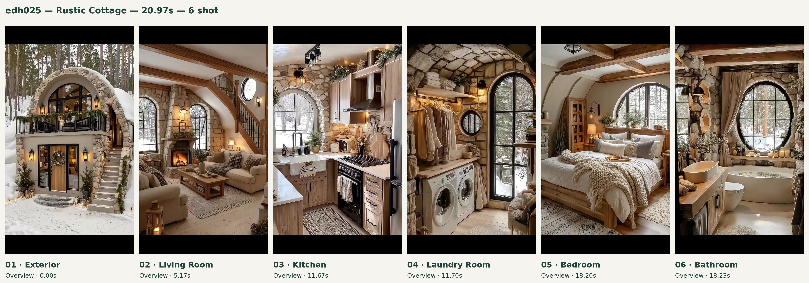
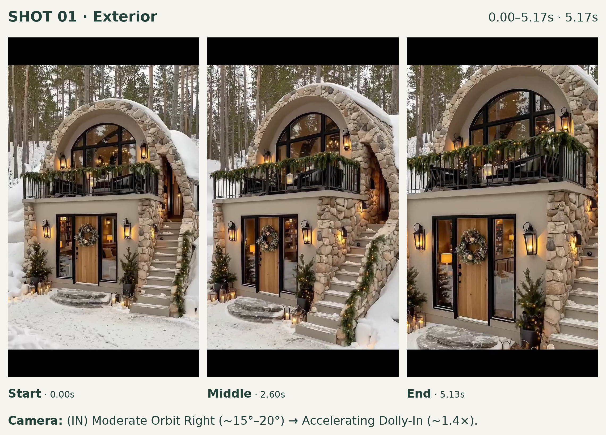
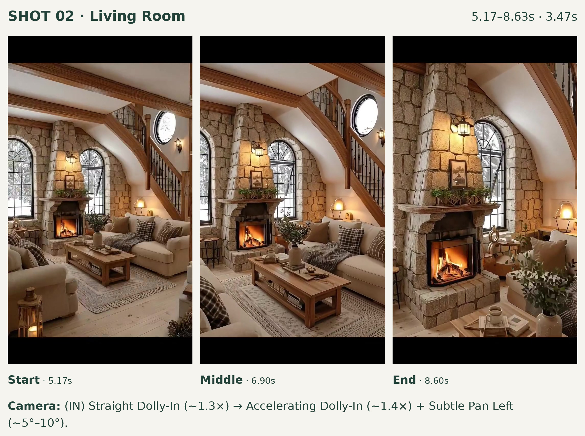
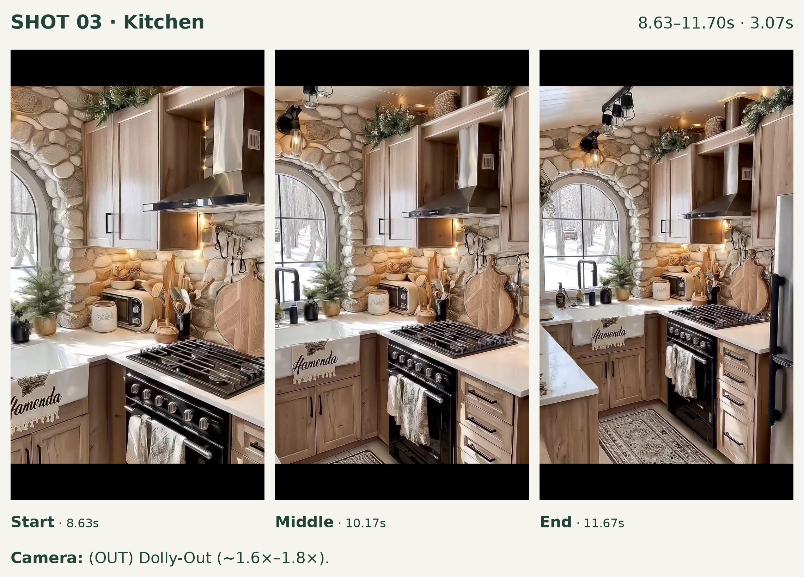
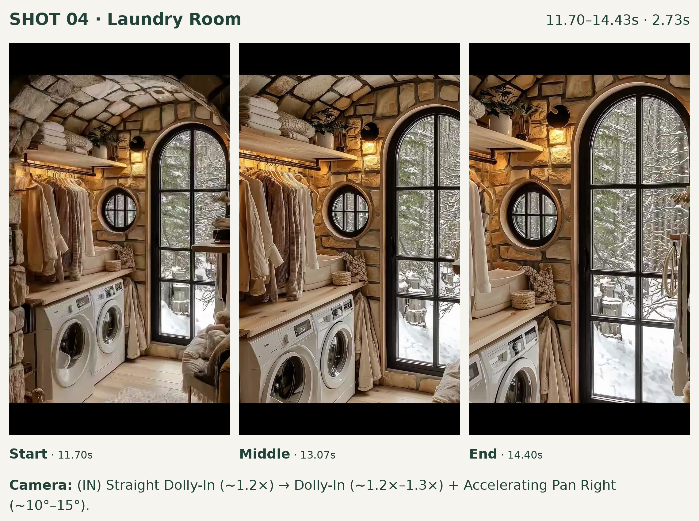
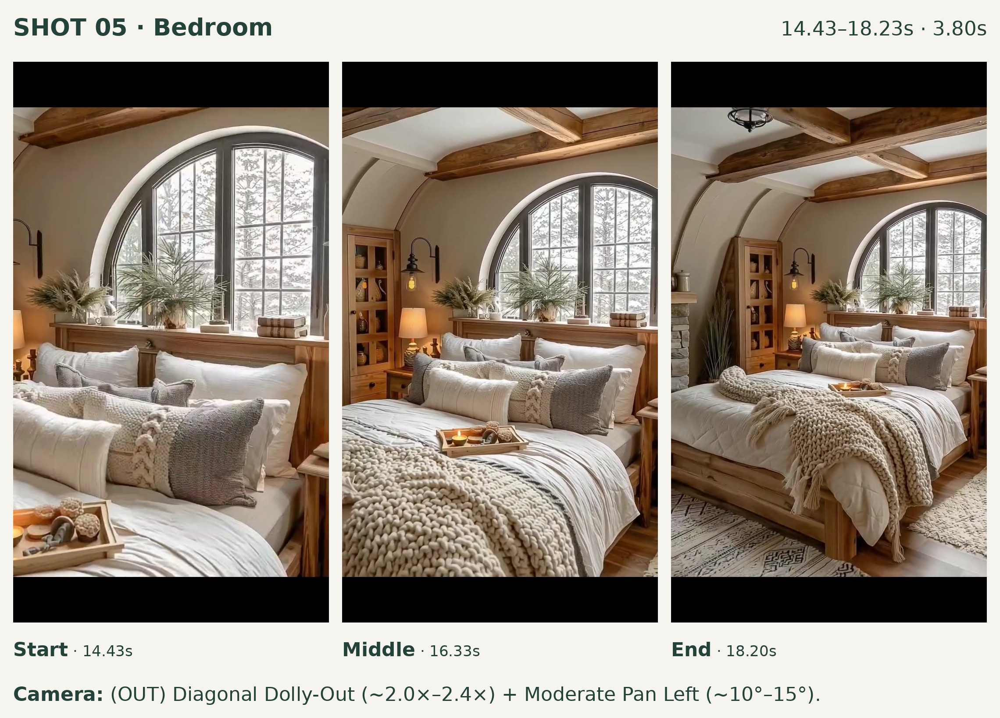
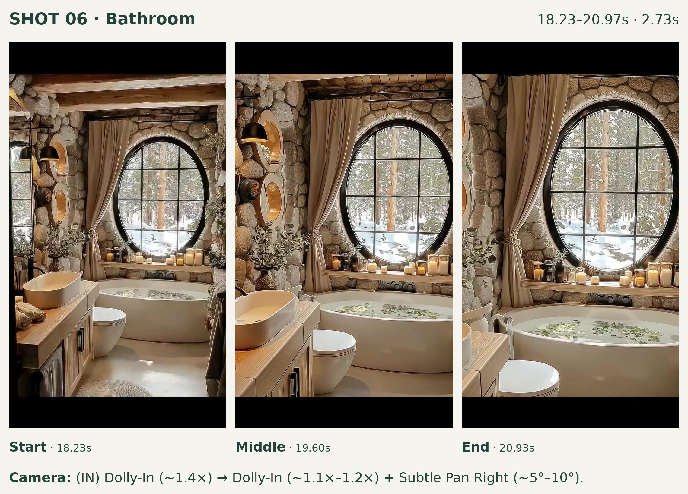

# edh025 — Winter Stone Arch Cottage

## 1. Profil desain

- **Nama desain:** Winter Stone Arch Cottage
- **Tipe rumah:** Cottage
- **Gaya utama:** **Rustic Cottage**
- **Pengaruh gaya:** Storybook Cottage; Alpine Rustic
- **Gaya interior:** Rustic Farmhouse
- **Susunan ruang utama:** Eksterior, living, kitchen, laundry, bedroom dan bathroom terlihat dalam shot terpisah
- **Ciri khas:** Lengkung fasad masif, perapian batu, bukaan oval/bulat
- **Material utama:** Tampilan batu alam, kayu hangat, plaster krem, metal gelap
- **Pencahayaan:** Cahaya putih dari jendela berpadu lampu aksen kuning hangat
- **Atmosfer:** Hangat, intim dan bernuansa cottage musim dingin
- **Lingkungan:** Hutan batang tinggi dan permukaan luar bersalju

### Palet warna

| Peran | Warna | HEX |
| --- | --- | --- |
| Dominan | Warm Ivory | `#E7DFD1` |
| Dominan | Stone Beige | `#B8A38B` |
| Pendamping | Honey Oak | `#A6784D` |
| Aksen | Charcoal | `#292824` |
| Aksen | Muted Olive | `#62674B` |
| Pendamping | Snow White | `#F0EFEB` |

## 2. Ukuran & proporsi

| Aspek | Estimasi visual |
| --- | --- |
| **Ukuran rumah** | small |
| **Bentuk bangunan** | Massa kompak dua tingkat dengan profil melengkung |
| **Lantai & bentuk atap** | Dua tingkat tampak pada fasad; tangga dalam juga terlihat · Profil barrel arch berlapis tampak batu dan salju |
| **Tapak bangunan** | Kompak; denah penuh tidak terlihat |
| **Proporsi utama** | Massa tinggi dengan lengkung besar menaungi tingkat atas |
| **Perkiraan luas lantai** | **60–100 m²** |

## 3. Shot Timeline

Durasi 20.97s · 6 shot.

**Camera Pattern:** IN – IN – OUT – IN – OUT – IN.

| Shot | Time (s) | Duration | Area/Scene | Camera Movement |
| --- | --- | --- | --- | --- |
| 01 | 0.00–5.17 | 5.17s | Exterior | Moderate Orbit Right (~15°–20°) → Accelerating Dolly-In (~1.4×). |
| 02 | 5.17–8.63 | 3.47s | Living Room | Straight Dolly-In (~1.3×) → Accelerating Dolly-In (~1.4×) + Subtle Pan Left (~5°–10°). |
| 03 | 8.63–11.70 | 3.07s | Kitchen | Dolly-Out (~1.6×–1.8×). |
| 04 | 11.70–14.43 | 2.73s | Laundry Room | Straight Dolly-In (~1.2×) → Dolly-In (~1.2×–1.3×) + Accelerating Pan Right (~10°–15°). |
| 05 | 14.43–18.23 | 3.80s | Bedroom | Diagonal Dolly-Out (~2.0×–2.4×) + Moderate Pan Left (~10°–15°). |
| 06 | 18.23–20.97 | 2.73s | Bathroom | Dolly-In (~1.4×) → Dolly-In (~1.1×–1.2×) + Subtle Pan Right (~5°–10°). |

## 4. Overview

**Shot 01 · Exterior · 0.00s**

> Di luar pada jalur depan; menghadap fasad dan tangga kanan. Wide fasad dari luar, tanah bersalju di depan, lengkung dan pohon terlihat utuh. Cahaya luar difus dan lentera kuning.

**Shot 02 · Living Room · 5.17s**

> Di depan area duduk; menghadap perapian dan jendela belakang. Wide dari sisi meja kopi, perapian di tengah dan sofa kanan/kiri. Daylight jendela, api, sconce dan lampu meja hangat.

**Shot 03 · Kitchen · 11.67s**

> Kamera di jalur lantai depan countertop, menghadap serong ke sudut sink dan kompor pada ketinggian sekitar mata. Wide menampakkan meja kiri, sink di bawah jendela lengkung, kompor, kabinet, kulkas dan runner. Cahaya jendela berpadu lampu bawah kabinet.

**Shot 04 · Laundry Room · 11.70s**

> Di ujung dekat mesin; menghadap area kerja dan kaca ujung. Wide dari depan mesin, rak kiri dan kaca tinggi kanan. Cahaya jendela kontras lampu hangat.

**Shot 05 · Bedroom · 18.20s**

> Kamera di depan kaki ranjang, menghadap serong ke headboard dan jendela pada ketinggian sekitar mata. Wide mencakup ranjang utuh, rak kiri, balok plafon, lantai dan karpet. Cahaya jendela difus dan lampu samping hangat.

**Shot 06 · Bathroom · 18.23s**

> Dekat sisi vanity; menghadap bathtub dan jendela. Wide dari sisi vanity, sink kiri, toilet dan tub di depan jendela. Cahaya jendela difus dan lilin/lampu hangat.

## 5. Storyboard

## 6. Shot Details

### Shot 01 · Exterior

**Time:** 0.00–5.17s · **Duration:** 5.17s

#### **A. Desain area**

**Arsitektur**

> Massa dua tingkat kompak dengan kulit lengkung besar tampak batu, dinding krem, balkon pagar hitam dan jendela lengkung besar di atas pintu kayu berpanel kaca. Tangga lurus di kanan menghubungkan tanah bersalju ke bukaan atas.

**Furnitur & dekorasi**

> Karangan hijau pada pagar, wreath pada pintu, lampu lentera dinding, tanaman pot dan lentera di kaki tangga.

**Lingkungan**

> Pepohonan tinggi rapat di belakang bangunan; salju menutupi tanah dan sisi lengkung.

#### **B. Framing & Lighting**

- **Fokus:** Fasad lengkung, pintu, tangga
- **Camera Start:** Di luar pada jalur depan · Menghadap fasad dan tangga kanan · oblique · Sekitar tinggi mata, melihat sedikit ke atas · Sedikit naik mengikuti tinggi fasad
- **Framing:** Wide fasad dari luar, tanah bersalju di depan, lengkung dan pohon terlihat utuh. → Lebih dekat pada pintu dan kaki balkon, bagian atap terpotong.
- **Lighting:** Cahaya luar difus dan lentera kuning
- **Foreground dan kedalaman:** Salju dan anak tangga · Tanah, fasad, pohon belakang
- **Reveal:** Sisi kanan terbuka lalu pintu mendominasi
- **Kesesuaian gerak:** Orbit mengungkap sisi, dolly menekankan akses

#### **C. Camera Movement**

Kamera mengitari fasad ke kanan lebih dahulu, lalu mendekat ke pintu dan tangga; peralihan berlangsung halus.

**Tempo:** Orbit awal tenang, pendekatan semakin cepat terutama F120–154; keseluruhan tempo sedang dengan aksen cepat menjelang cut.

**Movement Timeline**

| Time (s) | Area & fokus | Camera Movement | Tempo |
| --- | --- | --- | --- |
| 0.00–3.20 | Exterior · Fasad dan sisi kanan tangga | Moderate Orbit Right (~15°–20°) | Orbit awal tenang, pendekatan semakin cepat terutama F120–154; keseluruhan tempo sedang dengan aksen cepat menjelang cut. |
| 3.20–5.17 | Exterior · Pintu bawah dan akses tangga | Accelerating Dolly-In (~1.4×) | Orbit awal tenang, pendekatan semakin cepat terutama F120–154; keseluruhan tempo sedang dengan aksen cepat menjelang cut. |

**Camera:** Moderate Orbit Right (~15°–20°) → Accelerating Dolly-In (~1.4×).

---

### Shot 02 · Living Room

**Time:** 5.17–8.63s · **Duration:** 3.47s

#### **A. Desain area**

**Arsitektur**

> Dinding tampak batu dengan cerobong perapian di tengah, jendela lengkung di sisi, balok kayu di plafon dan tangga kayu dengan railing hitam naik di kanan. Lantai papan terang.

**Furnitur & dekorasi**

> Sofa krem mengapit meja kopi kayu persegi panjang di atas karpet bermotif; bantal kotak-kotak, vas tanaman, lampu meja dan dekorasi mantel.

**Lingkungan**

> Pohon dan salju terlihat melalui kaca; api dan lampu memberi aksen hangat.

#### **B. Framing & Lighting**

- **Fokus:** Perapian batu dan area duduk
- **Camera Start:** Di depan area duduk · Menghadap perapian dan jendela belakang · oblique · Sekitar tinggi mata duduk/berdiri rendah · Relatif datar
- **Framing:** Wide dari sisi meja kopi, perapian di tengah dan sofa kanan/kiri. → Close menuju perapian, meja dan sofa terpotong.
- **Lighting:** Daylight jendela, api, sconce dan lampu meja hangat
- **Foreground dan kedalaman:** Meja kopi dan sofa · Meja dekat, sofa, perapian belakang
- **Reveal:** Mendekat menonjolkan tekstur batu dan api
- **Kesesuaian gerak:** Dolly-In memanfaatkan lapisan meja dan perapian

#### **C. Camera Movement**

Maju melintasi meja menuju perapian; sapuan kiri ringan makin terasa setelah pertengahan.

**Tempo:** Awal relatif perlahan; pembesaran dan sapuan meningkat menjelang akhir.

**Movement Timeline**

| Time (s) | Area & fokus | Camera Movement | Tempo |
| --- | --- | --- | --- |
| 5.17–7.00 | Living Room · Perapian dan coffee table | Straight Dolly-In (~1.3×) | Awal relatif perlahan; pembesaran dan sapuan meningkat menjelang akhir. |
| 7.00–8.63 | Living Room · Perapian | Accelerating Dolly-In (~1.4×) + Subtle Pan Left (~5°–10°) | Awal relatif perlahan; pembesaran dan sapuan meningkat menjelang akhir. |

**Camera:** Straight Dolly-In (~1.3×) → Accelerating Dolly-In (~1.4×) + Subtle Pan Left (~5°–10°).

---

### Shot 03 · Kitchen

**Time:** 8.63–11.70s · **Duration:** 3.07s

#### **A. Desain area**

**Arsitektur**

> Kabinet kayu terang mengapit kompor hitam dengan hood logam; sink apron putih di bawah jendela lengkung, backsplash batu tak beraturan, countertop putih. Ada bidang meja kiri, sambungan tidak terlihat.

**Furnitur & dekorasi**

> Kabinet atas/bawah dan laci, kulkas di kanan, peralatan kecil, cutting boards, rak dekorasi hijau, runner bermotif.

**Lingkungan**

> Pemandangan hutan bersalju di balik jendela, cahaya luar putih dan lampu kerja hangat.

#### **B. Framing & Lighting**

- **Fokus:** Kompor, sink, kabinet
- **Camera Start:** Dekat kompor dan countertop · Menghadap sudut kabinet dan sink · oblique · Sekitar tinggi mata · Sedikit turun ke meja
- **Framing:** Detail kompor dan hood, sink sebagian terlihat. → Wide memperlihatkan sink, kompor, kulkas dan jalur lantai.
- **Lighting:** Cahaya jendela dan lampu bawah kabinet
- **Foreground dan kedalaman:** Kompor dan countertop · Counter dekat, kabinet dan jendela belakang
- **Reveal:** Jalur lantai, kulkas dan meja kiri terbuka
- **Kesesuaian gerak:** Dolly-Out memperluas konteks layout

#### **C. Camera Movement**

Mundur dari kompor untuk memperlihatkan susunan dapur yang lebih luas.

**Tempo:** Mundur relatif merata, sedikit mereda menuju cut; tidak ada pergantian fase yang tegas.

**Camera:** Dolly-Out (~1.6×–1.8×).

---

### Shot 04 · Laundry Room

**Time:** 11.70–14.43s · **Duration:** 2.73s

#### **A. Desain area**

**Arsitektur**

> Ruang sempit dengan plafon lengkung dan dinding tampak batu; bukaan bundar kecil dan pintu/jendela kaca lengkung tinggi berbingkai gelap di ujung, lantai papan terang.

**Furnitur & dekorasi**

> Dua mesin front-load berdampingan di bawah meja kayu; rak terbuka dengan handuk dan keranjang, rel gantungan pakaian di atas.

**Lingkungan**

> Salju dan batang pohon terlihat melalui kaca; lampu dinding dan bawah rak hangat.

#### **B. Framing & Lighting**

- **Fokus:** Mesin, jendela bulat, pintu kaca
- **Camera Start:** Di ujung dekat mesin · Menghadap area kerja dan kaca ujung · oblique · Sekitar tinggi mata · Relatif datar
- **Framing:** Wide dari depan mesin, rak kiri dan kaca tinggi kanan. → Kaca tinggi dan jendela bulat dominan; mesin terpotong.
- **Lighting:** Cahaya jendela kontras lampu hangat
- **Foreground dan kedalaman:** Mesin dan meja · Mesin dekat, rak, bukaan belakang
- **Reveal:** Bukaan tinggi menjadi fokus
- **Kesesuaian gerak:** Dolly-In dan Pan Right mengalihkan fokus ke kaca

#### **C. Camera Movement**

Mendekat ke dinding ujung laundry, kemudian menambah sapuan kanan menuju pintu kaca lengkung.

**Tempo:** Maju stabil dengan sapuan kanan yang semakin nyata dan cepat di sepertiga akhir.

**Movement Timeline**

| Time (s) | Area & fokus | Camera Movement | Tempo |
| --- | --- | --- | --- |
| 11.70–13.00 | Laundry Room · Jendela bulat dan mesin cuci | Straight Dolly-In (~1.2×) | Maju stabil dengan sapuan kanan yang semakin nyata dan cepat di sepertiga akhir. |
| 13.00–14.43 | Laundry Room · Pintu kaca lengkung | Dolly-In (~1.2×–1.3×) + Accelerating Pan Right (~10°–15°) | Maju stabil dengan sapuan kanan yang semakin nyata dan cepat di sepertiga akhir. |

**Camera:** Straight Dolly-In (~1.2×) → Dolly-In (~1.2×–1.3×) + Accelerating Pan Right (~10°–15°).

---

### Shot 05 · Bedroom

**Time:** 14.43–18.23s · **Duration:** 3.80s

#### **A. Desain area**

**Arsitektur**

> Plafon putih dengan balok kayu terbuka, dinding sisi melengkung, jendela arch besar berbingkai gelap tepat di belakang headboard. Lantai kayu dan karpet netral.

**Furnitur & dekorasi**

> Ranjang kayu dengan bantal berlapis, linen krem, throw rajut besar, tray; rak tinggi di kiri, lampu dinding dan meja samping.

**Lingkungan**

> Hutan bersalju terlihat dari jendela; cahaya putih lembut dan lampu samping hangat.

#### **B. Framing & Lighting**

- **Fokus:** Ranjang dan arch jendela
- **Camera Start:** Dekat bagian tengah ranjang · Menghadap headboard dan jendela · oblique · Sekitar tinggi mata · Sedikit turun ke ranjang
- **Framing:** Close bantal dan headboard di bawah arch. → Wide dari kaki ranjang, balok plafon, rak kiri, lantai dan karpet.
- **Lighting:** Cahaya jendela difus, lampu sisi hangat
- **Foreground dan kedalaman:** Bantal dan tray · Bantal dekat, ranjang, jendela
- **Reveal:** Footboard, rak dan lantai terbuka
- **Kesesuaian gerak:** Dolly-Out dan Pan Left memberi konteks ranjang

#### **C. Camera Movement**

Mundur dari detail bantal sambil mengalihkan pandangan ke kiri sehingga seluruh ranjang dan area samping terlihat.

**Tempo:** Awal lembut, laju mundur meningkat di tengah lalu sedikit mereda; framing berubah banyak dalam 3,8 detik.

**Camera:** Diagonal Dolly-Out (~2.0×–2.4×) + Moderate Pan Left (~10°–15°).

---

### Shot 06 · Bathroom

**Time:** 18.23–20.97s · **Duration:** 2.73s

#### **A. Desain area**

**Arsitektur**

> Dinding batu tak beraturan, balok kayu dan jendela oval besar berbingkai hitam dengan tirai krem. Bathtub berada tepat di bawah jendela; jalur masuk sempit di antara vanity dan sisi tub.

**Furnitur & dekorasi**

> Bathtub putih freestanding, toilet putih, vanity tampak kayu dengan vessel sink krem; lampu gantung, cermin/ceruk bulat, lilin di ambang jendela dan tanaman.

**Lingkungan**

> Hutan dan salju di luar kaca; cahaya siang difus dengan lampu dan lilin hangat.

#### **B. Framing & Lighting**

- **Fokus:** Bathtub dan jendela oval
- **Camera Start:** Dekat sisi vanity · Menghadap bathtub dan jendela · oblique · Sekitar tinggi mata · Relatif datar sedikit turun
- **Framing:** Wide dari sisi vanity, sink kiri, toilet dan tub di depan jendela. → Lebih dekat ke tub dan oval, vanity terpotong.
- **Lighting:** Cahaya jendela difus dan lilin/lampu hangat
- **Foreground dan kedalaman:** Vanity dan sink · Sink dekat, tub, kaca dan hutan
- **Reveal:** Tub dan jendela mengambil alih framing
- **Kesesuaian gerak:** Dolly-In dan Pan Right menekankan jendela

#### **C. Camera Movement**

Maju ke bathtub dan jendela oval, dengan sapuan kanan kecil yang makin terasa pada akhir.

**Tempo:** Gerak maju cukup merata, pergeseran framing menguat di akhir.

**Movement Timeline**

| Time (s) | Area & fokus | Camera Movement | Tempo |
| --- | --- | --- | --- |
| 18.23–20.07 | Bathroom · Bathtub dan jendela oval | Dolly-In (~1.4×) | Gerak maju cukup merata, pergeseran framing menguat di akhir. |
| 20.07–20.97 | Bathroom · Jendela oval dan permukaan bathtub | Dolly-In (~1.1×–1.2×) + Subtle Pan Right (~5°–10°) | Gerak maju cukup merata, pergeseran framing menguat di akhir. |

**Camera:** Dolly-In (~1.4×) → Dolly-In (~1.1×–1.2×) + Subtle Pan Right (~5°–10°).

**Catatan referensi:** Estimasi luas 60–100 m² merupakan perkiraan kasar dari massa dan proporsi furnitur, bukan hasil denah. Urutan cut bukan bukti keterhubungan ruang atau satu rumah fisik. Material dan warna adalah tampilan visual, bukan spesifikasi terverifikasi.
