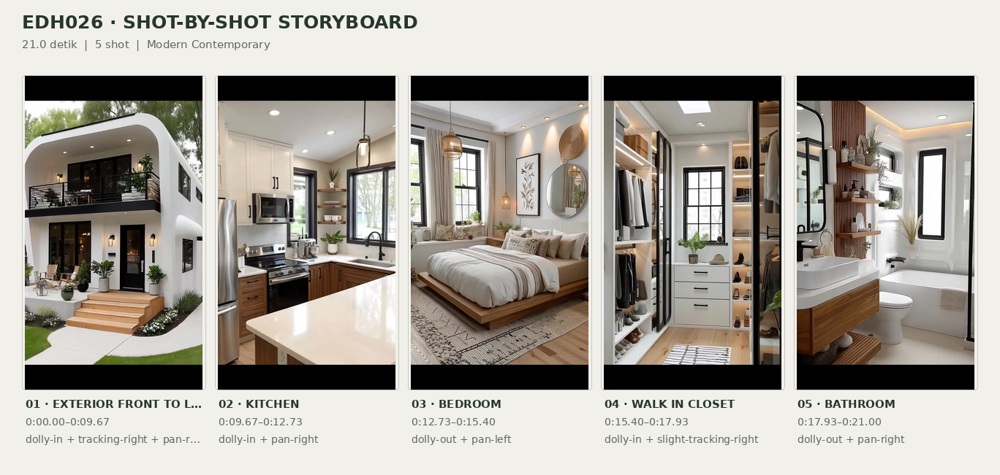
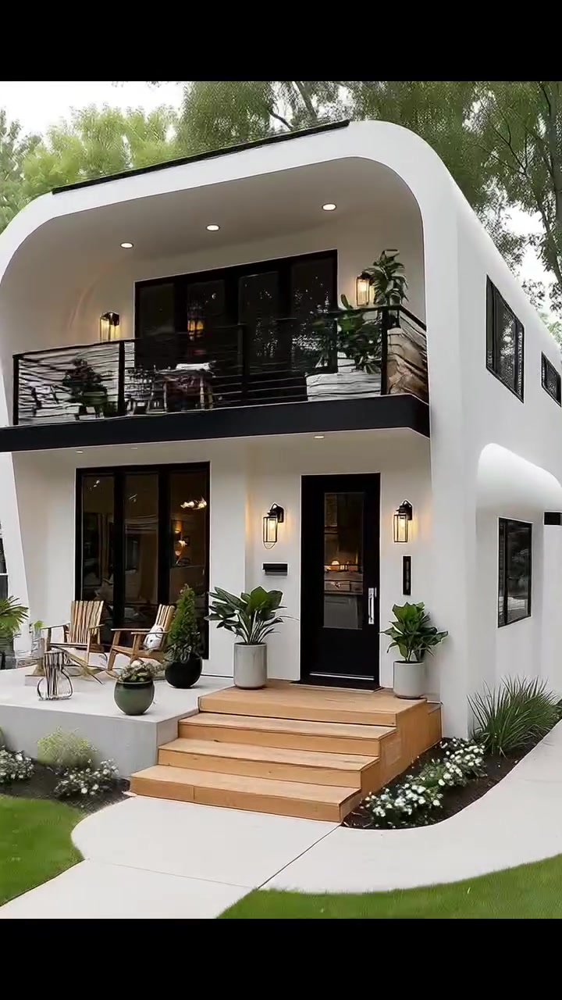
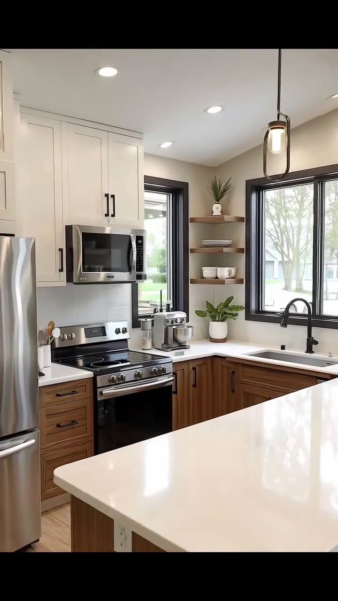
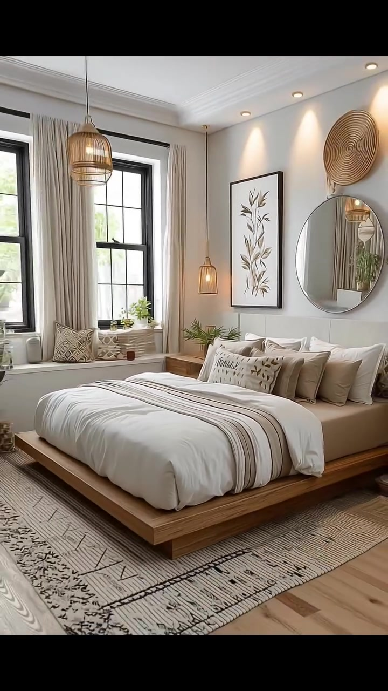
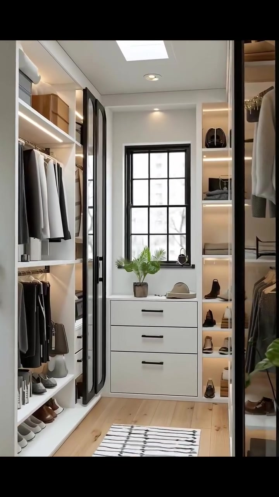
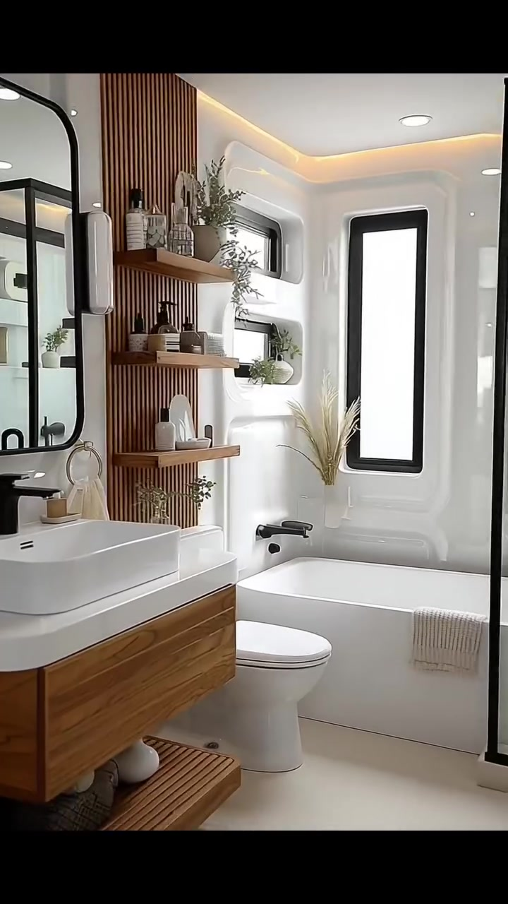

# edh026 — Modern Contemporary

<!-- homeku_request_id: edh026-20261104-01 -->

<!-- homeku_detail_narratives: chat-reviewed -->

**Sumber data:** [analysis.yaml](analysis.yaml) · **Status:** draft · **Diverifikasi manusia:** Tidak

## 1. Informasi Video

| Informasi | Nilai |
|---|---|
| ID | edh026 |
| File asli | edh026.mp4 |
| Durasi | 21.0 |
| Resolusi | 720x1280 |
| FPS | 30 |
| Rasio | 9:16 |
| Jumlah shot | 5 |

## 2. Storyboard Gabungan

## 3. Identitas Desain

| Aspek | Hasil analisis |
|---|---|
| Gaya utama | modern contemporary |
| Wilayah terkait gaya desain | north america, europe |
| Pengaruh gaya | soft modern curved facade, scandinavian inspired neutral interior, warm minimalist interiors |
| Ciri eksterior | smooth white rounded edge front facade, recessed upper balcony with black railings, black framed full height glazing, light wood appearance front steps, black lantern style sconces |
| Gaya interior | neutral contemporary, warm scandinavian inspired, wood and black metal accents |
| Confidence gaya | high |

## 4. Ukuran & Proporsi Bangunan

| Aspek | Estimasi visual |
|---|---|
| Ukuran yang terlihat | medium |
| Bentuk bangunan | narrow rectangular appearing front mass |
| Skala vertikal | two story |
| Tapak bangunan | moderate |
| Perkiraan luas lantai | 115–200 m² |
| Confidence | low |

> Luas adalah perkiraan visual, bukan ukuran terukur.

## 5. Warna, Pencahayaan, dan Atmosfer

| Warna dominan | HEX (perkiraan) |
|---|---|
| warm white | #F2F0EB |
| soft black | #171A1B |
| light warm wood | #BE936B |
| taupe beige | #C6B9A9 |
| leaf green | #6B8060 |

| Aspek | Hasil analisis |
|---|---|
| Pencahayaan | soft daylight, warm wall sconces, warm recessed ceiling lights, warm pendant lights, integrated shelf lighting |
| Lingkungan | suburban residential street, trimmed front lawn, mature green trees, small front flower beds |
| Musim yang tampak | Tidak diketahui |
| Mood | airy, warm, orderly, calm, polished |

## 6. Struktur dan Timeline Video

**Jenis:** home tour · **Tempo:** moderate · **Transisi:** continuous exterior to living tracking then four hard cuts

| Shot | Waktu (detik) | Durasi | Area/Scene | Gerakan Kamera |
|---|---|---|---|---|
| Shot 01 | 0.0–9.667 | 9.67 | exterior front to living room | dolly in, tracking right, pan right |
| Shot 02 | 9.667–12.733 | 3.07 | kitchen | dolly in, pan right |
| Shot 03 | 12.733–15.4 | 2.67 | bedroom | dolly out, pan left |
| Shot 04 | 15.4–17.933 | 2.53 | walk in closet | dolly in, slight tracking right |
| Shot 05 | 17.933–21.0 | 3.07 | bathroom | dolly out, pan right |

## 7. Analisis per Shot

### Shot 01 — exterior front to living room

**Waktu:** 0.0–9.667 detik

| Komponen | Pengamatan |
|---|---|
| Fokus utama | white two story house entry then open living room |
| Framing awal → akhir | wide front three quarter house view → medium wide interior living room view |
| Sudut pandang | eye level to slight upward view of staircase |
| Gerakan kamera | dolly in, tracking right, pan right |
| Kecepatan kamera | moderate with faster entry approach |
| Pencahayaan | soft outdoor daylight with warm wall sconces then window daylight and recessed interior lights |
| Transisi keluar | hard cut |

**Detail yang terlihat**

**Arsitektur**

Rumah berfasad sempit tampak terdiri atas dua lantai, dengan permukaan dinding luar putih halus dan bingkai atap bagian depan yang relatif datar serta membulat pada sudut atas. Balkon lantai dua masuk ke dalam massa bangunan, dibatasi railing logam hitam mendatar, dengan bukaan kaca berbingkai hitam di belakangnya dan jendela hitam sempit pada dinding samping kanan. Pada lantai bawah, pintu kaca ganda berada di sisi kiri fasad, sedangkan pintu masuk kaca tunggal berbingkai hitam berada di kanannya. Anak tangga lebar berpenampilan kayu terang mengarah ke pintu; lampu dinding bergaya lentera dan downlight bulat terlihat di area teras serta balkon. Setelah kamera melewati pintu, ruang keluarga memperlihatkan plafon putih berkotak dengan downlight, lantai papan berpenampilan kayu terang, dinding putih berlis sederhana, tangga terbuka bertapak kayu dan struktur serta pagar besi hitam di sisi kanan belakang, juga jendela tinggi berbingkai hitam dengan bukaan persegi panjang di area atas tangga.

**Furnitur dan properti**

Di teras kiri tangga terdapat dua kursi santai berpenampilan kayu terang dan meja bundar kecil di antaranya; kursi serta meja juga tampak pada balkon atas. Sejumlah tanaman hijau dalam pot menghiasi balkon dan teras, termasuk tanaman berdaun lebar dalam pot putih di kanan pintu. Di dalam ruang keluarga, dua sofa berlapis kain krem disusun menghadap area meja kopi, diberi bantal putih dan beige serta selimut rajut beige pada lengan sofa terdekat. Meja kopi rendah dua tingkat berwarna kayu terang berdiri di atas karpet putih gading berpola garis geometris gelap. Televisi hitam terpasang pada dinding di seberang sofa, di atas kabinet media berpenampilan kayu dengan panel depan anyaman. Vas dekoratif, ranting kering dan tanaman pot kecil ada di sekitar kabinet, sementara lampu meja kecil dan karya seni berbingkai terlihat dekat area bawah tangga.

**Lingkungan**

Di depan rumah terdapat rumput hijau yang dipangkas rapi pada kedua sisi jalur pejalan kaki beton terang yang melengkung menuju anak tangga. Bedeng tanaman bermulsa dengan bunga putih kecil membingkai bagian depan teras. Pohon\-pohon tinggi berdaun hijau tumbuh di belakang rumah; rumah tetangga berdinding abu\-abu tampak di kiri dan bangunan berwarna terang di kanan. Sebagian mobil gelap terlihat di sisi kanan rumah. Melalui jendela ruang keluarga, tampak pemandangan luar yang terang dengan pepohonan.

**Catatan pengamatan:** Satu shot kontinu: dimulai dari fasad depan, mendekati pintu, lalu masuk dan mengarah ke ruang keluarga tanpa cut keras yang terlihat.

**Confidence:** Kamera medium · Detail visual high

### Shot 02 — kitchen

**Waktu:** 9.667–12.733 detik

| Komponen | Pengamatan |
|---|---|
| Fokus utama | two tone kitchen cabinets island and stainless appliances |
| Framing awal → akhir | medium wide kitchen and island view → tighter counter and cooking area view |
| Sudut pandang | eye level slightly down toward countertop |
| Gerakan kamera | dolly in, pan right |
| Kecepatan kamera | moderate |
| Pencahayaan | mixed daylight from black framed windows and warm recessed pendants |
| Transisi keluar | hard cut |

**Detail yang terlihat**

**Arsitektur**

Dapur berbentuk area kerja berbelok memiliki kabinet atas putih bergaya shaker hingga dekat plafon, sementara kabinet bawah berpenampilan kayu cokelat hangat memakai pegangan gelap. Island persegi panjang di depan kamera memakai panel kayu senada dan bidang atas putih yang terlihat halus serta mengilap. Countertop putih berlanjut sepanjang dua sisi dapur dan backsplash di sekitar kompor berupa ubin persegi panjang terang mengilap. Jendela hitam lebar berada tepat di atas wastafel, disertai jendela hitam lebih sempit di kirinya. Di kanan jendela terdapat rak pajang melayang berpenampilan kayu. Lantai berpenampilan papan kayu terang berpadu dengan plafon putih bercahaya downlight.

**Furnitur dan properti**

Kulkas stainless steel berpintu ganda berada di kiri, bersebelahan dengan kompor dan oven stainless steel yang memiliki microwave senada di bagian atas. Wastafel di bawah jendela memakai keran leher angsa hitam. Pada sisi kanan island ada dua bangku tinggi logam hitam, sedangkan dua lampu gantung berbingkai hitam ramping dan kaca menggantung di atasnya. Mixer berdiri berwarna metalik berada di countertop kanan kompor; wadah putih berisi sendok kayu tampak di dekat permukaan memasak. Rak terbuka di kanan menyimpan piring, mangkuk, dan cangkir putih, diselingi tanaman hijau kecil dalam pot pada rak serta countertop.

**Lingkungan**

Di luar jendela dapur terlihat ranting dan dedaunan pohon serta sebagian bangunan tetangga berwarna terang.

**Catatan pengamatan:** Komposisi bergeser dari island dan kulkas menuju kompor, kabinet, serta jendela di atas wastafel.

**Confidence:** Kamera medium · Detail visual high

### Shot 03 — bedroom

**Waktu:** 12.733–15.4 detik

| Komponen | Pengamatan |
|---|---|
| Fokus utama | low wood platform bed and neutral layered bedding |
| Framing awal → akhir | close medium bed and headboard view → wide bedroom showing full bed and two windows |
| Sudut pandang | eye level slightly downward at bed |
| Gerakan kamera | dolly out, pan left |
| Kecepatan kamera | slow to moderate |
| Pencahayaan | soft window daylight with warm pendant and recessed lighting |
| Transisi keluar | hard cut |

**Detail yang terlihat**

**Arsitektur**

Kamar tidur memiliki dinding putih hangat dengan lis plafon sederhana dan titik lampu tanam kecil di dekat tepi atas dinding. Dua jendela tinggi berkisi hitam berada di sisi kiri ruangan, dengan gorden panjang berwarna netral. Lantainya tampak berupa papan berpenampilan kayu terang, sementara sandaran kepala tempat tidur berlapis bahan lembut berwarna pucat berada pada dinding di kanan.

**Furnitur dan properti**

Ranjang platform rendah berpenampilan kayu hangat memakai duvet putih krem dan aksen garis taupe serta abu\-abu memanjang di atasnya. Beberapa bantal berwarna putih, beige, dan taupe ditata pada sandaran kepala. Di sebelah kiri ranjang terdapat meja samping kecil dari kayu; lampu gantung kaca amber berada dekat kedua sisi ranjang dan sebuah lampu gantung anyaman rotan yang lebih besar menggantung dekat bagian kaki ranjang. Di dinding belakang terlihat cetakan botani berbingkai hitam, cermin bundar besar di kanannya, dan hiasan dinding bulat anyaman di atas cermin. Bangku rendah di bawah jendela diberi bantal bermotif beige, sedangkan karpet krem bergaris geometris gelap menghampar di bawah ranjang. Tanaman pot hijau berada dekat ranjang dan tanaman kecil lain di ambang jendela.

**Lingkungan**

Cahaya siang dan dedaunan hijau yang agak samar terlihat melalui jendela kamar tidur.

**Catatan pengamatan:** Kamera menjauh dari detail tempat tidur sehingga keseluruhan platform, jendela, dan elemen dekorasi tampak.

**Confidence:** Kamera medium · Detail visual high

### Shot 04 — walk in closet

**Waktu:** 15.4–17.933 detik

| Komponen | Pengamatan |
|---|---|
| Fokus utama | symmetrical white wardrobes and end window |
| Framing awal → akhir | wide narrow wardrobe corridor view → centered medium view toward end window and drawers |
| Sudut pandang | eye level central perspective |
| Gerakan kamera | dolly in, slight tracking right |
| Kecepatan kamera | slow |
| Pencahayaan | bright ceiling panel daylight from end window and warm integrated shelf lighting |
| Transisi keluar | hard cut |

**Detail yang terlihat**

**Arsitektur**

Walk\-in closet berbentuk lorong sempit dengan kabinet putih built\-in di kedua sisi. Panel cermin tinggi dengan ujung lengkung dan lis hitam membingkai sisi\-sisi lorong. Rel gantungan serta rak terbuka terintegrasi di kabinet, dan sebagian kompartemennya disinari lampu strip hangat. Pada plafon terdapat panel cahaya persegi panjang yang terang dan sejumlah lampu tanam bulat. Di ujung lorong, jendela berkisi hitam berada di atas kabinet laci putih, sedangkan lantai menggunakan papan berpenampilan kayu terang.

**Furnitur dan properti**

Di bawah jendela ujung lorong terdapat kabinet putih tiga laci. Pakaian putih, abu\-abu, dan beige tergantung di kedua sisi; sepatu tersusun pada rak rendah, kotak penyimpanan cokelat muda berada di rak atas, dan tas serta pakaian lipat mengisi sejumlah rak bercahaya. Karpet lorong sempit bergaris hitam\-putih membentang di tengah lantai. Tanaman kecil dalam pot dan topi beige diletakkan di atas laci ujung, sementara tanaman hijau berukuran lebih tinggi berada dekat pintu masuk closet.

**Lingkungan**

Ranting pohon yang tampak samar terlihat melalui jendela hitam di ujung closet.

**Catatan pengamatan:** Gerakan maju di lorong memperlihatkan susunan pakaian, sepatu, dan kabinet ujung; panel plafon terang belum dapat dipastikan merupakan skylight.

**Confidence:** Kamera medium · Detail visual high

### Shot 05 — bathroom

**Waktu:** 17.933–21.0 detik

| Komponen | Pengamatan |
|---|---|
| Fokus utama | floating wood vanity then full bathtub and shower zone |
| Framing awal → akhir | close up vessel sink and wall mirror → medium wide bathroom showing vanity toilet tub and shower |
| Sudut pandang | eye level slightly down on sink then level room view |
| Gerakan kamera | dolly out, pan right |
| Kecepatan kamera | moderate |
| Pencahayaan | warm ceiling cove and recessed lights with bright diffuse window light |
| Transisi keluar | video end |

**Detail yang terlihat**

**Arsitektur**

Kamar mandi menggunakan dinding putih dengan panel aksen bilah kayu vertikal berwarna hangat di sisi kiri area bathtub. Cermin besar bersudut membulat dan berbingkai hitam terpasang di atas vanity kayu gantung dengan rak bawah berbentuk bilah. Di atas counter putih halus terdapat wastafel mangkuk persegi panjang putih. Lantai tampak berlapis ubin besar warna beige muda. Pada dinding belakang bathtub ada jendela hitam tinggi dan sempit, dengan dua ceruk pajang bercahaya di sebelah kirinya. Pencahayaan plafon memakai garis lampu cove berwarna hangat serta downlight bulat. Partisi shower kaca dengan rangka logam hitam terlihat di sisi paling kanan.

**Furnitur dan properti**

Wastafel putih dilengkapi keran hitam matte bergagang tunggal. Cincin handuk warna emas di samping cermin memegang handuk tangan beige muda. Tiga rak kayu melayang menampung botol dan tanaman hijau dalam pot. Toilet putih berukuran ringkas berada di antara vanity kayu dan bathtub putih berbentuk persegi panjang, dengan cerat air hitam pada dinding bak. Handuk netral tersampir di tepi depan bathtub, sementara keset kamar mandi krem bertekstur berada di lantai. Sejumlah handuk gelap terlipat di rak bawah vanity; dekorasi rumput tinggi pucat berdiri dekat sudut bathtub dan tanaman kecil berada di ceruk dinding bercahaya. Dispenser sabun, wadah kecil, serta produk mandi terlihat di dekat wastafel dan rak.

**Lingkungan**

Tidak ada detail yang tercatat.

**Catatan pengamatan:** Awalnya close-up wastafel, lalu framing melebar dan bergeser ke kanan sehingga toilet, bathtub, dan partisi shower terlihat; pemandangan luar jendela tidak jelas.

**Confidence:** Kamera medium · Detail visual high

## 8. Kualitas dan Ketidakpastian Analisis

| Parameter | Hasil |
|---|---|
| Status | draft |
| Verifikasi manusia | Tidak |
| Ketepatan timestamp | estimated |
| Ketidakpastian | exact house dimensions and floor area unmeasured, smooth white exterior surface material not identifiable, wood and stone appearance finishes are not material certification, specific camera rig or digital zoom not verifiable, upper roof and back of building not visible, season actual location and countries not verified, regional style links are interpretive not proof of location, identity of rooms as one physical house not externally verifiable |

**Catatan:** Analisis visual seluruh durasi pada 30 fps; batas shot ditentukan berdasarkan perubahan gambar tajam. Area rumah dan luas lantai adalah estimasi visual berconfidence rendah. Tidak ada analisis audio.

---

*Laporan ini diturunkan dari [analysis.yaml](analysis.yaml).*
