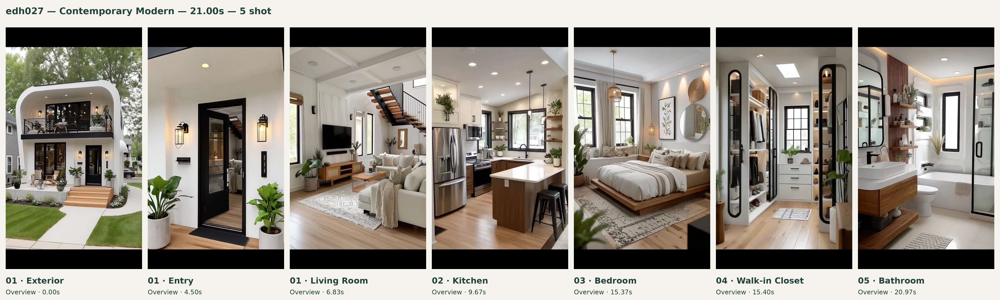
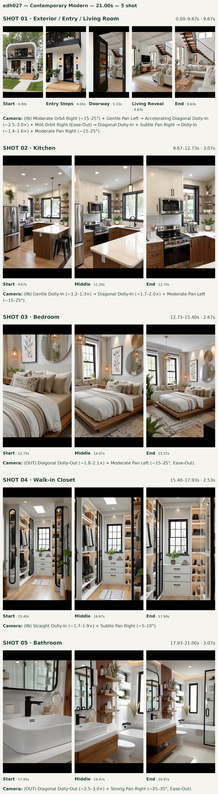
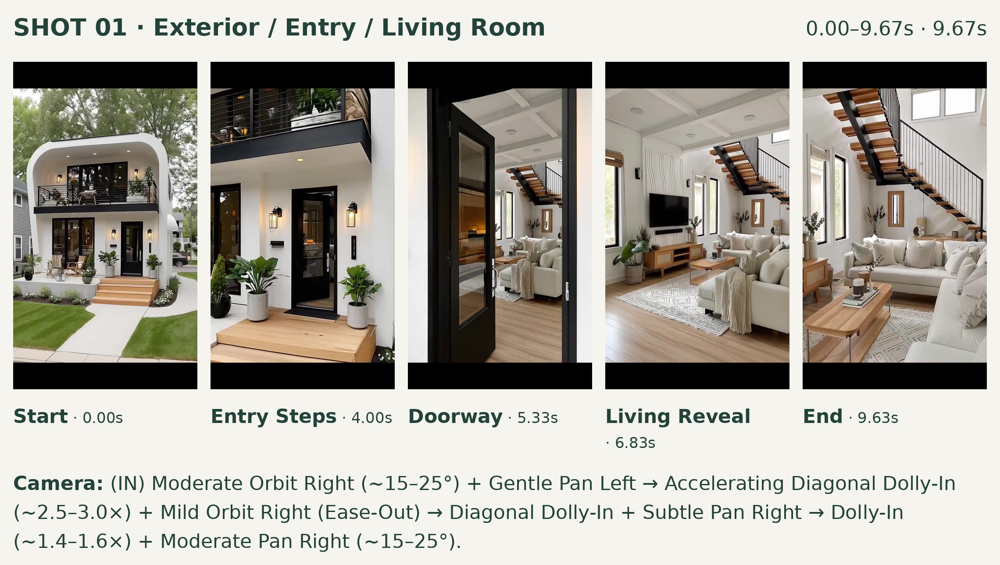
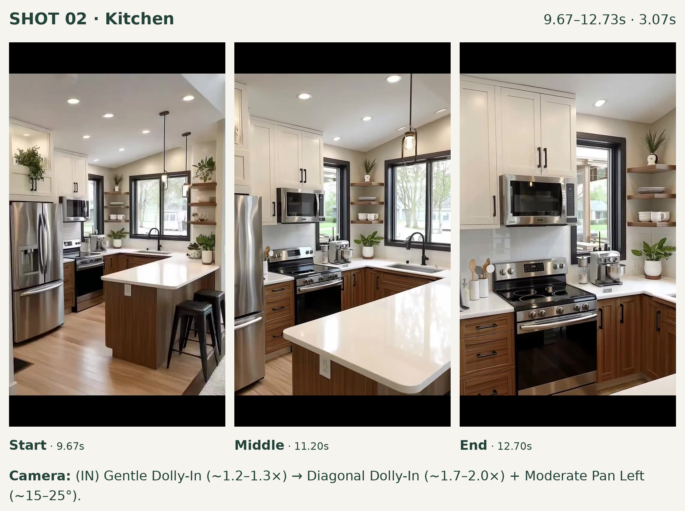
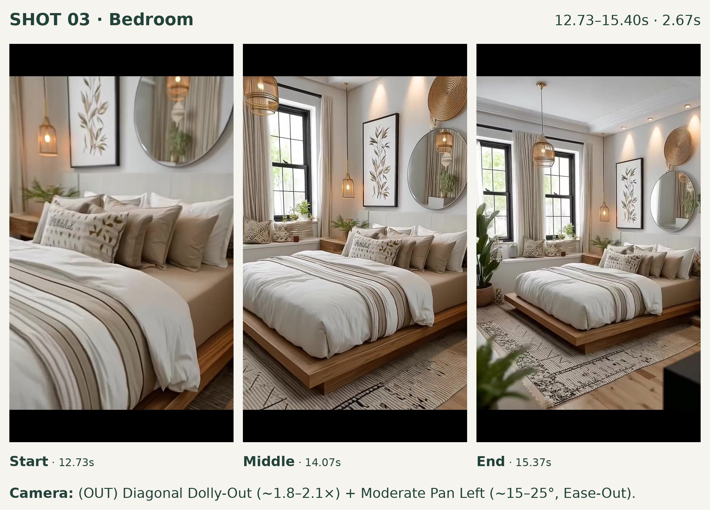
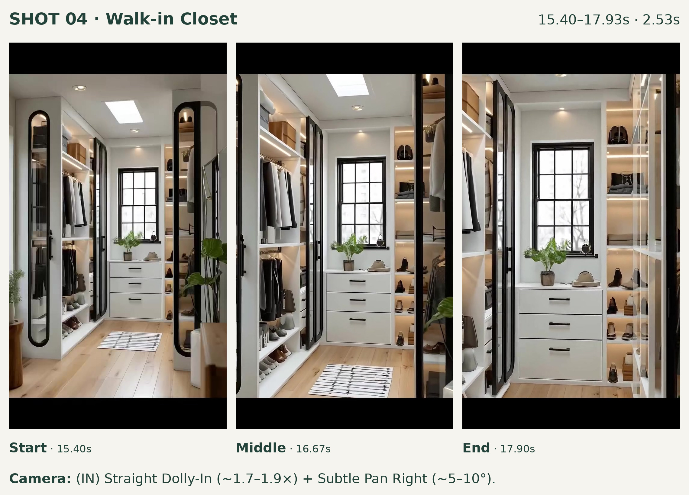
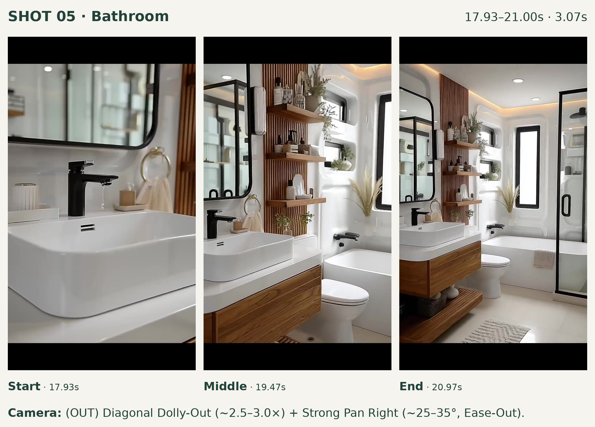

# edh027 — Rumah Modern Dua Tingkat dengan Fasad Lengkung

## 1. Profil desain

- **Nama desain:** Rumah Modern Dua Tingkat dengan Fasad Lengkung
- **Tipe rumah:** Detached House
- **Gaya utama:** **Contemporary Modern**
- **Pengaruh gaya:** Organic Modern
- **Gaya interior:** Warm Contemporary
- **Susunan ruang utama:** Fasad, teras dan ruang tamu tersambung dalam satu take; dapur, kamar, closet dan kamar mandi diperlihatkan melalui cut
- **Ciri khas:** Bingkai fasad membulat, balkon hitam, tangga terbuka kayu serta cermin sudut membulat
- **Material utama:** Permukaan putih, aksen hitam, tampilan kayu cokelat dan tekstil krem
- **Pencahayaan:** Cahaya siang dari jendela, dilengkapi lampu plafon, dinding dan gantung hangat
- **Atmosfer:** Terang, hangat dan rapi, dengan aksen kontras gelap
- **Lingkungan:** Halaman rumput, jalur masuk putih, tanaman pot dan pepohonan

### Palet warna

| Peran | Warna | HEX |
| --- | --- | --- |
| Dominan | Putih hangat | `#E9E6DF` |
| Pendamping | Krem linen | `#D0C4B2` |
| Pendamping | Kayu madu | `#B58A5E` |
| Pendamping | Cokelat kayu | `#795235` |
| Aksen | Hitam arang | `#242322` |
| Aksen | Hijau daun | `#657A42` |

## 2. Ukuran & proporsi

| Aspek | Estimasi visual |
| --- | --- |
| **Ukuran rumah** | medium |
| **Bentuk bangunan** | Massa dua tingkat dengan bingkai putih melengkung |
| **Lantai & bentuk atap** | Dua tingkat tampak · Garis atap datar tampak dari depan; struktur atap tidak terverifikasi |
| **Tapak bangunan** | Massa kompak memanjang ke belakang |
| **Proporsi utama** | Fasad relatif sempit dan tinggi, balkon di atas teras |
| **Perkiraan luas lantai** | **90–160 m²** |

## 3. Shot Timeline

Durasi 21.00s · 5 shot.

**Camera Pattern:** IN – IN – OUT – IN – OUT.

| Shot | Time (s) | Duration | Area/Scene | Camera Movement |
| --- | --- | --- | --- | --- |
| 01 | 0.00–9.67 | 9.67s | Exterior / Entry / Living Room | Moderate Orbit Right (~15–25°) + Gentle Pan Left → Accelerating Diagonal Dolly-In (~2.5–3.0×) + Mild Orbit Right (Ease-Out) → Diagonal Dolly-In + Subtle Pan Right → Dolly-In (~1.4–1.6×) + Moderate Pan Right (~15–25°). |
| 02 | 9.67–12.73 | 3.07s | Kitchen | Gentle Dolly-In (~1.2–1.3×) → Diagonal Dolly-In (~1.7–2.0×) + Moderate Pan Left (~15–25°). |
| 03 | 12.73–15.40 | 2.67s | Bedroom | Diagonal Dolly-Out (~1.8–2.1×) + Moderate Pan Left (~15–25°, Ease-Out). |
| 04 | 15.40–17.93 | 2.53s | Walk-in Closet | Straight Dolly-In (~1.7–1.9×) + Subtle Pan Right (~5–10°). |
| 05 | 17.93–21.00 | 3.07s | Bathroom | Diagonal Dolly-Out (~2.5–3.0×) + Strong Pan Right (~25–35°, Ease-Out). |

## 4. Overview

**Shot 01 · Exterior · 0.00s**

> Dari halaman menghadap fasad sedikit serong; dua tingkat, balkon, teras dan jalur masuk terlihat.

**Shot 01 · Entry · 4.50s**

> Dari depan teras menghadap pintu kaca, lampu dan pot di kedua sisi.

**Shot 01 · Living Room · 6.83s**

> Dari dekat pintu menghadap serong ke ruang tamu; TV, sofa, karpet dan tangga terbuka terlihat.

**Shot 02 · Kitchen · 9.67s**

> Dari depan island melihat serong kabinet perimeter, kulkas kiri dan jendela belakang.

**Shot 03 · Bedroom · 15.37s**

> Dari sisi kaki ranjang melihat serong ranjang platform, jendela, karpet dan dekor dinding.

**Shot 04 · Walk-in Closet · 15.40s**

> Dari mulut lorong menghadap jendela ujung; cermin dan rak di kedua sisi serta laci ujung.

**Shot 05 · Bathroom · 20.97s**

> Dari sudut yang lebih jauh menghadap serong vanity kiri, toilet, bathtub belakang dan shower kanan.

## 5. Storyboard

## 6. Shot Details

### Shot 01 · Exterior / Entry / Living Room

**Time:** 0.00–9.67s · **Duration:** 9.67s

**Shot Type:** Continuous shot · Multi area · No cut.

#### **A. Desain area**

##### **Exterior**

**Arsitektur**

> Massa dua tingkat dengan bingkai tebal putih bersudut lengkung mengapit balkon atas. Balkon memakai railing logam hitam; bukaan kaca lantai bawah tinggi dengan bingkai hitam. Tangga depan lebar berpenampilan kayu menuju teras.

**Furnitur & dekorasi**

> Tanaman pot berjajar di teras dan balkon; lampu dinding hitam di sekitar bukaan.

**Lingkungan**

> Rumput hijau membatasi jalur putih menuju tangga; pohon tinggi di latar.

##### **Entry**

**Arsitektur**

> Teras tertutup balkon dengan undakan lebar, dinding putih, pintu kaca hitam membuka ke ruang tamu; lantai tampak kayu berlanjut ke interior.

**Furnitur & dekorasi**

> Pot putih berisi tanaman hijau, lampu dinding berbentuk lentera, kotak kecil hitam di samping pintu.

**Lingkungan**

> Pintu memperlihatkan cahaya interior; teras terlindung bayangan balkon.

##### **Living Room**

**Arsitektur**

> Ruang tamu tinggi dengan tangga terbuka beranak tangga tampak kayu dan railing hitam naik di belakang sofa; dinding putih dan bukaan tinggi menyalurkan cahaya. Lantai berpola papan dan plafon berpanel.

**Furnitur & dekorasi**

> Sofa krem menghadap TV hitam di atas konsol rendah kayu; meja kopi persegi panjang kayu di atas karpet terang. Bantal, selimut, tanaman pot dan dekor dinding.

**Lingkungan**

> Cahaya siang masuk dari bukaan tinggi; lampu aksen hangat. Pemandangan luar terbatas.

#### **B. Framing & Lighting**

- **Fokus:** Fasad → pintu → sofa dan tangga
- **Camera Start:** Di halaman depan, sebelum jalur dan tangga · Menghadap fasad serong ringan · oblique · Sekitar tinggi mata, perkiraan · Hampir level
- **Framing:** Wide eksterior menampilkan dua tingkat dan halaman → Medium wide interior menghadap sofa dan tangga
- **Lighting:** Cahaya siang eksterior dan interior, lampu hangat
- **Foreground dan kedalaman:** Rumput, jalur putih, lalu kusen dan sofa · Jalur menuju teras, pintu, ruang tinggi dan tangga interior
- **Reveal:** Sisi fasad, pintu, lalu ruang tamu
- **Kesesuaian gerak:** Orbit memberi konteks massa; dolly kontinu memperlihatkan akses dan kedalaman; pan akhir mengarahkan perhatian ke tangga
- **Area:** Exterior / Entry / Living Room
- **Rute kamera:** Exterior (0.00–4.00s · Jalur depan · Fasad) → Entry (4.00–6.50s · Tangga, teras dan pintu · Pintu masuk) → Living Room (6.50–9.67s · Lewat kusen pintu · Sofa dan tangga)

**Hubungan antararea**

- **Penghubung area:** —
- **Peralihan:** Exterior · 0.00–5.50s; Entry · 3.00–6.50s; Living Room · 5.00–9.67s
- **Orientasi ruang:** Satu take kontinu dari halaman melewati pintu menuju ruang tamu.

#### **C. Camera Movement**

Berawal mengitari fasad ke kanan, mendekat menuju tangga, masuk melewati pintu, kemudian bergerak ke ruang tamu dengan sapuan pandangan kanan. Tidak ada cut internal.

**Tempo:** Pelan → cepat → sedang; perubahan terbesar di sekitar pintu.

- **0.00–2.20s · slow:** Orbit pelan, perubahan perspektif halus.
- **2.20–6.50s · fast:** Pendekatan akseleratif dan lintasan kusen cepat; laju tampak paling besar di dekat pintu.
- **6.50–9.67s · moderate:** Masuk ruang tamu melambat, lalu sapuan kanan dan pendekatan menguat di akhir.

**Movement Timeline**

| Time (s) | Area & fokus | Camera Movement | Tempo |
| --- | --- | --- | --- |
| 0.00–2.20 | Exterior / Entry / Living Room · Fasad dan sisi kanan rumah | Moderate Orbit Right (~15–25°) + Gentle Pan Left | Orbit pelan, perubahan perspektif halus. |
| 2.20–4.33 | Exterior / Entry / Living Room · Tangga teras dan pintu masuk | Accelerating Diagonal Dolly-In (~2.5–3.0×) + Mild Orbit Right (Ease-Out) | Pendekatan akseleratif dan lintasan kusen cepat; laju tampak paling besar di dekat pintu. |
| 4.33–6.83 | Exterior / Entry / Living Room · Kusen pintu dan ruang tamu di baliknya | Diagonal Dolly-In + Subtle Pan Right | Pendekatan akseleratif dan lintasan kusen cepat; laju tampak paling besar di dekat pintu.; Masuk ruang tamu melambat, lalu sapuan kanan dan pendekatan menguat di akhir. |
| 6.83–9.67 | Exterior / Entry / Living Room · Sofa belakang, meja kopi dan tangga | Dolly-In (~1.4–1.6×) + Moderate Pan Right (~15–25°) | Masuk ruang tamu melambat, lalu sapuan kanan dan pendekatan menguat di akhir. |

**Camera:** Moderate Orbit Right (~15–25°) + Gentle Pan Left → Accelerating Diagonal Dolly-In (~2.5–3.0×) + Mild Orbit Right (Ease-Out) → Diagonal Dolly-In + Subtle Pan Right → Dolly-In (~1.4–1.6×) + Moderate Pan Right (~15–25°).

---

### Shot 02 · Kitchen

**Time:** 9.67–12.73s · **Duration:** 3.07s

#### **A. Desain area**

**Arsitektur**

> Dapur dengan kabinet perimeter, meja island persegi panjang berpermukaan putih, jendela besar di belakang sink, lantai tampak kayu. Kabinet atas putih dan bawah cokelat kayu; backsplash terang.

**Furnitur & dekorasi**

> Kulkas stainless-look di kiri awal, bangku hitam di sisi island, microwave di atas range hitam, sink di bawah jendela; rak terbuka dengan tanaman dan benda kecil. Lampu gantung berbingkai hitam dan downlight.

**Lingkungan**

> Cahaya siang dari jendela memperlihatkan vegetasi; downlight menambah cahaya merata.

#### **B. Framing & Lighting**

- **Fokus:** Island, range dan microwave
- **Camera Start:** Di sisi depan island · Menghadap island dan kabinet belakang · oblique · Sekitar tinggi mata · Hampir level
- **Framing:** Wide dapur dengan island dan kulkas → Medium framing range dan microwave
- **Lighting:** Jendela, downlight dan lampu gantung
- **Foreground dan kedalaman:** Island putih dan tepi kulkas · Island, kabinet, jendela
- **Reveal:** Kompor dan microwave makin dominan
- **Kesesuaian gerak:** Dolly dan pan kiri menuntun dari layout menuju peralatan

#### **C. Camera Movement**

Mendekat ke island kemudian mengarahkan perhatian ke kompor di kiri dengan pendekatan berlanjut.

**Tempo:** Pendekatan lancar, sapuan kiri lebih jelas pada pertengahan dan akhir.

**Movement Timeline**

| Time (s) | Area & fokus | Camera Movement | Tempo |
| --- | --- | --- | --- |
| 9.67–10.50 | Kitchen · Island dan dapur | Gentle Dolly-In (~1.2–1.3×) | Pendekatan lancar, sapuan kiri lebih jelas pada pertengahan dan akhir. |
| 10.50–12.73 | Kitchen · Kompor dan microwave | Diagonal Dolly-In (~1.7–2.0×) + Moderate Pan Left (~15–25°) | Pendekatan lancar, sapuan kiri lebih jelas pada pertengahan dan akhir. |

**Camera:** Gentle Dolly-In (~1.2–1.3×) → Diagonal Dolly-In (~1.7–2.0×) + Moderate Pan Left (~15–25°).

---

### Shot 03 · Bedroom

**Time:** 12.73–15.40s · **Duration:** 2.67s

#### **A. Desain area**

**Arsitektur**

> Kamar dengan dinding terang, jendela grid hitam tinggi dan tirai netral; lantai tampak kayu dan plafon putih. Tempat tidur menempel pada bidang belakang.

**Furnitur & dekorasi**

> Ranjang platform kayu rendah, bedding putih krem, selimut bergaris dan bantal dekoratif; cermin bulat dan artwork botani di atas/samping kepala ranjang. Lampu gantung hangat dan meja sisi kecil; karpet motif dan tanaman.

**Lingkungan**

> Cahaya lembut dari jendela berteralis grid hitam ditambah lampu gantung hangat; vegetasi terlihat samar.

#### **B. Framing & Lighting**

- **Fokus:** Ranjang dan jendela
- **Camera Start:** Dekat sisi kaki ranjang · Menghadap kepala ranjang serong · oblique · Sekitar tinggi dada hingga mata · Sedikit mengarah ke ranjang
- **Framing:** Close/medium detail ranjang → Wide ranjang dengan jendela dan dekor
- **Lighting:** Cahaya jendela dan lampu hangat
- **Foreground dan kedalaman:** Bedding dan tepi ranjang · Ranjang, dinding kepala ranjang, jendela
- **Reveal:** Jendela, karpet dan platform ranjang
- **Kesesuaian gerak:** Dolly-Out dan Pan Left memperluas framing

#### **C. Camera Movement**

Mundur dari close view ranjang menuju framing luas kamar, dengan sapuan kiri yang mereda.

**Tempo:** Mundur dan sapuan cepat relatif di awal, melambat secara halus menjelang akhir.

**Camera:** Diagonal Dolly-Out (~1.8–2.1×) + Moderate Pan Left (~15–25°, Ease-Out).

---

### Shot 04 · Walk-in Closet

**Time:** 15.40–17.93s · **Duration:** 2.53s

#### **A. Desain area**

**Arsitektur**

> Lorong sempit dengan storage di kedua sisi, jendela grid hitam di ujung di atas laci putih; plafon putih dengan panel terang persegi dan lantai tampak kayu.

**Furnitur & dekorasi**

> Rak terbuka dengan gantungan pakaian, tas dan sepatu; laci putih di ujung; cermin panjang berbingkai hitam sudut membulat di sisi lorong, lampu rak hangat.

**Lingkungan**

> Cahaya ujung lorong dari jendela, dipadukan lampu rak dan plafon.

#### **B. Framing & Lighting**

- **Fokus:** Jendela dan storage ujung
- **Camera Start:** Di mulut lorong closet · Menghadap jendela ujung · frontal · Sekitar tinggi mata · Hampir level
- **Framing:** Wide lorong dengan cermin dan jendela → Medium jendela dan laci
- **Lighting:** Jendela, panel plafon dan lampu rak
- **Foreground dan kedalaman:** Cermin dan rak sisi · Lorong dengan storage kiri kanan menuju jendela
- **Reveal:** Rak sisi bergerak keluar bidang, laci ujung menonjol
- **Kesesuaian gerak:** Dolly-In mengikuti sumbu lorong, koreksi pan kecil

#### **C. Camera Movement**

Maju sepanjang lorong menuju kabinet dan jendela ujung; framing sedikit dikoreksi ke kanan.

**Tempo:** Laju pembesaran relatif konsisten, paralaks rak dekat makin cepat karena jarak menyusut.

**Camera:** Straight Dolly-In (~1.7–1.9×) + Subtle Pan Right (~5–10°).

---

### Shot 05 · Bathroom

**Time:** 17.93–21.00s · **Duration:** 3.07s

#### **A. Desain area**

**Arsitektur**

> Kamar mandi berdinding terang, jendela hitam tinggi dan panel shower kaca berbingkai hitam. Lantai terang, aksen panel vertikal kayu di belakang vanity dan plafon dengan cahaya tepi.

**Furnitur & dekorasi**

> Wastafel vessel putih persegi membulat dengan keran hitam di atas vanity kayu; cermin hitam sudut membulat, rak kayu terbuka, toilet putih, bathtub putih di belakang dekat jendela. Handuk dan dekor kecil.

**Lingkungan**

> Cahaya dari jendela dan lampu plafon/tepi; pemandangan di luar tidak cukup jelas.

#### **B. Framing & Lighting**

- **Fokus:** Wastafel, vanity, bathtub dan shower
- **Camera Start:** Sangat dekat wastafel · Menghadap keran dan cermin · oblique · Sekitar tinggi dada hingga mata · Hampir level
- **Framing:** Close detail wastafel → Wide vanity dan area mandi
- **Lighting:** Jendela serta lampu hangat plafon
- **Foreground dan kedalaman:** Wastafel dan keran · Vanity, toilet, bathtub, shower
- **Reveal:** Toilet, bathtub, panel shower
- **Kesesuaian gerak:** Dolly-Out dan Pan Right membuka urutan fixture

#### **C. Camera Movement**

Mundur dari detail wastafel dengan sapuan kanan sampai keseluruhan kamar mandi, termasuk bathtub dan shower, terbuka.

**Tempo:** Reveal cukup cepat pada awal dan tengah, melandai pada akhir.

**Camera:** Diagonal Dolly-Out (~2.5–3.0×) + Strong Pan Right (~25–35°, Ease-Out).

**Catatan referensi:** Estimasi luas 90–160 m² adalah perkiraan kasar dari massa, dua tingkat dan skala furnitur tanpa ukuran atau denah; bukan pengukuran. Gaya dan tipe rumah interpretatif; material hanya tampilan. Keterhubungan antarshot tidak terbukti. Notasi kamera dan tempo mempertahankan checkpoint yang disetujui; sudut dan rasio adalah estimasi visual.
