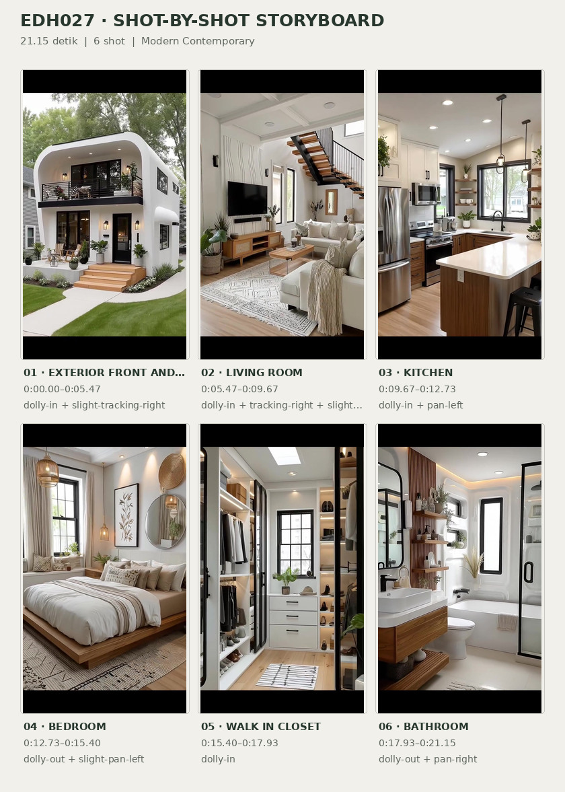
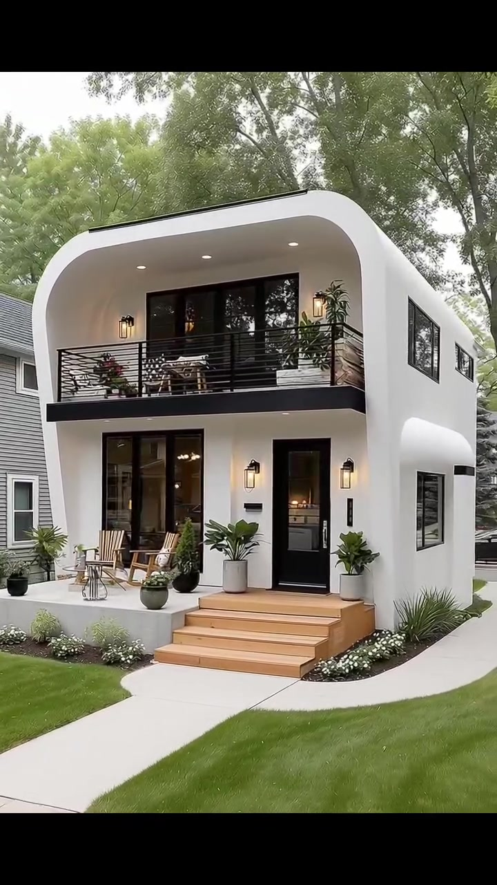
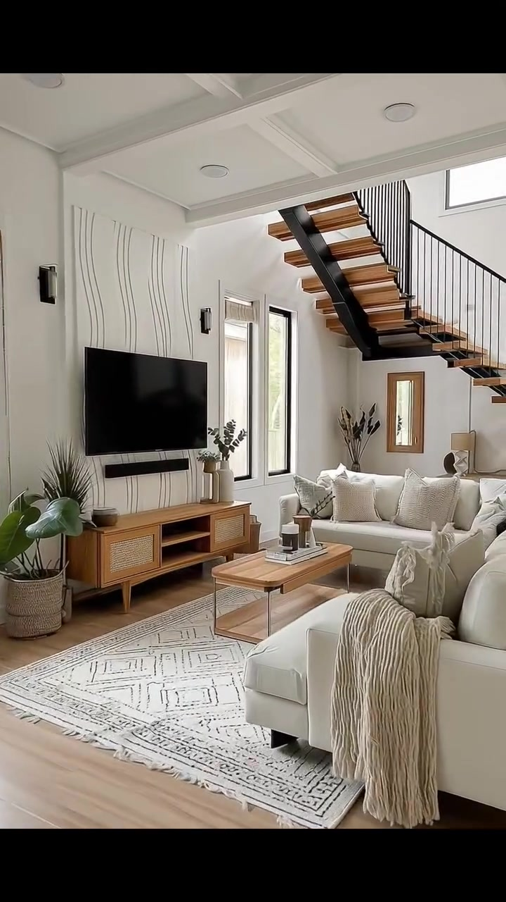
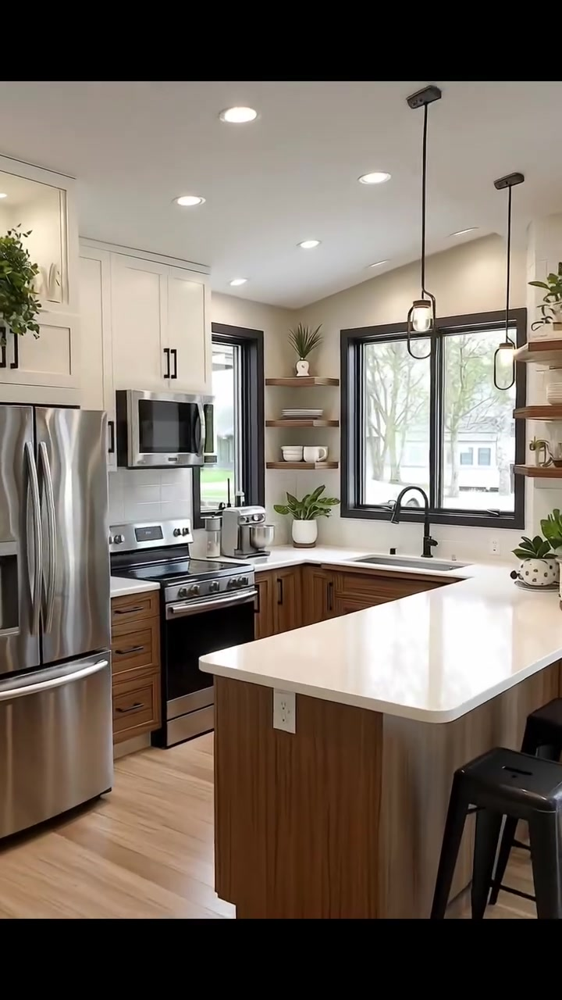
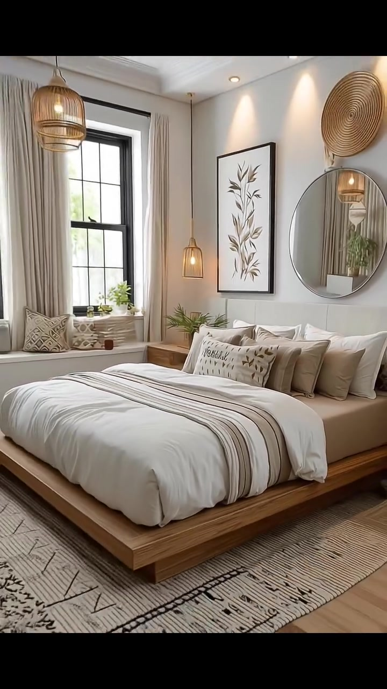
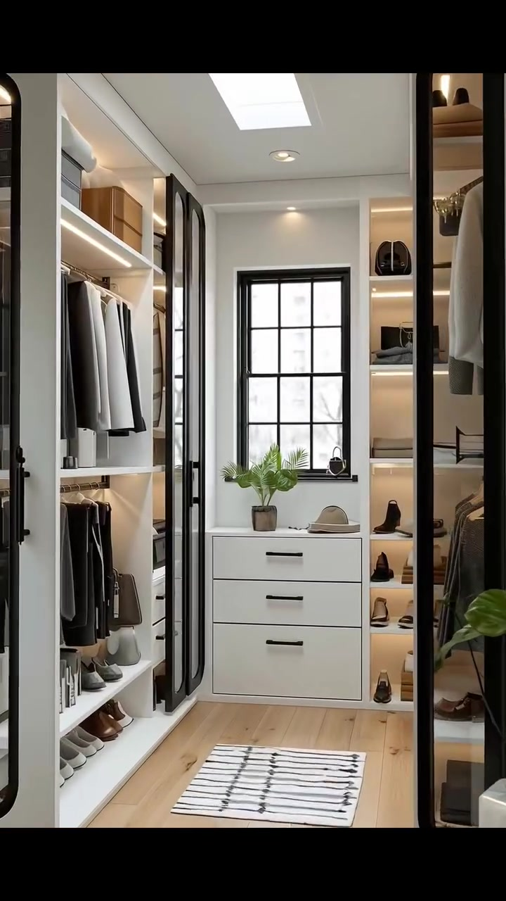
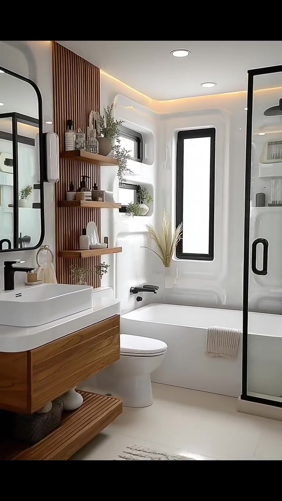

# edh027 — Modern Contemporary

<!-- homeku_request_id: edh027-20261104-1433 -->

<!-- homeku_detail_narratives: chat-reviewed -->

**Sumber data:** [analysis.yaml](analysis.yaml) · **Status:** draft · **Diverifikasi manusia:** Tidak

## 1. Informasi Video

| Informasi | Nilai |
|---|---|
| ID | edh027 |
| File asli | edh027.mp4 |
| Durasi | 21.15 |
| Resolusi | 720x1280 |
| FPS | 30 |
| Rasio | 9:16 |
| Jumlah shot | 6 |

## 2. Storyboard Gabungan

## 3. Identitas Desain

| Aspek | Hasil analisis |
|---|---|
| Gaya utama | modern contemporary |
| Wilayah terkait gaya desain | Tidak diketahui |
| Pengaruh gaya | soft minimalism, organic modern, scandinavian interior influences |
| Ciri eksterior | smooth white stucco appearance, rounded front facade corner, recessed upper balcony, black metal guardrail, black framed glazing, light wood appearance entry steps |
| Gaya interior | warm modern, natural wood accents, neutral textiles, subtle woven decor |
| Confidence gaya | medium |

## 4. Ukuran & Proporsi Bangunan

| Aspek | Estimasi visual |
|---|---|
| Ukuran yang terlihat | medium |
| Bentuk bangunan | narrow rectangular |
| Skala vertikal | two story |
| Tapak bangunan | compact |
| Perkiraan luas lantai | 95–160 m² |
| Confidence | low |

> Luas adalah perkiraan visual, bukan ukuran terukur.

## 5. Warna, Pencahayaan, dan Atmosfer

| Warna dominan | HEX (perkiraan) |
|---|---|
| warm white | #F1F0EB |
| black charcoal | #222525 |
| light natural wood | #C7A57B |
| soft cream | #DED5C5 |
| leaf green | #65815C |

| Aspek | Hasil analisis |
|---|---|
| Pencahayaan | soft exterior daylight, bright interior window daylight, warm ambient and recessed lights |
| Lingkungan | suburban residential street, green front lawn, mature leafy trees, front walkway and landscaped border |
| Musim yang tampak | Tidak diketahui |
| Mood | airy, warm, calm, welcoming |

## 6. Struktur dan Timeline Video

**Jenis:** home tour · **Tempo:** moderate · **Transisi:** smooth entry movement then hard cuts between rooms

| Shot | Waktu (detik) | Durasi | Area/Scene | Gerakan Kamera |
|---|---|---|---|---|
| Shot 01 | 0.0–5.47 | 5.47 | exterior front and entry | dolly in, slight tracking right |
| Shot 02 | 5.47–9.67 | 4.20 | living room | dolly in, tracking right, slight tilt up |
| Shot 03 | 9.67–12.73 | 3.06 | kitchen | dolly in, pan left |
| Shot 04 | 12.73–15.4 | 2.67 | bedroom | dolly out, slight pan left |
| Shot 05 | 15.4–17.93 | 2.53 | walk in closet | dolly in |
| Shot 06 | 17.93–21.15 | 3.22 | bathroom | dolly out, pan right |

## 7. Analisis per Shot

### Shot 01 — exterior front and entry

**Waktu:** 0.0–5.47 detik

| Komponen | Pengamatan |
|---|---|
| Fokus utama | two story white house and front entry |
| Framing awal → akhir | wide front three quarter view → close view through open front door |
| Sudut pandang | eye level with slight upward view of upper floor |
| Gerakan kamera | dolly in, slight tracking right |
| Kecepatan kamera | slow to moderate |
| Pencahayaan | soft daylight with warm entry and balcony lights |
| Transisi keluar | smooth forward entry transition |

**Detail yang terlihat**

**Arsitektur**

Rumah tampak sebagai massa persegi panjang yang relatif ramping dengan dua lantai. Dinding luar berfinishing halus putih menyerupai plester, sedangkan sudut depan bagian atas dan tepi fasad dibuat melengkung; sebuah garis tepian atap gelap terlihat di atasnya. Balkon lantai dua masuk ke dalam bidang fasad, dibatasi pagar logam hitam berbilah horizontal dengan bukaan kaca besar berbingkai hitam di belakangnya. Di lantai dasar, bukaan kaca tinggi berbingkai hitam berada di kiri pintu utama kaca berbingkai hitam. Dua lampu dinding hitam bercahaya hangat mengapit pintu; anak tangga berpenampilan kayu terang menuju pintu dari teras putih yang ditinggikan di sisi kirinya. Di sisi kanan bangunan terlihat jendela\-jendela persegi panjang berbingkai hitam dan proyeksi kanopi putih melengkung di atas bukaan bawah. Lampu sorot tanam kecil berada di bawah bidang overhang, dan slot surat horizontal gelap terpasang di kiri pintu.

**Furnitur dan properti**

Di teras lantai dasar sebelah kiri terdapat dua kursi berbilik kayu terang dengan meja samping kecil bundar berkerangka terbuka di antaranya. Pot putih dan gelap berisi tanaman hijau berdaun lebar ditempatkan dekat tangga. Balkon atas memuat tempat duduk luar dan beberapa pot tanaman; tanaman berbunga merah terlihat dekat pagar sisi kirinya.

**Lingkungan**

Hamparan rumput hijau terpangkas membingkai jalur beton pucat dari bagian depan gambar menuju anak tangga rumah. Jalur berpaving terang juga melengkung menyusuri sisi kanan bangunan. Di tepi tangga terdapat hamparan bunga putih kecil, disertai rumpun rumput hias hijau di dekat dinding kanan. Pohon\-pohon besar berdaun hijau menjulang di belakang rumah. Rumah tetangga berdinding abu\-abu terlihat di kiri, bangunan tetangga berwarna terang di kanan belakang, dan sebagian mobil gelap tampak di kanan. Seluruh area diterangi cahaya siang yang lembut di bawah langit terang.

**Catatan pengamatan:** Transisi kamera dari tampak depan ke ambang pintu berlangsung halus; jenis material eksterior dideskripsikan dari penampilan.

**Confidence:** Kamera medium · Detail visual high

### Shot 02 — living room

**Waktu:** 5.47–9.67 detik

| Komponen | Pengamatan |
|---|---|
| Fokus utama | cream seating area beneath open riser staircase |
| Framing awal → akhir | wide view from front entry → closer view of seating and staircase |
| Sudut pandang | eye level with upward view of stairs |
| Gerakan kamera | dolly in, tracking right, slight tilt up |
| Kecepatan kamera | slow to moderate |
| Pencahayaan | natural window daylight and recessed ceiling lights |
| Transisi keluar | hard cut to kitchen |

**Detail yang terlihat**

**Arsitektur**

Ruang keluarga memiliki dinding putih dan plafon putih berpanel cekung seperti coffered ceiling, dengan downlight bundar. Tangga terbuka di sisi kanan melewati atas area duduk, terdiri dari pijakan berpenampilan kayu hangat, penyangga logam hitam, dan baluster vertikal hitam yang ramping. Jendela tinggi dan sempit berbingkai hitam berada di kiri tangga, sementara jendela horizontal tinggi tampak di atasnya. Lantai berpenampilan papan kayu terang. Dinding di belakang televisi menampilkan motif garis lengkung halus; cermin vertikal kecil berbingkai kayu menggantung di bawah tangga. Lampu dinding hitam terpasang di sisi dinding ruang keluarga, dan pintu masuk berbingkai hitam masih terlihat pada awal adegan.

**Furnitur dan properti**

Televisi datar hitam besar terpasang pada dinding kiri, di atas konsol media rendah dari kayu terang dengan panel depan anyaman. Dua sofa berlapis kain krem ditata mengelilingi meja kopi di tengah, lengkap dengan bantal krem dan beige bertekstur; selimut rajut berwarna netral menjuntai dari sofa depan. Meja kopi kayu terang berbentuk persegi panjang memiliki dua tingkat dan berdiri di atas karpet putih gading berpola geometris hitam. Buku kecil dan dekorasi diletakkan di meja. Tanaman hijau berpot berada di dekat konsol, sedangkan vas dengan rangkaian batang kering terdapat dekat jendela dan tangga. Lampu meja kecil berada pada meja samping di dekat sofa belakang.

**Lingkungan**

Cahaya siang lembut masuk melalui jendela tinggi ruang keluarga. Sedikit kehijauan dari area luar tampak samar melalui kaca.

**Catatan pengamatan:** Ruang keluarga ditampilkan dengan dorongan kamera mendekat dan sedikit mengarah ke tangga.

**Confidence:** Kamera medium · Detail visual high

### Shot 03 — kitchen

**Waktu:** 9.67–12.73 detik

| Komponen | Pengamatan |
|---|---|
| Fokus utama | two tone kitchen cabinets and stove |
| Framing awal → akhir | wide kitchen with foreground island → medium close view of range and cabinets |
| Sudut pandang | eye level slightly downward toward counter |
| Gerakan kamera | dolly in, pan left |
| Kecepatan kamera | moderate |
| Pencahayaan | bright window daylight with recessed and pendant lights |
| Transisi keluar | hard cut to bedroom |

**Detail yang terlihat**

**Arsitektur**

Dapur berukuran ringkas ini menampilkan susunan countertop berbentuk L. Kabinet atas bergaya Shaker berwarna putih memakai gagang hitam memanjang, sedangkan laci dan kabinet bawah berpenampilan serat kayu hangat memakai gagang hitam. Countertop putih halus berpadu dengan backsplash terang. Island berlapis kayu mempunyai permukaan putih dengan sudut membulat. Jendela besar berbingkai hitam berada di atas bak cuci, dengan jendela lebih sempit di kanan kompor. Keran tinggi melengkung berwarna hitam terpasang di atas bak cuci yang masuk ke dalam countertop. Rak dinding kayu terbuka terlihat di samping area jendela. Plafon putih dilengkapi downlight kecil, di atas lantai papan berpenampilan kayu terang.

**Furnitur dan properti**

Kulkas stainless dengan dua pintu atas ditempatkan di kiri. Microwave stainless terpasang di atas kompor dan oven berwarna hitam\-perak; mesin mixer berdiri warna perak ada di countertop samping kompor. Dua kursi bar tinggi berangka logam hitam berada pada sisi island, dan dua lampu gantung kaca ramping dengan fitting gelap menggantung di atasnya. Rak terbuka menampilkan mangkuk putih dan keramik kecil, bersama tanaman hijau berpot kecil yang juga ada di countertop. Peralatan masak kayu tersimpan dalam wadah terang di dekat kompor.

**Lingkungan**

Cahaya siang terang masuk dari jendela\-jendela dapur berbingkai hitam. Di luar terlihat rumput hijau, cabang pepohonan, serta rumah tetangga berwarna terang melalui jendela besar.

**Catatan pengamatan:** Pergerakan mendekati kompor membuat perabot di sisi kiri semakin menonjol.

**Confidence:** Kamera high · Detail visual high

### Shot 04 — bedroom

**Waktu:** 12.73–15.4 detik

| Komponen | Pengamatan |
|---|---|
| Fokus utama | low wood platform bed with neutral textiles |
| Framing awal → akhir | close view of bed and headboard → wide view of bed and window wall |
| Sudut pandang | eye level slightly downward to bed |
| Gerakan kamera | dolly out, slight pan left |
| Kecepatan kamera | moderate |
| Pencahayaan | soft window daylight with warm pendants and spotlights |
| Transisi keluar | hard cut to walk in closet |

**Detail yang terlihat**

**Arsitektur**

Bidang dinding di belakang ranjang dilapisi panel vertikal putih lembut. Plafon putih memiliki cornice, dengan sorot lampu kecil di bagian atas dinding. Pada dinding kiri terdapat dua jendela tinggi berbingkai hitam, diapit tirai panjang beige muda, serta bangku jendela lebar di bawahnya. Lantai menampilkan papan berpenampilan kayu terang.

**Furnitur dan properti**

Ranjang platform kayu rendah berukuran besar menempel pada dinding belakang. Seprai netral kecokelatan ditutup duvet putih dan kain bergaris taupe\-abu di atasnya, dengan susunan bantal krem, beige, dan bantal bermotif di kepala ranjang. Meja samping kecil dari kayu berada di kiri ranjang. Satu lukisan botani berbingkai hitam tergantung di atas kepala ranjang; cermin bundar besar ada di kanannya, dengan dekorasi bundar anyaman di atas cermin. Lampu gantung berpenampilan anyaman menggantung dekat jendela dan lampu gantung kecil bercahaya hangat berada di samping ranjang. Karpet terang berpola geometris hitam mengisi area di bawah ranjang. Bangku jendela memuat bantal bermotif; tanaman hijau kecil dalam pot terlihat dekat jendela dan sisi ranjang.

**Lingkungan**

Cahaya alami lembut memasuki kamar melalui jendela\-jendela tinggi. Dedaunan hijau tampak samar di luar kaca.

**Catatan pengamatan:** Kamera mundur sehingga jendela, dekorasi dinding, dan karpet terlihat lebih lengkap.

**Confidence:** Kamera high · Detail visual high

### Shot 05 — walk in closet

**Waktu:** 15.4–17.93 detik

| Komponen | Pengamatan |
|---|---|
| Fokus utama | symmetrical walk in closet and back window |
| Framing awal → akhir | wide centered aisle view → medium view of back dresser and storage |
| Sudut pandang | straight on eye level |
| Gerakan kamera | dolly in |
| Kecepatan kamera | slow |
| Pencahayaan | soft window daylight recessed spots and warm shelf lighting |
| Transisi keluar | hard cut to bathroom |

**Detail yang terlihat**

**Arsitektur**

Walk\-in closet berbentuk lorong sempit dengan kabinet penyimpanan putih setinggi dinding pada kedua sisi. Rel gantungan dan rak terbuka menyatu dengan lampu rak berwarna hangat. Beberapa pintu kabinet kaca memakai bingkai hitam tinggi yang melengkung pada sudut atas. Lemari tiga laci putih terletak di ujung lorong, tepat di bawah jendela hitam dengan pembagi kisi. Di plafon terdapat panel cahaya persegi panjang besar yang tampak terdifusi serta downlight kecil. Lantai berpenampilan papan kayu terang.

**Furnitur dan properti**

Kemeja dan jaket berwarna netral tergantung pada kedua sisi. Rak atas menampung pakaian terlipat dan kotak penyimpanan beige, sementara rak bawah menampilkan sejumlah pasang sepatu warna netral. Tas tangan dan keranjang tersusun pada rak samping. Di atas lemari laci ujung terdapat pakis kecil berpot dan topi beige. Karpet lorong putih dengan garis gelap diletakkan di tengah; tanaman hijau tinggi berpot terlihat di depan sisi kanan.

**Lingkungan**

Cahaya siang masuk melalui jendela berkisi hitam di ujung ruangan; bayangan cabang pohon tampak samar di luar.

**Catatan pengamatan:** Panel terang persegi pada plafon tidak dipastikan sebagai skylight karena tampak seperti diffuser cahaya.

**Confidence:** Kamera high · Detail visual high

### Shot 06 — bathroom

**Waktu:** 17.93–21.15 detik

| Komponen | Pengamatan |
|---|---|
| Fokus utama | white vessel sink and wood accent bathroom |
| Framing awal → akhir | close view of sink and faucet → wide view of vanity toilet tub and shower |
| Sudut pandang | eye level slight downward angle at sink |
| Gerakan kamera | dolly out, pan right |
| Kecepatan kamera | moderate |
| Pencahayaan | bright diffuse window daylight with warm cove and shelf lights |
| Transisi keluar | end of video |

**Detail yang terlihat**

**Arsitektur**

Kamar mandi berdinding putih dengan lantai terang menyerupai ubin. Wastafel putih persegi panjang berjenis vessel berada di atas countertop putih, dilengkapi keran hitam matte bertuas tunggal. Kabinet vanity melayang memiliki muka berpenampilan serat kayu hangat; di atasnya tergantung cermin besar persegi panjang dengan sudut membulat dan bingkai hitam. Di samping cermin terdapat dinding aksen bilah kayu vertikal dan tiga rak kayu melayang. Sisi lain menampilkan ceruk pajangan putih dengan lampu latar hangat. Bak mandi putih berbentuk persegi panjang menempel ke dinding belakang, dengan cerat air hitam yang terpasang pada dinding dan jendela hitam tinggi\-sempit di atasnya. Kanan ruangan berisi shower di balik kaca bening berbingkai hitam. Plafon memakai downlight kecil dan pencahayaan cove hangat di tepinya. Cincin gantungan handuk warna emas berada di kanan cermin.

**Furnitur dan properti**

Toilet putih berada di antara vanity dan bathtub. Handuk kecil krem digantung pada cincin berwarna emas. Botol perlengkapan mandi warna netral dan keramik kecil dipajang pada rak kayu; beberapa tanaman hijau berpot kecil juga menempati rak dan ceruk dinding. Rak bawah terbuka dari bilah kayu berada di bawah vanity dengan handuk gulung. Keset mandi netral terang ada di lantai dan selembar handuk krem disampirkan pada tepi bathtub.

**Lingkungan**

Cahaya siang terang menembus jendela tinggi kamar mandi, tetapi pemandangan di luar terlalu terang sehingga tidak dapat diidentifikasi dengan pasti.

**Catatan pengamatan:** Merek sanitair dan jenis batu atau kayu tidak dapat dipastikan; tampak lantai dan countertop dijelaskan sebagai penampilan visual.

**Confidence:** Kamera high · Detail visual high

## 8. Kualitas dan Ketidakpastian Analisis

| Parameter | Hasil |
|---|---|
| Status | draft |
| Verifikasi manusia | Tidak |
| Ketepatan timestamp | estimated |
| Ketidakpastian | room and material labels describe appearance not verified specifications, floor area estimated without measured dimensions, architectural style and camera motion are interpretations, transition between exterior and living room is visually smooth, final 0 15 seconds of container have no additional video frames, original building location and season unknown |

**Catatan:** Analisis observasi visual menyeluruh; sumber main/video/edh027.mp4 dicocokkan melalui SHA Git blob. Enam segmen dipakai untuk memisahkan exterior/entry, living room, kitchen, bedroom, closet, dan bathroom. Durasi format 21.15 detik, sementara stream gambar berakhir pada 21.00 detik.

---

*Laporan ini diturunkan dari [analysis.yaml](analysis.yaml).*
