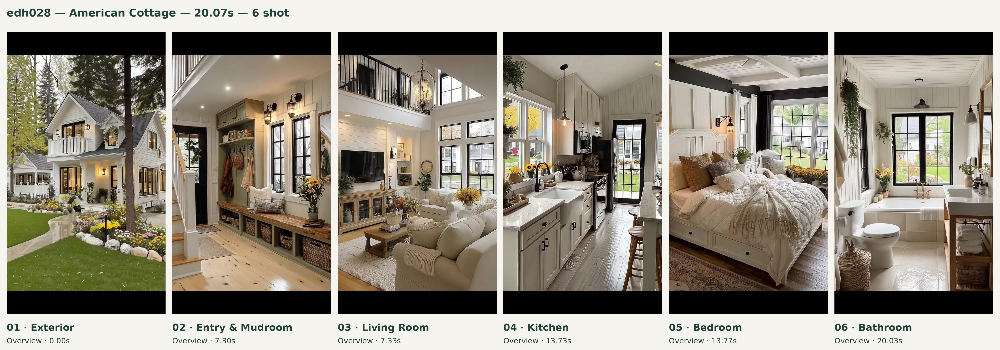
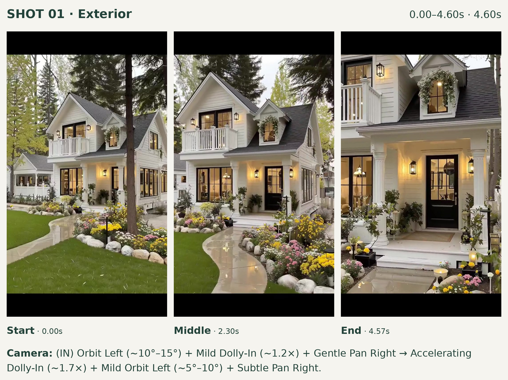
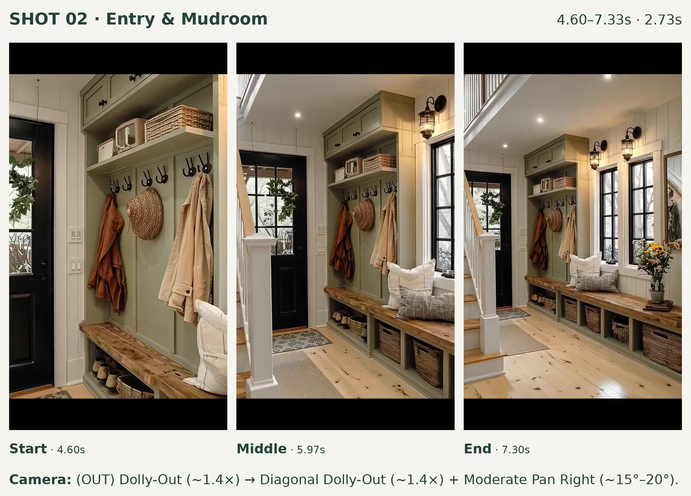
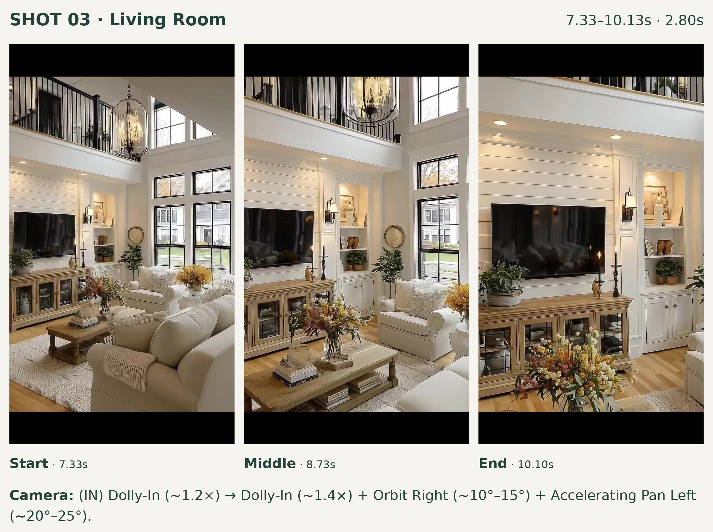
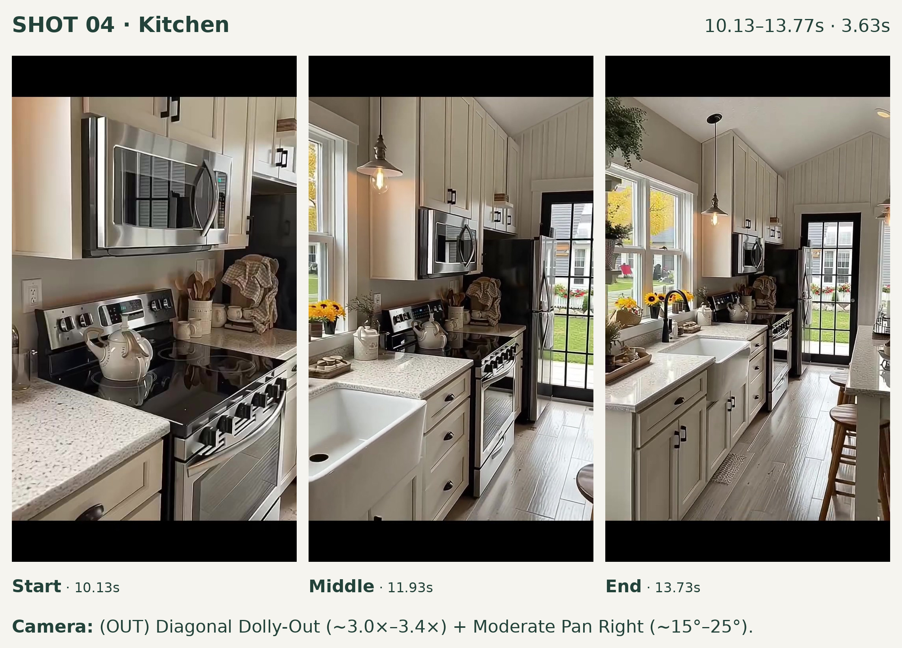
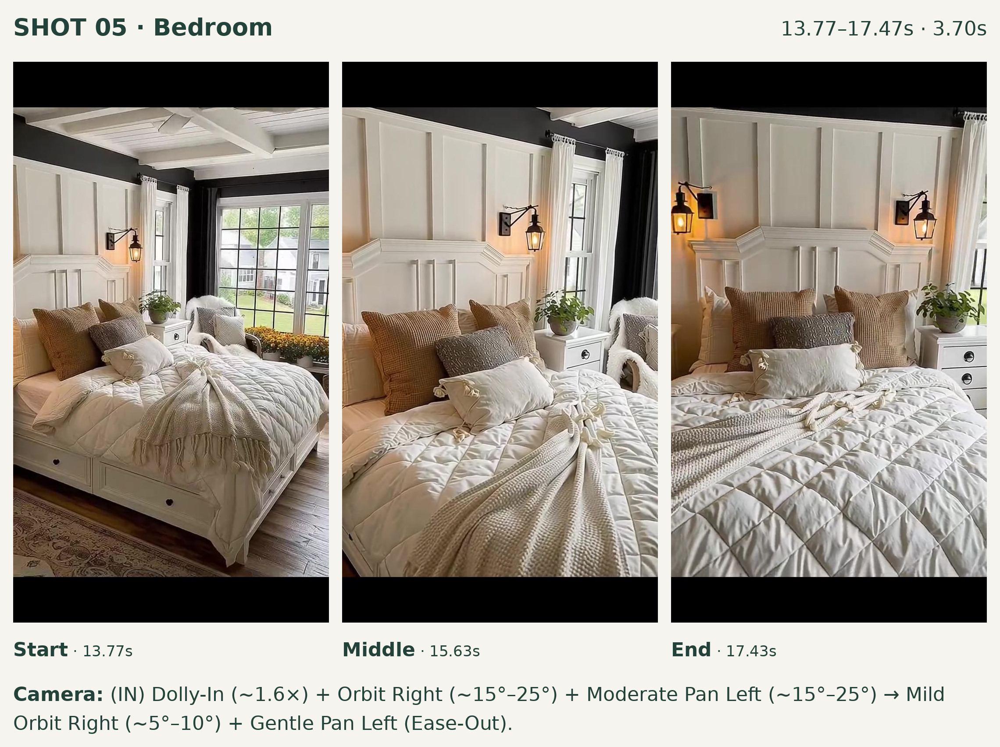
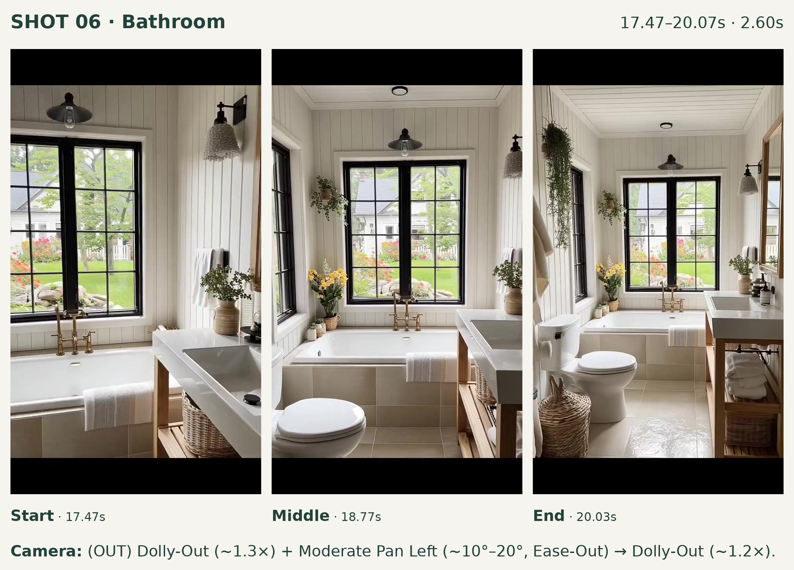

# edh028 — White Gabled Garden Cottage

## 1. Profil desain

- **Nama desain:** White Gabled Garden Cottage
- **Tipe rumah:** Cottage
- **Gaya utama:** **American Cottage**
- **Pengaruh gaya:** Modern Farmhouse
- **Gaya interior:** Cozy Farmhouse
- **Susunan ruang utama:** Entry dengan tangga, living bervolume tinggi dengan galeri atas, dapur memanjang, bedroom dan bathroom; hubungan antarshot tidak terkonfirmasi.
- **Ciri khas:** Dormer berhias tanaman, mudroom built-in, chandelier rangka hitam, apron-front sink dan headboard panel.
- **Material utama:** Siding putih beralur horizontal, bidang panel putih, lantai tampak kayu serta permukaan batu/ubin terang; material fisik tidak diverifikasi.
- **Pencahayaan:** Cahaya alami dari jendela besar berpadu lampu dinding dan lampu gantung hangat.
- **Atmosfer:** Hangat, rapi, domestik dan bernuansa taman.
- **Lingkungan:** Rumput, taman bunga, batu pembatas, pepohonan tinggi; bangunan lain terlihat dari bukaan.

### Palet warna

| Peran | Warna | HEX |
| --- | --- | --- |
| Dominan | Putih hangat | `#E9E4DA` |
| Pendamping | Kayu madu | `#BA946A` |
| Pendamping | Sage kusam | `#858575` |
| Pendamping | Greige | `#B8AA96` |
| Aksen | Arang | `#30302D` |
| Pendamping | Krem linen | `#D7CCB9` |

## 2. Ukuran & proporsi

| Aspek | Estimasi visual |
| --- | --- |
| **Ukuran rumah** | small |
| **Bentuk bangunan** | Massa utama tinggi dengan sayap rendah di kiri. |
| **Lantai & bentuk atap** | two levels · Atap pelana curam gelap, dormer pelana kecil dan gable utama. |
| **Tapak bangunan** | compact main mass with side extension |
| **Proporsi utama** | Massa utama relatif tinggi dengan atap curam dan sayap samping rendah. |
| **Perkiraan luas lantai** | **85–145 m²** |

## 3. Shot Timeline

Durasi 20.07s · 6 shot.

**Camera Pattern:** IN – OUT – IN – OUT – IN – OUT.

| Shot | Time (s) | Duration | Area/Scene | Camera Movement |
| --- | --- | --- | --- | --- |
| 01 | 0.00–4.60 | 4.60s | Exterior | Orbit Left (~10°–15°) + Mild Dolly-In (~1.2×) + Gentle Pan Right → Accelerating Dolly-In (~1.7×) + Mild Orbit Left (~5°–10°) + Subtle Pan Right. |
| 02 | 4.60–7.33 | 2.73s | Entry & Mudroom | Dolly-Out (~1.4×) → Diagonal Dolly-Out (~1.4×) + Moderate Pan Right (~15°–20°). |
| 03 | 7.33–10.13 | 2.80s | Living Room | Dolly-In (~1.2×) → Dolly-In (~1.4×) + Orbit Right (~10°–15°) + Accelerating Pan Left (~20°–25°). |
| 04 | 10.13–13.77 | 3.63s | Kitchen | Diagonal Dolly-Out (~3.0×–3.4×) + Moderate Pan Right (~15°–25°). |
| 05 | 13.77–17.47 | 3.70s | Bedroom | Dolly-In (~1.6×) + Orbit Right (~15°–25°) + Moderate Pan Left (~15°–25°) → Mild Orbit Right (~5°–10°) + Gentle Pan Left (Ease-Out). |
| 06 | 17.47–20.07 | 2.60s | Bathroom | Dolly-Out (~1.3×) + Moderate Pan Left (~10°–20°, Ease-Out) → Dolly-Out (~1.2×). |

## 4. Overview

**Shot 01 · Exterior · 0.00s**

> Dari halaman, menghadap serong fasad utama; wide mencakup gable, balkon, dormer, teras, sayap kiri, jalan, taman dan pohon.

**Shot 02 · Entry & Mudroom · 7.30s**

> Dari bagian dalam entry menghadap pintu dan dinding bangku; wide memperlihatkan tangga kiri, pintu, unit mantel, bangku panjang serta jendela kanan.

**Shot 03 · Living Room · 7.33s**

> Dari belakang sofa menghadap serong dinding TV dan jendela tinggi; wide mencakup sofa, kursi, meja, kabinet, galeri atas serta chandelier.

**Shot 04 · Kitchen · 13.73s**

> Dari ujung jalur dalam dapur, menghadap pintu berkaca; wide memperlihatkan deret kabinet kiri, sink di jendela, range, kulkas, counter kanan dan bangku.

**Shot 05 · Bedroom · 13.77s**

> Dari dekat kaki ranjang menghadap serong headboard; wide mencakup ranjang berlaci, panel dinding, balok plafon, jendela, meja dan kursi.

**Shot 06 · Bathroom · 20.03s**

> Dari dekat akses kamar mandi menghadap bathtub di ujung; wide mencakup jendela, toilet kiri, vanity kanan, lantai dan panel dinding.

## 5. Storyboard

## 6. Shot Details

### Shot 01 · Exterior

**Time:** 0.00–4.60s · **Duration:** 4.60s

#### **A. Desain area**

**Arsitektur**

> Massa utama tinggi berpelana dengan sayap rendah kiri. Pelana curam gelap, gable utama dan dormer kecil. Balustrade putih di depan pintu kaca lantai atas. Teras beratap, kolom putih, tiga undakan tampak, pintu berkaca hitam. Siding horizontal putih, trim putih, kusen hitam berkisi.

**Furnitur & dekorasi**

> Pot tanaman mengapit akses dan teras; dekorasi gantung mengelilingi dormer.

**Lingkungan**

> Halaman rumput, jalan melengkung tampak basah, bed bunga dengan batu bulat, pohon tinggi.

#### **B. Framing & Lighting**

- **Fokus:** Pintu dan teras
- **Camera Start:** Dari halaman dekat pohon · Ke fasad depan serong · oblique · Setinggi mata relatif terhadap halaman · Hampir datar; bidang vertikal dominan
- **Framing:** Wide fasad dan taman → Medium teras serta pintu
- **Lighting:** Cahaya luar lembut dan sconce kuning
- **Foreground dan kedalaman:** Rumput, batang pohon, bunga · Jalan depan menuju kolom dan massa rumah
- **Reveal:** Pohon bergeser, pintu semakin besar
- **Kesesuaian gerak:** Orbit dan dolly memindahkan foreground lalu menonjolkan akses

#### **C. Camera Movement**

Dari halaman, kamera bergerak mengitari rumah ke kiri sambil mendekat ringan; setelah pohon lepas dari bingkai, pendekatan makin dominan menuju teras dengan sisa orbit dan koreksi pandangan kanan.

**Tempo:** Pembukaan terkendali; pembesaran dan aliran foreground meningkat terutama setelah 3.1 detik. Tempo keseluruhan sedang dengan kecenderungan akselerasi visual.

**Movement Timeline**

| Time (s) | Area & fokus | Camera Movement | Tempo |
| --- | --- | --- | --- |
| 0.00–2.10 | Exterior · Fasad dan pohon depan | Orbit Left (~10°–15°) + Mild Dolly-In (~1.2×) + Gentle Pan Right | Pembukaan terkendali; pembesaran dan aliran foreground meningkat terutama setelah 3.1 detik. Tempo keseluruhan sedang dengan kecenderungan akselerasi visual. |
| 2.10–4.60 | Exterior · Pintu dan teras | Accelerating Dolly-In (~1.7×) + Mild Orbit Left (~5°–10°) + Subtle Pan Right | Pembukaan terkendali; pembesaran dan aliran foreground meningkat terutama setelah 3.1 detik. Tempo keseluruhan sedang dengan kecenderungan akselerasi visual. |

**Camera:** Orbit Left (~10°–15°) + Mild Dolly-In (~1.2×) + Gentle Pan Right → Accelerating Dolly-In (~1.7×) + Mild Orbit Left (~5°–10°) + Subtle Pan Right.

---

### Shot 02 · Entry & Mudroom

**Time:** 4.60–7.33s · **Duration:** 2.73s

#### **A. Desain area**

**Arsitektur**

> Pintu kaca hitam di ujung, jendela kanan, tangga di kiri menurut frame akhir. Panel vertikal terang dan lantai papan kayu muda. Downlight dan dua sconce hitam di atas jendela.

**Furnitur & dekorasi**

> Bangku kayu memanjang di bawah jendela, cubby terbuka berkeranjang dan sepatu. Kabinet sage built-in, kabinet atas tertutup, shelf terbuka dan deret kait mantel. Bantal, mantel, topi anyaman, vas bunga, karpet masuk.

**Lingkungan**

> Vegetasi tampak melalui pintu dan jendela; detail luar terbatas.

#### **B. Framing & Lighting**

- **Fokus:** Built-in penyimpanan
- **Camera Start:** Dekat bangku dan rak mantel · Ke pintu dan unit penyimpanan serong · oblique · Kira-kira setinggi mata · Hampir datar
- **Framing:** Close rak dan pintu → Wide pintu, tangga, bangku serta jendela
- **Lighting:** Cahaya jendela dan sconce hangat
- **Foreground dan kedalaman:** Tepi bangku, mantel · Lorong dari pintu ke tangga
- **Reveal:** Bangku utuh dan tangga muncul
- **Kesesuaian gerak:** Dolly-out memperluas konteks; Pan Right membuka jendela

#### **C. Camera Movement**

Kamera mundur dari rak mantel dan bangku, kemudian membuka mudroom lebih luas ke arah kanan dengan tangga di kiri.

**Tempo:** Mundur terasa cukup cepat di awal karena dekat; penyusutan melambat, tetapi sapuan kanan makin terasa pada paruh akhir. Tempo keseluruhan sedang.

**Movement Timeline**

| Time (s) | Area & fokus | Camera Movement | Tempo |
| --- | --- | --- | --- |
| 4.60–5.77 | Entry & Mudroom · Rak mantel dan bangku | Dolly-Out (~1.4×) | Mundur terasa cukup cepat di awal karena dekat; penyusutan melambat, tetapi sapuan kanan makin terasa pada paruh akhir. Tempo keseluruhan sedang. |
| 5.77–7.33 | Entry & Mudroom · Bangku, jendela dan tangga | Diagonal Dolly-Out (~1.4×) + Moderate Pan Right (~15°–20°) | Mundur terasa cukup cepat di awal karena dekat; penyusutan melambat, tetapi sapuan kanan makin terasa pada paruh akhir. Tempo keseluruhan sedang. |

**Camera:** Dolly-Out (~1.4×) → Diagonal Dolly-Out (~1.4×) + Moderate Pan Right (~15°–20°).

---

### Shot 03 · Living Room

**Time:** 7.33–10.13s · **Duration:** 2.80s

#### **A. Desain area**

**Arsitektur**

> Volume tinggi dengan galeri lantai atas berbalustrade besi hitam. Jendela berkisi hitam bertingkat dan transom tinggi. Panel horizontal putih di belakang TV, ceruk display built-in samping. Chandelier rangka oval hitam, downlight dan sconce.

**Furnitur & dekorasi**

> Sofa krem menghadap TV; kursi berlengan di sisi jendela. Meja kayu persegi panjang berkaki bubut dengan rak bawah, buku dan bunga. Kabinet kayu rendah berpintu kaca di bawah TV; kabinet putih dan ceruk di samping.

**Lingkungan**

> Rumput dan bangunan putih lain tampak dari jendela.

#### **B. Framing & Lighting**

- **Fokus:** Dinding TV dan meja kopi
- **Camera Start:** Di belakang/sisi sofa · Ke dinding TV dan jendela · oblique · Setinggi mata · Hampir datar
- **Framing:** Wide sofa, galeri atas, TV dan jendela → Medium TV, kabinet serta meja
- **Lighting:** Cahaya jendela tinggi, lampu hangat
- **Foreground dan kedalaman:** Sandaran sofa dan meja · Foreground sofa ke meja dan dinding TV, volume atas
- **Reveal:** TV makin frontal, jendela kanan keluar
- **Kesesuaian gerak:** Orbit dan pan mengubah orientasi dinding; dolly menonjolkan detail

#### **C. Camera Movement**

Kamera mendekat melewati sisi sofa ke arah TV. Mulai sekitar 8.3 detik, pendekatan bertumpang tindih dengan gerak melengkung kanan dan sapuan kiri yang mengarahkan pandangan ke dinding TV.

**Tempo:** Pendekatan awal tenang, sapuan meningkat bertahap di paruh kedua sehingga terasa lebih dinamis menjelang cut.

**Movement Timeline**

| Time (s) | Area & fokus | Camera Movement | Tempo |
| --- | --- | --- | --- |
| 7.33–8.30 | Living Room · Area duduk dan TV | Dolly-In (~1.2×) | Pendekatan awal tenang, sapuan meningkat bertahap di paruh kedua sehingga terasa lebih dinamis menjelang cut. |
| 8.30–10.13 | Living Room · Dinding TV dan meja kopi | Dolly-In (~1.4×) + Orbit Right (~10°–15°) + Accelerating Pan Left (~20°–25°) | Pendekatan awal tenang, sapuan meningkat bertahap di paruh kedua sehingga terasa lebih dinamis menjelang cut. |

**Camera:** Dolly-In (~1.2×) → Dolly-In (~1.4×) + Orbit Right (~10°–15°) + Accelerating Pan Left (~20°–25°).

---

### Shot 04 · Kitchen

**Time:** 10.13–13.77s · **Duration:** 3.63s

#### **A. Desain area**

**Arsitektur**

> Deret kabinet dan peralatan di kiri, counter berbangku di kanan, jalur ke pintu kaca. Plafon miring dan panel vertikal di ujung. Jendela besar di atas sink; pintu kaca berkisi hitam di ujung. Lantai papan abu-cokelat dan countertop terang berbintik.

**Furnitur & dekorasi**

> Range permukaan hitam dan oven, microwave logam di atas, kulkas gelap dekat pintu. Apron-front sink putih dengan keran lengkung hitam. Kabinet shaker krem, handle hitam; counter kanan dengan bangku bulat kayu. Sisi kanan meja terlihat, sambungan ke dinding tidak jelas; island atau peninsula belum pasti.

**Lingkungan**

> Rumput, pohon dan rumah lain terlihat melalui jendela/pintu.

#### **B. Framing & Lighting**

- **Fokus:** Deret peralatan dan layout
- **Camera Start:** Dekat range di sisi kabinet · Ke kompor dan microwave serong · oblique · Setinggi mata · Sedikit mengarah ke bidang kerja
- **Framing:** Close range dan microwave → Wide lorong dapur, sink, counter kanan, pintu
- **Lighting:** Cahaya jendela dan pendant hangat
- **Foreground dan kedalaman:** Counter kiri · Lorong memanjang menuju pintu
- **Reveal:** Sink dan bangku terbuka saat mundur
- **Kesesuaian gerak:** Dolly-out diagonal dan pan membuka panjang layout

#### **C. Camera Movement**

Mundur diagonal dari close-up kompor dan microwave, membuka wastafel, pintu kaca dan lorong dapur; pandangan beralih ke kanan mengikuti sumbu ruang.

**Tempo:** Penyusutan gambar kuat tetapi berlangsung kontinu selama 3.63 detik; perubahan visual sedikit mereda menjelang akhir.

**Camera:** Diagonal Dolly-Out (~3.0×–3.4×) + Moderate Pan Right (~15°–25°).

---

### Shot 05 · Bedroom

**Time:** 13.77–17.47s · **Duration:** 3.70s

#### **A. Desain area**

**Arsitektur**

> Panel putih vertikal dengan aksen arang di bagian atas. Plafon putih dengan balok dekoratif. Jendela besar berkisi dan jendela sempit di sisi headboard, tirai putih/hitam. Sconce lentera hitam di sisi headboard.

**Furnitur & dekorasi**

> Ranjang putih dengan headboard panel tinggi, laci bawah, quilt putih dan bantal cokelat. Meja putih berlaci di sisi ranjang dengan tanaman pot. Kursi aksen berlapis kain putih dekat jendela; karpet motif di kaki ranjang.

**Lingkungan**

> Halaman hijau dan bangunan putih terlihat dari jendela.

#### **B. Framing & Lighting**

- **Fokus:** Ranjang dan headboard
- **Camera Start:** Di sisi kaki ranjang · Ke headboard dan jendela kanan · oblique · Kira-kira setinggi mata · Sedikit ke bawah terhadap ranjang
- **Framing:** Wide ranjang dan jendela → Medium-close hampir frontal headboard
- **Lighting:** Cahaya jendela dan sconce kuning
- **Foreground dan kedalaman:** Sudut kaki ranjang, tekstil · Ranjang mengisi foreground, dinding panel di belakang
- **Reveal:** Headboard makin frontal, jendela menyempit
- **Kesesuaian gerak:** Dolly-in dan orbit menguatkan simetri akhir

#### **C. Camera Movement**

Kamera mendekat ke ranjang sambil mengitari ke kanan dan memutar pandangan ke kiri. Di akhir pendekatan jauh lebih lemah, fokus bergeser menjadi headboard hampir frontal.

**Tempo:** Gerakan halus dan sedang; pembesaran mereda di sekitar F503, sapuan tetap terlihat hingga cut.

**Movement Timeline**

| Time (s) | Area & fokus | Camera Movement | Tempo |
| --- | --- | --- | --- |
| 13.77–16.77 | Bedroom · Ranjang dan headboard | Dolly-In (~1.6×) + Orbit Right (~15°–25°) + Moderate Pan Left (~15°–25°) | Gerakan halus dan sedang; pembesaran mereda di sekitar F503, sapuan tetap terlihat hingga cut. |
| 16.77–17.47 | Bedroom · Headboard dan lampu kiri | Mild Orbit Right (~5°–10°) + Gentle Pan Left (Ease-Out) | Gerakan halus dan sedang; pembesaran mereda di sekitar F503, sapuan tetap terlihat hingga cut. |

**Camera:** Dolly-In (~1.6×) + Orbit Right (~15°–25°) + Moderate Pan Left (~15°–25°) → Mild Orbit Right (~5°–10°) + Gentle Pan Left (Ease-Out).

---

### Shot 06 · Bathroom

**Time:** 17.47–20.07s · **Duration:** 2.60s

#### **A. Desain area**

**Arsitektur**

> Bathtub di ujung bawah jendela, toilet kiri, vanity kanan menurut frame akhir. Jendela besar hitam berkisi di ujung dan bukaan samping kiri. Panel vertikal putih dan ubin beige pada lantai serta apron bathtub. Lampu dinding hitam di atas jendela, sconce vanity dan downlight.

**Furnitur & dekorasi**

> Bak putih built-in dengan keran berwarna kuningan, handuk di bibir bak. Wastafel kotak putih di atas rangka kayu terbuka dengan keranjang dan handuk. Toilet putih di kiri jalur, keranjang anyaman di dekatnya. Tanaman gantung, pot bunga kuning dan cermin berbingkai kayu di atas vanity.

**Lingkungan**

> Taman bunga, rumput, pohon dan bangunan putih terlihat melalui jendela.

#### **B. Framing & Lighting**

- **Fokus:** Bathtub di bawah jendela
- **Camera Start:** Dekat vanity sisi kanan · Ke bathtub dan jendela · oblique · Setinggi mata · Hampir datar
- **Framing:** Close jendela, bak dan vanity → Wide bathtub, toilet dan vanity
- **Lighting:** Cahaya jendela dan lampu dinding
- **Foreground dan kedalaman:** Sudut vanity · Jalur lantai menuju bathtub
- **Reveal:** Toilet, sisi vanity dan plafon terungkap
- **Kesesuaian gerak:** Pan Left memusatkan bak; Dolly-Out memperluas konteks

#### **C. Camera Movement**

Kamera mundur dari bathtub dan wastafel sambil menyapu ke kiri agar jendela terpusat, lalu meneruskan mundur untuk membuka toilet dan vanity.

**Tempo:** Sapuan paling terasa pada awal; mereda di paruh akhir, sementara gerak mundur tetap cukup konsisten.

**Movement Timeline**

| Time (s) | Area & fokus | Camera Movement | Tempo |
| --- | --- | --- | --- |
| 17.47–19.10 | Bathroom · Bathtub, jendela, wastafel | Dolly-Out (~1.3×) + Moderate Pan Left (~10°–20°, Ease-Out) | Sapuan paling terasa pada awal; mereda di paruh akhir, sementara gerak mundur tetap cukup konsisten. |
| 19.10–20.07 | Bathroom · Bathtub dan tampilan luas kamar mandi | Dolly-Out (~1.2×) | Sapuan paling terasa pada awal; mereda di paruh akhir, sementara gerak mundur tetap cukup konsisten. |

**Camera:** Dolly-Out (~1.3×) + Moderate Pan Left (~10°–20°, Ease-Out) → Dolly-Out (~1.2×).

**Catatan referensi:** Luas 85–145 m² merupakan perkiraan kasar dari massa tampak, bukan pengukuran. Label gaya dan tipe merupakan interpretasi visual. Warna HEX adalah perkiraan tampilan. Urutan shot bukan bukti denah atau satu bangunan fisik. Material fisik tidak terverifikasi. Kamera menggunakan hasil Fase 2 yang disetujui tanpa perubahan.
