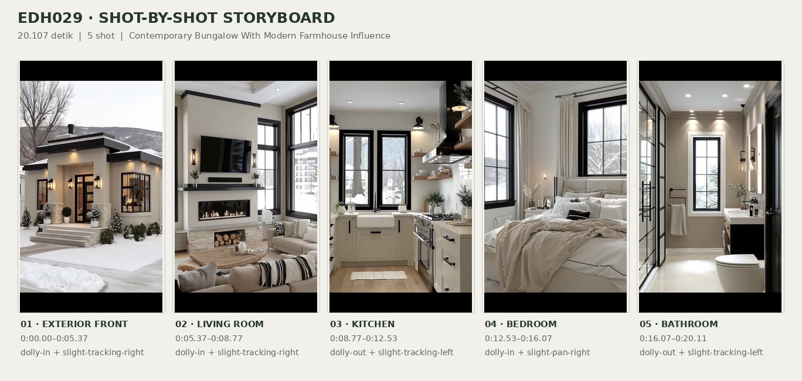
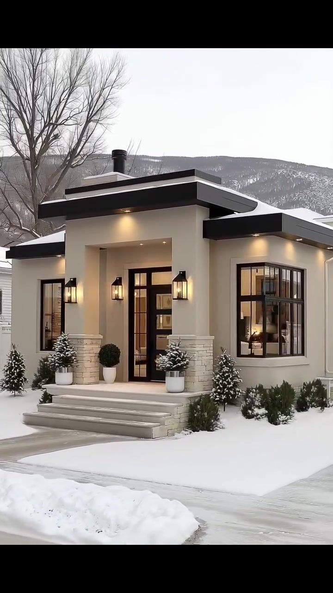
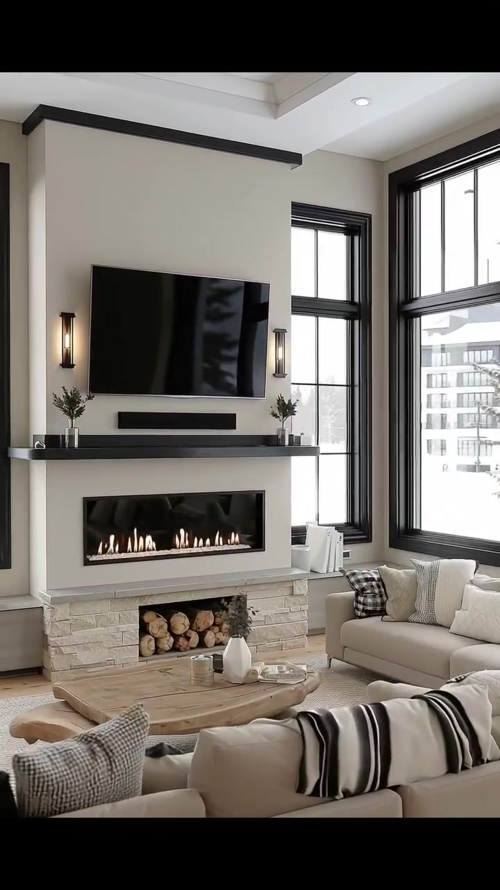
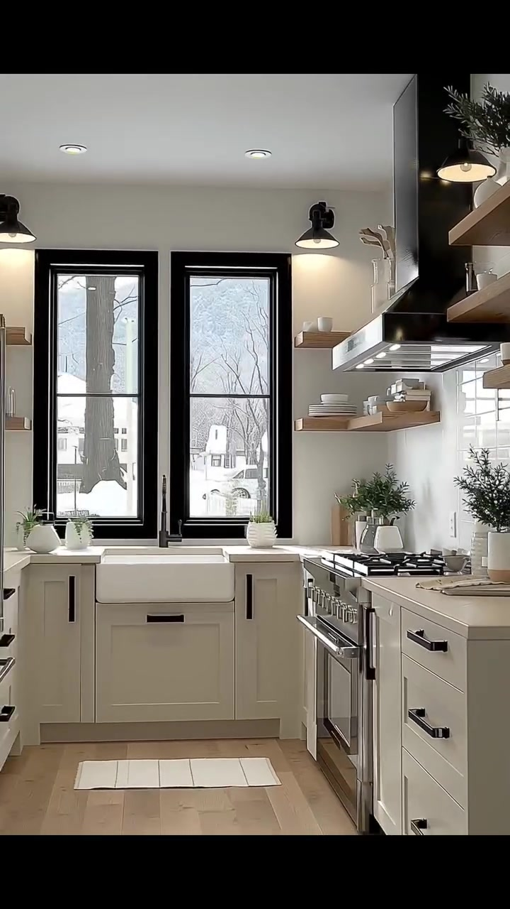
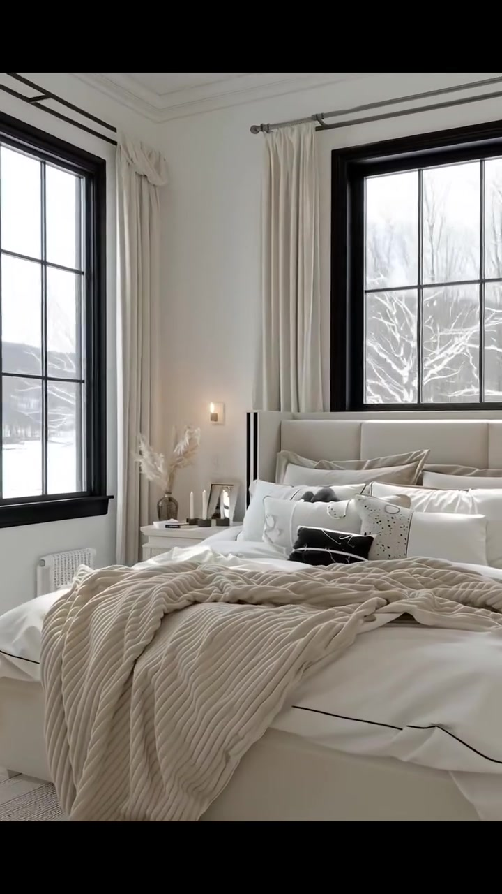
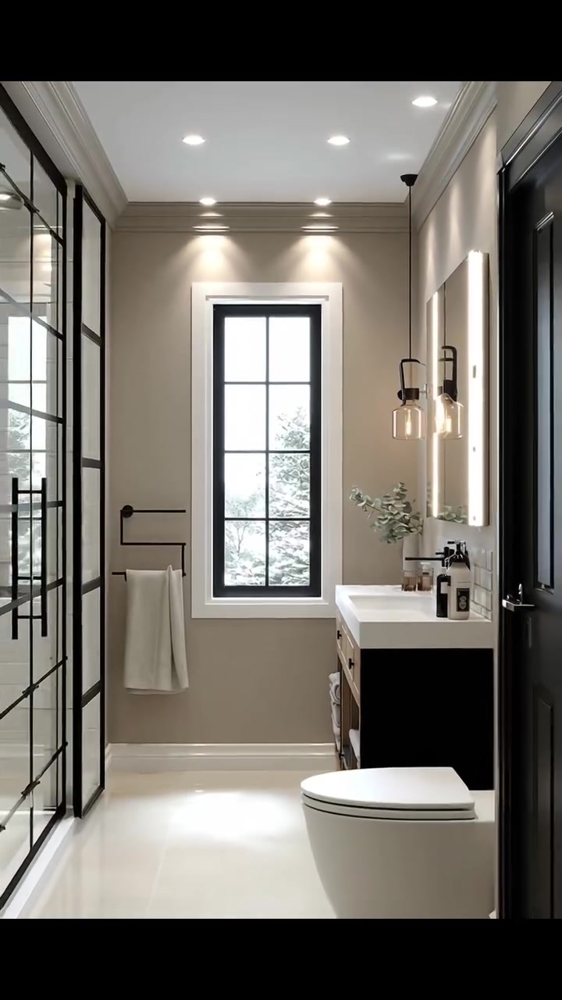

# edh029 — Contemporary Bungalow With Modern Farmhouse Influence

<!-- homeku_request_id: edh029-20261104-reviewed-001 -->

<!-- homeku_detail_narratives: chat-reviewed -->

**Sumber data:** [analysis.yaml](analysis.yaml) · **Status:** draft · **Diverifikasi manusia:** Tidak

## 1. Informasi Video

| Informasi | Nilai |
|---|---|
| ID | edh029 |
| File asli | edh029.mp4 |
| Durasi | 20.107 |
| Resolusi | 720x1280 |
| FPS | 30 |
| Rasio | 9:16 |
| Jumlah shot | 5 |

## 2. Storyboard Gabungan

## 3. Identitas Desain

| Aspek | Hasil analisis |
|---|---|
| Gaya utama | contemporary bungalow with modern farmhouse influence |
| Wilayah terkait gaya desain | north america |
| Pengaruh gaya | contemporary cottage, warm minimalism |
| Ciri eksterior | cream smooth finish facade, low slope staggered roof footprint with black fascias, recessed front entry and stone appearance column bases, black framed grid windows, black glazed front door, warm lantern wall sconces, snow dusted front garden |
| Gaya interior | warm contemporary, modern farmhouse details, neutral soft furnishings, black and cream contrast |
| Confidence gaya | medium |

## 4. Ukuran & Proporsi Bangunan

| Aspek | Estimasi visual |
|---|---|
| Ukuran yang terlihat | medium |
| Bentuk bangunan | rectangular appearing with projecting front entry |
| Skala vertikal | single story appearance |
| Tapak bangunan | moderate |
| Perkiraan luas lantai | 95–165 m² |
| Confidence | low |

> Luas adalah perkiraan visual, bukan ukuran terukur.

## 5. Warna, Pencahayaan, dan Atmosfer

| Warna dominan | HEX (perkiraan) |
|---|---|
| warm off white | #ECE9E2 |
| charcoal black | #242426 |
| soft beige | #D3C5B5 |
| light wood tone | #C7AC8C |
| pale stone gray | #C8C5BE |

| Aspek | Hasil analisis |
|---|---|
| Pencahayaan | cool overcast daylight, warm exterior wall sconces, large window daylight, recessed ceiling downlights, warm interior accent lighting, visible fireplace flames |
| Lingkungan | snow covered residential surroundings, snow dusted front planting, leafless trees in view, distant snow streaked hill at front exterior, nearby houses and yard views |
| Musim yang tampak | winter like snow visible |
| Mood | calm, cozy, clean lined, bright neutral, warm against snowy outdoors |

## 6. Struktur dan Timeline Video

**Jenis:** residential home tour · **Tempo:** slow · **Transisi:** straight cuts between five scenes

| Shot | Waktu (detik) | Durasi | Area/Scene | Gerakan Kamera |
|---|---|---|---|---|
| Shot 01 | 0.0–5.367 | 5.37 | exterior front | dolly in, slight tracking right |
| Shot 02 | 5.367–8.767 | 3.40 | living room | dolly in, slight tracking right |
| Shot 03 | 8.767–12.533 | 3.77 | kitchen | dolly out, slight tracking left |
| Shot 04 | 12.533–16.067 | 3.53 | bedroom | dolly in, slight pan right |
| Shot 05 | 16.067–20.107 | 4.04 | bathroom | dolly out, slight tracking left |

## 7. Analisis per Shot

### Shot 01 — exterior front

**Waktu:** 0.0–5.367 detik

| Komponen | Pengamatan |
|---|---|
| Fokus utama | recessed front entry and cream black facade |
| Framing awal → akhir | wide front elevation → medium close front entry |
| Sudut pandang | eye level slight left three quarter |
| Gerakan kamera | dolly in, slight tracking right |
| Kecepatan kamera | slow |
| Pencahayaan | soft overcast daylight with warm exterior lamps |
| Transisi keluar | straight cut |

**Detail yang terlihat**

**Arsitektur**

Fasad depan rumah tampak satu lantai dengan permukaan dinding krem berfinishing halus. Bidang atap landai bertingkat memiliki lis tepi dan overhang hitam, serta sebuah pipa cerobong pendek berwarna gelap. Bagian tengah menonjol menjadi area masuk yang agak masuk ke dalam, dengan dasar kolom persegi berpenampilan batu pucat. Pintu depan hitam mempunyai panel\-panel kaca persegi panjang. Di kiri pintu ada jendela tinggi berkisi hitam, sedangkan di kanan terdapat jendela sudut dengan bingkai hitam. Anak tangga lebar berwarna pucat menuju pintu, dan lampu dinding bergaya lentera menyala hangat pada area masuk serta fasad.

**Furnitur dan properti**

Di dekat pintu masuk terdapat pot\-pot putih berisi topiary hijau tua berbentuk bulat. Pot silinder putih lain di dekat tangga berisi tanaman hijau kecil yang tertutup sedikit salju.

**Lingkungan**

Halaman depan tertutup lapisan salju, dengan gundukan salju hasil pembersihan di tepi jalan. Jalur paving abu\-abu menghubungkan tangga dengan jalan. Pohon tinggi tanpa daun berada di kiri rumah, sementara semak hijau dan konifer kecil tumbuh di sepanjang kaki fasad. Di belakang garis atap tampak lereng bukit abu\-abu bercoret salju; sebagian rumah tetangga terlihat di tepi bingkai. Langit tampak pucat dan mendung.

**Catatan pengamatan:** Kamera bergerak maju dari seberang tepi jalan menuju tangga dan pintu masuk; bagian kanan fasad lebih dominan di akhir shot.

**Confidence:** Kamera medium · Detail visual high

### Shot 02 — living room

**Waktu:** 5.367–8.767 detik

| Komponen | Pengamatan |
|---|---|
| Fokus utama | tv and linear fireplace wall |
| Framing awal → akhir | wide corner seating and feature wall → medium close fireplace feature wall |
| Sudut pandang | interior eye level frontal rightward |
| Gerakan kamera | dolly in, slight tracking right |
| Kecepatan kamera | slow |
| Pencahayaan | daylight from tall windows and warm wall sconces and fireplace |
| Transisi keluar | straight cut |

**Detail yang terlihat**

**Arsitektur**

Ruang keluarga memiliki plafon putih bertingkat dengan lampu tanam kecil. Dinding aksen perapian berwarna krem dengan lis hitam tipis di bagian atas, diapit jendela\-jendela tinggi berkisi hitam. Di bagian tengah terdapat ambalan hitam lebar, perapian horizontal berkaca yang menampakkan nyala api, lapisan dasar berpenampilan batu pucat, serta ceruk terbuka untuk penyimpanan kayu bakar di bawahnya. Dua lampu dinding vertikal bercahaya hangat berada di kanan\-kiri area televisi.

**Furnitur dan properti**

Televisi layar datar hitam berukuran besar terpasang di atas ambalan, dengan soundbar hitam ramping tepat di bawahnya. Dua sofa berlapis kain krem disusun mengelilingi meja tengah, dihias bantal bernuansa netral dan selimut bermotif garis hitam\-putih. Meja kopi rendah berbentuk tidak beraturan memiliki tampilan kayu terang, dengan vas keramik putih dan baki kecil di atasnya. Karpet bertekstur warna netral berada di bawah area duduk. Rangkaian tangkai hijau kecil menghias kedua ujung ambalan, sedangkan potongan kayu ditumpuk di ceruk bawah perapian.

**Lingkungan**

Melalui jendela terlihat permukaan tanah bersalju dan pepohonan di luar. Sebuah bangunan tetangga berwarna terang juga terlihat melewati jendela di sisi kanan.

**Catatan pengamatan:** Tampilan awal mencakup dua sofa; seiring gerakan mendekat, televisi, perapian menyala, ceruk kayu bakar, dan meja menjadi fokus.

**Confidence:** Kamera medium · Detail visual high

### Shot 03 — kitchen

**Waktu:** 8.767–12.533 detik

| Komponen | Pengamatan |
|---|---|
| Fokus utama | stainless range hood and sink between windows |
| Framing awal → akhir | close angled range and shelves → wide view down narrow kitchen |
| Sudut pandang | interior eye level shifting toward center axis |
| Gerakan kamera | dolly out, slight tracking left |
| Kecepatan kamera | slow |
| Pencahayaan | bright window daylight with warm black wall lamps and recessed lights |
| Transisi keluar | straight cut |

**Detail yang terlihat**

**Arsitektur**

Dapur menggunakan kabinet bawah bergaya Shaker berwarna putih gading dengan gagang hitam dan countertop terang pada dua sisi ruang. Area kompor dilapisi backsplash ubin persegi panjang putih mengilap, dengan hood pengisap besar berwarna hitam di atasnya dan dua rak pajang terbuka bernuansa kayu terang di sebelah kiri. Bak cuci putih model apron\-front berada di bawah dua jendela belakang yang tinggi dan berbingkai hitam. Lantai tampak seperti papan kayu terang, sedangkan plafon pucat memakai sejumlah lampu tanam kecil.

**Furnitur dan properti**

Di bawah hood terdapat kompor dan oven stainless steel dengan banyak tungku serta tombol kontrol depan. Saat pandangan melebar, kulkas stainless steel terlihat di kiri. Rak kayu memajang tumpukan piring serta cangkir putih. Di countertop terdapat vas putih dengan tangkai hijau dan tanaman kecil menyerupai herba, serta talenan kayu yang disandarkan pada backsplash. Lampu dinding berkubah hitam dipasang di atas rak dan jendela. Kran berwarna gelap berada di atas bak cuci, sementara keset kecil berwarna terang terletak di depannya.

**Lingkungan**

Dari jendela dapur terlihat halaman bersalju, cabang pohon tanpa daun, dan beberapa rumah tetangga berwarna terang di kejauhan.

**Catatan pengamatan:** Dimulai dekat kompor dan rak piring, lalu kamera mundur untuk menampilkan dua sisi kabinet, kulkas di kiri, dan bak cuci di bawah dua jendela.

**Confidence:** Kamera medium · Detail visual high

### Shot 04 — bedroom

**Waktu:** 12.533–16.067 detik

| Komponen | Pengamatan |
|---|---|
| Fokus utama | large neutral bed with padded headboard |
| Framing awal → akhir | medium wide bed and two windows → medium close front of bed |
| Sudut pandang | interior eye level slight left to front |
| Gerakan kamera | dolly in, slight pan right |
| Kecepatan kamera | slow |
| Pencahayaan | soft daylight from corner windows and warm bedside lamp |
| Transisi keluar | straight cut |

**Detail yang terlihat**

**Arsitektur**

Kamar tidur mempunyai dinding krem terang, lis plafon putih, dan beberapa lampu kecil tertanam pada plafon putih. Dua jendela tinggi berkisi hitam berada pada sisi kiri serta dinding di belakang tempat tidur. Gorden panjang putih gading menggantung pada batang berwarna gelap di tepi jendela. Sedikit permukaan lantai berpenampilan kayu terang terlihat di samping ranjang.

**Furnitur dan properti**

Ranjang besar memiliki headboard tinggi berlapis bahan berpenampilan kain krem dengan bantalan persegi panjang. Seprai dan duvet putih dipadukan dengan banyak bantal putih serta taupe. Selimut rajut krem tebal menjuntai melintasi bagian kaki ranjang, dan sebuah bantal aksen hitam persegi panjang kecil berada di depan susunan bantal putih. Di sisi kiri ada nakas kecil berwarna terang dengan laci, lampu dinding hangat di dekat headboard, serta vas berisi batang tanaman kering. Karpet netral berwarna terang tampak sebagian di bawah ranjang.

**Lingkungan**

Di luar jendela belakang tampak pepohonan tanpa daun yang berlapis salju. Melalui jendela kiri terlihat sebagian atap dan permukaan tanah yang juga bersalju.

**Catatan pengamatan:** Kamera mendekat dari sudut kiri menuju ranjang dan menggeser komposisi sehingga bantal serta selimut rajut memenuhi bingkai di akhir shot.

**Confidence:** Kamera medium · Detail visual high

### Shot 05 — bathroom

**Waktu:** 16.067–20.107 detik

| Komponen | Pengamatan |
|---|---|
| Fokus utama | vanity and long bathroom with end window |
| Framing awal → akhir | close oblique vanity and mirror → wide view along narrow bathroom |
| Sudut pandang | interior eye level from entrance side |
| Gerakan kamera | dolly out, slight tracking left |
| Kecepatan kamera | slow |
| Pencahayaan | daylight from end window with warm mirror lighting and ceiling spots |
| Transisi keluar | end of video |

**Detail yang terlihat**

**Arsitektur**

Kamar mandi berbentuk memanjang dan relatif sempit dengan dinding beige terang. Sepanjang sisi kiri terlihat partisi shower kaca berkisi hitam. Di kanan terdapat countertop wastafel putih berbentuk persegi panjang dengan bak terintegrasi, di atas kabinet berlaci berpenampilan kayu terang dan panel ujung gelap. Backsplash wastafel menggunakan ubin persegi panjang putih. Cermin besar vertikal memiliki sisi yang diterangi lampu. Ujung ruangan ditutup jendela tinggi berkisi hitam dengan lis putih. Lantai tampak memakai ubin besar pucat, sementara plafon mempunyai lis putih dan sejumlah lampu tanam. Batang handuk hitam dipasang pada dinding belakang di kiri jendela, dan pintu interior berpanel gelap terlihat dekat sisi kanan kamera.

**Furnitur dan properti**

Wastafel memiliki kran berwarna gelap; di dekat cermin terdapat lampu dinding dari logam hitam dengan tudung kaca transparan. Beberapa botol perlengkapan mandi berpompa berwarna gelap diletakkan pada countertop, bersama stoples kaca kecil dan vas bertangkai hijau pucat. Handuk putih menggantung pada batang hitam di dinding belakang. Kloset putih baru terlihat jelas di kanan depan ketika kamera mundur.

**Lingkungan**

Melalui jendela di ujung ruangan terlihat dedaunan konifer hijau yang terkena salju.

**Catatan pengamatan:** Kamera mundur dari area wastafel menuju pintu; partisi shower berbingkai hitam di kiri dan kloset putih di kanan baru tampak jelas pada sudut akhir.

**Confidence:** Kamera medium · Detail visual high

## 8. Kualitas dan Ketidakpastian Analisis

| Parameter | Hasil |
|---|---|
| Status | draft |
| Verifikasi manusia | Tidak |
| Ketepatan timestamp | estimated to nearest video frame |
| Ketidakpastian | actual geographic location unknown, exact wall roof floor and counter materials not verified, true building footprint and floor area not measurable from video, number and size of hidden rooms unknown, precise camera translation vs digital cropping not verifiable, winter appearance does not establish capture date or month |

**Catatan:** Analisis visual seluruh durasi masing-masing shot; lima batas cut diperkirakan dari perubahan gambar sekitar 5.367, 8.767, 12.533, dan 16.067 detik. Semua atribusi material dan ukuran adalah penampakan/estimasi, bukan verifikasi fisik.

---

*Laporan ini diturunkan dari [analysis.yaml](analysis.yaml).*
