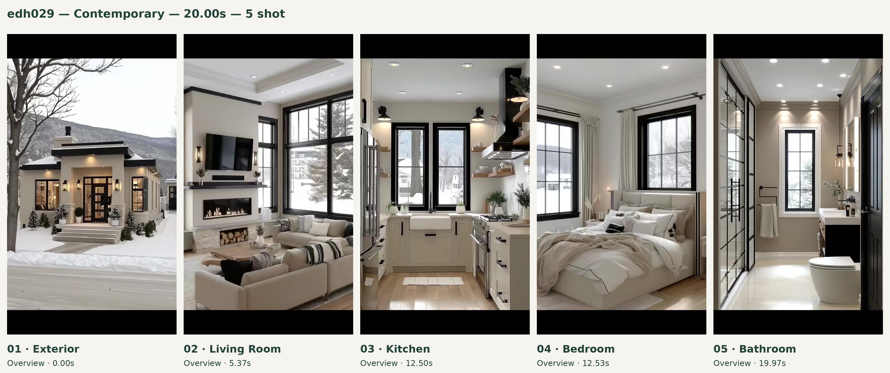
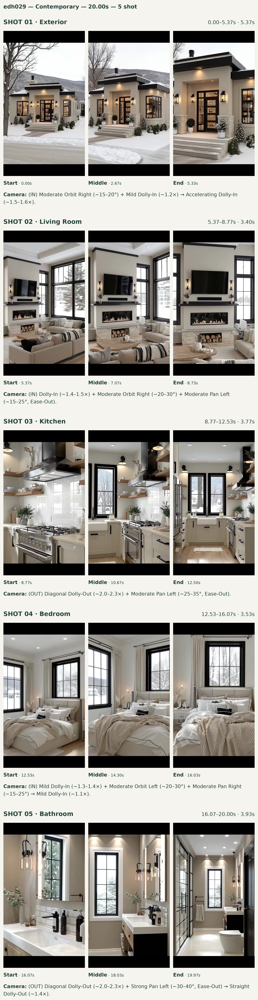
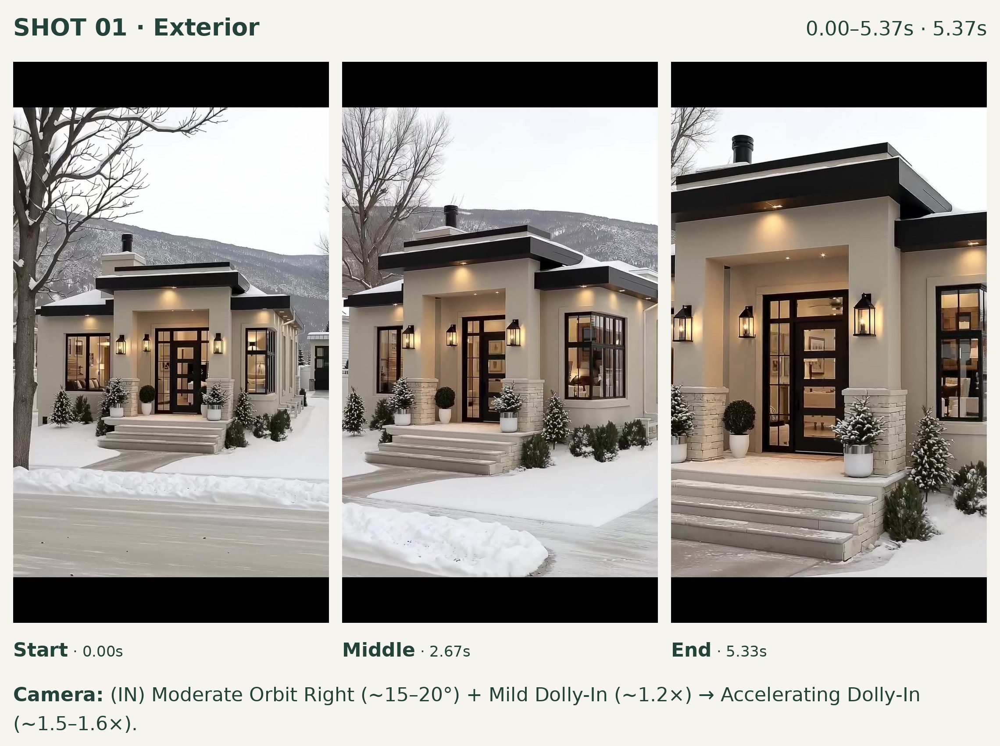
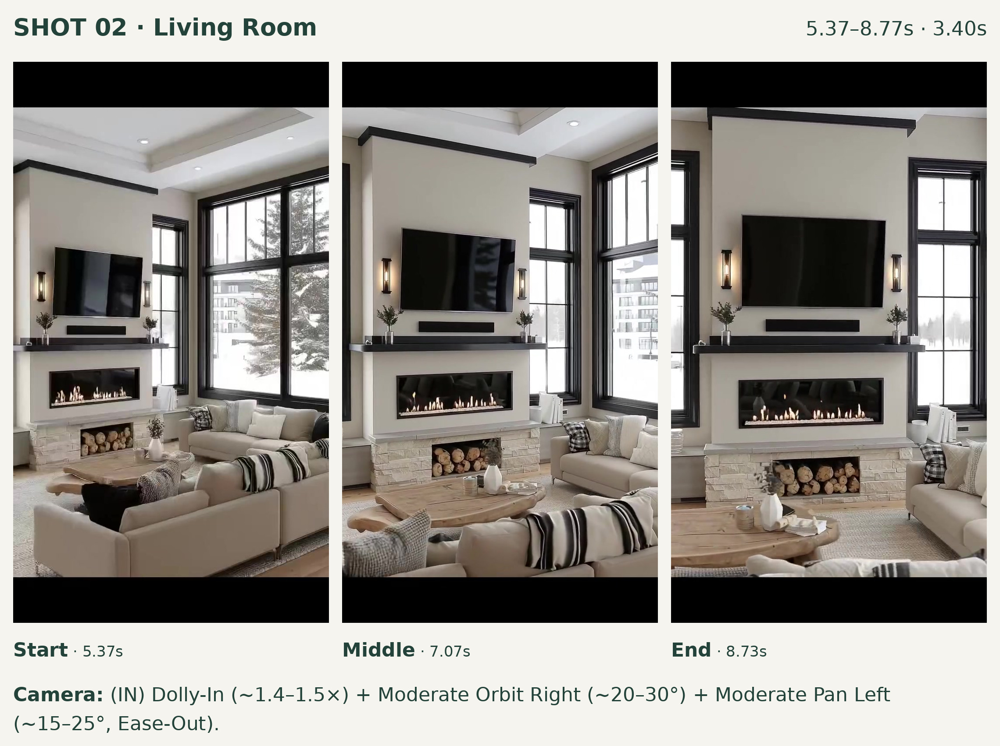
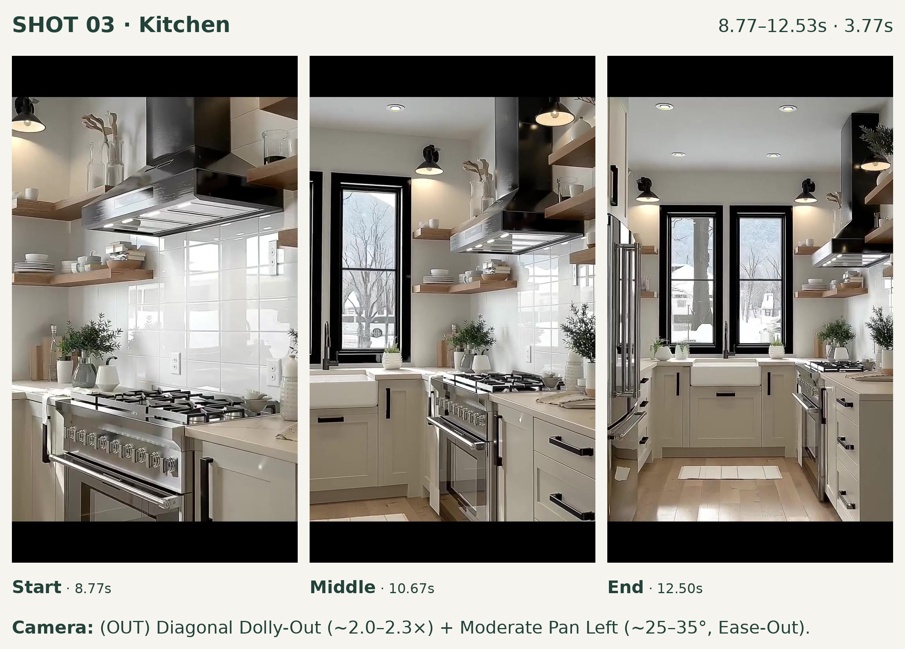
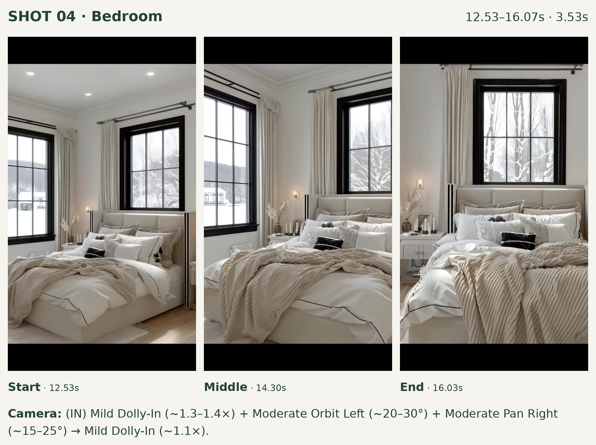
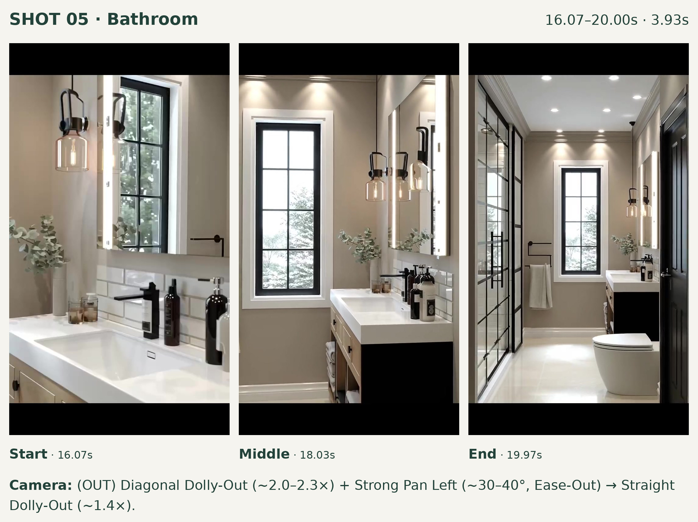

# edh029 — Rumah Kontemporer Krem dengan Bingkai Hitam

## 1. Profil desain

- **Nama desain:** Rumah Kontemporer Krem dengan Bingkai Hitam
- **Tipe rumah:** Detached House
- **Gaya utama:** **Contemporary**
- **Pengaruh gaya:** Modern Farmhouse
- **Gaya interior:** Warm Contemporary
- **Susunan ruang utama:** Urutan edit eksterior, ruang duduk, dapur, kamar tidur, kamar mandi; hubungan denah belum terverifikasi.
- **Ciri khas:** Fireplace linear dengan ceruk kayu bakar dan TV di atasnya.
- **Material utama:** Permukaan krem matte, tekstur batu terang, kayu hangat, kaca dan logam gelap secara visual.
- **Pencahayaan:** Cahaya siang dari jendela berpadu dengan lampu aksen hangat dan downlight.
- **Atmosfer:** Hangat, tenang dan kontras terhadap lanskap bersalju.
- **Lingkungan:** Salju, pohon tanpa daun, perbukitan dan bangunan lain terlihat di luar.

### Palet warna

| Peran | Warna | HEX |
| --- | --- | --- |
| Dominan | Ivory | `#E8E1D4` |
| Pendamping | Warm Greige | `#B6AA99` |
| Pendamping | Natural Oak | `#B59471` |
| Aksen | Charcoal Black | `#282725` |
| Pendamping | Linen Beige | `#C8BAA5` |

## 2. Ukuran & proporsi

| Aspek | Estimasi visual |
| --- | --- |
| **Ukuran rumah** | small to medium |
| **Bentuk bangunan** | Massa rendah dengan volume portal masuk menonjol dan garis horizontal bertingkat. |
| **Lantai & bentuk atap** | One visible storey · Tepi atap gelap lebar dengan bidang bertingkat tampak landai. |
| **Tapak bangunan** | Compact, articulated front mass |
| **Proporsi utama** | Massa horizontal dengan aksen portal vertikal di tengah |
| **Perkiraan luas lantai** | **70–120 m²** |

## 3. Shot Timeline

Durasi 20.00s · 5 shot.

**Camera Pattern:** IN – IN – OUT – IN – OUT.

| Shot | Time (s) | Duration | Area/Scene | Camera Movement |
| --- | --- | --- | --- | --- |
| 01 | 0.00–5.37 | 5.37s | Exterior | Moderate Orbit Right (~15–20°) + Mild Dolly-In (~1.2×) → Accelerating Dolly-In (~1.5–1.6×). |
| 02 | 5.37–8.77 | 3.40s | Living Room | Dolly-In (~1.4–1.5×) + Moderate Orbit Right (~20–30°) + Moderate Pan Left (~15–25°, Ease-Out). |
| 03 | 8.77–12.53 | 3.77s | Kitchen | Diagonal Dolly-Out (~2.0–2.3×) + Moderate Pan Left (~25–35°, Ease-Out). |
| 04 | 12.53–16.07 | 3.53s | Bedroom | Mild Dolly-In (~1.3–1.4×) + Moderate Orbit Left (~20–30°) + Moderate Pan Right (~15–25°) → Mild Dolly-In (~1.1×). |
| 05 | 16.07–20.00 | 3.93s | Bathroom | Diagonal Dolly-Out (~2.0–2.3×) + Strong Pan Left (~30–40°, Ease-Out) → Straight Dolly-Out (~1.4×). |

## 4. Overview

**Shot 01 · Exterior · 0.00s**

> Dari seberang jalan, arah pandang serong ke portal, setinggi mata dan relatif datar; wide mencakup massa rendah, atap bertingkat, tangga, jendela, salju dan bukit.

**Shot 02 · Living Room · 5.37s**

> Dari belakang sofa, diagonal menuju bidang fireplace dan sudut jendela; wide awal menunjukkan kelompok duduk, meja kopi, plafon bertingkat, fireplace dan bukaan tinggi.

**Shot 03 · Kitchen · 12.50s**

> Dari ujung lorong kerja, menghadap dua jendela di belakang, relatif datar; wide akhir mencakup kabinet dua sisi, kompor kanan, sink belakang, kulkas kiri dan lantai.

**Shot 04 · Bedroom · 12.53s**

> Dari sudut depan ranjang, serong menghadap headboard dan dua jendela; wide awal meliputi ranjang, tirai panjang, lantai, cornice dan cahaya siang.

**Shot 05 · Bathroom · 19.97s**

> Dari dekat akses, menghadap hampir lurus sepanjang lorong ke jendela ujung; wide akhir memperlihatkan shower kaca kiri, vanity kanan, toilet depan, lantai dan pencahayaan plafon.

## 5. Storyboard

## 6. Shot Details

### Shot 01 · Exterior

**Time:** 0.00–5.37s · **Duration:** 5.37s

#### **A. Desain area**

**Arsitektur**

> Massa rendah krem, portal persegi menonjol dengan overhang hitam bertingkat; pintu kaca berkisi dan jendela tinggi hitam mengapit akses. Tangga lebar naik dari jalan setapak; pangkal kolom bertekstur batu terang.

**Furnitur & dekorasi**

> Pot bulat dengan semak topiary di sisi pintu, lentera dinding hitam dan semak konifer rendah di muka rumah.

**Lingkungan**

> Salju menutup halaman dan tepi jalan; pohon gugur tanpa daun dan bukit di belakang, cahaya langit difus dengan lampu teras hangat.

#### **B. Framing & Lighting**

- **Fokus:** Portal dan pintu kaca
- **Camera Start:** Dari seberang jalan, serong ke portal · Menuju fasad dan pintu masuk · oblique · Sekitar tinggi mata, perkiraan · Hampir datar
- **Framing:** Wide fasad, jalan, pohon dan salju → Lebih rapat pada portal, pintu, tangga
- **Lighting:** Cahaya difus dan lampu teras hangat
- **Foreground dan kedalaman:** Jalan, salju, batang pohon · Lapisan jalan–tangga–portal–bukaan
- **Reveal:** Sisi kanan dan detail portal terbuka
- **Kesesuaian gerak:** Wide awal mendukung orbit dan pendekatan; akhir menekankan akses.

#### **C. Camera Movement**

Kamera bergeser melengkung ke kanan mengitari muka rumah sambil mendekat ringan; mendekati teras lebih cepat di akhir ketika perubahan sisi mereda.

**Tempo:** Awal sedang cenderung pelan; pendekatan meningkat nyata sekitar F108–160, akhir relatif cepat.

**Movement Timeline**

| Time (s) | Area & fokus | Camera Movement | Tempo |
| --- | --- | --- | --- |
| 0.00–3.60 | Exterior · Fasad dan teras | Moderate Orbit Right (~15–20°) + Mild Dolly-In (~1.2×) | Awal sedang cenderung pelan; pendekatan meningkat nyata sekitar F108–160, akhir relatif cepat. |
| 3.60–5.37 | Exterior · Pintu masuk dan tangga | Accelerating Dolly-In (~1.5–1.6×) | Awal sedang cenderung pelan; pendekatan meningkat nyata sekitar F108–160, akhir relatif cepat. |

**Camera:** Moderate Orbit Right (~15–20°) + Mild Dolly-In (~1.2×) → Accelerating Dolly-In (~1.5–1.6×).

---

### Shot 02 · Living Room

**Time:** 5.37–8.77s · **Duration:** 3.40s

#### **A. Desain area**

**Arsitektur**

> Plafon bertingkat dengan downlight, dinding krem dan garis trim hitam; jendela tinggi berkisi di sudut. Bidang fireplace linear berbingkai gelap di atas alas batu terang dengan ceruk kayu bakar.

**Furnitur & dekorasi**

> TV dan soundbar di atas mantel gelap; sofa krem berhadapan mengitari meja kopi kayu rendah dengan nampan dan dekorasi; bantal netral dan throw bergaris hitam.

**Lingkungan**

> Jendela memperlihatkan pepohonan dan area bersalju; cahaya siang kuat berpadu sconce dan downlight hangat.

#### **B. Framing & Lighting**

- **Fokus:** TV dan fireplace
- **Camera Start:** Di belakang sofa depan, diagonal ke fireplace · Ke dinding fireplace dan sudut jendela · oblique · Sekitar tinggi mata · Hampir datar
- **Framing:** Wide ruang duduk, sofa dan jendela → Medium wide hampir frontal fireplace
- **Lighting:** Cahaya jendela dan sconce
- **Foreground dan kedalaman:** Punggung sofa dan meja kopi · Sofa–meja–fireplace–jendela
- **Reveal:** Fireplace menjadi sentral
- **Kesesuaian gerak:** Pendekatan dan rotasi menggeser komposisi menjadi frontal.

#### **C. Camera Movement**

Kamera mendekat sambil bergerak ke kanan mengitari sudut pandang ruang dan menyapu pandangan ke kiri hingga fireplace hampir frontal.

**Tempo:** Awal lembut, gerakan lateral meningkat di tengah, sapuan mereda di akhir; pendekatan relatif stabil.

**Camera:** Dolly-In (~1.4–1.5×) + Moderate Orbit Right (~20–30°) + Moderate Pan Left (~15–25°, Ease-Out).

---

### Shot 03 · Kitchen

**Time:** 8.77–12.53s · **Duration:** 3.77s

#### **A. Desain area**

**Arsitektur**

> Dapur dengan lorong kerja di antara kabinet kiri dan kanan, kabinet melintang di belakang di bawah dua jendela kisi hitam. Backsplash ubin putih mengilap, lantai tampak papan kayu terang.

**Furnitur & dekorasi**

> Kompor/range stainless di kanan di bawah hood besar; kabinet panel krem dengan gagang hitam, rak kayu terbuka berisi peralatan makan, sink apron-front di belakang dan kulkas tinggi di kiri.

**Lingkungan**

> Pohon tanpa daun dan salju terlihat dari jendela; sconce hitam dan downlight menerangi permukaan kerja.

#### **B. Framing & Lighting**

- **Fokus:** Kompor lalu keseluruhan ruang kerja
- **Camera Start:** Dekat kompor di sisi kanan lorong · Serong ke kompor dan backsplash · oblique · Sekitar tinggi mata · Hampir datar
- **Framing:** Detail kompor, hood dan rak → Wide dari ujung lorong, dua jendela dan kabinet
- **Lighting:** Cahaya jendela, sconce, downlight
- **Foreground dan kedalaman:** Counter dan kompor · Counter kanan–sink belakang–jendela
- **Reveal:** Sink, kulkas dan lorong kerja masuk bingkai
- **Kesesuaian gerak:** Gerakan mundur dan pan membuka layout.

#### **C. Camera Movement**

Kamera mundur dari kompor sambil menyapu ke kiri menuju sumbu dapur; reveal jendela, sink, kabinet kiri dan kulkas.

**Tempo:** Mundur berkelanjutan; sapuan membesar di tengah, melandai saat komposisi lorong terbentuk.

**Camera:** Diagonal Dolly-Out (~2.0–2.3×) + Moderate Pan Left (~25–35°, Ease-Out).

---

### Shot 04 · Bedroom

**Time:** 12.53–16.07s · **Duration:** 3.53s

#### **A. Desain area**

**Arsitektur**

> Dinding dan plafon terang dengan cornice serta downlight; dua jendela tinggi berkisi hitam pada dinding bersebelahan dengan tirai krem panjang. Lantai tampak kayu terang.

**Furnitur & dekorasi**

> Ranjang besar dengan headboard empuk beige di bawah jendela, seprai putih, bantal bertumpuk dan selimut rajut krem; nakas kecil dan lampu dinding di sisi ranjang.

**Lingkungan**

> Pemandangan salju dan pohon tanpa daun dari jendela; cahaya siang lembut dengan aksen lampu hangat.

#### **B. Framing & Lighting**

- **Fokus:** Ranjang, headboard, tekstil
- **Camera Start:** Di sudut depan ranjang, serong · Menuju ranjang dan jendela · oblique · Sekitar tinggi mata · Hampir datar
- **Framing:** Wide ranjang dan dua sisi jendela → Frontal lebih dekat ke headboard
- **Lighting:** Cahaya jendela dan lampu aksen
- **Foreground dan kedalaman:** Ujung ranjang dan selimut · Ujung ranjang–headboard–jendela
- **Reveal:** Komposisi headboard semakin frontal
- **Kesesuaian gerak:** Orbit dan pan memusatkan ranjang, pendekatan akhir mempertegas tekstil.

#### **C. Camera Movement**

Kamera mendekat sambil mengitari ranjang ke kiri dan memutar pandangan ke kanan, kemudian menyelesaikan pendekatan hampir frontal.

**Tempo:** Gerak sedang pada awal hingga tengah, lalu melambat mendekati frontal.

**Movement Timeline**

| Time (s) | Area & fokus | Camera Movement | Tempo |
| --- | --- | --- | --- |
| 12.53–15.27 | Bedroom · Ranjang dan headboard | Mild Dolly-In (~1.3–1.4×) + Moderate Orbit Left (~20–30°) + Moderate Pan Right (~15–25°) | Gerak sedang pada awal hingga tengah, lalu melambat mendekati frontal. |
| 15.27–16.07 | Bedroom · Headboard dan bantal | Mild Dolly-In (~1.1×) | Gerak sedang pada awal hingga tengah, lalu melambat mendekati frontal. |

**Camera:** Mild Dolly-In (~1.3–1.4×) + Moderate Orbit Left (~20–30°) + Moderate Pan Right (~15–25°) → Mild Dolly-In (~1.1×).

---

### Shot 05 · Bathroom

**Time:** 16.07–20.00s · **Duration:** 3.93s

#### **A. Desain area**

**Arsitektur**

> Ruang memanjang dengan jendela tinggi hitam di ujung; shower kaca bergrid hitam di kiri, vanity di kanan dan toilet dekat depan. Lantai terang, dinding greige, backsplash ubin putih dan downlight.

**Furnitur & dekorasi**

> Vanity dengan countertop/basin putih persegi panjang, keran hitam, laci kayu dan sisi gelap; cermin persegi tinggi dengan lampu gantung dinding kaca, botol toiletries dan vas. Toilet putih dan handuk dekat jendela.

**Lingkungan**

> Vegetasi terlihat melalui jendela; cahaya siang di ujung ruang, downlight dan lampu vanity hangat.

#### **B. Framing & Lighting**

- **Fokus:** Vanity lalu layout kamar mandi
- **Camera Start:** Dekat vanity dan cermin · Serong ke wastafel dan cermin · oblique · Sekitar tinggi mata · Hampir datar
- **Framing:** Detail vanity, cermin dan lampu → Wide sepanjang lorong menuju jendela
- **Lighting:** Cahaya jendela, lampu kaca dan downlight
- **Foreground dan kedalaman:** Basin dan keran · Vanity–lorong–jendela belakang
- **Reveal:** Shower kiri dan toilet kanan muncul
- **Kesesuaian gerak:** Mundur dan pan membuka ruang, akhir lurus memperjelas susunan.

#### **C. Camera Movement**

Kamera mundur dari vanity sambil menyapu kiri ke arah jendela; setelah pandangan hampir segaris koridor, mundur berlanjut hingga shower dan toilet terlihat.

**Tempo:** Gerak sedang cenderung cepat karena reveal besar dalam 3,9 detik; pan mereda, mundur berlanjut.

**Movement Timeline**

| Time (s) | Area & fokus | Camera Movement | Tempo |
| --- | --- | --- | --- |
| 16.07–18.90 | Bathroom · Vanity menuju jendela belakang | Diagonal Dolly-Out (~2.0–2.3×) + Strong Pan Left (~30–40°, Ease-Out) | Gerak sedang cenderung cepat karena reveal besar dalam 3,9 detik; pan mereda, mundur berlanjut. |
| 18.90–20.00 | Bathroom · Koridor bathroom, shower dan toilet | Straight Dolly-Out (~1.4×) | Gerak sedang cenderung cepat karena reveal besar dalam 3,9 detik; pan mereda, mundur berlanjut. |

**Camera:** Diagonal Dolly-Out (~2.0–2.3×) + Strong Pan Left (~30–40°, Ease-Out) → Straight Dolly-Out (~1.4×).

**Catatan referensi:** Estimasi luas lantai 70–120 m² hanya perkiraan kasar berdasarkan skala pintu, furnitur dan ruang yang tampak; tidak ada denah atau ukuran terkalibrasi. Tidak dapat memastikan bahwa semua shot merupakan satu rumah fisik. Material dan warna dinilai dari tampilan, bukan spesifikasi. Kamera Fase 2 dipertahankan tanpa perubahan setelah persetujuan pengguna.
