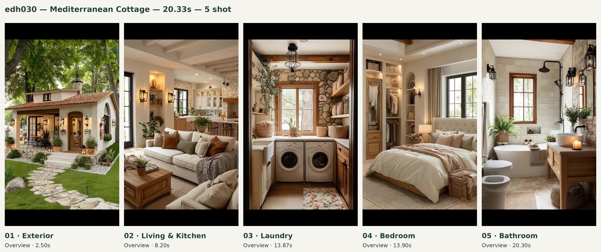
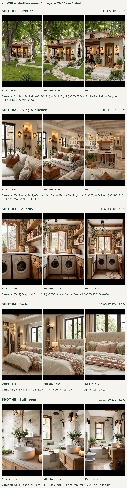
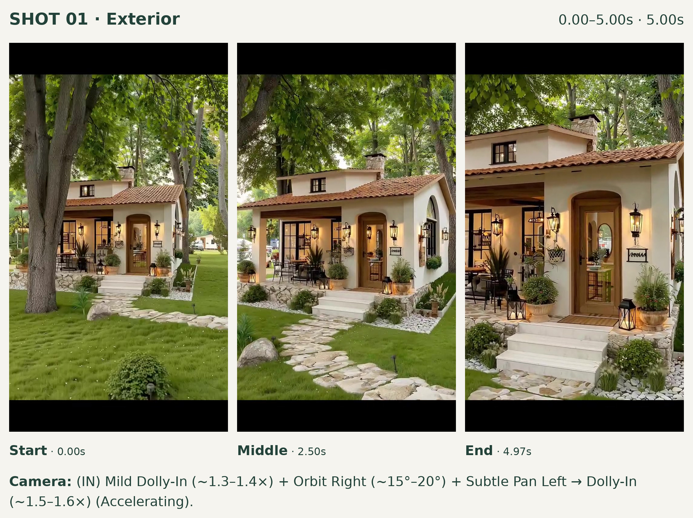
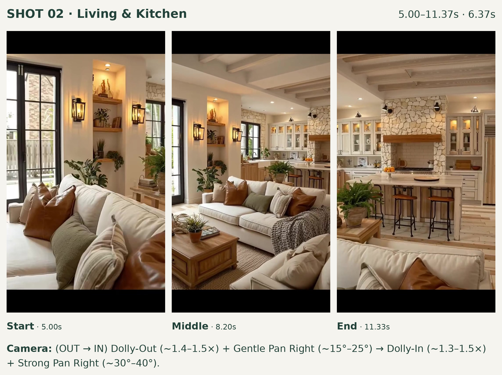
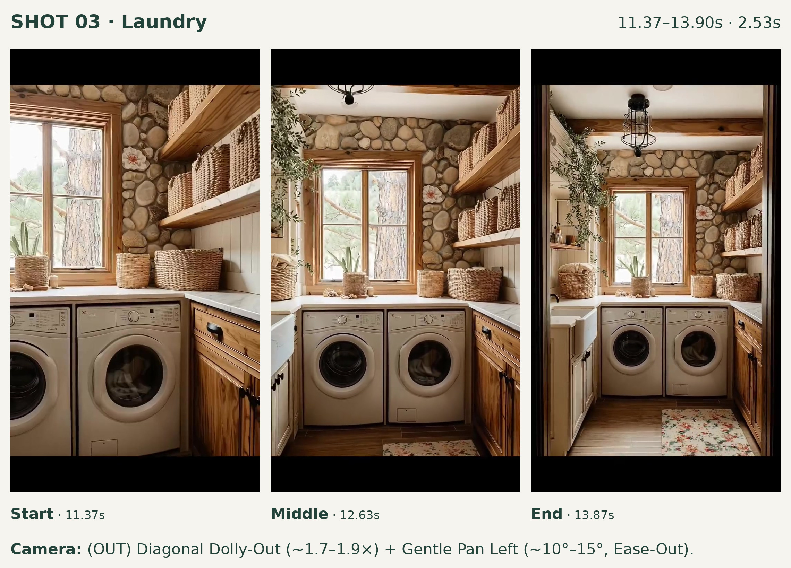
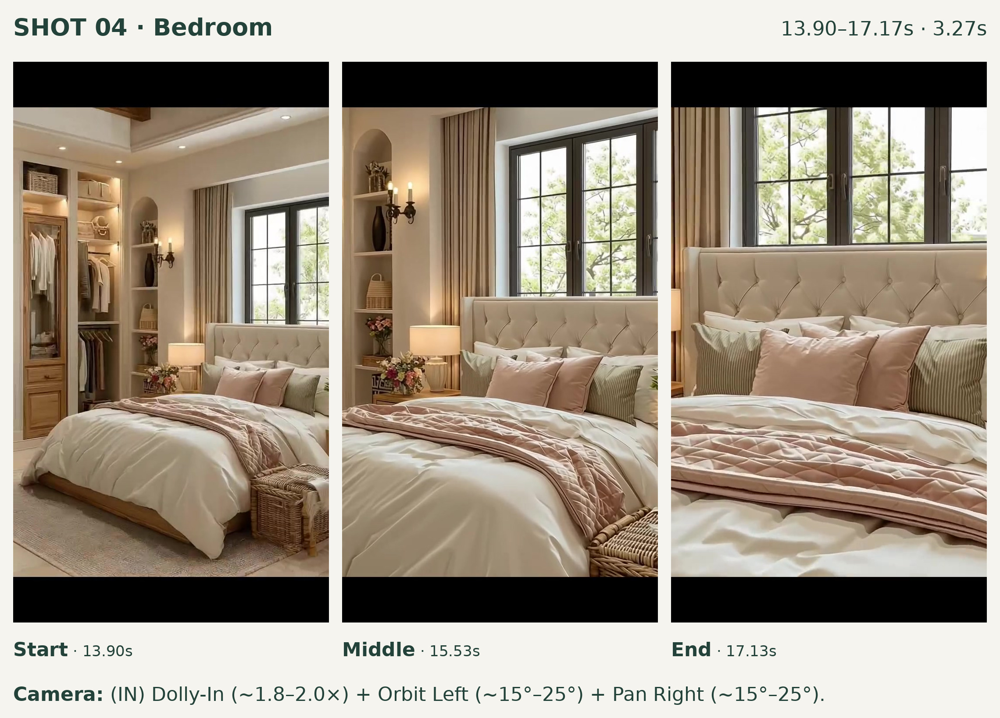
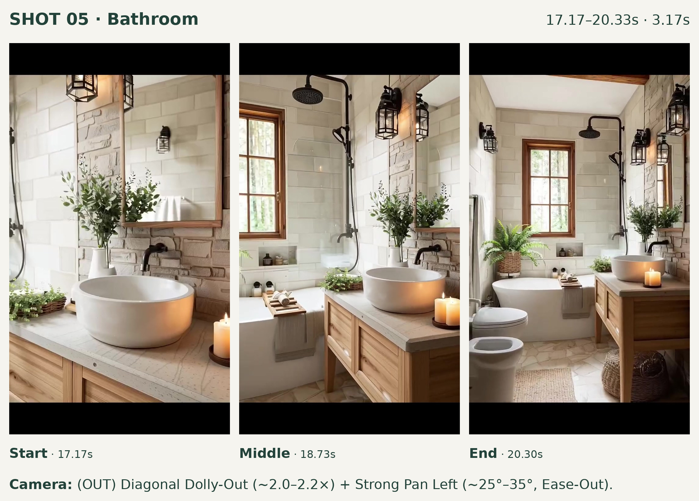

# edh030 — Warm Mediterranean Cottage

## 1. Profil desain

- **Nama desain:** Warm Mediterranean Cottage
- **Tipe rumah:** Detached House
- **Gaya utama:** **Mediterranean Cottage**
- **Pengaruh gaya:** Spanish Colonial Revival
- **Gaya interior:** Rustic Cottage; Transitional
- **Susunan ruang utama:** Living dan kitchen terhubung terbuka; laundry, bedroom, bathroom muncul via cut, hubungan denah tidak terverifikasi
- **Ciri khas:** Pintu lengkung berkaca, dinding batu irregular, balok kayu, lentera gelap dan tekstil netral hangat
- **Material utama:** Tampilan plester gading, batu alam tidak beraturan, serat kayu hangat, logam gelap dan tekstil netral
- **Pencahayaan:** Cahaya siang melalui bukaan dan pepohonan, dipadu lampu dinding serta aksen hangat
- **Atmosfer:** Hangat, tenang, nyaman dengan tekstur rustic dan komposisi rapi
- **Lingkungan:** Rumput, jalur pijak batu, semak dan pohon dewasa mengelilingi fasad; vegetasi terlihat melalui jendela

### Palet warna

| Peran | Warna | HEX |
| --- | --- | --- |
| Dominan | Ivory | `#E8DFCC` |
| Pendamping | Warm Oak | `#A77B4F` |
| Aksen | Terracotta | `#A65D3D` |
| Pendamping | Sand Beige | `#C7B79F` |
| Aksen | Olive Green | `#777A54` |
| Aksen | Charcoal | `#38332E` |

## 2. Ukuran & proporsi

| Aspek | Estimasi visual |
| --- | --- |
| **Ukuran rumah** | small to medium |
| **Bentuk bangunan** | Massa rendah kompak dengan volume atap belakang lebih tinggi |
| **Lantai & bentuk atap** | Satu tingkat utama terlihat, volume atap bertingkat dengan jendela tinggi; jumlah lantai penuh tidak pasti · Atap miring genteng lengkung terakota |
| **Tapak bangunan** | Massa kompak dengan teras depan; denah tidak terlihat |
| **Proporsi utama** | Fasad horizontal rendah dengan volume belakang lebih tinggi |
| **Perkiraan luas lantai** | **65–110 m²** |

## 3. Shot Timeline

Durasi 20.33s · 5 shot.

**Camera Pattern:** IN – (OUT → IN) – OUT – IN – OUT.

| Shot | Time (s) | Duration | Area/Scene | Camera Movement |
| --- | --- | --- | --- | --- |
| 01 | 0.00–5.00 | 5.00s | Exterior | Mild Dolly-In (~1.3–1.4×) + Orbit Right (~15°–20°) + Subtle Pan Left → Dolly-In (~1.5–1.6×) (Accelerating). |
| 02 | 5.00–11.37 | 6.37s | Living & Kitchen | Dolly-Out (~1.4–1.5×) + Gentle Pan Right (~15°–25°) → Dolly-In (~1.3–1.5×) + Strong Pan Right (~30°–40°). |
| 03 | 11.37–13.90 | 2.53s | Laundry | Diagonal Dolly-Out (~1.7–1.9×) + Gentle Pan Left (~10°–15°, Ease-Out). |
| 04 | 13.90–17.17 | 3.27s | Bedroom | Dolly-In (~1.8–2.0×) + Orbit Left (~15°–25°) + Pan Right (~15°–25°). |
| 05 | 17.17–20.33 | 3.17s | Bathroom | Diagonal Dolly-Out (~2.0–2.2×) + Strong Pan Left (~25°–35°, Ease-Out). |

## 4. Overview

**Shot 01 · Exterior · 2.50s**

> Dari jalur batu di halaman depan, pandangan serong ke fasad menangkap teras, pintu lengkung, jendela dan atap bertingkat.

**Shot 02 · Living & Kitchen · 8.20s**

> Dari sisi area duduk menghadap sofa dan dapur terbuka di belakang, terlihat meja kopi, dua sofa, bukaan kaca, balok plafon dan meja dapur.

**Shot 03 · Laundry · 13.87s**

> Dari dekat ambang pintu menghadap dinding belakang secara hampir frontal; dua mesin, jendela, counter samping dan rak keranjang terlihat bersama.

**Shot 04 · Bedroom · 13.90s**

> Dari sisi kaki ranjang menghadap serong ke headboard dan jendela, area lemari terbuka, ranjang, meja samping, karpet serta plafon terlihat.

**Shot 05 · Bathroom · 20.30s**

> Dari sisi masuk menghadap bathtub dan jendela belakang; vanity kanan, shower, toilet kiri, lantai dan dinding dapat dibaca bersama.

## 5. Storyboard

## 6. Shot Details

### Shot 01 · Exterior

**Time:** 0.00–5.00s · **Duration:** 5.00s

#### **A. Desain area**

**Arsitektur**

> Fasad gading beratap genteng terakota melengkung dengan volume belakang lebih tinggi, teras berkayu, kolom persegi, pintu lengkung berkaca, jendela kisi gelap dan tangga lebar.

**Furnitur & dekorasi**

> Kursi dan meja kecil gelap di teras, pot tanaman serta lentera di sisi pintu.

**Lingkungan**

> Jalur batu pijak di rumput, kerikil putih, semak, batu dan pohon besar menaungi halaman.

#### **B. Framing & Lighting**

- **Fokus:** Pintu lengkung dan teras
- **Camera Start:** Di halaman di balik pohon dekat · Ke fasad dan pintu masuk · Serong depan, semakin frontal · Sekitar mata · Hampir datar
- **Framing:** Fasad sebagian tertutup pohon pada kiri, rumput luas → Pintu, teras dan tangga mendominasi
- **Lighting:** Siang terfilter pepohonan, lentera hangat
- **Foreground dan kedalaman:** Batang pohon dan rumput · Pohon, jalur pijak, tangga, teras lalu massa belakang
- **Reveal:** Pohon keluar kiri dan pintu mendominasi
- **Kesesuaian gerak:** Orbit kanan membuka sisi fasad; dolly-in mempertegas akses

#### **C. Camera Movement**

Kamera mendekati rumah sambil melengkung ke kanan melewati pohon, kemudian memusatkan pendekatan pada pintu dan tangga.

**Tempo:** Sedang, lembut pada awal, pendekatan terasa lebih cepat pada akhir; laju fisik tidak terkalibrasi.

**Movement Timeline**

| Time (s) | Area & fokus | Camera Movement | Tempo |
| --- | --- | --- | --- |
| 0.00–2.70 | Exterior · Fasad dan pohon depan | Mild Dolly-In (~1.3–1.4×) + Orbit Right (~15°–20°) + Subtle Pan Left | Sedang, lembut pada awal, pendekatan terasa lebih cepat pada akhir; laju fisik tidak terkalibrasi. |
| 2.70–5.00 | Exterior · Pintu masuk dan tangga | Dolly-In (~1.5–1.6×) (Accelerating) | Sedang, lembut pada awal, pendekatan terasa lebih cepat pada akhir; laju fisik tidak terkalibrasi. |

**Camera:** Mild Dolly-In (~1.3–1.4×) + Orbit Right (~15°–20°) + Subtle Pan Left → Dolly-In (~1.5–1.6×) (Accelerating).

---

### Shot 02 · Living & Kitchen

**Time:** 5.00–11.37s · **Duration:** 6.37s

#### **A. Desain area**

**Arsitektur**

> Ruang terbuka dengan plafon balok terang, pintu kaca kisi gelap, ceruk rak bercahaya, dan zona dapur di belakang sofa; range hood berlapis batu tak beraturan diapit kabinet kaca.

**Furnitur & dekorasi**

> Sofa gading dengan bantal cokelat, olive dan krem mengapit meja kopi kayu persegi di atas karpet tenun; counter dapur kayu terang dengan bangku tinggi berkaki gelap dan tanaman.

**Lingkungan**

> Bukaan tinggi memperlihatkan vegetasi dan cahaya alami; lampu dinding dan ceruk memberi cahaya hangat.

#### **B. Framing & Lighting**

- **Fokus:** Sofa lalu counter dan range hood
- **Camera Start:** Dekat sofa di sisi pintu kaca · Ke sofa dan ceruk, lalu dapur kanan · Serong dari sisi sofa · Sekitar mata · Hampir datar
- **Framing:** Close-up bantal dan ceruk, kaca kiri → Counter dan hood terpusat, punggung sofa bawah
- **Lighting:** Siang dari pintu/jendela, lampu ceruk dan sconce hangat
- **Foreground dan kedalaman:** Bantal dan punggung sofa · Sofa, meja kopi, bukaan, counter dan kabinet belakang
- **Reveal:** Mundur membuka ruang duduk, maju menyapu ke dapur
- **Kesesuaian gerak:** Pembalikan kedalaman menampilkan layout dan detail kitchen

#### **C. Camera Movement**

Kamera mundur sambil menyapu kanan dari sofa, membuka living; setelah titik balik sekitar 7,8 detik kamera maju menuju kitchen dengan sapuan kanan yang lebih kuat.

**Tempo:** Sedang dan relatif halus, melambat pada pergantian kedalaman sekitar F231–243 lalu sapuan akhir lebih cepat.

**Movement Timeline**

| Time (s) | Area & fokus | Camera Movement | Tempo |
| --- | --- | --- | --- |
| 5.00–7.80 | Living & Kitchen · Sofa, ceruk dinding dan coffee table | Dolly-Out (~1.4–1.5×) + Gentle Pan Right (~15°–25°) | Sedang dan relatif halus, melambat pada pergantian kedalaman sekitar F231–243 lalu sapuan akhir lebih cepat. |
| 7.80–11.37 | Living & Kitchen · Kitchen island dan range hood | Dolly-In (~1.3–1.5×) + Strong Pan Right (~30°–40°) | Sedang dan relatif halus, melambat pada pergantian kedalaman sekitar F231–243 lalu sapuan akhir lebih cepat. |

**Camera:** Dolly-Out (~1.4–1.5×) + Gentle Pan Right (~15°–25°) → Dolly-In (~1.3–1.5×) + Strong Pan Right (~30°–40°).

---

### Shot 03 · Laundry

**Time:** 11.37–13.90s · **Duration:** 2.53s

#### **A. Desain area**

**Arsitektur**

> Ruang sempit dengan jendela kayu di tengah dinding batu bulat, counter mengelilingi mesin di bawah jendela dan sisi kanan-kiri, balok plafon kayu.

**Furnitur & dekorasi**

> Dua mesin front-load berdampingan, kabinet bawah kayu kanan dan terang kiri, rak terbuka kayu kanan dengan keranjang anyam, tanaman dan runner floral.

**Lingkungan**

> Batang pohon dan hijau tampak melalui jendela, cahaya siang masuk dari belakang.

#### **B. Framing & Lighting**

- **Fokus:** Mesin, jendela dan rak
- **Camera Start:** Dekat mesin dan rak kanan · Ke jendela dan counter · Serong ringan · Sekitar mata · Sedikit menurun
- **Framing:** Mesin kanan dan rak mendominasi → Keseluruhan laundry dibingkai kusen
- **Lighting:** Siang dari jendela, lampu gantung
- **Foreground dan kedalaman:** Mesin dan counter · Counter dekat, mesin, dinding batu, jendela
- **Reveal:** Sisi kiri, lantai dan kusen pintu muncul
- **Kesesuaian gerak:** Dolly-out membuka geometri kompak

#### **C. Camera Movement**

Kamera mundur dari mesin cuci dan mengoreksi pandangan ke kiri sehingga ruang laundry terbuka hingga kusen pintu.

**Tempo:** Sedang, sapuan korektif mereda, mundur tetap nyata hingga batas akhir.

**Camera:** Diagonal Dolly-Out (~1.7–1.9×) + Gentle Pan Left (~10°–15°, Ease-Out).

---

### Shot 04 · Bedroom

**Time:** 13.90–17.17s · **Duration:** 3.27s

#### **A. Desain area**

**Arsitektur**

> Dinding krem dengan jendela kisi gelap di belakang ranjang, tirai panjang, plafon bertingkat dengan balok kayu dan downlight; ceruk lengkung di sisi lemari.

**Furnitur & dekorasi**

> Ranjang besar ber-headboard tufted krem, bedding gading, throw dan bantal dusty rose, bantal olive; lemari terbuka kayu dengan pakaian tergantung dan laci; lampu meja dan keranjang anyam.

**Lingkungan**

> Pepohonan tampak melalui jendela, cahaya siang lembut bercampur lampu meja dan downlight.

#### **B. Framing & Lighting**

- **Fokus:** Ranjang dan headboard
- **Camera Start:** Di sisi kaki ranjang dekat lemari · Ke headboard dan jendela · Serong menjadi frontal · Sekitar mata · Sedikit ke bawah
- **Framing:** Ranjang utuh dan lemari kiri → Headboard, bantal dan jendela dekat
- **Lighting:** Siang dari jendela, lampu meja dan downlight
- **Foreground dan kedalaman:** Sudut ranjang dan keranjang · Ranjang, headboard, jendela dan lemari samping
- **Reveal:** Detail bedding dan headboard membesar
- **Kesesuaian gerak:** Dolly-in dengan orbit memperkuat fokus ranjang

#### **C. Camera Movement**

Kamera mendekat ke tempat tidur dari sudut serong, beralih ke pandangan lebih frontal pada headboard dan jendela.

**Tempo:** Sedang, laju pembesaran cukup konsisten dan tidak ada fase baru pada gap tracking.

**Camera:** Dolly-In (~1.8–2.0×) + Orbit Left (~15°–25°) + Pan Right (~15°–25°).

---

### Shot 05 · Bathroom

**Time:** 17.17–20.33s · **Duration:** 3.17s

#### **A. Desain area**

**Arsitektur**

> Dinding terang ubin persegi panjang dan aksen batu di vanity, jendela kayu kisi di belakang bathtub, lantai bermotif batu dan balok kayu di plafon.

**Furnitur & dekorasi**

> Wastafel mangkuk putih di atas vanity kayu, cermin bingkai kayu, keran gelap, bathtub putih dengan tray, shower hitam melengkung, toilet dan keranjang anyam; lentera dinding hitam.

**Lingkungan**

> Jendela memberi cahaya alami dan pandangan hijau; lentera serta lilin menciptakan aksen hangat.

#### **B. Framing & Lighting**

- **Fokus:** Wastafel lalu bathtub dan jendela
- **Camera Start:** Dekat vanity kanan · Ke wastafel dan cermin lalu bathtub kiri · Serong ke kanan, menjadi lebih frontal · Sekitar mata · Sedikit menurun
- **Framing:** Wastafel, cermin, bunga dan lentera → Tampilan lebar bathtub dan toilet dengan vanity kanan
- **Lighting:** Siang dari jendela, lentera hangat dan lilin
- **Foreground dan kedalaman:** Mangkuk wastafel dan permukaan counter · Vanity dekat, bathtub, jendela, toilet kiri
- **Reveal:** Mundur membuka bathtub, shower dan toilet
- **Kesesuaian gerak:** Dolly-out dan pan kiri memperjelas hubungan perlengkapan

#### **C. Camera Movement**

Kamera mundur dari wastafel sambil menyapu kiri, membuka bathtub, jendela dan toilet hingga tampilan ruang lebih utuh.

**Tempo:** Sedang, reveal cepat pada pertengahan lalu sapuan melambat menjelang akhir.

**Camera:** Diagonal Dolly-Out (~2.0–2.2×) + Strong Pan Left (~25°–35°, Ease-Out).
