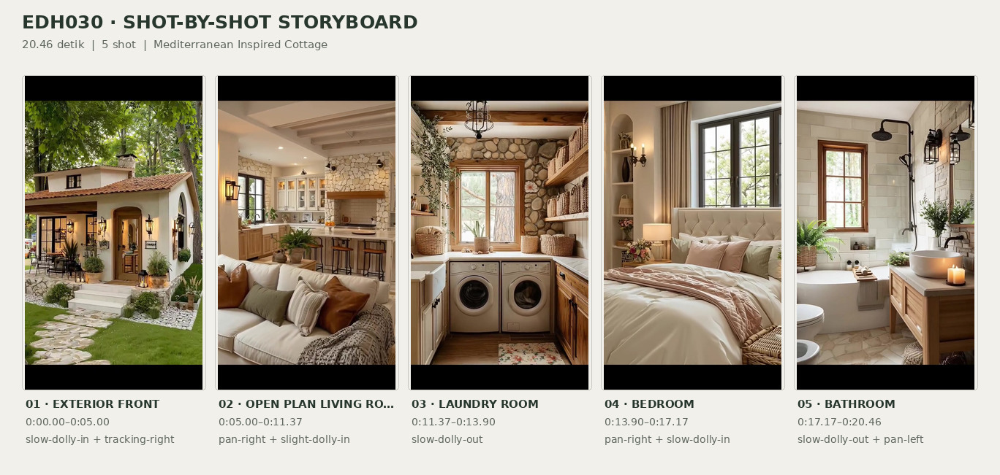
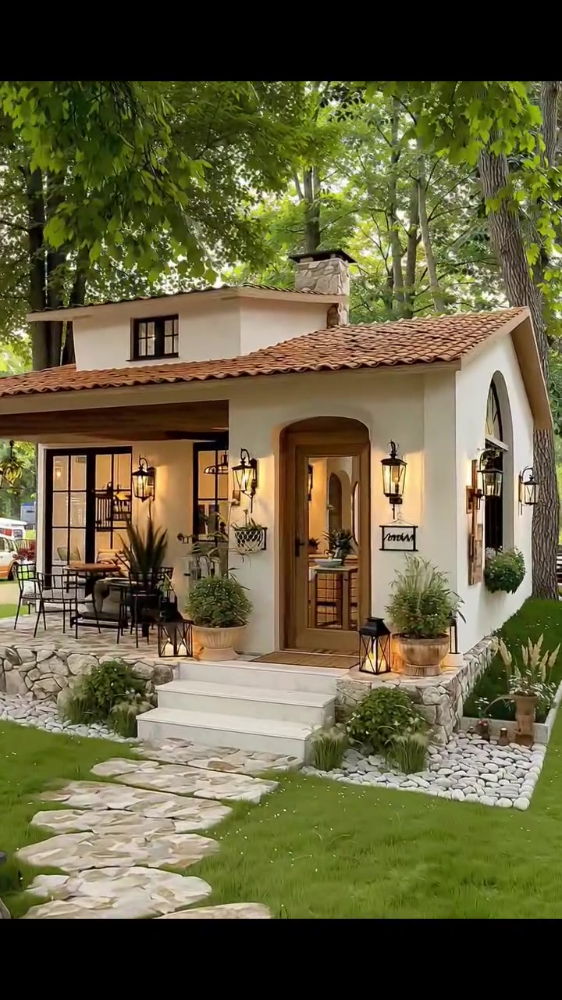
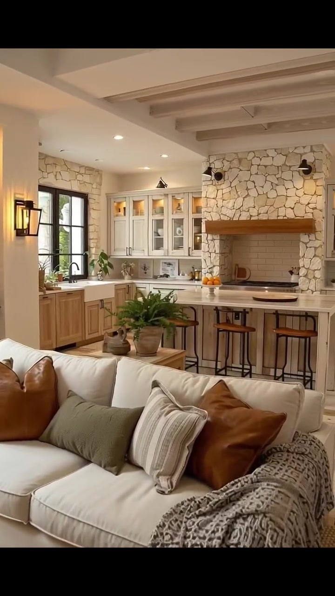
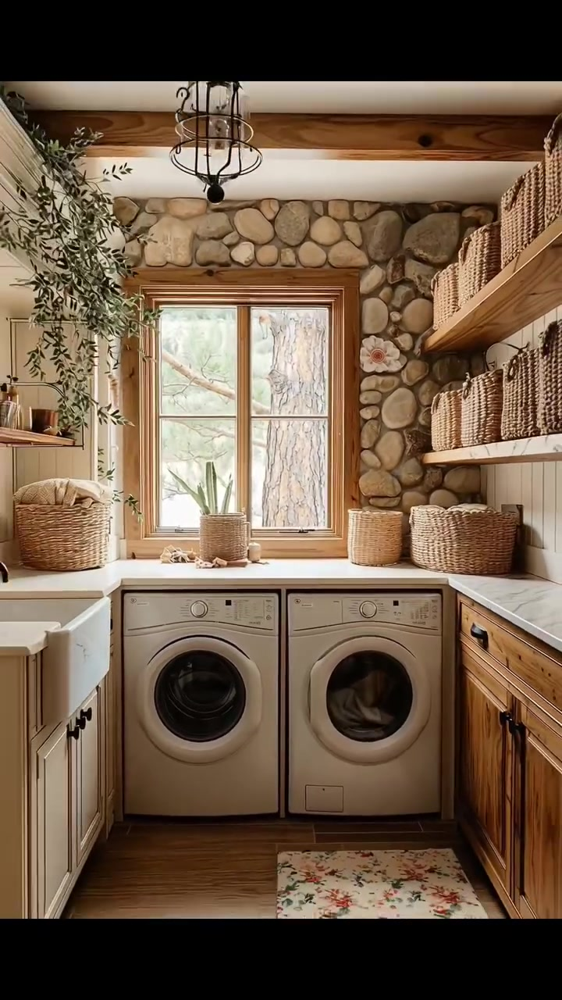
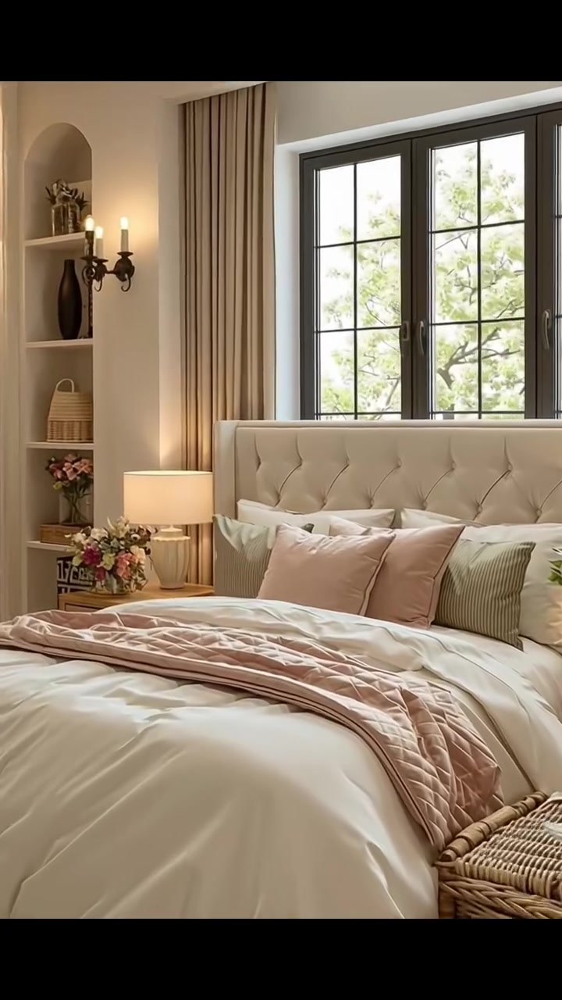
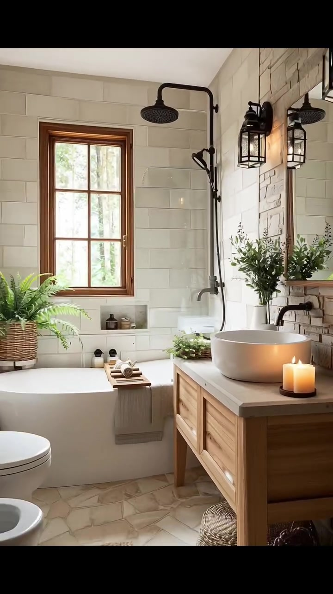

# edh030 — Mediterranean Inspired Cottage

<!-- homeku_request_id: edh030-20261104-1434 -->

<!-- homeku_detail_narratives: chat-reviewed -->

**Sumber data:** [analysis.yaml](analysis.yaml) · **Status:** draft · **Diverifikasi manusia:** Tidak

## 1. Informasi Video

| Informasi | Nilai |
|---|---|
| ID | edh030 |
| File asli | edh030.mp4 |
| Durasi | 20.46 |
| Resolusi | 720x1280 |
| FPS | 30 |
| Rasio | 9:16 |
| Jumlah shot | 5 |

## 2. Storyboard Gabungan

## 3. Identitas Desain

| Aspek | Hasil analisis |
|---|---|
| Gaya utama | mediterranean inspired cottage |
| Wilayah terkait gaya desain | europe |
| Pengaruh gaya | rustic country, modern farmhouse, traditional cottage |
| Ciri eksterior | warm cream stucco appearance exterior walls, terracotta tone curved roof tiles, arched recessed main entrance, wood framed glazed entry door, dark mullioned front windows, stone veneer raised terrace base, stone clad chimney, small upper level window, black metal lantern wall sconces |
| Gaya interior | warm rustic cottage, soft neutral country, modern farmhouse details |
| Confidence gaya | medium |

## 4. Ukuran & Proporsi Bangunan

| Aspek | Estimasi visual |
|---|---|
| Ukuran yang terlihat | medium |
| Bentuk bangunan | compact rectangular with projecting entry |
| Skala vertikal | single story with partial upper volume |
| Tapak bangunan | moderate |
| Perkiraan luas lantai | 85–155 m² |
| Confidence | low |

> Luas adalah perkiraan visual, bukan ukuran terukur.

## 5. Warna, Pencahayaan, dan Atmosfer

| Warna dominan | HEX (perkiraan) |
|---|---|
| warm cream | #E7DCCB |
| terracotta | #AC6843 |
| honey wood | #B48758 |
| light stone beige | #D4C6AC |
| soft sage green | #89917B |
| muted blush | #CDA8A0 |
| matte black | #302E2A |

| Aspek | Hasil analisis |
|---|---|
| Pencahayaan | soft natural daylight, warm wall lanterns, warm recessed ceiling lights, warm table lamps, small candle lights |
| Lingkungan | mature deciduous appearing trees, green lawn, natural stone step path, ornamental shrub beds, planters near entrance |
| Musim yang tampak | green leafy season unspecified |
| Mood | cozy, warm, rustic, calm, inviting |

## 6. Struktur dan Timeline Video

**Jenis:** home tour · **Tempo:** slow · **Transisi:** hard cuts between rooms

| Shot | Waktu (detik) | Durasi | Area/Scene | Gerakan Kamera |
|---|---|---|---|---|
| Shot 01 | 0–5 | 5.00 | exterior front | slow dolly in, tracking right |
| Shot 02 | 5–11.37 | 6.37 | open plan living room kitchen | pan right, slight dolly in |
| Shot 03 | 11.37–13.9 | 2.53 | laundry room | slow dolly out |
| Shot 04 | 13.9–17.17 | 3.27 | bedroom | pan right, slow dolly in |
| Shot 05 | 17.17–20.46 | 3.29 | bathroom | slow dolly out, pan left |

## 7. Analisis per Shot

### Shot 01 — exterior front

**Waktu:** 0–5 detik

| Komponen | Pengamatan |
|---|---|
| Fokus utama | cream cottage with terracotta roof and arched entrance |
| Framing awal → akhir | wide front three quarter → medium wide front three quarter |
| Sudut pandang | eye level slightly right oblique |
| Gerakan kamera | slow dolly in, tracking right |
| Kecepatan kamera | slow |
| Pencahayaan | soft daylight with warm entrance lanterns |
| Transisi keluar | hard cut |

**Detail yang terlihat**

**Arsitektur**

Rumah memiliki dinding depan dan samping berpenampilan plester halus warna krem, atap utama miring dengan genteng melengkung bernuansa merah terakota, serta volume atap belakang yang lebih tinggi dengan jendela kecil berbingkai gelap. Cerobong berlapis batu terlihat di dekat tengah atap. Pintu utama berkaca pada bagian bawah dan berbingkai kayu berada di ceruk masuk melengkung dengan trim kayu hangat. Di sebelah kirinya terdapat bukaan kaca lebar bersekat hitam, sedangkan sisi kanan mempunyai jendela tinggi berbentuk lengkung. Teras depan ditinggikan dengan alas berpenampilan susunan batu, tiga anak tangga pucat, lampu dinding bergaya lentera hitam di area masuk serta patio, dan langit\-langit bawah atap patio kiri berpenampilan kayu.

**Furnitur dan properti**

Pada patio kiri terdapat meja luar ruang dengan kursi berangka logam gelap. Dua pot besar berisi tanaman berada dekat pintu, lentera lantai hitam ditempatkan di sekitar tangga, dan satu pot gantung tampak di dekat jendela depan. Papan tanda kecil hitam terpasang di kanan pintu; pot tanaman berdaun panjang dan semak\-semak kecil turut menghias tepi teras.

**Lingkungan**

Batang pohon besar berada di latar depan kiri dan kanopi daun hijau yang rapat menaungi rumah. Beberapa pohon tinggi lain berdiri di belakang dan kanan bangunan. Halaman luas tertutup rumput hijau, dengan jalur pijakan batu terang tak beraturan menuju tangga, batu taman di kiri jalur, serta petak tanam berkerikil putih dan semak hijau rendah. Bangunan kecil berwarna terang tampak jauh di sebelah kanan.

**Catatan pengamatan:** Kamera bergerak mendekat dan ke kanan; kanopi dan batang pohon besar lebih dominan di awal, sedangkan pintu serta teras memenuhi bingkai menjelang akhir.

**Confidence:** Kamera medium · Detail visual high

### Shot 02 — open plan living room kitchen

**Waktu:** 5–11.37 detik

| Komponen | Pengamatan |
|---|---|
| Fokus utama | cream sofa then open kitchen with stone clad cooking wall |
| Framing awal → akhir | medium close living room corner → medium wide kitchen facing |
| Sudut pandang | interior eye level |
| Gerakan kamera | pan right, slight dolly in |
| Kecepatan kamera | slow |
| Pencahayaan | mixed soft daylight and warm recessed or sconce lighting |
| Transisi keluar | hard cut |

**Detail yang terlihat**

**Arsitektur**

Interior berdinding putih krem hangat dengan pintu kaca tinggi bersekat hitam di sisi kiri. Relung pajangan tanam pada dinding memiliki rak kayu dan lampu sorot hangat, diapit dua lampu dinding berbentuk lentera hitam. Balok\-balok plafon berpenampilan kayu pucat tampak di atas ruang. Saat kamera bergeser ke dapur, terlihat dinding aksen batu pucat di sekitar area memasak, termasuk bagian memasak berlapis batu dengan balok mantel kayu tebal dan backsplash ubin putih di belakang kompor. Kabinet atas putih krem mempunyai pintu berpanel kaca, sedangkan kabinet bawah bernuansa kayu alami. Pulau dapur besar dan countertop bernuansa terang melengkapi ruangan; jendela berbingkai hitam berada di atas bak cuci. Lantai tampak berupa papan panjang warna netral terang, dengan downlight plafon bernuansa hangat.

**Furnitur dan properti**

Sofa berlapis kain krem berada di depan kamera, dipadukan bantal cokelat cognac, hijau zaitun dan bermotif garis serta throw bermotif gelap di lengan kanannya. Di depan sofa ada meja kopi kayu persegi panjang yang memuat sukulen kecil dan buku, di atas karpet anyaman netral. Meja samping kayu di dekat dapur menahan tanaman paku dalam pot; tanaman daun lebar lain berdiri dekat sofa. Rak pajangan memuat tanaman dan benda dekoratif kecil. Pulau dapur dilengkapi kursi bar dudukan kayu dan rangka logam hitam serta piring buah berwarna jingga. Di bawah jendela dapur terlihat bak cuci putih gaya farmhouse dengan keran hitam, dan beberapa pot hijau kecil berada di atas meja kerja.

**Lingkungan**

Cahaya siang dan kehijauan tanaman tampak melalui jendela dapur. Dari pintu kaca di sisi kiri terlihat pagar atau railing luar ruang.

**Catatan pengamatan:** Gerakan perlahan ke kanan memperluas pandangan dari sofa dan pintu berkaca ke area kitchen-island, kabinet, serta dinding area memasak berlapis batu. Bukan perapian yang dapat dipastikan.

**Confidence:** Kamera medium · Detail visual high

### Shot 03 — laundry room

**Waktu:** 11.37–13.9 detik

| Komponen | Pengamatan |
|---|---|
| Fokus utama | paired front load laundry machines below wood window |
| Framing awal → akhir | medium front view tight → medium wide front view |
| Sudut pandang | interior eye level straight on |
| Gerakan kamera | slow dolly out |
| Kecepatan kamera | slow |
| Pencahayaan | diffused window daylight and single ceiling pendant |
| Transisi keluar | hard cut |

**Detail yang terlihat**

**Arsitektur**

Ruang laundry memiliki dinding aksen berpenampilan batu bulat alami di sekitar jendela kayu berdaun dua pada bagian tengah belakang. Sisi dinding lainnya menggunakan panel vertikal putih. Countertop netral terang terbentang di atas mesin dan kabinet; sebelah kiri berisi kabinet dasar krem dengan bak cuci putih yang dalam, sedangkan kanan memiliki kabinet laci berwarna kayu. Dua tingkat rak kayu terbuka memenuhi dinding kanan, sebuah balok kayu terlihat di plafon, dan lantainya berpenampilan papan kayu cokelat hangat.

**Furnitur dan properti**

Dua mesin laundry bukaan depan berwarna abu\-abu terang berjajar di bawah jendela. Beberapa keranjang anyaman tersusun di rak kanan dan di permukaan meja sekitar jendela. Lampu gantung berkerangka sangkar hitam berada di plafon tengah. Tanaman menjuntai dari rak kiri atas, pot kecil di ambang jendela, dan sebuah bak cuci kecil dengan keran gelap berada di kiri. Karpet lorong bermotif bunga terbentang di lantai; botol dan aksesori kecil tersusun di rak sisi kiri.

**Lingkungan**

Batang pohon besar terlihat tepat di balik jendela, dengan dedaunan hijau lembut di sekitarnya.

**Catatan pengamatan:** Kamera mundur sedikit dari area mesin cuci ke gambaran lebih lengkap ruang laundry yang sempit; keranjang anyaman serta sink kiri semakin tampak.

**Confidence:** Kamera medium · Detail visual high

### Shot 04 — bedroom

**Waktu:** 13.9–17.17 detik

| Komponen | Pengamatan |
|---|---|
| Fokus utama | large cream tufted bed beneath black framed window |
| Framing awal → akhir | wide bedroom view → close bed and headboard view |
| Sudut pandang | eye level facing bed |
| Gerakan kamera | pan right, slow dolly in |
| Kecepatan kamera | slow |
| Pencahayaan | soft daylight through window with warm table and recessed lights |
| Transisi keluar | hard cut |

**Detail yang terlihat**

**Arsitektur**

Kamar tidur memiliki dinding krem hangat dan plafon bertingkat dengan lampu tanam kecil. Jendela besar bersekat hitam berada di atas kepala tempat tidur, diapit tirai panjang warna beige. Bagian kiri ruangan menampilkan lemari built\-in terbuka dengan pakaian tergantung, panel cermin atau kaca berbingkai kayu, serta rak pajangan ceruk dengan bagian atas melengkung. Pencahayaan aksen hangat menerangi rak lemari, lampu dinding berbentuk tempat lilin berada di sisi tempat tidur, dan lantai netral ditutupi sebagian oleh karpet anyaman.

**Furnitur dan properti**

Tempat tidur besar memiliki sandaran tinggi berlapis kain krem dengan pola kancing, seprai serta bantal putih bertumpuk, dua bantal persegi merah muda lembut, dan dua bantal aksen hijau sage bermotif garis. Selimut quilt merah muda pucat dibentangkan melintang, dengan bagian dasar ranjang bernuansa kayu hangat. Di sisi kiri terdapat meja samping kayu, lampu berkap krem, dan rangkaian bunga kecil. Keranjang anyaman bertutup di kaki ranjang menopang kain netral terlipat, sedangkan rak lemari menyimpan pakaian lipat dan keranjang dekoratif.

**Lingkungan**

Dari jendela belakang tempat tidur tampak ranting\-ranting pohon dengan daun hijau.

**Catatan pengamatan:** Tampilan awal memperlihatkan area lemari terbuka kiri dan keseluruhan tempat tidur; kamera kemudian bergerak ke kanan dan mendekat hingga headboard, bantal, dan jendela mendominasi.

**Confidence:** Kamera medium · Detail visual high

### Shot 05 — bathroom

**Waktu:** 17.17–20.46 detik

| Komponen | Pengamatan |
|---|---|
| Fokus utama | white vessel sink wood vanity and bathtub near window |
| Framing awal → akhir | medium close vanity angle → medium wide bathroom view |
| Sudut pandang | interior eye level slightly oblique |
| Gerakan kamera | slow dolly out, pan left |
| Kecepatan kamera | slow |
| Pencahayaan | bright soft window light with warm lantern and candle glow |
| Transisi keluar | video end |

**Detail yang terlihat**

**Arsitektur**

Kamar mandi menggunakan ubin dinding persegi panjang besar warna putih gading dan aksen berpenampilan batu tidak beraturan di belakang cermin. Jendela kayu berada di atas bathtub. Kabinet wastafel bernuansa kayu alami memiliki dua laci dan countertop berpenampilan batu pucat; di atasnya duduk baskom putih bundar dengan keran hitam yang dipasang pada dinding. Cermin berbingkai kayu berada di atasnya. Perangkat shower hitam mencakup kepala pancuran hujan dan shower genggam di area bathtub. Lantai berubin batu pucat dengan bentuk tidak beraturan, terdapat ceruk kecil pada dinding dekat bak, serta lampu dinding hitam berkisi logam di sisi cermin.

**Furnitur dan properti**

Bathtub putih berada di bawah jendela bagian belakang. Di kiri depan terlihat toilet putih dan satu fixture keramik putih rendah lain yang jenisnya belum pasti. Tanaman paku dalam keranjang anyaman diletakkan dekat bak, sedangkan ranting hijau dalam vas bening dan dua lilin menyala ada di countertop. Sebuah nampan mandi kayu dengan handuk lipat dan perlengkapan kecil melintang di bak, dengan handuk terang tergantung di sisi depannya. Di bawah vanity tersimpan keranjang anyaman; tikar mandi anyaman berada di lantai, tanaman merambat kecil menghias tepian bak, dan botol perlengkapan tersusun dalam ceruk dinding.

**Lingkungan**

Melalui jendela kamar mandi terlihat batang pohon dan dedaunan hijau.

**Catatan pengamatan:** Saat kamera perlahan membuka pandangan, bathtub, shower hitam, toilet, dan bagian lantai menjadi lebih jelas; fungsi fixture putih kedua di kiri belum dapat dipastikan.

**Confidence:** Kamera medium · Detail visual high

## 8. Kualitas dan Ketidakpastian Analisis

| Parameter | Hasil |
|---|---|
| Status | draft |
| Verifikasi manusia | Tidak |
| Ketepatan timestamp | frame based cut detection approximate |
| Ketidakpastian | exact wall and floor materials are visual appearances, house location and real world construction not verified, small upper roof volume may be loft or second level, floor area is rough visual estimate without measured scale, camera movements inferred from shifting viewpoint, season and vegetation species not confirmed, second white fixture in bathroom not identified with certainty |

**Catatan:** Analisis visual berdasarkan beberapa frame sepanjang masing-masing shot; audio tidak dianalisis. Identitas gaya dan kaitan wilayah merupakan interpretasi, bukan bukti lokasi.

---

*Laporan ini diturunkan dari [analysis.yaml](analysis.yaml).*
