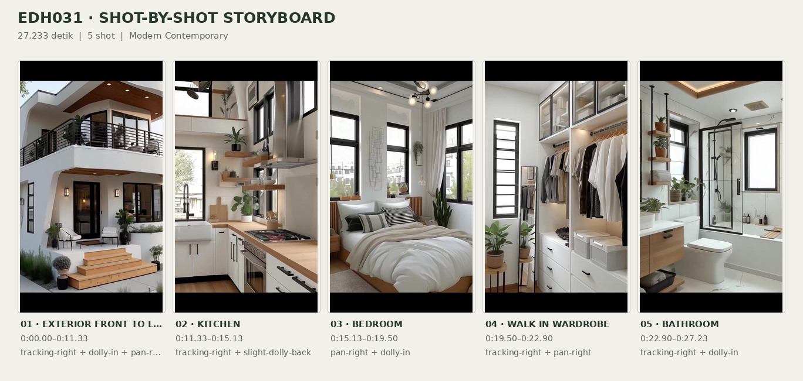
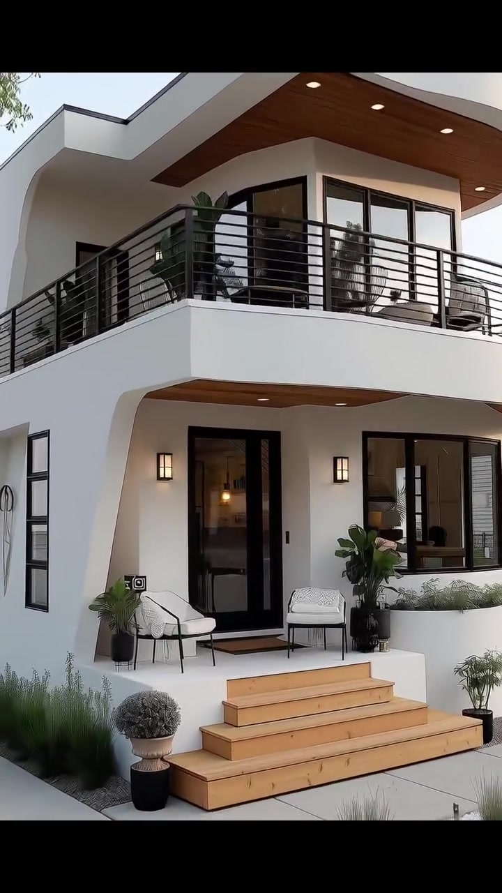
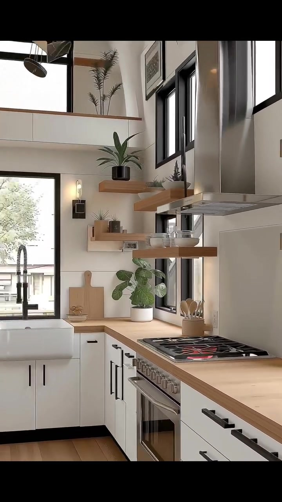
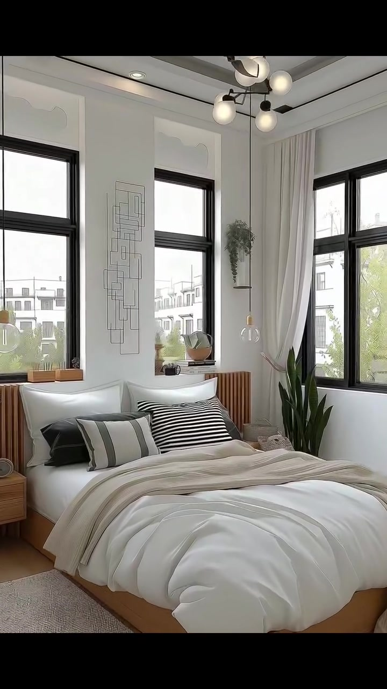
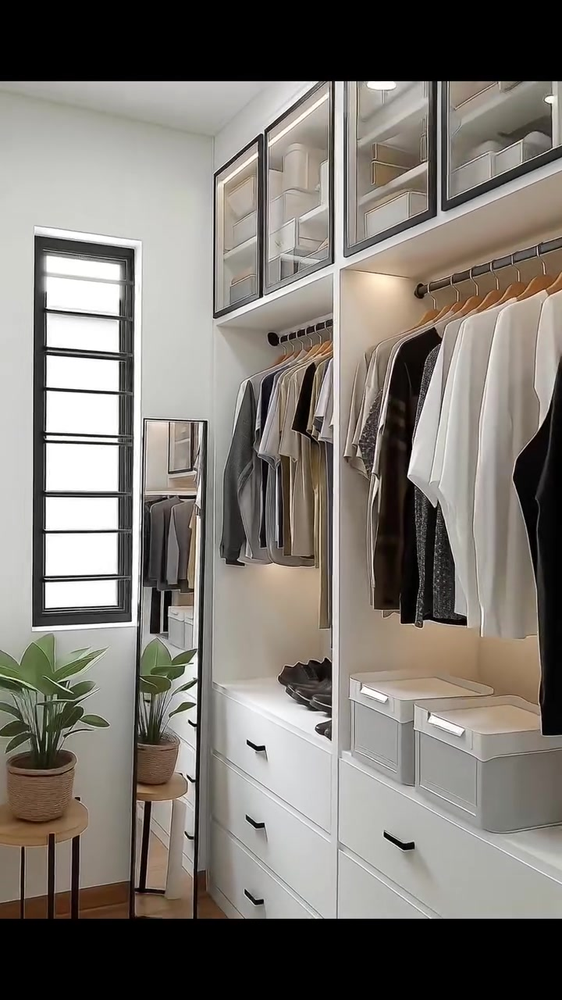
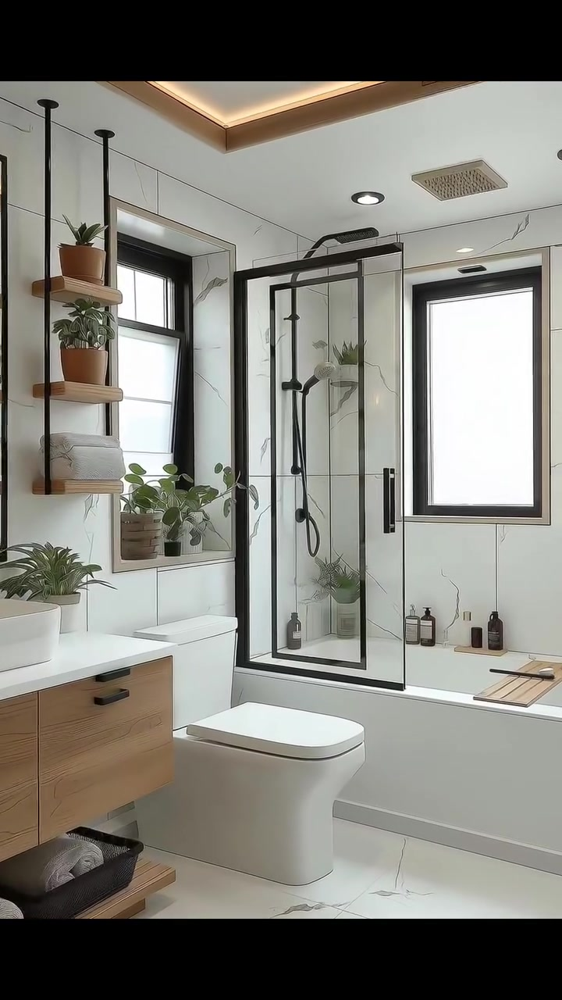

# edh031 — Modern Contemporary

<!-- homeku_request_id: edh031-20261105-491ac97e8460ab8f -->

<!-- homeku_detail_narratives: chat-reviewed -->

**Sumber data:** [analysis.yaml](analysis.yaml) · **Status:** draft · **Diverifikasi manusia:** Tidak

## 1. Informasi Video

| Informasi | Nilai |
|---|---|
| ID | edh031 |
| File asli | edh031.mp4 |
| Durasi | 27.233 |
| Resolusi | 720x1280 |
| FPS | 30 |
| Rasio | 9:16 |
| Jumlah shot | 5 |

## 2. Storyboard Gabungan

## 3. Identitas Desain

| Aspek | Hasil analisis |
|---|---|
| Gaya utama | modern contemporary |
| Wilayah terkait gaya desain | Tidak diketahui |
| Pengaruh gaya | warm minimalist, soft curvilinear modern |
| Ciri eksterior | white two story front facade, rounded upper balcony and overhanging roof, black horizontal metal balcony railings, black framed glazed openings, wood appearance soffits and entry stair treads |
| Gaya interior | bright modern minimalist, warm neutral palette, black metal details, light wood appearance finishes |
| Confidence gaya | medium |

## 4. Ukuran & Proporsi Bangunan

| Aspek | Estimasi visual |
|---|---|
| Ukuran yang terlihat | medium |
| Bentuk bangunan | compact rectangular appearance with rounded front balcony |
| Skala vertikal | two story with double height living area |
| Tapak bangunan | moderate |
| Perkiraan luas lantai | 110–185 m² |
| Confidence | low |

> Luas adalah perkiraan visual, bukan ukuran terukur.

## 5. Warna, Pencahayaan, dan Atmosfer

| Warna dominan | HEX (perkiraan) |
|---|---|
| off white | #F1F0EC |
| light warm wood | #BD9469 |
| charcoal black | #292B2B |
| soft beige | #DCD6CB |
| sage green accents | #627D61 |

| Aspek | Hasil analisis |
|---|---|
| Pencahayaan | soft daylight, warm recessed ceiling lights, warm wall sconces, localized under cabinet lighting |
| Lingkungan | residential streetscape, small front lawn, landscaped potted plants, neighboring houses visible |
| Musim yang tampak | Tidak diketahui |
| Mood | bright, calm, orderly, warm |

## 6. Struktur dan Timeline Video

**Jenis:** home tour · **Tempo:** slow · **Transisi:** continuous camera moves with hard cuts between main rooms

| Shot | Waktu (detik) | Durasi | Area/Scene | Gerakan Kamera |
|---|---|---|---|---|
| Shot 01 | 0.0–11.333 | 11.33 | exterior front to living room | tracking right, dolly in, pan right |
| Shot 02 | 11.333–15.133 | 3.80 | kitchen | tracking right, slight dolly back |
| Shot 03 | 15.133–19.5 | 4.37 | bedroom | pan right, dolly in |
| Shot 04 | 19.5–22.9 | 3.40 | walk in wardrobe | tracking right, pan right |
| Shot 05 | 22.9–27.233 | 4.33 | bathroom | tracking right, dolly in |

## 7. Analisis per Shot

### Shot 01 — exterior front to living room

**Waktu:** 0.0–11.333 detik

| Komponen | Pengamatan |
|---|---|
| Fokus utama | rounded upper balcony front entry and double height living stair |
| Framing awal → akhir | wide front three quarter view of facade → medium interior view of stair and tv wall |
| Sudut pandang | eye to slight low angle moving from outdoors to indoors |
| Gerakan kamera | tracking right, dolly in, pan right |
| Kecepatan kamera | slow to moderate |
| Pencahayaan | diffuse daylight with warm entry and interior accent lights |
| Transisi keluar | hard cut to kitchen |

**Detail yang terlihat**

**Arsitektur**

Fasad depan terdiri atas dua tingkat berwarna putih dengan profil bagian atas yang sedikit melengkung. Overhang atap yang lebar membulat di atas balkon lantai dua; bagian bawahnya berpenampilan kayu hangat dan memiliki lampu tanam bulat. Balkon dibatasi railing logam hitam bergaris horizontal dan berada di depan kaca sudut lantai atas dengan bingkai hitam yang besar. Di bawah balkon ada teras lantai dasar yang menjorok ke dalam, dicapai melalui anak tangga masuk lebar berpenampilan kayu terang. Pintu masuk sebagian berkaca dengan bingkai hitam; di sebelah kanannya terdapat jendela besar berbingkai hitam, dan lampu dinding gelap mengapit bukaan teras. Setelah kamera melewati pintu, tampak dinding putih yang menjulang setinggi dua lantai pada ruang keluarga. Tangga berpenampilan anak tangga kayu terang tanpa penutup tegak membentang naik melintasi dinding televisi, disertai railing logam hitam dengan garis diagonal dan horizontal. Beberapa jendela interior tinggi berbingkai hitam berada dekat tangga. Televisi besar berwarna hitam terpasang di dinding di bawah tangga, di atas kabinet media rendah berwarna putih dengan permukaan kayu. Plafon memiliki lampu tanam dan garis pencahayaan hangat.

**Furnitur dan properti**

Di dekat pintu depan terdapat dua kursi teras dengan bantalan putih dan rangka hitam tipis. Semak pangkas bundar di dalam pot gelap berdiri di sisi tangga masuk, sedangkan tanaman berdaun hijau lebar dalam pot berada dekat jendela teras kanan. Di ruang keluarga terdapat sofa sectional putih gading dengan bantal netral dan cokelat karat, menghadap meja kopi rendah persegi panjang dari kayu terang. Sebuah vas hitam kecil berisi batang kering berada di atas meja tersebut. Karpet netral bertekstur mengisi area duduk. Beberapa tanaman pot lain terlihat di dekat tangga dan jendela, sementara benda dekoratif kecil menghiasi kabinet media serta rak di area tangga.

**Lingkungan**

Di depan rumah terdapat petak rumput hijau yang kecil, dengan trotoar beton pucat dan jalur di sisi halaman. Rumpun rumput hias rendah tumbuh di sepanjang dasar dinding lantai satu. Tajuk pohon rimbun menjuntai dari kiri atas pandangan eksterior. Di sebelah kanan terlihat rumah tetangga dua lantai yang berwarna terang, sedangkan kabel utilitas melintang di depan langit terang yang pucat.

**Catatan pengamatan:** One continuous moving view approaches the front porch, crosses the glazed entrance, and ends inside facing the living room stair; outdoor and indoor details belong to the same uninterrupted interval.

**Confidence:** Kamera medium · Detail visual high

### Shot 02 — kitchen

**Waktu:** 11.333–15.133 detik

| Komponen | Pengamatan |
|---|---|
| Fokus utama | stainless steel range hood gas cooktop and galley kitchen |
| Framing awal → akhir | close detail of range and hood → wider view along galley to rear sink |
| Sudut pandang | slightly oblique eye level interior |
| Gerakan kamera | tracking right, slight dolly back |
| Kecepatan kamera | slow |
| Pencahayaan | bright daylight from windows with local warm shelf accents |
| Transisi keluar | hard cut to bedroom |

**Detail yang terlihat**

**Arsitektur**

Dapur berbentuk koridor sempit dengan deretan meja kerja pada dua sisi. Kabinet bawah berpanel putih polos memakai gagang batang hitam, dipadukan dengan countertop berpenampilan kayu terang dan lantai berpola papan kayu terang. Dinding serta backsplash di belakang kompor tampak putih pucat dan halus. Tudung pengisap asap berbahan logam tampak seperti stainless steel terpasang di atas kompor. Jendela\-jendela vertikal berbingkai hitam berada di atas dan di samping meja kerja. Di ujung dapur, bak cuci putih bergaya apron\-front berada tepat di bawah jendela belakang. Rak kayu terang terbuka dipasang melayang di dekat jendela dan tudung kompor; bagian atas ruangan juga memperlihatkan bidang dinding tinggi terbuka dengan jendela atas berbingkai hitam.

**Furnitur dan properti**

Kompor logam perak memiliki kisi tungku hitam dengan satu bagian tampak berpijar merah. Di sampingnya terdapat perkakas masak kayu di dalam wadah berwarna terang. Rak terbuka menampung piring dan mangkuk putih bertumpuk, juga sejumlah tanaman hijau kecil dalam pot yang tersebar sampai ke countertop. Keran hitam berleher melengkung berada di atas bak cuci putih bagian belakang, di dekat beberapa papan potong berwarna kayu terang. Mesin pencuci piring berpenampilan logam perak terpasang di bawah meja sisi kiri dekat bak cuci. Sebuah kipas plafon gelap terlihat tinggi di bagian ujung dapur.

**Lingkungan**

Dedaunan pohon yang diterangi siang terlihat melalui jendela belakang di atas bak cuci. Di balik jendela yang sama juga tampak railing luar berwarna hitam.

**Catatan pengamatan:** Camera reveals the cooker and hood first, then more shelving and the sink at the far end; glowing red burner is visible but heat source type beyond the gas hob is not independently verified.

**Confidence:** Kamera medium · Detail visual high

### Shot 03 — bedroom

**Waktu:** 15.133–19.5 detik

| Komponen | Pengamatan |
|---|---|
| Fokus utama | white duvet bed beneath tall black framed windows |
| Framing awal → akhir | wide diagonal bedroom view → frontal medium view of bed and two windows |
| Sudut pandang | eye level with slight rightward reframe |
| Gerakan kamera | pan right, dolly in |
| Kecepatan kamera | slow |
| Pencahayaan | strong soft daylight from tall windows and unlit looking globe fixtures |
| Transisi keluar | hard cut to walk in wardrobe |

**Detail yang terlihat**

**Arsitektur**

Kamar tidur memiliki plafon putih tinggi dengan susunan lis persegi panjang, sementara dinding putih juga memakai panel lis dekoratif. Jendela\-jendela tinggi berbingkai hitam tampak di belakang tempat tidur dan pada sisi kanannya. Tirai panjang berwarna terang menggantung di jendela sudut kanan. Bagian kepala tempat tidur diapit panel bilah vertikal berpenampilan kayu terang, sejalan dengan lantai berpenampilan kayu terang. Di antara jendela\-jendela tinggi terlihat hiasan dinding berbentuk garis geometris tipis.

**Furnitur dan properti**

Tempat tidur platform rendah dengan rangka kayu terang ditata menggunakan duvet putih yang penuh. Bantal dekoratif bergaris hitam, putih, dan abu\-abu bersandar di kepala tempat tidur, sedangkan selimut lempar taupe muda terbentang di atas bedding. Di sisi kiri ada meja nakas kayu bundar kecil dan dekat kedua sisi tempat tidur menggantung lampu pendant kaca bening. Pada plafon terdapat lampu gantung bercabang gelap dengan bola lampu putih. Tanaman hijau yang tegak tinggi ditempatkan di dekat jendela kanan. Karpet kecil pucat bertekstur berada di samping tempat tidur dan sejumlah vas dekoratif kecil berada pada ambang jendela.

**Lingkungan**

Dari jendela terlihat bangunan tetangga bertingkat berwarna terang. Di bawahnya tampak pepohonan dan semak hijau di bagian luar.

**Catatan pengamatan:** The camera shifts toward a more centered bed composition; exact bed dimensions and window glazing specifications cannot be determined.

**Confidence:** Kamera medium · Detail visual high

### Shot 04 — walk in wardrobe

**Waktu:** 19.5–22.9 detik

| Komponen | Pengamatan |
|---|---|
| Fokus utama | white built in wardrobe and neat neutral clothing rows |
| Framing awal → akhir | close view of left clothes rail → wide view down narrow closet aisle |
| Sudut pandang | eye level slight rightward rotation |
| Gerakan kamera | tracking right, pan right |
| Kecepatan kamera | moderate |
| Pencahayaan | bright ceiling downlights and warm wardrobe strip lighting |
| Transisi keluar | hard cut to bathroom |

**Detail yang terlihat**

**Arsitektur**

Ruang penyimpanan pakaian berbentuk lorong sempit dengan unit lemari pada sisi\-sisi yang menghadap jalur tengah. Laci\-laci built\-in berwarna putih berada di bawah rel pakaian terbuka. Kabinet penyimpanan bagian atas memiliki pintu kaca dengan bingkai gelap, sementara lampu garis hangat menerangi bagian belakang deretan pakaian gantung. Di ujung ruangan ada jendela tinggi dan sempit dengan bingkai hitam. Lantai tampak berpapan kayu terang. Pada dinding penyimpanan kiri terdapat rak pajang kayu terbuka, dan muka laci putih memakai gagang kecil berwarna gelap.

**Furnitur dan properti**

Deretan pakaian abu\-abu, beige, putih, dan hitam tergantung rapi pada hanger kayu. Sejumlah sepatu gelap disusun di rak putih bagian bawah. Kotak penyimpanan berwarna terang ditempatkan dalam kompartemen terbuka. Di dekat jendela ujung ada cermin berdiri ramping berbingkai gelap. Tanaman berdaun hijau lebar berada di atas meja dudukan tanaman berpermukaan kayu dan kaki logam hitam. Kain terlipat serta wadah penyimpanan juga terlihat di balik pintu kaca kabinet atas.

**Lingkungan**

Tidak ada detail yang tercatat.

**Catatan pengamatan:** Outdoor view through the narrow end window is too bright and indistinct for reliable landscape description.

**Confidence:** Kamera medium · Detail visual high

### Shot 05 — bathroom

**Waktu:** 22.9–27.233 detik

| Komponen | Pengamatan |
|---|---|
| Fokus utama | black framed glass shower screen and white bathtub below window |
| Framing awal → akhir | wide view of vanity toilet and bath → closer view of bathtub window and shower screen |
| Sudut pandang | eye level slow pan to right |
| Gerakan kamera | tracking right, dolly in |
| Kecepatan kamera | slow |
| Pencahayaan | diffuse daylight through bathroom window with warm recessed accent lights |
| Transisi keluar | end of video |

**Detail yang terlihat**

**Arsitektur**

Kamar mandi menggunakan ubin dinding putih berukuran besar dengan gurat abu\-abu tipis berpenampilan marmer, dipadukan dengan ubin lantai pucat dengan pola urat yang halus. Bathtub putih berbentuk persegi panjang terpasang menyatu di bawah jendela. Pada sisi kiri bak terpasang sekat kaca transparan dengan bingkai logam hitam, serta perangkat shower hitam yang mencakup kepala shower atas dan shower genggam. Di atas bathtub terdapat jendela vertikal berbingkai hitam. Kabinet wastafel melayang berpenampilan kayu terang memakai gagang laci hitam, dengan wastafel putih persegi panjang pada countertop di sebelah toilet putih. Plafon memiliki cahaya tidak langsung hangat di tepi, beberapa spotlight bulat tanam, dan kisi ventilasi persegi. Di dinding sebelah kanan bathtub ada rel handuk hitam. Di dekat wastafel terdapat rak dinding kayu melayang.

**Furnitur dan properti**

Beberapa tanaman hijau dalam pot diletakkan pada rak terbuka dan di area kabinet wastafel. Handuk berwarna terang bertumpuk pada rak dinding; handuk putih dan abu\-abu yang digulung tersimpan di rak bawah kabinet. Beberapa botol amber dan gelap berada bersama di pinggir bathtub. Nampan mandi sempit dari bilah kayu terang melintang di dekat ujung depan bathtub. Sebuah handuk putih tergantung pada rel hitam di dinding. Di dekat wastafel tampak lampu gantung berkaca bening.

**Lingkungan**

Tidak ada detail yang tercatat.

**Catatan pengamatan:** Window is strongly backlit with no verifiable exterior scenery; white stone-like patterns are appearance descriptions rather than proof of natural marble.

**Confidence:** Kamera medium · Detail visual high

## 8. Kualitas dan Ketidakpastian Analisis

| Parameter | Hasil |
|---|---|
| Status | draft |
| Verifikasi manusia | Tidak |
| Ketepatan timestamp | estimated |
| Ketidakpastian | estimated floor area not measured and building depth not visible, white wall and wood surfaces identified by appearance not material testing, exact geographic location and season not verifiable, exterior to living room motion is continuous without obvious hard cut, some rendered scene details or object counts may be ambiguous at video resolution |

**Catatan:** Visual-only inspection of all five shot intervals; no claims about audio, actual property location, structural measurements, or construction specification.

---

*Laporan ini diturunkan dari [analysis.yaml](analysis.yaml).*
