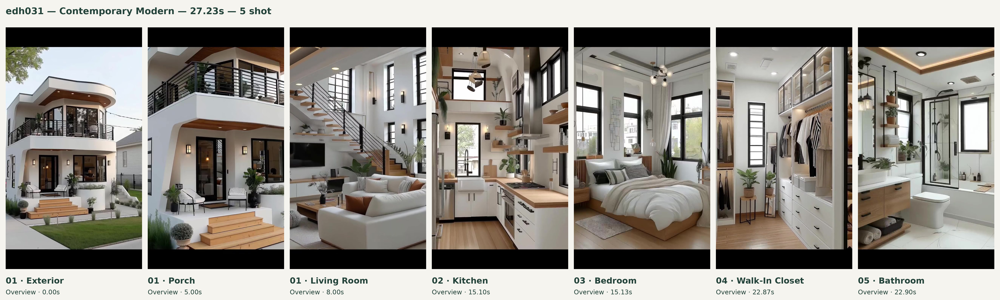
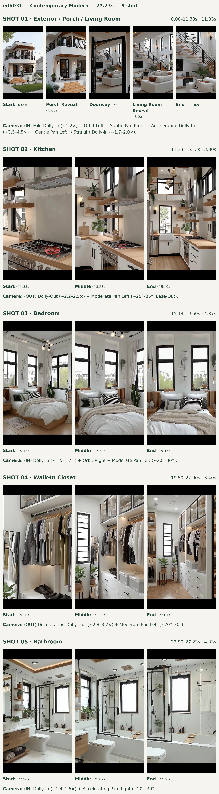
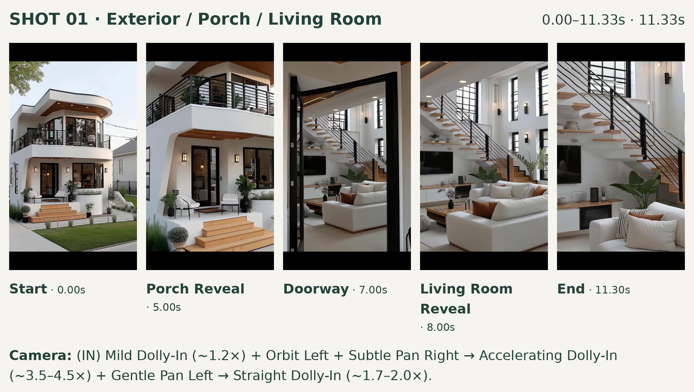
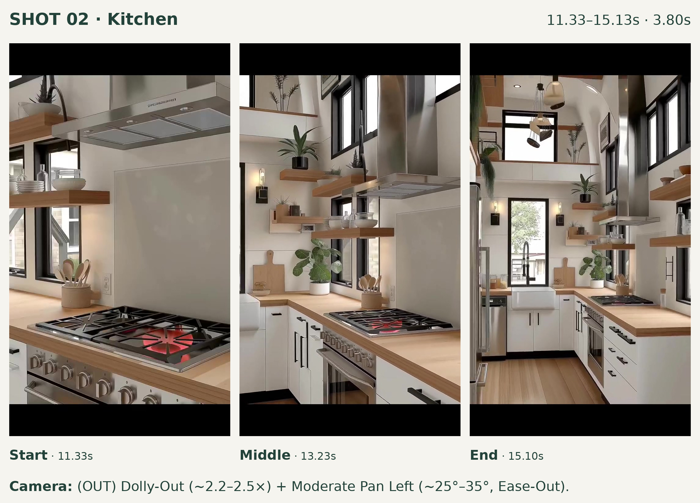
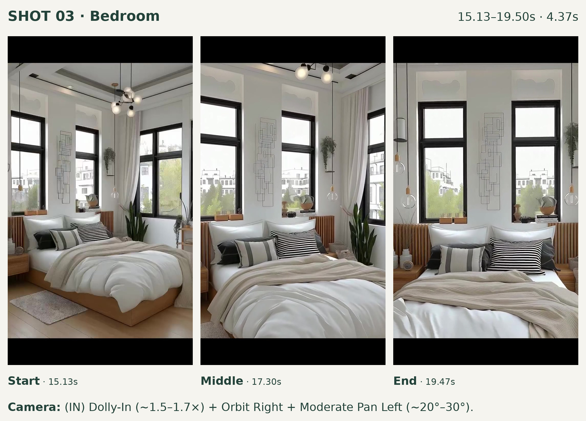
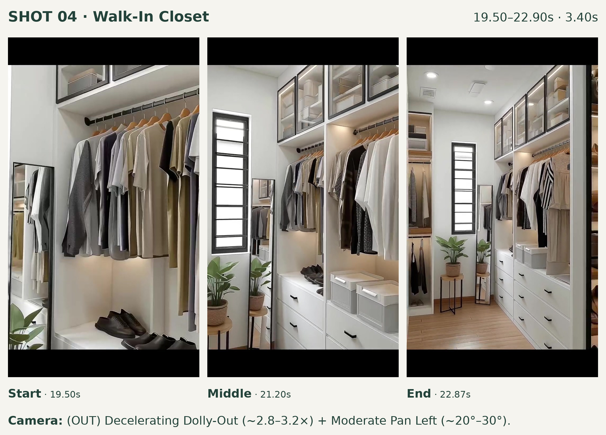
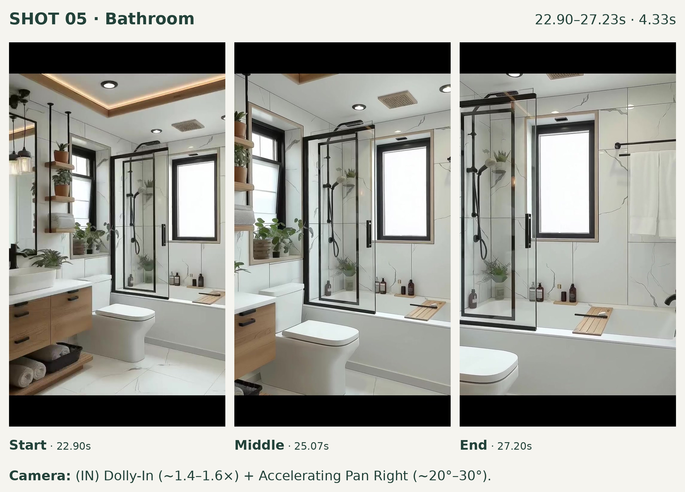

# edh031 — Rumah Modern Dua Tingkat dengan Balkon Lengkung

## 1. Profil desain

- **Nama desain:** Rumah Modern Dua Tingkat dengan Balkon Lengkung
- **Tipe rumah:** Detached House
- **Gaya utama:** **Contemporary Modern**
- **Pengaruh gaya:** Streamline Moderne
- **Gaya interior:** Warm Minimalism
- **Susunan ruang utama:** Fasad dan teras terhubung langsung ke ruang tamu dalam take pertama; dapur, kamar, closet dan kamar mandi muncul lewat cut
- **Ciri khas:** Balkon bersudut lengkung dan ruang tamu bertangga dengan railing horizontal hitam
- **Material utama:** Bidang putih dominan, tampilan kayu hangat pada soffit, tangga, lantai dan kabinet; aksen hitam pada rangka dan railing
- **Pencahayaan:** Daylight melalui jendela tinggi, dilengkapi lampu dinding, plafon dan lampu aksen hangat
- **Atmosfer:** Terang, rapi dan hangat dengan kontras grafis hitam-putih
- **Lingkungan:** Halaman rumput, jalur perkerasan dan rumah tetangga tampak di depan/samping

### Palet warna

| Peran | Warna | HEX |
| --- | --- | --- |
| Dominan | Putih hangat | `#E6E3DE` |
| Pendamping | Kayu madu | `#B98752` |
| Aksen | Hitam arang | `#262625` |
| Pendamping | Krem linen | `#C6B9A6` |
| Aksen | Hijau daun | `#536744` |

## 2. Ukuran & proporsi

| Aspek | Estimasi visual |
| --- | --- |
| **Ukuran rumah** | medium |
| **Bentuk bangunan** | Massa putih dua tingkat, bidang balkon depan melengkung |
| **Lantai & bentuk atap** | Dua tingkat terlihat pada fasad dan tangga interior · Garis tepi atap datar dengan overhang lengkung; konstruksi atap tidak diketahui |
| **Tapak bangunan** | Massa kompak, bagian depan menonjol dengan sudut melengkung |
| **Proporsi utama** | Fasad cenderung vertikal; balkon lebar membentang di depan |
| **Perkiraan luas lantai** | **100–180 m²** |

## 3. Shot Timeline

Durasi 27.23s · 5 shot.

**Camera Pattern:** IN – OUT – IN – OUT – IN.

| Shot | Time (s) | Duration | Area/Scene | Camera Movement |
| --- | --- | --- | --- | --- |
| 01 | 0.00–11.33 | 11.33s | Exterior / Porch / Living Room | Mild Dolly-In (~1.2×) + Orbit Left + Subtle Pan Right → Accelerating Dolly-In (~3.5–4.5×) + Gentle Pan Left → Straight Dolly-In (~1.7–2.0×). |
| 02 | 11.33–15.13 | 3.80s | Kitchen | Dolly-Out (~2.2–2.5×) + Moderate Pan Left (~25°–35°, Ease-Out). |
| 03 | 15.13–19.50 | 4.37s | Bedroom | Dolly-In (~1.5–1.7×) + Orbit Right + Moderate Pan Left (~20°–30°). |
| 04 | 19.50–22.90 | 3.40s | Walk-In Closet | Decelerating Dolly-Out (~2.8–3.2×) + Moderate Pan Left (~20°–30°). |
| 05 | 22.90–27.23 | 4.33s | Bathroom | Dolly-In (~1.4–1.6×) + Accelerating Pan Right (~20°–30°). |

## 4. Overview

**Shot 01 · Exterior · 0.00s**

> Di jalur depan, kamera setara mata menghadap serong fasad dua tingkat, mencakup halaman, balkon dan akses teras.

**Shot 01 · Porch · 5.00s**

> Dari depan tangga, kamera menghadap pintu di bawah balkon dengan dua kursi dan soffit kayu dalam framing teras.

**Shot 01 · Living Room · 8.00s**

> Dari ambang dalam, kamera menghadap sofa dan tangga tinggi; TV, railing serta jendela sisi kanan terlihat dalam framing wide.

**Shot 02 · Kitchen · 15.10s**

> Dari dekat akses lorong menghadap sink di ujung, counter kanan, rak, hood, kabinet bawah dan sebagian kulkas kiri tercakup dalam wide.

**Shot 03 · Bedroom · 15.13s**

> Dari sisi kaki ranjang kamera memandang serong ke headboard; ranjang utuh, jendela tinggi, tanaman dan sudut ruang terlihat.

**Shot 04 · Walk-In Closet · 22.87s**

> Dari dekat akses lorong kamera menghadap ujung jendela; rak gantung kanan, kabinet atas, laci bawah dan penyimpanan kiri terlihat.

**Shot 05 · Bathroom · 22.90s**

> Dari dekat akses, kamera memandang serong ke dinding belakang, mencakup vanity kiri, toilet, shower, bathtub dan jendela dalam wide.

## 5. Storyboard

## 6. Shot Details

### Shot 01 · Exterior / Porch / Living Room

**Time:** 0.00–11.33s · **Duration:** 11.33s

**Shot Type:** Continuous shot · Multi area · No cut.

#### **A. Desain area**

##### **Exterior**

**Arsitektur**

> Massa dua tingkat putih dengan overhang dan balkon membulat di sudut kanan; Balkon lantai atas dengan railing hitam horizontal dan pintu kaca tinggi; Tepi atap tampak datar dengan soffit berwarna kayu dan downlight; Bukaan vertikal rangka gelap di kedua tingkat, bukaan samping sempit; Bidang dinding putih halus dan soffit tampak kayu hangat.

**Furnitur & dekorasi**

> Planter putih dan tanaman menghias depan teras.

**Lingkungan**

> Rumput depan, jalur perkerasan di kiri layar, pohon dan rumah tetangga di kanan.

##### **Porch**

**Arsitektur**

> Teras dinaungi balkon dan dicapai lewat anak tangga lebar berwarna kayu; Pintu kaca rangka hitam mengarah langsung ke ruang tamu; Soffit tampak papan kayu dengan downlight dan sconce di dinding putih.

**Furnitur & dekorasi**

> Dua kursi putih berangka hitam mengapit pintu, tanaman pot di sisi kanan pintu.

**Lingkungan**

> Teras menghadap halaman dan tangga akses depan.

##### **Living Room**

**Arsitektur**

> Ruang tamu berplafon tinggi dengan tangga terbuka di belakang sofa dan TV di bawah sisi tangga; Anak tangga tampak kayu dengan railing hitam garis horizontal dan bordes atas; Jendela tinggi vertikal memberi cahaya dari sisi kanan dan belakang tangga; Bidang plafon putih, aksen kayu dan lampu tanam.

**Furnitur & dekorasi**

> Sofa putih besar membelakangi kamera awal interior, bantal putih dan cokelat, menghadap TV; Meja rendah tampak kayu di antara sofa dan TV, karpet terang di bawahnya; Kabinet TV rendah putih dan kayu dengan bidang gelap; pot tanaman dekat tangga.

**Lingkungan**

> Cahaya terang melalui kaca; detail lingkungan terbatas dari interior.

#### **B. Framing & Lighting**

- **Fokus:** Fasad, kusen, ruang tamu bertangga
- **Camera Start:** Di jalur depan rumah · Menghadap serong fasad lalu pintu dan tangga · oblique · Setara mata, perkiraan · Relatif datar
- **Framing:** Fasad wide dengan halaman dan balkon → Detail sofa dan tangga
- **Lighting:** Daylight eksterior dan jendela, lampu hangat interior
- **Foreground dan kedalaman:** Rumput, jalur, teras lalu sofa · Halaman → teras → interior
- **Reveal:** Teras, ambang pintu dan ruang tamu terbuka bertahap.
- **Kesesuaian gerak:** Lintasan maju kontinu membuka area berturut-turut
- **Area:** Exterior / Porch / Living Room
- **Rute kamera:** Exterior (0.00–4.50s · awal · Fasad dan halaman) → Porch (4.50–7.20s · anak tangga dan pintu · Teras serta pintu) → Living Room (7.20–11.33s · ambang pintu · Sofa dan tangga)

**Hubungan antararea**

- **Penghubung area:** Jalur halaman mengarah ke anak tangga teras.; Pintu dari teras membuka langsung ke ruang tamu.
- **Peralihan:** Exterior · 0.00–6.10s; Porch · 4.00–7.20s; Living Room · 6.50–11.33s
- **Orientasi ruang:** Satu take kontinu dari halaman melalui teras dan pintu ke ruang tamu; tidak ada cut internal.

#### **C. Camera Movement**

Kamera menyusur ke kiri fasad sambil sedikit mendekat, kemudian melaju ke pintu masuk, menembus ambang dan melanjutkan pendekatan menuju tangga di ruang tamu.

**Tempo:** Lambat pada fasad, cepat menjelang lintasan pintu, lalu sedang di interior.

- **0.00–3.00s · slow:** Perubahan sudut dan skala kecil.
- **3.00–7.50s · fast:** Percepatan pendekatan terutama saat kusen cepat membesar.
- **7.50–11.33s · moderate:** Maju ke sofa dan tangga lebih terkendali.

**Alur visual:** Fasad → teras → pintu masuk → living room; satu take tanpa cut.

**Movement Timeline**

| Time (s) | Area & fokus | Camera Movement | Tempo |
| --- | --- | --- | --- |
| 0.00–3.00 | Exterior / Porch / Living Room · Fasad dan sisi kiri | Mild Dolly-In (~1.2×) + Orbit Left + Subtle Pan Right | Perubahan sudut dan skala kecil. |
| 3.00–7.50 | Exterior / Porch / Living Room · Tangga teras dan bukaan pintu | Accelerating Dolly-In (~3.5–4.5×) + Gentle Pan Left | Percepatan pendekatan terutama saat kusen cepat membesar. |
| 7.50–11.33 | Exterior / Porch / Living Room · Sofa dan tangga interior | Straight Dolly-In (~1.7–2.0×) | Maju ke sofa dan tangga lebih terkendali. |

**Camera:** Mild Dolly-In (~1.2×) + Orbit Left + Subtle Pan Right → Accelerating Dolly-In (~3.5–4.5×) + Gentle Pan Left → Straight Dolly-In (~1.7–2.0×).

---

### Shot 02 · Kitchen

**Time:** 11.33–15.13s · **Duration:** 3.80s

#### **A. Desain area**

**Arsitektur**

> Lorong dapur sempit dengan bidang kerja di kanan dan sink di ujung; bentuk L yang terlihat, susunan sisi kiri tidak lengkap; Jendela hitam di atas sisi kerja dan di ujung sink; Countertop tampak kayu, backsplash krem pucat dan lantai papan hangat.

**Furnitur & dekorasi**

> Kompor gas dengan oven di bawah dan hood logam di atas, berada pada counter kanan; Sink putih apron-front di bawah jendela ujung, keran hitam melengkung; Kabinet bawah putih handle hitam, rak kayu terbuka bertingkat di atas meja dengan tanaman dan wadah; Sisi kulkas logam terlihat di kiri lorong pada akhir.

**Lingkungan**

> Cahaya dari jendela ujung dengan dedaunan samar di luar.

#### **B. Framing & Lighting**

- **Fokus:** Counter, rak dan sink
- **Camera Start:** Dekat kompor di sisi counter kanan · Menghadap kompor, beralih ke ujung sink · oblique · Sekitar tinggi dada/mata, perkiraan · Relatif datar
- **Framing:** Detail kompor dan hood → Wide lorong dapur
- **Lighting:** Daylight jendela dan lampu rak
- **Foreground dan kedalaman:** Kompor dan countertop · Counter dekat → jendela ujung
- **Reveal:** Sink dan susunan kabinet di ujung lorong terbuka.
- **Kesesuaian gerak:** Dolly-Out memperluas cakupan dan Pan Left membuka lorong

#### **C. Camera Movement**

Kamera mundur dari kompor sambil mengalihkan pandangan ke kiri hingga area sink dan lorong dapur terbuka.

**Tempo:** Mundur relatif konsisten, sapuan kiri lebih terasa di tengah dan mereda pada akhir.

**Camera:** Dolly-Out (~2.2–2.5×) + Moderate Pan Left (~25°–35°, Ease-Out).

---

### Shot 03 · Bedroom

**Time:** 15.13–19.50s · **Duration:** 4.37s

#### **A. Desain area**

**Arsitektur**

> Ranjang menjadi pusat ruang, dengan bukaan tinggi mengapit bidang headboard dan jendela sudut kanan; Dua jendela tinggi rangka hitam di belakang ranjang dan bukaan tambahan di sisi kanan; Dinding putih berpanel, bidang kayu bilah rendah di belakang ranjang; plafon berbingkai gelap dan lampu gantung.

**Furnitur & dekorasi**

> Ranjang platform tampak kayu berlapis linen putih, selimut krem dan bantal garis hitam-putih; Meja kecil di sisi ranjang, tanaman tinggi dekat jendela kanan dan karpet kecil di kaki ranjang.

**Lingkungan**

> Pohon dan bangunan putih di kejauhan terlihat melalui kaca.

#### **B. Framing & Lighting**

- **Fokus:** Ranjang dengan jendela
- **Camera Start:** Dekat kaki ranjang dari sisi kiri pandang awal · Menghadap ranjang serong lalu frontal · oblique · Sekitar tinggi mata, perkiraan · Relatif datar
- **Framing:** Wide ranjang dan sudut jendela → Medium frontal headboard
- **Lighting:** Daylight jendela dan lampu gantung
- **Foreground dan kedalaman:** Ranjang dan karpet · Kaki ranjang → headboard
- **Reveal:** Headboard dan dua jendela menjadi frontal.
- **Kesesuaian gerak:** Dolly-In dan orbit menyelaraskan pusat ranjang

#### **C. Camera Movement**

Kamera mendekat ke ranjang dari pandangan serong menuju frontal, bergeser ke kanan sambil mengarahkan pandangan ke kiri.

**Tempo:** Awal halus, pendekatan cukup merata lalu melambat; sapuan kiri makin nyata menjelang frontal.

**Camera:** Dolly-In (~1.5–1.7×) + Orbit Right + Moderate Pan Left (~20°–30°).

---

### Shot 04 · Walk-In Closet

**Time:** 19.50–22.90s · **Duration:** 3.40s

#### **A. Desain area**

**Arsitektur**

> Lorong memanjang dengan penyimpanan di kanan dan sebagian kiri, jendela vertikal di ujung; Jendela sempit berangka hitam dengan pembagian horizontal; Lantai berpola papan kayu hangat, dinding dan plafon putih dengan downlight.

**Furnitur & dekorasi**

> Rel gantung terbuka, kabinet atas berpintu kaca gelap, laci bawah putih handle hitam dan lampu rak hangat; Cermin tinggi dekat jendela dan tanaman pot pada stand; sepatu serta kotak tersimpan di bawah pakaian.

**Lingkungan**

> Cahaya menyebar dari jendela ujung; pemandangan luar tidak terbaca.

#### **B. Framing & Lighting**

- **Fokus:** Rel, kabinet, jendela
- **Camera Start:** Dekat rak gantung di lorong · Menghadap serong rak lalu ujung jendela · oblique · Sekitar tinggi mata, perkiraan · Relatif datar
- **Framing:** Detail rel pakaian → Wide lorong closet
- **Lighting:** Daylight jendela, downlight dan lampu rak
- **Foreground dan kedalaman:** Pakaian dan laci · Rak dekat → ujung lorong
- **Reveal:** Jendela ujung dan keseluruhan penyimpanan terbuka.
- **Kesesuaian gerak:** Dolly-Out membuka lorong dan penyimpanan

#### **C. Camera Movement**

Kamera mundur dari rak pakaian hingga lorong dan kedua sisi penyimpanan terbaca, sambil mengarahkan pandangan ke kiri sepanjang lorong.

**Tempo:** Mundur cukup aktif selama 3,4 detik, perubahan skala mereda bertahap.

**Camera:** Decelerating Dolly-Out (~2.8–3.2×) + Moderate Pan Left (~20°–30°).

---

### Shot 05 · Bathroom

**Time:** 22.90–27.23s · **Duration:** 4.33s

#### **A. Desain area**

**Arsitektur**

> Vanity kiri, toilet di tengah depan dan bathtub memanjang di belakang dengan shower di sisi kiri bak; Jendela hitam vertikal di dinding belakang dan sisi kiri, memberi cahaya difus; Bidang putih bermotif urat abu menyerupai marmer, lantai putih dan plafon dengan lampu cove hangat.

**Furnitur & dekorasi**

> Vanity gantung tampak kayu dengan top putih, cermin dan rak tanaman di kiri; Panel kaca rangka hitam di atas bathtub, rain shower hitam dan hand shower pada dinding; Bathtub putih menyatu dengan bidang dinding belakang, tray kayu di atas bibir bak dan towel bar di kanan; Toilet putih di antara vanity dan bak dari sudut awal.

**Lingkungan**

> Bukaan tampak terang tanpa detail luar yang terbaca.

#### **B. Framing & Lighting**

- **Fokus:** Bathtub, kaca shower, jendela
- **Camera Start:** Di sisi akses kamar mandi · Menghadap vanity dan bathtub lalu lebih kanan · oblique · Sekitar tinggi mata, perkiraan · Relatif datar
- **Framing:** Wide vanity, toilet, bathtub → Medium bathtub dan panel shower
- **Lighting:** Daylight difus, downlight dan cove hangat
- **Foreground dan kedalaman:** Vanity dan toilet · Vanity → bak dan dinding belakang
- **Reveal:** Bathtub dan panel shower menjadi fokus.
- **Kesesuaian gerak:** Dolly-In dan Pan Right menggeser fokus ke bak

#### **C. Camera Movement**

Kamera mendekat sambil menyapu ke kanan dari vanity dan toilet menuju bathtub, panel shower dan jendela.

**Tempo:** Mulai perlahan, sapuan kanan meningkat di tengah dan bertahan hingga akhir; pendekatan cukup halus.

**Camera:** Dolly-In (~1.4–1.6×) + Accelerating Pan Right (~20°–30°).
