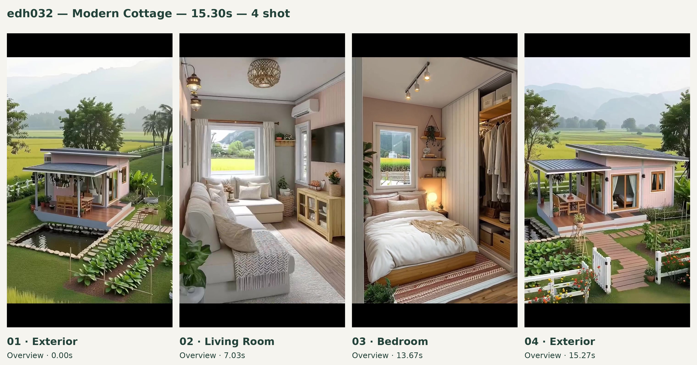
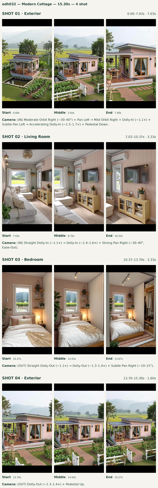
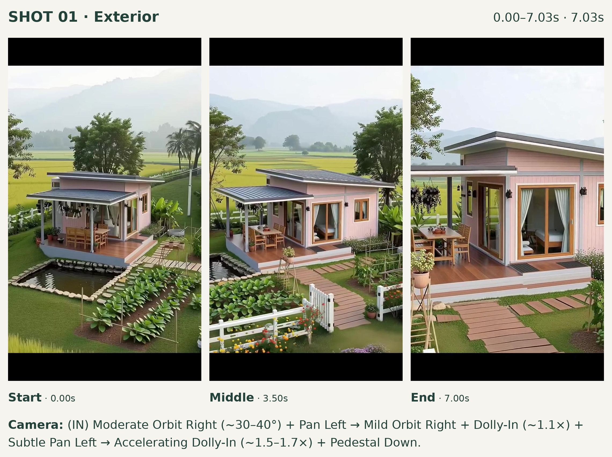
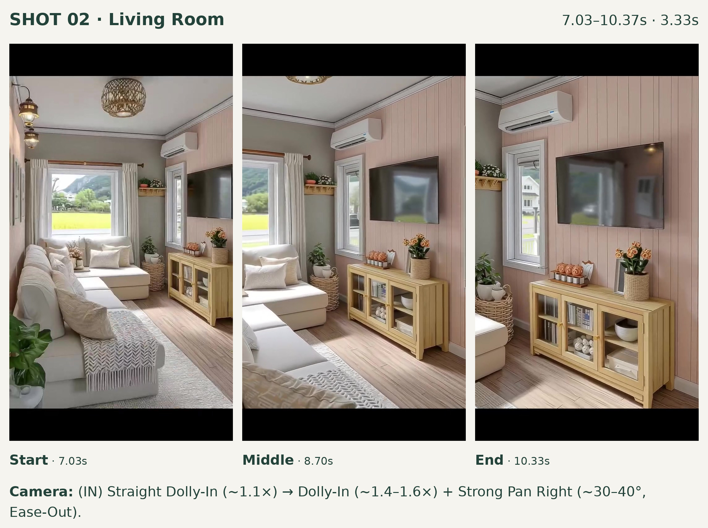
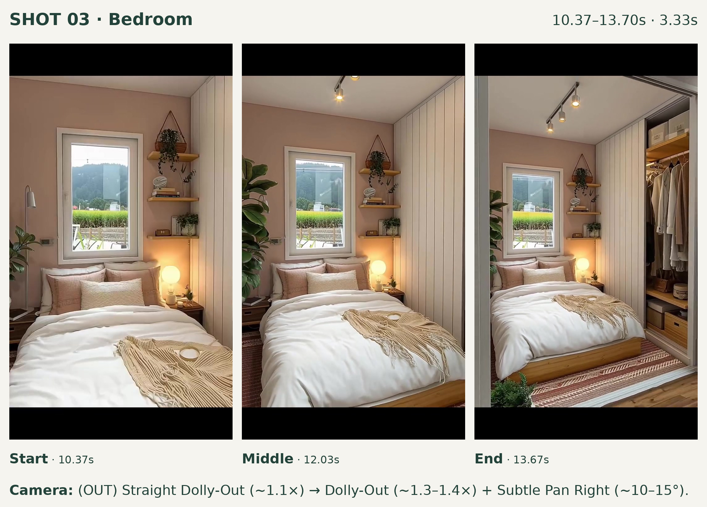
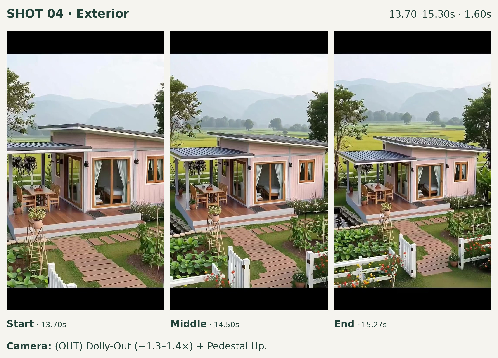

# edh032 — Cottage Modern Merah Muda di Tepi Sawah

## 1. Profil desain

- **Nama desain:** Cottage Modern Merah Muda di Tepi Sawah
- **Tipe rumah:** Cottage
- **Gaya utama:** **Modern Cottage**
- **Pengaruh gaya:** —
- **Gaya interior:** Cozy Minimalist
- **Susunan ruang utama:** Eksterior, ruang tamu dan kamar tidur diperlihatkan lewat cut; denah hubungan ruang belum terlihat
- **Ciri khas:** Teras makan terbuka dan kebun berpagar putih di depan fasad merah muda
- **Material utama:** Panel merah muda, trim putih, permukaan kayu dan atap gelap; material fisik tidak terverifikasi
- **Pencahayaan:** Cahaya siang lembut dari luar dan jendela, lampu aksen interior hangat
- **Atmosfer:** Tenang, hangat dan berskala intim
- **Lingkungan:** Taman, kolam bertepi batu, petak tanaman, sawah dan pegunungan jauh

### Palet warna

| Peran | Warna | HEX |
| --- | --- | --- |
| Dominan | Dusty Pink | `#C8A49B` |
| Pendamping | Warm White | `#E7E2D8` |
| Pendamping | Natural Wood | `#B99265` |
| Aksen | Charcoal | `#464A4A` |
| Pendamping | Beige | `#BDAA92` |
| Aksen | Garden Green | `#6B8246` |

## 2. Ukuran & proporsi

| Aspek | Estimasi visual |
| --- | --- |
| **Ukuran rumah** | small |
| **Bentuk bangunan** | Massa rendah kompak, satu tingkat tampak |
| **Lantai & bentuk atap** | Satu lantai tampak · Atap satu bidang miring rendah, kanopi teras terpisah dengan profil gelap |
| **Tapak bangunan** | Massa utama kompak mendekati persegi panjang dengan teras menempel |
| **Proporsi utama** | Massa rendah, lebar fasad dominan dibanding tinggi |
| **Perkiraan luas lantai** | **35–60 m²** |

## 3. Shot Timeline

Durasi 15.30s · 4 shot.

**Camera Pattern:** IN – IN – OUT – OUT.

| Shot | Time (s) | Duration | Area/Scene | Camera Movement |
| --- | --- | --- | --- | --- |
| 01 | 0.00–7.03 | 7.03s | Exterior | Moderate Orbit Right (~30–40°) + Pan Left → Mild Orbit Right + Dolly-In (~1.1×) + Subtle Pan Left → Accelerating Dolly-In (~1.5–1.7×) + Pedestal Down. |
| 02 | 7.03–10.37 | 3.33s | Living Room | Straight Dolly-In (~1.1×) → Dolly-In (~1.4–1.6×) + Strong Pan Right (~30–40°, Ease-Out). |
| 03 | 10.37–13.70 | 3.33s | Bedroom | Straight Dolly-Out (~1.1×) → Dolly-Out (~1.3–1.4×) + Subtle Pan Right (~10–15°). |
| 04 | 13.70–15.30 | 1.60s | Exterior | Dolly-Out (~1.3–1.4×) + Pedestal Up. |

## 4. Overview

**Shot 01 · Exterior · 0.00s**

> Kamera tinggi di atas taman sisi kolam, menghadap serong ke rumah dan menunduk. Wide menampilkan massa rendah, teras, kolam, petak tanaman dan bentang sawah berlatar gunung.

**Shot 02 · Living Room · 7.03s**

> Kamera di ujung ruang dekat sofa, menghadap serong ke jendela belakang dan TV kanan pada tinggi sekitar mata. Wide menampilkan sofa L, jendela, konsol dan lampu gantung.

**Shot 03 · Bedroom · 13.67s**

> Kamera di dekat ambang kamar setelah mundur, menghadap serong ke ranjang dan jendela belakang pada tinggi sekitar mata. Wide menampilkan ranjang, rak sudut, jalur plafon dan lemari terbuka di kanan.

**Shot 04 · Exterior · 15.27s**

> Kamera di depan taman pada posisi lebih tinggi, menghadap serong ke fasad dan sedikit menunduk. Wide memperlihatkan pagar putih, jalur, teras dan rumah serta sawah dan pegunungan.

## 5. Storyboard

## 6. Shot Details

### Shot 01 · Exterior

**Time:** 0.00–7.03s · **Duration:** 7.03s

#### **A. Desain area**

**Arsitektur**

> Massa rumah satu tingkat tampak, atap miring rendah dan kanopi gelap pada tiang putih. Panel merah muda vertikal membingkai pintu kaca lebar dan jendela kecil. Teras berlantai tampak kayu, dengan tangga rendah ke jalur taman.

**Furnitur & dekorasi**

> Meja makan dan kursi warna kayu berada di bawah kanopi; tanaman gantung menghiasi bagian tepi teras.

**Lingkungan**

> Kolam persegi bertepi batu di depan/samping teras, petak tanaman berbaris, pagar dan gerbang putih, jalur papan kemerahan, sawah hijau-kuning dan gunung jauh.

#### **B. Framing & Lighting**

- **Fokus:** Rumah dan teras
- **Camera Start:** Di luar tapak, di atas taman dekat sisi kolam · Menghadap serong ke rumah dari arah kolam · oblique · Tinggi, di atas atap teras · Menunduk
- **Framing:** Wide tinggi mencakup rumah, kolam, kebun dan sawah → Lebih dekat, fasad dan teras mengisi bingkai
- **Lighting:** Cahaya siang lembut, bayangan ringan
- **Foreground dan kedalaman:** Kolam, tanaman kebun dan pagar · Lapisan kolam/tanaman, rumah, sawah dan pegunungan
- **Reveal:** Orbit membuka fasad; pendekatan memperbesar pintu kaca
- **Kesesuaian gerak:** Orbit cocok untuk hubungan tapak; dolly-in mengalihkan fokus ke fasad

#### **C. Camera Movement**

Kamera mengitari rumah ke kanan dari sudut tinggi serong, sambil mempertahankan rumah dalam bidang pandang. Gerakan lateral mereda, pendekatan mulai terlihat sekitar F130 dan dominan setelah F150; tinggi pandang ikut turun menuju teras dan pintu kaca.

**Tempo:** Sedang: orbit berkesinambungan pada awal, overlap sekitar 4,33–5,00 detik, lalu pembesaran semakin cepat menjelang cut; laju fisik belum terkalibrasi.

**Movement Timeline**

| Time (s) | Area & fokus | Camera Movement | Tempo |
| --- | --- | --- | --- |
| 0.00–4.33 | Exterior · Rumah dan teras dari sudut tinggi | Moderate Orbit Right (~30–40°) + Pan Left | Sedang: orbit berkesinambungan pada awal, overlap sekitar 4,33–5,00 detik, lalu pembesaran semakin cepat menjelang cut; laju fisik belum terkalibrasi. |
| 4.33–5.00 | Exterior · Gerbang, jalur taman dan fasad | Mild Orbit Right + Dolly-In (~1.1×) + Subtle Pan Left | Sedang: orbit berkesinambungan pada awal, overlap sekitar 4,33–5,00 detik, lalu pembesaran semakin cepat menjelang cut; laju fisik belum terkalibrasi. |
| 5.00–7.03 | Exterior · Teras dan pintu kaca | Accelerating Dolly-In (~1.5–1.7×) + Pedestal Down | Sedang: orbit berkesinambungan pada awal, overlap sekitar 4,33–5,00 detik, lalu pembesaran semakin cepat menjelang cut; laju fisik belum terkalibrasi. |

**Camera:** Moderate Orbit Right (~30–40°) + Pan Left → Mild Orbit Right + Dolly-In (~1.1×) + Subtle Pan Left → Accelerating Dolly-In (~1.5–1.7×) + Pedestal Down.

---

### Shot 02 · Living Room

**Time:** 7.03–10.37s · **Duration:** 3.33s

#### **A. Desain area**

**Arsitektur**

> Ruang memanjang dengan plafon putih berlis, jendela ujung lebar bertirai putih dan jendela samping lebih sempit. Dinding TV berpanel vertikal merah muda; lantai tampak papan kayu terang.

**Furnitur & dekorasi**

> Sofa L krem dengan bantal dan selimut rajut menghadap TV dinding. Konsol kayu terang berpintu kaca menyimpan buku dan dekorasi; AC berada di atas jendela samping. Lampu gantung anyaman dan lampu kecil, pot tanaman.

**Lingkungan**

> Jendela membingkai area hijau dan pegunungan; cahaya lembut dari luar menerangi sofa dan lantai.

#### **B. Framing & Lighting**

- **Fokus:** Area duduk lalu TV
- **Camera Start:** Di ujung ruang tamu dekat sisi sofa · Menghadap jendela ujung dan dinding TV kanan · oblique · Sekitar tinggi mata · Relatif datar
- **Framing:** Wide memuat sofa L, jendela dan dinding TV → Medium fokus TV, konsol dan jendela samping
- **Lighting:** Siang melalui dua jendela; lampu gantung hangat
- **Foreground dan kedalaman:** Sofa dan bantal terang di kiri · Sofa depan, jendela ujung, dinding TV samping
- **Reveal:** Sapuan kanan membuka konsol dan panel TV
- **Kesesuaian gerak:** Dolly-in lalu pan kanan mengalihkan fokus tanpa cut

#### **C. Camera Movement**

Maju di sepanjang ruang tamu, kemudian menyapu ke kanan menuju bidang TV dan konsol. Sapuan menguat di tengah lalu mereda, sementara pendekatan berlanjut.

**Tempo:** Sedang: pendekatan lembut pada awal, sapuan kanan paling nyata pada pertengahan lalu melambat; skala terus meningkat sampai cut.

**Movement Timeline**

| Time (s) | Area & fokus | Camera Movement | Tempo |
| --- | --- | --- | --- |
| 7.03–7.60 | Living Room · Sofa dan jendela belakang | Straight Dolly-In (~1.1×) | Sedang: pendekatan lembut pada awal, sapuan kanan paling nyata pada pertengahan lalu melambat; skala terus meningkat sampai cut. |
| 7.60–10.37 | Living Room · TV dan konsol pada dinding kanan | Dolly-In (~1.4–1.6×) + Strong Pan Right (~30–40°, Ease-Out) | Sedang: pendekatan lembut pada awal, sapuan kanan paling nyata pada pertengahan lalu melambat; skala terus meningkat sampai cut. |

**Camera:** Straight Dolly-In (~1.1×) → Dolly-In (~1.4–1.6×) + Strong Pan Right (~30–40°, Ease-Out).

---

### Shot 03 · Bedroom

**Time:** 10.37–13.70s · **Duration:** 3.33s

#### **A. Desain area**

**Arsitektur**

> Kamar kompak dengan jendela persegi panjang putih di atas kepala ranjang, dinding belakang merah muda lembut dan panel vertikal terang di kanan. Bukaan lemari tampak di sisi kanan kaki ranjang; lantai tampak kayu.

**Furnitur & dekorasi**

> Ranjang platform warna kayu dengan seprai putih, bantal beige dan throw rajut. Rak sudut mengambang di kanan jendela berisi tanaman dan buku, lampu bola hangat di meja samping. Lemari terbuka berisi gantungan, kotak dan laci; track light di plafon.

**Lingkungan**

> Jendela memperlihatkan vegetasi, sawah dan bukit, memberikan cahaya siang yang bercampur dengan lampu hangat.

#### **B. Framing & Lighting**

- **Fokus:** Ranjang lalu penyimpanan sisi kanan
- **Camera Start:** Di depan kaki ranjang, dekat ranjang · Menghadap kepala ranjang dan jendela belakang · frontal · Sekitar tinggi mata · Relatif datar
- **Framing:** Medium-wide ranjang dan jendela pusat → Wide dari ambang dengan lemari kanan
- **Lighting:** Siang dari jendela dan lampu bola hangat serta track light
- **Foreground dan kedalaman:** Selimut putih dan tekstil krem · Kaki ranjang, kepala ranjang, jendela dan lemari samping
- **Reveal:** Mundur membuka plafon, sisi lemari, dan ambang
- **Kesesuaian gerak:** Dolly-out memperluas cakupan; pan kanan memperlihatkan penyimpanan

#### **C. Camera Movement**

Mundur dari ranjang, awal relatif lurus, kemudian menyapu sedikit ke kanan hingga lemari dan ambang masuk terlihat. Skala dekat menyusut lebih cepat daripada jangkar belakang.

**Tempo:** Sedang: mundur stabil, sapuan kanan ringan berkembang setelah sekitar 11,43 detik, tanpa berhenti sebelum cut.

**Movement Timeline**

| Time (s) | Area & fokus | Camera Movement | Tempo |
| --- | --- | --- | --- |
| 10.37–11.43 | Bedroom · Ranjang dan jendela kepala ranjang | Straight Dolly-Out (~1.1×) | Sedang: mundur stabil, sapuan kanan ringan berkembang setelah sekitar 11,43 detik, tanpa berhenti sebelum cut. |
| 11.43–13.70 | Bedroom · Ranjang, lemari kanan dan ambang kamar | Dolly-Out (~1.3–1.4×) + Subtle Pan Right (~10–15°) | Sedang: mundur stabil, sapuan kanan ringan berkembang setelah sekitar 11,43 detik, tanpa berhenti sebelum cut. |

**Camera:** Straight Dolly-Out (~1.1×) → Dolly-Out (~1.3–1.4×) + Subtle Pan Right (~10–15°).

---

### Shot 04 · Exterior

**Time:** 13.70–15.30s · **Duration:** 1.60s

#### **A. Desain area**

**Arsitektur**

> Fasad merah muda berpanel, pintu kaca lebar dan jendela kecil, teras dengan kanopi gelap pada tiang putih. Atap utama rendah dan profil massa sederhana.

**Furnitur & dekorasi**

> Meja dan kursi kayu tampak di teras; tanaman pot dan gantung menambah aksen.

**Lingkungan**

> Jalur papan menghubungkan gerbang putih ke teras, petak kebun kiri dan kanan, kolam tampak sebagian dan sawah serta gunung di belakang.

#### **B. Framing & Lighting**

- **Fokus:** Fasad, teras dan kebun
- **Camera Start:** Di luar rumah di depan teras dan jalur taman · Menghadap serong ke fasad dan teras · oblique · Lebih tinggi dari teras · Sedikit menunduk
- **Framing:** Medium-wide fasad dan teras → Wide lebih tinggi dengan pagar dan kebun
- **Lighting:** Cahaya siang lembut
- **Foreground dan kedalaman:** Jalur papan dan tanaman · Pagar dan tanaman, rumah, sawah dan gunung
- **Reveal:** Mundur-naik mengungkap taman dan gerbang
- **Kesesuaian gerak:** Dolly-out dan naik mengembalikan cakupan tapak

#### **C. Camera Movement**

Kamera mundur dari fasad sambil naik, membuka kembali jalur taman, pagar dan kolam. Tampilan sangat mirip potongan gerak shot pertama yang diputar balik; kesamaan gambar tidak membuktikan proses penyuntingan persis.

**Tempo:** Sedang: mundur dan naik berkesinambungan selama 1,6 detik, perubahan skala relatif merata; tidak terlihat Ease-Out yang jelas sebelum video berakhir.

**Camera:** Dolly-Out (~1.3–1.4×) + Pedestal Up.

**Catatan referensi:** Luas lantai 35–60 m² merupakan perkiraan kasar dari massa dan proporsi pintu, bukan hasil ukur. Denah, bahan fisik, lokasi, dan hubungan eksterior–interior tidak terverifikasi. Kemiripan fasad Shot 01/04 mendukung pengelompokan Exterior. Urutan edit tidak membuktikan koneksi denah. Estimasi gerak kamera Fase 2 dipertahankan tanpa koreksi.
