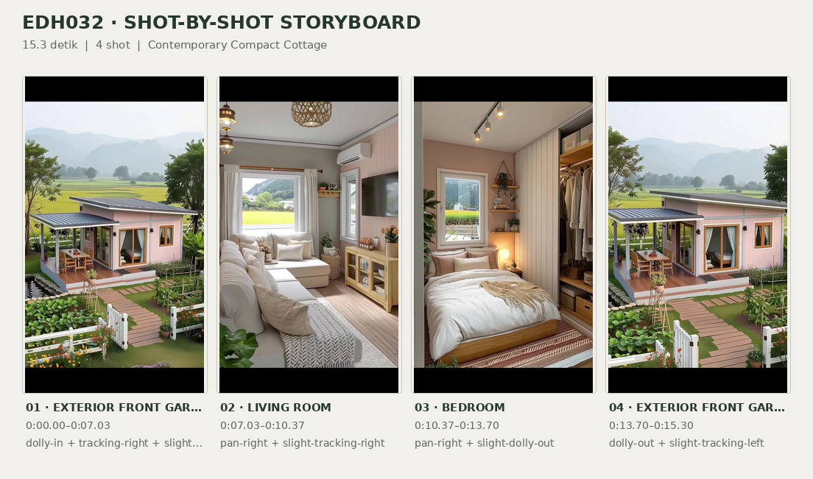
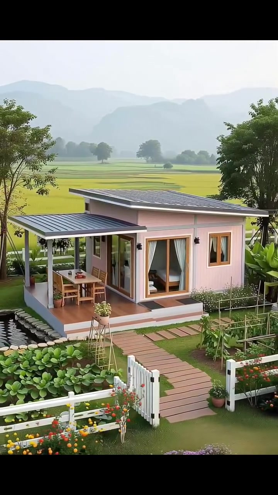
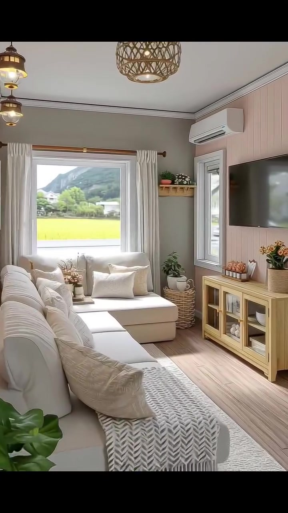
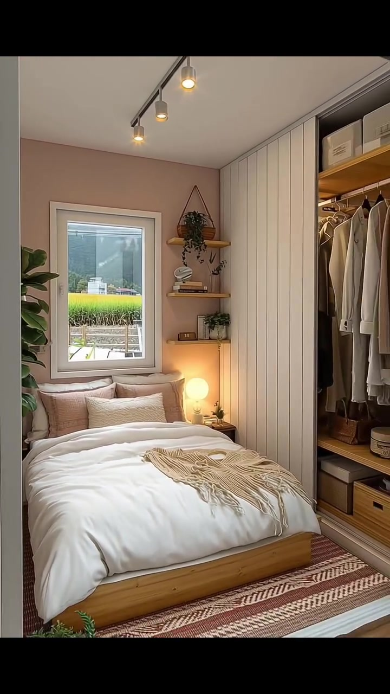
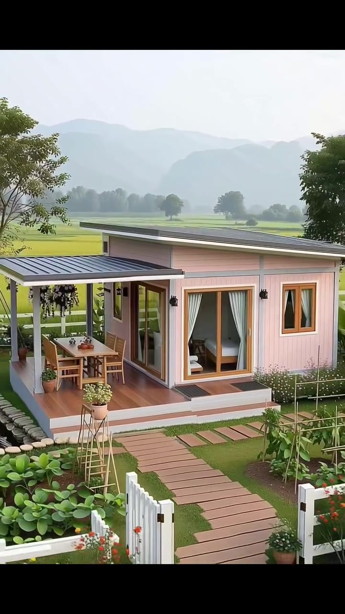

# edh032 — Contemporary Compact Cottage

<!-- homeku_request_id: edh032-20261105-1645-C1 -->

<!-- homeku_detail_narratives: chat-reviewed -->

**Sumber data:** [analysis.yaml](analysis.yaml) · **Status:** draft · **Diverifikasi manusia:** Tidak

## 1. Informasi Video

| Informasi | Nilai |
|---|---|
| ID | edh032 |
| File asli | edh032.mp4 |
| Durasi | 15.3 |
| Resolusi | 720x1280 |
| FPS | 30 |
| Rasio | 9:16 |
| Jumlah shot | 4 |

## 2. Storyboard Gabungan

## 3. Identitas Desain

| Aspek | Hasil analisis |
|---|---|
| Gaya utama | contemporary compact cottage |
| Wilayah terkait gaya desain | Tidak diketahui |
| Pengaruh gaya | modern tiny house, soft rustic cottage decor |
| Ciri eksterior | pale pink vertical panel siding, low sloping single pitch roof, dark gray ribbed roof appearance, white trim, wood tone framed large windows, covered front deck, wood tone sliding glass doors, lantern style exterior sconces |
| Gaya interior | soft neutral cozy living room, pastel pink accent paneling, light wood furniture, natural woven texture decor, compact warm bedroom |
| Confidence gaya | medium |

## 4. Ukuran & Proporsi Bangunan

| Aspek | Estimasi visual |
|---|---|
| Ukuran yang terlihat | small |
| Bentuk bangunan | compact rectangular |
| Skala vertikal | single story |
| Tapak bangunan | compact |
| Perkiraan luas lantai | 25–45 m² |
| Confidence | low |

> Luas adalah perkiraan visual, bukan ukuran terukur.

## 5. Warna, Pencahayaan, dan Atmosfer

| Warna dominan | HEX (perkiraan) |
|---|---|
| pale blush pink | #D8B8B1 |
| off white | #F0E9DF |
| light wood tan | #B98A61 |
| sage and leaf green | #667D52 |
| dark gray roof | #4F5456 |
| yellow green field | #B8C45C |

| Aspek | Hasil analisis |
|---|---|
| Pencahayaan | soft hazy daylight, bright window daylight, warm practical indoor lights |
| Lingkungan | landscaped small lawn, vegetable garden beds, stone edged small pond, white picket fence and stepping path, agricultural fields, distant mountain ridges |
| Musim yang tampak | Tidak diketahui |
| Mood | calm, cozy, pastoral, bright |

## 6. Struktur dan Timeline Video

**Jenis:** home tour · **Tempo:** moderate · **Transisi:** three hard cuts between four smooth moving shots

| Shot | Waktu (detik) | Durasi | Area/Scene | Gerakan Kamera |
|---|---|---|---|---|
| Shot 01 | 0–7.03 | 7.03 | exterior front garden | dolly in, tracking right, slight descending |
| Shot 02 | 7.03–10.37 | 3.34 | living room | pan right, slight tracking right |
| Shot 03 | 10.37–13.7 | 3.33 | bedroom | pan right, slight dolly out |
| Shot 04 | 13.7–15.3 | 1.60 | exterior front garden | dolly out, slight tracking left |

## 7. Analisis per Shot

### Shot 01 — exterior front garden

**Waktu:** 0–7.03 detik

| Komponen | Pengamatan |
|---|---|
| Fokus utama | small pink single story home with covered deck and garden |
| Framing awal → akhir | wide elevated three quarter view → medium front right oblique view |
| Sudut pandang | elevated to near eye level oblique |
| Gerakan kamera | dolly in, tracking right, slight descending |
| Kecepatan kamera | slow |
| Pencahayaan | soft hazy daylight |
| Transisi keluar | hard cut |

**Detail yang terlihat**

**Arsitektur**

Rumah satu lantai ini bermassa persegi panjang yang ringkas, dengan atap miring satu arah berpenampilan logam bergelombang abu\-abu gelap. Fasad bawah menggunakan panel vertikal merah muda pucat, sedangkan bidang dinding yang lebih tinggi memakai pelapis horizontal senada; lis putih dan tiang sudut abu\-abu muda memberi garis pembatas. Dek kayu bernuansa hangat ditinggikan dengan dasar putih, dan sisi kirinya dinaungi kanopi lebih rendah berpenampilan logam abu\-abu gelap yang ditopang tiang putih. Pintu geser kaca berbingkai warna kayu menghadap dek. Jendela depan yang besar, juga berbingkai warna kayu, memperlihatkan kamar tidur melalui tirai putih yang tersibak; satu jendela lebih kecil berada di bagian kanan. Lampu dinding bergaya lentera berwarna hitam dipasang dekat bukaan, sementara beberapa anak tangga dangkal dengan bidang tegak berwarna terang menghubungkan dek ke taman.

**Furnitur dan properti**

Di bawah kanopi terdapat meja makan luar ruang persegi panjang bernuansa kayu dan empat kursi bersandaran bilah, dengan teko serta cangkir kecil berwarna terakota di atas meja. Keranjang gantung berisi tanaman menjuntai gelap menghiasi bawah kanopi, ditemani beberapa pot tanaman hijau di tepi dek. Sebuah penyangga tanaman yang ramping membawa pot bunga terang di depan dek. Melalui jendela depan terlihat ranjang berbingkai warna kayu dengan seprai putih.

**Lingkungan**

Di samping kiri depan dek terbentang kolam air gelap berbentuk persegi panjang dengan batas batu pucat tidak beraturan. Di depannya ada barisan tanaman berdaun hijau lebar dan hamparan rumput yang terawat. Jalur papan pijakan cokelat mengarah dari gerbang pagar kayu putih yang terbuka menuju anak tangga dek; tanaman bunga kecil oranye, kuning, dan putih tumbuh di dekat pagar, yang juga berlanjut di tepi kiri lahan. Tanaman berdaun besar menyerupai vegetasi tropis terlihat di kanan rumah, sedangkan pohon hijau tinggi berdiri di belakang. Di seberang pekarangan tampak hamparan lahan pertanian kuning kehijauan, pepohonan hijau gelap yang tersebar pada batas lahan, dan beberapa lapis punggungan gunung biru keabu\-abuan yang berkabut di bawah langit pucat terang.

**Catatan pengamatan:** Kamera bergerak mendekat dan menyamping dari sudut lebih tinggi; rupa logam, material panel, serta jenis tanaman dinilai dari tampilan visual.

**Confidence:** Kamera medium · Detail visual high

### Shot 02 — living room

**Waktu:** 7.03–10.37 detik

| Komponen | Pengamatan |
|---|---|
| Fokus utama | cream sectional seating area and wall mounted television |
| Framing awal → akhir | wide sofa and window view → medium tv feature wall view |
| Sudut pandang | eye level oblique |
| Gerakan kamera | pan right, slight tracking right |
| Kecepatan kamera | slow |
| Pencahayaan | bright window daylight with warm decorative light |
| Transisi keluar | hard cut |

**Detail yang terlihat**

**Arsitektur**

Ruang keluarga berbentuk persegi panjang yang ringkas ini memiliki dinding aksen panel vertikal merah muda pucat di sisi kanan tempat televisi terpasang. Dinding di sekitar jendela utama berwarna abu\-abu hangat lembut. Jendela depan besar berbingkai putih dilengkapi tirai putih menjuntai, dengan satu jendela putih yang lebih sempit di dekat dinding televisi. Plafon putih dibingkai lis sederhana dan garis tepi tipis gelap, sementara lantainya berupa papan berpenampilan kayu terang. Unit AC split putih terpasang di atas jendela yang sempit.

**Furnitur dan properti**

Sofa sectional besar berbentuk L dengan pelapis krem memenuhi sisi kiri dan belakang ruangan, disertai beberapa bantal bertekstur dan bermotif krem. Selimut rajut berpola zigzag putih abu\-abu dengan rumbai menjuntai di dudukan depannya, dan karpet persegi panjang bertekstur pucat terbentang di bawah sofa. Televisi layar datar hitam berukuran besar dipasang pada dinding merah muda, tepat di atas konsol rendah warna kayu terang berpintu kaca. Di dalamnya terlihat buku, keramik putih, dan benda berbahan kain. Di sudut dekat jendela terdapat tanaman hijau di dalam wadah anyaman, dengan rak dinding pendek berisi pot kecil di atasnya. Konsol dihiasi pot bertekstur anyaman dengan bunga kuning\-oranye serta ornamen kecil berwarna terakota. Lampu gantung bernaung anyaman terbuka tergantung di plafon, dua lampu dinding mirip lentera menyala hangat di sisi kiri atas, dan vas kecil beserta baki dekoratif berada di antara bagian\-bagian sofa.

**Lingkungan**

Dari jendela depan terlihat lahan kuning kehijauan yang terang, lalu deretan pepohonan dan perbukitan biru keabu\-abuan di kejauhan. Vegetasi hijau luar ruangan juga terlihat melalui jendela samping yang sempit.

**Catatan pengamatan:** Pergerakan kamera perlahan ke kanan memperlihatkan sofa kemudian televisi serta konsol; material kayu dan anyaman adalah identifikasi berbasis penampakan.

**Confidence:** Kamera medium · Detail visual high

### Shot 03 — bedroom

**Waktu:** 10.37–13.7 detik

| Komponen | Pengamatan |
|---|---|
| Fokus utama | double bed below window and open wardrobe to right |
| Framing awal → akhir | medium bed and window framing → wide bed and open wardrobe framing |
| Sudut pandang | near eye level front oblique |
| Gerakan kamera | pan right, slight dolly out |
| Kecepatan kamera | slow |
| Pencahayaan | soft daylight with warm bedside lamp and ceiling spotlights |
| Transisi keluar | hard cut |

**Detail yang terlihat**

**Arsitektur**

Kamar tidur berukuran ringkas ini memiliki plafon datar putih dan dinding belakang ranjang berwarna merah muda berdebu. Sisi kanan memakai panel vertikal putih. Sebuah jendela persegi panjang dengan bingkai putih berada tepat di atas kepala ranjang. Di ujung kanan terdapat ceruk lemari terbuka dengan rak\-rak berpenampilan kayu dan batang gantungan pakaian. Rel lampu gelap di plafon membawa tiga sorot silinder, sedangkan di dekat ambang ruangan terlihat lantai berpenampilan papan kayu terang.

**Furnitur dan properti**

Ranjang ganda rendah dengan alas kayu terang tertutup duvet putih tebal. Beberapa bantal krem dan merah muda lembut bertumpuk di kepala ranjang, dan selimut rajut krem berumbai terbentang melintang pada bagian bawahnya. Meja samping bernuansa kayu mengapit ranjang, dengan lampu meja berbentuk bola yang menyala hangat di sisi kanan. Di sudut kanan jendela terdapat tiga rak terbuka dari kayu yang memuat buku, hiasan kecil, dan tanaman pot; di atasnya tergantung keranjang tanaman berdaun menjuntai. Sebuah tanaman tinggi berdaun lebar berdiri di sisi kiri ranjang. Ceruk lemari memajang mantel dan baju bernuansa krem serta cokelat muda pada gantungan, kotak penyimpanan terang di rak atas, dan laci kayu di bawah. Karpet bermotif geometris merah karat dan krem terhampar di bawah ranjang.

**Lingkungan**

Lewat jendela kamar terlihat lahan tanaman kuning kehijauan, perbukitan hijau gelap di kejauhan, dan beberapa bangunan kecil berwarna terang. Bagian bawah jendela juga memperlihatkan pagar putih rendah dan tanah bertanaman di dekat rumah.

**Catatan pengamatan:** Awal shot berfokus pada ranjang; area gantungan baju dan penyimpanan semakin tampak ketika framing bergeser ke kanan.

**Confidence:** Kamera medium · Detail visual high

### Shot 04 — exterior front garden

**Waktu:** 13.7–15.3 detik

| Komponen | Pengamatan |
|---|---|
| Fokus utama | pink house with deck gate and field backdrop |
| Framing awal → akhir | medium front right oblique view → wide front garden view |
| Sudut pandang | slightly elevated oblique |
| Gerakan kamera | dolly out, slight tracking left |
| Kecepatan kamera | slow |
| Pencahayaan | soft hazy daylight |
| Transisi keluar | end of video |

**Detail yang terlihat**

**Arsitektur**

Tampak kembali rumah satu lantai yang ringkas dengan panel dinding bawah merah muda pucat tersusun vertikal. Atap utamanya rendah dan miring berwarna abu\-abu gelap di atas dinding bagian atas yang lebih tinggi. Kanopi depan di sebelah kiri ditopang tiang putih dan menaungi dek berpenampilan kayu. Pada fasad terlihat jendela depan besar berbingkai warna kayu dengan tirai putih, pintu geser kaca berbingkai kayu menuju dek, serta jendela ganda yang lebih kecil di sisi kanan. Lampu dinding hitam bergaya lentera mengapit jendela besar, dan anak tangga pendek menghubungkan dek dengan jalur papan pijakan.

**Furnitur dan properti**

Di bawah kanopi terlihat meja luar ruang bernuansa kayu beserta kursi\-kursi bersandaran bilah yang serasi. Beberapa keranjang tanaman menjuntai menggantung di bawah atap kanopi, sementara pot tanaman kecil berada di sudut dek dan taman depan. Melalui jendela depan, ranjang berwarna terang dengan seprai putih masih tampak sebagian.

**Lingkungan**

Jalur papan pijakan cokelat menuju gerbang putih yang terbuka pada pagar rendah, dengan bunga kecil oranye dan kuning tumbuh di dekatnya. Barisan tanaman berdaun hijau padat berada di kiri depan, sedangkan rumput pendek dan tanaman kebun yang disangga ajir terlihat di depan rumah. Pohon berdaun lebat membingkai sisi kiri dan kanan kejauhan. Di belakang rumah membentang lahan pertanian kuning kehijauan dan pegunungan biru keabu\-abuan yang samar karena kabut. Sebagian kolam berbatas batu pucat tetap terlihat di samping kiri dek.

**Catatan pengamatan:** Cut kembali ke sisi depan rumah; kamera mundur perlahan hingga gerbang dan hamparan tanaman lebih jelas.

**Confidence:** Kamera medium · Detail visual high

## 8. Kualitas dan Ketidakpastian Analisis

| Parameter | Hasil |
|---|---|
| Status | draft |
| Verifikasi manusia | Tidak |
| Ketepatan timestamp | estimated |
| Ketidakpastian | building floor area is rough visual estimate not measured, siding roof and wood materials identified by surface appearance only, agricultural crop species and geographic location not confirmed, camera translation and panning inferred from image motion, visual stream ends at 15 3 seconds while container metadata duration is 15 44 seconds |

**Catatan:** Visual-only analysis of all 459 video frames at 30 fps, with scene boundaries near frames 211, 311 and 411; byte identity with main/video/edh032.mp4 verified using Git blob SHA e387450ba68d31654a963e5253ec05258d07d5ac.

---

*Laporan ini diturunkan dari [analysis.yaml](analysis.yaml).*
