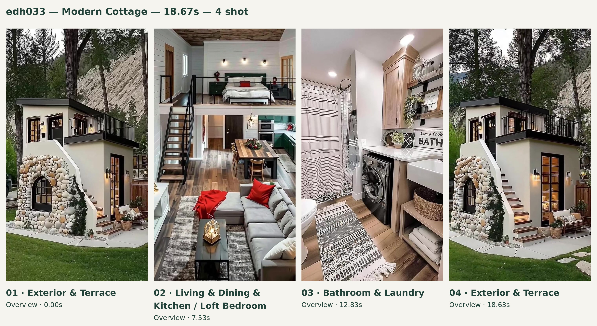
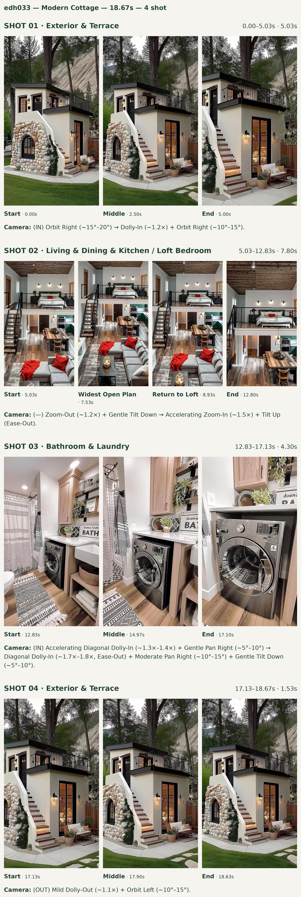
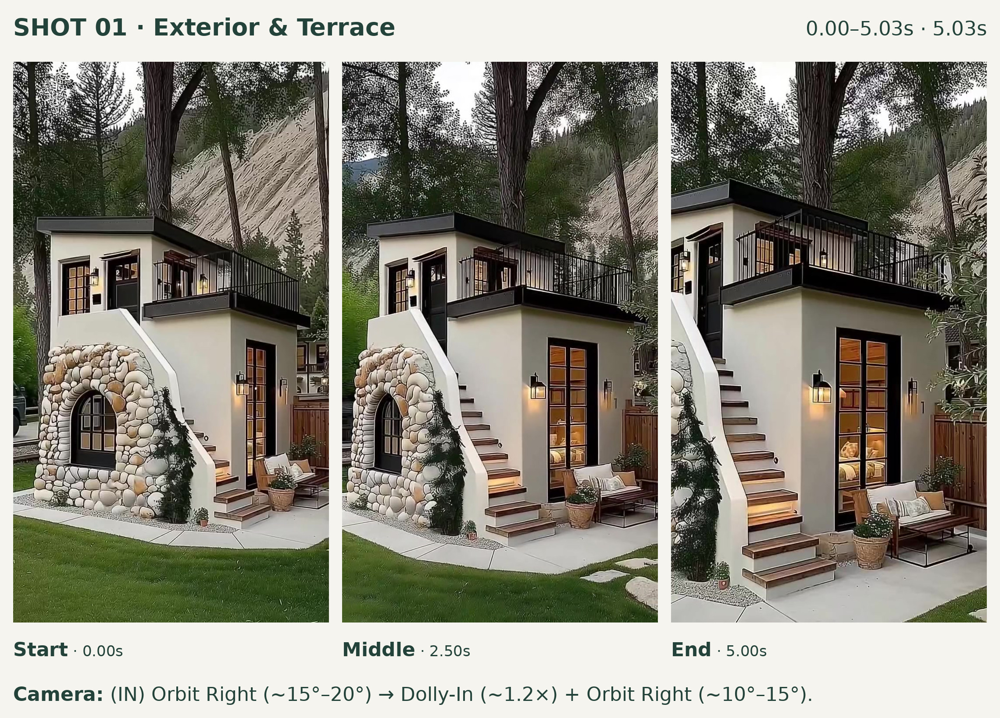
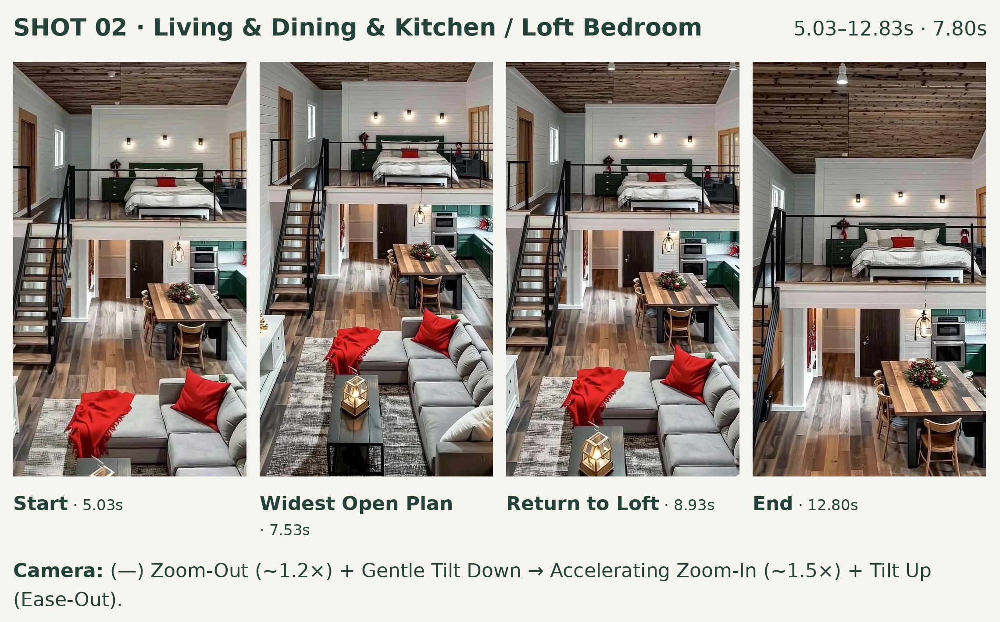
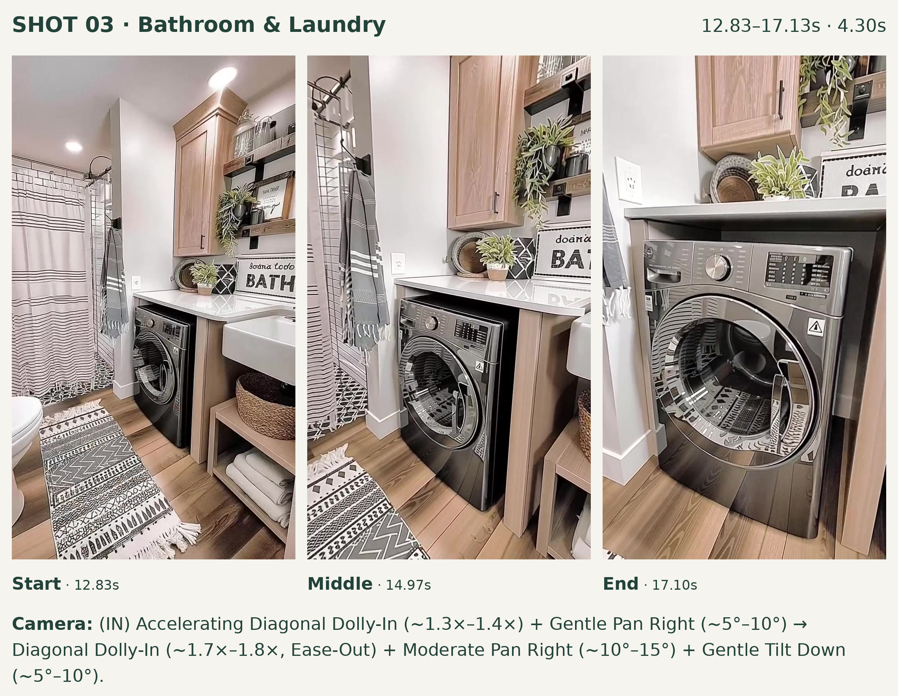
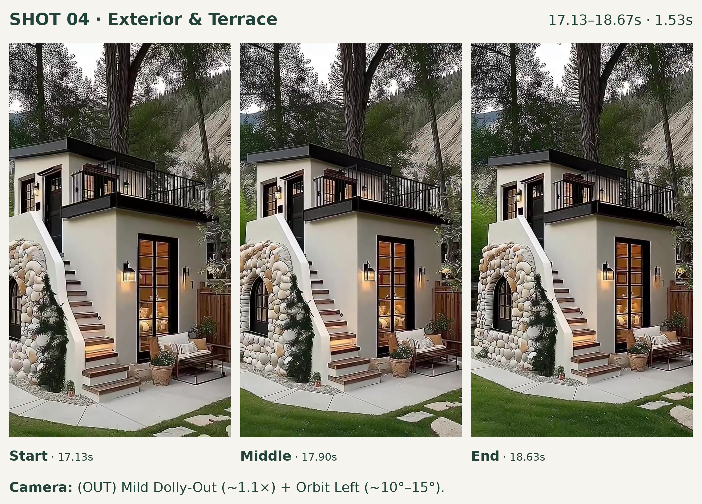

# edh033 — Modern Cottage Loft dengan Fasad Batu Bulat dan Balkon

## 1. Profil desain

- **Nama desain:** Modern Cottage Loft dengan Fasad Batu Bulat dan Balkon
- **Tipe rumah:** Detached Tiny House
- **Gaya utama:** **Modern Cottage**
- **Pengaruh gaya:** Rustic
- **Gaya interior:** Modern Farmhouse
- **Susunan ruang utama:** Ruang keluarga, makan dan dapur terbuka di bawah loft tidur; kamar mandi dan laundry pada shot terpisah
- **Ciri khas:** Bidang batu bulat dengan jendela lengkung, tangga luar berparapet putih, balkon pagar hitam
- **Material utama:** Permukaan plester terang visual, batu bulat, kayu cokelat, logam hitam
- **Pencahayaan:** Cahaya luar lembut; lampu dinding hangat, pendant dan lampu plafon menyala
- **Atmosfer:** Kabin kompak yang hangat, kontras dengan alam berhutan
- **Lingkungan:** Rumput, pohon tinggi, pagar kayu dan lereng batu di latar

### Palet warna

| Peran | Warna | HEX |
| --- | --- | --- |
| Dominan | Putih hangat | `#E5E0D6` |
| Pendamping | Arang | `#292827` |
| Pendamping | Cokelat kayu | `#9B7656` |
| Pendamping | Abu batu | `#B4AA9B` |
| Aksen | Hijau gelap | `#214B43` |
| Aksen | Merah bata | `#B52D1F` |

## 2. Ukuran & proporsi

| Aspek | Estimasi visual |
| --- | --- |
| **Ukuran rumah** | Small |
| **Bentuk bangunan** | Volume kotak bertumpuk dan balkon atap volume bawah |
| **Lantai & bentuk atap** | Dua tingkat terlihat di luar; loft terbuka di interior · Atap datar visual dengan lis gelap |
| **Tapak bangunan** | Massa persegi panjang kompak dengan tangga eksternal dan teras |
| **Proporsi utama** | Massa vertikal dua tingkat dengan atap rendah dan balkon menonjol |
| **Perkiraan luas lantai** | **35–65 m²** |

## 3. Shot Timeline

Durasi 18.67s · 4 shot.

**Camera Pattern:** IN – — – IN – OUT.

| Shot | Time (s) | Duration | Area/Scene | Camera Movement |
| --- | --- | --- | --- | --- |
| 01 | 0.00–5.03 | 5.03s | Exterior & Terrace | Orbit Right (~15°–20°) → Dolly-In (~1.2×) + Orbit Right (~10°–15°). |
| 02 | 5.03–12.83 | 7.80s | Living & Dining & Kitchen / Loft Bedroom | Zoom-Out (~1.2×) + Gentle Tilt Down → Accelerating Zoom-In (~1.5×) + Tilt Up (Ease-Out). |
| 03 | 12.83–17.13 | 4.30s | Bathroom & Laundry | Accelerating Diagonal Dolly-In (~1.3×–1.4×) + Gentle Pan Right (~5°–10°) → Diagonal Dolly-In (~1.7×–1.8×, Ease-Out) + Moderate Pan Right (~10°–15°) + Gentle Tilt Down (~5°–10°). |
| 04 | 17.13–18.67 | 1.53s | Exterior & Terrace | Mild Dolly-Out (~1.1×) + Orbit Left (~10°–15°). |

## 4. Overview

**Shot 01 · Exterior & Terrace · 0.00s**

> Dari halaman depan menghadap serong ke rumah, seluruh fasad batu, tangga, pintu kaca dan balkon terlihat bersama.

**Shot 02 · Living & Dining & Kitchen / Loft Bedroom · 7.53s**

> Dari depan ruang keluarga menghadap loft; cakupan terlebar memuat sofa, meja kopi, makan, dapur, tangga dan ranjang loft.

**Shot 03 · Bathroom & Laundry · 12.83s**

> Dari pintu/sisi kiri kamar mandi menghadap laundry; shower, toilet sebagian, mesin cuci dan wastafel masuk framing lebar.

**Shot 04 · Exterior & Terrace · 18.63s**

> Dari halaman menghadap serong fasad; akhir gerakan keluar menunjukkan batu lengkung, tangga, balkon, pintu kaca dan rumput.

## 5. Storyboard

## 6. Shot Details

### Shot 01 · Exterior & Terrace

**Time:** 0.00–5.03s · **Duration:** 5.03s

#### **A. Desain area**

**Arsitektur**

> Massa dua tingkat kompak dengan lis atap datar gelap, bidang batu bulat mengelilingi jendela lengkung, dinding terang, pintu kaca kisi tinggi di bawah dan pintu atas dicapai tangga terbuka dengan parapet putih. Balkon di atas volume bawah berpagar logam hitam.

**Furnitur & dekorasi**

> Bangku outdoor dengan bantalan terang dan meja kecil dekat pintu kaca; pot tanaman dan sulur hijau di bidang batu; lampu dinding hitam menyala hangat.

**Lingkungan**

> Rumput hijau, jalur pijakan, pagar kayu, pepohonan tinggi dan lereng batu di belakang. Cahaya luar lembut.

#### **B. Framing & Lighting**

- **Fokus:** Fasad, akses, balkon.
- **Camera Start:** Di halaman depan, serong ke bidang batu dan sisi pintu kaca. · Menuju sudut rumah dan tangga luar. · Wide oblique exterior. · Kira-kira tinggi pandang manusia. · Hampir datar, sedikit ke atas ke lantai atas.
- **Framing:** Fasad batu lengkung, tangga dan balkon dalam satu frame. → Tangga dan pintu kaca membesar, batu terpotong sebagian.
- **Lighting:** Cahaya luar lembut dan lampu dinding hangat.
- **Foreground dan kedalaman:** Rumput dan pelataran. · Rumput, rumah, pagar, pohon dan lereng.
- **Reveal:** Sisi pintu kaca dan tangga makin terbuka.
- **Kesesuaian gerak:** Orbit mengungkap sisi, Dolly-In menekankan akses.

#### **C. Camera Movement**

Kamera menyapu mengitari rumah ke kanan, membuka muka pintu kaca dan teras. Pendekatan lebih jelas sejak sekitar F75; dinding batu makin terpotong di kiri.

**Tempo:** Sedang dan kontinu; awal sapuan lateral dominan, pertengahan hingga akhir pendekatan dan sapuan berjalan bersamaan tanpa stop nyata.

**Movement Timeline**

| Time (s) | Area & fokus | Camera Movement | Tempo |
| --- | --- | --- | --- |
| 0.00–2.50 | Exterior & Terrace · Sudut rumah, fasad batu dan pintu kaca | Orbit Right (~15°–20°) | Sedang dan kontinu; awal sapuan lateral dominan, pertengahan hingga akhir pendekatan dan sapuan berjalan bersamaan tanpa stop nyata. |
| 2.50–5.03 | Exterior & Terrace · Pintu kaca, tangga dan teras | Dolly-In (~1.2×) + Orbit Right (~10°–15°) | Sedang dan kontinu; awal sapuan lateral dominan, pertengahan hingga akhir pendekatan dan sapuan berjalan bersamaan tanpa stop nyata. |

**Camera:** Orbit Right (~15°–20°) → Dolly-In (~1.2×) + Orbit Right (~10°–15°).

---

### Shot 02 · Living & Dining & Kitchen / Loft Bedroom

**Time:** 5.03–12.83s · **Duration:** 7.80s

**Shot Type:** Continuous shot · Multi area · No cut.

#### **A. Desain area**

##### **Living & Dining & Kitchen**

**Arsitektur**

> Ruang terbuka di bawah loft: area sofa di depan kanan, meja makan memanjang di tengah kanan, kabinet dapur hijau di belakang kanan; jalur lantai kayu ke pintu belakang dan tangga terbuka kiri. Dinding panel horizontal putih dan langit-langit papan kayu visual.

**Furnitur & dekorasi**

> Sofa sectional abu dengan chaise, bantal merah dan selimut merah; meja kopi persegi panjang gelap di karpet abu. Meja makan kayu panjang berkaki gelap dan kursi kayu, hiasan tengah serta pendant. Dapur kabinet hijau gelap, permukaan meja putih, backsplash terang dan perangkat oven bertumpuk.

**Lingkungan**

> Cahaya dari jendela samping atas dan lampu menyala; pemandangan luar tidak terbaca.

##### **Loft Bedroom**

**Arsitektur**

> Loft tidur terbuka di atas ruang makan/dapur, lantai platform bertepi putih dan railing hitam; tangga kiri mencapai level loft. Panel dinding horizontal putih, plafon papan kayu; pintu/kusen kayu dan bukaan kecil di kiri.

**Furnitur & dekorasi**

> Ranjang berpusat pada dinding belakang dengan headboard hijau gelap, seprai putih dan bantal merah, meja kecil di sisi, serta tiga lampu dinding di atas ranjang.

**Lingkungan**

> Bukaan samping memberi cahaya, tiga lampu dinding memperhangat bidang belakang.

#### **B. Framing & Lighting**

- **Fokus:** Loft dan hubungan vertikal dengan ruang makan.
- **Camera Start:** Di depan ruang keluarga menghadap loft dan ruang makan. · Menuju ranjang loft dan zona makan/dapur bawah. · Wide frontal interior dengan pandangan vertikal ke loft. · Tinggi relatif di atas sofa, tidak terkalibrasi. · Sedikit ke bawah pada area sofa, kemudian framing naik.
- **Framing:** Loft, tangga, makan, dapur dan bagian sofa. → Ranjang loft, railing dan ruang makan/dapur lebih dominan.
- **Lighting:** Lampu dinding, pendant dan cahaya bukaan samping.
- **Foreground dan kedalaman:** Sofa dan karpet. · Sofa, meja makan, dapur/pintu belakang, loft atas.
- **Reveal:** Pelebaran memperlihatkan sofa; pembesaran kemudian menekankan loft.
- **Kesesuaian gerak:** Zoom-Out/Tilt Down lalu Zoom-In/Tilt Up mengubah penekanan tanpa menyatakan perpindahan fisik.
- **Area:** Living & Dining & Kitchen / Loft Bedroom
- **Rute kamera:** —

**Hubungan antararea**

- **Penghubung area:** Tangga kiri terlihat menghubungkan lantai bawah dan platform loft terbuka.
- **Peralihan:** Living & Dining & Kitchen · 5.03–12.83s; Loft Bedroom · 5.03–12.83s
- **Orientasi ruang:** —

#### **C. Camera Movement**

Framing loft mula-mula melebar dan turun sehingga sofa serta meja kopi masuk lebih utuh, berbalik sekitar F228, lalu memperbesar dan mengarahkan framing ke atas menuju loft dan meja makan. Efek paling menyerupai zoom/reframing; pergerakan fisik belum terkonfirmasi.

**Tempo:** Sedang; pelebaran awal mereda sejenak sekitar 7.6 s, lalu pembesaran meningkat hingga akhir. Sapuan vertikal ke atas mereda menjelang akhir.

**Movement Timeline**

| Time (s) | Area & fokus | Camera Movement | Tempo |
| --- | --- | --- | --- |
| 5.03–7.60 | Living & Dining & Kitchen / Loft Bedroom · Loft, tangga, sofa dan meja kopi | Zoom-Out (~1.2×) + Gentle Tilt Down | Sedang; pelebaran awal mereda sejenak sekitar 7.6 s, lalu pembesaran meningkat hingga akhir. Sapuan vertikal ke atas mereda menjelang akhir. |
| 7.60–12.83 | Living & Dining & Kitchen / Loft Bedroom · Loft dan meja makan | Accelerating Zoom-In (~1.5×) + Tilt Up (Ease-Out) | Sedang; pelebaran awal mereda sejenak sekitar 7.6 s, lalu pembesaran meningkat hingga akhir. Sapuan vertikal ke atas mereda menjelang akhir. |

**Camera:** Zoom-Out (~1.2×) + Gentle Tilt Down → Accelerating Zoom-In (~1.5×) + Tilt Up (Ease-Out).

---

### Shot 03 · Bathroom & Laundry

**Time:** 12.83–17.13s · **Duration:** 4.30s

#### **A. Desain area**

**Arsitektur**

> Kamar mandi sempit memanjang, zona shower di kiri belakang dengan tirai garis, dinding ubin putih pola bata, toilet sebagian di kiri depan, kabinet laundry dan wastafel di kanan. Lantai papan kayu visual; plafon putih dengan lampu tanam.

**Furnitur & dekorasi**

> Mesin cuci front-load berwarna gelap di bawah countertop putih, kabinet atas kayu berpintu panel, rak terbuka berisi tanaman/dekor, wastafel putih di kanan dengan rak bawah berisi keranjang dan handuk. Karpet lorong berpola geometris.

**Lingkungan**

> Lampu plafon putih menerangi bidang terang dan kayu; tidak ada bukaan luar yang jelas terlihat.

#### **B. Framing & Lighting**

- **Fokus:** Mesin cuci front-load.
- **Camera Start:** Di sisi masuk kamar mandi menghadap laundry dari kiri. · Menuju countertop dan mesin cuci kanan. · Wide oblique menuju close-up. · Tinggi pandang manusia. · Sedikit ke bawah pada lantai dan kabinet.
- **Framing:** Shower, toilet sebagian, laundry dan vanity. → Close-up drum mesin cuci dan kabinet.
- **Lighting:** Lampu plafon tanam putih.
- **Foreground dan kedalaman:** Karpet lorong dan tepi toilet. · Karpet, mesin cuci, kabinet dan shower belakang kiri.
- **Reveal:** Mesin cuci semakin frontal, shower dan vanity tersapu keluar.
- **Kesesuaian gerak:** Dolly diagonal dan pan memperjelas laundry, tilt down menekankan drum.

#### **C. Camera Movement**

Kamera mendekati area laundry dari sudut kiri, sekaligus menggeser pandangan ke kanan menuju mesin cuci; kemudian framing turun untuk menekankan pintu drum.

**Tempo:** Sedang menuju cepat secara visual pada bagian tengah karena pembesaran; laju pembesaran mereda dekat akhir.

**Movement Timeline**

| Time (s) | Area & fokus | Camera Movement | Tempo |
| --- | --- | --- | --- |
| 12.83–14.33 | Bathroom & Laundry · Kabinet, mesin cuci dan sisi shower | Accelerating Diagonal Dolly-In (~1.3×–1.4×) + Gentle Pan Right (~5°–10°) | Sedang menuju cepat secara visual pada bagian tengah karena pembesaran; laju pembesaran mereda dekat akhir. |
| 14.33–17.13 | Bathroom & Laundry · Pintu drum mesin cuci dan counter | Diagonal Dolly-In (~1.7×–1.8×, Ease-Out) + Moderate Pan Right (~10°–15°) + Gentle Tilt Down (~5°–10°) | Sedang menuju cepat secara visual pada bagian tengah karena pembesaran; laju pembesaran mereda dekat akhir. |

**Camera:** Accelerating Diagonal Dolly-In (~1.3×–1.4×) + Gentle Pan Right (~5°–10°) → Diagonal Dolly-In (~1.7×–1.8×, Ease-Out) + Moderate Pan Right (~10°–15°) + Gentle Tilt Down (~5°–10°).

---

### Shot 04 · Exterior & Terrace

**Time:** 17.13–18.67s · **Duration:** 1.53s

#### **A. Desain area**

**Arsitektur**

> Massa dua tingkat kompak dengan lis atap datar gelap, bidang batu bulat mengelilingi jendela lengkung, dinding terang, pintu kaca kisi tinggi di bawah dan pintu atas dicapai tangga terbuka dengan parapet putih. Balkon di atas volume bawah berpagar logam hitam.

**Furnitur & dekorasi**

> Bangku outdoor dengan bantalan terang dan meja kecil dekat pintu kaca; pot tanaman dan sulur hijau di bidang batu; lampu dinding hitam menyala hangat.

**Lingkungan**

> Rumput hijau, jalur pijakan, pagar kayu, pepohonan tinggi dan lereng batu di belakang. Cahaya luar lembut.

#### **B. Framing & Lighting**

- **Fokus:** Akses dan fasad batu.
- **Camera Start:** Di halaman dekat tangga dan pintu kaca. · Menghadap fasad sudut dan balkon. · Oblique exterior agak dekat. · Kira-kira tinggi pandang manusia. · Hampir datar, sedikit ke atas.
- **Framing:** Tangga dan pintu kaca dominan. → Fasad batu lebih utuh, rumput lebih luas.
- **Lighting:** Cahaya luar lembut, lampu hangat.
- **Foreground dan kedalaman:** Pelataran dan rumput. · Tangga, fasad, pagar dan pohon.
- **Reveal:** Bidang batu dan rumput terbuka kembali.
- **Kesesuaian gerak:** Dolly-Out dan orbit kiri memperluas cakupan.

#### **C. Camera Movement**

Kamera bergerak menjauh ringan sambil mengitari kembali ke kiri, memperlihatkan bidang batu dan rumput lebih luas.

**Tempo:** Sedang dan singkat, hampir konstan hingga cut akhir; sedikit perlambatan pada frame terakhir.

**Camera:** Mild Dolly-Out (~1.1×) + Orbit Left (~10°–15°).
