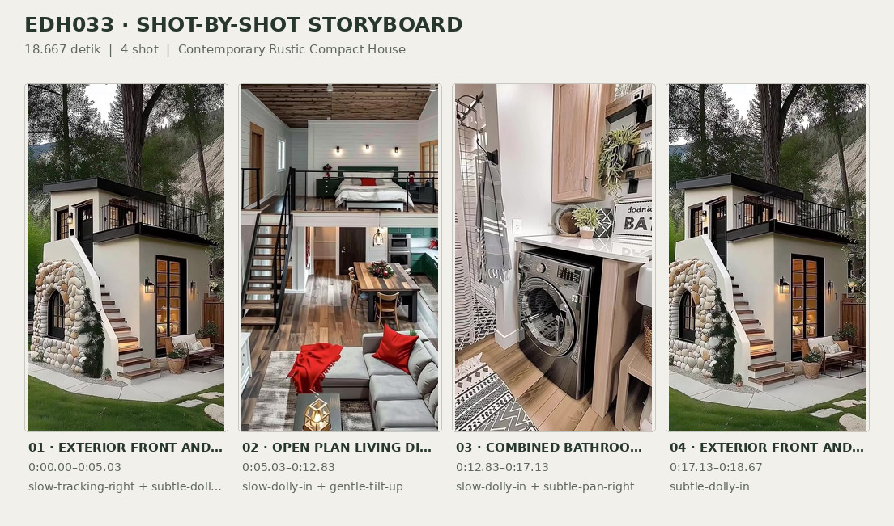
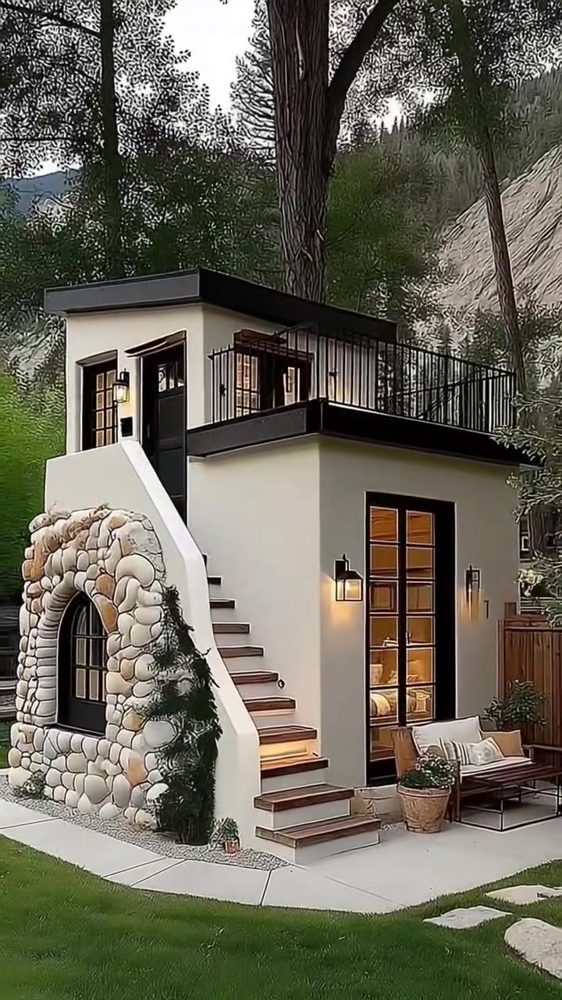
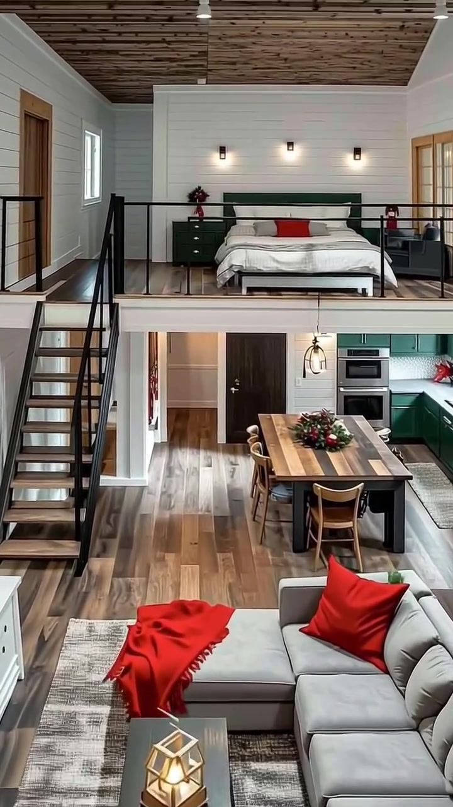
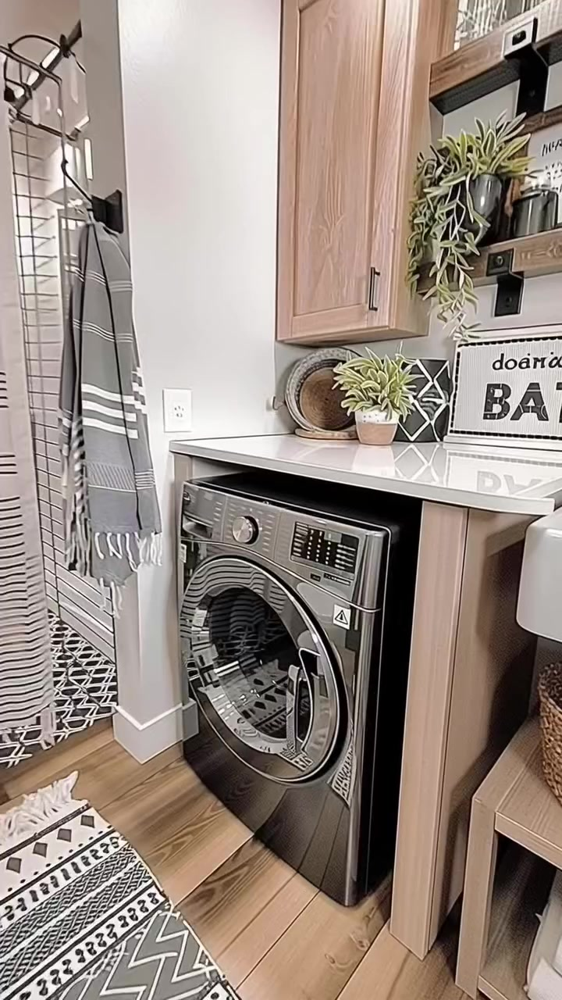
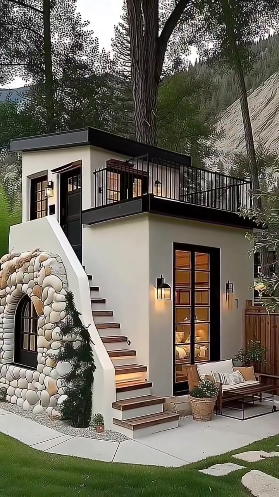

# edh033 — Contemporary Rustic Compact House

<!-- homeku_request_id: edh033-20261105-23eae34d -->

<!-- homeku_detail_narratives: chat-reviewed -->

**Sumber data:** [analysis.yaml](analysis.yaml) · **Status:** draft · **Diverifikasi manusia:** Tidak

## 1. Informasi Video

| Informasi | Nilai |
|---|---|
| ID | edh033 |
| File asli | edh033.mp4 |
| Durasi | 18.667 |
| Resolusi | 720x1280 |
| FPS | 30.0 |
| Rasio | 9:16 |
| Jumlah shot | 4 |

## 2. Storyboard Gabungan

## 3. Identitas Desain

| Aspek | Hasil analisis |
|---|---|
| Gaya utama | contemporary rustic compact house |
| Wilayah terkait gaya desain | north america |
| Pengaruh gaya | woodland cottage, modern tiny house, rustic stone accent |
| Ciri eksterior | cream white smooth exterior walls, low slope or flat dark roof with prominent edge, black metal roof terrace guardrails, external white parapet stair with brown treads, rounded mixed pale stone arch at stair base, dark gridded glazing and doors, warm black metal wall lanterns |
| Gaya interior | modern rustic, open plan loft living, warm wood tone floor and ceiling, white horizontal wall paneling, dark green kitchen cabinetry, neutral upholstery with red textile accents |
| Confidence gaya | medium |

## 4. Ukuran & Proporsi Bangunan

| Aspek | Estimasi visual |
|---|---|
| Ukuran yang terlihat | small |
| Bentuk bangunan | compact two level rectangular mass with exterior stair and roof terrace |
| Skala vertikal | two levels with open sleeping loft |
| Tapak bangunan | compact |
| Perkiraan luas lantai | 40–80 m² |
| Confidence | low |

> Luas adalah perkiraan visual, bukan ukuran terukur.

## 5. Warna, Pencahayaan, dan Atmosfer

| Warna dominan | HEX (perkiraan) |
|---|---|
| warm cream white | #EEEDE5 |
| charcoal black | #252725 |
| natural warm wood brown | #987554 |
| forest green | #416146 |
| pale rounded stone grey | #BEB8AE |
| muted light grey | #A9ABAB |
| red textile accent | #C7352F |

| Aspek | Hasil analisis |
|---|---|
| Pencahayaan | soft diffuse outdoor daylight, warm illuminated exterior wall lanterns, soft natural window light indoors, warm interior wall sconces, bright recessed bathroom ceiling lights |
| Lingkungan | wooded hillside, mature tall trees, green foreground lawn, pale rocky hillside in background, small paved patio |
| Musim yang tampak | Tidak diketahui |
| Mood | cozy, warm, woodland retreat, compact and orderly |

## 6. Struktur dan Timeline Video

**Jenis:** compact house visual tour · **Tempo:** slow · **Transisi:** three hard cuts between four continuous camera shots

| Shot | Waktu (detik) | Durasi | Area/Scene | Gerakan Kamera |
|---|---|---|---|---|
| Shot 01 | 0.0–5.033 | 5.03 | exterior front and side | slow tracking right, subtle dolly in |
| Shot 02 | 5.033–12.833 | 7.80 | open plan living dining kitchen with sleeping loft | slow dolly in, gentle tilt up |
| Shot 03 | 12.833–17.133 | 4.30 | combined bathroom and laundry | slow dolly in, subtle pan right |
| Shot 04 | 17.133–18.667 | 1.53 | exterior front and side return | subtle dolly in |

## 7. Analisis per Shot

### Shot 01 — exterior front and side

**Waktu:** 0.0–5.033 detik

| Komponen | Pengamatan |
|---|---|
| Fokus utama | compact white two level house with stone arch stair and roof terrace |
| Framing awal → akhir | wide portrait three quarter view of entire house → slightly closer right weighted exterior view |
| Sudut pandang | eye level to slightly low angle |
| Gerakan kamera | slow tracking right, subtle dolly in |
| Kecepatan kamera | slow |
| Pencahayaan | diffuse daylight with warm exterior lanterns |
| Transisi keluar | hard cut to interior |

**Detail yang terlihat**

**Arsitektur**

Rumah kompak dua tingkat ini memiliki dinding luar halus berwarna putih krem dan tepi atap rendah berwarna gelap. Di kanan atas terdapat teras terbuka berpagar batang logam hitam vertikal. Tangga luar naik secara diagonal dari halaman depan menuju pintu gelap di tingkat atas; dinding pembatasnya putih, dengan anak tangga berpenampilan kayu cokelat yang diterangi cahaya hangat. Di bawah tangga, tampak lengkungan dari batu bulat bernuansa krem dan abu\-abu, yang membingkai bukaan melengkung berkisi hitam. Di sisi kanan lantai bawah berdiri pintu kaca tinggi berbingkai hitam dengan beberapa petak kaca, sedangkan tingkat atas memiliki bukaan berbingkai gelap di dekat pintu dan di balik pagar teras. Lentera dinding hitam menyala hangat di dekat akses masuk lantai bawah dan atas. Lis horizontal tepi atap serta teras tampak hitam, dan permukaan patio lantai dasar memakai paving beton abu\-abu muda.

**Furnitur dan properti**

Di sebelah kanan pintu kaca bawah terdapat bangku luar ruang berangka bernuansa kayu dengan bantalan terang. Pot besar bulat berwarna cokelat berisi semak hijau berada di antara bangku dan tangga. Beberapa pot tanaman kecil juga tampak dekat kaki lengkungan batu.

**Lingkungan**

Halaman depan dipenuhi rumput hijau cerah, dengan pijakan batu pucat tak beraturan di bagian kanan bawah. Tepat di belakang rumah menjulang batang pohon sangat tinggi dan gelap, dikelilingi pepohonan hijau rapat di kiri serta belakang bangunan. Lereng berbatu atau tanah terbuka berwarna pucat naik di sisi kanan belakang, sementara siluet bukit biru keabu\-abuan tampak jauh di sela pohon di kiri atas. Sulur hijau kecil tumbuh di bagian dasar lengkungan batu. Di sebelah kanan patio terlihat pagar bilah kayu vertikal; di sekitar kaki lengkungan terdapat jalur kerikil berwarna terang.

**Catatan pengamatan:** Bukaan kaca tingkat bawah menampilkan cahaya interior hangat; lahan berada di tepi lereng berhutan.

**Confidence:** Kamera medium · Detail visual high

### Shot 02 — open plan living dining kitchen with sleeping loft

**Waktu:** 5.033–12.833 detik

| Komponen | Pengamatan |
|---|---|
| Fokus utama | sleeping loft above compact open plan living dining and kitchen |
| Framing awal → akhir | wide interior portrait view from living area toward loft → tighter upward weighted view centering sleeping loft |
| Sudut pandang | front facing slightly upward view |
| Gerakan kamera | slow dolly in, gentle tilt up |
| Kecepatan kamera | slow |
| Pencahayaan | soft daylight from windows with warm loft sconces and pendant |
| Transisi keluar | hard cut to bathroom laundry |

**Detail yang terlihat**

**Arsitektur**

Interior memiliki ruang tinggi ganda dengan mezzanine tidur terbuka di atas area lantai bawah. Dinding pada kedua tingkat dilapisi panel horizontal putih, sedangkan plafon loft terdiri atas papan bernuansa kayu cokelat dengan sambungan garis gelap. Pagar logam hitam membatasi tepi depan loft. Di kiri terdapat tangga terbuka dengan anak tangga cokelat dan pegangan logam hitam. Lantai bawah berpenampilan papan kayu cokelat dengan variasi warna, dan balok penyangga putih melintang pada bagian depan bawah loft. Jendela sempit berbingkai putih serta bukaan pintu dengan lis kayu terlihat di lantai atas. Dapur di kanan bawah memakai kabinet hijau gelap dan countertop putih, dengan oven bertumpuk berpenampilan baja tahan karat dan backsplash keramik terang. Tiga lampu dinding kecil menyala di atas sandaran tempat tidur loft, lampu gantung berbingkai gelap berada di area makan, dan pintu interior cokelat gelap terlihat di belakang meja makan.

**Furnitur dan properti**

Sofa sudut berlapis kain abu\-abu muda mengisi bagian kanan depan, dengan bantal aksen dan selimut merah yang disampirkan. Di depannya terdapat meja kopi persegi panjang berwarna gelap dan lentera geometris emas kecil, di atas karpet besar bercorak krem dan abu\-abu. Meja makan panjang dengan variasi rona kayu berada di antara tangga dan dapur, dikelilingi kursi kayu dengan sandaran melengkung serta rangkaian bunga dan daun merah\-hijau sebagai hiasan tengah. Pada loft terdapat tempat tidur ganda dengan sandaran hijau gelap, seprai putih, dan satu bantal aksen merah di tengah. Lemari laci hijau gelap berdiri di kiri tempat tidur dengan rangkaian bunga merah kecil di atasnya, sedangkan sebuah meja atau kabinet kecil berwarna gelap tampak di kanan tempat tidur.

**Lingkungan**

Tidak ada detail yang tercatat.

**Catatan pengamatan:** Selama kamera mendekat dan naik, sofa di depan makin terpotong sehingga tempat tidur loft menjadi dominan.

**Confidence:** Kamera medium · Detail visual high

### Shot 03 — combined bathroom and laundry

**Waktu:** 12.833–17.133 detik

| Komponen | Pengamatan |
|---|---|
| Fokus utama | front loading washer beneath white counter in compact bathroom |
| Framing awal → akhir | wide portrait view showing shower laundry counter and partial sink → close view of front loading washer and counter surface |
| Sudut pandang | eye level to slightly downward view |
| Gerakan kamera | slow dolly in, subtle pan right |
| Kecepatan kamera | slow |
| Pencahayaan | bright recessed white ceiling lighting |
| Transisi keluar | hard cut back to exterior |

**Detail yang terlihat**

**Arsitektur**

Ruang kamar mandi sekaligus laundry berdinding putih dengan plafon datar yang memiliki lampu tanam bundar. Di kiri terlihat area pancuran dengan ubin persegi panjang putih dan garis nat gelap; kepala pancuran berwarna hitam terpasang pada pipa melengkung. Lantai area pancuran memiliki pola geometris hitam\-putih, sedangkan lantai bagian laundry berpenampilan papan kayu cokelat hangat. Di atas mesin cuci terdapat kabinet tinggi bernuansa kayu muda dan countertop putih mengilap. Rak terbuka berpenampilan kayu pada penyangga gelap terpasang di dinding kanan atas, serta ceruk penyimpanan terbuka bernuansa kayu di bagian kanan bawah. Sekat putih sempit memisahkan pancuran dan laundry. Sebagian wastafel putih di kanan dan tepi kloset putih di kiri bawah juga tampak dalam framing awal.

**Furnitur dan properti**

Mesin cuci berwarna metalik gelap dengan pintu kaca bundar dan panel pengatur berada di bawah countertop. Di sisi kiri tergantung tirai pancuran putih bergaris horizontal gelap dan handuk abu\-abu bergaris putih pada kait dinding hitam. Karpet runner hitam\-putih dengan motif geometris membentang di atas lantai kayu. Di atas countertop terdapat tanaman hijau belang dalam pot kecil, nampan anyaman bundar yang disandarkan, serta papan dekorasi kamar mandi bertulisan hitam\-putih. Rak di kanan menampung tanaman hijau menjuntai dan barang penyimpanan kecil. Keranjang anyaman cokelat dan tumpukan handuk putih berada di rak terbuka bagian kanan bawah.

**Lingkungan**

Tidak ada detail yang tercatat.

**Catatan pengamatan:** Bukaan kamera bermula luas hingga menyisakan fokus mesin cuci dan benda di atas counter. Jenis mesin hanya diidentifikasi sebagai mesin cuci bukaan depan karena fungsi spesifiknya tidak dapat diuji.

**Confidence:** Kamera medium · Detail visual high

### Shot 04 — exterior front and side return

**Waktu:** 17.133–18.667 detik

| Komponen | Pengamatan |
|---|---|
| Fokus utama | same compact white house and external stair in wooded setting |
| Framing awal → akhir | wide portrait three quarter view of exterior house → very slightly closer exterior view |
| Sudut pandang | eye level to slightly low angle |
| Gerakan kamera | subtle dolly in |
| Kecepatan kamera | slow |
| Pencahayaan | soft overcast daylight with warm exterior wall lanterns |
| Transisi keluar | end of video |

**Detail yang terlihat**

**Arsitektur**

Tampak kembali rumah dua tingkat yang kompak dengan dinding putih krem dan garis atap datar berwarna gelap. Teras terbuka di tingkat atas dipagari batang logam hitam vertikal. Tangga luar beranak tangga cokelat mengarah dari sisi lengkungan batu ke pintu gelap di atas. Lengkungan bermaterial batu bulat pucat dengan bukaan melengkung berkisi gelap tetap terlihat di kiri bawah. Pintu kaca tinggi berbingkai hitam dengan banyak petak tampak di kanan bawah, ditemani lentera dinding hitam bercahaya hangat. Paving patio abu\-abu muda membentang di depan bangunan.

**Furnitur dan properti**

Bangku luar ruang dengan bantalan terang berada di sebelah kanan pintu lantai bawah. Di dekatnya terdapat pot besar cokelat berisi semak hijau.

**Lingkungan**

Rumput hijau dengan batu pijakan pucat tak beraturan memenuhi bagian depan. Batang pohon yang sangat tinggi berdiri tepat di belakang rumah dan pepohonan hijau tinggi yang rapat mengelilingi lahan. Lereng berbatu pucat terlihat di kanan belakang garis atap. Tanaman merambat hijau kecil tumbuh di bagian bawah lengkungan batu, sedangkan pagar bilah kayu cokelat terlihat di sisi kanan.

**Catatan pengamatan:** Eksterior yang sama dipakai kembali sebagai penutup; hanya bagian singkat dari gerak kamera yang dapat dilihat.

**Confidence:** Kamera low · Detail visual high

## 8. Kualitas dan Ketidakpastian Analisis

| Parameter | Hasil |
|---|---|
| Status | draft |
| Verifikasi manusia | Tidak |
| Ketepatan timestamp | estimated |
| Ketidakpastian | exact building location cannot be determined, north america is only a possible stylistic association not a geographic identification, exact exterior and interior materials not physically verified, floor area range is visual and has no measured scale, precise camera motion may include digital zoom or stabilization, season not determinable from evergreen vegetation, bathroom shot only partially reveals the toilet and sink |

**Catatan:** Observasi visual dari seluruh klip 560 frame pada 30 fps. Cut diperkirakan di frame 151, 385, dan 514. Keyframe draft ditentukan pada 2.5, 9.0, 15.0, dan 18.0 detik. Tidak ada analisis audio atau verifikasi manusia.

---

*Laporan ini diturunkan dari [analysis.yaml](analysis.yaml).*
