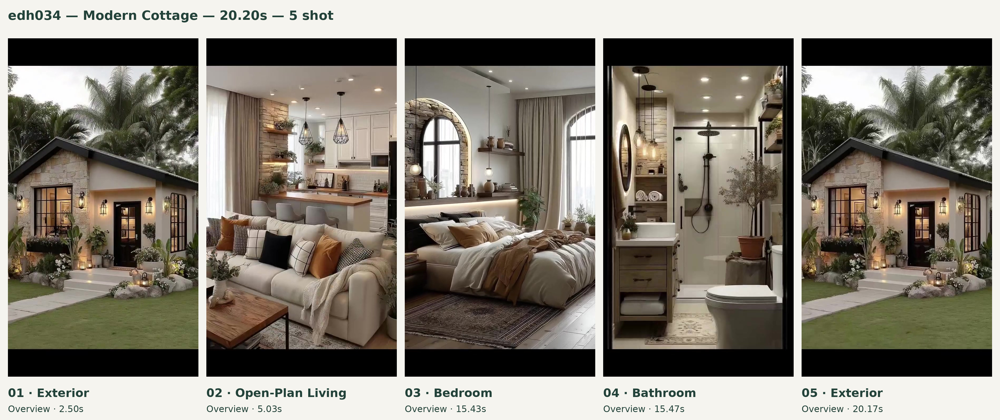
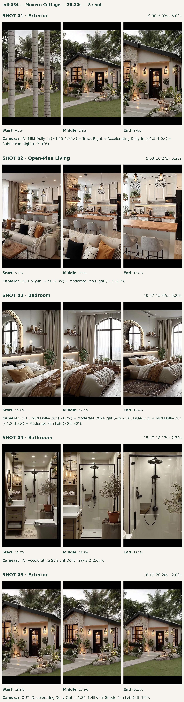
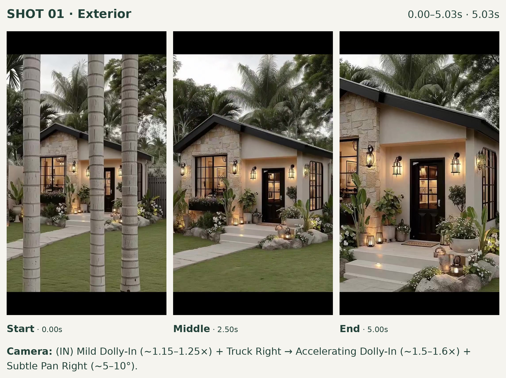
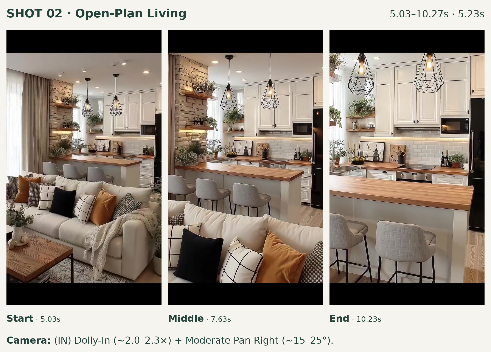
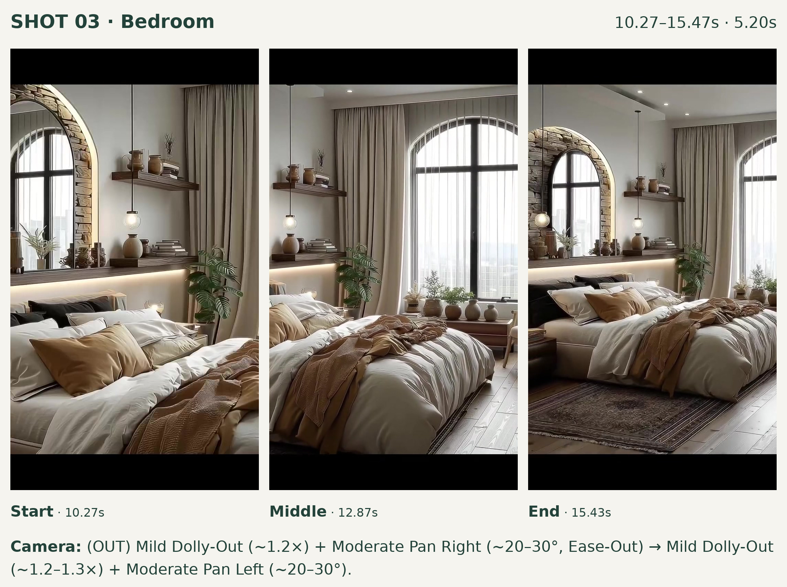
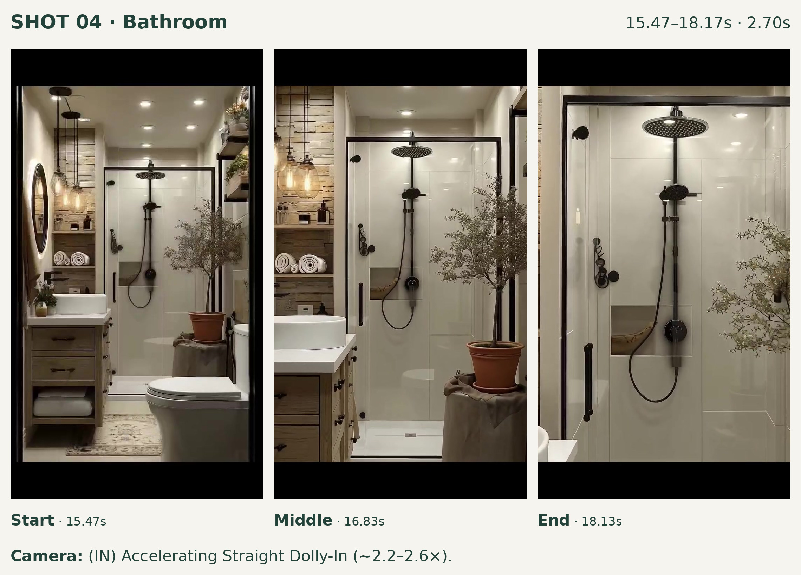
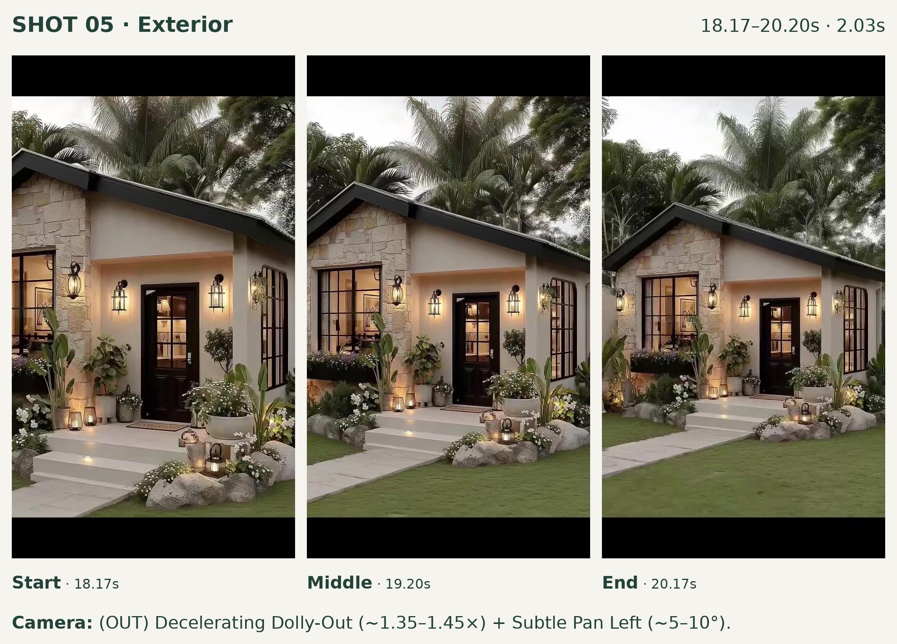

# edh034 — Warm Stone & Timber Cottage

## 1. Profil desain

- **Nama desain:** Warm Stone & Timber Cottage
- **Tipe rumah:** Cottage
- **Gaya utama:** **Modern Cottage**
- **Pengaruh gaya:** Rustic Contemporary
- **Gaya interior:** Warm Modern Farmhouse; Cozy Contemporary
- **Susunan ruang utama:** Living dan kitchen terlihat dalam satu ruang terbuka; bedroom serta bathroom ditampilkan melalui cut.
- **Ciri khas:** Fasad batu beraksen grid, island berpermukaan kayu, cermin lengkung dan jendela lengkung di bedroom, shower berbingkai hitam.
- **Material utama:** Permukaan krem, aksen batu bertekstur, kayu bernuansa madu, rangka gelap dan tekstil netral.
- **Pencahayaan:** Cahaya langit lembut, jendela terang, lampu dinding, pendant, downlight dan pencahayaan aksen hangat.
- **Atmosfer:** Hangat, tenang dan domestik dengan aksen rustic serta tanaman.
- **Lingkungan:** Halaman rumput, jalan setapak, bebatuan, bunga, palem dan vegetasi rapat di belakang fasad.

### Palet warna

| Peran | Warna | HEX |
| --- | --- | --- |
| Dominan | Warm Ivory | `#E2D9C8` |
| Pendamping | Sandstone Beige | `#B7A18B` |
| Pendamping | Honey Oak | `#AB7950` |
| Aksen | Charcoal | `#292827` |
| Aksen | Caramel | `#9F6D40` |
| Pendamping | Garden Green | `#62704B` |

## 2. Ukuran & proporsi

| Aspek | Estimasi visual |
| --- | --- |
| **Ukuran rumah** | small |
| **Bentuk bangunan** | Massa rendah kompak, bidang depan beraksen batu di kiri dan teras menjorok ke dalam di kanan. |
| **Lantai & bentuk atap** | Single-storey appearance · Atap pelana landai dengan tepi gelap. |
| **Tapak bangunan** | Compact rectangular appearance |
| **Proporsi utama** | Low, horizontally oriented mass with shallow gable roof |
| **Perkiraan luas lantai** | **55–90 m²** |

## 3. Shot Timeline

Durasi 20.20s · 5 shot.

**Camera Pattern:** IN – IN – OUT – IN – OUT.

| Shot | Time (s) | Duration | Area/Scene | Camera Movement |
| --- | --- | --- | --- | --- |
| 01 | 0.00–5.03 | 5.03s | Exterior | Mild Dolly-In (~1.15–1.25×) + Truck Right → Accelerating Dolly-In (~1.5–1.6×) + Subtle Pan Right (~5–10°). |
| 02 | 5.03–10.27 | 5.23s | Open-Plan Living | Dolly-In (~2.0–2.3×) + Moderate Pan Right (~15–25°). |
| 03 | 10.27–15.47 | 5.20s | Bedroom | Mild Dolly-Out (~1.2×) + Moderate Pan Right (~20–30°, Ease-Out) → Mild Dolly-Out (~1.2–1.3×) + Moderate Pan Left (~20–30°). |
| 04 | 15.47–18.17 | 2.70s | Bathroom | Accelerating Straight Dolly-In (~2.2–2.6×). |
| 05 | 18.17–20.20 | 2.03s | Exterior | Decelerating Dolly-Out (~1.35–1.45×) + Subtle Pan Left (~5–10°). |

## 4. Overview

**Shot 01 · Exterior · 2.50s**

> Kamera berada di halaman setelah sebagian batang palem tersingkap, menghadap serong fasad. Wide menampilkan atap pelana, bidang batu kiri, teras dan tangga, taman serta vegetasi belakang.

**Shot 02 · Open-Plan Living · 5.03s**

> Kamera berada di depan sofa, menghadap serong ke kitchen. Wide memperlihatkan sofa, meja kopi, island dengan bangku, kabinet putih, aksen batu dan lampu.

**Shot 03 · Bedroom · 15.43s**

> Kamera lebih jauh dari kaki ranjang, menghadap dinding kepala ranjang dan jendela kanan. Wide memperlihatkan ranjang, karpet, rak, cermin lengkung dan bukaan tinggi.

**Shot 04 · Bathroom · 15.47s**

> Kamera di ambang menghadap shower secara frontal. Wide memperlihatkan vanity dan cermin kiri, toilet kanan serta shower kaca di belakang.

**Shot 05 · Exterior · 20.17s**

> Kamera mundur ke halaman, menghadap serong fasad. Wide memperlihatkan massa rendah, atap, bukaan grid, tangga, jalur, halaman rumput dan palem.

## 5. Storyboard

## 6. Shot Details

### Shot 01 · Exterior

**Time:** 0.00–5.03s · **Duration:** 5.03s

#### **A. Desain area**

**Arsitektur**

> Massa rendah ber-atap pelana landai dengan lis gelap. Bidang batu krem di kiri membingkai jendela grid; pintu gelap berkaca di teras kanan dicapai lewat tangga lebar. Jendela tinggi juga tampak di sisi kanan.

**Furnitur & dekorasi**

> Pot tanaman, lentera lantai dan sconce hangat mengapit akses.

**Lingkungan**

> Rumput terawat, jalan beton pucat, batu dan bunga di sisi tangga; palem di foreground dan belakang rumah.

#### **B. Framing & Lighting**

- **Fokus:** Pintu, fasad batu dan teras.
- **Camera Start:** Di halaman, di balik deret batang palem. · Menghadap fasad dan pintu. · oblique · Sekitar tinggi mata, estimasi visual. · Hampir datar.
- **Framing:** Wide fasad dengan batang palem dominan. → Medium menuju pintu dan tangga.
- **Lighting:** Cahaya luar lembut dengan sconce hangat.
- **Foreground dan kedalaman:** Batang palem, rumput, jalan setapak. · Lapisan palem, halaman, tangga dan rumah.
- **Reveal:** Fasad tersingkap saat batang bergeser keluar.
- **Kesesuaian gerak:** Paralaks foreground mendukung gerak lateral dan pendekatan.

#### **C. Camera Movement**

Kamera menyingkap fasad dari balik deretan batang palem sambil mendekat ke kanan, kemudian pendekatan menuju pintu semakin dominan.

**Tempo:** Sedang, gerak lateral terasa di awal; pendekatan semakin cepat pada bagian akhir.

**Movement Timeline**

| Time (s) | Area & fokus | Camera Movement | Tempo |
| --- | --- | --- | --- |
| 0.00–2.20 | Exterior · Fasad di balik batang palem | Mild Dolly-In (~1.15–1.25×) + Truck Right | Sedang, gerak lateral terasa di awal; pendekatan semakin cepat pada bagian akhir. |
| 2.20–5.03 | Exterior · Pintu, tangga dan teras | Accelerating Dolly-In (~1.5–1.6×) + Subtle Pan Right (~5–10°) | Sedang, gerak lateral terasa di awal; pendekatan semakin cepat pada bagian akhir. |

**Camera:** Mild Dolly-In (~1.15–1.25×) + Truck Right → Accelerating Dolly-In (~1.5–1.6×) + Subtle Pan Right (~5–10°).

---

### Shot 02 · Open-Plan Living

**Time:** 5.03–10.27s · **Duration:** 5.23s

#### **A. Desain area**

**Arsitektur**

> Ruang living dan kitchen terbuka; plafon putih dengan downlight, dinding aksen batu di kiri dapur, kabinet putih berpanel di belakang dan backsplash ubin terang. Island berdiri di antara sofa dan bidang kerja; sambungan sisi tidak sepenuhnya terlihat.

**Furnitur & dekorasi**

> Sofa krem menghadap ke foreground dengan bantal kotak-kotak hitam, karamel dan krem; meja kopi kayu persegi. Island putih bertop kayu dengan tiga bangku berlapis terang terlihat pada awal; pendant rangka hitam, kabinet panel putih, rak kayu, kulkas gelap di kanan dan peralatan kecil di meja.

**Lingkungan**

> Cahaya lembut dari bukaan kiri, tanaman pot di rak dan countertop; detail luar tidak jelas.

#### **B. Framing & Lighting**

- **Fokus:** Island, lampu gantung dan kabinet.
- **Camera Start:** Di depan sofa menghadap dapur. · Menuju island dan kabinet belakang. · oblique · Sekitar tinggi mata duduk/berdiri rendah. · Hampir datar.
- **Framing:** Wide living dan kitchen. → Medium kitchen island dan kabinet.
- **Lighting:** Bukaan kiri, pendant hangat, downlight dan lampu bawah kabinet.
- **Foreground dan kedalaman:** Sofa, bantal dan meja kopi. · Sofa di depan, island di tengah, kabinet belakang.
- **Reveal:** Living berkurang dari bingkai saat kitchen membesar.
- **Kesesuaian gerak:** Framing berlapis mendukung pendekatan dan sapuan kanan.

#### **C. Camera Movement**

Dari sofa, kamera bergerak mendekat dan mengarahkan pandangan ke kanan menuju island dan kabinet dapur; sofa turun keluar dari bingkai.

**Tempo:** Sedang dan relatif merata pada pendekatan; sapuan lebih terasa di tengah.

**Camera:** Dolly-In (~2.0–2.3×) + Moderate Pan Right (~15–25°).

---

### Shot 03 · Bedroom

**Time:** 10.27–15.47s · **Duration:** 5.20s

#### **A. Desain area**

**Arsitektur**

> Dinding netral dengan cermin lengkung berbingkai tekstur batu di atas kepala ranjang, jendela lengkung tinggi bergrid hitam dan tirai lantai-plafon di kanan; lantai papan terang dan plafon putih.

**Furnitur & dekorasi**

> Ranjang besar rendah dengan duvet krem dan selimut karamel; karpet bermotif di bawah kaki ranjang. Rak apung di samping cermin, pendant kecil, cahaya aksen di belakang kepala ranjang, meja rendah dekat jendela dengan pot.

**Lingkungan**

> Daylight kuat tersaring tirai tipis, tanaman pot dekat jendela, pemandangan luar tidak dapat diidentifikasi.

#### **B. Framing & Lighting**

- **Fokus:** Tempat tidur dan bukaan lengkung.
- **Camera Start:** Dekat sisi kaki tempat tidur. · Ke kepala ranjang dan jendela kanan. · oblique · Sekitar tinggi ranjang sampai mata rendah. · Hampir datar.
- **Framing:** Medium ranjang, cermin dan rak. → Wide ranjang, karpet, cermin dan jendela.
- **Lighting:** Daylight tersaring tirai, pendant, aksen kepala ranjang.
- **Foreground dan kedalaman:** Duvet dan selimut karamel. · Ranjang depan, dinding kepala ranjang dan jendela di belakang.
- **Reveal:** Jendela kanan terbuka lalu cermin kembali terlihat.
- **Kesesuaian gerak:** Mundur memperluas cakupan sementara sapuan berubah arah.

#### **C. Camera Movement**

Kamera mundur perlahan sambil menyapu ke kanan menuju jendela besar, lalu berbalik menyapu kiri sehingga tempat tidur dan cermin kembali masuk ke komposisi yang lebih lebar.

**Tempo:** Sedang, sapuan kanan mereda sekitar 12,8 detik, berbalik ke kiri dengan mundur berlanjut.

**Movement Timeline**

| Time (s) | Area & fokus | Camera Movement | Tempo |
| --- | --- | --- | --- |
| 10.27–12.80 | Bedroom · Tempat tidur menuju jendela kanan | Mild Dolly-Out (~1.2×) + Moderate Pan Right (~20–30°, Ease-Out) | Sedang, sapuan kanan mereda sekitar 12,8 detik, berbalik ke kiri dengan mundur berlanjut. |
| 12.80–15.47 | Bedroom · Jendela kembali ke tempat tidur dan cermin | Mild Dolly-Out (~1.2–1.3×) + Moderate Pan Left (~20–30°) | Sedang, sapuan kanan mereda sekitar 12,8 detik, berbalik ke kiri dengan mundur berlanjut. |

**Camera:** Mild Dolly-Out (~1.2×) + Moderate Pan Right (~20–30°, Ease-Out) → Mild Dolly-Out (~1.2–1.3×) + Moderate Pan Left (~20–30°).

---

### Shot 04 · Bathroom

**Time:** 15.47–18.17s · **Duration:** 2.70s

#### **A. Desain area**

**Arsitektur**

> Ruang memanjang dengan shower di belakang, panel kaca transparan berbingkai hitam dan ubin besar terang. Vanity di kiri, toilet di kanan; dinding rak bertekstur batu di belakang vanity.

**Furnitur & dekorasi**

> Wastafel persegi putih di atas kabinet kayu berlaci dan rak bawah, cermin bulat bercahaya, rak handuk, toilet putih, shower hujan hitam dan hand shower. Pot tanaman di kanan shower.

**Lingkungan**

> Downlight putih, pendant hangat di area wastafel; tidak ada bukaan luar yang dapat dinilai.

#### **B. Framing & Lighting**

- **Fokus:** Shower hujan dan panel kaca.
- **Camera Start:** Di ambang kamar mandi. · Ke shower di ujung ruang. · frontal · Sekitar tinggi mata. · Hampir datar.
- **Framing:** Wide ruang sempit: vanity kiri, toilet kanan, shower belakang. → Close shower dan perangkat hitam.
- **Lighting:** Downlight dan lampu aksen hangat pada vanity.
- **Foreground dan kedalaman:** Kusen, wastafel dan toilet. · Saniter di depan, shower di belakang.
- **Reveal:** Perangkat shower menjadi fokus.
- **Kesesuaian gerak:** Sumbu lurus menuju shower mendukung dolly-in.

#### **C. Camera Movement**

Kamera maju dari ambang kamar mandi menuju perangkat shower, dengan pembesaran perspektif yang makin cepat.

**Tempo:** Cepat, terutama mendekati akhir; ekspansi perspektif naik selama 2,7 detik.

**Camera:** Accelerating Straight Dolly-In (~2.2–2.6×).

---

### Shot 05 · Exterior

**Time:** 18.17–20.20s · **Duration:** 2.03s

#### **A. Desain area**

**Arsitektur**

> Kembali ke fasad serupa: atap pelana rendah gelap, bidang batu kiri dan pintu grid pada teras kanan; tangga dan jalur masuk terlihat penuh saat kamera mundur.

**Furnitur & dekorasi**

> Sconce hangat, lentera lantai dan pot tanaman di sekitar teras.

**Lingkungan**

> Halaman rumput, setapak pucat, batu dan bunga membingkai akses, palem tinggi di belakang.

#### **B. Framing & Lighting**

- **Fokus:** Fasad, teras dan lanskap.
- **Camera Start:** Di depan teras, dekat tangga. · Menghadap fasad dan pintu. · oblique · Sekitar tinggi mata. · Hampir datar.
- **Framing:** Medium fasad dan teras. → Wide rumah, halaman dan jalan setapak.
- **Lighting:** Cahaya luar lembut dan lampu fasad hangat.
- **Foreground dan kedalaman:** Tangga, batu taman, jalan dan rumput. · Teras di tengah, halaman depan dan palem belakang.
- **Reveal:** Sisi kiri rumah dan halaman terlihat lebih luas.
- **Kesesuaian gerak:** Mundur membuka komposisi dengan sapuan kiri ringan.

#### **C. Camera Movement**

Kamera menarik diri dari teras menuju pandangan eksterior yang lebih luas, dengan koreksi arah ringan ke kiri.

**Tempo:** Sedang; perubahan skala lebih cepat pada awal dan mereda menjelang akhir.

**Camera:** Decelerating Dolly-Out (~1.35–1.45×) + Subtle Pan Left (~5–10°).

**Catatan referensi:** Estimasi luas 55–90 m² bersifat indikatif dari skala visual relatif terhadap pintu, furnitur dan ruang yang ditampilkan; tidak ada denah atau ukuran terkalibrasi. Material dinilai dari tampilan, bukan spesifikasi fisik. Hubungan denah antar shot dan identitas rumah fisik tidak terkonfirmasi. Interpretasi kamera yang disetujui pengguna dipertahankan tanpa perubahan; ketidakpastian gerak lateral dan besaran tetap tercatat.
