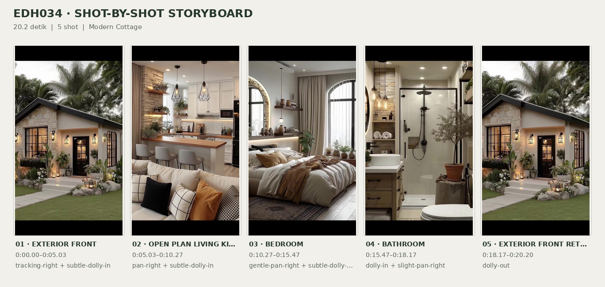
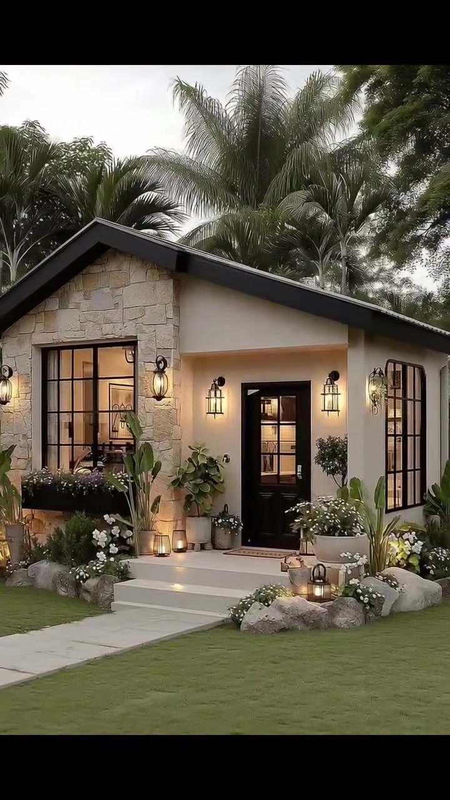
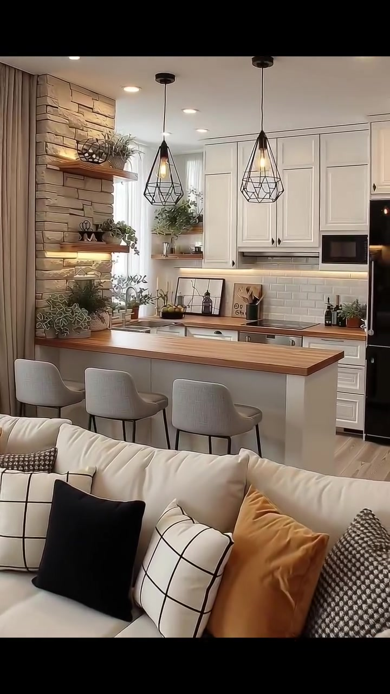
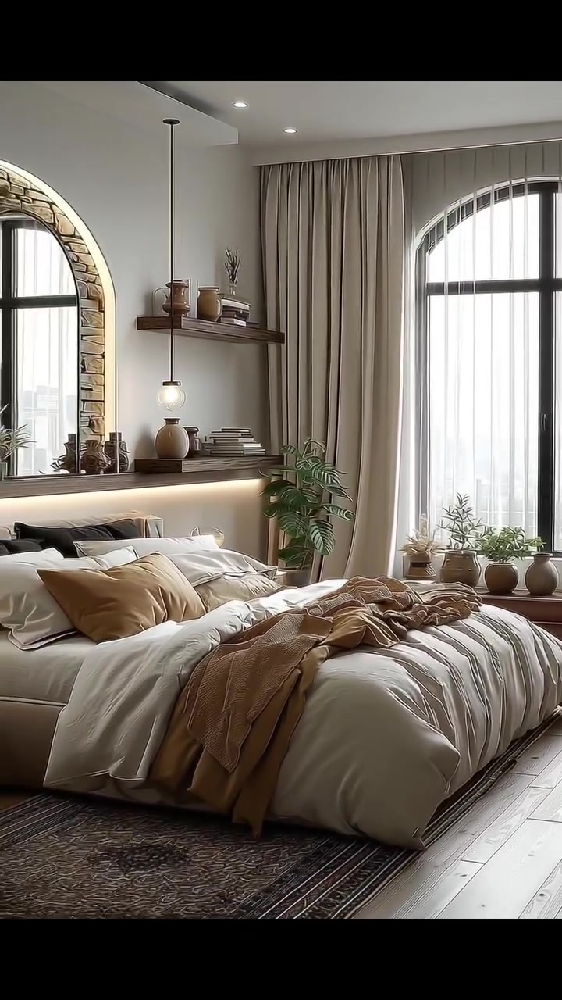
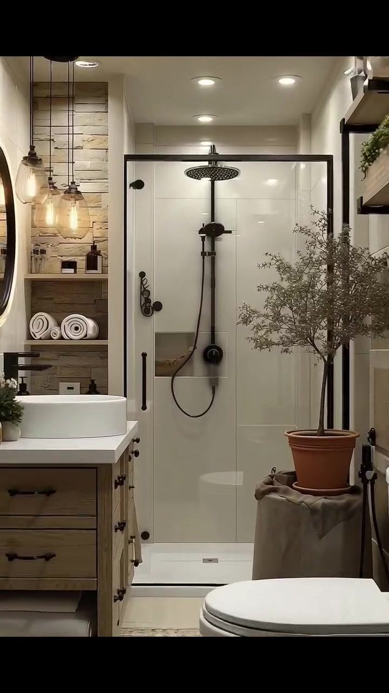
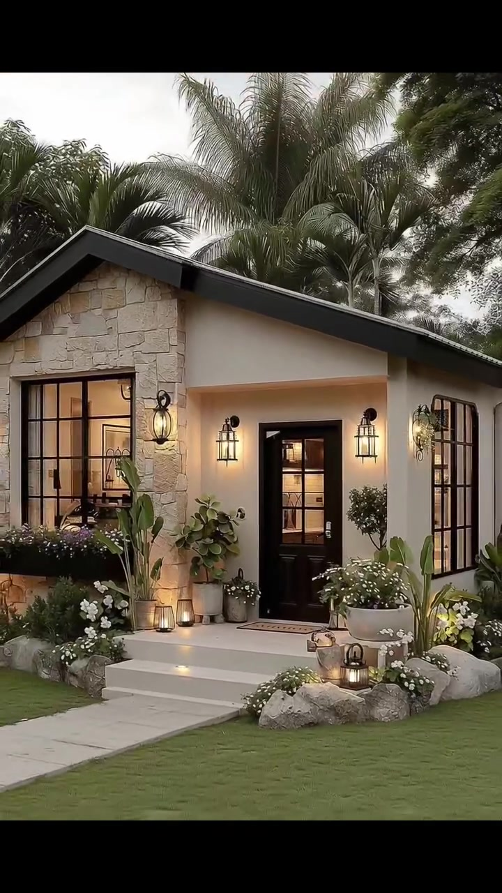

# edh034 — Modern Cottage

<!-- homeku_request_id: edh034-92990168190587a02b671bf5 -->

<!-- homeku_detail_narratives: chat-reviewed -->

**Sumber data:** [analysis.yaml](analysis.yaml) · **Status:** draft · **Diverifikasi manusia:** Tidak

## 1. Informasi Video

| Informasi | Nilai |
|---|---|
| ID | edh034 |
| File asli | edh034.mp4 |
| Durasi | 20.2 |
| Resolusi | 720x1280 |
| FPS | 30 |
| Rasio | 9:16 |
| Jumlah shot | 5 |

## 2. Storyboard Gabungan

## 3. Identitas Desain

| Aspek | Hasil analisis |
|---|---|
| Gaya utama | modern cottage |
| Wilayah terkait gaya desain | europe, north america |
| Pengaruh gaya | modern farmhouse, rustic stone accents, warm contemporary interior |
| Ciri eksterior | dark charcoal gable roof, irregular pale beige stone appearance front cladding, smooth warm cream rendered walls, black mullioned windows and glazed entry door, small two step entry porch |
| Gaya interior | warm neutral modern farmhouse, white shaker cabinetry, natural wood appearance finishes, rustic stone appearance accent walls, soft layered cream and tan textiles |
| Confidence gaya | medium |

## 4. Ukuran & Proporsi Bangunan

| Aspek | Estimasi visual |
|---|---|
| Ukuran yang terlihat | small |
| Bentuk bangunan | compact rectangular with front gable |
| Skala vertikal | single story |
| Tapak bangunan | compact |
| Perkiraan luas lantai | 45–95 m² |
| Confidence | low |

> Luas adalah perkiraan visual, bukan ukuran terukur.

## 5. Warna, Pencahayaan, dan Atmosfer

| Warna dominan | HEX (perkiraan) |
|---|---|
| warm off white | #EEE8DD |
| pale stone beige | #CDBDA5 |
| light natural wood | #B88F69 |
| charcoal black | #252624 |
| leaf green | #65735B |
| caramel tan | #B78256 |

| Aspek | Hasil analisis |
|---|---|
| Pencahayaan | diffuse outdoor daylight, warm exterior wall sconces, warm interior pendant lights, recessed ceiling downlights, under cabinet and shelf accent lighting, soft bedroom window daylight |
| Lingkungan | tropical palm backdrop, trimmed front lawn, pale paver walkway, stone bordered flowering entry garden, dense green tree canopy |
| Musim yang tampak | Tidak diketahui |
| Mood | cozy, calm, warm, welcoming |

## 6. Struktur dan Timeline Video

**Jenis:** home tour · **Tempo:** moderate · **Transisi:** hard cuts between interior and exterior scenes

| Shot | Waktu (detik) | Durasi | Area/Scene | Gerakan Kamera |
|---|---|---|---|---|
| Shot 01 | 0.0–5.033 | 5.03 | exterior front | tracking right, subtle dolly in |
| Shot 02 | 5.033–10.267 | 5.23 | open plan living kitchen | pan right, subtle dolly in |
| Shot 03 | 10.267–15.467 | 5.20 | bedroom | gentle pan right, subtle dolly out |
| Shot 04 | 15.467–18.167 | 2.70 | bathroom | dolly in, slight pan right |
| Shot 05 | 18.167–20.2 | 2.03 | exterior front return | dolly out |

## 7. Analisis per Shot

### Shot 01 — exterior front

**Waktu:** 0.0–5.033 detik

| Komponen | Pengamatan |
|---|---|
| Fokus utama | cream and stone single story cottage front |
| Framing awal → akhir | wide partly obscured front elevation → medium front entry and gable |
| Sudut pandang | eye level slight left front three quarter |
| Gerakan kamera | tracking right, subtle dolly in |
| Kecepatan kamera | slow |
| Pencahayaan | soft diffuse outdoor light with warm wall and ground lantern glow |
| Transisi keluar | hard cut to open plan living kitchen |

**Detail yang terlihat**

**Arsitektur**

Rumah tampak satu lantai dengan atap pelana berwarna arang gelap yang memanjang miring ke kanan. Sisi kiri fasad, terutama bidang segitiga di bawah atap, dilapisi material berpenampilan batu beige muda tak beraturan, sedangkan area pintu dan dinding kanan berfinishing halus krem hangat. Di kiri pintu terdapat jendela tinggi berbingkai hitam berkisi, sementara pintu kaca berpanel hitam berada pada ceruk masuk; jendela serupa tampak di sudut kanan. Dua anak tangga lebar berwarna pucat mengarah ke pintu, dengan lampu dinding hitam berbentuk lentera di dekat pintu dan jendela.

**Furnitur dan properti**

Beberapa pot tanaman berdaun hijau berjajar di sekitar pintu dan jendela. Di kanan tangga terlihat pot bundar besar berwarna terang dengan bunga putih. Lentera\-lentera kecil bercahaya hangat ditempatkan di antara bebatuan dan pot, serta ada keset persegi panjang berwarna cokelat muda tepat di depan pintu.

**Lingkungan**

Pada awal shot, tiga batang palem tinggi melintas di depan pandangan menuju rumah. Di belakang atap terlihat tajuk palem hijau, dengan kanopi pohon berdaun lebar menaungi sisi kanan atas. Hamparan rumput hijau yang rapi membentang di depan rumah dan dilintasi jalur batu pijakan persegi panjang berwarna pucat menuju tangga. Batu\-batu besar abu\-abu membatasi petak bunga putih yang rendah di sekitar pintu masuk, sedangkan langit pucat terlihat di atas pepohonan.

**Catatan pengamatan:** Pergeseran kamera ke kanan menyingkirkan batang palem yang semula menghalangi fasad; material batu dicatat berdasarkan penampakan.

**Confidence:** Kamera medium · Detail visual high

### Shot 02 — open plan living kitchen

**Waktu:** 5.033–10.267 detik

| Komponen | Pengamatan |
|---|---|
| Fokus utama | wood topped white kitchen island behind cream sofa |
| Framing awal → akhir | wide living seating and kitchen → medium kitchen island and cabinetry |
| Sudut pandang | slightly elevated front three quarter interior |
| Gerakan kamera | pan right, subtle dolly in |
| Kecepatan kamera | slow |
| Pencahayaan | mixed soft daylight warm recessed ceiling lights pendants and under shelf lighting |
| Transisi keluar | hard cut to bedroom |

**Detail yang terlihat**

**Arsitektur**

Langit\-langit putih memiliki beberapa lampu tanam kecil bercahaya hangat. Di sisi kiri dapur terdapat bidang dinding berpenampilan susunan batu beige dengan dua rak kayu tebal melayang. Dinding belakang diisi kabinet atas dan bawah putih berpanel bergaya shaker, serta backsplash ubin putih persegi panjang yang tersusun mendatar. Kitchen island berbasis putih berdiri di depan kabinet dan, seperti meja dapur di belakangnya, memakai permukaan berpenampilan kayu alami terang. Lantai berupa papan panjang berwarna kayu muda, sementara tirai tinggi cokelat muda berada di sisi kiri. Pencahayaan aksen hangat terlihat di bawah kabinet dan rak, dan ada jendela sempit bercahaya siang di antara bidang batu dan kabinet atas.

**Furnitur dan properti**

Di bagian depan tampak sofa kain krem dengan bantal hitam, putih bermotif kotak, serta warna karamel, ditambah selimut rajut terang di salah satu lengannya. Meja tamu kayu persegi panjang berdiri di depan sofa. Tiga kursi bar berlapis kain taupe muda dan berkaki gelap berjajar di kitchen island, yang dinaungi dua lampu gantung hitam berkerangka geometris. Di kabinet kanan terdapat microwave tanam hitam dan logam, sedangkan meja belakang memuat bak cuci logam dengan keran, talenan, botol kecil, dan beberapa tanaman pot. Kulkas gelap terlihat di tepi kanan, dan rak dinding menampung tanaman serta benda dekoratif kecil.

**Lingkungan**

Tidak ada detail yang tercatat.

**Catatan pengamatan:** Awal shot masih memperlihatkan sofa dan meja tamu, kemudian bidang pandang semakin terpusat pada kitchen island dan kabinet.

**Confidence:** Kamera medium · Detail visual high

### Shot 03 — bedroom

**Waktu:** 10.267–15.467 detik

| Komponen | Pengamatan |
|---|---|
| Fokus utama | cream bed under arched black framed window |
| Framing awal → akhir | close three quarter bed and left arch → wide bedroom with full bed and arched window |
| Sudut pandang | eye level diagonal from bed foot |
| Gerakan kamera | gentle pan right, subtle dolly out |
| Kecepatan kamera | slow |
| Pencahayaan | soft window daylight and warm backlit bedside shelf with recessed spotlights |
| Transisi keluar | hard cut to bathroom |

**Detail yang terlihat**

**Arsitektur**

Kamar tidur memiliki dinding putih gading dan plafon putih datar. Sebuah jendela besar berbentuk lengkung dengan bingkai hitam dan pembagi kaca berada di dinding kanan, ditutupi tirai jatuh berwarna taupe serta lapisan tirai tipis putih. Di kiri tampak elemen berbingkai lengkung dengan keliling bertekstur batu; permukaannya terlihat reflektif atau seperti kaca sehingga belum bisa dipastikan apakah itu cermin atau bukaan. Lantai berpenampilan papan kayu muda, dengan cahaya garis hangat di belakang tempat tidur, lampu plafon tanam kecil, dan rak kayu melayang pada dinding dekat jendela.

**Furnitur dan properti**

Tempat tidur lebar dan rendah berlapis krem dipenuhi duvet putih tebal, bantal berlapis warna krem, tan, dan aksen gelap, serta selimut rajut karamel yang terhampar kusut di bagian kaki. Di samping tempat tidur menggantung lampu kecil berkaca bundar. Rak kayu memuat vas keramik dan tumpukan buku. Di antara tempat tidur dan jendela ada tanaman pot berdaun besar terbelah, sementara beberapa pot tanaman kecil berjajar pada bangku kayu rendah di bawah jendela. Karpet luas bercorak gelap yang lembut terlihat di bawah tempat tidur.

**Lingkungan**

Melalui tirai tipis pada jendela lengkung kanan tampak cahaya siang dari luar yang terang dan agak berkabut; objek di kejauhan tidak cukup jelas untuk diidentifikasi.

**Catatan pengamatan:** Elemen melengkung di kiri bisa merupakan cermin besar atau bukaan; citra tidak cukup jelas untuk memastikannya.

**Confidence:** Kamera medium · Detail visual medium

### Shot 04 — bathroom

**Waktu:** 15.467–18.167 detik

| Komponen | Pengamatan |
|---|---|
| Fokus utama | black framed glass shower with rainfall fixture |
| Framing awal → akhir | wide narrow bathroom showing vanity toilet and shower → tight view of black framed shower |
| Sudut pandang | eye level straight on |
| Gerakan kamera | dolly in, slight pan right |
| Kecepatan kamera | moderate |
| Pencahayaan | warm interior spotlights and glowing pendants reflecting on shower glass |
| Transisi keluar | hard cut to exterior front |

**Detail yang terlihat**

**Arsitektur**

Kamar mandi berbentuk memanjang, dengan plafon putih dan lampu tanam. Bagian dinding kiri menampilkan tekstur susunan batu beige muda serta rak\-rak kayu terbuka. Area shower dipisahkan kaca bening berbingkai hitam tipis, menghadap dinding ubin persegi panjang besar warna krem terang. Perlengkapan shower hitam terdiri dari kepala pancuran hujan dan pancuran genggam; dasarnya berupa baki putih rendah dengan lubang pembuangan kecil di bagian depan. Di kiri terdapat kabinet wastafel bercorak kayu dengan permukaan putih dan cermin dinding bulat berbingkai gelap. Lantai di dekat kabinet dan toilet memiliki pola dekoratif, sementara lampu gantung kaca hangat menggantung di depan dinding batu.

**Furnitur dan properti**

Di atas kabinet terdapat wastafel mangkuk putih dan tanaman pot kecil di sudutnya. Toilet putih berada di bagian depan kanan, dekat shower. Handuk putih tergulung tersusun di rak terbuka, dengan botol sabun dan perlengkapan kecil di kabinet maupun rak. Di sebelah kanan kabinet terlihat pohon kecil bercabang di dalam pot yang diletakkan di atas dudukan berselimut kain. Beberapa tanaman hias kecil lainnya tersusun di rak atas sisi kanan.

**Lingkungan**

Tidak ada detail yang tercatat.

**Catatan pengamatan:** Selama gerakan maju, wastafel dan toilet perlahan terpotong dari bidang pandang sehingga shower menjadi fokus.

**Confidence:** Kamera high · Detail visual high

### Shot 05 — exterior front return

**Waktu:** 18.167–20.2 detik

| Komponen | Pengamatan |
|---|---|
| Fokus utama | illuminated stone and cream front facade |
| Framing awal → akhir | medium close front door and steps → wider front elevation with lawn and walkway |
| Sudut pandang | eye level slight left front three quarter |
| Gerakan kamera | dolly out |
| Kecepatan kamera | slow |
| Pencahayaan | soft cloudy outdoor light with warm lit wall lanterns and step lanterns |
| Transisi keluar | end of video |

**Detail yang terlihat**

**Arsitektur**

Sudut depan rumah kembali memperlihatkan bangunan satu lantai berwarna krem dan atap pelana gelap. Bidang kiri dilapisi material berpenampilan batu beige muda tak beraturan, dengan jendela besar berkisi hitam di sebelah kiri pintu masuk kaca gelap. Pintu terletak di ceruk yang dicapai melalui dua anak tangga pucat, dilengkapi lampu dinding hitam berbentuk lentera. Satu jendela tinggi berkisi hitam lainnya tampak di sudut kanan fasad.

**Furnitur dan properti**

Lentera kecil bercahaya hangat berada di sekitar anak tangga. Pot berisi tanaman berdaun lebar terkumpul di dekat pintu, dan pot bundar besar berbunga putih terletak di kanan tangga. Keset cokelat muda berada tepat di depan pintu kaca berbingkai hitam.

**Lingkungan**

Pohon\-pohon palem hijau tinggi menjulang dari balik atap, dengan pepohonan berdaun hijau gelap memenuhi latar belakang. Rumput hijau membentang di halaman depan dan di kanan jalan masuk. Jalur batu pijakan persegi panjang berwarna terang mengarah dari kiri bawah menuju tangga, diapit bebatuan abu\-abu serta petak bunga putih dan kuning muda. Di atas tajuk pepohonan terlihat langit pucat berawan.

**Catatan pengamatan:** Sudut eksterior yang sama muncul kembali; kamera menjauh perlahan sehingga jalur masuk dan hamparan rumput lebih terlihat.

**Confidence:** Kamera high · Detail visual high

## 8. Kualitas dan Ketidakpastian Analisis

| Parameter | Hasil |
|---|---|
| Status | draft |
| Verifikasi manusia | Tidak |
| Ketepatan timestamp | estimated |
| Ketidakpastian | exact building floor area and unseen footprint not measurable from video, stone wood and wall finishes described by visual appearance only, left bedroom arched surface could be mirror or glazed opening, camera movement types are interpretations of on screen motion, regional style association does not identify actual home location, season and actual geographic location cannot be verified visually |

**Catatan:** Analisis hanya dari gambar video; durasi 20,2 detik dihitung dari 606 frame video pada 30 fps. Batas shot diperiksa terhadap pergantian frame; rentang luas merupakan estimasi visual ber-confidence rendah.

---

*Laporan ini diturunkan dari [analysis.yaml](analysis.yaml).*
