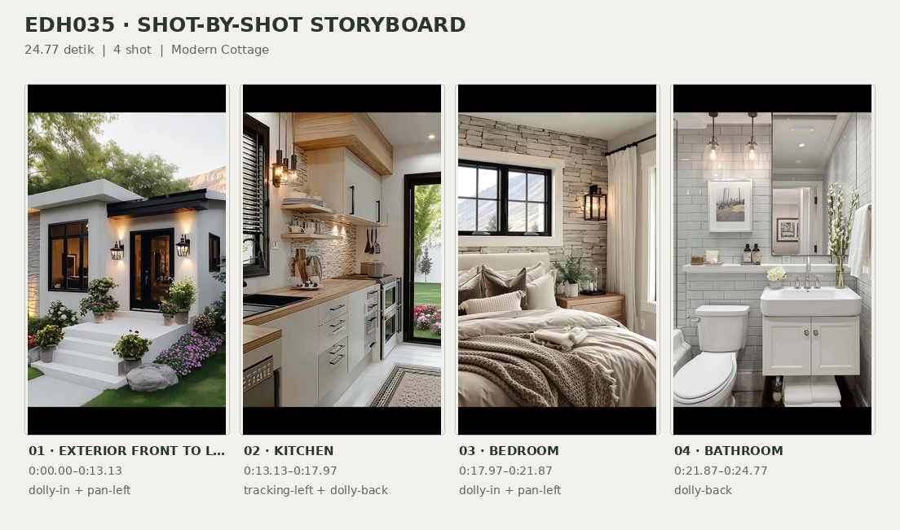
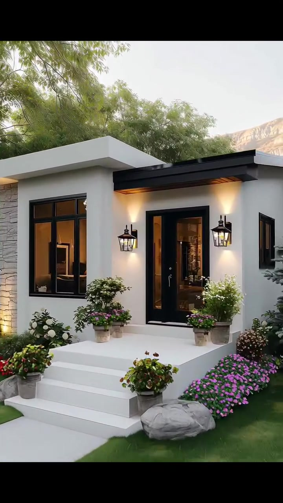
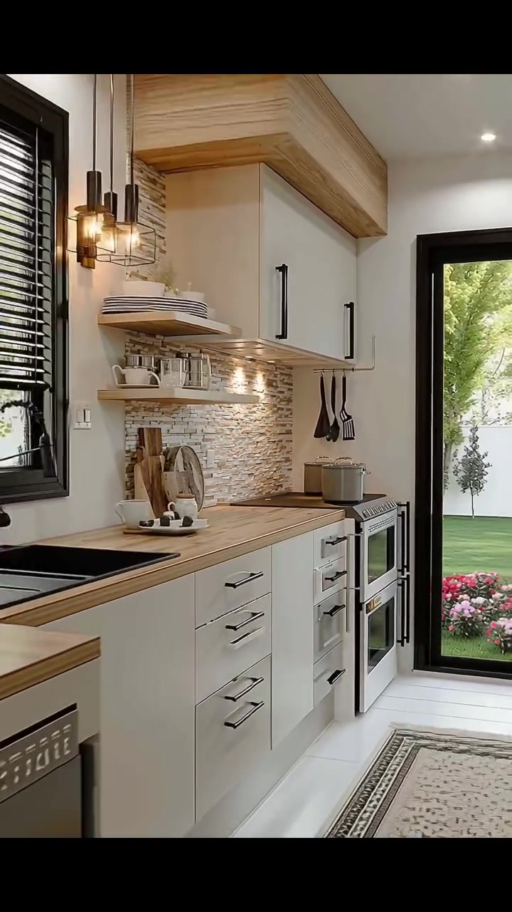
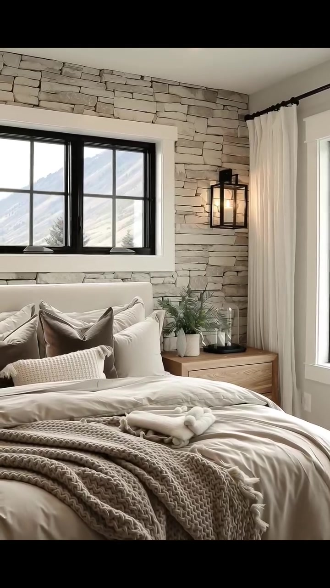
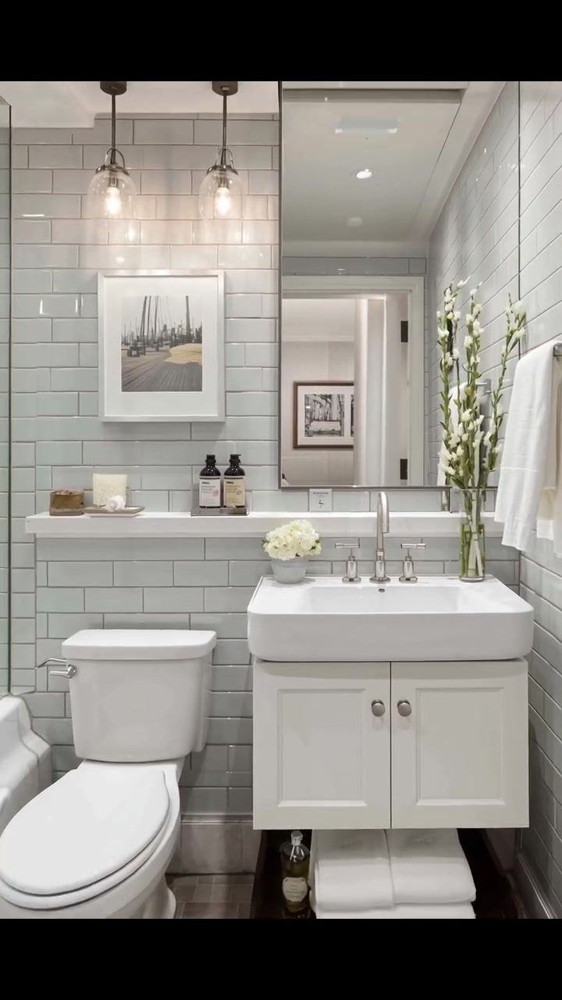

# edh035 — Modern Cottage

<!-- homeku_request_id: edh035_20261105_27766063b -->

<!-- homeku_detail_narratives: chat-reviewed -->

**Sumber data:** [analysis.yaml](analysis.yaml) · **Status:** draft · **Diverifikasi manusia:** Tidak

## 1. Informasi Video

| Informasi | Nilai |
|---|---|
| ID | edh035 |
| File asli | edh035.mp4 |
| Durasi | 24.77 |
| Resolusi | 720x1280 |
| FPS | 30 |
| Rasio | 9:16 |
| Jumlah shot | 4 |

## 2. Storyboard Gabungan

## 3. Identitas Desain

| Aspek | Hasil analisis |
|---|---|
| Gaya utama | modern cottage |
| Wilayah terkait gaya desain | europe, north america |
| Pengaruh gaya | modern farmhouse, rustic contemporary |
| Ciri eksterior | white rendered facade, dark metal framed glazing, simple flat entry canopy, black lantern sconces, white entry steps |
| Gaya interior | light neutral cottage palette, rustic stone texture accents, light wood furnishings, modern black metal details |
| Confidence gaya | medium |

## 4. Ukuran & Proporsi Bangunan

| Aspek | Estimasi visual |
|---|---|
| Ukuran yang terlihat | small |
| Bentuk bangunan | compact rectangular |
| Skala vertikal | single story |
| Tapak bangunan | compact |
| Perkiraan luas lantai | 45–85 m² |
| Confidence | low |

> Luas adalah perkiraan visual, bukan ukuran terukur.

## 5. Warna, Pencahayaan, dan Atmosfer

| Warna dominan | HEX (perkiraan) |
|---|---|
| warm off white | #EFEDE5 |
| soft cream | #D9CFBE |
| natural light wood | #B18F6C |
| charcoal black | #292826 |
| leaf green | #607451 |

| Aspek | Hasil analisis |
|---|---|
| Pencahayaan | soft daylight, warm lantern wall sconces, warm under cabinet task lights, recessed ceiling downlights |
| Lingkungan | landscaped front lawn, flower beds and potted plants, mature trees, distant mountain view |
| Musim yang tampak | Tidak diketahui |
| Mood | cozy, calm, welcoming, bright |

## 6. Struktur dan Timeline Video

**Jenis:** home tour · **Tempo:** slow · **Transisi:** continuous entry movement followed by hard cuts

| Shot | Waktu (detik) | Durasi | Area/Scene | Gerakan Kamera |
|---|---|---|---|---|
| Shot 01 | 0.0–13.13 | 13.13 | exterior front to living room | dolly in, pan left |
| Shot 02 | 13.13–17.97 | 4.84 | kitchen | tracking left, dolly back |
| Shot 03 | 17.97–21.87 | 3.90 | bedroom | dolly in, pan left |
| Shot 04 | 21.87–24.77 | 2.90 | bathroom | dolly back |

## 7. Analisis per Shot

### Shot 01 — exterior front to living room

**Waktu:** 0.0–13.13 detik

| Komponen | Pengamatan |
|---|---|
| Fokus utama | front entry and living room |
| Framing awal → akhir | wide exterior front view → medium wide living room media wall |
| Sudut pandang | eye level front to oblique interior |
| Gerakan kamera | dolly in, pan left |
| Kecepatan kamera | slow |
| Pencahayaan | mixed soft daylight and warm wall lantern light |
| Transisi keluar | hard cut |

**Detail yang terlihat**

**Arsitektur**

Rumah satu lantai berukuran kompak ini memiliki fasad putih dengan tonjolan atap datar di atas jendela kiri. Kanopi pintu masuk berwarna hitam memperlihatkan bagian bawah bernuansa kayu; pintu berkaca dan jendela depan sama\-sama berbingkai hitam. Dua lampu dinding model lentera mengapit pintu, sedangkan teras putih yang sedikit terangkat dihubungkan oleh tangga pendek. Pada sudut kiri fasad tampak aksen pelapis menyerupai batu terang. Setelah melewati pintu, terlihat lantai papan kayu bernuansa hangat, dinding televisi bertekstur menyerupai batu putih, dan plafon bertingkat dangkal dengan lampu tanam. Jendela ruang keluarga berbingkai hitam dilengkapi tirai lipat gelap, dengan lampu lentera dinding di dekatnya.

**Furnitur dan properti**

Di ruang keluarga terdapat sofa krem dengan bantal bermotif botani gelap di sisi kanan. Meja kopi kayu persegi panjang yang rendah berada di atas karpet anyaman terang. Televisi layar datar hitam terpasang pada dinding bertekstur batu, dengan kabinet kayu rendah dan vas keramik putih di bawahnya. Bangku berlapis kain terang menempel di sisi kiri, sementara tanaman hijau dalam pot dan pot bunga berwarna merah muda serta putih menghiasi area dekat jendela. Di atas meja kopi terdapat baki dekoratif dan beberapa cangkir berwarna terang.

**Lingkungan**

Halaman depan berupa rumput hijau di kedua sisi jalur masuk yang lurus dan berwarna pucat. Pepohonan besar berdaun lebat mengelilingi rumah; hamparan bunga merah dan merah muda, konifer kecil di kanan pintu, serta batu\-batu taman membingkai tangga depan. Pagar piket putih terlihat di sebelah kiri bangunan, dan punggung bukit berbatu berwarna pucat muncul jauh di atas atap. Melalui jendela ruang keluarga, pepohonan hijau di luar juga masih terlihat.

**Catatan pengamatan:** Camera travels from the landscaped front yard toward the open entry, then continues inside and sweeps across the living room. Scene change at the doorway is continuous, not an editorial cut.

**Confidence:** Kamera medium · Detail visual high

### Shot 02 — kitchen

**Waktu:** 13.13–17.97 detik

| Komponen | Pengamatan |
|---|---|
| Fokus utama | wood countertop white cabinetry and cooking range |
| Framing awal → akhir | medium stove and backsplash close view → wide single wall kitchen and garden door view |
| Sudut pandang | eye level oblique side view |
| Gerakan kamera | tracking left, dolly back |
| Kecepatan kamera | slow |
| Pencahayaan | warm under cabinet task lights and soft window daylight |
| Transisi keluar | hard cut |

**Detail yang terlihat**

**Arsitektur**

Dapur memiliki deretan kabinet putih dengan gagang batang hitam yang dipasang vertikal dan horizontal. Bidang kerja dan rak terbukanya bernuansa kayu terang, sementara backsplash bertekstur susunan batu tidak beraturan berwarna beige mendapat sorotan dari lampu hangat di bawah kabinet. Lis kayu terlihat di pertemuan kabinet atas dan plafon. Di bagian kiri terdapat wastafel gelap dengan keran hitam melengkung di bawah jendela berbingkai hitam dan tirai bilah gelap. Ujung dapur memiliki pintu kaca menuju taman dengan bingkai senada. Plafon putih dilengkapi lampu tanam, sedangkan lampu gantung kaca kecil berada dekat area wastafel.

**Furnitur dan properti**

Kompor sekaligus oven berdiri berwarna putih dan logam menempati sisi meja, dengan dua panci abu\-abu terang di atas tungkunya. Spatula dan sendok masak hitam tergantung di dekat kabinet. Rak terbuka memuat piring serta cangkir putih, dan beberapa talenan kayu bundar maupun persegi disandarkan pada backsplash. Ada cangkir putih dan wadah kecil di meja, tanaman hijau dalam pot dekat wastafel, serta karpet lorong panjang bermotif netral di lantai.

**Lingkungan**

Melalui pintu kaca di ujung dapur terlihat halaman rumput hijau, semak berbunga merah pada bagian bawah, dan pepohonan hijau di luar bukaan kaca.

**Catatan pengamatan:** Camera glides along the same cabinetry run, widening from the stove and textured backsplash toward the sink and exterior door.

**Confidence:** Kamera medium · Detail visual high

### Shot 03 — bedroom

**Waktu:** 17.97–21.87 detik

| Komponen | Pengamatan |
|---|---|
| Fokus utama | cream bed against stacked stone wall |
| Framing awal → akhir | medium wide bedroom corner view → medium bed headboard and stone wall view |
| Sudut pandang | eye level oblique to nearly frontal view |
| Gerakan kamera | dolly in, pan left |
| Kecepatan kamera | slow |
| Pencahayaan | balanced window daylight and warm wall sconce light |
| Transisi keluar | hard cut |

**Detail yang terlihat**

**Arsitektur**

Kamar tidur menonjolkan dinding aksen berlapis material yang tampak seperti susunan batu beige keabu\-abuan. Jendela berbingkai logam hitam berada di atas kepala ranjang, sementara sebuah jendela tinggi dengan lis putih menempati dinding kanan. Dinding samping dicat krem dan plafonnya putih dengan beberapa lampu tanam. Lampu dinding bergaya lentera hitam dipasang di samping ranjang. Lantai tampak seperti papan kayu terang, dan tirai panjang krem menggantung di sisi jendela kanan.

**Furnitur dan properti**

Ranjang ganda dengan kepala ranjang berlapis kain krem ditempatkan di depan dinding batu. Seprai dan selimut berlapis warna krem serta taupe dilengkapi kain rajut bertekstur, beberapa bantal warna netral, dan kain terang yang terlipat di kaki ranjang. Di sebelah kanan terdapat meja samping dari kayu hangat dengan tanaman hijau kecil dalam pot di atasnya.

**Lingkungan**

Dari jendela kanan tampak pohon hijau, rumput, dan deretan bunga merah di luar. Siluet pegunungan pucat juga terlihat melalui jendela di atas kepala ranjang.

**Catatan pengamatan:** The camera moves closer while turning toward the bed, shifting emphasis from the right exterior window to the headboard and stone feature wall.

**Confidence:** Kamera medium · Detail visual high

### Shot 04 — bathroom

**Waktu:** 21.87–24.77 detik

| Komponen | Pengamatan |
|---|---|
| Fokus utama | white vanity mirror sink and adjacent toilet |
| Framing awal → akhir | close vanity sink and mirror view → medium wide toilet and vanity view |
| Sudut pandang | eye level frontal view |
| Gerakan kamera | dolly back |
| Kecepatan kamera | slow |
| Pencahayaan | bright neutral ceiling light and warm pendant accents |
| Transisi keluar | end of video |

**Detail yang terlihat**

**Arsitektur**

Dinding kamar mandi dilapisi ubin putih mengilap berbentuk persegi panjang yang dipasang mendatar. Wastafel putih berbentuk persegi menyatu dengan kabinet meja rias berpintu panel sederhana. Cermin besar persegi panjang terpasang di atasnya, dengan plafon putih berlampu tanam dan sepasang lampu gantung kaca bening pada sisi kiri. Lantainya bernuansa kayu gelap; pantulan cermin memperlihatkan bukaan pintu berlis putih.

**Furnitur dan properti**

Kloset putih berada di sebelah kiri meja rias. Pada wastafel terdapat keran logam krom dengan tiga komponen, sedangkan dua botol pompa warna amber gelap diletakkan di ambang belakang. Rangkaian bunga putih kecil menghiasi sisi kiri wastafel dan vas kaca berisi dahan berbunga pucat berada di sisi kanan. Di atas kloset tergantung gambar lanskap bernuansa netral, sementara handuk putih terpasang di sisi kanan meja rias.

**Lingkungan**

Tidak ada detail yang tercatat.

**Catatan pengamatan:** Camera eases backward from the sink and mirror, revealing the adjacent toilet, twin pendant lights, artwork and the vanity base.

**Confidence:** Kamera high · Detail visual high

## 8. Kualitas dan Ketidakpastian Analisis

| Parameter | Hasil |
|---|---|
| Status | draft |
| Verifikasi manusia | Tidak |
| Ketepatan timestamp | estimated |
| Ketidakpastian | floor area estimated from limited front facade and room views, roof depth and rear building geometry not visible, primary style and common regions are interpretive not location evidence, camera motion types inferred from visual changes, video container duration includes short audio tail after last visible frame, surface materials described by visible appearance not verified composition |

**Catatan:** Analisis visual penuh. Satu gerakan berkesinambungan membawa kamera dari fasad ke ruang keluarga tanpa hard cut; batas potongan lain diamati pada frame 394, 539, dan 656. Lokasi asli, bahan pasti, dan luas tidak terverifikasi.

---

*Laporan ini diturunkan dari [analysis.yaml](analysis.yaml).*
