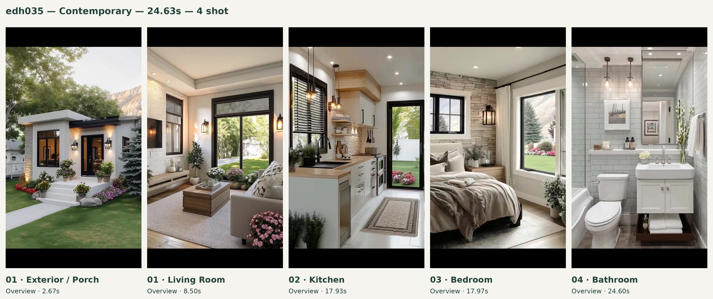
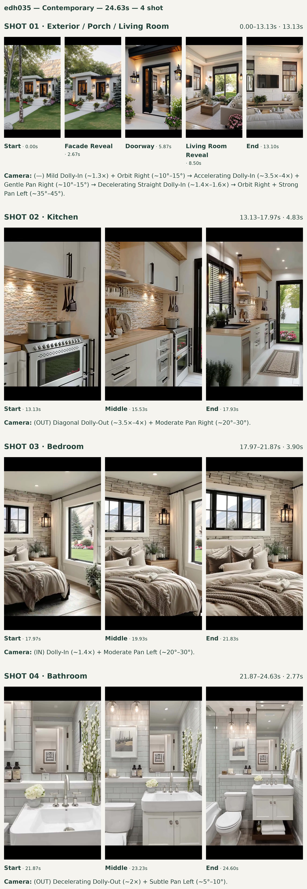
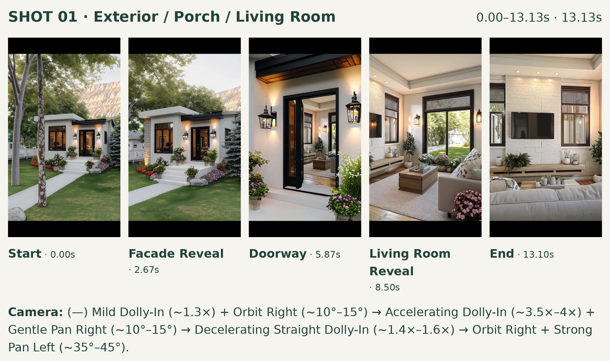
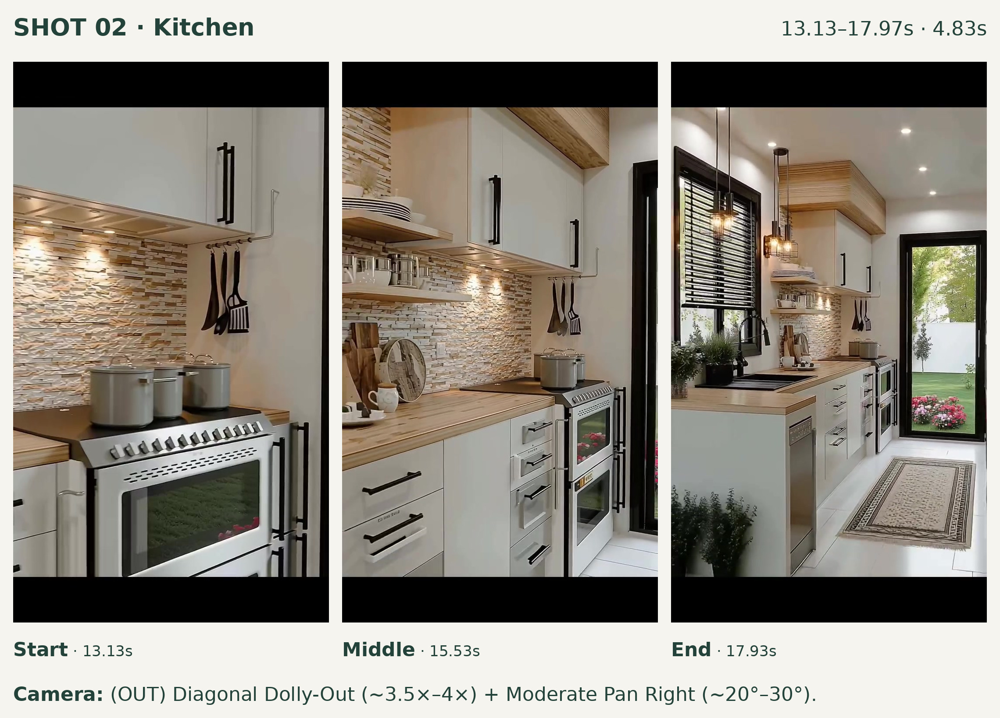
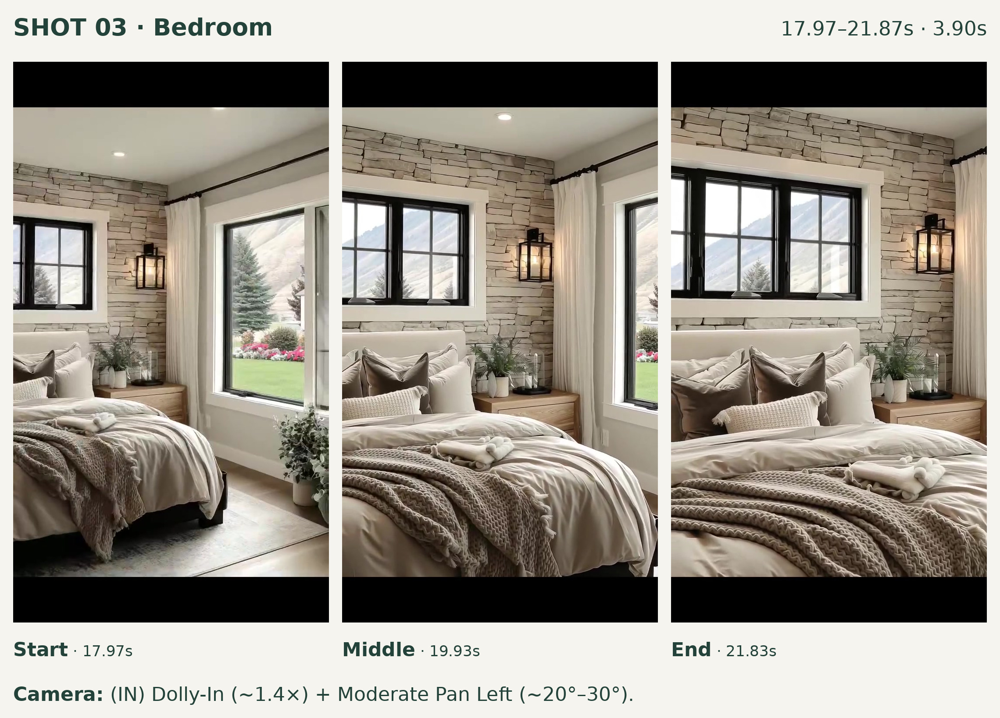
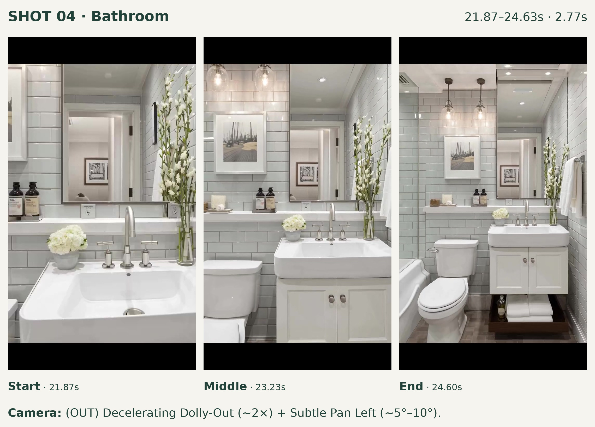

# edh035 — Compact Modern Garden House

## 1. Profil desain

- **Nama desain:** Compact Modern Garden House
- **Tipe rumah:** Bungalow
- **Gaya utama:** **Contemporary**
- **Pengaruh gaya:** Modern Cottage
- **Gaya interior:** Warm Contemporary; Modern Rustic
- **Susunan ruang utama:** Akses teras ke living terlihat kontinu; dapur, kamar dan kamar mandi ditampilkan setelah cut
- **Ciri khas:** Kusen hitam, lampu lentera, dinding aksen bertekstur, furnitur kayu terang
- **Material utama:** Bidang putih hangat, tekstur batu, permukaan tampak kayu, metal gelap
- **Pencahayaan:** Cahaya siang dari kaca besar, lampu dinding hangat, downlight dan lampu kerja
- **Atmosfer:** Terang, hangat, rapi dan dekat taman
- **Lingkungan:** Rumput, pepohonan, bunga, jalan setapak dan latar lereng tampak

### Palet warna

| Peran | Warna | HEX |
| --- | --- | --- |
| Dominan | Putih hangat | `#E5E1D7` |
| Aksen | Hitam arang | `#252626` |
| Pendamping | Kayu madu | `#B58C61` |
| Pendamping | Taupe | `#A89C8D` |
| Pendamping | Abu batu | `#B9B6AC` |
| Aksen | Hijau daun | `#617544` |

## 2. Ukuran & proporsi

| Aspek | Estimasi visual |
| --- | --- |
| **Ukuran rumah** | small |
| **Bentuk bangunan** | Massa rendah dengan bidang fasad bertingkat |
| **Lantai & bentuk atap** | Satu tingkat tampak dari fasad · Tepi atap mendatar dengan overhang gelap dan parapet terang |
| **Tapak bangunan** | Massa depan kompak; denah tidak terlihat |
| **Proporsi utama** | Massa rendah, bidang horizontal dan bukaan tinggi |
| **Perkiraan luas lantai** | **45–85 m²** |

## 3. Shot Timeline

Durasi 24.63s · 4 shot.

**Camera Pattern:** — – OUT – IN – OUT.

| Shot | Time (s) | Duration | Area/Scene | Camera Movement |
| --- | --- | --- | --- | --- |
| 01 | 0.00–13.13 | 13.13s | Exterior / Porch / Living Room | Mild Dolly-In (~1.3×) + Orbit Right (~10°–15°) → Accelerating Dolly-In (~3.5×–4×) + Gentle Pan Right (~10°–15°) → Decelerating Straight Dolly-In (~1.4×–1.6×) → Orbit Right + Strong Pan Left (~35°–45°). |
| 02 | 13.13–17.97 | 4.83s | Kitchen | Diagonal Dolly-Out (~3.5×–4×) + Moderate Pan Right (~20°–30°). |
| 03 | 17.97–21.87 | 3.90s | Bedroom | Dolly-In (~1.4×) + Moderate Pan Left (~20°–30°). |
| 04 | 21.87–24.63 | 2.77s | Bathroom | Decelerating Dolly-Out (~2×) + Subtle Pan Left (~5°–10°). |

## 4. Overview

**Shot 01 · Exterior / Porch · 2.67s**

> Kamera di jalur taman menghadap serong fasad pada tinggi mata; wide memperlihatkan rumput, tangga, teras, pintu dan massa rendah.

**Shot 01 · Living Room · 8.50s**

> Kamera baru masuk ruang keluarga mengarah ke kaca belakang; wide memperlihatkan sofa, meja, karpet, plafon tray dan akses visual taman.

**Shot 02 · Kitchen · 17.93s**

> Kamera di ujung dekat sink menghadap serong sepanjang counter ke pintu kaca belakang; wide mencakup sink, rak, kabinet, kompor, runner dan jalur sirkulasi.

**Shot 03 · Bedroom · 17.97s**

> Kamera dekat kaki ranjang menghadap serong ke headboard dan jendela sisi kanan; wide mencakup ranjang, nakas, dua bukaan dan sebagian lantai.

**Shot 04 · Bathroom · 24.60s**

> Kamera mundur menghadap hampir frontal dinding vanity; wide mencakup toilet kiri, kabinet dan wastafel kanan, cermin, pendant dan tepi kaca/bak.

## 5. Storyboard

## 6. Shot Details

### Shot 01 · Exterior / Porch / Living Room

**Time:** 0.00–13.13s · **Duration:** 13.13s

**Shot Type:** Continuous shot · Multi area · No cut.

#### **A. Desain area**

##### **Exterior**

**Arsitektur**

> Fasad rendah putih hangat, atap bertepi mendatar dan overhang gelap, jendela hitam tinggi; jalur lurus mengarah ke tangga.

**Furnitur & dekorasi**

> Bedeng bunga dan batu dekoratif di tepi jalur.

**Lingkungan**

> Rumput, batang pohon foreground dan pepohonan serta lereng di latar.

##### **Porch**

**Arsitektur**

> Teras bertangga lebar, dinding terang dan pintu kaca hitam; plafon overhang tampak kayu.

**Furnitur & dekorasi**

> Pot tanaman berbunga dan lentera dinding di sisi pintu.

**Lingkungan**

> Teras menghadap taman dan jalur masuk.

##### **Living Room**

**Arsitektur**

> Ruang keluarga dengan plafon tray, dinding aksen putih bertekstur, lantai tampak papan kayu, jendela dan pintu kaca hitam besar.

**Furnitur & dekorasi**

> Sofa krem menghadap TV dinding dengan konsol rendah kayu; meja kopi persegi bertingkat di atas karpet, pot tanaman dan bantal.

**Lingkungan**

> Taman terlihat lewat bukaan besar; lentera dan downlight menambah cahaya hangat.

#### **B. Framing & Lighting**

- **Fokus:** Fasad, pintu, lalu TV
- **Camera Start:** Di taman dekat jalur menuju fasad · Menghadap fasad dan pintu · oblique · Sekitar tinggi mata, perkiraan visual · Relatif datar
- **Framing:** Wide fasad dari balik pohon → Medium wide frontal dinding TV dari belakang sofa
- **Lighting:** Siang tersaring pohon; lampu dinding, downlight hangat
- **Foreground dan kedalaman:** Batang pohon lalu kusen, meja dan sofa · Paralaks taman, ambang dan furnitur
- **Reveal:** Akses ke teras lalu living dan TV
- **Kesesuaian gerak:** Pendekatan dan orbit memperlihatkan hubungan akses, belokan mengungkap TV
- **Area:** Exterior / Porch / Living Room
- **Rute kamera:** Exterior (0.00–4.33s · awal · fasad dan jalur) → Porch (4.33–6.83s · tangga dan teras · pintu kaca) → Living Room (6.83–13.13s · ambang pintu · ruang keluarga dan TV)

**Hubungan antararea**

- **Penghubung area:** Jalur taman menuju tangga teras.; Pintu teras memberi akses ke living room.
- **Peralihan:** Exterior · 0.00–6.83s; Porch · 0.00–7.17s; Living Room · 4.83–13.13s
- **Orientasi ruang:** Satu take kontinu dari taman melalui teras dan ambang ke ruang keluarga.

#### **C. Camera Movement**

Kamera bergerak ke kanan mengitari fasad sambil mendekat ringan, lalu maju lebih cepat ke teras dan pintu. Setelah melewati ambang, pendekatan melambat dan berlanjut menjadi belokan kiri dengan perpindahan badan ke kanan menuju tampak frontal dinding TV.

**Tempo:** Awal pelan, pendekatan pintu semakin cepat, lalu kembali sedang saat di dalam dan mereda di akhir.

- **0.00–2.67s · slow:** Pergerakan lateral dan pendekatan ringan.
- **2.67–6.83s · fast:** Percepatan optis mendekati teras dan pintu.
- **6.83–13.13s · moderate:** Maju lebih lambat lalu berbelok halus menuju dinding TV.

**Movement Timeline**

| Time (s) | Area & fokus | Camera Movement | Tempo |
| --- | --- | --- | --- |
| 0.00–2.67 | Exterior / Porch / Living Room · Fasad dan taman | Mild Dolly-In (~1.3×) + Orbit Right (~10°–15°) | Pergerakan lateral dan pendekatan ringan. |
| 2.67–6.83 | Exterior / Porch / Living Room · Tangga, teras dan ambang pintu | Accelerating Dolly-In (~3.5×–4×) + Gentle Pan Right (~10°–15°) | Percepatan optis mendekati teras dan pintu. |
| 6.83–9.33 | Exterior / Porch / Living Room · Ambang dan living room | Decelerating Straight Dolly-In (~1.4×–1.6×) | Maju lebih lambat lalu berbelok halus menuju dinding TV. |
| 9.33–13.13 | Exterior / Porch / Living Room · Sofa, meja kopi dan dinding TV | Orbit Right + Strong Pan Left (~35°–45°) | Maju lebih lambat lalu berbelok halus menuju dinding TV. |

**Camera:** Mild Dolly-In (~1.3×) + Orbit Right (~10°–15°) → Accelerating Dolly-In (~3.5×–4×) + Gentle Pan Right (~10°–15°) → Decelerating Straight Dolly-In (~1.4×–1.6×) → Orbit Right + Strong Pan Left (~35°–45°).

---

### Shot 02 · Kitchen

**Time:** 13.13–17.97s · **Duration:** 4.83s

#### **A. Desain area**

**Arsitektur**

> Dapur memanjang dengan jalur sirkulasi di kanan bidang kerja; backsplash tampak batu, plafon terang, pintu kaca belakang dan jendela berkerai hitam.

**Furnitur & dekorasi**

> Kabinet putih atas-bawah dengan handle hitam, countertop kayu, kompor oven stainless-look, rak terbuka, sink gelap dekat jendela, pendant dan runner.

**Lingkungan**

> Taman dengan rumput dan bunga terlihat dari pintu; lampu bawah kabinet dan pendant hangat.

#### **B. Framing & Lighting**

- **Fokus:** Kompor, kabinet, sink
- **Camera Start:** Dekat kompor dan counter · Menghadap bidang kerja serong · oblique · Sekitar tinggi mata · Relatif datar
- **Framing:** Close-up kompor dan backsplash → Wide bidang kerja, sink, jalur dan pintu belakang
- **Lighting:** Lampu kerja hangat, pendant dan cahaya pintu
- **Foreground dan kedalaman:** Kompor lalu sisi counter · Penyusutan kompor dan bukaan jalur
- **Reveal:** Sink dan pintu belakang terlihat
- **Kesesuaian gerak:** Dolly-Out dan Pan Right membuka panjang bidang kerja

#### **C. Camera Movement**

Kamera mundur diagonal sepanjang kabinet dari kompor menuju sink, sambil membingkai ulang ke arah ujung dapur.

**Tempo:** Mundur kontinu, perubahan skala menguat di tengah; sapuan dan pembukaan area melambat menjelang akhir.

**Camera:** Diagonal Dolly-Out (~3.5×–4×) + Moderate Pan Right (~20°–30°).

---

### Shot 03 · Bedroom

**Time:** 17.97–21.87s · **Duration:** 3.90s

#### **A. Desain area**

**Arsitektur**

> Kamar dengan dinding aksen bertekstur batu di belakang ranjang, jendela hitam horizontal di atas headboard, kaca besar di kanan dan tirai putih.

**Furnitur & dekorasi**

> Ranjang besar dengan headboard empuk, bantal berlapis, duvet taupe, selimut rajut dan nakas kayu dengan tanaman serta lentera dinding.

**Lingkungan**

> Taman, pohon dan lereng terlihat dari jendela; cahaya siang dominan dengan lentera dan downlight.

#### **B. Framing & Lighting**

- **Fokus:** Ranjang dan dinding aksen
- **Camera Start:** Dekat kaki ranjang · Menghadap serong headboard dan jendela kanan · oblique · Sekitar tinggi mata · Relatif datar
- **Framing:** Wide ranjang dan kaca samping → Medium close ranjang dan headboard frontal
- **Lighting:** Siang jendela dan lentera hangat
- **Foreground dan kedalaman:** Selimut dan kaki ranjang · Ranjang membesar dan jendela samping keluar
- **Reveal:** Tekstur dan bantal menjadi dominan
- **Kesesuaian gerak:** Dolly-In dan Pan Left mengalihkan fokus ke headboard

#### **C. Camera Movement**

Kamera mendekati ranjang sambil menyapu pandangan ke kiri dari jendela samping ke headboard.

**Tempo:** Pendekatan dan sapuan berlangsung kontinu, pertumbuhan skala sedikit mereda pada akhir; sapuan masih berlangsung.

**Camera:** Dolly-In (~1.4×) + Moderate Pan Left (~20°–30°).

---

### Shot 04 · Bathroom

**Time:** 21.87–24.63s · **Duration:** 2.77s

#### **A. Desain area**

**Arsitektur**

> Dinding ubin persegi panjang abu terang, cermin vertikal, lantai cokelat tampak kayu; bidang kaca di kiri dan tepi bak mandi tampak sebagian.

**Furnitur & dekorasi**

> Wastafel putih persegi dengan keran krom, kabinet putih dua pintu dan rak bawah terbuka berisi handuk; toilet di kiri, vas tinggi, bunga, artwork dan dua pendant.

**Lingkungan**

> Pemandangan luar tidak terlihat; penerangan lampu gantung dan downlight, pantulan pintu di cermin.

#### **B. Framing & Lighting**

- **Fokus:** Vanity dan toilet
- **Camera Start:** Dekat wastafel · Menghadap vanity dan cermin · frontal · Sekitar tinggi mata · Relatif datar
- **Framing:** Close-up wastafel dan cermin → Wide vanity, toilet, kaca dan lampu
- **Lighting:** Pendant hangat, downlight dan pantulan
- **Foreground dan kedalaman:** Wastafel dan vas · Mundur memperlihatkan lantai dan toilet
- **Reveal:** Toilet dan rak bawah terlihat
- **Kesesuaian gerak:** Dolly-Out dan Pan Left halus memperluas cakupan

#### **C. Camera Movement**

Kamera mundur dari close-up wastafel ke komposisi lebih lebar yang memuat kloset dan lampu.

**Tempo:** Mundur relatif lancar dan mereda mendekati framing akhir.

**Camera:** Decelerating Dolly-Out (~2×) + Subtle Pan Left (~5°–10°).

**Catatan referensi:** Luas 45–85 m² adalah perkiraan kasar dari proporsi visual, bukan pengukuran atau denah. Material dinilai dari tampilan; lokasi, struktur, hubungan antarshot dan keaslian fisik tidak terverifikasi. Estimasi kamera dan ketidakpastian mengikuti hasil Fase 2 yang disetujui.
