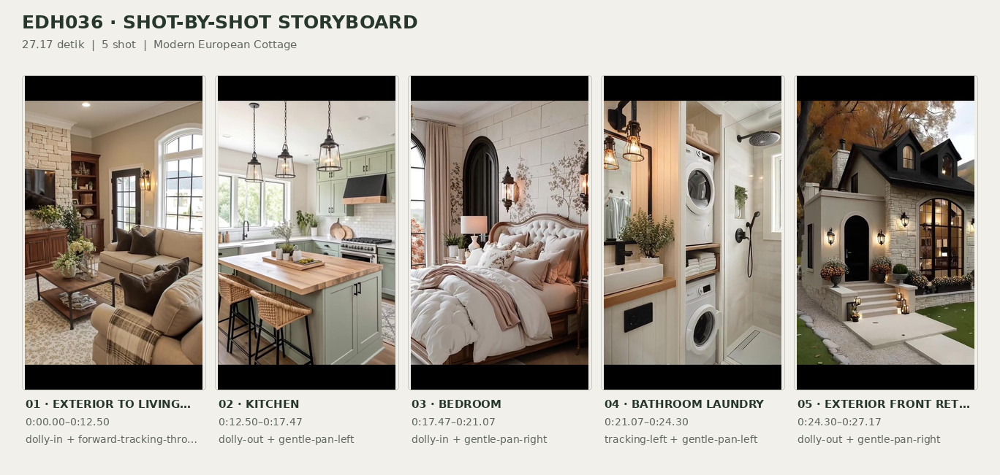
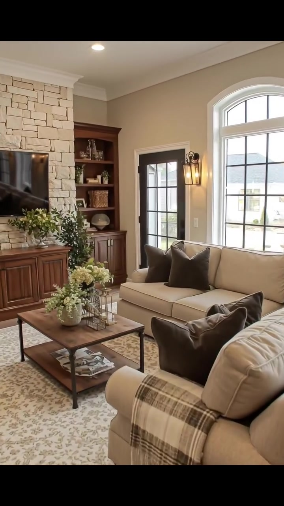
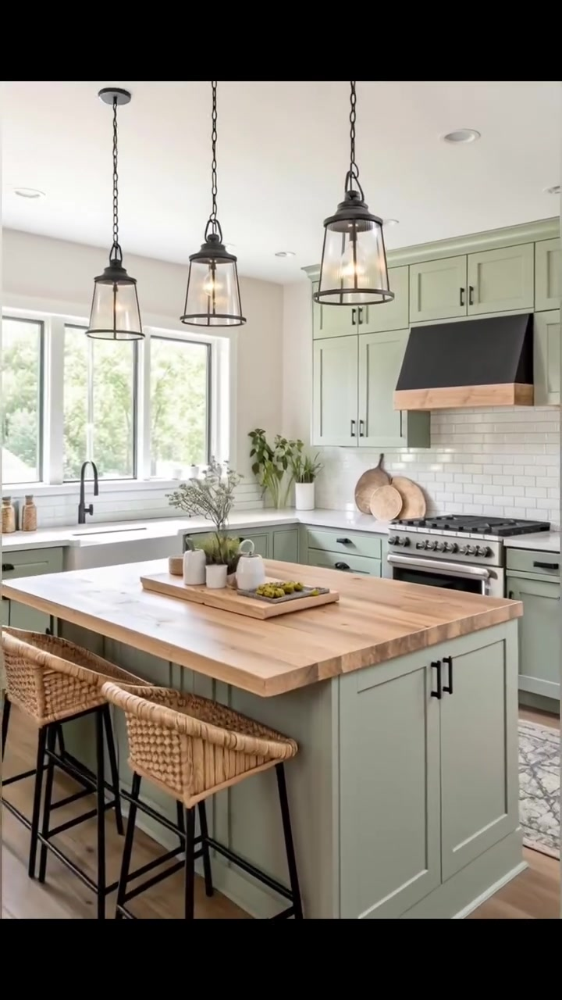
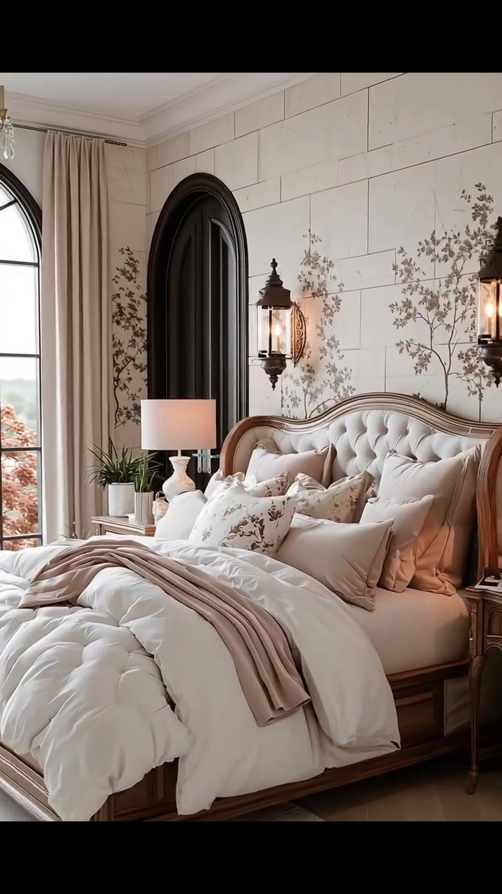
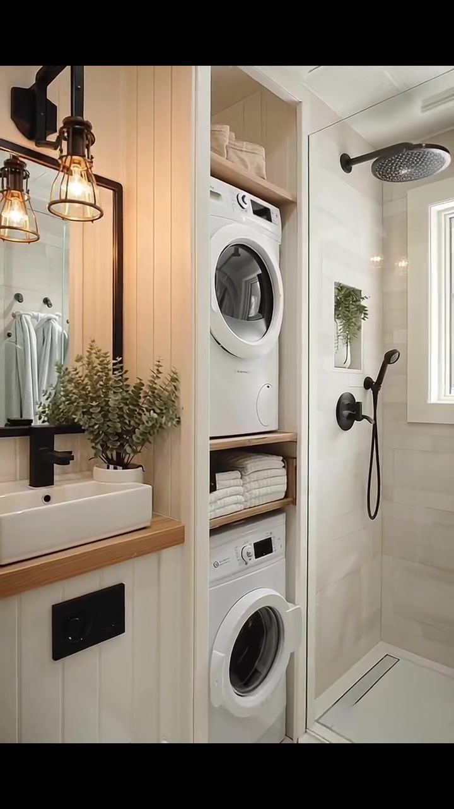
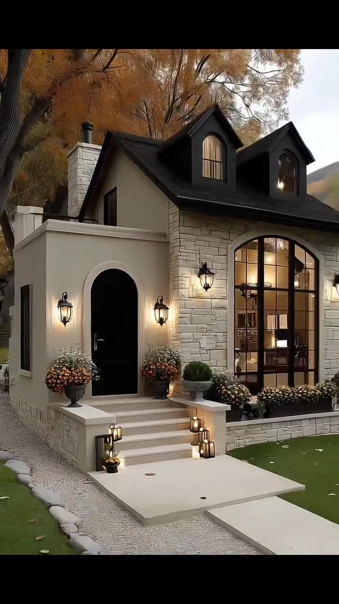

# edh036 — Modern European Cottage

<!-- homeku_request_id: edh036_20261105_df391a3ca -->

<!-- homeku_detail_narratives: chat-reviewed -->

**Sumber data:** [analysis.yaml](analysis.yaml) · **Status:** draft · **Diverifikasi manusia:** Tidak

## 1. Informasi Video

| Informasi | Nilai |
|---|---|
| ID | edh036 |
| File asli | edh036.mp4 |
| Durasi | 27.17 |
| Resolusi | 720x1280 |
| FPS | 30 |
| Rasio | 9:16 |
| Jumlah shot | 5 |

## 2. Storyboard Gabungan

## 3. Identitas Desain

| Aspek | Hasil analisis |
|---|---|
| Gaya utama | modern european cottage |
| Wilayah terkait gaya desain | europe, north america |
| Pengaruh gaya | english country cottage, modern farmhouse, transitional interior |
| Ciri eksterior | steep charcoal gabled roof with dormers, beige rendered entry volume, pale stone front facing, black arched entry door, tall black mullioned arched window, short front stair with masonry parapets, warm black metal lantern sconces |
| Gaya interior | warm transitional living room, rustic farmhouse inspired kitchen, soft classic cottage bedroom, compact white bathroom laundry |
| Confidence gaya | medium |

## 4. Ukuran & Proporsi Bangunan

| Aspek | Estimasi visual |
|---|---|
| Ukuran yang terlihat | medium |
| Bentuk bangunan | compact irregular gabled mass |
| Skala vertikal | single story with possible dormered upper level |
| Tapak bangunan | moderate |
| Perkiraan luas lantai | Tidak diketahui |
| Confidence | low |

> Luas adalah perkiraan visual, bukan ukuran terukur.

## 5. Warna, Pencahayaan, dan Atmosfer

| Warna dominan | HEX (perkiraan) |
|---|---|
| charcoal black | #252629 |
| warm cream | #E6DCCF |
| pale stone | #D7D0C1 |
| soft sage green | #BBC5B2 |
| warm wood brown | #A47E5E |
| rust orange foliage | #B57743 |

| Aspek | Hasil analisis |
|---|---|
| Pencahayaan | soft overcast exterior daylight, warm exterior wall lanterns, bright interior window daylight, warm interior wall and pendant lights |
| Lingkungan | green front lawn, stone paved entry walk, orange brown deciduous trees, low garden plants and flower urns, distant vegetated hillside |
| Musim yang tampak | autumn like foliage |
| Mood | cozy, welcoming, refined, warm, rustic elegance |

## 6. Struktur dan Timeline Video

**Jenis:** architectural home tour · **Tempo:** moderate · **Transisi:** continuous doorway move then four direct cuts

| Shot | Waktu (detik) | Durasi | Area/Scene | Gerakan Kamera |
|---|---|---|---|---|
| Shot 01 | 0.0–12.5 | 12.50 | exterior to living room | dolly in, forward tracking through door, gentle pan right |
| Shot 02 | 12.5–17.47 | 4.97 | kitchen | dolly out, gentle pan left |
| Shot 03 | 17.47–21.07 | 3.60 | bedroom | dolly in, gentle pan right |
| Shot 04 | 21.07–24.3 | 3.23 | bathroom laundry | tracking left, gentle pan left |
| Shot 05 | 24.3–27.17 | 2.87 | exterior front return | dolly out, gentle pan right |

## 7. Analisis per Shot

### Shot 01 — exterior to living room

**Waktu:** 0.0–12.5 detik

| Komponen | Pengamatan |
|---|---|
| Fokus utama | front entry transitioning to living room |
| Framing awal → akhir | wide front three quarter facade → medium wide living room |
| Sudut pandang | eye level with slight upward exterior angle |
| Gerakan kamera | dolly in, forward tracking through door, gentle pan right |
| Kecepatan kamera | moderate |
| Pencahayaan | soft exterior daylight and warm lantern light then bright interior window light |
| Transisi keluar | hard cut to kitchen |

**Detail yang terlihat**

**Arsitektur**

Dari tampak depan terlihat atap pelana curam berwarna arang dengan dua dormer kecil. Massa pintu masuk di kiri berlapis finishing krem, sedangkan bagian fasad kanan menampilkan batu pucat berpola tak beraturan dan jendela lengkung tinggi berbingkai hitam. Pintu depan hitam berbentuk lengkung berada agak masuk ke dalam, dicapai lewat tangga terang dengan dinding samping rendah dan diterangi lampu dinding logam hitam yang menyala hangat. Pintu bergerak membuka ke dalam, memperlihatkan ruang duduk dengan dinding krem, plafon putih berlampu tanam, dinding aksen batu terang, dan lantai berpola papan kayu hangat. Di sisi ruang terdapat jendela lengkung tinggi bersekat putih, pintu kaca berbingkai gelap, rak terbuka bernuansa kayu di samping dinding batu, serta lampu dinding gelap di dekat pintu kaca. Cerobong berwarna batu terang juga tampak menjulang di sisi kiri atap.

**Furnitur dan properti**

Di pintu masuk terdapat pot besar gelap berisi bunga jingga dan putih, tanaman bulat hijau di atas dinding samping tangga, serta beberapa lentera kecil keemasan pada anak tangga. Di ruang duduk, sofa\-sofa krem dengan bantal aksen gelap mengelilingi meja kopi kayu gelap berbentuk persegi panjang dan rak bawah; salah satu lengannya diselimuti kain bermotif kotak netral. Karpet bermotif lembut membingkai area duduk. Meja kopi dihiasi rangkaian bunga dan dedaunan, sementara televisi layar datar gelap terpasang pada dinding batu di atas kabinet kayu hangat. Rak kayu memuat buku, vas kecil, dan tanaman hijau, dengan tanaman tambahan di sekitar kabinet.

**Lingkungan**

Di luar rumah tampak pohon besar berdaun cokelat\-jingga di sisi kiri dan tajuk daun jingga menaungi bagian atap. Halaman depan berumput hijau, dengan paving beton pucat lurus menuju tangga dan hamparan kerikil abu\-abu di tepinya. Semak rendah serta bunga\-bunga kecil gelap berada di bawah jendela lengkung. Beberapa daun kuning berguguran di rumput, sementara lereng bervegetasi kecokelatan terlihat jauh di belakang rumah dan langit pucat keabu\-abuan mengintip di antara tajuk pohon.

**Catatan pengamatan:** Opening front-facade view advances toward the black arched door, which opens and reveals the living room; no abrupt cut is visible at the doorway.

**Confidence:** Kamera high · Detail visual high

### Shot 02 — kitchen

**Waktu:** 12.5–17.47 detik

| Komponen | Pengamatan |
|---|---|
| Fokus utama | sage green cabinetry and wood topped island |
| Framing awal → akhir | medium kitchen range and island counter → wide kitchen with full island and stools |
| Sudut pandang | eye level to slightly elevated |
| Gerakan kamera | dolly out, gentle pan left |
| Kecepatan kamera | slow |
| Pencahayaan | bright daylight from side windows and warm pendant lights |
| Transisi keluar | hard cut to bedroom |

**Detail yang terlihat**

**Arsitektur**

Dapur menggunakan kabinet atas dan bawah model Shaker berwarna hijau sage pucat dengan tarikan logam hitam. Backsplash ubin persegi panjang putih berada di belakang kompor logam keperakan, yang di atasnya terpasang tudung pengisap gelap bertepi logam hangat. Island besar beralas hijau sage dan permukaan menyerupai kayu terang menempati bagian depan ruang. Di sisi kiri, jendela berbingkai putih menerangi wastafel putih dengan keran tinggi gelap. Tiga lampu gantung logam hitam berkaca menggantung di atas island; plafon putih juga memiliki lampu tanam kecil, sedangkan lantainya terlihat seperti papan kayu berwarna terang.

**Furnitur dan properti**

Dua kursi tinggi dengan dudukan anyaman rotan dan rangka logam gelap berada di sisi island. Di atas permukaannya terlihat baki kayu dangkal berisi buah sitrus kuning, wadah keramik putih kecil, serta tanaman hijau. Dua talenan kayu bundar disandarkan di dekat kompor, sementara tanaman berdaun hijau, stoples keramik, dan tanaman kecil lainnya ditempatkan di countertop dekat jendela dan wastafel.

**Lingkungan**

Rimbunan daun hijau di luar terlihat melalui jendela\-jendela dapur.

**Catatan pengamatan:** The view expands from the cooktop and worktop to a wider kitchen, showing the island and woven stools.

**Confidence:** Kamera high · Detail visual high

### Shot 03 — bedroom

**Waktu:** 17.47–21.07 detik

| Komponen | Pengamatan |
|---|---|
| Fokus utama | tufted cream bed against pale feature wall |
| Framing awal → akhir | wide bedroom showing window and bed → closer bed and headboard view |
| Sudut pandang | eye level |
| Gerakan kamera | dolly in, gentle pan right |
| Kecepatan kamera | slow |
| Pencahayaan | soft window daylight mixed with warm bedside lighting |
| Transisi keluar | hard cut to bathroom laundry |

**Detail yang terlihat**

**Arsitektur**

Di belakang ranjang terdapat dinding aksen pucat dengan pola blok persegi panjang besar dan motif cabang berbunga yang halus. Sebuah bukaan atau ceruk lengkung gelap berada di kiri ranjang, sedangkan jendela lengkung bersekat hitam tampak lebih jauh di kiri. Dinding krem, lis plafon putih, dan lantai bernuansa terang membingkai ruangan. Lampu dinding logam gelap bergaya lentera terpasang pada kedua sisi area ranjang.

**Furnitur dan properti**

Ranjang berbingkai kayu hangat memiliki sandaran kepala melengkung dengan pelapis krem berkancing. Selimut tebal putih berlapis dan beberapa bantal krem memenuhi ranjang, ditambah bantal aksen bermotif bunga kecil serta selimut lempar warna taupe pada bagian ujung. Di kedua sisi terdapat meja nakas, masing\-masing dengan lampu berkap warna terang; meja kiri tampak berbahan kayu bernuansa hangat. Karpet krem muda terlihat memanjang dari bawah ranjang.

**Lingkungan**

Melalui jendela lengkung di sisi kiri tampak pepohonan luar dengan dedaunan jingga.

**Catatan pengamatan:** A gradual forward movement emphasizes the layered bedding and curved tufted headboard.

**Confidence:** Kamera high · Detail visual high

### Shot 04 — bathroom laundry

**Waktu:** 21.07–24.3 detik

| Komponen | Pengamatan |
|---|---|
| Fokus utama | compact vanity shower and vertical laundry tower |
| Framing awal → akhir | wide combined bathroom laundry view → closer vanity and stacked appliances |
| Sudut pandang | eye level |
| Gerakan kamera | tracking left, gentle pan left |
| Kecepatan kamera | moderate |
| Pencahayaan | warm mirror sconces and bright window daylight |
| Transisi keluar | hard cut to exterior entry |

**Detail yang terlihat**

**Arsitektur**

Ruangan putih yang kompak menggabungkan kamar mandi dan area laundry. Area wastafel memiliki panel dinding vertikal putih, baskom persegi panjang putih di atas permukaan kayu terang, keran dinding hitam, cermin tinggi berbingkai hitam, serta dua lampu dinding hitam yang menyala hangat. Kloset putih terletak di bawah panel siram gelap. Di dekatnya terdapat area shower berubin putih dengan sekat kaca bening, shower bundar hitam di atas dan selang pancuran tangan, serta jendela kecil berbingkai putih. Di sisi lain, mesin cuci dan pengering bukaan depan berwarna putih tersusun vertikal dalam kabinet terbuka, dengan rak\-rak kayu terang di antaranya.

**Furnitur dan properti**

Rak terbuka menyimpan handuk putih yang terlipat. Di dekat cermin tergantung handuk kecil abu\-abu kebiruan; pada sudut meja wastafel terdapat tanaman hijau kecil, dispenser sabun gelap, dan perlengkapan kamar mandi berwarna putih.

**Lingkungan**

Cahaya dari luar masuk melalui jendela shower yang memperlihatkan daun\-daun hijau.

**Catatan pengamatan:** The camera traverses a compact multipurpose room, revealing the shower, vertical laundry tower, and close-up of vanity.

**Confidence:** Kamera high · Detail visual medium

### Shot 05 — exterior front return

**Waktu:** 24.3–27.17 detik

| Komponen | Pengamatan |
|---|---|
| Fokus utama | black arched entrance and front facade |
| Framing awal → akhir | close front door and lanterns → wide front three quarter facade |
| Sudut pandang | eye level with slight upward roof view |
| Gerakan kamera | dolly out, gentle pan right |
| Kecepatan kamera | moderate |
| Pencahayaan | soft exterior daylight with warm illuminated entry lanterns |
| Transisi keluar | end of video |

**Detail yang terlihat**

**Arsitektur**

Kamera kembali menampilkan pintu depan hitam berbentuk lengkung yang menjorok ke dalam dengan bingkai dinding pucat. Dua lampu dinding hitam menyala di sampingnya. Tangga pendek berwarna terang dibatasi dua dinding samping rendah, sementara fasad utama memakai lapisan batu pucat bertekstur. Di kanan pintu terdapat jendela lengkung tinggi bersekat hitam. Atap pelana berwarna arang memiliki dua dormer kecil; dinding segitiga di bawah atap bernuansa beige, dan cerobong batu terang terlihat pada sisi kiri belakang atap.

**Furnitur dan properti**

Pot besar gelap dengan bunga putih dan jingga menghiasi pintu masuk. Beberapa lentera kecil bercahaya keemasan ditempatkan di atas anak tangga, dan pot tanaman hijau bulat berada di dinding samping tangga.

**Lingkungan**

Pohon besar berdaun jingga berdiri di sebelah kiri rumah, dengan tajuk jingga lainnya menaungi atap dormer. Halaman hijau memperlihatkan sejumlah daun gugur, jalur paving terang yang diapit kerikil, serta hamparan tanaman rendah di bawah jendela depan. Lereng dengan vegetasi cokelat kehijauan tampak di kejauhan di balik garis atap kanan.

**Catatan pengamatan:** After an abrupt return to the front door, the camera recedes to reveal the building facade and garden again.

**Confidence:** Kamera high · Detail visual high

## 8. Kualitas dan Ketidakpastian Analisis

| Parameter | Hasil |
|---|---|
| Status | draft |
| Verifikasi manusia | Tidak |
| Ketepatan timestamp | estimated |
| Ketidakpastian | style region associations are not building location, floor area cannot be reliably inferred from partial exterior, dormers do not confirm an occupied upper floor, several stone wood and tile materials are visual appearances only, autumn like foliage does not confirm season or country, video is not independently verified as unedited real footage |

**Catatan:** Shot boundaries are estimated from 30 FPS visual frame changes at approximately 12.50, 17.47, 21.07, and 24.30 seconds. First sequence passes through the entrance without a detectable hard cut. Visual stream duration is 27.167 s; container duration is 27.282 s due to a longer audio stream, which was not analyzed.

---

*Laporan ini diturunkan dari [analysis.yaml](analysis.yaml).*
