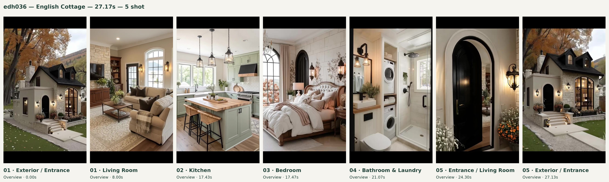
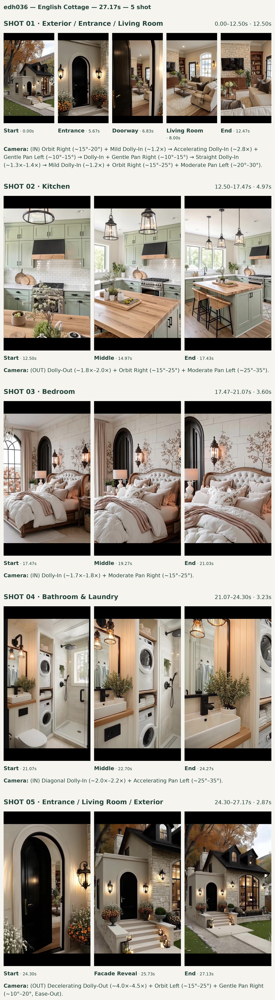
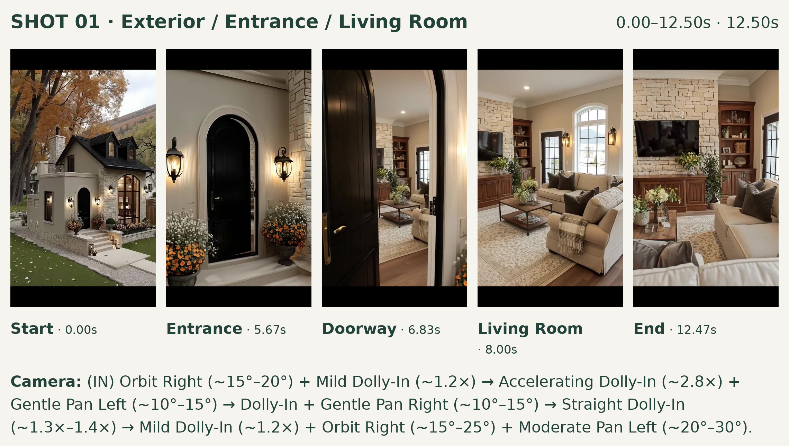
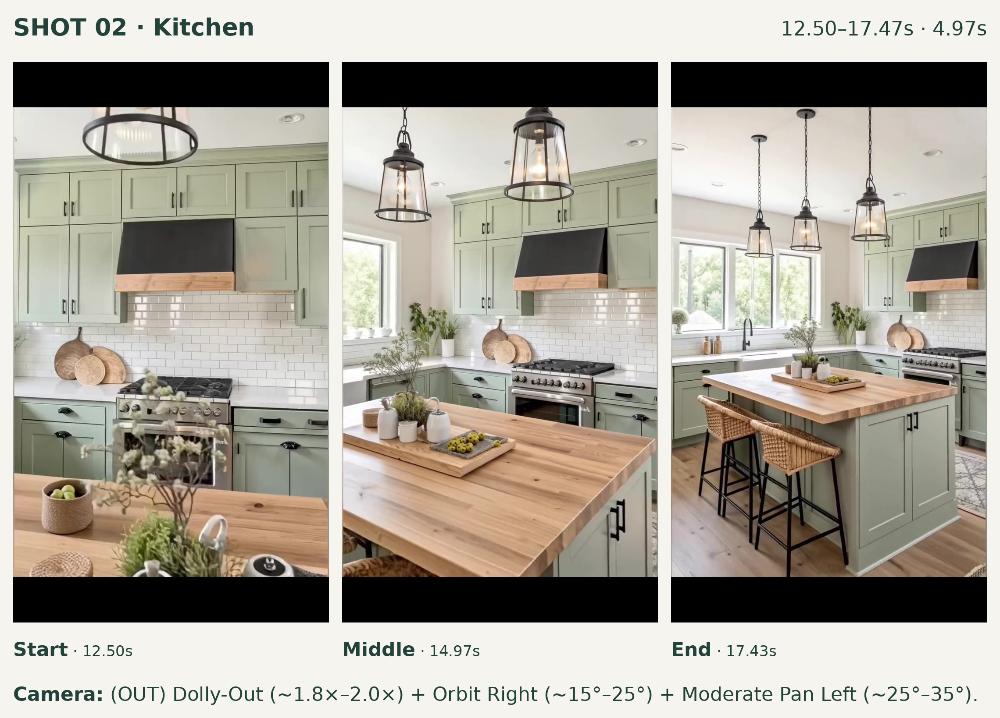
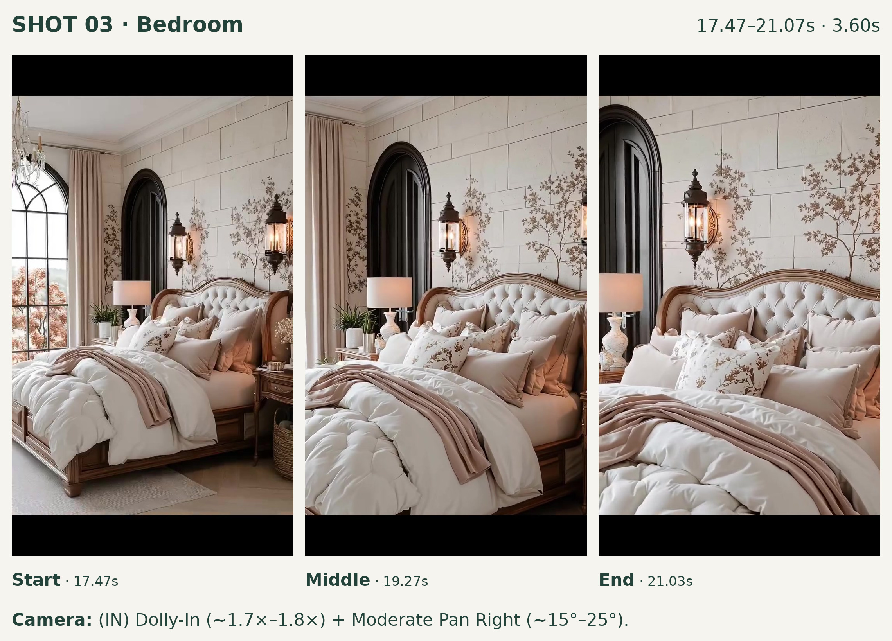
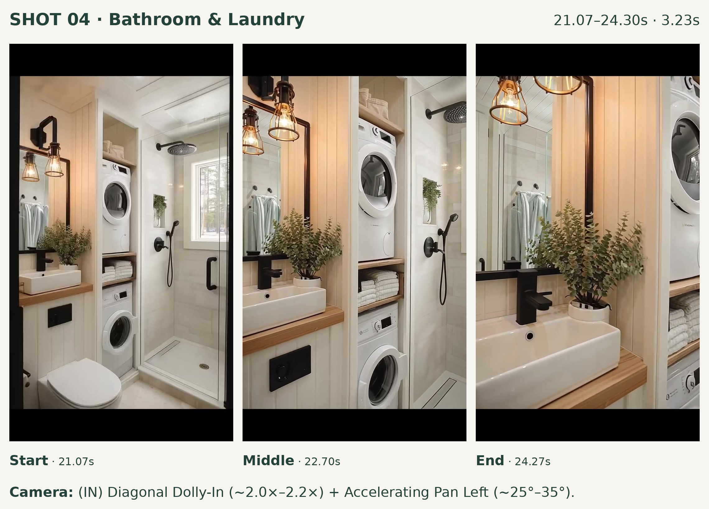
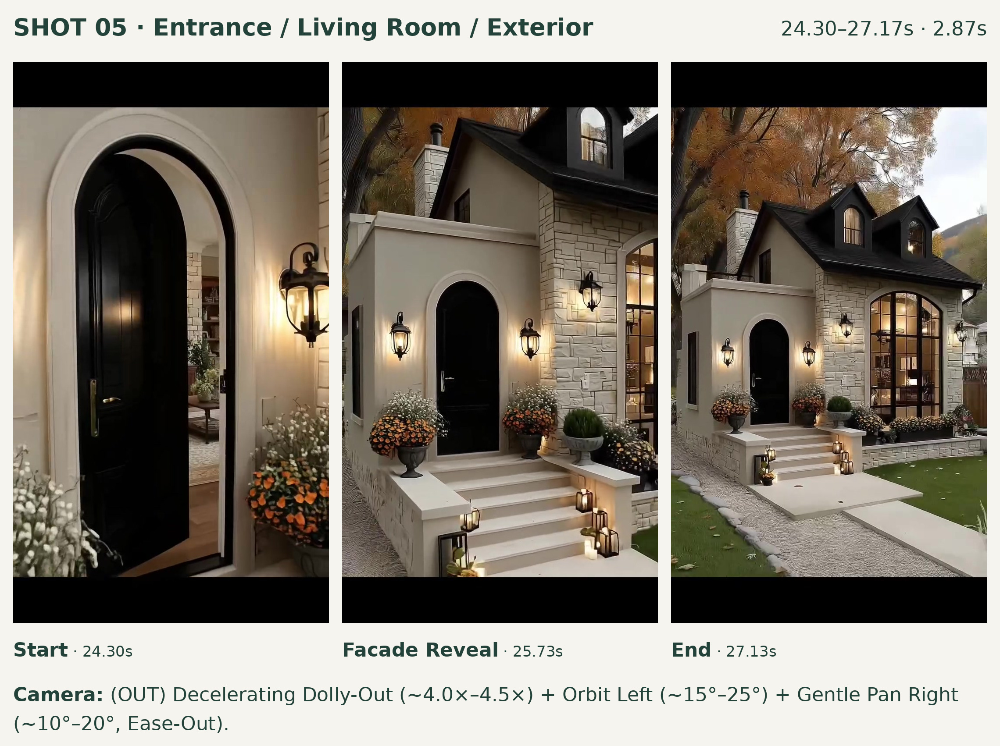

# edh036 — Autumn Stone & Sage Cottage

## 1. Profil desain

- **Nama desain:** Autumn Stone & Sage Cottage
- **Tipe rumah:** Cottage
- **Gaya utama:** **English Cottage**
- **Pengaruh gaya:** Storybook Cottage
- **Gaya interior:** Traditional Cottage; Modern Farmhouse
- **Susunan ruang utama:** Entrance membuka langsung ke ruang duduk; dapur, kamar tidur dan ruang mandi/laundry ditampilkan lewat cut, koneksinya tidak diketahui.
- **Ciri khas:** Lengkung berulang, batu terang, cabinetry sage dan laundry tower terintegrasi.
- **Material utama:** Plester krem dan batu terang tampak pada fasad; kayu, panel sage, tekstil lembut dan aksen hitam di dalam.
- **Pencahayaan:** Cahaya siang difus melalui bukaan, dipadu lantern hangat, pendant, recessed light dan lampu meja.
- **Atmosfer:** Hangat, tenang, tradisional dengan detail dekorasi berlapis.
- **Lingkungan:** Rumput hijau, jalan kerikil, pepohonan berdaun jingga dan bukit di kejauhan.

### Palet warna

| Peran | Warna | HEX |
| --- | --- | --- |
| Dominan | Warm Ivory | `#E4DCD0` |
| Pendamping | Sandstone Beige | `#C5B49C` |
| Aksen | Charcoal Black | `#252321` |
| Pendamping | Sage Green | `#A7AE99` |
| Pendamping | Honey Oak | `#B78D62` |
| Aksen | Walnut Brown | `#79553D` |

## 2. Ukuran & proporsi

| Aspek | Estimasi visual |
| --- | --- |
| **Ukuran rumah** | small |
| **Bentuk bangunan** | Massa utama berpelana dengan volume entrance lebih rendah. |
| **Lantai & bentuk atap** | 1–1.5 storeys · Atap pelana gelap curam, dua dormer depan dan cerobong di sisi kiri. |
| **Tapak bangunan** | compact rectangular main mass with entrance projection |
| **Proporsi utama** | Massa utama tinggi dengan atap curam; entrance rendah menjorok di depan, bukaan besar vertikal. |
| **Perkiraan luas lantai** | **55–95 m²** |

## 3. Shot Timeline

Durasi 27.17s · 5 shot.

**Camera Pattern:** IN – OUT – IN – IN – OUT.

| Shot | Time (s) | Duration | Area/Scene | Camera Movement |
| --- | --- | --- | --- | --- |
| 01 | 0.00–12.50 | 12.50s | Exterior / Entrance / Living Room | Orbit Right (~15°–20°) + Mild Dolly-In (~1.2×) → Accelerating Dolly-In (~2.8×) + Gentle Pan Left (~10°–15°) → Dolly-In + Gentle Pan Right (~10°–15°) → Straight Dolly-In (~1.3×–1.4×) → Mild Dolly-In (~1.2×) + Orbit Right (~15°–25°) + Moderate Pan Left (~20°–30°). |
| 02 | 12.50–17.47 | 4.97s | Kitchen | Dolly-Out (~1.8×–2.0×) + Orbit Right (~15°–25°) + Moderate Pan Left (~25°–35°). |
| 03 | 17.47–21.07 | 3.60s | Bedroom | Dolly-In (~1.7×–1.8×) + Moderate Pan Right (~15°–25°). |
| 04 | 21.07–24.30 | 3.23s | Bathroom & Laundry | Diagonal Dolly-In (~2.0×–2.2×) + Accelerating Pan Left (~25°–35°). |
| 05 | 24.30–27.17 | 2.87s | Entrance / Living Room / Exterior | Decelerating Dolly-Out (~4.0×–4.5×) + Orbit Left (~15°–25°) + Gentle Pan Right (~10°–20°, Ease-Out). |

## 4. Overview

**Shot 01 · Exterior / Entrance · 0.00s**

> Kamera dari jalur depan agak kiri, menghadap serong ke fasad pada tinggi kira-kira mata; wide mencakup atap, dormer, tangga, jendela, rumput dan pohon.

**Shot 01 · Living Room · 8.00s**

> Kamera tepat di dalam pintu menghadap serong ke TV dan jendela; wide menunjukkan dua sofa, meja, karpet, dinding batu, storage dan bukaan kanan.

**Shot 02 · Kitchen · 17.43s**

> Kamera di sisi luar island menghadap serong ke range dan jendela kiri; wide menunjukkan kabinet L, meja island, dua bangku dan tiga pendant.

**Shot 03 · Bedroom · 17.47s**

> Dari sudut kaki ranjang sebelah kiri, pandangan serong ke headboard; wide menampilkan hampir seluruh ranjang, jendela lengkung, gorden dan meja samping.

**Shot 04 · Bathroom & Laundry · 21.07s**

> Dari ambang dengan tepi pintu gelap, menghadap serong ke laundry tower dan shower kanan; wide mencakup vanity kiri, toilet, kedua mesin dan shower.

**Shot 05 · Entrance / Living Room · 24.30s**

> Dari luar dekat ambang, pandangan frontal ke pintu lengkung yang masih terbuka sebagian; living room hanya terlihat melalui celah pintu, bukan wide penuh. Pot bunga dan lantern membingkai akses.

**Shot 05 · Exterior / Entrance · 27.13s**

> Kamera mundur ke jalur depan agak kiri, pandangan serong pada fasad; wide menunjukkan pintu, tangga, jendela lengkung, dormer, halaman dan pepohonan.

## 5. Storyboard

## 6. Shot Details

### Shot 01 · Exterior / Entrance / Living Room

**Time:** 0.00–12.50s · **Duration:** 12.50s

**Shot Type:** Continuous shot · Multi area · No cut.

#### **A. Desain area**

##### **Exterior**

**Arsitektur**

> Massa utama berpelana curam dengan dua dormer depan, cerobong sisi kiri dan volume entrance datar lebih rendah. Fasad krem halus berpasangan dengan bidang batu terang dan jendela tinggi lengkung ber-grid hitam.

**Furnitur & dekorasi**

> Pot, semak rendah dan lampu dinding bergaya lantern menghiasi muka rumah.

**Lingkungan**

> Halaman rumput, jalan setapak terang dan kerikil samping; pohon berdaun jingga, bukit di belakang.

##### **Entrance**

**Arsitektur**

> Pintu hitam lengkung dalam ceruk berbingkai krem; tangga pendek dari halaman menuju ambang.

**Furnitur & dekorasi**

> Lantern di kedua sisi, pot bunga putih-jingga dan lentera kecil di tangga.

**Lingkungan**

> Ambang menghadap jalur masuk halaman; pintu membuka dan memperlihatkan living room.

##### **Living Room**

**Arsitektur**

> Dinding aksen batu terang dengan TV, kabinet kayu dan rak ceruk; dinding krem dan bukaan tinggi lengkung putih, pintu kaca grid gelap, lantai tampak kayu.

**Furnitur & dekorasi**

> Sofa krem berbantal cokelat saling menghadap meja kopi persegi panjang kayu berkaki gelap; karpet motif terang, throw kotak, vas bunga, TV dan storage kayu gelap.

**Lingkungan**

> Cahaya jendela bercampur lampu dinding hangat dan recessed light; luar hanya tampak melalui kaca.

#### **B. Framing & Lighting**

- **Fokus:** Pintu lengkung lalu living room
- **Camera Start:** Jalur depan agak kiri rumah · Serong ke entrance dan fasad depan · oblique · Sekitar tinggi mata, estimasi · Hampir datar, sedikit perspektif ke atas pada fasad
- **Framing:** Wide exterior dengan massa utuh → Medium wide living room dengan sofa depan dan TV
- **Lighting:** Daylight difus dan lampu lantern; interior hangat
- **Foreground dan kedalaman:** Jalur, rumput dan tangga; kemudian daun pintu dan sofa · Fasad menuju ambang lalu TV di belakang meja
- **Reveal:** Interior terungkap saat pintu membuka
- **Kesesuaian gerak:** Orbit dan dolly-in membuka fasad, pendekatan pintu dan parallax sofa; pan mengarahkan fokus
- **Area:** Exterior / Entrance / Living Room
- **Rute kamera:** Exterior (0.00–5.67s · front path · Fasad) → Entrance (5.67–7.67s · arched doorway · Ambang) → Living Room (7.67–12.50s · interior passage · Sofa dan TV)

**Hubungan antararea**

- **Penghubung area:** —
- **Peralihan:** Exterior · 0.00–5.67s; Entrance · 0.00–7.67s; Living Room · 6.23–12.50s
- **Orientasi ruang:** Satu take dari halaman melewati ambang ke living room.

#### **C. Camera Movement**

Mengitari fasad ke kanan sambil sedikit mendekat, kemudian maju lebih cepat ke pintu, menembus ambang, masuk ke ruang duduk dan mengitari sisi sofa sambil menyapu kiri ke TV.

**Tempo:** Awal relatif pelan; pendekatan luar semakin cepat, melambat relatif saat melewati ambang dan interior; sapuan akhir sedang.

**Alur visual:** Exterior → Entrance → Living Room dalam satu take.

**Movement Timeline**

| Time (s) | Area & fokus | Camera Movement | Tempo |
| --- | --- | --- | --- |
| 0.00–3.33 | Exterior / Entrance / Living Room · Fasad dan jalur masuk | Orbit Right (~15°–20°) + Mild Dolly-In (~1.2×) | Awal relatif pelan; pendekatan luar semakin cepat, melambat relatif saat melewati ambang dan interior; sapuan akhir sedang. |
| 3.33–5.67 | Exterior / Entrance / Living Room · Tangga dan pintu lengkung | Accelerating Dolly-In (~2.8×) + Gentle Pan Left (~10°–15°) | Awal relatif pelan; pendekatan luar semakin cepat, melambat relatif saat melewati ambang dan interior; sapuan akhir sedang. |
| 5.67–7.67 | Exterior / Entrance / Living Room · Ambang pintu menuju ruang duduk | Dolly-In + Gentle Pan Right (~10°–15°) | Awal relatif pelan; pendekatan luar semakin cepat, melambat relatif saat melewati ambang dan interior; sapuan akhir sedang. |
| 7.67–9.83 | Exterior / Entrance / Living Room · Meja kopi dan sofa | Straight Dolly-In (~1.3×–1.4×) | Awal relatif pelan; pendekatan luar semakin cepat, melambat relatif saat melewati ambang dan interior; sapuan akhir sedang. |
| 9.83–12.50 | Exterior / Entrance / Living Room · Sofa foreground dan TV | Mild Dolly-In (~1.2×) + Orbit Right (~15°–25°) + Moderate Pan Left (~20°–30°) | Awal relatif pelan; pendekatan luar semakin cepat, melambat relatif saat melewati ambang dan interior; sapuan akhir sedang. |

**Camera:** Orbit Right (~15°–20°) + Mild Dolly-In (~1.2×) → Accelerating Dolly-In (~2.8×) + Gentle Pan Left (~10°–15°) → Dolly-In + Gentle Pan Right (~10°–15°) → Straight Dolly-In (~1.3×–1.4×) → Mild Dolly-In (~1.2×) + Orbit Right (~15°–25°) + Moderate Pan Left (~20°–30°).

---

### Shot 02 · Kitchen

**Time:** 12.50–17.47s · **Duration:** 4.97s

#### **A. Desain area**

**Arsitektur**

> Kabinet panel sage hingga tinggi dinding, bidang backsplash ubin putih subway dan countertop terang; kabinet berbelok pada dinding jendela kiri. Lantai bermotif papan kayu.

**Furnitur & dekorasi**

> Range dan hood hitam bertrim kayu di tengah kabinet belakang; meja island sage dengan top kayu dan dua bangku anyaman berbingkai hitam, tiga pendant lantern di atas.

**Lingkungan**

> Daylight dari jendela memperlihatkan vegetasi luar; pendant dan lampu plafon memperkuat nuansa hangat.

#### **B. Framing & Lighting**

- **Fokus:** Island dan range
- **Camera Start:** Dekat sisi meja kerja di depan range · Ke range dan kabinet belakang · oblique · Sekitar tinggi mata · Hampir datar
- **Framing:** Medium range dan countertop → Wide kitchen dengan island lengkap
- **Lighting:** Daylight kiri dan pendant hangat
- **Foreground dan kedalaman:** Top kayu, tray dan bunga · Island menuju kabinet dan backsplash
- **Reveal:** Jendela kiri dan bangku terungkap
- **Kesesuaian gerak:** Dolly-out dan orbit memberi cakupan lebih lebar; pan menjaga kabinet

#### **C. Camera Movement**

Mundur dari kompor dan island sambil mengitari island ke kanan dan menyapu pandangan ke kiri hingga jendela serta kursi terlihat.

**Tempo:** Mundur konsisten, sapuan meningkat pada tengah dan mereda di akhir; perubahan skala perspektif tidak identik dengan kecepatan badan.

**Camera:** Dolly-Out (~1.8×–2.0×) + Orbit Right (~15°–25°) + Moderate Pan Left (~25°–35°).

---

### Shot 03 · Bedroom

**Time:** 17.47–21.07s · **Duration:** 3.60s

#### **A. Desain area**

**Arsitektur**

> Dinding terang berblok dengan motif cabang bunga, bukaan tinggi ber-grid lengkung di kiri dan elemen lengkung hitam di belakang sisi ranjang; lantai bernuansa kayu.

**Furnitur & dekorasi**

> Ranjang kayu dengan headboard lengkung upholstered tufted, bedding putih berlapis, throw dusty rose dan bantal motif floral. Meja dan lampu samping serta lantern dinding mengapit area headboard.

**Lingkungan**

> Cahaya dari jendela kiri, daun jingga terlihat di luar, aksen lampu hangat di sekitar ranjang.

#### **B. Framing & Lighting**

- **Fokus:** Headboard dan bedding
- **Camera Start:** Sudut dekat kaki ranjang · Serong menuju headboard · oblique · Sekitar tinggi mata · Sedikit mengarah ke bawah secara visual
- **Framing:** Wide ranjang dan jendela → Close medium headboard dan bedding
- **Lighting:** Daylight kiri dan lantern hangat
- **Foreground dan kedalaman:** Ujung ranjang dan bedding · Ranjang menuju dinding bermotif
- **Reveal:** Detail tufting dan lampu semakin dominan
- **Kesesuaian gerak:** Dolly-in memperbesar ranjang, pan kanan mengurangi cakupan jendela

#### **C. Camera Movement**

Maju menuju tempat tidur dengan sapuan kanan ringan hingga detail headboard dan lampu dinding memenuhi frame.

**Tempo:** Pendekatan halus dengan sapuan horizontal makin jelas di paruh akhir; tidak ada jeda nyata.

**Camera:** Dolly-In (~1.7×–1.8×) + Moderate Pan Right (~15°–25°).

---

### Shot 04 · Bathroom & Laundry

**Time:** 21.07–24.30s · **Duration:** 3.23s

#### **A. Desain area**

**Arsitektur**

> Ruang kompak menyatukan mandi dan laundry; vanity kiri, toilet dekat foreground, kolom laundry tengah, shower kaca di kanan dengan lantai dan dinding terang. Panel vertikal hangat membingkai vanity.

**Furnitur & dekorasi**

> Wastafel vessel persegi putih di atas top kayu, keran hitam, cermin berbingkai hitam, lampu kaca hangat; dua mesin front load dipisah rak handuk, shower rainfall hitam dengan hand shower, toilet putih.

**Lingkungan**

> Cahaya dari jendela shower dan lampu vanity hangat; vegetasi luar samar, tidak ada informasi denah lanjutan.

#### **B. Framing & Lighting**

- **Fokus:** Vanity dan laundry
- **Camera Start:** Ambang ruang mandi · Serong ke laundry dan shower · oblique · Sekitar tinggi mata · Hampir datar
- **Framing:** Wide bathroom & laundry dari ambang → Close medium vanity dan sebagian laundry
- **Lighting:** Daylight dari shower, lampu vanity hangat
- **Foreground dan kedalaman:** Tepi doorway dan toilet · Vanity dan tower menuju shower berjendela
- **Reveal:** Wastafel, cermin dan top kayu menjadi fokus
- **Kesesuaian gerak:** Dolly-in dan pan kiri menggeser shower keluar, detail vanity membesar

#### **C. Camera Movement**

Mendekati vanity dari doorway dengan sapuan kiri yang meningkat; shower keluar ke kanan.

**Tempo:** Maju halus; sapuan kiri lebih lambat awal dan meningkat menuju akhir.

**Camera:** Diagonal Dolly-In (~2.0×–2.2×) + Accelerating Pan Left (~25°–35°).

---

### Shot 05 · Entrance / Living Room / Exterior

**Time:** 24.30–27.17s · **Duration:** 2.87s

**Shot Type:** Continuous shot · Multi area · No cut.

#### **A. Desain area**

##### **Entrance**

**Arsitektur**

> Pintu lengkung hitam menutup saat kamera mundur; anak tangga dan jalur masuk terlihat.

**Furnitur & dekorasi**

> Pot bunga putih dan jingga, lantern dinding dan lentera tangga.

**Lingkungan**

> Living room terlihat sekilas melalui pintu sebelum menutup.

##### **Living Room**

**Arsitektur**

> Ruang duduk hanya terlihat sebagian di balik pintu lengkung pada awal shot.

**Furnitur & dekorasi**

> Tampak sebagian furnitur krem dan rak kayu di balik pintu.

**Lingkungan**

> Cakupan sangat terbatas; cahaya interior hangat.

##### **Exterior**

**Arsitektur**

> Massa pelana dan dua dormer gelap kembali terlihat, bidang batu terang dan jendela lengkung tinggi di kanan entrance.

**Furnitur & dekorasi**

> Tanaman rendah dan lantern pada fasad.

**Lingkungan**

> Rumput, kerikil, jalur terang, pohon jingga.

#### **B. Framing & Lighting**

- **Fokus:** Entrance lalu fasad
- **Camera Start:** Dekat ambang di luar pintu · Menghadap langsung ke pintu · frontal · Sekitar tinggi mata · Hampir datar
- **Framing:** Medium pintu lengkung dengan sekilas ruang duduk → Wide fasad dan halaman
- **Lighting:** Lantern hangat dan cahaya luar difus
- **Foreground dan kedalaman:** Pot bunga dan ambang · Dari pintu menuju fasad dan halaman
- **Reveal:** Massa rumah dan lingkungan terungkap
- **Kesesuaian gerak:** Dolly-out cepat dengan orbit kiri dan pan kanan memperluas cakupan
- **Area:** Entrance / Living Room / Exterior
- **Rute kamera:** Entrance (24.30–25.73s · front steps · Pintu menutup) → Exterior (25.73–27.17s · front path · Fasad dan halaman)

**Hubungan antararea**

- **Penghubung area:** —
- **Peralihan:** Entrance · 24.30–27.17s; Living Room · 24.30–24.80s; Exterior · 25.73–27.17s
- **Orientasi ruang:** Satu take mundur dari entrance; living room sekilas melalui pintu, tidak dilalui.

#### **C. Camera Movement**

Mundur cepat dari pintu yang menutup, membuka tangga dan fasad, lalu melambat menuju tampilan exterior lebar.

**Tempo:** Mundur cepat pada awal, makin lambat saat fasad terbuka penuh; ease-out menuju akhir.

**Movement Timeline**

| Time (s) | Area & fokus | Camera Movement | Tempo |
| --- | --- | --- | --- |
| 24.30–27.17 | Entrance / Living Room / Exterior · Pintu lengkung, tangga dan fasad | Decelerating Dolly-Out (~4.0×–4.5×) + Orbit Left (~15°–25°) + Gentle Pan Right (~10°–20°, Ease-Out) | Mundur cepat pada awal, makin lambat saat fasad terbuka penuh; ease-out menuju akhir. |

**Camera:** Decelerating Dolly-Out (~4.0×–4.5×) + Orbit Left (~15°–25°) + Gentle Pan Right (~10°–20°, Ease-Out).

**Catatan referensi:** Luas 55–95 m² adalah estimasi kasar dari proporsi visual dan ruang yang terlihat, bukan denah terukur. Tingkat atas tidak terkonfirmasi. Warna HEX estimasi tampilan, material fisik dan lokasi tidak diverifikasi. Cut tidak membuktikan hubungan denah antarruang. Interval visibilitas area gradual merupakan perkiraan berdasarkan frame. Kamera dipertahankan persis sebagaimana disetujui.
