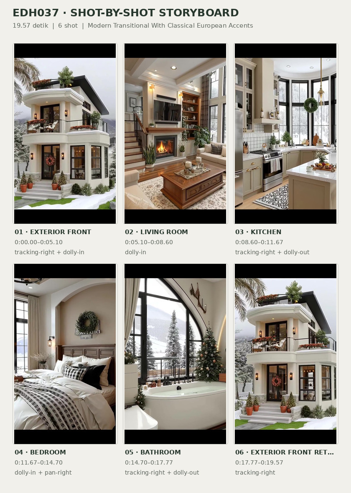
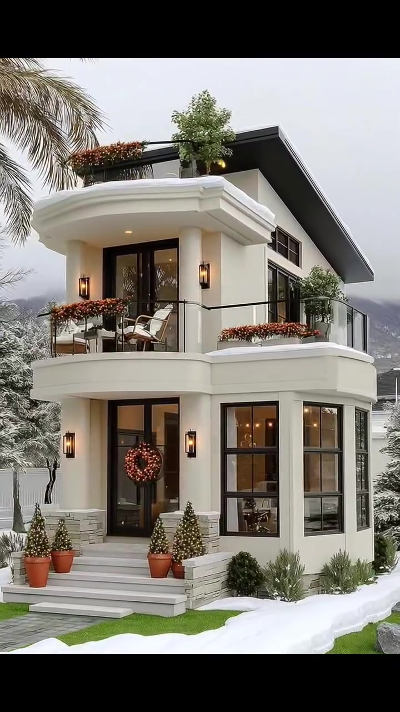
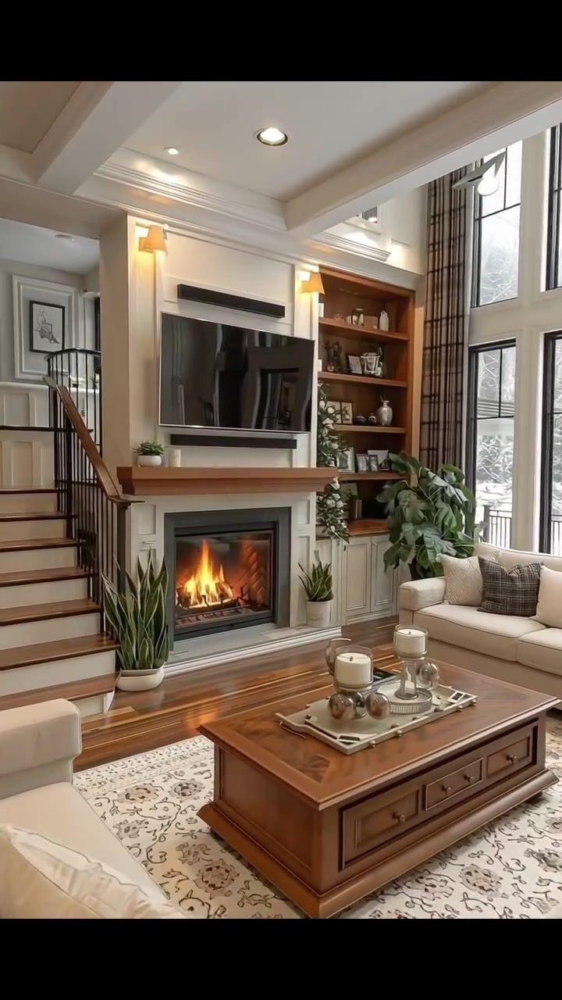
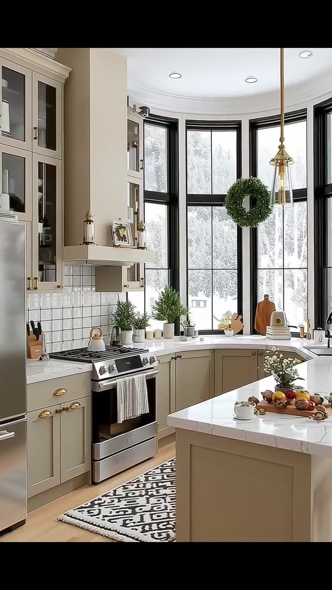
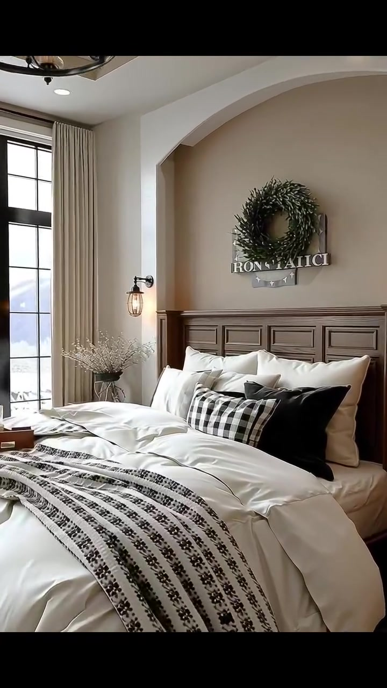
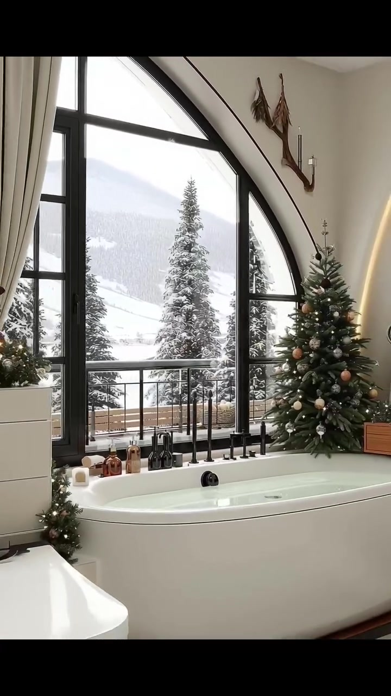
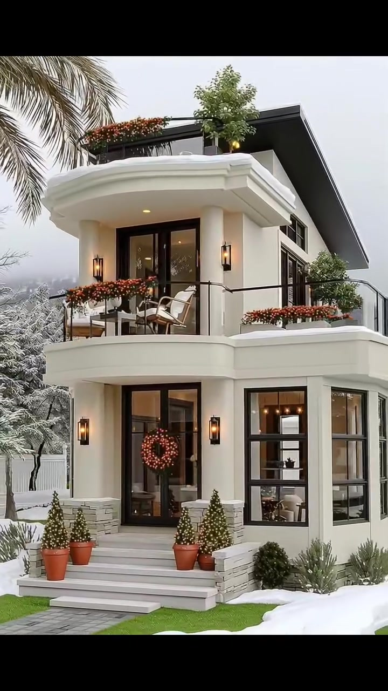

# edh037 — Modern Transitional With Classical European Accents

<!-- homeku_request_id: homeku_edh037_20261105T1720 -->

<!-- homeku_detail_narratives: chat-reviewed -->

**Sumber data:** [analysis.yaml](analysis.yaml) · **Status:** draft · **Diverifikasi manusia:** Tidak

## 1. Informasi Video

| Informasi | Nilai |
|---|---|
| ID | edh037 |
| File asli | edh037.mp4 |
| Durasi | 19.57 |
| Resolusi | 720x1280 |
| FPS | 30 |
| Rasio | 9:16 |
| Jumlah shot | 6 |

## 2. Storyboard Gabungan

## 3. Identitas Desain

| Aspek | Hasil analisis |
|---|---|
| Gaya utama | modern transitional with classical european accents |
| Wilayah terkait gaya desain | europe, north america |
| Pengaruh gaya | contemporary classical facade details, north american transitional interiors, seasonal cozy decor |
| Ciri eksterior | white rendered walls, deep projecting molded balconies, dark asymmetric sloping roof, black mullioned windows, upper glazed balcony doors, slender black balcony railings, warm wall sconces |
| Gaya interior | warm transitional, contemporary classical trim, soft neutral palette, cozy seasonal accents |
| Confidence gaya | medium |

## 4. Ukuran & Proporsi Bangunan

| Aspek | Estimasi visual |
|---|---|
| Ukuran yang terlihat | medium |
| Bentuk bangunan | narrow rectangular |
| Skala vertikal | two story |
| Tapak bangunan | compact |
| Perkiraan luas lantai | 130–220 m² |
| Confidence | low |

> Luas adalah perkiraan visual, bukan ukuran terukur.

## 5. Warna, Pencahayaan, dan Atmosfer

| Warna dominan | HEX (perkiraan) |
|---|---|
| warm cream white | #F0ECE3 |
| charcoal black | #252727 |
| greige | #B8B0A1 |
| medium wood brown | #8A603F |
| evergreen green | #53644D |
| warm amber | #D7A35F |

| Aspek | Hasil analisis |
|---|---|
| Pencahayaan | diffuse cool daylight, warm fireplace glow, warm wall sconces, warm pendant and recessed lighting |
| Lingkungan | snow banks around house, snow dusted evergreen trees, palm fronds near front facade, mountain views, winter holiday ornaments |
| Musim yang tampak | snowy winter appearance |
| Mood | cozy, refined, festive, calm |

## 6. Struktur dan Timeline Video

**Jenis:** home tour · **Tempo:** moderate · **Transisi:** hard cuts between slow moving shots

| Shot | Waktu (detik) | Durasi | Area/Scene | Gerakan Kamera |
|---|---|---|---|---|
| Shot 01 | 0.0–5.1 | 5.10 | exterior front | tracking right, dolly in |
| Shot 02 | 5.1–8.6 | 3.50 | living room | dolly in |
| Shot 03 | 8.6–11.67 | 3.07 | kitchen | tracking right, dolly out |
| Shot 04 | 11.67–14.7 | 3.03 | bedroom | dolly in, pan right |
| Shot 05 | 14.7–17.77 | 3.07 | bathroom | tracking right, dolly out |
| Shot 06 | 17.77–19.57 | 1.80 | exterior front return | tracking right |

## 7. Analisis per Shot

### Shot 01 — exterior front

**Waktu:** 0.0–5.1 detik

| Komponen | Pengamatan |
|---|---|
| Fokus utama | white two story house and upper balcony |
| Framing awal → akhir | medium wide front three quarter view → closer front three quarter view |
| Sudut pandang | slightly low eye level view |
| Gerakan kamera | tracking right, dolly in |
| Kecepatan kamera | slow |
| Pencahayaan | diffuse overcast daylight with warm exterior sconces |
| Transisi keluar | hard cut |

**Detail yang terlihat**

**Arsitektur**

Rumah tampak terdiri atas dua lantai dengan massa depan yang relatif ramping dan dinding luar berwarna putih berfinishing halus. Atap miring berwarna arang gelap membentang di sisi kanan, sedangkan tepian balkon dan bagian atas bangunan menggunakan lis putih tebal yang menonjol. Balkon lantai dua berpagar logam hitam tipis dengan bidang transparan, di depan pintu kaca ganda berbingkai hitam. Di bawahnya, pintu masuk kaca gelap dihiasi karangan bunga kemerahan, dengan jendela\-jendela tinggi bersekat hitam yang membentuk sudut di kanan. Tangga masuk lebar dan dangkal diapit dinding rendah berpenampilan batu terang; lapisan serupa terlihat di bagian bawah fasad. Lampu dinding hitam menyala hangat di sekitar bukaan, sementara deret jendela kecil tampak di bawah tepi atap samping.

**Furnitur dan properti**

Di balkon atas terdapat dua kursi santai berwarna terang dengan meja bundar kecil di tengahnya. Kotak\-kotak tanaman memanjang berisi bunga merah jingga mengikuti tepian balkon. Pot terakota dengan semak hijau kecil berbentuk kerucut diletakkan di sisi anak tangga, sedangkan di teras paling atas terdapat tanaman kemerahan dan sebuah pohon hijau kecil.

**Lingkungan**

Jalur pijakan persegi berwarna abu\-abu menuju tangga utama, diapit rumpun salju putih yang tidak beraturan dan bidang rumput hijau cerah. Batang palem tinggi beserta pelepahnya berada di depan sisi kiri rumah; di belakang dan kanan terlihat deretan pohon berdaun jarum yang tampak terselimuti salju. Pohon kecil tanpa daun serta pagar putih pendek muncul di latar kiri. Lereng gunung keabu\-abuan terlihat jauh di bawah langit pucat berawan.

**Catatan pengamatan:** Kamera bergeser ke kanan dan sedikit mendekat; pohon palem pada lanskap bersalju tidak digunakan untuk menyimpulkan lokasi geografis.

**Confidence:** Kamera medium · Detail visual high

### Shot 02 — living room

**Waktu:** 5.1–8.6 detik

| Komponen | Pengamatan |
|---|---|
| Fokus utama | lit fireplace and television wall |
| Framing awal → akhir | wide double height living room view → medium close fireplace wall view |
| Sudut pandang | eye level oblique interior view |
| Gerakan kamera | dolly in |
| Kecepatan kamera | slow |
| Pencahayaan | bright cool daylight through windows with warm fire and wall lights |
| Transisi keluar | hard cut |

**Detail yang terlihat**

**Arsitektur**

Ruang keluarga memiliki area tinggi dua lantai dengan plafon putih berpetak dan lampu tanam. Deretan jendela tinggi bersekat hitam mengisi sisi kanan, dengan gorden panjang bermotif kotak gelap. Di tengah dinding terdapat perapian berbingkai putih dan ruang api persegi panjang dengan nyala terlihat; televisi layar datar hitam terpasang di atas mantel. Rak pajangan tanam bernuansa kayu hangat berada di kanan perapian, sementara tangga beranak kayu dan baluster logam hitam terlihat di kiri. Lantainya menyerupai papan kayu cokelat sedang, dilengkapi lis plafon dan trim vertikal putih di sekitar bidang perapian.

**Furnitur dan properti**

Sofa berlapis kain krem dengan bantal abu\-abu kotak\-kotak berada di bawah jendela kanan, sementara sofa krem lain terlihat sebagian di latar depan kiri. Meja kopi persegi panjang dari kayu cokelat dengan laci depan diletakkan di tengah, di atas karpet terang bermotif halus. Di permukaan meja terdapat baki logam berisi lilin dan dekorasi kecil. Beberapa tanaman hijau tinggi ditempatkan di dekat perapian dan sofa, sementara benda keramik kecil dan bingkai foto tersusun pada rak kayu.

**Lingkungan**

Melalui jendela tinggi di sisi ruang keluarga tampak pepohonan berdaun jarum dengan lapisan putih menyerupai salju.

**Catatan pengamatan:** Gerakan menyerupai dorongan kamera ke dinding perapian; bahan lantai dan rak dinyatakan berdasarkan tampilan visual.

**Confidence:** Kamera medium · Detail visual high

### Shot 03 — kitchen

**Waktu:** 8.6–11.67 detik

| Komponen | Pengamatan |
|---|---|
| Fokus utama | light greige kitchen with bay windows and island |
| Framing awal → akhir | medium view toward bay window and range → wider view including island and refrigerator |
| Sudut pandang | eye level interior three quarter view |
| Gerakan kamera | tracking right, dolly out |
| Kecepatan kamera | slow |
| Pencahayaan | cool daylight through large windows with warm pendant light |
| Transisi keluar | hard cut |

**Detail yang terlihat**

**Arsitektur**

Dapur menggunakan kabinet bawah model shaker berwarna greige pucat dengan tarikan logam keemasan, dipadukan kabinet tinggi atas dengan pintu kaca. Backsplash berupa ubin persegi putih bergaris nat gelap, sedangkan permukaan meja kerja dan pulau dapur tampil putih dengan guratan samar menyerupai batu. Pulau berbentuk persegi panjang memiliki bagian dasar taupe terang. Di belakang, susunan jendela tinggi hitam mengikuti ceruk melengkung; lantai menyerupai papan kayu terang dan lampu tanam terpasang di plafon. Rak terbuka bernuansa kayu terlihat di dinding ujung kanan.

**Furnitur dan properti**

Kompor stainless steel dengan bidang masak hitam berdiri di depan meja belakang, disertai lemari pendingin tinggi dari bahan serupa di sebelah kanannya. Lampu gantung ramping berwarna kuningan menggantung di atas pulau, sementara karangan daun hijau bundar berada di tengah jendela. Papan potong dan beberapa pot tanaman kecil diletakkan di meja belakang. Karpet lorong bermotif geometris hitam\-putih terbentang di depan kompor. Di atas pulau terdapat piring buah dan wadah kecil, dengan bangku dudukan kayu di ujung kanan. Blok pisau dan peralatan dapur terlihat di kiri kompor, sedangkan keran melengkung gelap berada di area bak cuci dekat jendela kanan.

**Lingkungan**

Di balik jendela\-jendela dapur berbingkai hitam tampak pepohonan dengan permukaan terang yang menyerupai salju.

**Catatan pengamatan:** Kamera bergeser ke kanan dan sedikit membuka bidang pandang; warna kabinet dibaca sebagai greige, bukan spesifikasi cat.

**Confidence:** Kamera medium · Detail visual high

### Shot 04 — bedroom

**Waktu:** 11.67–14.7 detik

| Komponen | Pengamatan |
|---|---|
| Fokus utama | wood headboard and white dressed bed |
| Framing awal → akhir | medium wide bedroom view → close view of headboard and upper bed |
| Sudut pandang | eye level interior front oblique view |
| Gerakan kamera | dolly in, pan right |
| Kecepatan kamera | slow |
| Pencahayaan | soft window daylight and warm amber bedside wall lamps |
| Transisi keluar | hard cut |

**Detail yang terlihat**

**Arsitektur**

Dinding kamar tidur berwarna krem memiliki ceruk lengkung besar bernuansa taupe di belakang ranjang. Tepat di depannya terpasang kepala ranjang kayu cokelat sedang dengan panel\-panel persegi berbingkai. Sebuah jendela tinggi bersekat hitam terletak di kiri, disertai tirai krem panjang. Plafon putih dengan bidang bertingkat dan lis tepi melengkapi ruangan, sedangkan lampu dinding hangat berada di kedua sisi area kepala ranjang. Sedikit karpet lantai berwarna netral terlihat di tepi ranjang.

**Furnitur dan properti**

Ranjang besar ditata dengan selimut putih tebal dan beberapa lapis bantal putih. Kain dekoratif bermotif hitam\-putih membentang melintang di bagian bawah, sedangkan bantal aksen hitam dan bantal kotak\-kotak berada di depan tumpukan bantal. Lampu gantung bundar dari logam gelap dengan bentuk menyerupai lilin terlihat di atas. Di kanan ranjang ada meja nakas kayu dengan benda kecil; karangan daun hijau gelap terpasang di atas kepala ranjang dengan papan hias bertulisan di bawahnya. Vas berisi ranting kering terang terlihat di sisi kiri tempat tidur.

**Lingkungan**

Dari jendela kiri terlihat lanskap berwarna pucat yang tampak bersalju.

**Catatan pengamatan:** Framing makin rapat pada ranjang dan ceruk melengkung; tulisan pada plakat tidak ditranskripsi karena tidak cukup jelas.

**Confidence:** Kamera medium · Detail visual high

### Shot 05 — bathroom

**Waktu:** 14.7–17.77 detik

| Komponen | Pengamatan |
|---|---|
| Fokus utama | oval bathtub below tall arched window |
| Framing awal → akhir | medium view of arch window and tub → wider view including toilet and right wall |
| Sudut pandang | eye level interior oblique view |
| Gerakan kamera | tracking right, dolly out |
| Kecepatan kamera | slow |
| Pencahayaan | bright daylight through arch window with warm sconce and decorative lights |
| Transisi keluar | hard cut |

**Detail yang terlihat**

**Arsitektur**

Jendela sangat tinggi dengan lengkung di bagian atas dan kisi\-kisi hitam mendominasi kamar mandi. Dinding putih hangat memiliki ceruk lengkung, dengan lantai ubin terang, plafon putih bertitik lampu tanam, serta bibir alas bernuansa kayu di bawah bak mandi. Lampu dinding hitam terpasang di sisi kanan dan tirai panjang krem menggantung di tepi kiri jendela.

**Furnitur dan properti**

Bak mandi bebas berdiri berwarna putih dan berbentuk oval ditempatkan tepat di bawah jendela lengkung; keran serta pengatur air berwarna gelap terlihat di belakang bibir bak. Pohon Natal hijau dengan ornamen keemasan terang berdiri di kanan jendela. Toilet putih modern berada di kiri bak mandi, bersama tepi wastafel atau meja rias putih yang terlihat di latar depan. Di dinding kanan terdapat cermin bundar berbingkai gelap. Rak kayu kecil berisi handuk putih terlipat berada di kanan bak, dengan sejumlah botol kecil dan wadah dekoratif dekat keran. Alas lantai bermotif geometris hitam\-putih terbentang di depan bak, dan rangkaian dedaunan hijau dengan cahaya hangat menghiasi rak kanan.

**Lingkungan**

Di balik jendela lengkung tampak beberapa pohon hijau berdaun jarum yang tertutup lapisan putih menyerupai salju, dengan lereng gunung pucat di kejauhan. Pagar teras luar dari logam hitam terlihat melintang pada bagian bawah pemandangan.

**Catatan pengamatan:** Pandangan bergeser ke kanan sambil meluas; jendela tampak menghadap lanskap bersalju, tetapi lokasi asli tidak diketahui.

**Confidence:** Kamera medium · Detail visual high

### Shot 06 — exterior front return

**Waktu:** 17.77–19.57 detik

| Komponen | Pengamatan |
|---|---|
| Fokus utama | front facade with balcony and black framed entry |
| Framing awal → akhir | medium front three quarter view → slightly wider front three quarter view |
| Sudut pandang | slightly low eye level view |
| Gerakan kamera | tracking right |
| Kecepatan kamera | slow |
| Pencahayaan | diffuse cool daylight with warm black wall sconces |
| Transisi keluar | end of video |

**Detail yang terlihat**

**Arsitektur**

Tampilan penutup kembali memperlihatkan fasad putih dua lantai dengan bagian atas yang menonjol, di bawah atap utama miring berwarna arang gelap. Lis tebal putih membentuk garis tepi balkon dan atap; di belakang pagar balkon logam hitam berbidang transparan tampak pintu kaca berbingkai hitam lantai dua. Pintu masuk bawah juga berbingkai hitam, dihiasi karangan bundar kemerahan. Jendela tinggi bersekat hitam mengisi sudut kanan, tangga putih lebar mengarah ke pintu, dan lampu dinding luar memancarkan cahaya hangat.

**Furnitur dan properti**

Sepasang kursi santai terang berada di balkon atas, disertai kotak tanaman panjang dengan bunga kemerahan di tepian. Pot\-pot terakota berisi semak hijau kecil berbaris di samping tangga masuk. Pada teras teratas terlihat pohon kecil dan tanaman berwarna merah kecokelatan.

**Lingkungan**

Gumpalan salju putih terlihat di sisi tangga dan dasar rumah, dengan petak rumput hijau sempit di antaranya. Pelepah palem masuk dari sudut kiri atas gambar, sementara pepohonan berdaun jarum yang tampak bersalju berdiri di belakang rumah. Pegunungan abu\-abu terlihat jauh di bawah langit mendung.

**Catatan pengamatan:** Shot penutup kembali ke fasad yang sama, tanpa bukti lokasi geografis.

**Confidence:** Kamera medium · Detail visual high

## 8. Kualitas dan Ketidakpastian Analisis

| Parameter | Hasil |
|---|---|
| Status | draft |
| Verifikasi manusia | Tidak |
| Ketepatan timestamp | frame aligned |
| Ketidakpastian | europe and north america are stylistic associations not verified geographic location, floor area estimate has no measured scale reference, white stone and wood materials are appearance based not verified, snowy landscape and palm in same scene do not verify real climate or season, some camera motions may be digital pushes or crops, room to room floorplan continuity is not verified from separate shots |

**Catatan:** Video visual diamati melalui sampel lintas setiap shot dengan batas cut diperiksa pada frame penuh; belum diverifikasi manusia.

---

*Laporan ini diturunkan dari [analysis.yaml](analysis.yaml).*
