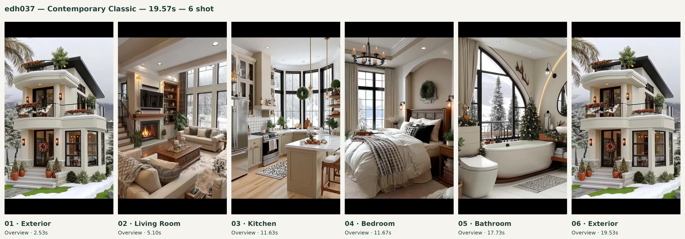
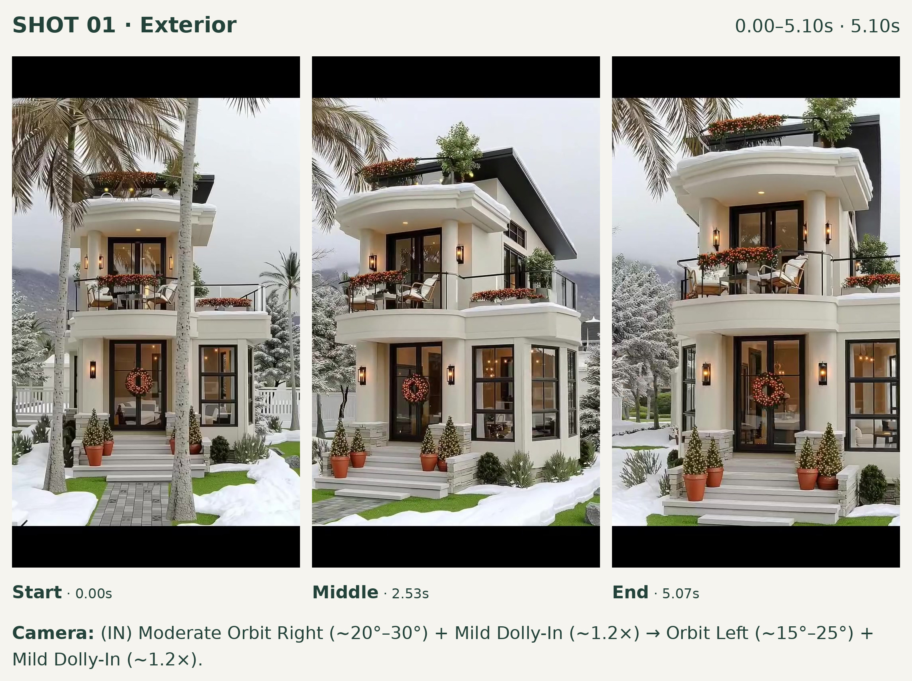
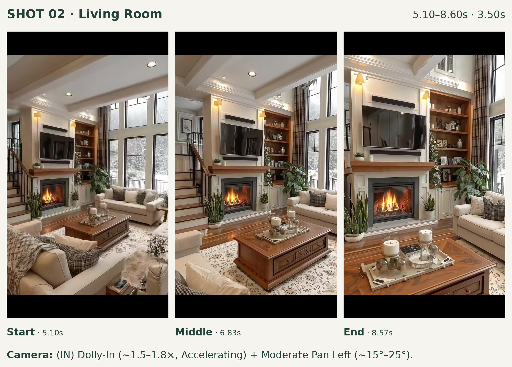
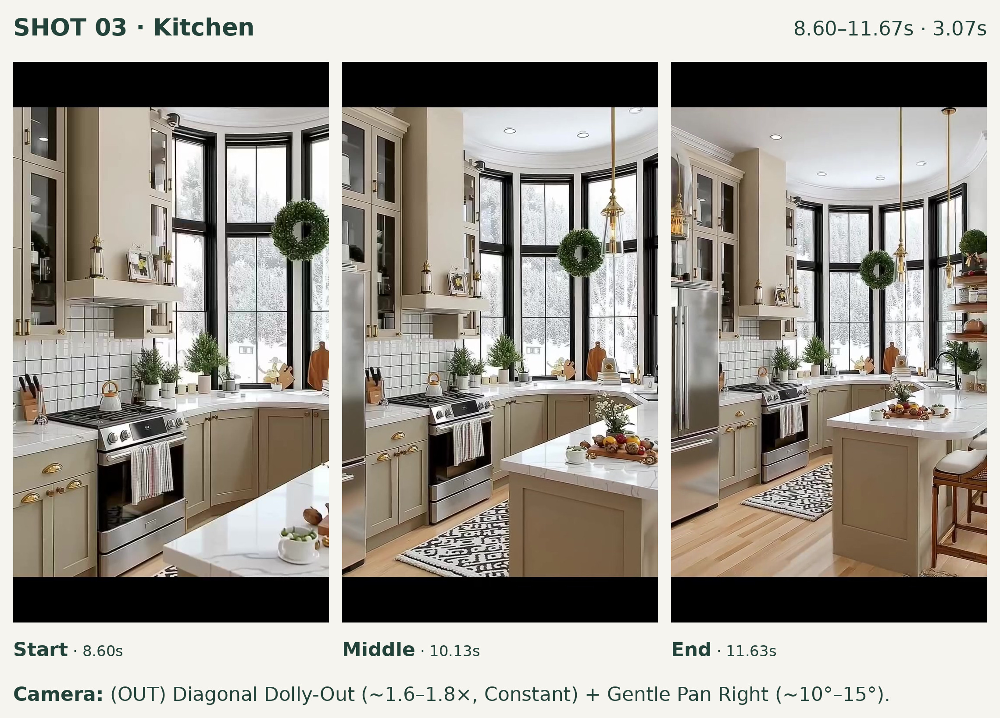
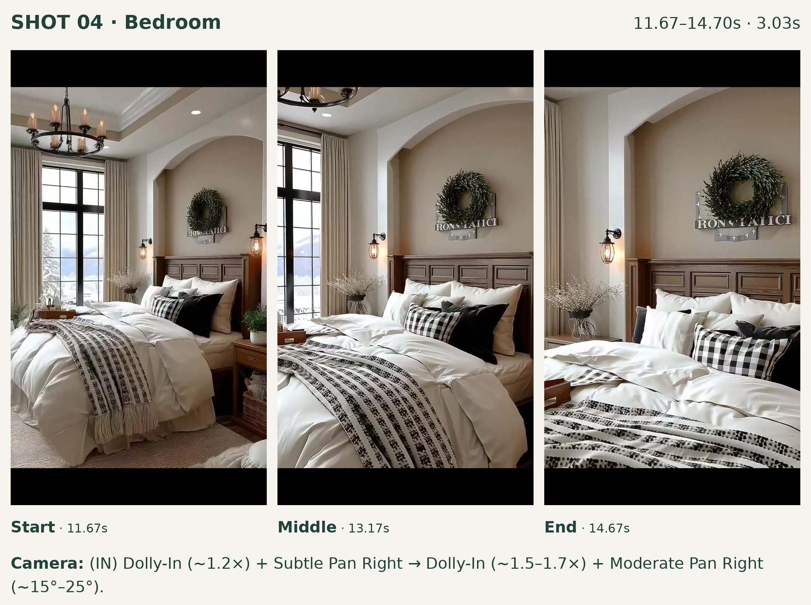
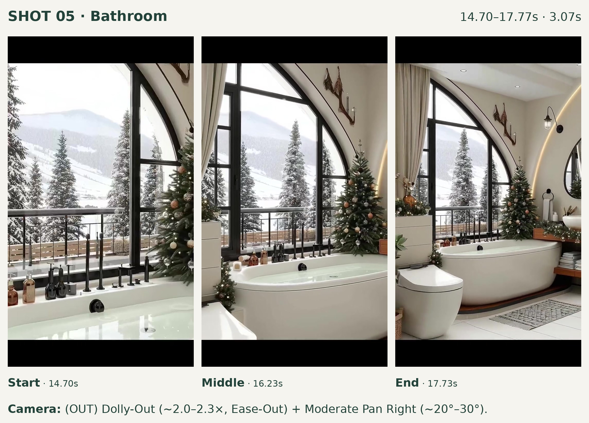
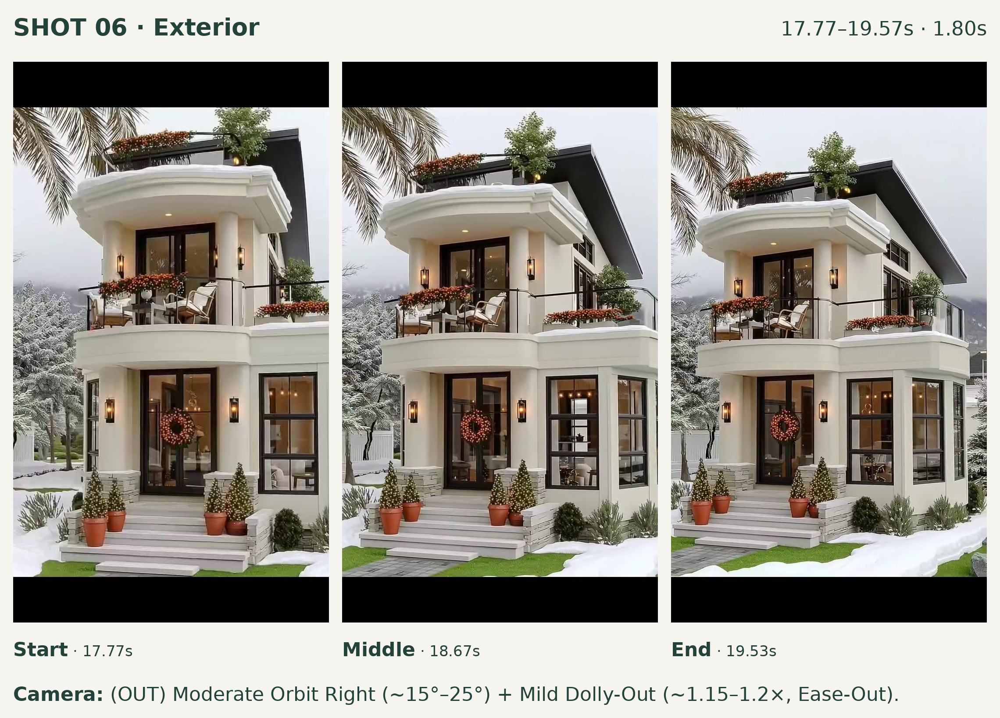

# edh037 — Rumah Dua Lantai Putih dengan Balkon Melengkung dan Interior Hangat

## 1. Profil desain

- **Nama desain:** Rumah Dua Lantai Putih dengan Balkon Melengkung dan Interior Hangat
- **Tipe rumah:** Detached House
- **Gaya utama:** **Contemporary Classic**
- **Pengaruh gaya:** Modern Mediterranean
- **Gaya interior:** Transitional
- **Susunan ruang utama:** Ruang keluarga dengan tangga, dapur, kamar tidur dan kamar mandi diperlihatkan terpisah lewat cut; hubungan denah tidak terverifikasi.
- **Ciri khas:** Balkon membulat, perapian di bawah TV, ceruk lengkung headboard, dan jendela lengkung besar di atas bathtub.
- **Material utama:** Permukaan putih halus, trim gelap, lantai serta furnitur berpenampilan kayu; bahan fisik tidak teruji.
- **Pencahayaan:** Cahaya siang difus melalui jendela besar, dipadukan lampu interior hangat dan lampu dinding fasad.
- **Atmosfer:** Hangat, rapi dan bernuansa liburan musim dingin dengan aksen dekorasi hijau.
- **Lingkungan:** Visual salju, rumput, palem serta pegunungan dan konifer melalui jendela.

### Palet warna

| Peran | Warna | HEX |
| --- | --- | --- |
| Dominan | Putih gading | `#EEE9DF` |
| Pendamping | Greige | `#B6A898` |
| Pendamping | Cokelat kayu | `#8D6545` |
| Aksen | Hitam arang | `#302D29` |
| Aksen | Hijau dedaunan | `#526345` |
| Aksen | Merah bata | `#A1543D` |

## 2. Ukuran & proporsi

| Aspek | Estimasi visual |
| --- | --- |
| **Ukuran rumah** | medium |
| **Bentuk bangunan** | Massa dua tingkat kompak dengan sudut depan membulat. |
| **Lantai & bentuk atap** | Dua lantai terlihat; area tanaman pada atap tidak membuktikan lantai hunian ketiga. · Bidang atap gelap dengan tepi menjorok; tanaman terlihat di bagian atas. |
| **Tapak bangunan** | Kompak, bagian sudut depan membulat; denah tidak terlihat. |
| **Proporsi utama** | Massa vertikal dua lantai dengan balkon lebar dan pintu tinggi. |
| **Perkiraan luas lantai** | **100–170 m²** |

## 3. Shot Timeline

Durasi 19.57s · 6 shot.

**Camera Pattern:** IN – IN – OUT – IN – OUT – OUT.

| Shot | Time (s) | Duration | Area/Scene | Camera Movement |
| --- | --- | --- | --- | --- |
| 01 | 0.00–5.10 | 5.10s | Exterior | Moderate Orbit Right (~20°–30°) + Mild Dolly-In (~1.2×) → Orbit Left (~15°–25°) + Mild Dolly-In (~1.2×). |
| 02 | 5.10–8.60 | 3.50s | Living Room | Dolly-In (~1.5–1.8×, Accelerating) + Moderate Pan Left (~15°–25°). |
| 03 | 8.60–11.67 | 3.07s | Kitchen | Diagonal Dolly-Out (~1.6–1.8×, Constant) + Gentle Pan Right (~10°–15°). |
| 04 | 11.67–14.70 | 3.03s | Bedroom | Dolly-In (~1.2×) + Subtle Pan Right → Dolly-In (~1.5–1.7×) + Moderate Pan Right (~15°–25°). |
| 05 | 14.70–17.77 | 3.07s | Bathroom | Dolly-Out (~2.0–2.3×, Ease-Out) + Moderate Pan Right (~20°–30°). |
| 06 | 17.77–19.57 | 1.80s | Exterior | Moderate Orbit Right (~15°–25°) + Mild Dolly-Out (~1.15–1.2×, Ease-Out). |

## 4. Overview

**Shot 01 · Exterior · 2.53s**

> Dari halaman depan serong kanan ke fasad, pelat balkon, pintu, jendela kanan dan undakan terlihat bersama; palem tidak lagi menghalangi pusat bangunan.

**Shot 02 · Living Room · 5.10s**

> Dari sudut duduk menghadap perapian, wide mencakup sofa, meja kopi, tangga kiri, TV, rak, dan jendela kanan.

**Shot 03 · Kitchen · 11.63s**

> Dari sisi depan meja kerja menghadap jendela sudut, wide akhir menampilkan kabinet, range, lemari es, meja kerja, bangku serta lantai.

**Shot 04 · Bedroom · 11.67s**

> Dari kaki ranjang serong ke headboard, wide awal menampilkan ranjang, ceruk, jendela kiri, meja samping dan lampu gantung.

**Shot 05 · Bathroom · 17.73s**

> Dari sisi depan kamar mandi menghadap bathtub, wide akhir mencakup toilet, bathtub, jendela lengkung dan sebagian vanity kanan.

**Shot 06 · Exterior · 19.53s**

> Dari halaman dengan sudut tiga-perempat kanan, wide akhir memperlihatkan dua tingkat, balkon, sisi kanan, atap dan undakan.

## 5. Storyboard

## 6. Shot Details

### Shot 01 · Exterior

**Time:** 0.00–5.10s · **Duration:** 5.10s

#### **A. Desain area**

**Arsitektur**

> Massa dua lantai putih, sudut dan pelat balkon membulat, trim berlapis, atap gelap menjorok. Pintu kaca gelap di tengah dicapai lewat undakan; jendela tinggi di kanan, balkon terbuka dengan railing gelap di atas.

**Furnitur & dekorasi**

> Kursi balkon dan tanaman; pot merah bata serta tanaman berbentuk kerucut di sisi tangga. Wreath pada pintu, lampu dinding hangat.

**Lingkungan**

> Palem di depan, jalur batu menuju tangga, rumput hijau dan hamparan putih menyerupai salju; pepohonan di latar.

#### **B. Framing & Lighting**

- **Fokus:** Fasad dan balkon.
- **Camera Start:** Di depan jalur masuk, dekat palem. · Menuju fasad dan pintu. · frontal · Perkiraan setinggi mata dari halaman. · Sedikit mendongak ke balkon.
- **Framing:** Wide fasad dengan palem di depan. → Medium-wide pintu dan balkon.
- **Lighting:** Siang difus, lampu dinding hangat.
- **Foreground dan kedalaman:** Palem dan jalur batu. · Palem, undakan, fasad, pepohonan berlapis.
- **Reveal:** Sisi kanan rumah lalu kembali frontal.
- **Kesesuaian gerak:** Orbit mengungkap sisi, dolly-in memperbesar pintu.

#### **C. Camera Movement**

Kamera menyusuri fasad ke kanan, dengan pendekatan ringan, kemudian berbalik ke kiri sambil terus mendekat hingga pintu dan balkon dominan.

**Tempo:** Sedang, perubahan arah sekitar 3,3 s; pendekatan dan sapuan kembali lebih terasa pada akhir.

**Movement Timeline**

| Time (s) | Area & fokus | Camera Movement | Tempo |
| --- | --- | --- | --- |
| 0.00–3.30 | Exterior · Pohon depan, pintu masuk dan sisi kanan fasad | Moderate Orbit Right (~20°–30°) + Mild Dolly-In (~1.2×) | Sedang, perubahan arah sekitar 3,3 s; pendekatan dan sapuan kembali lebih terasa pada akhir. |
| 3.30–5.10 | Exterior · Fasad depan, balkon, pintu masuk | Orbit Left (~15°–25°) + Mild Dolly-In (~1.2×) | Sedang, perubahan arah sekitar 3,3 s; pendekatan dan sapuan kembali lebih terasa pada akhir. |

**Camera:** Moderate Orbit Right (~20°–30°) + Mild Dolly-In (~1.2×) → Orbit Left (~15°–25°) + Mild Dolly-In (~1.2×).

---

### Shot 02 · Living Room

**Time:** 5.10–8.60s · **Duration:** 3.50s

#### **A. Desain area**

**Arsitektur**

> Ruang keluarga dengan bukaan tinggi berbingkai gelap di kanan, tangga kayu naik di kiri layar, plafon bertrim dengan lampu tanam. Dinding fokus menggabungkan TV, mantel perapian dan rak tinggi di kanan.

**Furnitur & dekorasi**

> Sofa krem di kiri depan dan kanan, meja kopi kayu persegi panjang di tengah di atas karpet bermotif. Rak tinggi kayu di kanan TV dengan pajangan; tanaman, nampan dan cangkir.

**Lingkungan**

> Cahaya difus dari kanan, tampak pepohonan dan permukaan putih di luar jendela; api dan lampu memberi aksen hangat.

#### **B. Framing & Lighting**

- **Fokus:** TV dan perapian.
- **Camera Start:** Di sudut area duduk, di belakang sofa depan. · Ke dinding TV dan perapian. · oblique · Sekitar tinggi mata berdiri. · Hampir datar, sedikit melihat permukaan meja.
- **Framing:** Wide ruang duduk, tangga dan jendela. → Medium TV, perapian dan meja.
- **Lighting:** Jendela kanan dan lampu hangat.
- **Foreground dan kedalaman:** Sofa, meja kopi, karpet. · Meja di depan, perapian di belakang, jendela di kanan.
- **Reveal:** Tangga kiri dan dinding fokus semakin menonjol.
- **Kesesuaian gerak:** Dolly-in memperkuat fokus perapian, pan membuka tangga.

#### **C. Camera Movement**

Maju menuju perapian dan TV sambil menggeser arah pandang ke kiri; sofa dekat keluar frame dan tangga lebih terbuka.

**Tempo:** Maju halus, pembesaran bertambah cepat menjelang akhir; pan berlangsung bersamaan.

**Camera:** Dolly-In (~1.5–1.8×, Accelerating) + Moderate Pan Left (~15°–25°).

---

### Shot 03 · Kitchen

**Time:** 8.60–11.67s · **Duration:** 3.07s

#### **A. Desain area**

**Arsitektur**

> Kabinet greige mengikuti sisi kiri dan bidang di bawah jendela sudut tinggi. Backsplash ubin putih kecil bergrid, lantai papan tampak kayu, countertop putih. Meja kerja depan kanan tampak sebagai island; sambungan sisi tersembunyi tidak sepenuhnya jelas.

**Furnitur & dekorasi**

> Range dan oven berwarna logam di kiri, kabinet atas sebagian berkaca, lemari es logam di kiri ujung; meja kerja dengan permukaan putih dan bangku kayu di kanan. Pendant dan wreath pada jendela.

**Lingkungan**

> Cahaya siang menyebar dari sudut jendela; pepohonan dan latar putih terlihat melalui kaca.

#### **B. Framing & Lighting**

- **Fokus:** Kabinet dan meja kerja.
- **Camera Start:** Dekat meja kerja sisi kanan depan. · Ke range dan jendela sudut. · oblique · Sekitar tinggi mata berdiri. · Sedikit menurun ke countertop.
- **Framing:** Medium range dan jendela. → Wide dapur dan meja kerja.
- **Lighting:** Cahaya siang difus dan lampu gantung.
- **Foreground dan kedalaman:** Countertop putih. · Meja depan, kabinet dan jendela belakang.
- **Reveal:** Lantai, island/peninsula dan bangku terlihat saat mundur.
- **Kesesuaian gerak:** Dolly-out memperluas konteks, pan kanan membuka meja.

#### **C. Camera Movement**

Mundur dari area kompor ke pandangan dapur yang lebih luas, dengan sapuan ke kanan sehingga island dan lampu gantung terungkap.

**Tempo:** Mundur stabil selama sekitar tiga detik; sapuan lateral lebih terasa di awal.

**Camera:** Diagonal Dolly-Out (~1.6–1.8×, Constant) + Gentle Pan Right (~10°–15°).

---

### Shot 04 · Bedroom

**Time:** 11.67–14.70s · **Duration:** 3.03s

#### **A. Desain area**

**Arsitektur**

> Kamar tidur dengan ceruk dinding lengkung membingkai headboard; jendela tinggi bergrid hitam di kiri dengan tirai panjang. Plafon berprofil dan lampu gantung; palet krem dan putih.

**Furnitur & dekorasi**

> Ranjang besar dengan headboard kayu, duvet putih, bantal hitam-putih dan selimut kotak; meja samping dan lampu dinding; wreath hijau di atas ranjang.

**Lingkungan**

> Cahaya lembut dari kiri dan lampu hangat di samping ranjang; latar terang di balik kaca, detail luar terbatas.

#### **B. Framing & Lighting**

- **Fokus:** Ranjang dan ceruk.
- **Camera Start:** Di sisi kaki ranjang dekat sudut kamar. · Menuju ranjang dan ceruk headboard. · oblique · Perkiraan tinggi mata berdiri. · Sedikit menurun ke ranjang.
- **Framing:** Wide ranjang, jendela dan chandelier. → Medium-close headboard dan bantal.
- **Lighting:** Cahaya dari kiri, lampu samping hangat.
- **Foreground dan kedalaman:** Ujung ranjang dan selimut. · Ranjang, headboard dan ceruk; jendela kiri.
- **Reveal:** Headboard dan wreath membesar.
- **Kesesuaian gerak:** Dolly-in dan pan kanan memusatkan ranjang.

#### **C. Camera Movement**

Maju ke tempat tidur, lalu pandangan semakin diarahkan ke kanan menuju headboard dan dekorasi dinding.

**Tempo:** Maju berkelanjutan, dengan sapuan kanan semakin jelas setelah sekitar 12,5 s.

**Movement Timeline**

| Time (s) | Area & fokus | Camera Movement | Tempo |
| --- | --- | --- | --- |
| 11.67–12.50 | Bedroom · Tempat tidur dan jendela | Dolly-In (~1.2×) + Subtle Pan Right | Maju berkelanjutan, dengan sapuan kanan semakin jelas setelah sekitar 12,5 s. |
| 12.50–14.70 | Bedroom · Headboard, bantal dan karangan dinding | Dolly-In (~1.5–1.7×) + Moderate Pan Right (~15°–25°) | Maju berkelanjutan, dengan sapuan kanan semakin jelas setelah sekitar 12,5 s. |

**Camera:** Dolly-In (~1.2×) + Subtle Pan Right → Dolly-In (~1.5–1.7×) + Moderate Pan Right (~15°–25°).

---

### Shot 05 · Bathroom

**Time:** 14.70–17.77s · **Duration:** 3.07s

#### **A. Desain area**

**Arsitektur**

> Jendela besar berbingkai gelap dengan puncak lengkung dan tirai krem membuka pemandangan luar. Bathtub berada tepat di bawah jendela, toilet di kiri depan, vanity di kanan; bidang lengkung bercahaya dekat cermin.

**Furnitur & dekorasi**

> Bathtub oval putih dengan perlengkapan gelap, toilet putih, vanity kayu dan cermin bundar sebagian terlihat; tanaman dekoratif pohon kecil, karpet bermotif.

**Lingkungan**

> Konifer, pegunungan dan hamparan salju terlihat melalui jendela; railing di luar kaca. Cahaya siang difus dan aksen lampu hangat.

#### **B. Framing & Lighting**

- **Fokus:** Bathtub dan jendela lengkung.
- **Camera Start:** Dekat tepi bathtub menghadap jendela. · Ke luar melalui bukaan tinggi. · oblique · Perkiraan tinggi mata di dalam ruang. · Sedikit turun ke tepi bathtub.
- **Framing:** Close-wide jendela dan tepi tub. → Wide bathtub, toilet dan sebagian vanity.
- **Lighting:** Siang difus dari jendela, aksen lampu hangat.
- **Foreground dan kedalaman:** Tepi tub dan keran. · Tub, jendela, railing, pegunungan.
- **Reveal:** Toilet dan vanity muncul ketika mundur.
- **Kesesuaian gerak:** Dolly-out dan pan kanan memperluas layout.

#### **C. Camera Movement**

Mundur dari detail jendela dan bathtub menuju pandangan kamar mandi luas, sambil menyapu ke kanan.

**Tempo:** Perubahan framing besar dalam 3,07 s, mundur paling kuat pada awal lalu melandai.

**Camera:** Dolly-Out (~2.0–2.3×, Ease-Out) + Moderate Pan Right (~20°–30°).

---

### Shot 06 · Exterior

**Time:** 17.77–19.57s · **Duration:** 1.80s

#### **A. Desain area**

**Arsitektur**

> Fasad putih dua tingkat dengan balkon membulat dan railing gelap, pintu kaca gelap pada akses depan, jendela tinggi di kanan. Atap gelap menjorok dan bidang sisi kanan terbuka pada akhir.

**Furnitur & dekorasi**

> Kursi, tanaman dan rangkaian hijau di balkon; wreath di pintu, pot merah bata di tepi undakan, lampu dinding hangat.

**Lingkungan**

> Rumput hijau, bidang putih menyerupai salju, pepohonan dan palem di latar/depan; langit terang difus.

#### **B. Framing & Lighting**

- **Fokus:** Fasad dan balkon.
- **Camera Start:** Di halaman depan agak serong. · Ke pintu dan balkon. · oblique · Perkiraan tinggi mata dari halaman. · Sedikit mendongak.
- **Framing:** Medium-wide fasad relatif frontal. → Wide tiga-perempat kanan.
- **Lighting:** Siang difus, lampu dinding hangat.
- **Foreground dan kedalaman:** Undakan dan pot. · Halaman, fasad, pepohonan belakang.
- **Reveal:** Sisi kanan massa dan atap lebih terbuka.
- **Kesesuaian gerak:** Orbit kanan dan dolly-out memperjelas massa.

#### **C. Camera Movement**

Kamera bergerak ke kanan mengitari fasad dan sedikit mundur, membuka sisi kanan rumah sebagai penutup.

**Tempo:** Gerak penutup relatif singkat, lateral jelas dan melandai menjelang akhir.

**Camera:** Moderate Orbit Right (~15°–25°) + Mild Dolly-Out (~1.15–1.2×, Ease-Out).

**Catatan referensi:** Estimasi luas 100–170 m² hanya perkiraan dari proporsi tampak dua lantai tanpa ukuran kalibrasi atau denah. Identitas bangunan fisik, hubungan antar interior, lokasi, dan material asli tidak dapat dipastikan. Salju, palem, dekorasi dan pemandangan merupakan tampilan video, bukan verifikasi kondisi lokasi. Notasi kamera dan Production Start mengikuti persetujuan pengguna tanpa perubahan.
