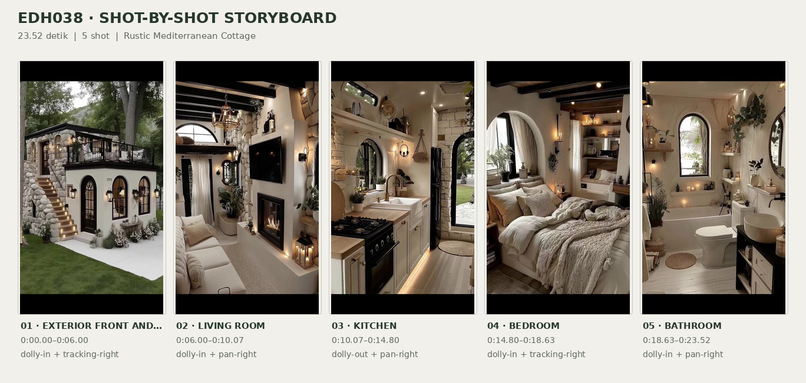
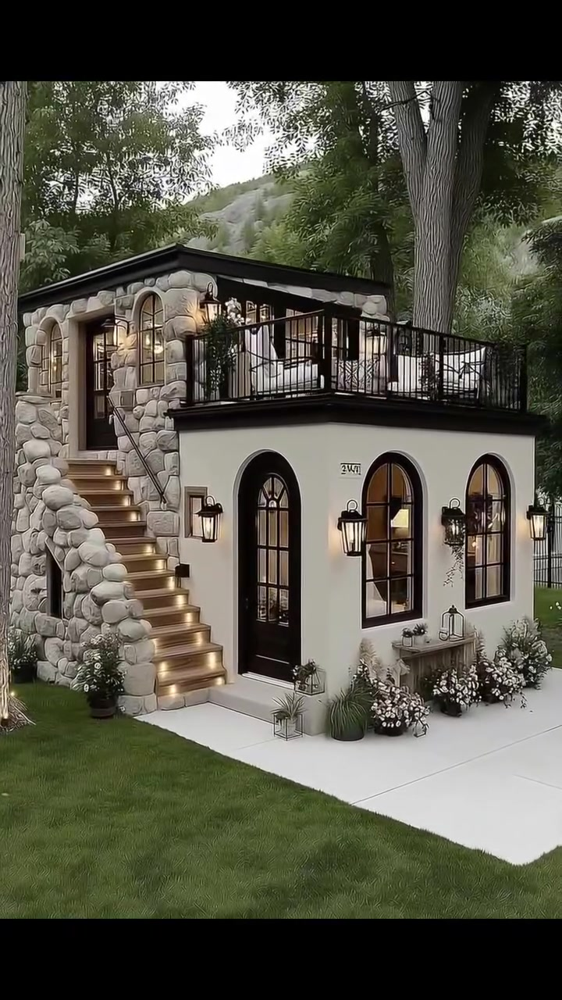
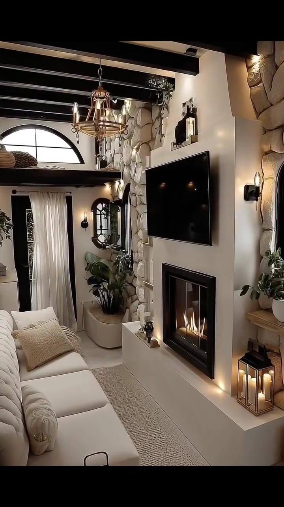
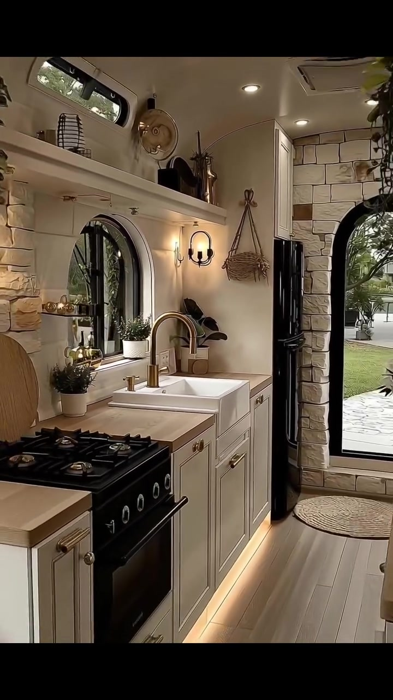
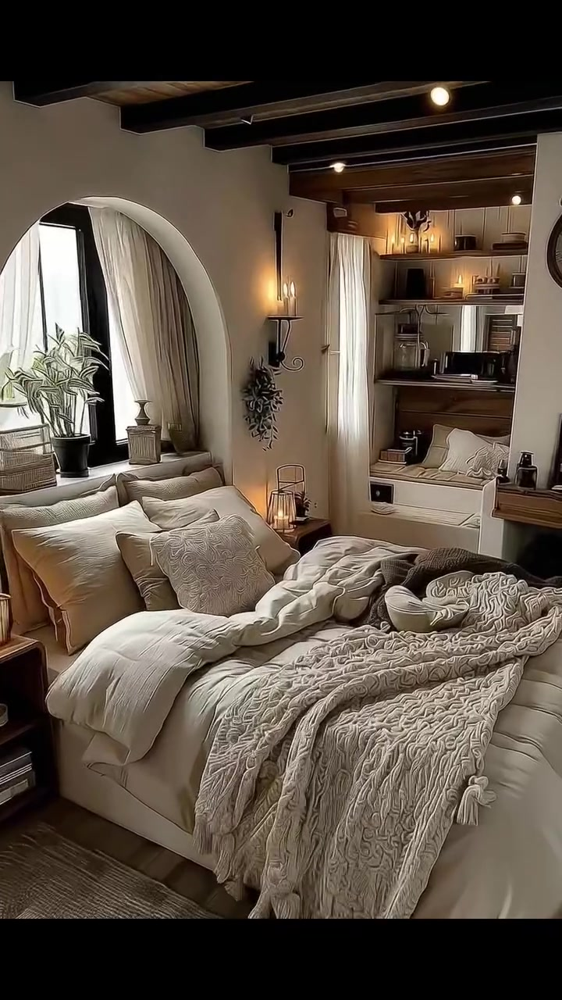
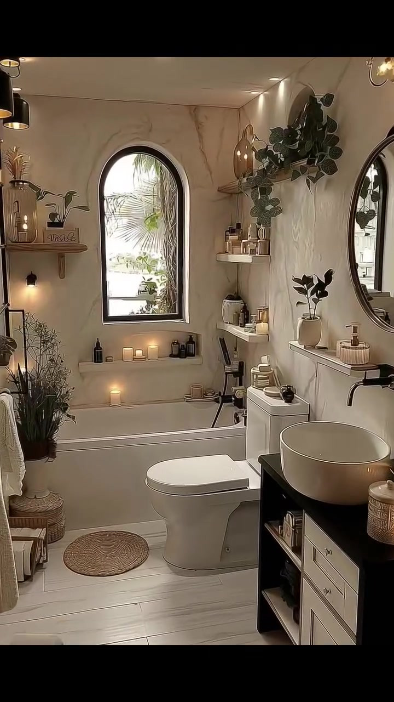

# edh038 — Rustic Mediterranean Cottage

<!-- homeku_request_id: edh038_20261105_1721_F4B2C7A9 -->

<!-- homeku_detail_narratives: chat-reviewed -->

**Sumber data:** [analysis.yaml](analysis.yaml) · **Status:** draft · **Diverifikasi manusia:** Tidak

## 1. Informasi Video

| Informasi | Nilai |
|---|---|
| ID | edh038 |
| File asli | edh038.mp4 |
| Durasi | 23.52 |
| Resolusi | 720x1280 |
| FPS | 30.0 |
| Rasio | 9:16 |
| Jumlah shot | 5 |

## 2. Storyboard Gabungan

## 3. Identitas Desain

| Aspek | Hasil analisis |
|---|---|
| Gaya utama | rustic mediterranean cottage |
| Wilayah terkait gaya desain | europe, north america |
| Pengaruh gaya | european country cottage, rustic farmhouse interior details |
| Ciri eksterior | cream stucco lower facade, rough light stone upper volume and stairs, tall black framed arched doors and windows, exterior staircase with warm step lights, upper terrace with black metal railing, dark low pitched roof over upper room, wall mounted lantern lights |
| Gaya interior | rustic european cottage, warm neutral color palette, exposed dark ceiling beams, arched black framed openings, natural stone appearance accents, soft cream textiles, warm candle style lighting |
| Confidence gaya | medium |

## 4. Ukuran & Proporsi Bangunan

| Aspek | Estimasi visual |
|---|---|
| Ukuran yang terlihat | small |
| Bentuk bangunan | compact rectangular with partial upper stone volume |
| Skala vertikal | two level with partial upper room and rooftop terrace |
| Tapak bangunan | compact |
| Perkiraan luas lantai | 35–75 m² |
| Confidence | low |

> Luas adalah perkiraan visual, bukan ukuran terukur.

## 5. Warna, Pencahayaan, dan Atmosfer

| Warna dominan | HEX (perkiraan) |
|---|---|
| warm cream | #EDE5D8 |
| soft ivory white | #F4EFE6 |
| light beige stone | #CFC3AE |
| charcoal black | #292925 |
| warm wood brown | #AE8E6C |
| muted foliage green | #69765B |

| Aspek | Hasil analisis |
|---|---|
| Pencahayaan | soft diffused daylight, warm wall sconces, accent step lighting, candle and lantern glow |
| Lingkungan | mature trees around house, green lawn, white flower border, partially visible rocky slope, garden greenery visible through interiors |
| Musim yang tampak | Tidak diketahui |
| Mood | cozy, rustic, calm, intimate |

## 6. Struktur dan Timeline Video

**Jenis:** architectural home tour · **Tempo:** moderate · **Transisi:** hard cuts between five continuous camera moves

| Shot | Waktu (detik) | Durasi | Area/Scene | Gerakan Kamera |
|---|---|---|---|---|
| Shot 01 | 0.0–6.0 | 6.00 | exterior front and rooftop terrace | dolly in, tracking right |
| Shot 02 | 6.0–10.07 | 4.07 | living room | dolly in, pan right |
| Shot 03 | 10.07–14.8 | 4.73 | kitchen | dolly out, pan right |
| Shot 04 | 14.8–18.63 | 3.83 | bedroom | dolly in, tracking right |
| Shot 05 | 18.63–23.52 | 4.89 | bathroom | dolly in, pan right |

## 7. Analisis per Shot

### Shot 01 — exterior front and rooftop terrace

**Waktu:** 0.0–6.0 detik

| Komponen | Pengamatan |
|---|---|
| Fokus utama | compact stone and stucco house with exterior stairs and rooftop terrace |
| Framing awal → akhir | wide three quarter exterior → medium three quarter front facade |
| Sudut pandang | slightly elevated front left view |
| Gerakan kamera | dolly in, tracking right |
| Kecepatan kamera | slow |
| Pencahayaan | soft overcast daylight with warm exterior wall and stair lighting |
| Transisi keluar | hard cut |

**Detail yang terlihat**

**Arsitektur**

Rumah berukuran kompak tampak mempunyai dua level, dengan sebagian volume atas berlapis batu. Lantai bawah berfasad plester halus warna krem terang, dengan pintu masuk tinggi melengkung berbingkai hitam di sisi kiri\-tengah dan dua jendela lengkung hitam tinggi di sebelah kanannya. Susunan batu bulat kasar bernuansa abu\-abu dan beige terang membentuk dinding tangga serta ruang atas. Tangga luar lurus naik di sisi kiri menuju teras atas; anak tangga bernuansa kayu dilengkapi lampu hangat. Ruang atas memiliki atap gelap landai dan bukaan kaca melengkung, sementara teras atap dibatasi railing logam hitam. Lampu dinding berbentuk lentera hitam terpasang dekat pintu dan jendela bawah, dengan pelataran beton pucat di depan pintu masuk.

**Furnitur dan properti**

Pada teras atas terdapat kursi\-kursi luar ruang berwarna terang dan sebuah meja kecil di dekatnya. Di bawah jendela depan berdiri konsol luar ruang sempit dengan dekorasi kecil. Lentera dekoratif dan pot\-pot kecil berada di sekitar kaki tangga serta area masuk.

**Lingkungan**

Batang pohon besar berdiri di sisi paling kiri rumah dan satu pohon tinggi lain tepat di kanan teras atas. Tajuk pepohonan hijau rimbun memenuhi latar belakang serta area di atas atap. Hamparan rumput hijau berbatasan dengan pelataran depan, sementara kelompok bunga putih tumbuh rendah di sepanjang dinding muka dan tangga. Bagian lereng berbatu pucat tampak samar di sela pepohonan belakang, dan beberapa batu pijakan putih terlihat di sisi kanan halaman.

**Catatan pengamatan:** Tampilan bergerak mendekati rumah dari sudut depan kiri; identitas material batu dan kayu berdasarkan penampakan visual.

**Confidence:** Kamera medium · Detail visual high

### Shot 02 — living room

**Waktu:** 6.0–10.07 detik

| Komponen | Pengamatan |
|---|---|
| Fokus utama | television and lit fireplace wall in narrow rustic living room |
| Framing awal → akhir | wide longitudinal living room view → tight fireplace and television detail |
| Sudut pandang | eye level slightly right facing |
| Gerakan kamera | dolly in, pan right |
| Kecepatan kamera | slow |
| Pencahayaan | warm chandelier sconce and fireplace light with soft window daylight |
| Transisi keluar | hard cut |

**Detail yang terlihat**

**Arsitektur**

Ruang duduk ini memanjang dan relatif sempit, dengan dinding plester krem serta balok plafon gelap yang berjajar searah panjang ruangan. Lapisan batu bulat bernuansa beige terang tampak di dekat bagian belakang dan sisi perapian. Pada dinding putih kanan, sebuah perapian persegi panjang berbingkai hitam terpasang tepat di bawah televisi datar hitam berukuran besar. Di bagian belakang terlihat platform loteng yang lebih tinggi, di bawah jendela setengah lingkaran, serta bukaan melengkung dengan tirai terang di bawahnya. Sisi kanan memiliki jendela lengkung berbingkai hitam; lantai bernuansa kayu terang dan satu anak tangga rendah terlihat di kanan depan.

**Furnitur dan properti**

Sofa panjang berlapis kain krem dengan bantal bertekstur pucat menempati sisi kiri, berhadapan dengan karpet anyaman netral terang di antara sofa dan perapian. Lampu gantung bundar bergaya lilin dengan nuansa kuningan antik menggantung dari langit\-langit. Beberapa lentera logam bernuansa hitam dan kuningan menyala di sekitar perapian. Di kanan perapian ada rak kayu kecil dengan tanaman hijau dalam pot putih. Tanaman berdaun lebar dalam pot bulat besar berada dekat tirai belakang, dengan cermin dekoratif berbingkai gelap dekat lengkungan. Tempat lilin dan ornamen kecil juga tersusun di ambang perapian.

**Lingkungan**

Dedaunan hijau terlihat melalui jendela lengkung berbingkai hitam di sisi kanan.

**Catatan pengamatan:** Gerakan mendekat mempersempit komposisi dari sofa dan sudut ruang menuju televisi serta perapian; jenis bahan dan sumber api tidak dipastikan.

**Confidence:** Kamera medium · Detail visual high

### Shot 03 — kitchen

**Waktu:** 10.07–14.8 detik

| Komponen | Pengamatan |
|---|---|
| Fokus utama | white apron front sink then compact kitchen and rear garden door |
| Framing awal → akhir | close sink and countertop view → wide narrow galley kitchen view |
| Sudut pandang | eye level looking toward rear door |
| Gerakan kamera | dolly out, pan right |
| Kecepatan kamera | slow |
| Pencahayaan | soft daylight through arched glazing with warm sconces and under cabinet lights |
| Transisi keluar | hard cut |

**Detail yang terlihat**

**Arsitektur**

Dapur kecil bertipe galley ini mempunyai kabinet pada kedua sisi ruang yang sempit. Pintu kabinet bawah berprofil shaker berwarna krem dengan pegangan bundar bernuansa kuningan, sedangkan countertop berpenampilan kayu terang. Bak cuci putih model apron\-front berada tepat di bawah jendela lengkung berbingkai hitam. Dindingnya berwarna putih gading, lantainya berpenampilan papan kayu terang, dan rak pajang putih panjang terpasang di atas area jendela. Lampu dinding logam hitam bergaya lilin berada di atas countertop kanan. Di ujung dapur terlihat susunan batu balok bernuansa beige muda yang membingkai pintu belakang tinggi dan melengkung dengan kaca serta rangka hitam. Lampu strip hangat menyala di bawah kabinet dasar, dilengkapi titik\-titik lampu plafon kecil.

**Furnitur dan properti**

Keran dapur tinggi melengkung bernuansa kuningan berada di atas bak cuci. Di sebelah kiri terdapat kompor freestanding hitam dengan beberapa tungku, sedangkan kulkas tinggi hitam berdiri dekat pintu belakang. Keranjang anyaman menggantung di dinding kanan bak cuci, berdampingan dengan tanaman hijau dalam pot beige di atas countertop. Tanaman\-tanaman pot kecil dan botol terlihat di sekitar jendela. Sebuah papan kayu bundar tergantung pada dinding batu di atas kompor, sementara rak atas menampung keranjang, vas kecil, dan wadah penyimpanan.

**Lingkungan**

Rumput hijau terlihat melalui pintu kaca belakang dan pepohonan taman berdaun hijau tampak melalui jendela dapur berbingkai hitam.

**Catatan pengamatan:** Shot bermula dekat bak cuci lalu memperlihatkan kompor, lemari tinggi, pintu belakang, serta koneksi visual ke taman.

**Confidence:** Kamera medium · Detail visual high

### Shot 04 — bedroom

**Waktu:** 14.8–18.63 detik

| Komponen | Pengamatan |
|---|---|
| Fokus utama | cream bed with layered pillows and chunky knit throw |
| Framing awal → akhir | wide bedroom and rear nook view → close textured bedding and pillows |
| Sudut pandang | eye level front three quarter bed view |
| Gerakan kamera | dolly in, tracking right |
| Kecepatan kamera | slow to moderate |
| Pencahayaan | soft daylight from left window and warm wall sconce and lantern |
| Transisi keluar | hard cut |

**Detail yang terlihat**

**Arsitektur**

Kamar tidur mempunyai dinding plester krem dan balok\-balok plafon gelap dengan penampakan kayu. Di dinding kiri ada jendela besar melengkung dengan rangka hitam dan tirai krem terang. Pada dinding belakang terlihat rak yang masuk ke dalam ceruk serta area ceruk bernuansa kayu yang sedikit lebih tinggi. Lampu dinding hangat bergaya lilin berada di antara jendela dan ceruk tersebut. Sebagian lantai bernuansa kayu terang tertutup karpet bermotif halus dengan warna netral.

**Furnitur dan properti**

Tempat tidur ganda rendah berlapis kain krem memenuhi bagian depan, dengan susunan bantal putih dan beige bertumpuk di depan sandaran empuk. Selimut rajut kabel tebal berwarna krem membentang di setengah bagian bawah kasur, disertai duvet putih yang berlipat lembut. Meja samping kecil dari kayu gelap terlihat di kiri tempat tidur, dengan lentera lilin menyala dari kaca dan logam di area meja terdekat. Tanaman hijau berdaun diletakkan pada ambang jendela kiri. Rak belakang berisi botol kecil dan benda dekoratif, sementara ceruk belakang menampung bangku built\-in berbantal. Seikat tanaman kering menggantung di bawah lampu dinding.

**Lingkungan**

Dedaunan taman hijau tampak samar melalui jendela lengkung di kiri.

**Catatan pengamatan:** Kamera bergerak mendekati kasur sehingga detail rajutan selimut dan tekstur bantal makin dominan.

**Confidence:** Kamera medium · Detail visual high

### Shot 05 — bathroom

**Waktu:** 18.63–23.52 detik

| Komponen | Pengamatan |
|---|---|
| Fokus utama | white bathtub beneath arched window and right wall shelves |
| Framing awal → akhir | wide view of full narrow bathroom → close bathtub toilet and shelving view |
| Sudut pandang | eye level slightly right angled |
| Gerakan kamera | dolly in, pan right |
| Kecepatan kamera | slow |
| Pencahayaan | bright window daylight with warm wall lights and candlelight |
| Transisi keluar | end of video |

**Detail yang terlihat**

**Arsitektur**

Kamar mandi sempit ini memiliki dinding plester krem bertekstur. Jendela tinggi melengkung berbingkai hitam berada di tengah dinding belakang, tepat di atas bak mandi putih persegi panjang. Kloset putih terletak di depan dan sedikit ke kanan bak mandi. Meja wastafel gelap dengan bagian depan laci krem menempati kanan depan, dilengkapi cermin dinding bundar berbingkai gelap di atasnya. Lantai berpenampilan papan kayu terang, sementara rak\-rak dinding putih melayang berada di samping jendela dan di atas kloset. Kran bak mandi serta pancuran genggam berwarna hitam dipasang pada ujung kanan bak mandi, dengan lampu dinding dan plafon kecil yang memancarkan cahaya hangat.

**Furnitur dan properti**

Wastafel mangkuk bulat putih berdiri di atas countertop meja gelap. Botol\-botol perlengkapan mandi bening dan amber tersusun di rak dinding. Sejumlah lilin menyala ditempatkan pada tepian bak mandi dan meja wastafel. Tanaman merambat hijau menggantung dari rak atas kanan, sementara sebuah tanaman hijau kecil di pot terletak pada rak samping meja wastafel. Keset bulat berserat alami berada dekat bak mandi. Handuk krem terlipat tergantung pada rak dinding kiri dan diletakkan dalam keranjang. Keranjang anyaman serta rangkaian tanaman kering tampak dekat lantai kiri, dengan lampu gantung logam gelap di sudut kiri atas.

**Lingkungan**

Helai daun hijau mirip palem terlihat melalui jendela lengkung belakang, dengan cahaya siang terang dari luar jendela.

**Catatan pengamatan:** Komposisi bergerak dari keseluruhan kamar mandi ke bak mandi, kloset, dan rak penyimpanan; tanaman luar tidak dapat diidentifikasi hingga spesies.

**Confidence:** Kamera medium · Detail visual high

## 8. Kualitas dan Ketidakpastian Analisis

| Parameter | Hasil |
|---|---|
| Status | draft |
| Verifikasi manusia | Tidak |
| Ketepatan timestamp | estimated |
| Ketidakpastian | stylistic region association is not actual location, building floor area and upper floor configuration are visual estimates, stone wood and metal material names are based on visible appearance, camera movements may be digital reframing or physical movement, outdoor vegetation and season cannot be verified to species or calendar season |

**Catatan:** Analisis visual seluruh durasi dari lima shot; data draft menunggu review pengguna dan tidak ditulis ke GitHub.

---

*Laporan ini diturunkan dari [analysis.yaml](analysis.yaml).*
