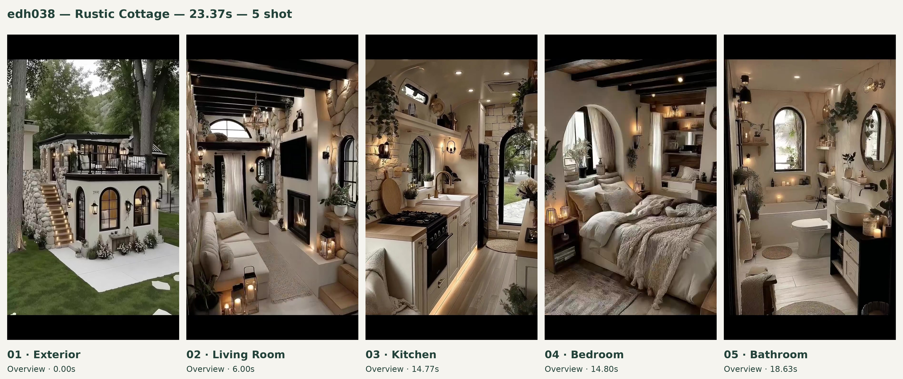
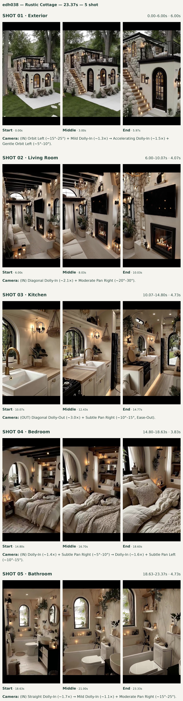
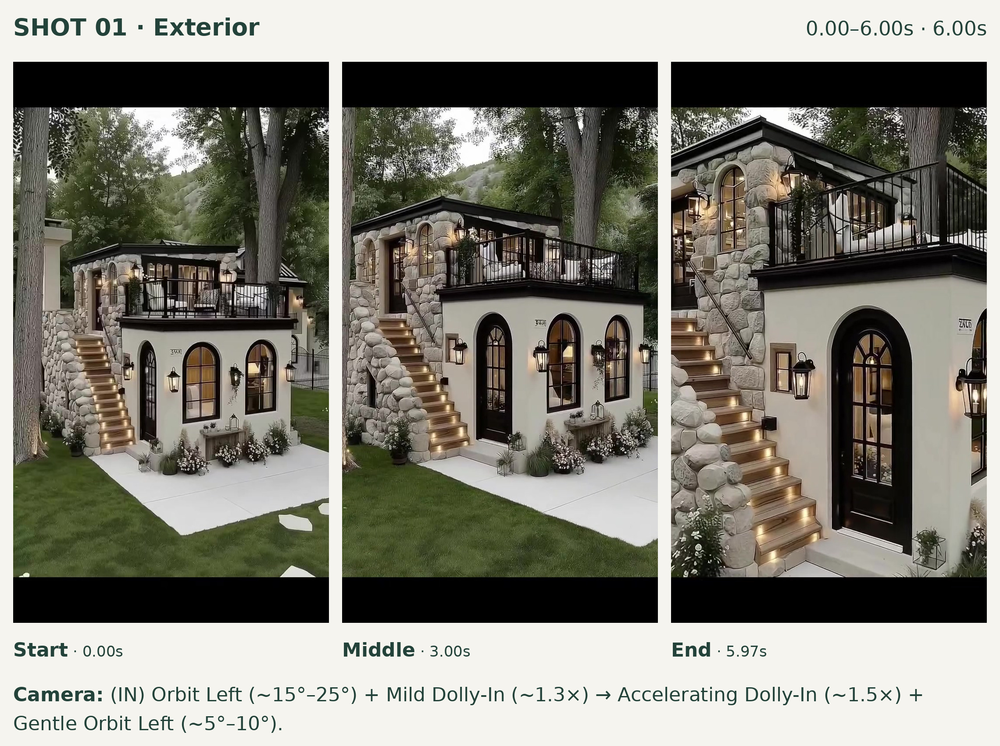
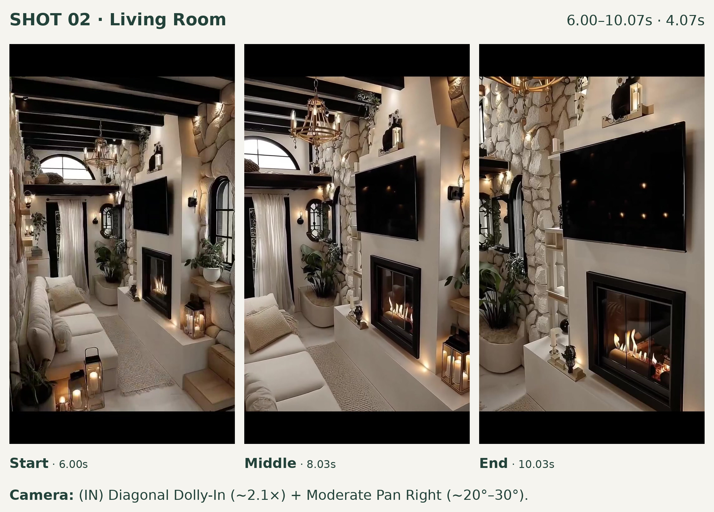
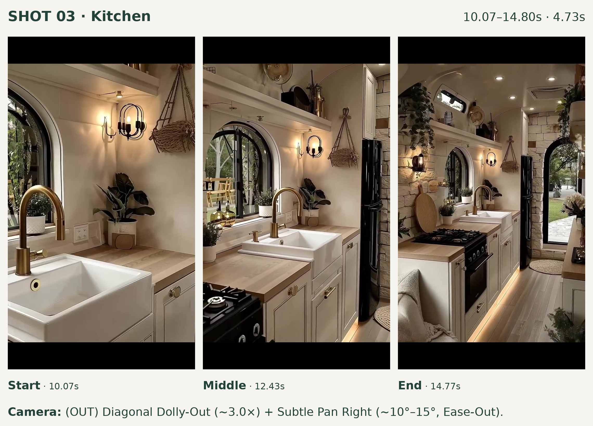
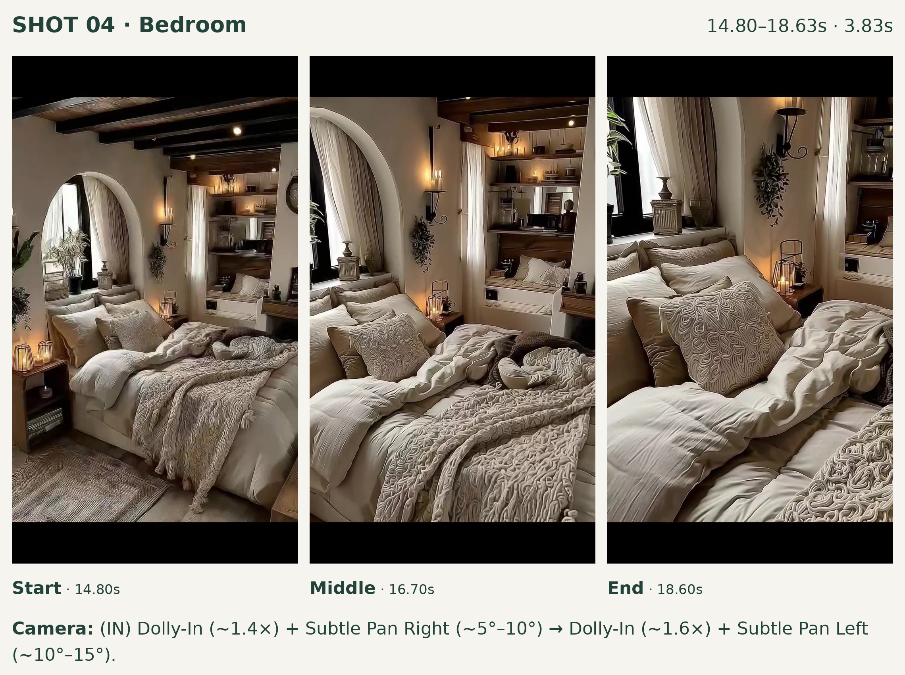
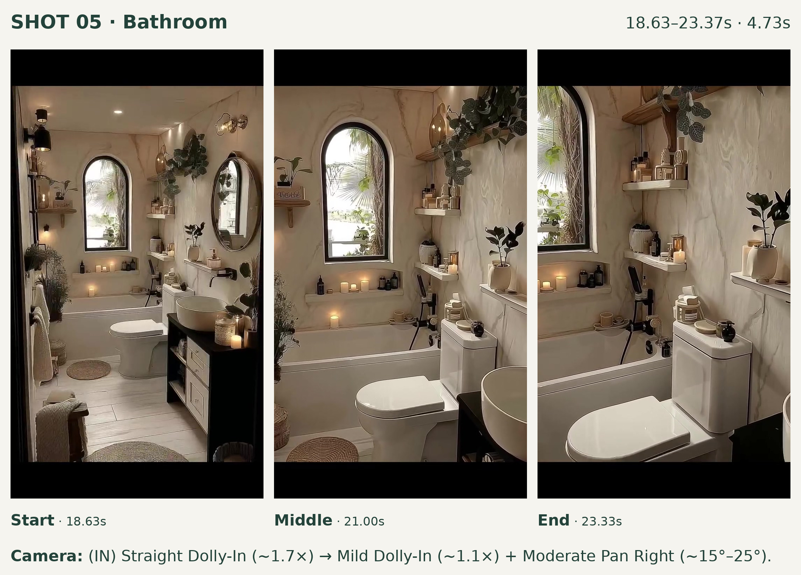

# edh038 — Woodland Stone & Arched Cottage

## 1. Profil desain

- **Nama desain:** Woodland Stone & Arched Cottage
- **Tipe rumah:** Cottage
- **Gaya utama:** **Rustic Cottage**
- **Pengaruh gaya:** Mediterranean Revival
- **Gaya interior:** Rustic Chic; Modern Cottage
- **Susunan ruang utama:** Lima area terlihat terpisah oleh cut: eksterior, ruang keluarga, dapur, kamar tidur, kamar mandi; denah tidak diketahui
- **Ciri khas:** Batu bulat besar, lampu tangga, perapian di bawah TV, apron sink, ranjang tekstil rajut dan bak mandi di bawah jendela lengkung
- **Material utama:** Plester terang, tekstur batu, tampilan kayu, tekstil natural dan logam hitam
- **Pencahayaan:** Cahaya siang dari bukaan, aksen lampu dinding, lentera, downlight dan cahaya tangga hangat
- **Atmosfer:** Hangat, intim, rustik dengan kontras hitam dan warna netral lembut
- **Lingkungan:** Rumput, pepohonan besar dan vegetasi taman mengelilingi fasad

### Palet warna

| Peran | Warna | HEX |
| --- | --- | --- |
| Dominan | Putih gading | `#E4DDD0` |
| Pendamping | Abu batu | `#B0A89A` |
| Pendamping | Kayu madu | `#B89B76` |
| Aksen | Hitam arang | `#272625` |
| Aksen | Hijau zaitun | `#58644A` |
| Pendamping | Beige linen | `#C8BAA5` |

## 2. Ukuran & proporsi

| Aspek | Estimasi visual |
| --- | --- |
| **Ukuran rumah** | small |
| **Bentuk bangunan** | Dua volume bertingkat, teras atas berpagar hitam |
| **Lantai & bentuk atap** | Dua tingkat terlihat dari fasad dan akses tangga luar · Atap atas berlereng rendah dengan tepi hitam |
| **Tapak bangunan** | Massa kompak dengan teras atas menjorok di atas volume bawah |
| **Proporsi utama** | Volume bawah melebar, volume atas mundur dengan teras terbuka |
| **Perkiraan luas lantai** | **45–85 m²** |

## 3. Shot Timeline

Durasi 23.37s · 5 shot.

**Camera Pattern:** IN – IN – OUT – IN – IN.

| Shot | Time (s) | Duration | Area/Scene | Camera Movement |
| --- | --- | --- | --- | --- |
| 01 | 0.00–6.00 | 6.00s | Exterior | Orbit Left (~15°–25°) + Mild Dolly-In (~1.3×) → Accelerating Dolly-In (~1.5×) + Gentle Orbit Left (~5°–10°). |
| 02 | 6.00–10.07 | 4.07s | Living Room | Diagonal Dolly-In (~2.1×) + Moderate Pan Right (~20°–30°). |
| 03 | 10.07–14.80 | 4.73s | Kitchen | Diagonal Dolly-Out (~3.0×) + Subtle Pan Right (~10°–15°, Ease-Out). |
| 04 | 14.80–18.63 | 3.83s | Bedroom | Dolly-In (~1.4×) + Subtle Pan Right (~5°–10°) → Dolly-In (~1.6×) + Subtle Pan Left (~10°–15°). |
| 05 | 18.63–23.37 | 4.73s | Bathroom | Straight Dolly-In (~1.7×) → Mild Dolly-In (~1.1×) + Moderate Pan Right (~15°–25°). |

## 4. Overview

**Shot 01 · Exterior · 0.00s**

> Kamera dari taman pada ketinggian menengah menghadap serong ke sudut fasad; wide memperlihatkan massa dua tingkat, akses tangga, teras atas dan halaman rumput.

**Shot 02 · Living Room · 6.00s**

> Kamera dari ujung lorong di sisi sofa menghadap serong ke TV dan perapian; wide menunjukkan sofa kiri, dinding media kanan, balok langit-langit dan bukaan belakang.

**Shot 03 · Kitchen · 14.77s**

> Kamera pada ujung lorong kerja menghadap serong menuju sink dan pintu lengkung belakang; wide memperlihatkan deretan kabinet kiri, kompor, meja kanan, jalur lantai serta akses keluar.

**Shot 04 · Bedroom · 14.80s**

> Kamera dari dekat kaki ranjang menghadap serong ke kepala ranjang di bawah bukaan lengkung; wide mencakup ranjang, meja sisi, rak ceruk kanan, balok plafon dan karpet.

**Shot 05 · Bathroom · 18.63s**

> Kamera di ambang kamar mandi menghadap ke bak di bawah jendela lengkung; wide memperlihatkan vanity kanan, kloset di tengah, bak belakang, rak dan lantai.

## 5. Storyboard

## 6. Shot Details

### Shot 01 · Exterior

**Time:** 0.00–6.00s · **Duration:** 6.00s

#### **A. Desain area**

**Arsitektur**

> Dua tingkat dengan volume bawah berplester gading dan volume atas bertekstur batu bulat besar. Tangga luar di kiri naik ke teras berpagar hitam dengan pintu kaca; atap rendah bertepi hitam. Pintu bawah dan dua jendela lengkung memiliki kusen hitam dan lampu dinding.

**Furnitur & dekorasi**

> Teras atas berisi kursi berwarna terang; meja kecil dan pot bunga berjajar di kaki fasad. Lampu kecil mengikuti anak tangga.

**Lingkungan**

> Rumput, jalur paving terang, pohon besar dan vegetasi rapat membingkai bangunan; cahaya alami lembut bercampur lampu hangat.

#### **B. Framing & Lighting**

- **Fokus:** Fasad, tangga dan pintu lengkung
- **Camera Start:** Di taman, serong di depan sudut rumah · Ke arah sudut fasad dan tangga · oblique · Menengah, sedikit di atas halaman · Sedikit menunduk secara tampak, tanpa perubahan tilt meyakinkan
- **Framing:** Wide seluruh massa dan halaman → Medium detail pintu dan tangga
- **Lighting:** Cahaya siang lembut dan lampu kuning
- **Foreground dan kedalaman:** Rumput, paving, tangga · Lapisan taman–fasad–pepohonan
- **Reveal:** Sisi tangga semakin frontal, bidang kanan keluar frame
- **Kesesuaian gerak:** Orbit dan Dolly-In memperjelas akses tanpa cut

#### **C. Camera Movement**

Kamera mengitari sudut rumah ke kiri sambil mendekat ringan, lalu pendekatan menuju pintu dan tangga menjadi dominan. Tidak ada cut internal.

**Tempo:** Lambat ke sedang pada awal, lebih cepat menjelang akhir; perpindahan gambar paling besar setelah sekitar 4 detik.

**Movement Timeline**

| Time (s) | Area & fokus | Camera Movement | Tempo |
| --- | --- | --- | --- |
| 0.00–4.00 | Exterior · Sudut fasad, tangga dan pintu lengkung | Orbit Left (~15°–25°) + Mild Dolly-In (~1.3×) | Lambat ke sedang pada awal, lebih cepat menjelang akhir; perpindahan gambar paling besar setelah sekitar 4 detik. |
| 4.00–6.00 | Exterior · Pintu hitam dan tangga batu | Accelerating Dolly-In (~1.5×) + Gentle Orbit Left (~5°–10°) | Lambat ke sedang pada awal, lebih cepat menjelang akhir; perpindahan gambar paling besar setelah sekitar 4 detik. |

**Camera:** Orbit Left (~15°–25°) + Mild Dolly-In (~1.3×) → Accelerating Dolly-In (~1.5×) + Gentle Orbit Left (~5°–10°).

---

### Shot 02 · Living Room

**Time:** 6.00–10.07s · **Duration:** 4.07s

#### **A. Desain area**

**Arsitektur**

> Ruang memanjang sempit dengan balok gelap melintang pada plafon terang, bidang batu tak beraturan dan dinding media gading. Jendela lengkung tinggi di belakang di atas tirai; jendela samping berbingkai hitam.

**Furnitur & dekorasi**

> Sofa krem memanjang menghadap TV di atas perapian hitam tertanam di dinding kanan. Karpet panjang, tanaman pot, lentera, ambalan dan lampu gantung lingkaran berwarna logam hangat.

**Lingkungan**

> Cahaya dari jendela belakang dan samping, lampu dinding serta nyala perapian menambah kesan intim; pemandangan luar tidak cukup jelas.

#### **B. Framing & Lighting**

- **Fokus:** Perapian di bawah TV
- **Camera Start:** Ujung lorong dekat sofa · Diagonal menuju dinding media kanan · oblique · Sekitar tinggi mata · Hampir datar
- **Framing:** Wide sofa dan dinding media → Medium-close TV dan perapian
- **Lighting:** Cahaya bukaan dan lampu hangat
- **Foreground dan kedalaman:** Sofa dan lentera · Lorong antara sofa dan perapian menuju tirai
- **Reveal:** Dinding TV semakin frontal
- **Kesesuaian gerak:** Dolly-In dan Pan Right memusatkan perhatian pada perapian

#### **C. Camera Movement**

Maju dari lorong sofa menuju dinding TV dan perapian sambil mengarahkan pandang ke kanan; panel semakin frontal.

**Tempo:** Maju halus, laju tampak meningkat bertahap, terutama paruh kedua; tidak cukup bukti membedakan akselerasi badan dari perspektif dekat.

**Camera:** Diagonal Dolly-In (~2.1×) + Moderate Pan Right (~20°–30°).

---

### Shot 03 · Kitchen

**Time:** 10.07–14.80s · **Duration:** 4.73s

#### **A. Desain area**

**Arsitektur**

> Dapur memanjang dengan lorong di antara deretan kerja kiri dan meja kanan yang hanya sebagian terlihat. Jendela lengkung di atas sink, pintu kaca lengkung di ujung, bidang batu kotak dan batu kasar, plafon terang dengan downlight serta bukaan horizontal tinggi.

**Furnitur & dekorasi**

> Apron-front sink putih dan keran lengkung warna kuningan, kabinet gading berpanel dengan kenop logam, countertop tampak kayu, range hitam dan oven di depan sink, unit tinggi hitam dekat pintu. Rak panjang terbuka, tanaman, keranjang gantung dan papan potong.

**Lingkungan**

> Pintu dan jendela memperlihatkan rumput dan pepohonan; lampu dinding dan strip di bawah kabinet menerangi meja dan lantai tampak papan.

#### **B. Framing & Lighting**

- **Fokus:** Sink, kemudian kompor dan lorong
- **Camera Start:** Dekat apron sink di sisi meja · Serong ke sink, lalu membuka lorong dan pintu · oblique · Sekitar tinggi mata · Sedikit menunduk ke meja
- **Framing:** Close sink dan keran → Wide deretan dapur dan pintu
- **Lighting:** Cahaya jendela, sconce dan strip kabinet
- **Foreground dan kedalaman:** Countertop dan sink · Counter depan ke pintu belakang
- **Reveal:** Kompor, kabinet, pintu dan meja seberang muncul
- **Kesesuaian gerak:** Dolly-Out dan Pan Right membuka konfigurasi kerja

#### **C. Camera Movement**

Mundur dari sink menyusuri dapur sehingga kompor, kabinet, lorong dan pintu kanan terbuka; pandang beralih sedikit ke arah lorong.

**Tempo:** Mundur halus, perubahan terbesar pada tengah shot lalu mereda menjelang framing dapur yang lebih lebar.

**Camera:** Diagonal Dolly-Out (~3.0×) + Subtle Pan Right (~10°–15°, Ease-Out).

---

### Shot 04 · Bedroom

**Time:** 14.80–18.63s · **Duration:** 3.83s

#### **A. Desain area**

**Arsitektur**

> Kamar kompak dengan bukaan lengkung berbingkai hitam dan tirai krem di belakang kepala ranjang, plafon dengan balok gelap dan ceruk di sisi kanan. Lantai tampak kayu dengan karpet.

**Furnitur & dekorasi**

> Ranjang besar berlapis linen gading, bantal beige, selimut rajut tebal dan headboard empuk; meja samping kayu dengan lentera. Ceruk kanan berisi ambalan, buku, benda dekoratif dan laci di bawah bangku berbantal.

**Lingkungan**

> Cahaya lembut melalui jendela dan tirai, lampu dinding serta lentera hangat; lingkungan luar tidak jelas.

#### **B. Framing & Lighting**

- **Fokus:** Ranjang dan tekstil
- **Camera Start:** Dekat kaki ranjang · Serong ke kepala ranjang dan ceruk kanan · oblique · Sekitar tinggi mata · Sedikit menunduk ke ranjang
- **Framing:** Wide ranjang, bukaan dan rak → Close bantal, headboard dan rajutan
- **Lighting:** Cahaya tirai dan lampu hangat
- **Foreground dan kedalaman:** Kaki ranjang dan karpet · Kaki ranjang–headboard–jendela
- **Reveal:** Detail bantal mengisi frame dan rak menyempit
- **Kesesuaian gerak:** Dolly-In dengan perubahan arah Pan memusatkan ranjang

#### **C. Camera Movement**

Mendekat ke ranjang; arah pandang mula-mula sedikit ke kanan, lalu bergeser kembali ke kiri menuju bantal dan headboard.

**Tempo:** Gerak kontinu, lebih terasa di tengah, sedikit mereda dekat akhir.

**Movement Timeline**

| Time (s) | Area & fokus | Camera Movement | Tempo |
| --- | --- | --- | --- |
| 14.80–16.63 | Bedroom · Ranjang dan rak ceruk | Dolly-In (~1.4×) + Subtle Pan Right (~5°–10°) | Gerak kontinu, lebih terasa di tengah, sedikit mereda dekat akhir. |
| 16.63–18.63 | Bedroom · Bantal dan headboard | Dolly-In (~1.6×) + Subtle Pan Left (~10°–15°) | Gerak kontinu, lebih terasa di tengah, sedikit mereda dekat akhir. |

**Camera:** Dolly-In (~1.4×) + Subtle Pan Right (~5°–10°) → Dolly-In (~1.6×) + Subtle Pan Left (~10°–15°).

---

### Shot 05 · Bathroom

**Time:** 18.63–23.37s · **Duration:** 4.73s

#### **A. Desain area**

**Arsitektur**

> Ruang memanjang dengan permukaan dinding krem berurat halus menyerupai batu, lantai papan terang dan jendela lengkung hitam tepat di atas bak. Bak menempati lebar dinding belakang; kloset di depan ujung kanannya, vanity di kanan dekat ambang.

**Furnitur & dekorasi**

> Bak putih persegi panjang dengan perlengkapan shower hitam, kloset putih, vanity hitam dengan laci terang dan basin bulat krem, cermin bulat/oval berbingkai gelap. Ambalan terbuka berisi botol, tanaman, handuk dan lilin; keset bulat anyaman.

**Lingkungan**

> Cahaya siang masuk dari jendela dengan daun dan batang pohon tampak di luar; lampu plafon, sconce dan lilin memberi aksen hangat.

#### **B. Framing & Lighting**

- **Fokus:** Bak, jendela dan rak dinding
- **Camera Start:** Ambang kamar mandi · Ke bak dan jendela belakang, kemudian dinding kanan · frontal · Sekitar tinggi mata · Hampir datar, lantai terlihat
- **Framing:** Wide seluruh perlengkapan utama → Medium bak, kloset dan rak kanan
- **Lighting:** Cahaya jendela dan aksen hangat
- **Foreground dan kedalaman:** Vanity dan keset · Ambang–kloset–bak–jendela
- **Reveal:** Vanity keluar frame, rak kanan lebih dominan
- **Kesesuaian gerak:** Dolly-In lalu Pan Right mengisolasi bak dan rak

#### **C. Camera Movement**

Kamera maju dari ambang kamar mandi menuju bak dan jendela, lalu menyapu ke kanan menuju rak dan kloset saat pendekatan mereda.

**Tempo:** Maju stabil hingga sekitar 21,8 detik, kemudian kedalaman mereda dan sapuan kanan menjadi dominan.

**Movement Timeline**

| Time (s) | Area & fokus | Camera Movement | Tempo |
| --- | --- | --- | --- |
| 18.63–21.80 | Bathroom · Bak mandi dan jendela lengkung | Straight Dolly-In (~1.7×) | Maju stabil hingga sekitar 21,8 detik, kemudian kedalaman mereda dan sapuan kanan menjadi dominan. |
| 21.80–23.37 | Bathroom · Rak dinding kanan, bak dan kloset | Mild Dolly-In (~1.1×) + Moderate Pan Right (~15°–25°) | Maju stabil hingga sekitar 21,8 detik, kemudian kedalaman mereda dan sapuan kanan menjadi dominan. |

**Camera:** Straight Dolly-In (~1.7×) → Mild Dolly-In (~1.1×) + Moderate Pan Right (~15°–25°).

**Catatan referensi:** Estimasi luas 45–85 m² adalah perkiraan kasar dari skala pintu, tangga dan furnitur serta massa dua tingkat; tanpa denah, ukuran terkalibrasi atau bukti semua ruang satu bangunan. Gaya dan material merupakan interpretasi tampilan. Urutan edit tidak membuktikan adjacency. Kamera dipertahankan sesuai persetujuan pengguna; ketidakpastian gerak tetap dalam catatan fase.
