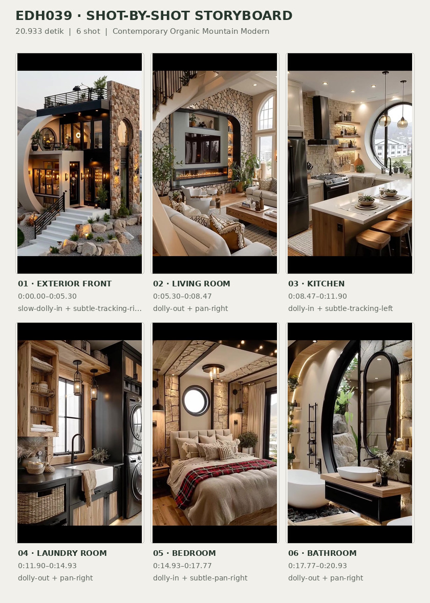
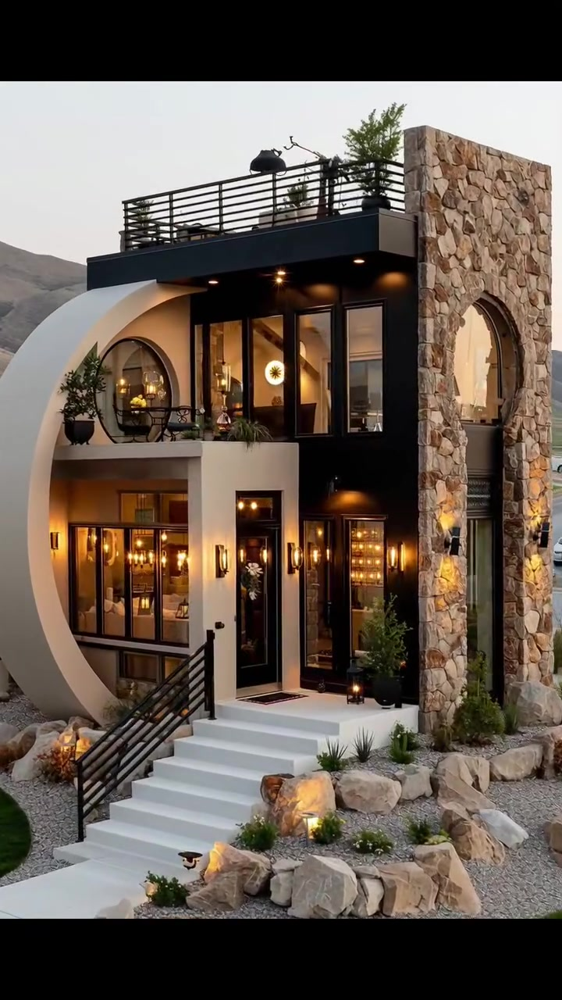
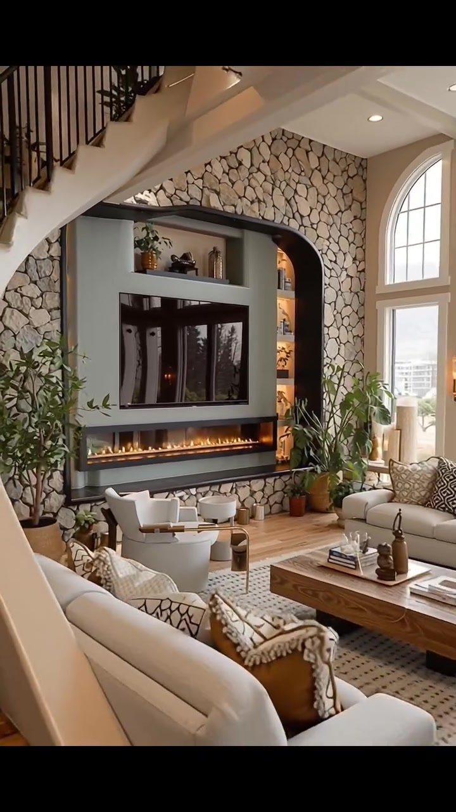
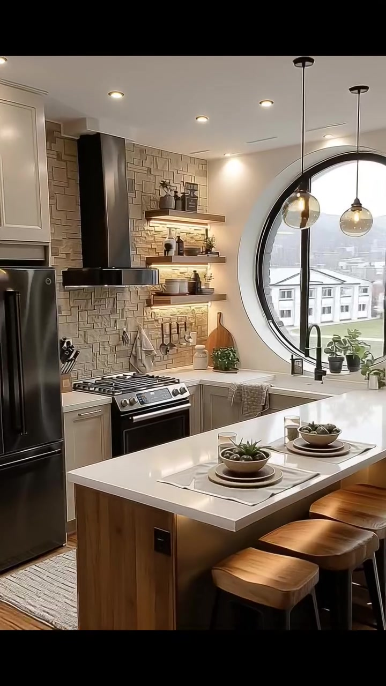
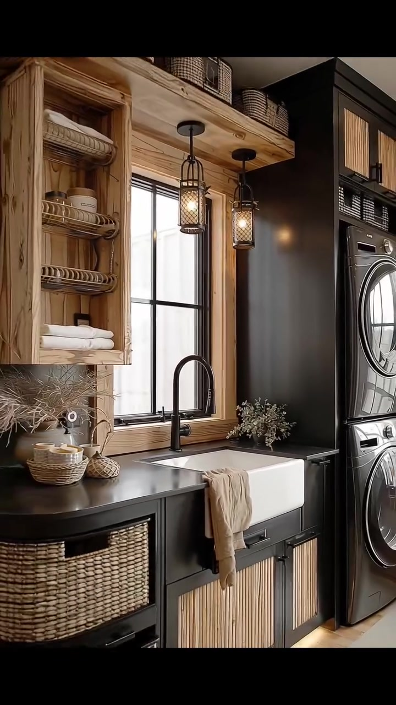
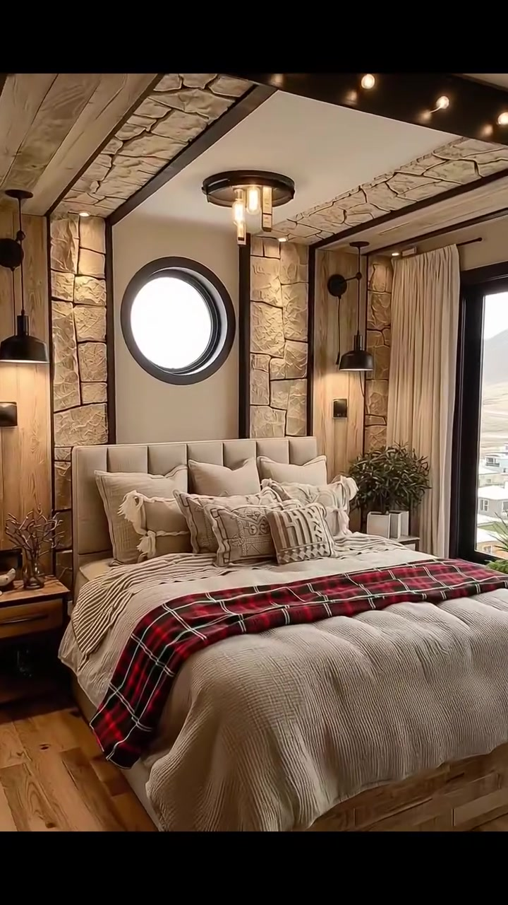
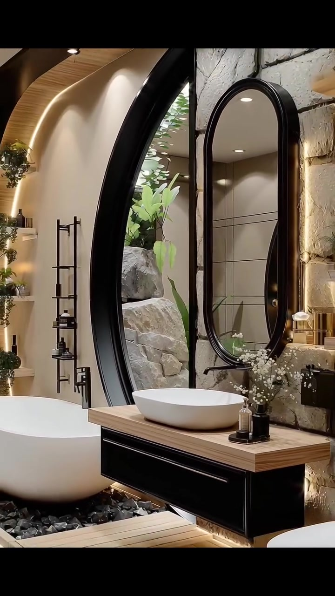

# edh039 — Contemporary Organic Mountain Modern

<!-- homeku_request_id: edh039-20261105-e4fe667fac888b4a354a -->

<!-- homeku_detail_narratives: chat-reviewed -->

**Sumber data:** [analysis.yaml](analysis.yaml) · **Status:** draft · **Diverifikasi manusia:** Tidak

## 1. Informasi Video

| Informasi | Nilai |
|---|---|
| ID | edh039 |
| File asli | edh039.mp4 |
| Durasi | 20.933 |
| Resolusi | 720x1280 |
| FPS | 30 |
| Rasio | 9:16 |
| Jumlah shot | 6 |

## 2. Storyboard Gabungan

## 3. Identitas Desain

| Aspek | Hasil analisis |
|---|---|
| Gaya utama | contemporary organic mountain modern |
| Wilayah terkait gaya desain | north america, europe |
| Pengaruh gaya | sculptural curvilinear modernism, rustic stone and timber, industrial black metal accents |
| Ciri eksterior | off white sculptural front arch, rough tan stone vertical tower, black flat roof terrace guardrails, dark charcoal cladding, tall black framed glazing, white front staircase with black handrail |
| Gaya interior | warm modern rustic, contemporary neutral furnishings, stone accent walls, natural wood appearance finishes, black metal light fixtures |
| Confidence gaya | medium |

## 4. Ukuran & Proporsi Bangunan

| Aspek | Estimasi visual |
|---|---|
| Ukuran yang terlihat | large |
| Bentuk bangunan | compact rectangular core with curved front volume |
| Skala vertikal | two stories with rooftop terrace |
| Tapak bangunan | moderate |
| Perkiraan luas lantai | 150–300 m² |
| Confidence | low |

> Luas adalah perkiraan visual, bukan ukuran terukur.

## 5. Warna, Pencahayaan, dan Atmosfer

| Warna dominan | HEX (perkiraan) |
|---|---|
| warm off white | #EAE5DA |
| charcoal black | #272624 |
| tan natural stone | #B9A086 |
| honey wood | #AD855A |
| soft cream | #D8CEBC |
| tartan deep red accent | #843A3D |

| Aspek | Hasil analisis |
|---|---|
| Pencahayaan | warm exterior architectural lighting, soft natural daylight, warm interior recessed and pendant lighting |
| Lingkungan | dry rolling hills near exterior view, boulder rock garden at front entry, small shrubs and lawn patch, plants and stones visible outside bathroom glazing |
| Musim yang tampak | Tidak diketahui |
| Mood | warm, cozy, sculptural, refined, spa like |

## 6. Struktur dan Timeline Video

**Jenis:** architectural home tour · **Tempo:** moderate · **Transisi:** five hard cuts between six slow moving shots

| Shot | Waktu (detik) | Durasi | Area/Scene | Gerakan Kamera |
|---|---|---|---|---|
| Shot 01 | 0.0–5.3 | 5.30 | exterior front | slow dolly in, subtle tracking right |
| Shot 02 | 5.3–8.467 | 3.17 | living room | dolly out, pan right |
| Shot 03 | 8.467–11.9 | 3.43 | kitchen | dolly in, subtle tracking left |
| Shot 04 | 11.9–14.933 | 3.03 | laundry room | dolly out, pan right |
| Shot 05 | 14.933–17.767 | 2.83 | bedroom | dolly in, subtle pan right |
| Shot 06 | 17.767–20.933 | 3.17 | bathroom | dolly out, pan right |

## 7. Analisis per Shot

### Shot 01 — exterior front

**Waktu:** 0.0–5.3 detik

| Komponen | Pengamatan |
|---|---|
| Fokus utama | two story curvilinear modern house with stone tower and roof terrace |
| Framing awal → akhir | wide three quarter front elevation → medium front facade view |
| Sudut pandang | slightly elevated front left three quarter |
| Gerakan kamera | slow dolly in, subtle tracking right |
| Kecepatan kamera | slow |
| Pencahayaan | mixed cool dusk ambient and warm architectural lighting |
| Transisi keluar | hard cut |

**Detail yang terlihat**

**Arsitektur**

Rumah dua lantai ini beratap datar dengan teras terbuka di bagian paling atas. Pita fasad putih gading melengkung besar membingkai sisi kiri muka rumah, sementara dinding vertikal di kanan dilapis batu bertekstur warna cokelat muda dengan ceruk berbentuk lengkung tinggi. Teras atap diberi pagar besi hitam horizontal. Bidang lantai atas berwarna arang memiliki kaca\-kaca tinggi berbingkai hitam, sedangkan balkon atas kiri menampilkan pagar logam dan detail lengkung. Di lantai dasar tampak pintu dan jendela kaca penuh berbingkai hitam, termasuk pintu masuk ramping dengan kaca vertikal. Tangga masuk dan pelatarannya putih, dengan pegangan besi hitam; lampu sorot hangat tersembunyi di bawah atap dan balkon serta lampu dinding mengapit bukaan bawah.

**Furnitur dan properti**

Di balkon kiri atas tampak kursi luar ruang berwarna gelap beserta sebuah meja kecil. Sejumlah pot tanaman hijau menghiasi balkon itu; satu tanaman semak dalam pot juga berada dekat pintu masuk lantai dasar.

**Lingkungan**

Batu\-batu besar berwarna krem tersusun sebagai taman bebatuan di sekitar tangga dan dasar dinding sisi kanan. Di antaranya tumbuh semak rendah dan rumput hias, dikelilingi kerikil kelabu. Jalur paving terang yang sedikit melengkung mengarah ke tangga, dengan sepetak rumput hijau di kiri bawah. Di belakang sisi kiri rumah terlihat perbukitan cokelat kering di bawah langit senja pucat yang tampak berawan. Lampu sorot dari area tanah menerangi bebatuan dan dinding batu.

**Catatan pengamatan:** Fasad terlihat dari depan kiri; sisi belakang dan kedalaman bangunan tidak terlihat. Material batu dan kayu dideskripsikan berdasarkan penampakannya.

**Confidence:** Kamera medium · Detail visual high

### Shot 02 — living room

**Waktu:** 5.3–8.467 detik

| Komponen | Pengamatan |
|---|---|
| Fokus utama | double height living space with stone fireplace wall and staircase |
| Framing awal → akhir | medium detail of fireplace feature wall → wide living area with staircase and windows |
| Sudut pandang | interior eye level three quarter |
| Gerakan kamera | dolly out, pan right |
| Kecepatan kamera | moderate |
| Pencahayaan | soft window daylight with warm recessed accents and fireplace glow |
| Transisi keluar | hard cut |

**Detail yang terlihat**

**Arsitektur**

Dinding aksen ruang keluarga berlapis batu terang bertekstur dari bawah ke atas, dibingkai lengkungan gelap yang tinggi. Televisi hitam persegi panjang tergantung di atas perapian linier dengan efek nyala api jingga; rak pajangan putih terintegrasi di bagian atas dan sisi dinding tersebut. Lantainya berupa papan berpenampilan kayu warna madu. Di sisi kiri, tangga putih dengan anak tangga kayu naik di bawah pagar baluster logam hitam. Sisi kanan dipenuhi jendela\-jendela tinggi berbentuk lengkung berbingkai putih dan berkisi, sementara plafon putih memiliki lampu downlight kecil.

**Furnitur dan properti**

Sofa kain krem dengan bantal motif beige ditempatkan dekat jendela kanan. Di depan dinding perapian terdapat dua kursi bundar berlapis kain krem, menghadap meja kopi rendah berbentuk persegi panjang berbahan kayu. Karpet krem dengan motif kecil gelap membentang di bawah meja; meja samping kayu bundar berdiri dekat area duduk. Pot\-pot terakota berisi tanaman hijau berjajar di kaki dinding aksen, rak menampilkan vas dan ornamen, sedangkan meja kopi memuat lilin ramping dan buku.

**Lingkungan**

Cahaya siang masuk melalui jendela tinggi di kanan; bangunan\-bangunan berwarna terang terlihat jauh di balik kacanya.

**Catatan pengamatan:** Gerakan melebar dari dinding TV/perapian memperlihatkan posisi sofa, kursi, jendela, dan tangga.

**Confidence:** Kamera medium · Detail visual high

### Shot 03 — kitchen

**Waktu:** 8.467–11.9 detik

| Komponen | Pengamatan |
|---|---|
| Fokus utama | bright kitchen with white island stone backsplash and round window |
| Framing awal → akhir | wide kitchen with island and large round window → medium view of range hood and island |
| Sudut pandang | interior eye level from island corner |
| Gerakan kamera | dolly in, subtle tracking left |
| Kecepatan kamera | slow |
| Pencahayaan | bright daylight combined with recessed and warm shelf lighting |
| Transisi keluar | hard cut |

**Detail yang terlihat**

**Arsitektur**

Dapur memiliki jendela bundar besar dengan bingkai logam hitam di dinding belakang. Kabinet pintu berpanel sederhana berwarna putih dan beige muda dipadukan dengan backsplash berpenampilan batu persegi panjang yang bertekstur terang. Tudung pengisap asap hitam doff berdiri di atas kompor hitam dan baja nirkarat, sementara kulkas hitam tinggi berada di kirinya. Countertop perimeter dan island berwarna putih mulus; bagian dasar island persegi panjang dilapis kayu. Lantai berpenampilan papan kayu terang dan plafon putih dilengkapi downlight kecil. Rak\-rak kayu melayang di dinding memasak disinari lampu hangat dari bawah.

**Furnitur dan properti**

Di sisi island yang dekat kamera terlihat dua bangku dudukan kayu dengan penopang gelap. Dua lampu gantung berbentuk bola kaca berada di atas island, yang ditata dengan dua set piring putih, mangkuk kecil, dan sajian hijau. Rak terbuka memuat mangkuk, stoples, dan tanaman kecil. Di dekat kompor terdapat blok pisau serta peralatan masak; area bawah jendela bundar menampilkan tanaman pot kecil dan keran hitam. Sehelai karpet terang diletakkan di depan kompor.

**Lingkungan**

Bangunan tetangga berwarna terang tampak melalui jendela bundar, yang juga memasukkan cahaya siang lembut ke dapur.

**Catatan pengamatan:** Warna peralatan, jendela bundar, bentuk kabinet, dan furnitur pulau teramati dalam gerak mendekat.

**Confidence:** Kamera medium · Detail visual high

### Shot 04 — laundry room

**Waktu:** 11.9–14.933 detik

| Komponen | Pengamatan |
|---|---|
| Fokus utama | rustic modern laundry sink with open wood shelves and stacked machines |
| Framing awal → akhir | medium close view of sink and window → wide laundry wall with stacked appliances |
| Sudut pandang | interior front three quarter |
| Gerakan kamera | dolly out, pan right |
| Kecepatan kamera | moderate |
| Pencahayaan | bright window daylight with warm pendant and under cabinet accents |
| Transisi keluar | hard cut |

**Detail yang terlihat**

**Arsitektur**

Area laundry memiliki jendela persegi panjang tinggi berkisi hitam tepat di atas bak cuci, dikelilingi kusen dan rak atas dengan tampilan kayu tebal. Rak kayu terbuka berdiri di sisi kiri jendela. Countertop hitam membentang di atas kabinet bawah, dengan bak cuci apron\-front putih besar dan keran hitam berleher angsa tinggi. Kabinet bawah berwarna hitam mempunyai sisipan panel kayu terang vertikal; kabinet tinggi di sisi kanan berwarna arang gelap, sedangkan dinding kiri memperlihatkan aksen batu kasar. Lantai papan berpenampilan kayu hangat dengan cahaya tersembunyi di bawah kabinet dekat lantai.

**Furnitur dan properti**

Dua lampu gantung berkerangka sangkar logam hitam turun di depan jendela. Mesin cuci dan pengering berwarna gelap dengan pintu bulat kaca ditumpuk di sisi kanan. Keranjang anyaman mengisi kompartemen penyimpanan bawah, sementara handuk putih dilipat dan digulung di rak kayu terbuka. Vas keramik dan wadah kecil menghiasi rak serta countertop. Handuk krem tersampir di bagian depan bak cuci, keranjang tambahan tersusun di atas kabinet tinggi, dan vas kecil berisi tangkai bunga putih terletak di kanan keran.

**Lingkungan**

Cahaya siang terang masuk melalui jendela di atas bak cuci; dinding eksterior berwarna terang terlihat di seberang jendela.

**Catatan pengamatan:** Dari detail bak cuci, kamera melebar ke kanan hingga mesin cuci dan pengering bertumpuk terlihat.

**Confidence:** Kamera medium · Detail visual high

### Shot 05 — bedroom

**Waktu:** 14.933–17.767 detik

| Komponen | Pengamatan |
|---|---|
| Fokus utama | cozy stone and timber bedroom with round window over bed |
| Framing awal → akhir | medium wide view of full bed and side window → medium close view of headboard and bedding |
| Sudut pandang | interior eye level from front left of bed |
| Gerakan kamera | dolly in, subtle pan right |
| Kecepatan kamera | slow |
| Pencahayaan | natural daylight with warm ceiling spotlights and bedside accents |
| Transisi keluar | hard cut |

**Detail yang terlihat**

**Arsitektur**

Dinding kepala tempat tidur dibingkai dua pilar berpenampilan batu warna pasir terang, dengan jendela bundar kecil berbingkai hitam tepat di atas headboard. Balok\-balok plafon kayu rustic yang tebal diselingi bidang berpenampilan batu, sementara balok melintang gelap memuat barisan lampu sorot kecil hangat. Di kanan tempat tidur ada jendela lebar persegi panjang berbingkai hitam dan tirai beige di kedua sisinya. Lantai berupa papan berpenampilan kayu madu, dengan lampu aksen hangat di celah dinding antara bidang kayu dan batu serta panel plafon putih halus di sela balok.

**Furnitur dan properti**

Tempat tidur besar rendah memakai headboard empuk warna krem, dilengkapi selimut tebal krem dan banyak bantal beige serta bantal bermotif yang bertumpuk. Kain selimut plaid merah, hitam, dan krem terhampar melintang di bagian kaki kasur. Meja samping kayu terang berada di masing\-masing sisi, dengan lampu gantung hitam di dekat kedua sisi headboard. Tanaman hijau kecil ditempatkan pada meja kanan dan beberapa dekorasi kecil pada meja kiri. Sebagian karpet krem bertekstur tampak di ujung kaki tempat tidur.

**Lingkungan**

Melalui jendela samping kanan terlihat perbukitan landai berwarna pucat dan kering. Cahaya siang masuk melalui jendela bundar di atas ranjang dan jendela besar di samping.

**Catatan pengamatan:** Jendela samping menunjukkan lanskap kering; bentuk jendela bundar dan tata ruang bedhead tetap jelas saat mendekat.

**Confidence:** Kamera medium · Detail visual high

### Shot 06 — bathroom

**Waktu:** 17.767–20.933 detik

| Komponen | Pengamatan |
|---|---|
| Fokus utama | spa like bathroom with arched black framed glazing and freestanding tub |
| Framing awal → akhir | medium close view of vanity and arch window → wide bathroom showing tub vanity and toilet |
| Sudut pandang | interior eye level three quarter |
| Gerakan kamera | dolly out, pan right |
| Kecepatan kamera | moderate |
| Pencahayaan | soft daylight with warm indirect arch and recessed ceiling lighting |
| Transisi keluar | end of video |

**Detail yang terlihat**

**Arsitektur**

Kamar mandi memiliki bukaan kaca tinggi melengkung dengan bingkai logam hitam di sebelah kiri, berada di bawah lengkungan putih gading yang lebar di area berendam. Di sekitar cermin, dinding tersusun dari blok\-blok berpenampilan batu pucat tidak beraturan. Cermin oval vertikal berbingkai tipis hitam dipasang di atas meja rias melayang, yang mempunyai laci hitam dan countertop berpenampilan kayu alami. Dekat bak mandi terdapat lantai platform serta anak pijakan berpenampilan kayu; area di bawah dan sekelilingnya tampak berisi kerikil hitam. Bagian dinding lain halus berwarna beige terang, diberi lampu tidak langsung hangat di sepanjang lengkungan, sementara plafon putih memakai beberapa downlight kecil.

**Furnitur dan properti**

Bak mandi oval putih berdiri bebas pada area berkerikil hitam. Wastafel mangkuk oval putih berada di atas meja rias dengan keran hitam tuas tunggal di belakangnya. Toilet putih menyatu terlihat di kanan bawah. Botol sabun gelap kecil serta rangkaian bunga putih menghiasi meja wastafel. Sebuah tangga handuk ramping berwarna hitam berdiri dekat dinding kiri; rak pajangan kecil sepanjang dinding lengkung memuat tanaman pot hijau. Lampu gantung vertikal bernuansa hangat berada di samping dinding batu area cermin.

**Lingkungan**

Di luar bukaan kaca terlihat tanaman berdaun hijau dan batu\-batu besar kelabu. Cahaya siang yang tersebar masuk dari sisi kiri tersebut.

**Catatan pengamatan:** Kamera memperlebar tampilan dari area wastafel ke bak mandi dan toilet; area berbatu dan tanaman terlihat melalui kaca.

**Confidence:** Kamera medium · Detail visual high

## 8. Kualitas dan Ketidakpastian Analisis

| Parameter | Hasil |
|---|---|
| Status | draft |
| Verifikasi manusia | Tidak |
| Ketepatan timestamp | frame based for hard cuts |
| Ketidakpastian | regional association is stylistic not geographic location, building floor area is rough visual estimate without known dimensions, stone and wood materials are inferred from visible appearance, some camera movements can be digital zoom or generated camera motion, different room lighting does not establish same time of day, exterior rocky hills do not prove specific country or season |

**Catatan:** Analisis visual berdasar seluruh durasi setiap shot pada berkas chat yang Git blob SHA-nya cocok dengan video di main. Keyframe masih null pada tahap review, dan akan diekstraksi oleh workflow setelah persetujuan resmi.

---

*Laporan ini diturunkan dari [analysis.yaml](analysis.yaml).*
