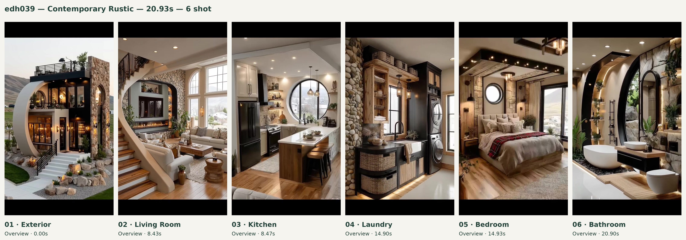
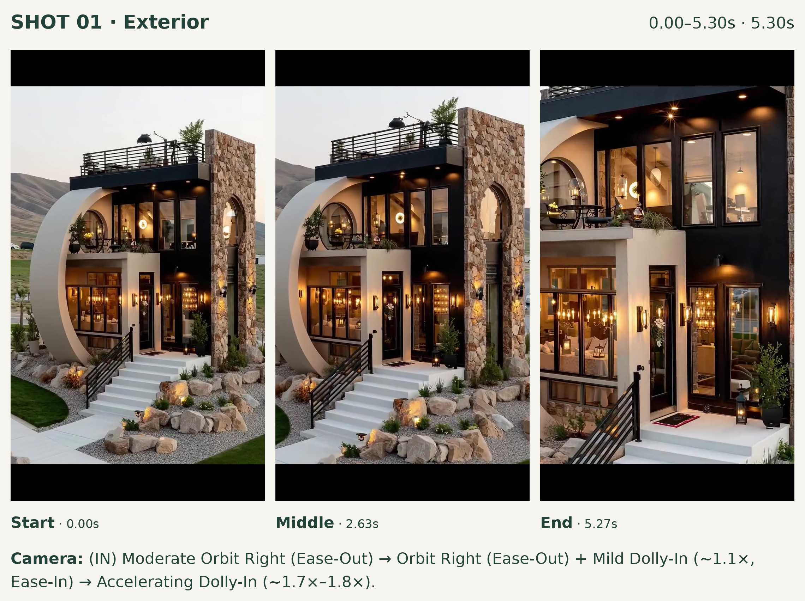
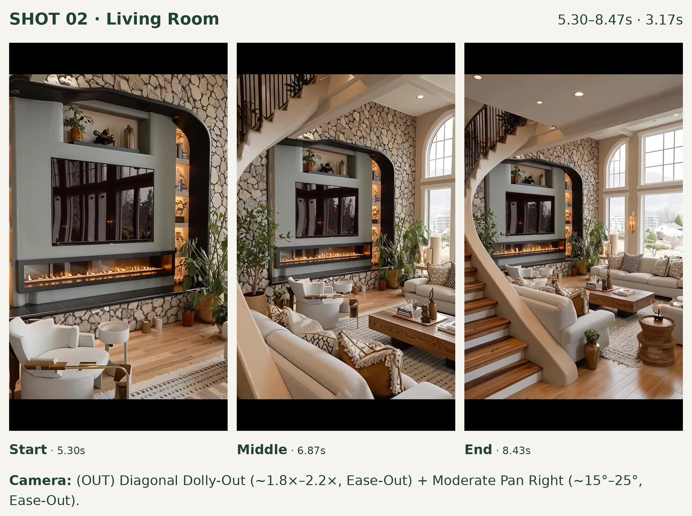
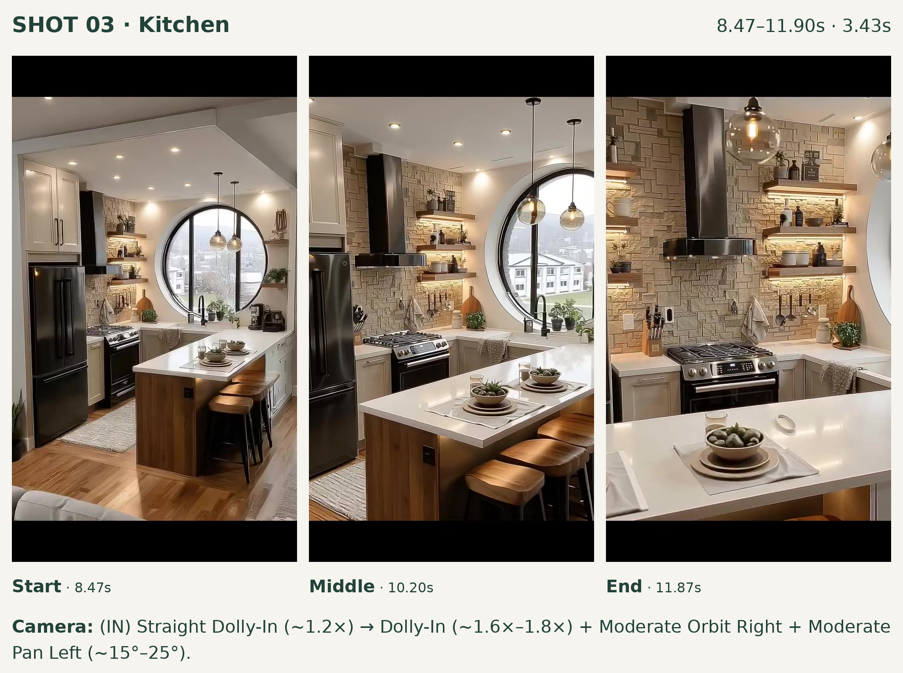
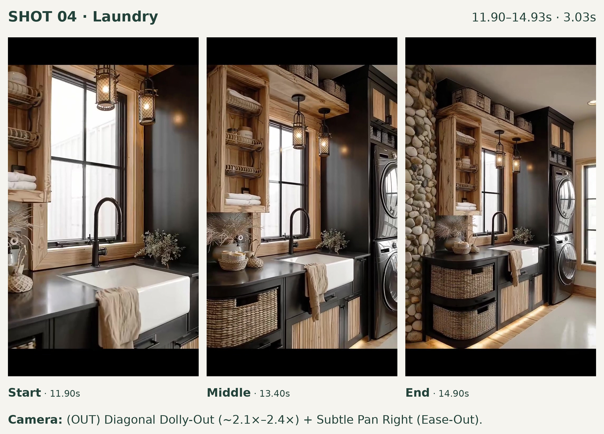
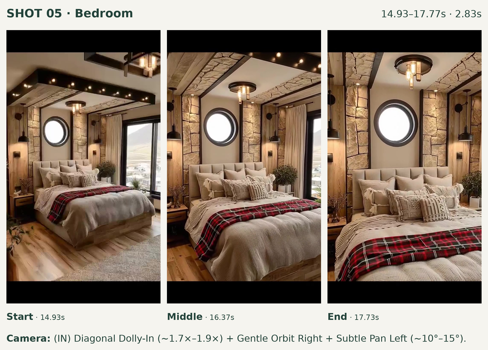
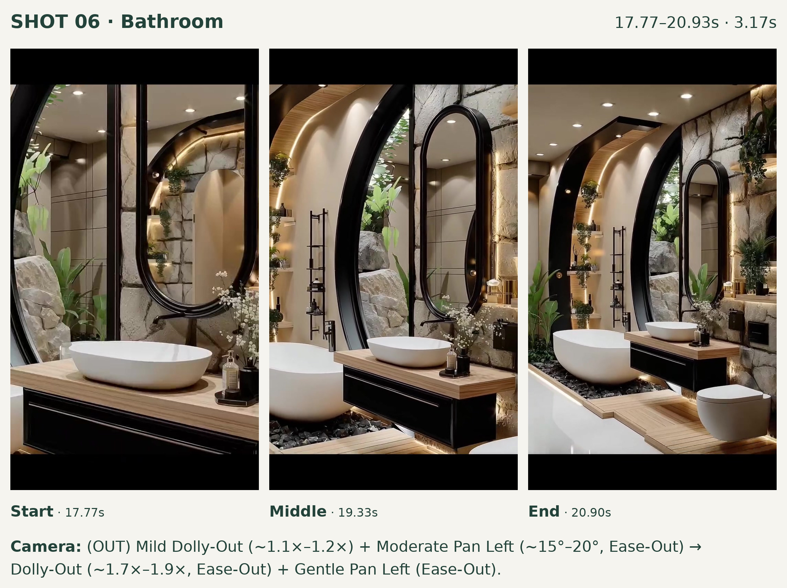

# edh039 — Curved Stone & Black Contemporary Rustic House

## 1. Profil desain

- **Nama desain:** Curved Stone & Black Contemporary Rustic House
- **Tipe rumah:** Detached House
- **Gaya utama:** **Contemporary Rustic**
- **Pengaruh gaya:** Organic Modern
- **Gaya interior:** Rustic Contemporary
- **Susunan ruang utama:** Exterior, ruang duduk dengan tangga, dapur ber-island, laundry, kamar tidur, kamar mandi. Keterhubungan denah tidak terbukti oleh cut.
- **Ciri khas:** Bingkai kurva besar, motif lingkaran, tekstur batu dan aksen hitam berulang.
- **Material utama:** Tampilan batu beige kasar, dinding ivory, logam hitam dan kayu cokelat hangat; spesifikasi material fisik tidak terkonfirmasi.
- **Pencahayaan:** Cahaya luar lembut; interior menggabungkan daylight dari bukaan dengan downlight, lampu gantung dan lampu aksen hangat.
- **Atmosfer:** Kontras gelap-terang, tekstur natural dan cahaya keemasan memberi kesan hangat, dramatis dan nyaman.
- **Lingkungan:** Tapak berbatu dan rumput, tanaman rendah, latar lereng kering; pemandangan luar melalui jendela.

### Palet warna

| Peran | Warna | HEX |
| --- | --- | --- |
| Dominan | Ivory | `#E5DDD0` |
| Pendamping | Charcoal Black | `#242322` |
| Pendamping | Warm Stone Beige | `#B6A18B` |
| Pendamping | Honey Wood | `#A87949` |
| Pendamping | Warm Taupe | `#B5A797` |
| Aksen | Deep Red | `#81332D` |

## 2. Ukuran & proporsi

| Aspek | Estimasi visual |
| --- | --- |
| **Ukuran rumah** | medium |
| **Bentuk bangunan** | Massa vertikal dua tingkat tampak, bingkai kurva putih besar, bidang hitam dan dinding batu kanan. |
| **Lantai & bentuk atap** | two storeys with rooftop terrace · Atap tampak datar dengan teras berpagar hitam. |
| **Tapak bangunan** | unknown |
| **Proporsi utama** | tall narrow frontage |
| **Perkiraan luas lantai** | **100–180 m²** |

## 3. Shot Timeline

Durasi 20.93s · 6 shot.

**Camera Pattern:** IN – OUT – IN – OUT – IN – OUT.

| Shot | Time (s) | Duration | Area/Scene | Camera Movement |
| --- | --- | --- | --- | --- |
| 01 | 0.00–5.30 | 5.30s | Exterior | Moderate Orbit Right (Ease-Out) → Orbit Right (Ease-Out) + Mild Dolly-In (~1.1×, Ease-In) → Accelerating Dolly-In (~1.7×–1.8×). |
| 02 | 5.30–8.47 | 3.17s | Living Room | Diagonal Dolly-Out (~1.8×–2.2×, Ease-Out) + Moderate Pan Right (~15°–25°, Ease-Out). |
| 03 | 8.47–11.90 | 3.43s | Kitchen | Straight Dolly-In (~1.2×) → Dolly-In (~1.6×–1.8×) + Moderate Orbit Right + Moderate Pan Left (~15°–25°). |
| 04 | 11.90–14.93 | 3.03s | Laundry | Diagonal Dolly-Out (~2.1×–2.4×) + Subtle Pan Right (Ease-Out). |
| 05 | 14.93–17.77 | 2.83s | Bedroom | Diagonal Dolly-In (~1.7×–1.9×) + Gentle Orbit Right + Subtle Pan Left (~10°–15°). |
| 06 | 17.77–20.93 | 3.17s | Bathroom | Mild Dolly-Out (~1.1×–1.2×) + Moderate Pan Left (~15°–20°, Ease-Out) → Dolly-Out (~1.7×–1.9×, Ease-Out) + Gentle Pan Left (Ease-Out). |

## 4. Overview

**Shot 01 · Exterior · 0.00s**

> Dari depan-kiri jalur luar menghadap serong fasad pada framing wide, memperlihatkan massa dua tingkat, lengkung putih, teras atap, akses bertangga dan tapak berbatu.

**Shot 02 · Living Room · 8.43s**

> Dari dekat tangga pada sudut ruang, menghadap dinding media dan jendela tinggi di kanan; wide mencakup sofa, kursi, meja, tangga dan bidang batu dengan perapian.

**Shot 03 · Kitchen · 8.47s**

> Dari sisi akses dapur menghadap serong ke island dan dinding belakang; wide memuat kulkas, kompor, island dengan bangku, kabinet dan jendela bulat.

**Shot 04 · Laundry · 14.90s**

> Dari posisi lebih jauh di depan bidang kerja menghadap serong sepanjang dinding, wide menampilkan sink di bawah jendela, rak kayu, keranjang, laundry tower kanan dan batu kiri.

**Shot 05 · Bedroom · 14.93s**

> Dari sudut kiri kaki ranjang menghadap serong ke headboard; wide memperlihatkan ranjang, struktur plafon, jendela bulat, bukaan kaca kanan, bedside dan lantai.

**Shot 06 · Bathroom · 20.90s**

> Dari posisi mundur menghadap serong sepanjang vanity dan sisi bathtub, wide mencakup bak putih, bukaan lengkung gelap, cermin oval, toilet, lantai aksen kerikil dan tanaman.

## 5. Storyboard

## 6. Shot Details

### Shot 01 · Exterior

**Time:** 0.00–5.30s · **Duration:** 5.30s

#### **A. Desain area**

**Arsitektur**

> Fasad tinggi bertingkat dua dengan bingkai lengkung putih raksasa, bidang gelap, panel batu kasar beige vertikal kanan dan jendela tinggi bingkai hitam. Teras atap ber-railing hitam; pintu kaca bawah dicapai lewat tangga putih dengan railing.

**Furnitur & dekorasi**

> Teras atap memperlihatkan tanaman pot; lampu dinding dan soffit menyala hangat, tanaman pot mengapit akses.

**Lingkungan**

> Bebatuan dekoratif, rumput dan jalur terang; bukit kering terlihat di belakang kiri.

#### **B. Framing & Lighting**

- **Fokus:** Pintu masuk dan tangga
- **Camera Start:** Di luar, pada sisi depan-kiri tangga. · Menghadap fasad dan pintu masuk serong. · oblique · Sekitar tinggi mata relatif jalur luar. · Sedikit mendongak mengikuti massa vertikal.
- **Framing:** Wide seluruh fasad dan sebagian tapak. → Medium fasad bawah dan pintu masuk.
- **Lighting:** Cahaya langit lembut, lampu fasad hangat.
- **Foreground dan kedalaman:** Tangga putih, bebatuan dan tanaman rendah. · Tangga menuju pintu dan massa dua tingkat di belakang.
- **Reveal:** Bidang batu kanan dan pintu makin jelas.
- **Kesesuaian gerak:** Orbit membuka sisi batu; dolly-in menonjolkan akses.

#### **C. Camera Movement**

Awal mengitari fasad ke kanan dengan skala hampir tetap, lalu pendekatan bertumpang tindih dan berlanjut dominan menuju tangga dan pintu.

**Tempo:** Awal pelan dan terkendali, pendekatan menjadi semakin nyata dan cepat menuju akhir.

**Movement Timeline**

| Time (s) | Area & fokus | Camera Movement | Tempo |
| --- | --- | --- | --- |
| 0.00–1.60 | Exterior · Fasad dan dinding batu kanan | Moderate Orbit Right (Ease-Out) | Awal pelan dan terkendali, pendekatan menjadi semakin nyata dan cepat menuju akhir. |
| 1.60–2.40 | Exterior · Sudut fasad dan pintu masuk | Orbit Right (Ease-Out) + Mild Dolly-In (~1.1×, Ease-In) | Awal pelan dan terkendali, pendekatan menjadi semakin nyata dan cepat menuju akhir. |
| 2.40–5.30 | Exterior · Pintu masuk dan tangga | Accelerating Dolly-In (~1.7×–1.8×) | Awal pelan dan terkendali, pendekatan menjadi semakin nyata dan cepat menuju akhir. |

**Camera:** Moderate Orbit Right (Ease-Out) → Orbit Right (Ease-Out) + Mild Dolly-In (~1.1×, Ease-In) → Accelerating Dolly-In (~1.7×–1.8×).

---

### Shot 02 · Living Room

**Time:** 5.30–8.47s · **Duration:** 3.17s

#### **A. Desain area**

**Arsitektur**

> Dinding tinggi bertekstur batu dengan bingkai lengkung hitam mengitari panel TV dan perapian linear. Tangga kayu dengan sisi putih dan baluster gelap di kiri, jendela lengkung tinggi di kanan; lantai tampak kayu.

**Furnitur & dekorasi**

> TV di atas perapian linear, ceruk rak bercahaya; kursi/sofa krem, meja kopi persegi panjang kayu, meja samping bulat, karpet dan tanaman.

**Lingkungan**

> Jendela besar menerangi ruang; lanskap luar terlihat terbatas.

#### **B. Framing & Lighting**

- **Fokus:** Living room, perapian dan tangga
- **Camera Start:** Dekat dinding media dan perapian. · Menghadap bidang media serong. · oblique · Sekitar tinggi mata. · Relatif datar.
- **Framing:** Medium dinding media dan kursi. → Wide ruang duduk, tangga dan jendela.
- **Lighting:** Daylight dari jendela kanan; api linear dan ceruk berlampu.
- **Foreground dan kedalaman:** Kursi krem dan tepi meja. · Furnitur depan, dinding media dan jendela tinggi di belakang.
- **Reveal:** Sofa, meja, tangga dan bukaan tinggi tersingkap.
- **Kesesuaian gerak:** Mundur membuka konteks dan tangga.

#### **C. Camera Movement**

Mundur serong dari perapian sambil membuka ruang duduk, jendela kanan dan tangga kiri.

**Tempo:** Mundur cukup nyata di awal, sapuan berkembang di tengah, gerakan melambat menjelang akhir.

**Camera:** Diagonal Dolly-Out (~1.8×–2.2×, Ease-Out) + Moderate Pan Right (~15°–25°, Ease-Out).

---

### Shot 03 · Kitchen

**Time:** 8.47–11.90s · **Duration:** 3.43s

#### **A. Desain area**

**Arsitektur**

> Dapur dengan island countertop putih berbasis tampilan kayu, kabinet putih dan perangkat hitam pada sisi kiri/belakang, jendela bulat berbingkai hitam serta backsplash tekstur batu beige. Lantai tampak papan kayu.

**Furnitur & dekorasi**

> Kulkas hitam tinggi di kiri, range dan hood hitam pada dinding batu; rak terbuka berlampu, sink dekat jendela, bangku kayu berjajar pada island dan dua lampu gantung kaca.

**Lingkungan**

> Pemandangan bangunan terang melalui jendela bulat.

#### **B. Framing & Lighting**

- **Fokus:** Island dan kompor dengan rak terbuka
- **Camera Start:** Di sisi akses dapur, depan island. · Menghadap island dan sudut kompor/jendela. · oblique · Sekitar tinggi mata. · Relatif datar.
- **Framing:** Wide kabinet, island dan jendela bulat. → Medium island dan kompor.
- **Lighting:** Daylight jendela bulat, downlight, pendant dan rak aksen.
- **Foreground dan kedalaman:** Ujung island, bangku dan perangkat meja. · Island di depan, kabinet dan dinding kompor di belakang.
- **Reveal:** Kompor, hood, rak dan backsplash makin dominan.
- **Kesesuaian gerak:** Dolly-in lalu sapuan memperjelas bidang kerja.

#### **C. Camera Movement**

Maju ke island, kemudian mendekat sambil mengitari ke kanan dan menyapu kiri menuju kompor.

**Tempo:** Maju stabil, sapuan makin nyata di bagian tengah sampai akhir.

**Movement Timeline**

| Time (s) | Area & fokus | Camera Movement | Tempo |
| --- | --- | --- | --- |
| 8.47–9.47 | Kitchen · Island dapur dan jendela bulat | Straight Dolly-In (~1.2×) | Maju stabil, sapuan makin nyata di bagian tengah sampai akhir. |
| 9.47–11.90 | Kitchen · Island dan kompor dengan rak terbuka | Dolly-In (~1.6×–1.8×) + Moderate Orbit Right + Moderate Pan Left (~15°–25°) | Maju stabil, sapuan makin nyata di bagian tengah sampai akhir. |

**Camera:** Straight Dolly-In (~1.2×) → Dolly-In (~1.6×–1.8×) + Moderate Orbit Right + Moderate Pan Left (~15°–25°).

---

### Shot 04 · Laundry

**Time:** 11.90–14.93s · **Duration:** 3.03s

#### **A. Desain area**

**Arsitektur**

> Bidang kerja linear dengan jendela persegi panjang berbingkai hitam, dinding batu bulat di kiri, kabinet gelap dan kayu; lantai terang pada akhir shot.

**Furnitur & dekorasi**

> Sink apron-front putih, keran hitam melengkung, countertop gelap, rak kayu terbuka, keranjang anyam bertingkat dan washer/dryer front-load bertumpuk di kanan. Lampu gantung kecil dan strip hangat bawah kabinet.

**Lingkungan**

> Cahaya luar terlihat melalui jendela; detail tapak tidak jelas.

#### **B. Framing & Lighting**

- **Fokus:** Wastafel laundry, kabinet dan mesin cuci
- **Camera Start:** Dekat sink dan jendela. · Menghadap dinding kerja. · frontal · Sekitar tinggi mata. · Relatif datar.
- **Framing:** Medium-close sink dan jendela. → Wide laundry tower dan penyimpanan.
- **Lighting:** Daylight jendela, pendant hangat dan aksen bawah kabinet.
- **Foreground dan kedalaman:** Countertop gelap dan sink putih. · Bidang kerja sepanjang dinding, tower di ujung kanan.
- **Reveal:** Kabinet, keranjang dan mesin bertumpuk.
- **Kesesuaian gerak:** Mundur membuka keseluruhan konfigurasi.

#### **C. Camera Movement**

Mundur dari wastafel untuk memperlihatkan unit laundry lengkap, dengan sapuan kanan ringan.

**Tempo:** Mundur relatif konsisten dan mereda pada akhir.

**Camera:** Diagonal Dolly-Out (~2.1×–2.4×) + Subtle Pan Right (Ease-Out).

---

### Shot 05 · Bedroom

**Time:** 14.93–17.77s · **Duration:** 2.83s

#### **A. Desain area**

**Arsitektur**

> Dinding headboard dengan pilaster tekstur batu dan kayu, jendela bulat berbingkai gelap di tengah; plafon dengan bidang balok hitam dan inset bertekstur, bukaan tinggi kaca kanan ber-gorden; lantai kayu hangat.

**Furnitur & dekorasi**

> Ranjang double dengan headboard tufted krem, bantal berlapis dan throw kotak merah-hitam; bedside kayu, lampu dinding/lampu plafon hangat dan karpet netral.

**Lingkungan**

> Lereng dan lanskap terang terlihat melalui kaca di sisi kanan.

#### **B. Framing & Lighting**

- **Fokus:** Ranjang dan jendela bulat kamar tidur
- **Camera Start:** Dekat sisi kaki ranjang dari kiri. · Menghadap headboard dan jendela lingkaran. · oblique · Sekitar tinggi mata. · Relatif datar.
- **Framing:** Wide ranjang, plafon, bukaan kanan. → Medium-close ranjang dan headboard.
- **Lighting:** Daylight kanan, lampu plafon dan bedside hangat.
- **Foreground dan kedalaman:** Kaki ranjang dan karpet. · Ranjang sebagai foreground menuju dinding kepala ranjang.
- **Reveal:** Tekstur dinding, bantal dan jendela bulat.
- **Kesesuaian gerak:** Dolly-in dan orbit menekankan framing frontal.

#### **C. Camera Movement**

Mendekati ranjang dari sudut kiri menjadi lebih frontal, sambil menyapu ke kiri menuju kepala ranjang.

**Tempo:** Laju pendekatan relatif stabil; sapuan lebih terlihat menjelang akhir.

**Camera:** Diagonal Dolly-In (~1.7×–1.9×) + Gentle Orbit Right + Subtle Pan Left (~10°–15°).

---

### Shot 06 · Bathroom

**Time:** 17.77–20.93s · **Duration:** 3.17s

#### **A. Desain area**

**Arsitektur**

> Bukaan lengkung tinggi berbingkai hitam di sisi bak dengan batu besar dan tanaman di baliknya; dinding stone-look beige, plafon melengkung beraksen hitam dan lampu tanam, lantai beraksen kerikil dan jalur kayu.

**Furnitur & dekorasi**

> Bathtub freestanding putih di kiri, vanity floating hitam dengan countertop tampak kayu dan vessel sink putih, cermin oval hitam, toilet putih kanan, keran shower gelap dan ceruk tanaman/aksesori.

**Lingkungan**

> Batuan besar dan tanaman terlihat di balik bukaan; belum jelas apakah taman terbuka atau ruang terlindung.

#### **B. Framing & Lighting**

- **Fokus:** Kamar mandi, bak mandi dan vanity
- **Camera Start:** Di depan vanity dekat cermin. · Menghadap vanity dan bukaan lengkung. · oblique · Sekitar tinggi mata. · Relatif datar.
- **Framing:** Medium sink, cermin dan bukaan. → Wide bathtub, vanity dan toilet.
- **Lighting:** Downlight, lampu ceruk hangat, daylight bukaan lengkung.
- **Foreground dan kedalaman:** Bowl sink putih di countertop kayu. · Vanity depan, bathtub dan area batu/vegetasi di belakang.
- **Reveal:** Bathtub, area tanaman, toilet dan rak.
- **Kesesuaian gerak:** Pan kiri lalu dolly-out memperlihatkan perlengkapan lain.

#### **C. Camera Movement**

Sapuan kiri dominan dari vanity menuju bak mandi; mundur makin terasa kemudian mereda pada tampilan kamar mandi luas.

**Tempo:** Sapuan relatif cepat di awal, mundur dominan di tengah, mereda menjelang akhir.

**Movement Timeline**

| Time (s) | Area & fokus | Camera Movement | Tempo |
| --- | --- | --- | --- |
| 17.77–18.93 | Bathroom · Vanity, cermin dan bukaan taman | Mild Dolly-Out (~1.1×–1.2×) + Moderate Pan Left (~15°–20°, Ease-Out) | Sapuan relatif cepat di awal, mundur dominan di tengah, mereda menjelang akhir. |
| 18.93–20.93 | Bathroom · Kamar mandi, bak mandi dan vanity | Dolly-Out (~1.7×–1.9×, Ease-Out) + Gentle Pan Left (Ease-Out) | Sapuan relatif cepat di awal, mundur dominan di tengah, mereda menjelang akhir. |

**Camera:** Mild Dolly-Out (~1.1×–1.2×) + Moderate Pan Left (~15°–20°, Ease-Out) → Dolly-Out (~1.7×–1.9×, Ease-Out) + Gentle Pan Left (Ease-Out).

**Catatan referensi:** Estimasi luas lantai 100–180 m² adalah perkiraan visual kasar berdasarkan proporsi dua tingkat dan furnitur, bukan pengukuran. Material dijelaskan berdasarkan tampilan. Video tidak membuktikan denah, ukuran, tipe konstruksi, atau bahwa seluruh shot berasal dari satu rumah fisik. Kamera dipertahankan persis sesuai audit Fase 2 yang disetujui. Awal tiap shot jernih; panel Start mengikuti frame awal native, tidak memerlukan Production Start terpisah.
