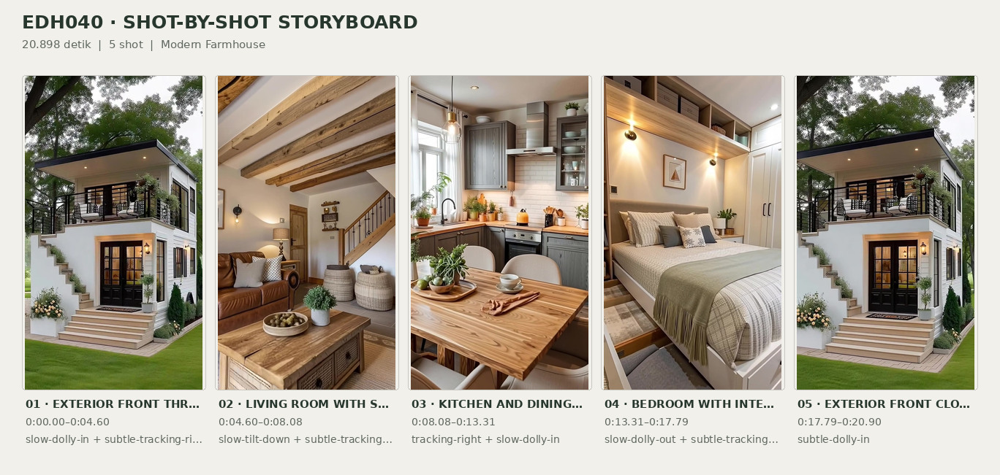
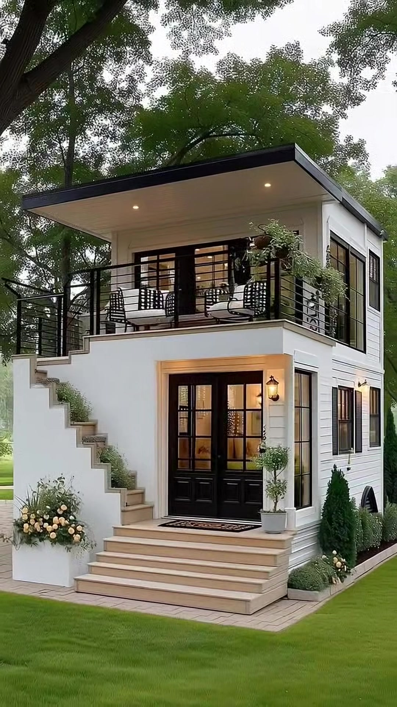
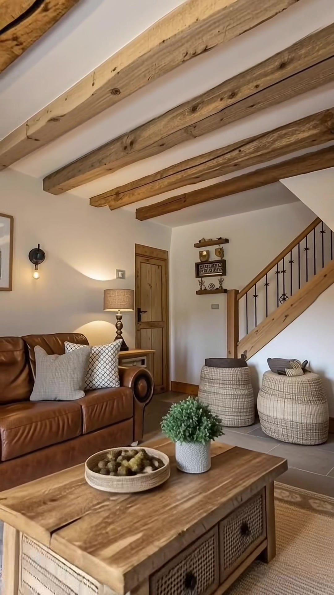
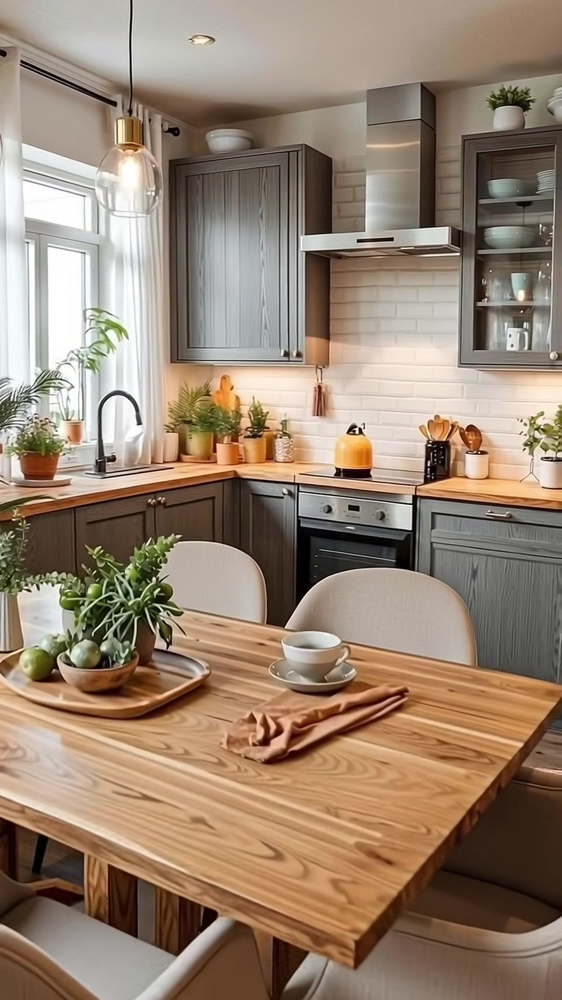
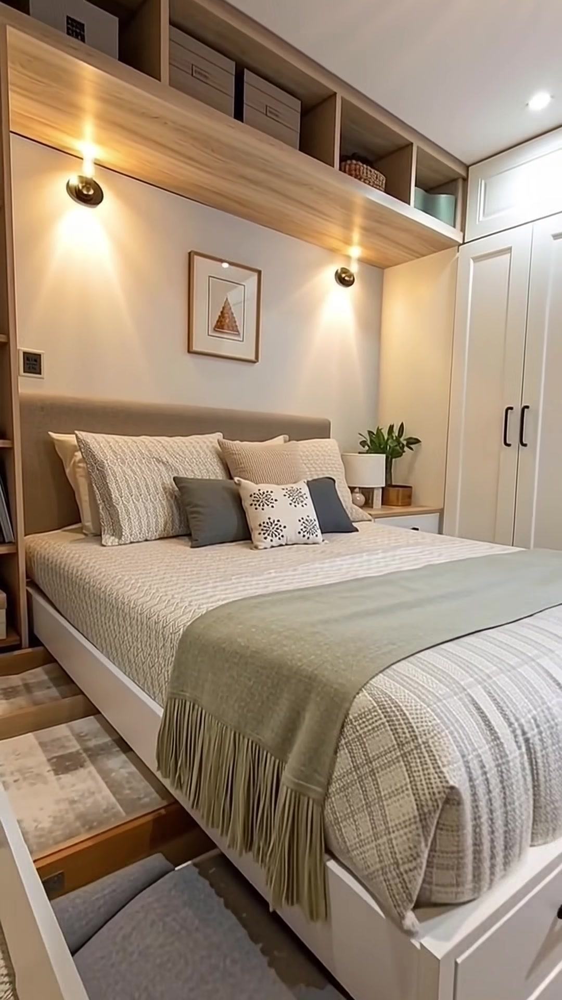
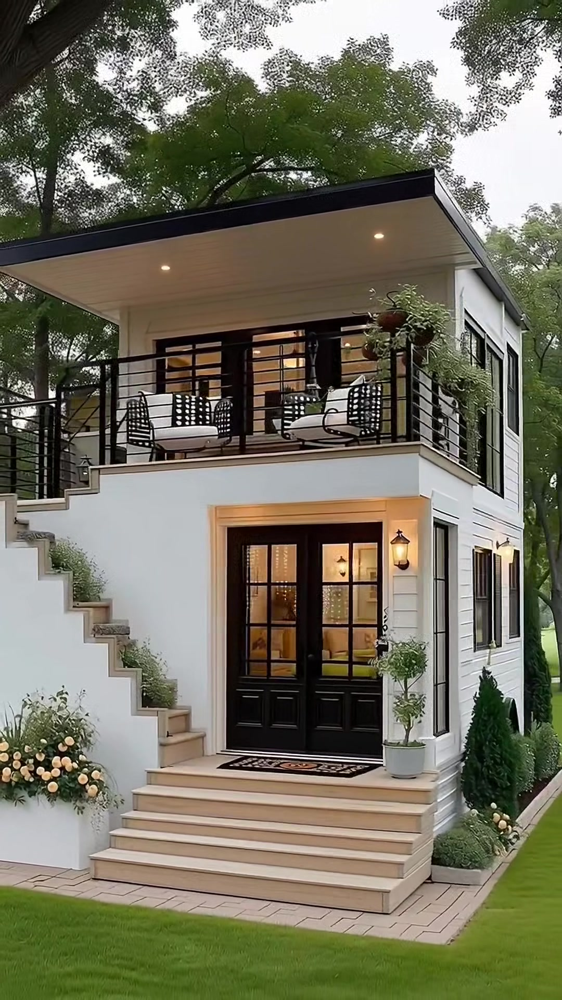

# edh040 — Modern Farmhouse

<!-- homeku_request_id: edh040_0edf3cc873cc78b43cba549c -->

<!-- homeku_detail_narratives: chat-reviewed -->

**Sumber data:** [analysis.yaml](analysis.yaml) · **Status:** draft · **Diverifikasi manusia:** Tidak

## 1. Informasi Video

| Informasi | Nilai |
|---|---|
| ID | edh040 |
| File asli | edh040.mp4 |
| Durasi | 20.898 |
| Resolusi | 1080x1920 |
| FPS | 60.041 |
| Rasio | 9:16 |
| Jumlah shot | 5 |

## 2. Storyboard Gabungan

## 3. Identitas Desain

| Aspek | Hasil analisis |
|---|---|
| Gaya utama | modern farmhouse |
| Wilayah terkait gaya desain | north america |
| Pengaruh gaya | contemporary minimalist, rustic interior, space saving built ins |
| Ciri eksterior | white horizontal siding, low slope roof with deep overhang, upper front balcony, black metal balcony railing, black gridded glazing, exterior staircase to second floor, warm lantern sconces |
| Gaya interior | rustic modern living room, warm neutral color palette, exposed wood ceiling beams, gray shaker kitchen cabinets, integrated bedroom storage |
| Confidence gaya | medium |

## 4. Ukuran & Proporsi Bangunan

| Aspek | Estimasi visual |
|---|---|
| Ukuran yang terlihat | small |
| Bentuk bangunan | compact rectangular two story |
| Skala vertikal | two story |
| Tapak bangunan | compact |
| Perkiraan luas lantai | 65–110 m² |
| Confidence | low |

> Luas adalah perkiraan visual, bukan ukuran terukur.

## 5. Warna, Pencahayaan, dan Atmosfer

| Warna dominan | HEX (perkiraan) |
|---|---|
| soft white | #F2F0E9 |
| warm wood brown | #B48A5D |
| deep charcoal | #272523 |
| sage green | #A7AD96 |
| warm taupe | #B4A89B |
| muted gray | #777A79 |

| Aspek | Hasil analisis |
|---|---|
| Pencahayaan | soft diffuse daylight, warm exterior wall lanterns, warm interior practical lamps, natural window light, warm under cabinet kitchen light |
| Lingkungan | mature green trees around house, maintained grass lawn, flowering shrubs near entry, paved path and garden beds |
| Musim yang tampak | Tidak diketahui |
| Mood | cozy, welcoming, orderly, calm |

## 6. Struktur dan Timeline Video

**Jenis:** home tour · **Tempo:** slow · **Transisi:** hard cuts between five scenes

| Shot | Waktu (detik) | Durasi | Area/Scene | Gerakan Kamera |
|---|---|---|---|---|
| Shot 01 | 0–4.597 | 4.60 | exterior front three quarter | slow dolly in, subtle tracking right |
| Shot 02 | 4.597–8.078 | 3.48 | living room with staircase | slow tilt down, subtle tracking right |
| Shot 03 | 8.078–13.308 | 5.23 | kitchen and dining area | tracking right, slow dolly in |
| Shot 04 | 13.308–17.788 | 4.48 | bedroom with integrated storage | slow dolly out, subtle tracking right, slight tilt down |
| Shot 05 | 17.788–20.898 | 3.11 | exterior front closing view | subtle dolly in |

## 7. Analisis per Shot

### Shot 01 — exterior front three quarter

**Waktu:** 0–4.597 detik

| Komponen | Pengamatan |
|---|---|
| Fokus utama | two story white house with rooftop level balcony |
| Framing awal → akhir | wide full house view with left foreground tree → closer front right three quarter facade view |
| Sudut pandang | slightly low front right three quarter |
| Gerakan kamera | slow dolly in, subtle tracking right |
| Kecepatan kamera | slow |
| Pencahayaan | soft overcast daylight and warm exterior lights |
| Transisi keluar | hard cut |

**Detail yang terlihat**

**Arsitektur**

Rumah putih berbentuk persegi panjang yang relatif kompak terlihat memiliki dua lantai dengan balkon di atas area masuk. Atapnya hampir datar, memiliki teritisan lebar dan lis tepi hitam; bagian bawah teritisan berwarna putih dengan dua lampu tanam hangat. Sisi kanan fasad memakai pelapis horizontal putih dan lis sederhana. Balkon atas dikelilingi pagar logam hitam bergaris horizontal. Tangga luar naik di sisi kiri menuju balkon, menggunakan anak tangga krem muda dengan dinding samping putih bertingkat. Pada bagian tengah lantai bawah terdapat pintu masuk ganda berkaca berkisi hitam yang masuk ke dalam bidang fasad, didahului tangga masuk lebar berwarna krem muda. Di belakang balkon terdapat pintu kaca atas berkisi hitam. Sisi kanan menampilkan jendela tinggi berbingkai hitam dan daun penutup jendela gelap. Lampu dinding bergaya lentera menyala hangat di dekat bukaan depan maupun samping, sedangkan area masuk lantai bawah dibingkai lis krem terang.

**Furnitur dan properti**

Pada balkon atas terlihat dua kursi rangka hitam berpola terbuka dengan bantalan duduk terang, serta meja bundar kecil berwarna gelap di antaranya. Keranjang tanaman gantung dengan daun hijau menjuntai berada dekat sudut kanan balkon. Di sebelah kanan pintu masuk bawah terdapat tanaman pangkas dalam pot, sedangkan keset persegi panjang bermotif gelap terbentang di depan pintu ganda.

**Lingkungan**

Batang pohon besar berwarna gelap menempati latar depan sebelah kiri, sementara tajuk pepohonan hijau yang rapat menjulang di belakang dan di atas atap. Rumput halaman depan tampak rata dan hijau. Di kiri tangga masuk terdapat semak berbunga krem dalam planter rendah. Sepanjang sisi kanan rumah tumbuh deretan semak hijau gelap, dan tanaman kecil terlihat pada beberapa bagian anak tangga luar di kiri. Jalur paving terang mengelilingi tangga depan dan sisi kanan rumah. Langit pucat dan cerah terlihat melalui celah tajuk pohon.

**Catatan pengamatan:** View shows main facade, balcony, external stair and right-side elevation; apparent finishes are not laboratory-verified.

**Confidence:** Kamera medium · Detail visual high

### Shot 02 — living room with staircase

**Waktu:** 4.597–8.078 detik

| Komponen | Pengamatan |
|---|---|
| Fokus utama | warm brown leather sofa and rustic coffee table beside staircase |
| Framing awal → akhir | medium view upward toward exposed ceiling beams → wider lower view including coffee table and rug |
| Sudut pandang | slightly upward turning to eye level |
| Gerakan kamera | slow tilt down, subtle tracking right |
| Kecepatan kamera | slow |
| Pencahayaan | warm table lamp and wall sconce light |
| Transisi keluar | hard cut |

**Detail yang terlihat**

**Arsitektur**

Langit\-langit putih disilang balok\-balok besar berpenampilan kayu alami dengan serat dan simpul yang terlihat jelas. Dindingnya putih hangat dengan lis kaki kayu sederhana. Tangga berpenampilan kayu menanjak diagonal ke arah kanan atas, dipasangi terali logam hitam serta pegangan kayu. Sebuah pintu panel tunggal berpenampilan kayu alami berada di area kiri bawah tangga. Dua rak dinding kayu pendek terpasang dekat tangga, sementara ubin lantai persegi panjang berwarna abu\-abu besar terlihat di dekat kaki tangga.

**Furnitur dan properti**

Sofa cokelat berpenampilan kulit menempel pada sisi kiri ruangan dan dilengkapi bantal krem polos serta bantal bermotif geometris. Di depannya terdapat meja kopi kayu berkesan rustic dengan panel laci depan beranyaman. Di atas meja tersusun nampan bundar dangkal berisi bola dekoratif kehijauan dan tanaman hijau kecil dalam pot. Dua bangku pouf bundar berlapis kain tweed beige diletakkan di bawah tangga. Di belakang sisi sofa tampak meja samping kayu kecil dan lampu meja dengan kap cokelat muda, sedangkan lampu dinding hitam berbohlam hangat berada di atas sofa. Rak dekat tangga memuat benda dekoratif kecil dan pajangan berbingkai. Karpet beige berkesan serat alami dengan tepian geometris terhampar di bawah meja; menjelang akhir shot, sebagian keranjang anyaman terang terlihat di sudut kiri bawah.

**Lingkungan**

Tidak ada detail yang tercatat.

**Catatan pengamatan:** Camera lowers from the exposed beams to show more of the central coffee table and foreground rug.

**Confidence:** Kamera medium · Detail visual high

### Shot 03 — kitchen and dining area

**Waktu:** 8.078–13.308 detik

| Komponen | Pengamatan |
|---|---|
| Fokus utama | light wood dining table in front of gray l shaped kitchen |
| Framing awal → akhir | medium wide kitchen dining view with left window → closer kitchen counter and dining table view shifted right |
| Sudut pandang | eye level slightly downward toward table |
| Gerakan kamera | tracking right, slow dolly in |
| Kecepatan kamera | slow |
| Pencahayaan | soft window daylight glass pendant lights and warm under cabinet glow |
| Transisi keluar | hard cut |

**Detail yang terlihat**

**Arsitektur**

Dapur dibentuk oleh susunan countertop kompak berbentuk L di dinding kiri dan belakang. Kabinet atas serta bawah memakai panel bergaya shaker dengan serat kayu berwarna abu\-abu, dipadukan dengan countertop berpenampilan kayu alami terang dan backsplash ubin putih berpola bata horizontal. Jendela besar berbingkai putih dengan tirai tipis krem berada di kiri. Tepat di bawah jendela terlihat keran tinggi hitam melengkung dan bak cuci yang tertanam pada countertop. Di bagian tengah terdapat cooker hood baja nirkarat di atas kompor serta oven tanam dengan tampilan hitam dan logam di bawahnya. Kabinet pajangan kanan atas menggunakan panel depan kaca sehingga peralatan makan di dalamnya tampak. Menjelang akhir shot, kulkas tinggi berpenampilan baja nirkarat terlihat di sisi kanan terjauh.

**Furnitur dan properti**

Sebuah meja makan persegi panjang dengan pola serat kayu madu menempati bagian depan, dikelilingi empat kursi berlapis kain beige muda. Di atasnya tergantung lampu\-lampu gantung kaca bening dengan detail kepala kuningan. Nampan kayu lonjong di meja memuat dedaunan hijau dalam pot kecil dan buah hijau. Cangkir putih beserta tatakannya berada dekat bagian tengah\-kanan meja, dengan serbet kain warna terakota terlipat di sebelahnya. Sejumlah pot tanaman hijau kecil menghiasi ambang jendela dan countertop. Ketel kuning mustard terletak di atas kompor hitam, ditemani wadah perkakas warna gelap dan putih berisi sendok kayu pada countertop belakang. Mangkuk putih dan gelas bening tersimpan di balik pintu kabinet kaca. Pot keramik putih kecil serta beberapa papan potong diletakkan di dekat backsplash.

**Lingkungan**

Tidak ada detail yang tercatat.

**Catatan pengamatan:** Late frames reveal more of the right-side glass cabinet and stainless refrigerator, while the left window recedes from view.

**Confidence:** Kamera medium · Detail visual high

### Shot 04 — bedroom with integrated storage

**Waktu:** 13.308–17.788 detik

| Komponen | Pengamatan |
|---|---|
| Fokus utama | cream bed with overhead cubbies and pullout underbed storage |
| Framing awal → akhir | close view of bed headboard and wall storage → wider view including underbed drawers wardrobe and side shelves |
| Sudut pandang | eye level slightly downward as view widens |
| Gerakan kamera | slow dolly out, subtle tracking right, slight tilt down |
| Kecepatan kamera | slow |
| Pencahayaan | warm wall sconces and white ceiling downlights |
| Transisi keluar | hard cut |

**Detail yang terlihat**

**Arsitektur**

Kamar tidur mempunyai dinding putih gading hangat dengan ceruk area kepala ranjang. Rak atas berpenampilan kayu terang membentang selebar ranjang, dengan sejumlah kompartemen terbuka di atasnya. Di sisi kanan terpasang lemari pakaian putih tinggi berpintu panel shaker dan bergagang gelap. Sebelah kiri ranjang memiliki rak buku kayu vertikal terbuka dengan ruang penyimpanan bawah. Lantai yang terlihat di sisi ranjang memakai ubin berformat besar dan warna netral terang. Plafon putih dilengkapi lampu tanam dan lampu sorot pada rel pendek.

**Furnitur dan properti**

Ranjang besar menggunakan headboard persegi panjang berlapis kain taupe, seprai dan selimut krem bertekstur dengan pola kotak yang halus, serta kain tambahan hijau keabu\-abuan berserumbai yang dibentangkan di bagian kaki. Bantal krem rajut ditumpuk bersama dua bantal kecil abu\-abu gelap dan satu bantal aksen putih bercorak menyerupai bunga gelap di bagian tengah. Dua lampu dinding hitam dan kuningan menyinari area kepala ranjang, dengan cetakan ilustrasi sederhana menyerupai pohon dalam bingkai kecil di antara keduanya. Di sisi kanan terdapat meja samping kecil dengan lampu putih dan tanaman hijau dalam pot. Kompartemen atas memuat kotak penyimpanan kain, keranjang anyaman, dan beberapa wadah kecil. Bagian bawah rangka ranjang menyediakan laci putih dengan gagang panjang gelap di bagian depan dan kiri; pada akhir shot, laci sisi kiri tampak ditarik keluar dan memperlihatkan kain abu\-abu terlipat. Rak terbuka kiri memuat buku dan kotak tertutup. Karpet tenun terang dengan rumbai terlihat di area lantai kiri depan ranjang.

**Lingkungan**

Tidak ada detail yang tercatat.

**Catatan pengamatan:** End portion reveals opened side pullout drawers with folded textiles; no person is shown operating them.

**Confidence:** Kamera medium · Detail visual high

### Shot 05 — exterior front closing view

**Waktu:** 17.788–20.898 detik

| Komponen | Pengamatan |
|---|---|
| Fokus utama | upper balcony and black double entry doors of white house |
| Framing awal → akhir | medium front right view of full entry and balcony → slightly tighter front right facade composition |
| Sudut pandang | slightly low front right three quarter |
| Gerakan kamera | subtle dolly in |
| Kecepatan kamera | slow |
| Pencahayaan | soft overcast daylight with warm entry and soffit lights |
| Transisi keluar | video end |

**Detail yang terlihat**

**Arsitektur**

Pada shot penutup, tampak kembali rumah putih dua lantai berbentuk persegi panjang dengan balkon di sisi depan atas. Atap gelapnya hampir datar dan menjorok di atas balkon, dengan dua lampu kecil hangat tertanam pada plafon bawah atap yang putih. Pagar balkon menggunakan bilah logam hitam horizontal di sisi depan dan kanan. Dinding luar putih bertingkat di sisi kiri menutupi bagian samping tangga luar, sementara anak tangga krem muda menaik ke arah balkon kiri. Lantai bawah menampilkan pintu ganda berkisi kaca hitam pada bidang masuk yang menjorok ke dalam, dengan anak tangga depan lebar berwarna beige dan paving terang pada bagian bawah. Di belakang sepasang kursi balkon tampak pintu berkisi hitam pada lantai atas. Jendela samping kanan memakai bingkai hitam serta daun penutup gelap, dan lampu lentera dinding menyala hangat di dekat bukaan depan maupun samping. Pelapis dinding horizontal putih juga terlihat sepanjang sisi kanan fasad.

**Furnitur dan properti**

Dua kursi santai balkon hitam berpola anyaman terbuka memiliki bantalan duduk pucat; di antaranya terdapat meja bundar hitam kecil. Tanaman gantung berdaun hijau menjuntai menempati sudut kanan pagar atas. Sebuah pot putih berisi pohon kecil yang dipangkas berdiri di samping pintu depan, sedangkan keset persegi panjang dekoratif berwarna gelap diletakkan tepat di area masuk.

**Lingkungan**

Tajuk pepohonan dewasa yang berdaun hijau membingkai bagian belakang atap. Batang serta cabang pohon besar berwarna gelap tampak di bagian kiri atas. Halaman di depan tangga ditutupi rumput hijau rapi, dan semak berbunga krem tumbuh di kiri tangga depan. Sejumlah semak hijau tua yang tinggi berkumpul di sepanjang dinding kanan, dengan tanaman kecil lain di anak tangga luar kiri. Jalur paving berwarna krem pucat tampak di sekitar area masuk.

**Catatan pengamatan:** Return view of the same exterior; lateral versus forward camera drift is subtle.

**Confidence:** Kamera low · Detail visual high

## 8. Kualitas dan Ketidakpastian Analisis

| Parameter | Hasil |
|---|---|
| Status | draft |
| Verifikasi manusia | Tidak |
| Ketepatan timestamp | estimated |
| Ketidakpastian | modern farmhouse style is visual interpretation, north america region is stylistic association not verified location, exact wall roof furniture and floor materials unverified from images, estimated total floor area has no reliable scale reference, precise camera translation for exterior closing shot is subtle, original date season and geographic location unknown |

**Catatan:** Visual-only review of the full 20.898-second uploaded clip; source Git blob matches main/video/edh040.mp4. Five cuts detected; no audio interpretation. Keyframe times selected separately: 2.50, 6.50, 10.75, 15.75, 19.40 seconds.

---

*Laporan ini diturunkan dari [analysis.yaml](analysis.yaml).*
