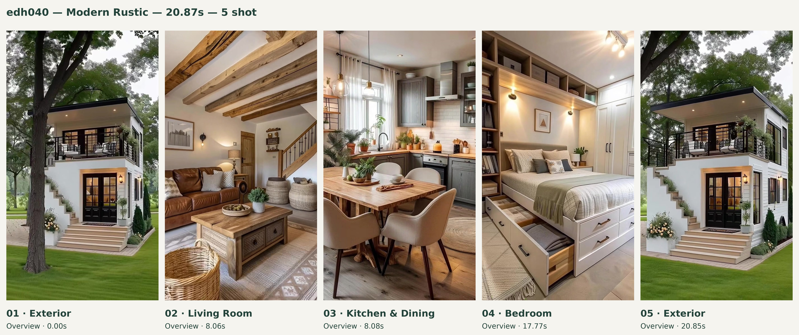
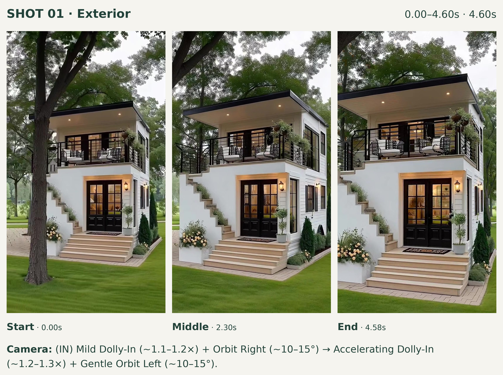
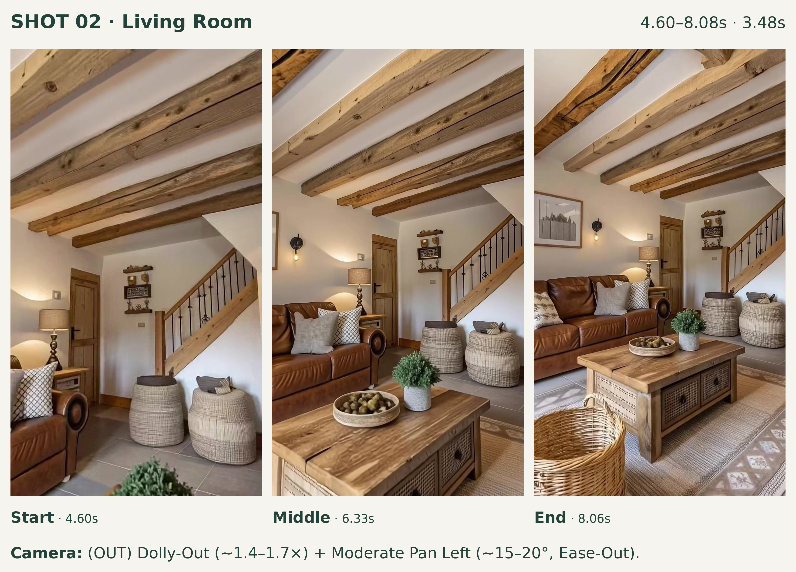
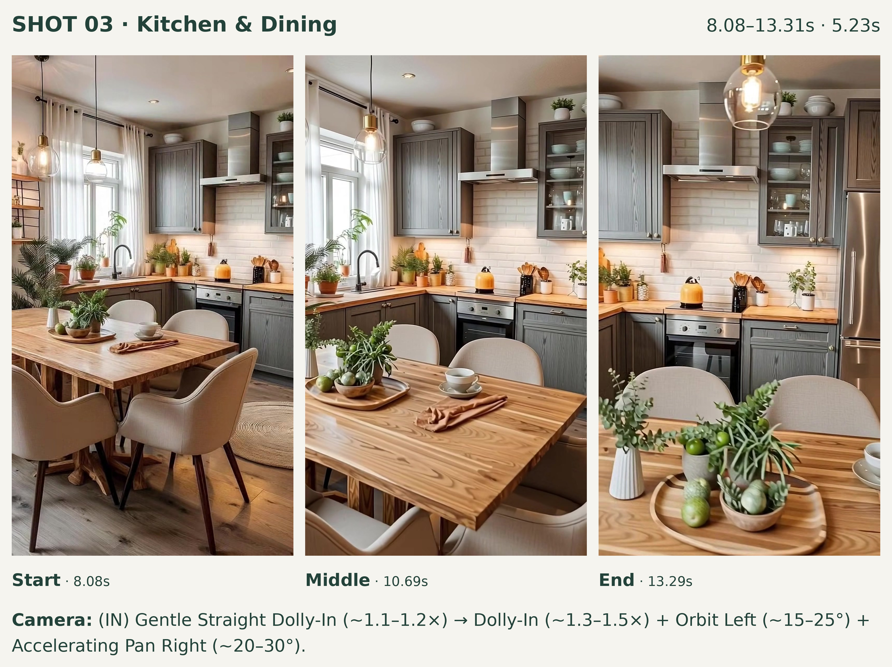
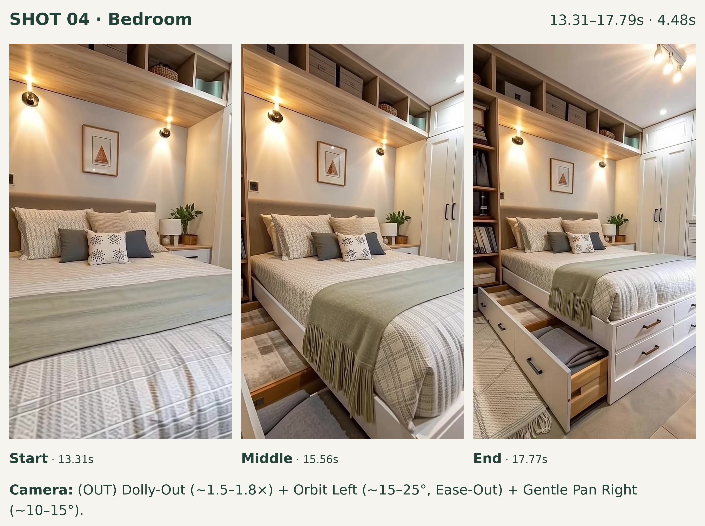
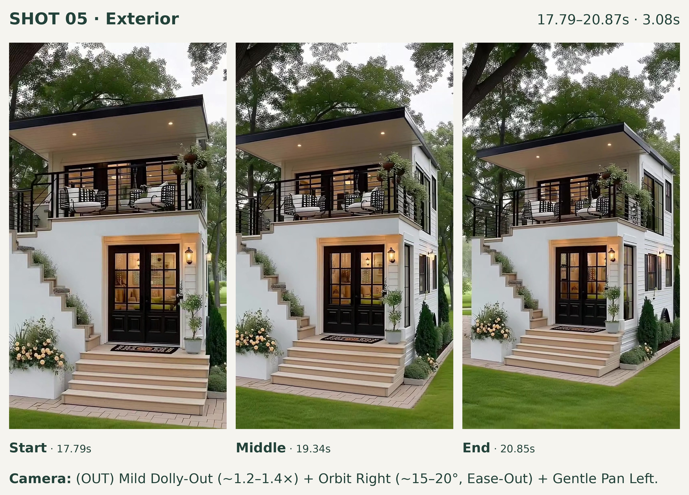

# edh040 — Compact Modern Rustic House with Roof Terrace

## 1. Profil desain

- **Nama desain:** Compact Modern Rustic House with Roof Terrace
- **Tipe rumah:** Detached House
- **Gaya utama:** **Modern Rustic**
- **Pengaruh gaya:** Contemporary
- **Gaya interior:** Rustic Contemporary
- **Susunan ruang utama:** Ruang keluarga dengan tangga, ruang dapur dan makan menyatu, kamar dengan storage bawah ranjang
- **Ciri khas:** Tangga luar diagonal, teras atas, balok plafon ruang keluarga, laci bawah tempat tidur
- **Material utama:** Permukaan putih halus, elemen tampak kayu hangat, metal gelap, tekstil dan anyaman
- **Pencahayaan:** Cahaya siang terfilter pepohonan dan jendela; lampu interior hangat serta lampu teras
- **Atmosfer:** Hangat, rapi, kompak dan dekat dengan penghijauan
- **Lingkungan:** Rumput, pohon tinggi, semak dan pot bunga di halaman

### Palet warna

| Peran | Warna | HEX |
| --- | --- | --- |
| Dominan | Warm White | `#E8E4DA` |
| Pendamping | Natural Oak | `#A77C50` |
| Aksen | Charcoal Black | `#292B27` |
| Pendamping | Muted Sage Gray | `#858779` |
| Aksen | Cognac Brown | `#99633E` |
| Pendamping | Linen Beige | `#C9BCA8` |

## 2. Ukuran & proporsi

| Aspek | Estimasi visual |
| --- | --- |
| **Ukuran rumah** | small |
| **Bentuk bangunan** | Massa kotak dua tingkat dengan teras atas dan kanopi tipis |
| **Lantai & bentuk atap** | Dua tingkat tampak, lantai atas dengan teras terbuka · Atap rendah hampir datar, overhang lebar menaungi teras |
| **Tapak bangunan** | Rectangular compact mass |
| **Proporsi utama** | Massa kompak cenderung vertikal; teras atas lebar dan tangga luar di kiri |
| **Perkiraan luas lantai** | **45–85 m²** |

## 3. Shot Timeline

Durasi 20.87s · 5 shot.

**Camera Pattern:** IN – OUT – IN – OUT – OUT.

| Shot | Time (s) | Duration | Area/Scene | Camera Movement |
| --- | --- | --- | --- | --- |
| 01 | 0.00–4.60 | 4.60s | Exterior | Mild Dolly-In (~1.1–1.2×) + Orbit Right (~10–15°) → Accelerating Dolly-In (~1.2–1.3×) + Gentle Orbit Left (~10–15°). |
| 02 | 4.60–8.08 | 3.48s | Living Room | Dolly-Out (~1.4–1.7×) + Moderate Pan Left (~15–20°, Ease-Out). |
| 03 | 8.08–13.31 | 5.23s | Kitchen & Dining | Gentle Straight Dolly-In (~1.1–1.2×) → Dolly-In (~1.3–1.5×) + Orbit Left (~15–25°) + Accelerating Pan Right (~20–30°). |
| 04 | 13.31–17.79 | 4.48s | Bedroom | Dolly-Out (~1.5–1.8×) + Orbit Left (~15–25°, Ease-Out) + Gentle Pan Right (~10–15°). |
| 05 | 17.79–20.87 | 3.08s | Exterior | Mild Dolly-Out (~1.2–1.4×) + Orbit Right (~15–20°, Ease-Out) + Gentle Pan Left. |

## 4. Overview

**Shot 01 · Exterior · 0.00s**

> Kamera di halaman menghadap fasad sedikit serong; pohon, rumput, tangga masuk, pintu dan teras atas terlihat utuh.

**Shot 02 · Living Room · 8.06s**

> Kamera lebih jauh menghadap tangga dan sofa; balok plafon, meja kopi, keranjang dan karpet memberi konteks ruang keluarga.

**Shot 03 · Kitchen & Dining · 8.08s**

> Kamera di depan meja makan menghadap dapur; meja dan kursi di foreground, jendela kiri serta kabinet dan hood di belakang.

**Shot 04 · Bedroom · 17.77s**

> Kamera mundur ke sisi kiri kaki ranjang menghadap headboard; ranjang, laci terbuka, cubby atas dan lemari kanan terlihat.

**Shot 05 · Exterior · 20.85s**

> Kamera di halaman lebih jauh dan serong kanan menghadap rumah; dua tingkat, tangga, teras, sisi kanan dan halaman tampak.

## 5. Storyboard

## 6. Shot Details

### Shot 01 · Exterior

**Time:** 0.00–4.60s · **Duration:** 4.60s

#### **A. Desain area**

**Arsitektur**

> Massa putih dua tingkat, atap hampir datar dengan overhang lebar; pintu kaca ganda hitam di atas tangga masuk lebar. Tangga luar diagonal di kiri menuju teras atas berpagar hitam.

**Furnitur & dekorasi**

> Kursi dan meja kecil tampak di teras atas; pot bunga di kiri akses dan semak tegak di kanan.

**Lingkungan**

> Rumput hijau dan pepohonan tinggi mengelilingi rumah; batang pohon di foreground, cahaya siang tersaring.

#### **B. Framing & Lighting**

- **Fokus:** Akses dan teras atas
- **Camera Start:** Di halaman depan, dekat pohon · Ke fasad depan rumah · oblique · Kira-kira tinggi mata · Sedikit mengarah ke atas
- **Framing:** Wide rumah utuh dengan pohon di kiri → Fasad, tangga dan teras lebih memenuhi bidang
- **Lighting:** Siang difus dengan lampu soffit hangat
- **Foreground dan kedalaman:** Batang pohon dan rumput · Rumput, tangga, pintu, teras dan pohon belakang
- **Reveal:** Sisi kanan lalu muka rumah lebih dekat
- **Kesesuaian gerak:** Dolly-in dan orbit menguatkan fasad tanpa cut

#### **C. Camera Movement**

Kamera mendekati rumah sambil bergerak ke kanan relatif terhadap fasad, lalu kembali ke sudut lebih frontal dengan pendekatan yang semakin nyata.

**Tempo:** Halus; mendekat perlahan pada paruh awal, peningkatan skala lebih nyata menjelang akhir.

**Movement Timeline**

| Time (s) | Area & fokus | Camera Movement | Tempo |
| --- | --- | --- | --- |
| 0.00–2.50 | Exterior · Fasad, pohon dekat dan teras | Mild Dolly-In (~1.1–1.2×) + Orbit Right (~10–15°) | Halus; mendekat perlahan pada paruh awal, peningkatan skala lebih nyata menjelang akhir. |
| 2.50–4.60 | Exterior · Pintu masuk, tangga teras | Accelerating Dolly-In (~1.2–1.3×) + Gentle Orbit Left (~10–15°) | Halus; mendekat perlahan pada paruh awal, peningkatan skala lebih nyata menjelang akhir. |

**Camera:** Mild Dolly-In (~1.1–1.2×) + Orbit Right (~10–15°) → Accelerating Dolly-In (~1.2–1.3×) + Gentle Orbit Left (~10–15°).

**Catatan:** Awal shot berupa gambar jernih, tanpa transisi yang menutup framing; Production Start tambahan tidak diperlukan.

---

### Shot 02 · Living Room

**Time:** 4.60–8.08s · **Duration:** 3.48s

#### **A. Desain area**

**Arsitektur**

> Dinding putih dengan balok plafon kayu terekspos sejajar, tangga kayu berbaluster vertikal di kanan belakang dan pintu kayu di bawah area tangga. Lantai bernuansa kayu dengan karpet bermotif.

**Furnitur & dekorasi**

> Sofa kulit tampak cokelat cognac di kiri, bantal netral, meja kopi persegi panjang kayu dengan laci, keranjang anyam, lampu meja dan dekorasi tanaman.

**Lingkungan**

> Lampu dinding dan meja hangat menerangi ruang; hubungan jendela ke luar tidak terlihat jelas.

#### **B. Framing & Lighting**

- **Fokus:** Sofa, meja kopi, tangga
- **Camera Start:** Di sisi depan ruang keluarga, dekat meja · Ke dinding belakang dan tangga · oblique · Sekitar tinggi mata · Hampir level
- **Framing:** Medium tangga, sofa sebagian, balok plafon → Wide sofa, meja, keranjang dan tangga
- **Lighting:** Lampu hangat dan permukaan terang
- **Foreground dan kedalaman:** Ujung sofa, keranjang dan meja · Furnitur depan menuju tangga belakang
- **Reveal:** Meja kopi dan sofa makin lengkap
- **Kesesuaian gerak:** Dolly-out dan pan kiri memperluas konteks ruang

#### **C. Camera Movement**

Kamera mundur dari tangga dan keranjang, membuka meja kopi, sofa dan lantai sambil menyapu ke kiri.

**Tempo:** Mundur relatif merata; sapuan kiri lebih kuat pada awal, kemudian mereda.

**Camera:** Dolly-Out (~1.4–1.7×) + Moderate Pan Left (~15–20°, Ease-Out).

**Catatan:** Awal shot berupa gambar jernih, tanpa transisi yang menutup framing; Production Start tambahan tidak diperlukan.

---

### Shot 03 · Kitchen & Dining

**Time:** 8.08–13.31s · **Duration:** 5.23s

#### **A. Desain area**

**Arsitektur**

> Dapur dengan kabinet bawah dan atas abu kehijauan, bidang backsplash terang dan meja kerja kayu; jendela bertirai di sisi kiri, kompor dan hood di belakang, kulkas di kanan. Meja makan berada di depan dapur dalam satu ruang.

**Furnitur & dekorasi**

> Meja makan kayu persegi panjang dengan kursi berlapis kain krem dan kaki kayu menyudut, dekorasi tanaman, mangkuk, serta lampu gantung kaca. Kabinet kaca atas menyimpan peralatan makan.

**Lingkungan**

> Cahaya siang dari jendela kiri bercampur cahaya hangat di area kerja dan lampu gantung.

#### **B. Framing & Lighting**

- **Fokus:** Meja makan dan kabinet
- **Camera Start:** Di depan meja makan · Ke dapur di belakang · oblique · Sekitar tinggi mata · Hampir level
- **Framing:** Wide meja makan, kursi, jendela dan kabinet → Meja dekat, kabinet belakang dan kulkas kanan
- **Lighting:** Jendela kiri dan lampu gantung hangat
- **Foreground dan kedalaman:** Kursi dan meja makan · Meja, kabinet, jendela dan backsplash
- **Reveal:** Kulkas di kanan dan detail meja
- **Kesesuaian gerak:** Dolly-in dan pan kanan menekankan meja dan dapur

#### **C. Camera Movement**

Kamera mendekati meja makan terlebih dahulu, lalu tetap maju sambil mengitari meja ke kiri dan menyapu kanan ke kabinet serta kulkas.

**Tempo:** Awal tenang dan mendekat; sapuan kanan bertambah cepat hingga akhir.

**Movement Timeline**

| Time (s) | Area & fokus | Camera Movement | Tempo |
| --- | --- | --- | --- |
| 8.08–9.59 | Kitchen & Dining · Meja makan, kursi dan jendela | Gentle Straight Dolly-In (~1.1–1.2×) | Awal tenang dan mendekat; sapuan kanan bertambah cepat hingga akhir. |
| 9.59–13.31 | Kitchen & Dining · Meja, kabinet, kompor dan kulkas | Dolly-In (~1.3–1.5×) + Orbit Left (~15–25°) + Accelerating Pan Right (~20–30°) | Awal tenang dan mendekat; sapuan kanan bertambah cepat hingga akhir. |

**Camera:** Gentle Straight Dolly-In (~1.1–1.2×) → Dolly-In (~1.3–1.5×) + Orbit Left (~15–25°) + Accelerating Pan Right (~20–30°).

**Catatan:** Awal shot berupa gambar jernih, tanpa transisi yang menutup framing; Production Start tambahan tidak diperlukan.

---

### Shot 04 · Bedroom

**Time:** 13.31–17.79s · **Duration:** 4.48s

#### **A. Desain area**

**Arsitektur**

> Kamar kompak dengan headboard menempel dinding; deret cubby tinggi di atas ranjang, panel kayu horizontal, dinding putih dan lemari pintu tinggi di kanan. Lantai bernuansa kayu.

**Furnitur & dekorasi**

> Ranjang ganda dengan laci penyimpanan di bawah, tekstil putih bergaris dan selimut sage, bantal berlapis; meja samping, pot tanaman dan gambar kecil di tengah. Laci sisi kiri terbuka di akhir.

**Lingkungan**

> Lampu dinding kecil di kedua sisi headboard memberi aksen hangat, lampu plafon tampak saat kamera mundur; pandangan ke luar tidak jelas.

#### **B. Framing & Lighting**

- **Fokus:** Ranjang dan laci penyimpanan
- **Camera Start:** Dekat kaki ranjang · Ke headboard · frontal · Sekitar tinggi mata · Hampir level
- **Framing:** Medium headboard dan tekstil → Wide ranjang, laci terbuka, lemari dan plafon
- **Lighting:** Sconce hangat dan lampu plafon
- **Foreground dan kedalaman:** Seprai dan selimut · Ranjang menuju dinding headboard dan cubby
- **Reveal:** Laci bawah ranjang dan lemari kanan
- **Kesesuaian gerak:** Dolly-out dengan orbit kiri memperlihatkan penyimpanan

#### **C. Camera Movement**

Kamera mundur dan bergeser mengitari sisi kiri tempat tidur, menjaga headboard sebagai fokus sambil membuka penyimpanan bawah ranjang dan lemari kanan.

**Tempo:** Mundur halus dan konsisten; perubahan sudut lebih kuat pada awal hingga tengah, lalu mereda.

**Camera:** Dolly-Out (~1.5–1.8×) + Orbit Left (~15–25°, Ease-Out) + Gentle Pan Right (~10–15°).

**Catatan:** Awal shot berupa gambar jernih, tanpa transisi yang menutup framing; Production Start tambahan tidak diperlukan.

---

### Shot 05 · Exterior

**Time:** 17.79–20.87s · **Duration:** 3.08s

#### **A. Desain area**

**Arsitektur**

> Fasad kembali terlihat, massa kotak putih dan teras atas berkanopi, pintu grid hitam, tangga masuk lebar dan tangga luar di kiri. Gerakan memperlihatkan sisi kanan dengan bukaan gelap.

**Furnitur & dekorasi**

> Perabot teras atas dan pot bunga di akses depan tampak kembali, dengan semak tegak di sisi kanan.

**Lingkungan**

> Halaman rumput, semak, pepohonan tinggi dan cahaya siang terfilter; sisi tapak belakang tidak tampak.

#### **B. Framing & Lighting**

- **Fokus:** Fasad dan teras
- **Camera Start:** Di depan tangga masuk · Ke fasad rumah · frontal · Sekitar tinggi mata · Sedikit mengarah ke atas
- **Framing:** Fasad dekat, teras atas dan tangga → Wide rumah dan rumput dengan sisi kanan terbuka
- **Lighting:** Cahaya siang terfilter, lampu soffit
- **Foreground dan kedalaman:** Rumput dan tangga · Akses, dua tingkat dan pohon belakang
- **Reveal:** Sisi kanan fasad dan halaman
- **Kesesuaian gerak:** Dolly-out dan orbit kanan menutup dengan konteks massa

#### **C. Camera Movement**

Kamera mundur dari pintu dan teras sambil mengitari fasad ke kanan, menjaga bangunan sebagai fokus dan memperlihatkan sisi kanan serta taman.

**Tempo:** Gerak ringan hingga sedang, mundur relatif merata; perubahan orientasi melambat.

**Camera:** Mild Dolly-Out (~1.2–1.4×) + Orbit Right (~15–20°, Ease-Out) + Gentle Pan Left.

**Catatan:** Awal shot berupa gambar jernih, tanpa transisi yang menutup framing; Production Start tambahan tidak diperlukan.
