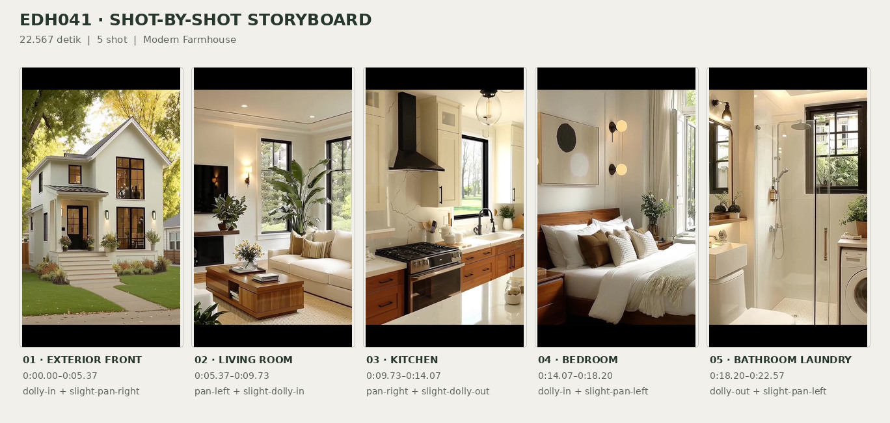
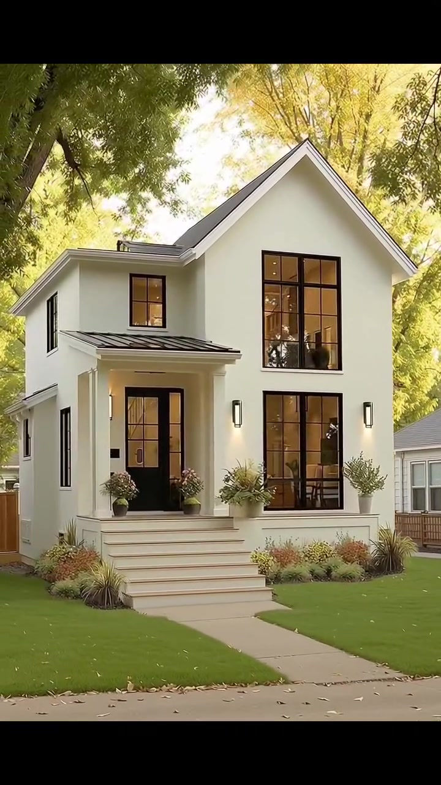
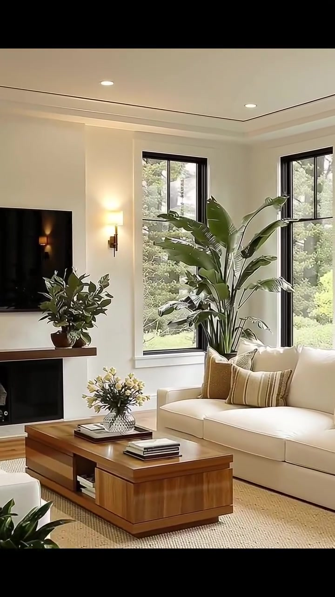
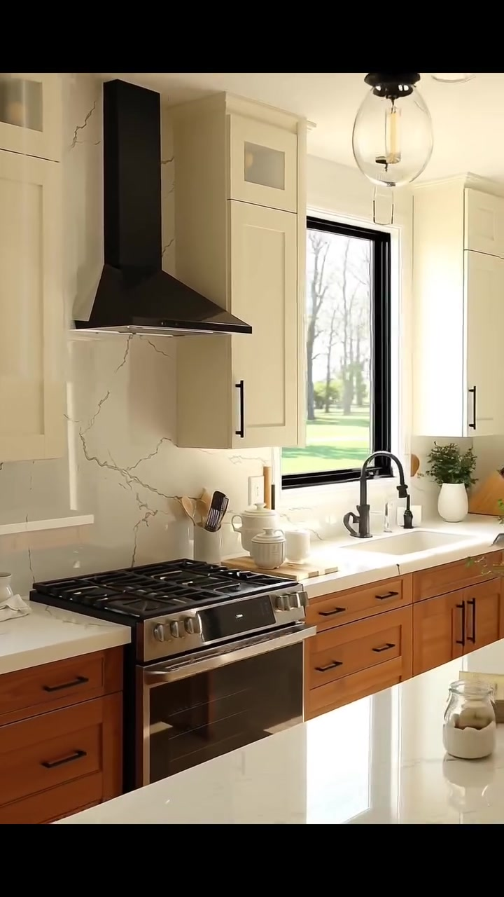
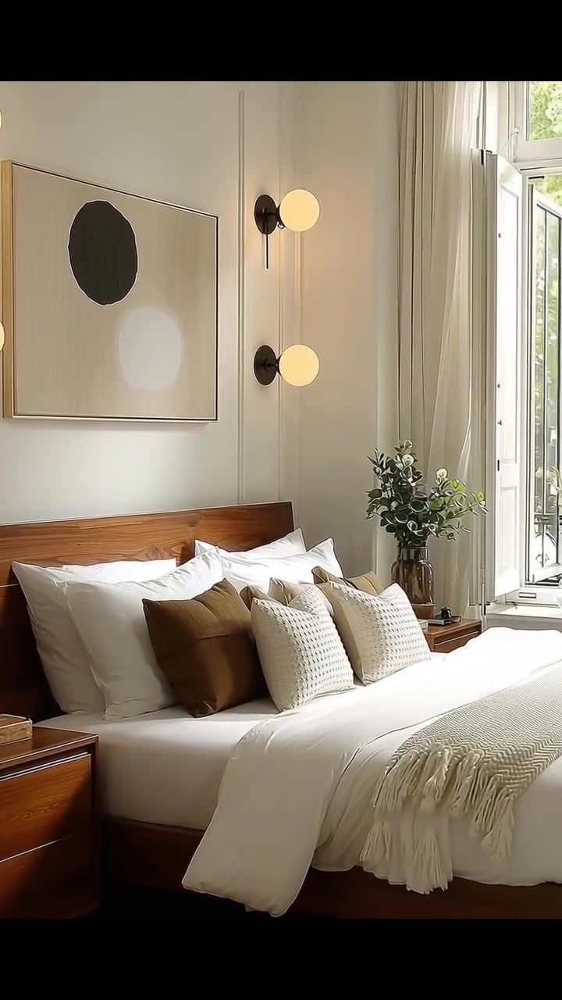
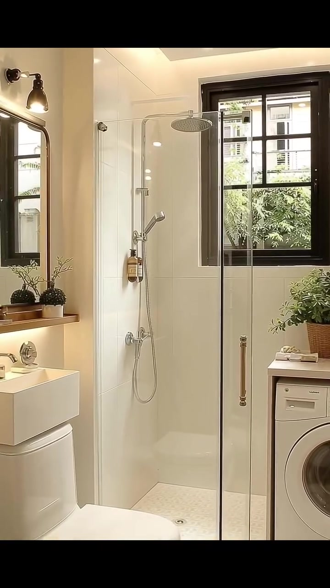

# edh041 — Modern Farmhouse

<!-- homeku_request_id: edh041-20261105-1617b99aea241bc6c04a28fe4807eb7112ebe5fc -->

<!-- homeku_detail_narratives: chat-reviewed -->

**Sumber data:** [analysis.yaml](analysis.yaml) · **Status:** draft · **Diverifikasi manusia:** Tidak

## 1. Informasi Video

| Informasi | Nilai |
|---|---|
| ID | edh041 |
| File asli | edh041.mp4 |
| Durasi | 22.567 |
| Resolusi | 720x1280 |
| FPS | 30 |
| Rasio | 9:16 |
| Jumlah shot | 5 |

## 2. Storyboard Gabungan

## 3. Identitas Desain

| Aspek | Hasil analisis |
|---|---|
| Gaya utama | modern farmhouse |
| Wilayah terkait gaya desain | north america |
| Pengaruh gaya | contemporary cottage, transitional interior |
| Ciri eksterior | warm white plaster appearance facade, steep front gable dark roof, lower side wing on left, black gridded tall windows, small covered recessed front porch, white entry stairs, black glazed front door |
| Gaya interior | warm neutral transitional, modern farmhouse kitchen, natural wood accents, minimal abstract bedroom decor |
| Confidence gaya | high |

## 4. Ukuran & Proporsi Bangunan

| Aspek | Estimasi visual |
|---|---|
| Ukuran yang terlihat | medium |
| Bentuk bangunan | two story front gabled main volume with lower side wing |
| Skala vertikal | two story |
| Tapak bangunan | moderate |
| Perkiraan luas lantai | 150–260 m² |
| Confidence | low |

> Luas adalah perkiraan visual, bukan ukuran terukur.

## 5. Warna, Pencahayaan, dan Atmosfer

| Warna dominan | HEX (perkiraan) |
|---|---|
| warm white | #F2EEE6 |
| charcoal black | #272829 |
| creamy beige | #E4DBCC |
| medium warm wood brown | #9D673F |
| foliage green | #6E8154 |
| soft gold ochre | #C3A25E |

| Aspek | Hasil analisis |
|---|---|
| Pencahayaan | warm daylight, soft recessed ceiling light, warm decorative wall sconces |
| Lingkungan | tree shaded residential street, green front lawn, ornamental flower beds, leafy window views |
| Musim yang tampak | autumn like yellowing leaves |
| Mood | welcoming, bright, calm, cozy, well kept |

## 6. Struktur dan Timeline Video

**Jenis:** home tour · **Tempo:** slow · **Transisi:** hard cuts between scenes

| Shot | Waktu (detik) | Durasi | Area/Scene | Gerakan Kamera |
|---|---|---|---|---|
| Shot 01 | 0.0–5.367 | 5.37 | exterior front | dolly in, slight pan right |
| Shot 02 | 5.367–9.733 | 4.37 | living room | pan left, slight dolly in |
| Shot 03 | 9.733–14.067 | 4.33 | kitchen | pan right, slight dolly out |
| Shot 04 | 14.067–18.2 | 4.13 | bedroom | dolly in, slight pan left |
| Shot 05 | 18.2–22.567 | 4.37 | bathroom laundry | dolly out, slight pan left |

## 7. Analisis per Shot

### Shot 01 — exterior front

**Waktu:** 0.0–5.367 detik

| Komponen | Pengamatan |
|---|---|
| Fokus utama | white two story front gabled house |
| Framing awal → akhir | wide frontal street view → medium frontal house view |
| Sudut pandang | street level slightly low angle |
| Gerakan kamera | dolly in, slight pan right |
| Kecepatan kamera | slow |
| Pencahayaan | warm daylight with subtle exterior sconces |
| Transisi keluar | hard cut |

**Detail yang terlihat**

**Arsitektur**

Bangunan utama dua lantai memiliki fasad putih menyerupai plester, atap pelana curam berwarna abu\-abu gelap, dan sayap di sisi kiri dengan garis atap yang lebih rendah. Di depan terdapat teras masuk yang menjorok ke dalam, dinaungi atap kecil berpenampilan logam gelap, dengan tiang\-tiang putih dan pembatas teras rendah. Pintu masuk berwarna hitam dengan panel kaca berada di bawah teras, sementara tangga putih yang lebar terhubung ke jalur pejalan kaki melengkung. Bagian kanan fasad memiliki jendela\-jendela tinggi berbingkai hitam berkisi yang tersusun pada dua tingkat; sebuah jendela lebih kecil berada di lantai atas sebelah kiri pintu. Dua lampu dinding hitam vertikal mengapit jendela kanan bawah. Pagar rendah berpenampilan kayu tampak di batas samping, dan dari jendela besar depan terlihat kursi di balik kaca.

**Furnitur dan properti**

Dua pot kecil berisi bunga ditempatkan di dekat pintu masuk. Di bawah jendela depan terdapat tanaman semak dalam area tanam yang ditinggikan, sementara rerumputan hias dan tanaman berbunga bernuansa karat tumbuh di sepanjang tepi tangga.

**Lingkungan**

Batang pohon besar tampak di latar depan, di sebelah kanan rumah, sementara kanopi daun hijau dan kuning membingkai atap. Halaman depan berumput hijau rapi, dengan jalan setapak beton terang yang melengkung dari trotoar menuju tangga. Daun kuning tersebar di halaman dan trotoar. Di kanan terlihat rumah tetangga berwarna terang dan di belakang garis atap terdapat pepohonan dewasa. Sinar matahari hangat menembus sela pepohonan.

**Catatan pengamatan:** Facade enlarges gradually as camera advances; exact facade materials cannot be confirmed from video.

**Confidence:** Kamera medium · Detail visual high

### Shot 02 — living room

**Waktu:** 5.367–9.733 detik

| Komponen | Pengamatan |
|---|---|
| Fokus utama | cream sofa and tv fireplace wall |
| Framing awal → akhir | wide living room corner view → medium fireplace and sofa view |
| Sudut pandang | eye level oblique interior |
| Gerakan kamera | pan left, slight dolly in |
| Kecepatan kamera | slow |
| Pencahayaan | bright window daylight with warm ceiling and wall lamps |
| Transisi keluar | hard cut |

**Detail yang terlihat**

**Arsitektur**

Ruang keluarga memiliki dinding putih hangat dengan lis vertikal sederhana, lis plafon putih, dan beberapa lampu tanam bundar. Jendela\-jendela tinggi berbingkai hitam berada pada dua dinding yang bertemu di sudut ruangan. Perapian berbentuk ceruk gelap dipasang di bawah ambalan bernuansa kayu. Lantai memperlihatkan papan\-papan dengan tampilan kayu terang.

**Furnitur dan properti**

Sofa tiga dudukan berlapis kain krem berada di depan dinding berjendela, dilengkapi bantal berwarna krem, beige, dan oker lembut. Di depannya ada meja kopi kayu persegi panjang dengan rak terbuka, vas kaca berisi bunga pucat, serta beberapa buku bertumpuk. Tanaman berdaun lebar yang tinggi ditempatkan di sisi jendela sudut, sedangkan TV layar datar hitam terpasang di atas perapian dan satu tanaman pot diletakkan di ambalannya. Pot gelap berisi tanaman hijau tampak di depan sebelah kiri. Karpet anyaman beige membentang di bawah meja dan sofa. Lampu dinding bernuansa logam hangat terpasang dekat area perapian, dan sebagian kursi berlapis kain krem terlihat di tepi kiri.

**Lingkungan**

Kanopi pohon hijau dan hamparan rumput terlihat melalui jendela berbingkai hitam. Cahaya siang masuk dari dua sisi jendela tersebut.

**Catatan pengamatan:** Shot begins with a wider sofa arrangement and ends closer to the fireplace and front edge of the coffee table.

**Confidence:** Kamera medium · Detail visual high

### Shot 03 — kitchen

**Waktu:** 9.733–14.067 detik

| Komponen | Pengamatan |
|---|---|
| Fokus utama | black range hood stainless range and wood cabinetry |
| Framing awal → akhir | medium cooking wall closeup → wide oblique kitchen with island |
| Sudut pandang | eye level oblique interior |
| Gerakan kamera | pan right, slight dolly out |
| Kecepatan kamera | slow |
| Pencahayaan | strong side window daylight with pendant and recessed lighting |
| Transisi keluar | hard cut |

**Detail yang terlihat**

**Arsitektur**

Dapur menampilkan kabinet atas berwarna krem dengan panel bergaya Shaker dan gagang gelap memanjang, sedangkan kabinet serta laci bawah bernuansa kayu cokelat hangat. Backsplash dan meja kerja berwarna putih dengan urat abu\-abu halus, menyerupai marmer. Sebuah island besar dengan permukaan putih mengilap berada di bagian depan. Di sebelah kanan ada jendela berbingkai hitam di atas bak cuci. Plafon putih halus dilengkapi lampu tanam, dan sebagian kabinet atas memiliki panel kaca kecil.

**Furnitur dan properti**

Di atas kompor gas berbahan logam warna baja dengan jeruji hitam terpasang cooker hood hitam berbentuk mengerucut. Bak cuci putih di bawah jendela memakai keran lengkung gelap. Lampu gantung berkap kaca bening menggantung di atas island. Di area memasak terdapat stoples keramik putih bertutup dan peralatan masak kayu dalam wadah. Di dekat bak cuci terlihat tanaman pot kecil, perlengkapan dapur, serta blok pisau bergagang gelap. Beberapa wadah kaca dan putih berada di atas island; lemari es berwarna logam tampak sekilas di belakang sebelah kanan.

**Lingkungan**

Melalui jendela dapur terlihat hamparan rumput hijau dan pepohonan berdaun.

**Catatan pengamatan:** The camera reveals sink and island toward the right; countertop finish is described by appearance rather than confirmed stone type.

**Confidence:** Kamera medium · Detail visual high

### Shot 04 — bedroom

**Waktu:** 14.067–18.2 detik

| Komponen | Pengamatan |
|---|---|
| Fokus utama | warm wood platform bed with white bedding |
| Framing awal → akhir | wide bedroom bed and window view → medium bed and headboard view |
| Sudut pandang | eye level oblique interior |
| Gerakan kamera | dolly in, slight pan left |
| Kecepatan kamera | slow |
| Pencahayaan | soft bright window daylight with warm bedside wall sconces |
| Transisi keluar | hard cut |

**Detail yang terlihat**

**Arsitektur**

Kamar tidur berdinding putih dengan detail panel vertikal, lis plafon putih, dan lantai papan bernuansa kayu hangat sedang. Sebuah jendela tinggi berbingkai putih di sebelah kanan tampak terbuka ke luar dan dibingkai gorden panjang warna beige muda. Unit AC split putih terpasang tinggi pada dinding sebelah kiri.

**Furnitur dan properti**

Ranjang platform rendah dengan rangka dan kepala ranjang kayu hangat menggunakan duvet serta bantal utama putih. Bantal aksen cokelat karamel dan krem bertekstur tersusun di depannya, sementara selimut ringan taupe berumbai terhampar di bagian bawah ranjang. Meja samping kecil dari kayu berada di kedua sisi. Di atas kepala ranjang tergantung karya seni abstrak berbingkai dengan bentuk bulat hitam dan putih. Lampu dinding hitam dengan kap bola putih menyala berada di dekat tempat tidur. Vas bening berisi tangkai daun hijau diletakkan di meja samping kanan, dan sebagian karpet pucat bertekstur tampak di bawah ranjang.

**Lingkungan**

Pepohonan berdaun dan tanaman hijau terlihat melalui jendela kamar yang terbuka. Sebagian bangunan tetangga berwarna terang juga terlihat di luar.

**Catatan pengamatan:** The bed occupies progressively more of the frame, while the tall window shifts toward the right edge.

**Confidence:** Kamera medium · Detail visual high

### Shot 05 — bathroom laundry

**Waktu:** 18.2–22.567 detik

| Komponen | Pengamatan |
|---|---|
| Fokus utama | glass shower enclosure with black framed window |
| Framing awal → akhir | medium shower and window view → wide bathroom and laundry view |
| Sudut pandang | eye level frontal interior |
| Gerakan kamera | dolly out, slight pan left |
| Kecepatan kamera | slow |
| Pencahayaan | warm recessed ceiling lighting with natural window daylight |
| Transisi keluar | end of video |

**Detail yang terlihat**

**Arsitektur**

Kamar mandi memakai ubin dinding besar berwarna putih hangat, dengan jendela berkisi berbingkai hitam di sisi area shower. Sekat shower kaca bening setinggi ruangan memiliki pegangan logam vertikal. Plafon bertingkat dilengkapi lampu tanam kecil dan cahaya tersembunyi di tepinya. Lantai berubin terang memiliki sisipan belah ketupat kecil berwarna gelap, sedangkan lantai area shower memakai mozaik kecil berwarna terang. Di kanan shower terdapat meja kerja pendek berwarna terang.

**Furnitur dan properti**

Area shower memiliki kepala pancuran bulat di atas dan pancuran genggam pada perangkat vertikal, dengan botol warna amber yang tergantung di sisinya. Setelah bidang pandang melebar, terlihat kloset putih modern di kiri depan serta wastafel putih persegi panjang di kiri shower. Di atas wastafel ada cermin persegi panjang berbingkai gelap dan lampu dinding logam hitam. Mesin cuci putih dengan pintu bukaan depan ditempatkan di bawah meja sisi kanan, sementara pot anyaman berisi tanaman hijau berada di atasnya. Botol\-botol kecil serta handuk terang yang terlipat terdapat di atas meja, dan tanaman pot kecil menghiasi ambalan di bawah cermin.

**Lingkungan**

Melalui jendela kamar mandi tampak semak hijau yang rimbun, dengan sebagian fasad bangunan berwarna terang di baliknya.

**Catatan pengamatan:** The field of view widens to reveal toilet, basin and front-load washer; no bathtub is visible.

**Confidence:** Kamera medium · Detail visual high

## 8. Kualitas dan Ketidakpastian Analisis

| Parameter | Hasil |
|---|---|
| Status | draft |
| Verifikasi manusia | Tidak |
| Ketepatan timestamp | estimated |
| Ketidakpastian | exact building location unknown, regional style association is not geolocation, actual floor area and house depth not measurable from video, precise roof wall floor and countertop materials not confirmed, season and tree species not verified, camera translation versus digital zoom cannot be fully distinguished |

**Catatan:** Visual-only draft based on all five shots. Video Git blob SHA matches main/video/edh041.mp4. No GitHub write requested.

---

*Laporan ini diturunkan dari [analysis.yaml](analysis.yaml).*
