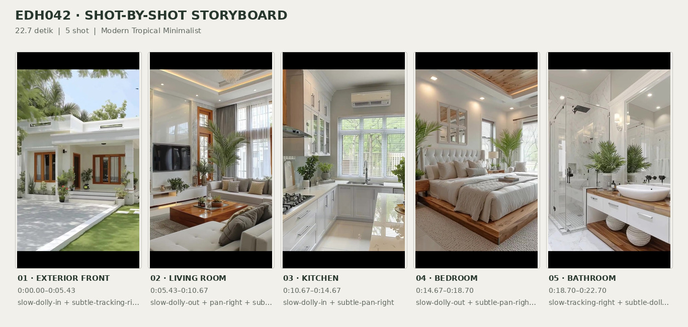
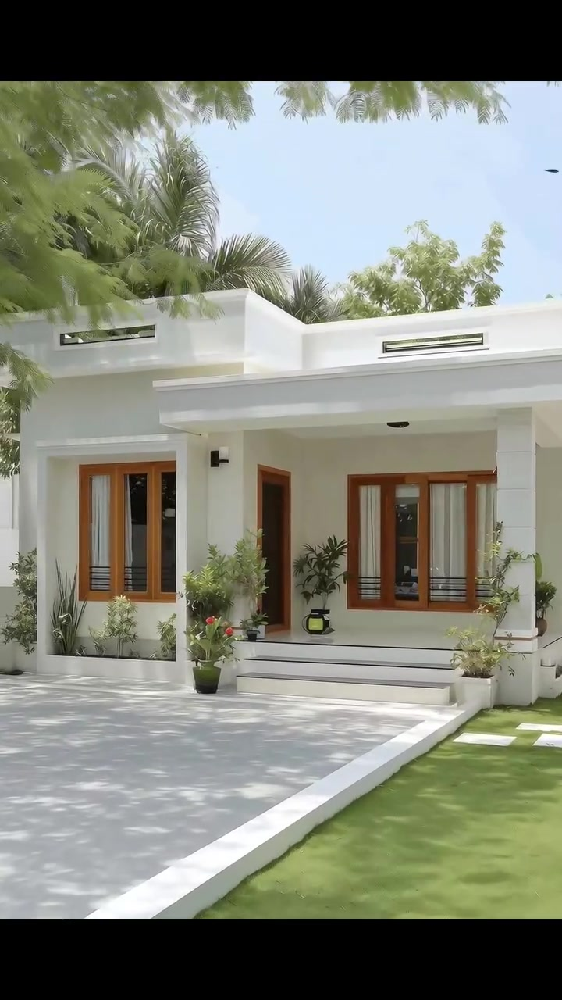
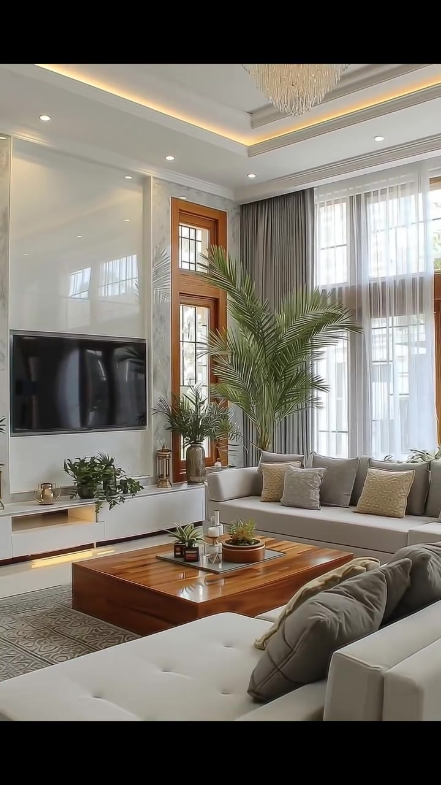
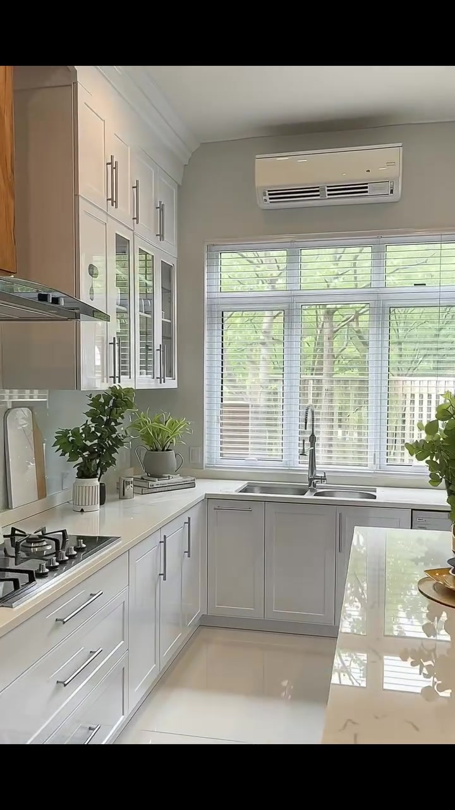
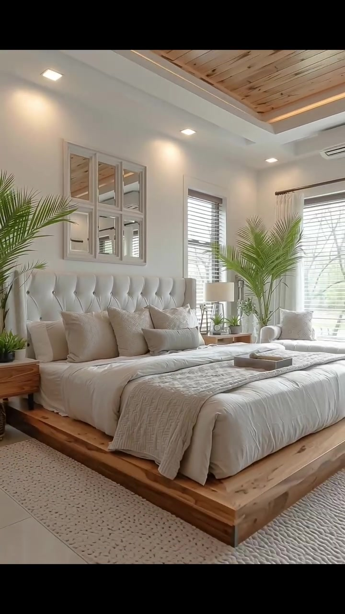
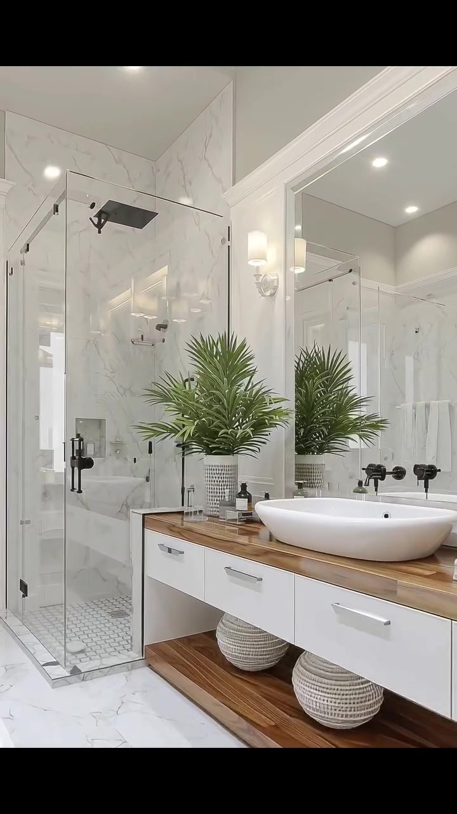

# edh042 — Modern Tropical Minimalist

<!-- homeku_request_id: edh042_20261105_0733db700254 -->

<!-- homeku_detail_narratives: chat-reviewed -->

**Sumber data:** [analysis.yaml](analysis.yaml) · **Status:** draft · **Diverifikasi manusia:** Tidak

## 1. Informasi Video

| Informasi | Nilai |
|---|---|
| ID | edh042 |
| File asli | edh042.mp4 |
| Durasi | 22.7 |
| Resolusi | 720x1280 |
| FPS | 30 |
| Rasio | 9:16 |
| Jumlah shot | 5 |

## 2. Storyboard Gabungan

## 3. Identitas Desain

| Aspek | Hasil analisis |
|---|---|
| Gaya utama | modern tropical minimalist |
| Wilayah terkait gaya desain | asia, oceania |
| Pengaruh gaya | contemporary minimalism, tropical modernism, soft luxury transitional interior accents |
| Ciri eksterior | bright white rectilinear facade, flat appearing parapet roof, deep covered entry porch, warm wood tone window frames, broad white entry steps, white trimmed vertical facade panels |
| Gaya interior | cream and white contemporary living room, warm wood appearance furniture and accents, marble appearance kitchen and bathroom finishes, white shaker cabinetry, recessed and indirect warm lighting, tropical leafy indoor plants |
| Confidence gaya | high |

## 4. Ukuran & Proporsi Bangunan

| Aspek | Estimasi visual |
|---|---|
| Ukuran yang terlihat | medium |
| Bentuk bangunan | rectangular single story with stepped front facade |
| Skala vertikal | single story |
| Tapak bangunan | moderate |
| Perkiraan luas lantai | 80–150 m² |
| Confidence | low |

> Luas adalah perkiraan visual, bukan ukuran terukur.

## 5. Warna, Pencahayaan, dan Atmosfer

| Warna dominan | HEX (perkiraan) |
|---|---|
| bright white | #F3F2ED |
| soft cream | #DFD7C9 |
| warm honey wood | #B88455 |
| light gray | #B7B5B0 |
| leaf green | #668057 |
| dark hardware | #292B2A |

| Aspek | Hasil analisis |
|---|---|
| Pencahayaan | bright soft daylight, dappled tree shadows on exterior paving, warm recessed ceiling downlights, warm indirect cove lighting |
| Lingkungan | mature green tree canopy around front lawn, tropical palm like planting behind house, neat lawn and flowering shrubs, light gray paved forecourt, tree greenery visible outside kitchen and bedroom windows |
| Musim yang tampak | Tidak diketahui |
| Mood | bright, fresh, calm, polished, airy, warm |

## 6. Struktur dan Timeline Video

**Jenis:** architectural home tour · **Tempo:** moderate · **Transisi:** four hard cuts between five slow moving shots

| Shot | Waktu (detik) | Durasi | Area/Scene | Gerakan Kamera |
|---|---|---|---|---|
| Shot 01 | 0.0–5.433 | 5.43 | exterior front | slow dolly in, subtle tracking right |
| Shot 02 | 5.433–10.667 | 5.23 | living room | slow dolly out, pan right, subtle tilt up |
| Shot 03 | 10.667–14.667 | 4.00 | kitchen | slow dolly in, subtle pan right |
| Shot 04 | 14.667–18.7 | 4.03 | bedroom | slow dolly out, subtle pan right, subtle tilt up |
| Shot 05 | 18.7–22.7 | 4.00 | bathroom | slow tracking right, subtle dolly in |

## 7. Analisis per Shot

### Shot 01 — exterior front

**Waktu:** 0.0–5.433 detik

| Komponen | Pengamatan |
|---|---|
| Fokus utama | single story white tropical minimalist house with recessed front porch |
| Framing awal → akhir | wide front left view including trees lawn and driveway → medium front facade view with porch steps and wood tone windows |
| Sudut pandang | slightly low front left three quarter |
| Gerakan kamera | slow dolly in, subtle tracking right |
| Kecepatan kamera | slow |
| Pencahayaan | bright diffuse daylight with dappled tree shadows on driveway |
| Transisi keluar | hard cut |

**Detail yang terlihat**

**Arsitektur**

Rumah satu lantai ini memiliki massa depan berbentuk kotak bertingkat dengan dinding putih halus dan garis panel yang tipis. Atapnya tampak datar dan tersembunyi di balik parapet putih tebal yang memuat dua bukaan horizontal sempit berbingkai gelap. Kanopi datar yang lebar menaungi teras dan ditopang kolom persegi di sisi kanan. Jendela depan berbingkai cokelat hangat menyerupai kayu, dengan bidang kaca vertikal; jendela kiri masuk ke dalam ceruk persegi putih. Pintu masuk berada di ceruk yang lebih gelap di antara kelompok jendela, dicapai melalui anak tangga putih lebar dan rendah dengan garis tepi gelap. Sebuah lampu dinding hitam berada di dekat pintu dan lampu bulat tanam terlihat di bawah kanopi.

**Furnitur dan properti**

Sejumlah tanaman perdu hijau dalam pot ditempatkan di kedua sisi tangga dan sepanjang teras. Pot berwarna gelap serta terang juga tampak di bawah jendela, sementara bed tanam permanen di bawah jendela kiri diisi tanaman hias berdaun.

**Lingkungan**

Di kiri depan berdiri dua batang pohon berwarna pucat, dengan kanopi berdaun hijau halus membentang di bagian atas gambar. Pelepah palem dan pepohonan hijau yang rapat menjulang di belakang atap. Halaman depan memuat jalur kendaraan abu\-abu muda menuju tangga, berbatasan dengan rumput hijau terpangkas rapi di kanan. Semak berbunga putih dan tanaman rendah mengikuti sisi rumput, disertai batu pijakan putih di dekat sisi kanan rumah. Di sela pepohonan kanan tampak sebagian rumah tetangga berwarna terang, sedangkan langit biru pucat terlihat di atasnya.

**Catatan pengamatan:** Pergerakan mendekat ke arah fasad memudahkan pembacaan teras, jendela, akses masuk, dan jalur depan; kedalaman bangunan tidak terlihat.

**Confidence:** Kamera medium · Detail visual high

### Shot 02 — living room

**Waktu:** 5.433–10.667 detik

| Komponen | Pengamatan |
|---|---|
| Fokus utama | bright neutral living room with television wall and facing cream seating |
| Framing awal → akhir | medium view of television wall and tall wood tone glazed door → wide view of sofas coffee table ceiling and corner windows |
| Sudut pandang | interior eye level from front left of seating |
| Gerakan kamera | slow dolly out, pan right, subtle tilt up |
| Kecepatan kamera | slow |
| Pencahayaan | bright window daylight with warm ceiling cove and recessed lighting |
| Transisi keluar | hard cut |

**Detail yang terlihat**

**Arsitektur**

Ruang keluarga menampilkan dinding putih tinggi dengan panel glossy, bingkai cetak persegi, dan aksen vertikal abu\-abu pucat bermotif menyerupai urat marmer di sisi dinding TV. Di sebelah kanan dinding tersebut terdapat pintu kaca bersekat tinggi dengan bingkai bernuansa kayu. Sudut kanan ruangan dibatasi jendela\-jendela tinggi bersekat putih yang diberi tirai tipis putih dan gorden abu\-abu hingga lantai. Lantai di sekeliling area duduk tampak putih mengilap. Plafon putih bertingkat memiliki cornice dekoratif, titik lampu tanam bulat, dan pencahayaan tidak langsung kekuningan di ceruknya.

**Furnitur dan properti**

Televisi datar hitam terpasang pada dinding utama, di atas kabinet media putih yang panjang dengan ceruk kecil dan cahaya hangat di bagian bawah. Dua sofa berlapis kain krem mengapit meja kopi kayu rendah berbentuk persegi, dengan bagian duduk chaise krem berjahitan kancing tampak paling dekat kamera. Meja berada di atas karpet bermotif geometris abu\-abu dan taupe; sofa memiliki bantal krem, taupe, dan bermotif halus. Sebuah palem besar dalam pot berdiri di antara sofa belakang dan jendela, sementara tanaman lain berada dekat pintu kayu. Tanaman kecil, ornamen metalik, dan baki berisi sukulen serta lilin menghiasi kabinet dan meja. Bagian dari lampu gantung menyerupai kristal terlihat di atas.

**Lingkungan**

Cahaya siang yang terang masuk melalui jendela\-jendela tinggi di sisi kanan, sementara sebagian dedaunan hijau di luar terlihat samar di balik kaca dan tirai.

**Catatan pengamatan:** Kamera bergerak dari detail dinding TV ke sudut yang lebih lebar sehingga dua area duduk, meja rendah, jendela tinggi, dan plafon tersembunyi lampunya terlihat.

**Confidence:** Kamera medium · Detail visual high

### Shot 03 — kitchen

**Waktu:** 10.667–14.667 detik

| Komponen | Pengamatan |
|---|---|
| Fokus utama | bright white u shaped kitchen with back window sink and gas hob |
| Framing awal → akhir | wide view along left cooking counter toward sink and right peninsula → medium close view of sink window and white cabinetry |
| Sudut pandang | interior eye level slightly from front right |
| Gerakan kamera | slow dolly in, subtle pan right |
| Kecepatan kamera | slow |
| Pencahayaan | bright window daylight and white recessed ceiling lights |
| Transisi keluar | hard cut |

**Detail yang terlihat**

**Arsitektur**

Dapur putih yang kompak membentuk susunan U, dengan meja memasak di kiri dan area bak cuci di dinding belakang. Kabinet atas dan bawah bergaya Shaker memakai gagang batang logam keperakan; beberapa pintu kabinet atas dekat sudut memakai panel kaca. Dinding bagian atas belakang berwarna abu\-abu muda. Permukaan meja keliling dan peninsula kanan tampak putih mengilap seperti batu bermotif marmer, dengan lantai ubin besar berwarna terang dan backsplash pucat di sisi kompor. Jendela lebar bersekat putih dengan bilah tirai horizontal berada tepat di atas bak cuci. Plafon putih memiliki profil tepi sederhana dan lampu tanam, sementara penutup cooker hood bernuansa kayu dengan kanopi logam\-kaca berada di atas area memasak. Unit AC putih terpasang di atas jendela.

**Furnitur dan properti**

Kompor gas hitam empat tungku tertanam di sisi kiri, sedangkan bak cuci logam dua bagian berada tepat di bawah jendela dengan keran tinggi berwarna gelap dan perak. Pot tanaman hijau kecil ditempatkan di meja kiri, sudut kabinet, dan peninsula kanan. Ada alas lantai panjang bermotif geometris abu\-abu di depan kabinet kiri, beberapa talenan putih yang disandarkan dekat kompor, serta wadah dan baki kecil berwarna terang dekat bak cuci.

**Lingkungan**

Di luar jendela tampak cabang\-cabang pohon hijau dan pagar pembatas berwarna pucat pada bagian bawah. Cahaya siang masuk melalui bilah tirai putih.

**Catatan pengamatan:** Kamera mendekat menuju bak cuci di bawah jendela, sehingga sebagian peninsula menghilang dari bingkai di akhir shot; kompor tetap berada di sisi kiri.

**Confidence:** Kamera medium · Detail visual high

### Shot 04 — bedroom

**Waktu:** 14.667–18.7 detik

| Komponen | Pengamatan |
|---|---|
| Fokus utama | large cream bed on warm wood platform with wood inset ceiling |
| Framing awal → akhir | medium close view of cream tufted headboard and bed → wide front right view of full platform bed ceiling and rug |
| Sudut pandang | interior eye level from front left of bed |
| Gerakan kamera | slow dolly out, subtle pan right, subtle tilt up |
| Kecepatan kamera | slow |
| Pencahayaan | soft daylight with warm ceiling cove lighting and recessed downlights |
| Transisi keluar | hard cut |

**Detail yang terlihat**

**Arsitektur**

Kamar tidur memiliki dinding putih hangat berprofil sederhana dan plafon bertingkat dengan sisipan panel bermotif papan kayu berwarna terang. Cahaya tersembunyi hangat mengelilingi sisipan tersebut, sementara lampu tanam persegi tersebar di pinggir plafon. Tepat di atas sandaran ranjang tergantung susunan cermin persegi panjang berbingkai putih seperti jendela bersekat. Jendela\-jendela samping memiliki bingkai putih dan tirai bilah horizontal, dengan panel tirai krem tipis di jendela paling kanan. Ubin lantai berukuran besar tampak terang dan unit AC putih berada tinggi di dinding kanan.

**Furnitur dan properti**

Tempat tidur besar berdiri di atas platform rendah tebal berpenampilan kayu alami, dengan sandaran tinggi berlapis kain krem berjahitan kancing. Selimut putih dan sejumlah bantal krem\-beige bertekstur tersusun berlapis, sementara kain rajut beige memanjang ke arah kaki ranjang. Sebuah baki kecil dengan handuk terlipat ditempatkan di tengah kasur. Karpet krem berpola bintik mengelilingi platform; di kedua sisi ada meja kecil bernuansa kayu. Meja kanan memuat lampu berkap putih dan tanaman mungil, sedangkan tanaman lain berada dekat meja kiri. Palem tinggi serta kursi aksen berlapis kain krem dengan bantal ditempatkan di sudut dekat jendela kanan.

**Lingkungan**

Cabang pepohonan dan dedaunan hijau tampak di balik jendela samping. Cahaya alami yang lembut masuk melalui tirai bilah horizontal.

**Catatan pengamatan:** Gerakan kamera melebar menampakkan platform tempat tidur, karpet tepi, kursi sudut, dan sisipan panel menyerupai papan kayu pada plafon.

**Confidence:** Kamera medium · Detail visual high

### Shot 05 — bathroom

**Waktu:** 18.7–22.7 detik

| Komponen | Pengamatan |
|---|---|
| Fokus utama | bright white marble look bathroom with glass shower and wood topped vanity |
| Framing awal → akhir | wide left angled view of glass shower wood top vanity and partial bathtub → medium close view of shower wall vanity plant and black fixtures |
| Sudut pandang | interior eye level three quarter from vanity side |
| Gerakan kamera | slow tracking right, subtle dolly in |
| Kecepatan kamera | slow |
| Pencahayaan | bright white recessed downlights with warm white wall sconce |
| Transisi keluar | end of video |

**Detail yang terlihat**

**Arsitektur**

Kamar mandi dilapisi bidang putih berurat abu\-abu menyerupai marmer pada dinding dan lantainya. Bilik shower sudut memakai panel kaca jernih dengan engsel dan pegangan hitam. Di dalamnya terdapat kepala pancuran hujan hitam berbentuk persegi, pengatur air serta selang pancuran genggam hitam, ceruk penyimpanan kecil pada dinding, dan lantai bermotif ubin heksagonal kecil. Di sebelah shower, cermin persegi panjang besar berbingkai putih berada di atas kabinet laci putih berpemegang logam keperakan dan meja berpenampilan kayu hangat. Rak terbuka dengan finishing serupa kayu terbentang di bawah kabinet. Plafon putih memiliki titik lampu tanam, dan lampu dinding berkap silinder buram terpasang di samping cermin.

**Furnitur dan properti**

Wastafel mangkuk oval putih bertumpu di atas meja kabinet, dengan keran hitam yang terpasang di dinding. Tanaman berdaun mirip palem dalam pot putih berlubang dekoratif berdiri di meja, berdampingan dengan dua botol kecil berwarna gelap. Beberapa keranjang anyaman bundar berwarna terang tersusun pada rak bawah. Pada awal shot terlihat sebagian bak mandi putih berdiri bebas dengan tepi melengkung di kiri bawah, sementara pantulan cermin memperlihatkan handuk putih.

**Lingkungan**

Tidak ada detail yang tercatat.

**Catatan pengamatan:** Arah kamera bergeser ke kanan dan lebih dekat sehingga area bak mandi di sisi kiri perlahan keluar dari bingkai; tidak ada pemandangan luar yang dapat diverifikasi.

**Confidence:** Kamera medium · Detail visual high

## 8. Kualitas dan Ketidakpastian Analisis

| Parameter | Hasil |
|---|---|
| Status | draft |
| Verifikasi manusia | Tidak |
| Ketepatan timestamp | frame based for hard cuts |
| Ketidakpastian | architectural style and common regions are interpretations not verified location, estimated floor area based only on front facade and partial room views, flat roof is visual appearance only actual roof structure unknown, wood and marble finishes described by appearance not material testing, camera translation can include digital motion or stabilized zoom, exterior location date season and geographic origin unknown, visual stream ends at 22 point 700 seconds container extends to 22 point 847 seconds due to audio |

**Catatan:** Analisis visual seluruh shot dari video chat dan GitHub dengan Git blob SHA identik. Empat hard cut pada sekitar 5.433, 10.667, 14.667, dan 18.700 detik. Keyframe pratinjau: 3.60, 9.50, 13.20, 17.40, dan 19.80 detik. Audio tidak dianalisis.

---

*Laporan ini diturunkan dari [analysis.yaml](analysis.yaml).*
