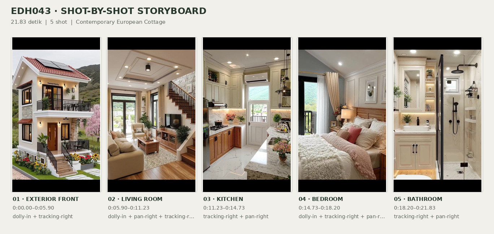
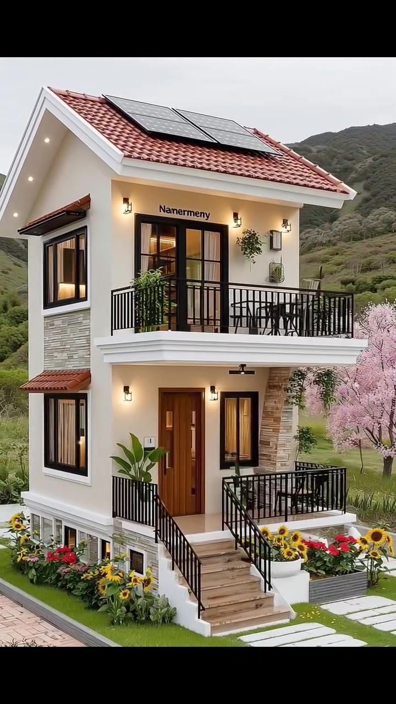
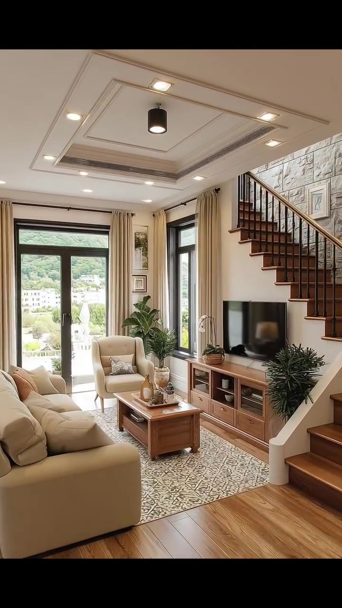
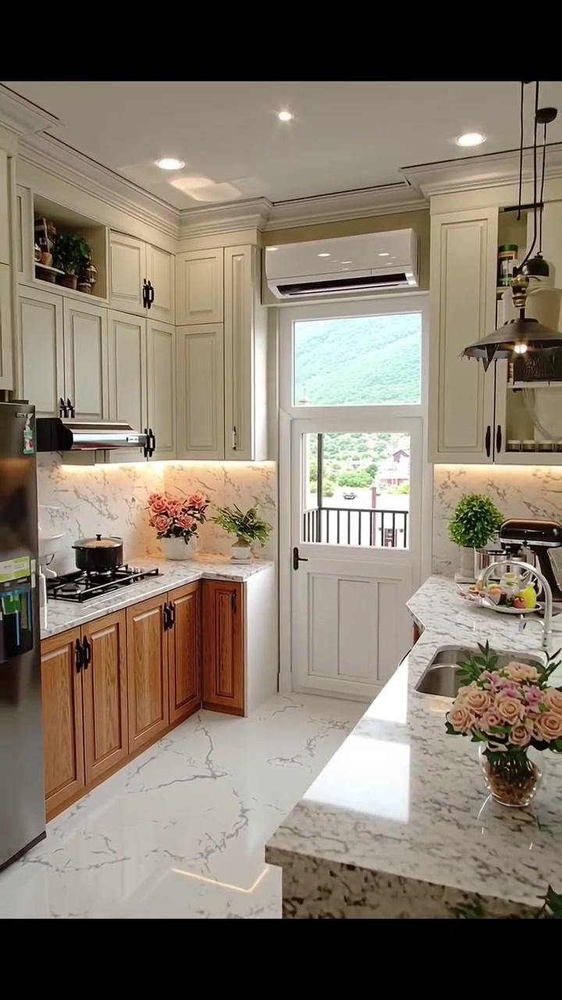
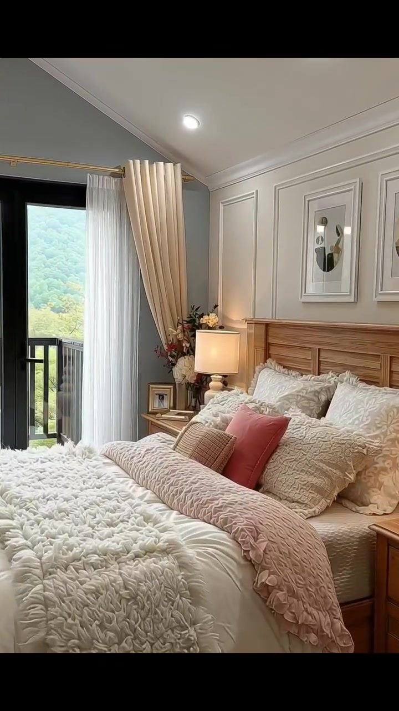
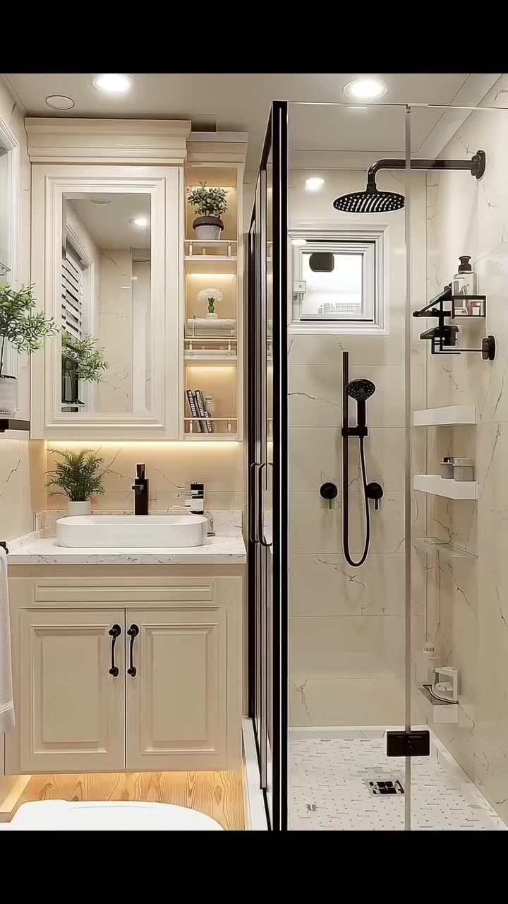

# edh043 — Contemporary European Cottage

<!-- homeku_request_id: edh043_20261105_57bf3696e037592f8b4dc2aada329cb5 -->

<!-- homeku_detail_narratives: chat-reviewed -->

**Sumber data:** [analysis.yaml](analysis.yaml) · **Status:** draft · **Diverifikasi manusia:** Tidak

## 1. Informasi Video

| Informasi | Nilai |
|---|---|
| ID | edh043 |
| File asli | edh043.mp4 |
| Durasi | 21.83 |
| Resolusi | 720x1280 |
| FPS | 30 |
| Rasio | 9:16 |
| Jumlah shot | 5 |

## 2. Storyboard Gabungan

## 3. Identitas Desain

| Aspek | Hasil analisis |
|---|---|
| Gaya utama | contemporary european cottage |
| Wilayah terkait gaya desain | europe, north america |
| Pengaruh gaya | modern farmhouse elements, mediterranean influenced roof tiles, modern classic interior |
| Ciri eksterior | steep front gabled roof with terracotta colored tile appearance, dark rectangular panels on front roof slope, warm white plastered two story facade, black framed windows and upper balcony door, upper front balcony with black metal railings, raised front entrance with brown steps and black handrails, natural stone appearance cladding beside front door, warm wall sconces and recessed soffit lights |
| Gaya interior | warm transitional, modern classic panel molding, neutral cozy living room, light marble appearance kitchen and bathroom |
| Confidence gaya | medium |

## 4. Ukuran & Proporsi Bangunan

| Aspek | Estimasi visual |
|---|---|
| Ukuran yang terlihat | medium |
| Bentuk bangunan | narrow rectangular two story |
| Skala vertikal | two stories |
| Tapak bangunan | compact |
| Perkiraan luas lantai | 100–160 m² |
| Confidence | low |

> Luas adalah perkiraan visual, bukan ukuran terukur.

## 5. Warna, Pencahayaan, dan Atmosfer

| Warna dominan | HEX (perkiraan) |
|---|---|
| warm ivory | #EEE5D8 |
| terracotta roof red | #AA5844 |
| matte black | #242321 |
| honey wood brown | #A67243 |
| beige cream | #C8B8A3 |
| sage and garden green | #6E8760 |
| blush pink | #C99491 |

| Aspek | Hasil analisis |
|---|---|
| Pencahayaan | soft exterior daylight, warm exterior sconce and soffit lights, bright window daylight, warm interior recessed lighting, warm bedside lamps |
| Lingkungan | narrow landscaped house plot, flower beds at front of house, pink flowering trees to right and behind house, distant green hills |
| Musim yang tampak | Tidak diketahui |
| Mood | welcoming, cozy, bright, polished, garden oriented |

## 6. Struktur dan Timeline Video

**Jenis:** multi room house tour · **Tempo:** moderate · **Transisi:** continuous exterior to living room camera move followed by hard cuts between interior rooms

| Shot | Waktu (detik) | Durasi | Area/Scene | Gerakan Kamera |
|---|---|---|---|---|
| Shot 01 | 0–5.9 | 5.90 | exterior front | dolly in, tracking right |
| Shot 02 | 5.9–11.23 | 5.33 | living room | dolly in, pan right, tracking right |
| Shot 03 | 11.23–14.73 | 3.50 | kitchen | tracking right, pan right |
| Shot 04 | 14.73–18.2 | 3.47 | bedroom | dolly in, tracking right, pan right |
| Shot 05 | 18.2–21.83 | 3.63 | bathroom | tracking right, pan right |

## 7. Analisis per Shot

### Shot 01 — exterior front

**Waktu:** 0–5.9 detik

| Komponen | Pengamatan |
|---|---|
| Fokus utama | two story white house with tiled gable and front balcony |
| Framing awal → akhir | wide three quarter front elevation → close view from raised entry under upper balcony |
| Sudut pandang | slightly elevated front left three quarter |
| Gerakan kamera | dolly in, tracking right |
| Kecepatan kamera | moderate |
| Pencahayaan | soft daylight with warm exterior practical lights |
| Transisi keluar | continuous camera move past entry into living room |

**Detail yang terlihat**

**Arsitektur**

Bangunan dua lantai ini bermassa persegi panjang yang relatif ramping dengan atap pelana di bagian depan. Atap tampak memakai genteng merah terakota, lis tepi putih, dan beberapa modul persegi panjang gelap menyerupai panel surya pada bidang atap depan. Fasadnya berfinishing halus putih hangat. Di lantai atas terdapat pintu kaca besar berkusen hitam yang membuka ke balkon depan dengan pagar logam hitam. Jendela lantai bawah dan sisi kiri juga berbingkai hitam. Pintu utama terlihat berwarna cokelat menyerupai kayu dengan sisipan kaca, berdampingan dengan dinding aksen berpenampilan batu berwarna krem kecokelatan di sebelah kanannya. Tangga menuju pintu masuk yang lebih tinggi memiliki anak tangga cokelat dan pegangan logam hitam di kedua sisi. Lampu dinding bercangkang hitam memberi cahaya hangat di sekitar pintu dan jendela; di bawah balkon juga tampak lampu tanam plafon dan kipas kecil berwarna hitam. Pada dinding kiri ada kanopi jendela kecil bernuansa terakota, sementara teras masuk dibatasi dinding dasar putih yang rendah dan pagar gelap.

**Furnitur dan properti**

Sebuah tanaman berdaun lebar dalam pot yang tinggi berada di kiri pintu masuk. Sejumlah pot hijau kecil tertata di balkon atas, sedangkan di bawah jendela depan terdapat pot bunga dan petak tanaman hias yang cukup rapat.

**Lingkungan**

Taman depan menampilkan bunga kuning menyerupai bunga matahari bersama bunga merah dan putih. Jalur depan dibatasi hamparan rumput hijau yang sempit, dengan batu pijakan persegi panjang berwarna terang di sisi kanan depan rumah. Pohon\-pohon berbunga merah muda tampak di sisi kanan dan belakang rumah, diselingi pepohonan serta semak berdaun hijau di tepi lahan. Di kejauhan terlihat perbukitan hijau berhutan dan langit yang tampak pucat berawan.

**Catatan pengamatan:** Camera advances from a full facade view toward the porch; room boundary is spatial, not a hard cut.

**Confidence:** Kamera high · Detail visual high

### Shot 02 — living room

**Waktu:** 5.9–11.23 detik

| Komponen | Pengamatan |
|---|---|
| Fokus utama | cream furnished living area beside wooden staircase |
| Framing awal → akhir | wide entry view toward seating and staircase → closer view of tv wall window and patio door |
| Sudut pandang | eye level oblique interior |
| Gerakan kamera | dolly in, pan right, tracking right |
| Kecepatan kamera | moderate |
| Pencahayaan | bright window daylight with warm recessed ceiling lights |
| Transisi keluar | hard cut to kitchen |

**Detail yang terlihat**

**Arsitektur**

Ruang keluarga memiliki plafon putih bertingkat dengan panel cekung persegi panjang, dilengkapi lampu tanam hangat dan beberapa lampu sorot kecil berwarna hitam. Lantainya berpenampilan papan kayu bernuansa hangat, sementara dindingnya putih krem. Di sisi kanan terdapat tangga dengan anak tangga menyerupai kayu dan pagar berwarna logam gelap; bagian dinding di dekat tangga berlapis material yang tampak seperti susunan batu abu\-abu krem. Di ujung ruangan ada pintu kaca besar berkusen hitam menuju area luar serta jendela tinggi berbingkai hitam yang disertai gorden panjang warna beige.

**Furnitur dan properti**

Sofa besar berlapis kain krem menghadap televisi, sedangkan dua kursi santai berwarna terang ditempatkan di dekat pintu kaca belakang. Meja kopi kayu berbentuk persegi panjang berada di depan sofa, di atas karpet bercorak lembut warna krem dan abu\-abu. Televisi layar datar hitam diletakkan pada konsol kayu rendah. Meja dan konsol dihiasi baki, vas, dan benda dekorasi kecil; sebuah tanaman hijau berdaun lebat berada di dekat jendela serta area duduk. Bantal\-bantal krem melengkapi sofa.

**Lingkungan**

Melalui pintu kaca terlihat taman dengan vegetasi hijau, sementara perbukitan hijau tampak lebih jauh di belakang. Di dekat bagian luar pintu terlihat pula tepi teras atau balkon yang terang.

**Catatan pengamatan:** Starts in the same continuous movement as exterior; camera reveals the living zone then moves toward the TV and glazed doors.

**Confidence:** Kamera medium · Detail visual high

### Shot 03 — kitchen

**Waktu:** 11.23–14.73 detik

| Komponen | Pengamatan |
|---|---|
| Fokus utama | cream and wood kitchen with marble appearance island |
| Framing awal → akhir | medium wide view from kitchen entry → wider view including island and refrigerator |
| Sudut pandang | eye level three quarter interior |
| Gerakan kamera | tracking right, pan right |
| Kecepatan kamera | moderate |
| Pencahayaan | bright daylight warm under cabinet lights and ceiling downlights |
| Transisi keluar | hard cut to bedroom |

**Detail yang terlihat**

**Arsitektur**

Dapur menggunakan kabinet atas model shaker warna krem yang menjulang tinggi dengan profil mahkota, dipadukan dengan pintu kabinet bawah bernuansa kayu hangat. Dinding backsplash dan lantai putih mengilap tampak memiliki urat abu\-abu menyerupai marmer. Permukaan island juga berpenampilan batu putih berurat abu\-abu. Plafon dilengkapi lis sederhana dan lampu tanam. Di bagian belakang terdapat pintu putih berjendela kecil dan bergagang hitam, dengan unit AC putih di atasnya. Cahaya hangat dari bawah kabinet menerangi area countertop.

**Furnitur dan properti**

Di sisi kanan berdiri lemari es tinggi berpenampilan baja tahan karat. Pada meja kerja kiri terdapat kompor tanam hitam dengan panci gelap. Island memuat bak cuci berbahan logam dan keran logam, dengan dua lampu gantung berunsur logam gelap di atasnya. Di samping pintu belakang ada rangkaian bunga merah muda; tanaman pot hijau kecil juga menghiasi meja kerja dan rak bagian atas. Di dekat permukaan island tersusun baki berisi cangkir serta perlengkapan makan, dan rangkaian bunga lain terlihat di ujung island yang dekat kamera.

**Lingkungan**

Dari kaca pintu belakang tampak lereng atau bukit hijau, sekaligus pagar pembatas luar ruangan dan vegetasi hijau.

**Catatan pengamatan:** Camera moves right to reveal the refrigerator and pendant-lit island. Island counter surface has white veined stone appearance.

**Confidence:** Kamera high · Detail visual high

### Shot 04 — bedroom

**Waktu:** 14.73–18.2 detik

| Komponen | Pengamatan |
|---|---|
| Fokus utama | large layered bed facing black framed balcony doors |
| Framing awal → akhir | wide bed foot and balcony view → closer view of right bedside and balcony doors |
| Sudut pandang | eye level three quarter bedroom |
| Gerakan kamera | dolly in, tracking right, pan right |
| Kecepatan kamera | slow |
| Pencahayaan | soft daylight with warm bedside lamps and ceiling downlights |
| Transisi keluar | hard cut to bathroom |

**Detail yang terlihat**

**Arsitektur**

Kamar tidur memiliki bidang plafon berbentuk pelana bernuansa biru\-abu pucat di atas pintu balkon. Dinding putih di belakang tempat tidur diberi lis panel dekoratif. Lampu tanam hangat tersebar di plafon, ditemani lampu gantung kecil di tengah. Pintu balkon dua daun berbingkai hitam diapit gorden panjang berwarna krem. Lantainya tampak berupa papan bernuansa kayu cokelat sedang, dan pagar balkon logam hitam terlihat di balik kaca.

**Furnitur dan properti**

Tempat tidur besar memiliki kepala dan rangka berpenampilan kayu hangat. Spreinya terdiri atas selimut tebal putih berlapis dengan throw krem yang bertekstur jelas, serta kain lempar merah muda kusam yang dibentangkan di bagian bawah. Bantal\-bantal dekoratif krem dan merah muda tersusun di depan kepala tempat tidur. Di kedua sisi terdapat nakas laci bernuansa kayu dengan lampu meja yang menyala hangat. Dua karya seni berbingkai terang tergantung di sisi kiri atas tempat tidur, sedangkan karpet pucat terlihat sebagian dari bawah ranjang. Nakas kanan menampung vas bunga dan bingkai dekorasi kecil.

**Lingkungan**

Melalui pintu balkon tampak perbukitan hijau dengan banyak pepohonan, disertai langit terang pucat dan vegetasi yang lebih jauh.

**Catatan pengamatan:** Bedroom camera glides right, revealing raised gable ceiling and right bedside area; exterior beyond balcony remains visible.

**Confidence:** Kamera high · Detail visual high

### Shot 05 — bathroom

**Waktu:** 18.2–21.83 detik

| Komponen | Pengamatan |
|---|---|
| Fokus utama | white vanity and black framed glass shower |
| Framing awal → akhir | medium view of vanity and glass shower → wider view showing toilet and shower |
| Sudut pandang | eye level frontal then right oblique |
| Gerakan kamera | tracking right, pan right |
| Kecepatan kamera | moderate |
| Pencahayaan | bright recessed ceiling lights and warm niche lights |
| Transisi keluar | end of video |

**Detail yang terlihat**

**Arsitektur**

Kamar mandi didominasi dinding dan lis panel berwarna putih hangat. Kabinet wastafel putih menggunakan pintu berpanel klasik dengan countertop menyerupai marmer putih berurat abu\-abu halus. Cermin tinggi berbingkai terpasang di antara panel dinding, berdampingan dengan ceruk display terbuka yang mendapat pencahayaan hangat. Ruang pancuran dibatasi kaca bening dengan rangka serta pintu logam hitam. Dinding shower memakai ubin besar krem beige, dengan kepala shower hujan hitam di atas dan pancuran genggam hitam. Sebuah jendela kecil berkusen hitam berada di bagian atas shower. Plafon putih memakai lampu tanam terang, sementara lantainya tampak memakai keramik bernuansa pucat.

**Furnitur dan properti**

Wastafel mangkuk oval putih terpasang di atas meja, disertai keran tunggal hitam matte. Kabinet bawah memiliki dua pegangan logam gelap. Tanaman pot kecil menghiasi countertop dan rak bercahaya, bersama botol dispenser sabun berwarna gelap di samping wastafel. Sebuah toilet putih berada di antara kabinet wastafel dan kaca shower. Di area shower juga terlihat rak gantung kecil dari logam gelap.

**Lingkungan**

Tidak ada detail yang tercatat.

**Catatan pengamatan:** Camera pans right from sink toward glass enclosure, black shower fittings and visible toilet. Outdoor scenery cannot be identified.

**Confidence:** Kamera high · Detail visual high

## 8. Kualitas dan Ketidakpastian Analisis

| Parameter | Hasil |
|---|---|
| Status | draft |
| Verifikasi manusia | Tidak |
| Ketepatan timestamp | estimated |
| Ketidakpastian | exterior to living room boundary marks spatial change without a hard cut, exact roof tile material and roof panel function are not verified, exact surface materials are described by visual appearance, building floor area is a low confidence visual estimate, design region labels are style associations not home location, outdoor season and geographic location cannot be confirmed from video |

**Catatan:** Full visual duration reviewed. Shot boundaries approximate at 5.90, 11.23, 14.73, and 18.20 seconds; the first is a scene transition within a continuous camera move. No audio analyzed.

---

*Laporan ini diturunkan dari [analysis.yaml](analysis.yaml).*
