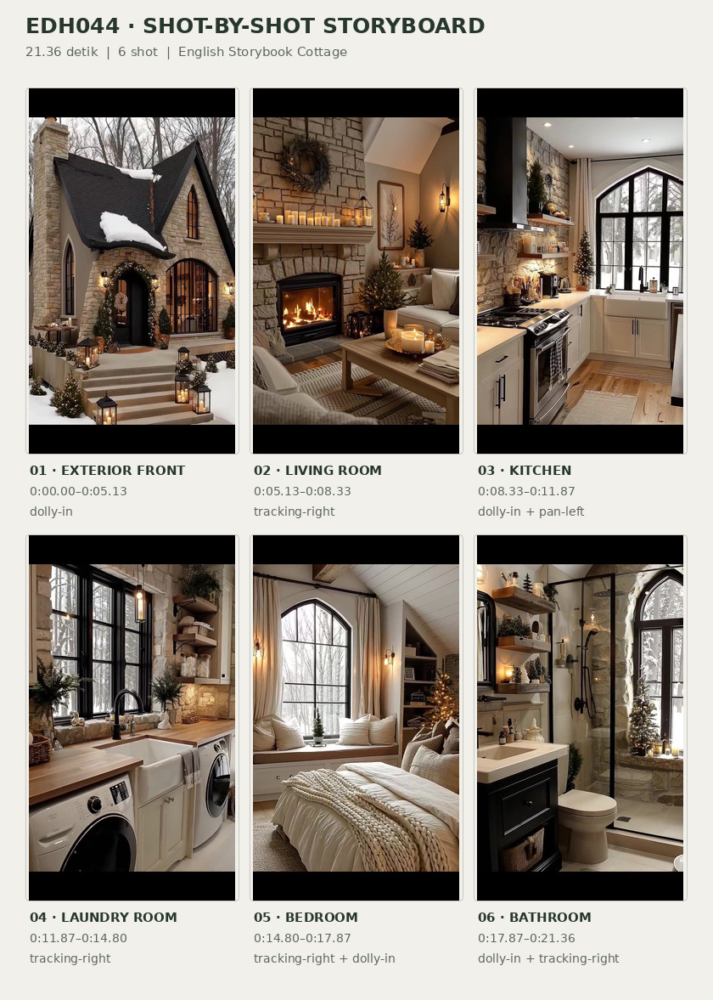
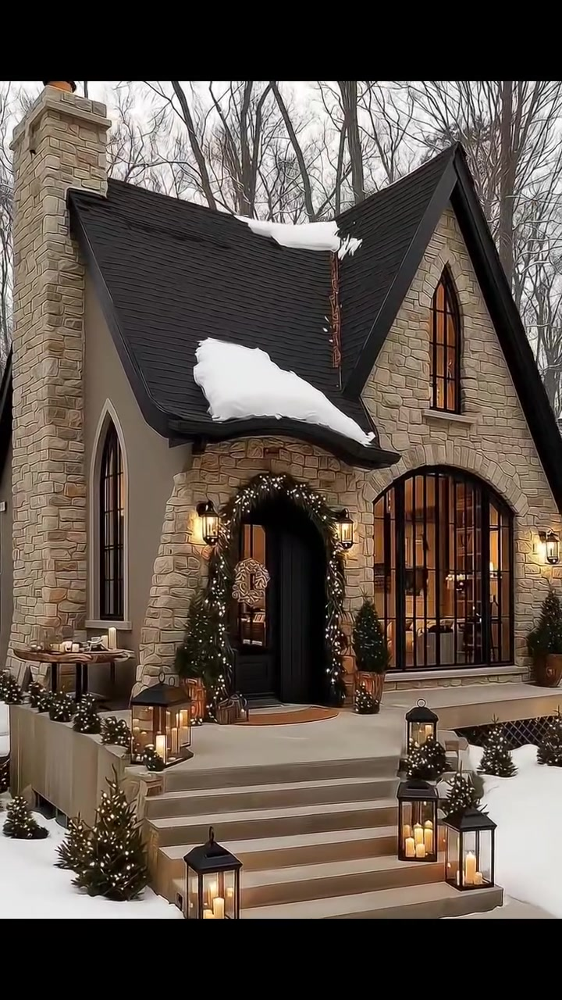
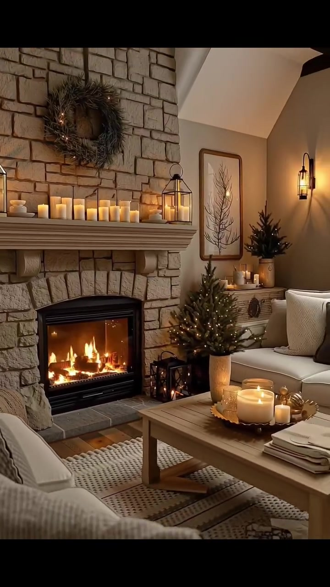
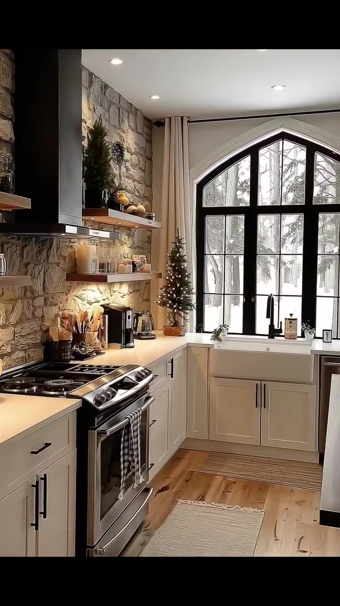
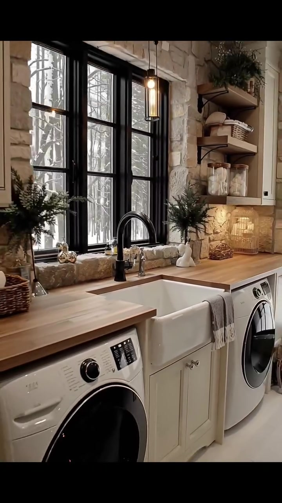
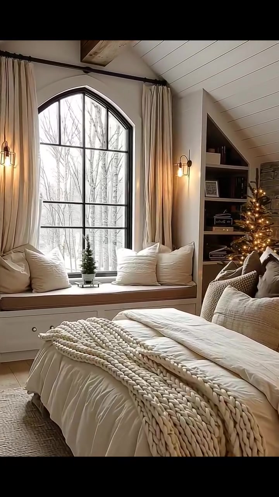
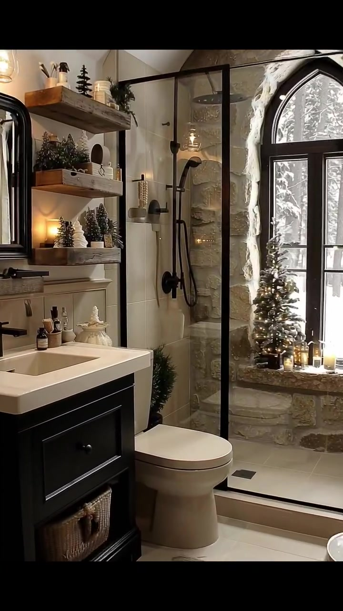

# edh044 — English Storybook Cottage

<!-- homeku_request_id: edh044-20261105-17b9377980794e88 -->

<!-- homeku_detail_narratives: chat-reviewed -->

**Sumber data:** [analysis.yaml](analysis.yaml) · **Status:** draft · **Diverifikasi manusia:** Tidak

## 1. Informasi Video

| Informasi | Nilai |
|---|---|
| ID | edh044 |
| File asli | edh044.mp4 |
| Durasi | 21.36 |
| Resolusi | 720x1280 |
| FPS | 30 |
| Rasio | 9:16 |
| Jumlah shot | 6 |

## 2. Storyboard Gabungan

## 3. Identitas Desain

| Aspek | Hasil analisis |
|---|---|
| Gaya utama | english storybook cottage |
| Wilayah terkait gaya desain | europe, north america |
| Pengaruh gaya | gothic revival details, english country cottage, rustic farmhouse interior |
| Ciri eksterior | steep dark multi gable roof, cream beige stone facade, tall stone chimney, pointed arch black framed windows, recessed arched entry, snow covered roof sections |
| Gaya interior | warm rustic cottage, neutral farmhouse furnishings, rough stone wall accents, light wood appearance surfaces, holiday greenery and candles |
| Confidence gaya | high |

## 4. Ukuran & Proporsi Bangunan

| Aspek | Estimasi visual |
|---|---|
| Ukuran yang terlihat | medium |
| Bentuk bangunan | compact multi gabled |
| Skala vertikal | main story with possible under roof space |
| Tapak bangunan | moderate |
| Perkiraan luas lantai | 80–150 m² |
| Confidence | low |

> Luas adalah perkiraan visual, bukan ukuran terukur.

## 5. Warna, Pencahayaan, dan Atmosfer

| Warna dominan | HEX (perkiraan) |
|---|---|
| warm beige stone | #B9A58C |
| cream white | #E7E0D4 |
| charcoal black | #242221 |
| natural wood brown | #987456 |
| warm amber light | #DBAB62 |
| snow white | #EDEDED |

| Aspek | Hasil analisis |
|---|---|
| Pencahayaan | diffused overcast daylight, warm wall sconces, warm lantern and candle glow, fireplace flame light, under shelf task lighting |
| Lingkungan | snow covered ground, leafless woodland around house, small evergreen landscape shrubs, winter view through interior windows |
| Musim yang tampak | snowy winter like appearance |
| Mood | cozy, quiet, rustic, festive |

## 6. Struktur dan Timeline Video

**Jenis:** home tour · **Tempo:** slow · **Transisi:** hard cuts between scenes

| Shot | Waktu (detik) | Durasi | Area/Scene | Gerakan Kamera |
|---|---|---|---|---|
| Shot 01 | 0.0–5.13 | 5.13 | exterior front | dolly in |
| Shot 02 | 5.13–8.33 | 3.20 | living room | tracking right |
| Shot 03 | 8.33–11.87 | 3.54 | kitchen | dolly in, pan left |
| Shot 04 | 11.87–14.8 | 2.93 | laundry room | tracking right |
| Shot 05 | 14.8–17.87 | 3.07 | bedroom | tracking right, dolly in |
| Shot 06 | 17.87–21.36 | 3.49 | bathroom | dolly in, tracking right |

## 7. Analisis per Shot

### Shot 01 — exterior front

**Waktu:** 0.0–5.13 detik

| Komponen | Pengamatan |
|---|---|
| Fokus utama | stone clad storybook cottage front facade |
| Framing awal → akhir | wide three quarter front view → medium close front entry view |
| Sudut pandang | slightly low front left angle |
| Gerakan kamera | dolly in |
| Kecepatan kamera | slow |
| Pencahayaan | overcast daylight with warm entry lanterns |
| Transisi keluar | hard cut |

**Detail yang terlihat**

**Arsitektur**

Rumah menampilkan atap pelana curam berpenutup gelap dengan sebagian salju menempel, dinding fasad dari susunan batu tak beraturan berwarna krem\-krem kecokelatan, serta cerobong batu tinggi di sisi kiri. Pada pelana depan terdapat jendela lancip yang ramping, dengan jendela lancip lain di dinding samping kiri dan jendela lengkung besar berkisi hitam di kanan pintu utama. Pintu hitam berada di dalam lengkungan masuk berbatu yang menjorok ke dalam. Terasnya ditinggikan dengan beberapa anak tangga lebar berwarna pucat, diterangi lentera dinding hangat di kedua sisi pintu. Lis gelap menegaskan tepian atap dan bingkai jendela, sedangkan dinding penahan rendah membatasi sisi kiri tangga.

**Furnitur dan properti**

Lengkungan pintu dihias rangkaian daun hijau dengan lampu\-lampu kecil hangat, dan sebuah karangan bundar terpasang pada daun pintu hitam. Tanaman hijau berbentuk kerucut dalam pot mengapit pintu. Beberapa lentera lantai hitam berisi cahaya lilin diletakkan di dekat tangga. Di kiri pintu terdapat meja kayu kecil, sementara perdu hijau kecil tersebar sepanjang teras dan tepi tangga. Keset oval cokelat berada tepat di depan pintu.

**Lingkungan**

Tanah di depan dan sekeliling rumah tertutup salju. Di belakang bangunan berdiri pepohonan tinggi yang meranggas, dengan langit mendung berwarna abu\-abu pucat di atas atap. Sebuah bangunan kecil berwarna terang terlihat jauh di latar kanan, sementara semak hijau rendah muncul di beberapa bagian hamparan salju.

**Catatan pengamatan:** Camera steadily approaches front doorway; snow and seasonal decor are visually evident, actual locality is unknown.

**Confidence:** Kamera high · Detail visual high

### Shot 02 — living room

**Waktu:** 5.13–8.33 detik

| Komponen | Pengamatan |
|---|---|
| Fokus utama | stone fireplace and neutral seating group |
| Framing awal → akhir | medium close fireplace view → wide living room seating view |
| Sudut pandang | eye level interior angle |
| Gerakan kamera | tracking right |
| Kecepatan kamera | slow |
| Pencahayaan | warm firelight and candles with soft daylight |
| Transisi keluar | hard cut |

**Detail yang terlihat**

**Arsitektur**

Dinding perapian dibuat dari susunan batu kasar berwarna pucat, dengan bukaan tungku berbingkai hitam yang memperlihatkan nyala api jingga. Di atasnya terdapat ambalan mantel tebal berwarna krem, sementara dasar tungku dilapisi ubin batu persegi panjang abu\-abu. Plafon putih yang tinggi dan miring memperlihatkan balok gelap di sisi kanan. Jendela besar berujung lancip dengan kisi hitam menempati dinding kanan, berdampingan dengan dinding krem hangat yang dipasangi lampu dinding hitam. Lantainya tampak seperti papan kayu berwarna hangat.

**Furnitur dan properti**

Di atas mantel tersusun lilin krem dengan tinggi beragam dan lentera logam hitam pada kedua ujungnya; karangan hijau bundar tergantung di atasnya. Pohon hijau kecil berlampu berada di kanan perapian. Sofa berlapis kain krem dengan bantal netral menempati sisi kanan, sedangkan kursi berlengan warna beige berada di depan kiri. Meja kopi persegi panjang dari kayu terang memisahkan area duduk, dengan nampan bundar berisi lilin serta tumpukan buku. Karpet anyaman bermotif krem terhampar di bawahnya. Tirai krem membingkai jendela lancip, dan lukisan botani berbingkai tergantung di atas kabinet kecil krem.

**Lingkungan**

Melalui jendela di kanan terlihat pepohonan tanpa daun pada lanskap yang tertutup salju.

**Catatan pengamatan:** Camera shifts right from fireplace to include sofa, low coffee table and tall window.

**Confidence:** Kamera high · Detail visual high

### Shot 03 — kitchen

**Waktu:** 8.33–11.87 detik

| Komponen | Pengamatan |
|---|---|
| Fokus utama | compact kitchen cooking zone and arch window |
| Framing awal → akhir | wide view of narrow kitchen → closer view of stove and stone wall |
| Sudut pandang | eye level interior angle |
| Gerakan kamera | dolly in, pan left |
| Kecepatan kamera | slow |
| Pencahayaan | cool snowy daylight with warm under shelf and ceiling lights |
| Transisi keluar | hard cut |

**Detail yang terlihat**

**Arsitektur**

Dapur tampak memanjang dan relatif sempit dengan deretan kabinet pada dua sisi. Kabinet bawah bergaya shaker berwarna krem terang memakai gagang hitam. Dinding batu kasar beige menjadi latar area memasak di kiri, di bawah tudung penghisap asap logam hitam yang tinggi. Jendela besar berujung lancip dengan kisi hitam berada di dinding ujung. Lantai menyerupai papan kayu terang, dipadukan dengan meja kerja berpermukaan pucat, lampu tanam pada plafon putih, dan dua ambalan kayu alami di dinding batu kiri. Tirai krem membatasi kedua sisi jendela ujung.

**Furnitur dan properti**

Kompor berbodi depan baja tahan karat dan permukaan tungku listrik gelap berada di bawah tudung hitam. Di meja belakang terlihat mesin kopi hitam serta ketel kaca. Spatula dan sendok kayu disimpan dalam wadah dekat kompor, sedangkan stoples kaca kecil dan cangkir keramik tersusun pada rak terbuka. Sebuah pohon hijau kecil berhias berdiri dekat jendela, karpet lorong anyaman terang terhampar di lantai, dan kain bergaris tergantung di pegangan pintu oven.

**Lingkungan**

Di balik jendela ujung dapur tampak pepohonan tanpa daun pada lanskap bersalju.

**Catatan pengamatan:** The apparent galley proportions come from visible countertops on both sides; no full floor plan is available.

**Confidence:** Kamera high · Detail visual high

### Shot 04 — laundry room

**Waktu:** 11.87–14.8 detik

| Komponen | Pengamatan |
|---|---|
| Fokus utama | apron front sink with side by side laundry machines |
| Framing awal → akhir | close view of sink and window → wider view of laundry machines and end door |
| Sudut pandang | eye level interior angle |
| Gerakan kamera | tracking right |
| Kecepatan kamera | slow |
| Pencahayaan | bright diffused daylight with warm pendant and task lights |
| Transisi keluar | hard cut |

**Detail yang terlihat**

**Arsitektur**

Ruang utilitas tampak panjang dan sempit, dengan kabinet krem serta meja kerja menerus berpenampilan kayu terang di sepanjang dinding berjendela. Wastafel celemek putih berukuran besar tertanam pada meja tersebut. Dinding batu tidak beraturan berwarna beige mengelilingi jendela\-jendela persegi berbingkai hitam. Di ujung ruang terdapat pintu kaca berbingkai hitam dengan puncak lengkung. Lantainya tampak berubin pucat. Kabinet atas berwarna krem dan rak terbuka dari kayu terpasang di sisi kanan jendela, dengan cahaya kerja hangat di bawah rak.

**Furnitur dan properti**

Di atas wastafel terdapat keran lengkung tinggi hitam matte dan keran logam kecil berwarna perak; handuk tangan abu\-abu bergaris tergantung pada sisi depan bak. Mesin cuci atau pengering bukaan depan berwarna putih terlihat di bawah meja. Rak\-rak memuat stoples bening berisi benda berwarna terang, kain terlipat, dan keranjang anyaman. Vas putih dengan ranting hijau berdiri dekat bak, lampu gantung ramping bernuansa hangat terlihat di dekat jendela, dan keranjang berisi handuk terang diletakkan pada meja.

**Lingkungan**

Pepohonan tanpa daun pada tanah bersalju terlihat melalui jendela hitam; lapisan salju juga tampak melalui pintu kaca di ujung ruang.

**Catatan pengamatan:** Rightward camera motion reveals more of the laundry appliances, cabinets, and door beyond sink.

**Confidence:** Kamera high · Detail visual high

### Shot 05 — bedroom

**Waktu:** 14.8–17.87 detik

| Komponen | Pengamatan |
|---|---|
| Fokus utama | cream bed and pointed arch window seat |
| Framing awal → akhir | wide bedroom with arch window and bed → closer bed and right shelving view |
| Sudut pandang | eye level interior angle |
| Gerakan kamera | tracking right, dolly in |
| Kecepatan kamera | slow |
| Pencahayaan | cool window daylight balanced with warm sconces and tree lights |
| Transisi keluar | hard cut |

**Detail yang terlihat**

**Arsitektur**

Kamar tidur memiliki plafon miring berlapis papan putih dengan balok kayu yang terekspos. Jendela tinggi berujung lancip dan berkisi hitam berada di dinding ujung yang bercat netral terang. Tepat di bawah jendela dibangun bangku duduk dengan laci berpanel. Ceruk akibat kemiringan atap di kedua sisi dimanfaatkan sebagai rak buku terbuka; bagian dinding di kanan tempat tidur menampilkan lapisan batu abu\-beige. Lampu dinding hangat mengapit jendela, sedangkan lantainya menyerupai papan kayu terang.

**Furnitur dan properti**

Tempat tidur berangka kayu rendah dengan selimut tebal krem menempati bagian depan. Bantal dekoratif bertekstur dalam nuansa krem, taupe, dan cokelat tersusun di kepala tempat tidur, sementara rajutan tebal berwarna krem terhampar di kaki ranjang. Karpet anyaman terang berada di sisi tempat tidur. Tirai krem menggantung di kedua sisi jendela, dengan bantal besar krem dan tanaman hijau kecil di bangku bawahnya. Pohon dekoratif kecil berlampu berdiri di dekat rak kanan, yang juga memuat buku serta ornamen kecil.

**Lingkungan**

Pemandangan pepohonan meranggas dan hamparan salju terlihat melalui jendela kamar tidur.

**Catatan pengamatan:** Closer rightward framing emphasizes tactile bedding and built-in reading nook.

**Confidence:** Kamera high · Detail visual high

### Shot 06 — bathroom

**Waktu:** 17.87–21.36 detik

| Komponen | Pengamatan |
|---|---|
| Fokus utama | black vanity and stone framed arch window |
| Framing awal → akhir | wide bathroom showing vanity toilet and shower → close view of vanity sink and faucet |
| Sudut pandang | eye level interior angle |
| Gerakan kamera | dolly in, tracking right |
| Kecepatan kamera | slow |
| Pencahayaan | diffused window daylight with warm sconce and candlelight |
| Transisi keluar | end of video |

**Detail yang terlihat**

**Arsitektur**

Kamar mandi memperlihatkan dinding batu kasar beige di sekeliling jendela tinggi berujung lancip berbingkai hitam. Jendela ini berada di ujung zona pancuran, yang dibatasi kaca bening dengan rangka logam hitam tipis dan dinding ubin putih. Lantai menggunakan ubin persegi berwarna pucat. Kabinet wastafel gelap menopang bak putih persegi panjang, dengan cermin berbingkai hitam di atasnya. Rak kayu terapung menempati sisi kanan cermin dan plafon putih menurun di atas area wastafel.

**Furnitur dan properti**

Keran tunggal hitam matte terpasang di atas bak putih. Pancuran atas hitam dan semprotan genggam terlihat pada dinding area mandi; kloset putih\-krem berada di antara kabinet dan pancuran. Lampu dinding hangat terpasang di atas area cermin. Rak kayu dihiasi pohon\-pohon hijau mini serta stoples, sementara botol sabun dan wadah sikat berada di sekitar wastafel dan handuk netral terlipat pada rak. Lilin menyala bersama pohon hijau kecil diletakkan di ambang jendela batu. Keset mandi bertekstur terang menutupi sebagian lantai.

**Lingkungan**

Pepohonan tanpa daun di luar dengan permukaan tanah bersalju terlihat melalui jendela tinggi kamar mandi.

**Catatan pengamatan:** At the end the camera advances towards the vanity, obscuring much of the shower.

**Confidence:** Kamera high · Detail visual high

## 8. Kualitas dan Ketidakpastian Analisis

| Parameter | Hasil |
|---|---|
| Status | draft |
| Verifikasi manusia | Tidak |
| Ketepatan timestamp | estimated |
| Ketidakpastian | exact home location not inferable from architecture, stylistic region is association not geolocation, exact natural stone and wood materials unverified, floor area estimate has no measured scale reference, upper floor or loft layout not visible, winter like conditions do not confirm calendar date, movement classification is visual interpretation, technical duration includes a short audio tail beyond last video frame |

**Catatan:** Six visually distinct shots observed across the full clip. Camera cuts estimated to the nearest video frame; no audio analysis performed.

---

*Laporan ini diturunkan dari [analysis.yaml](analysis.yaml).*
