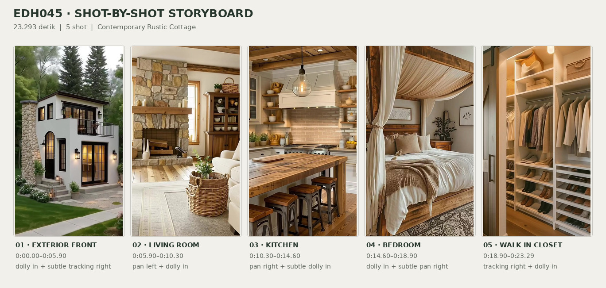
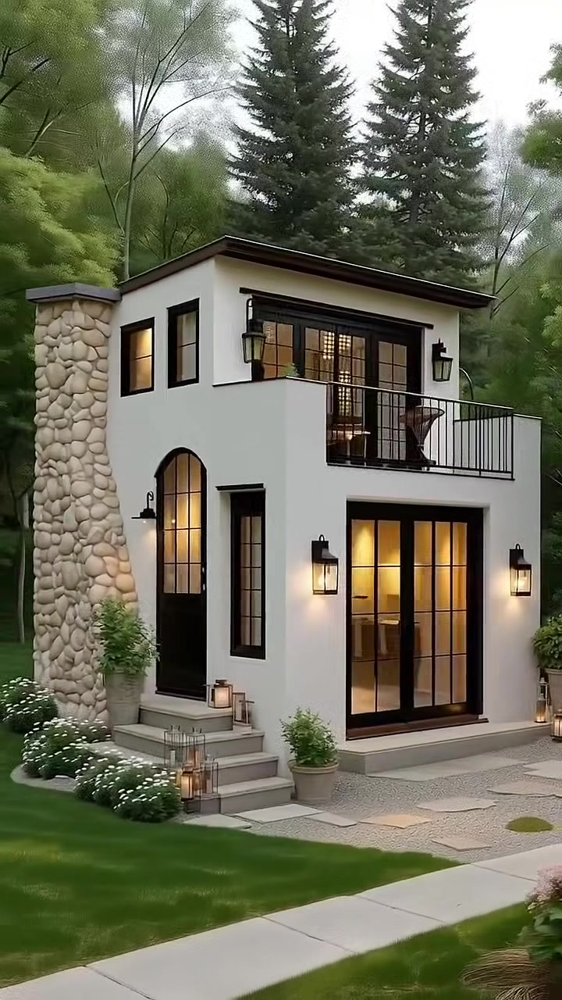
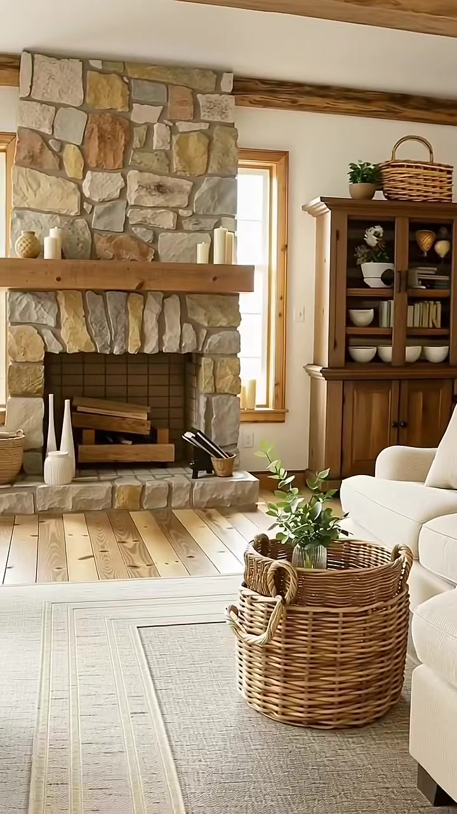
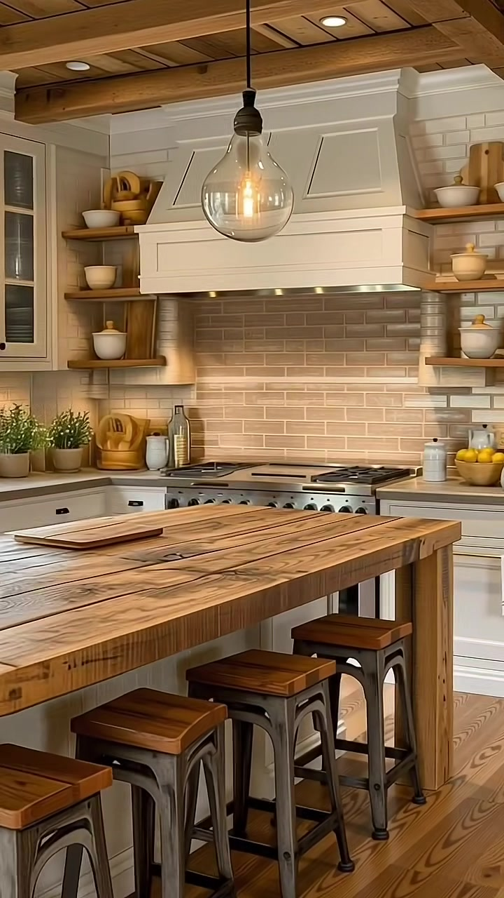
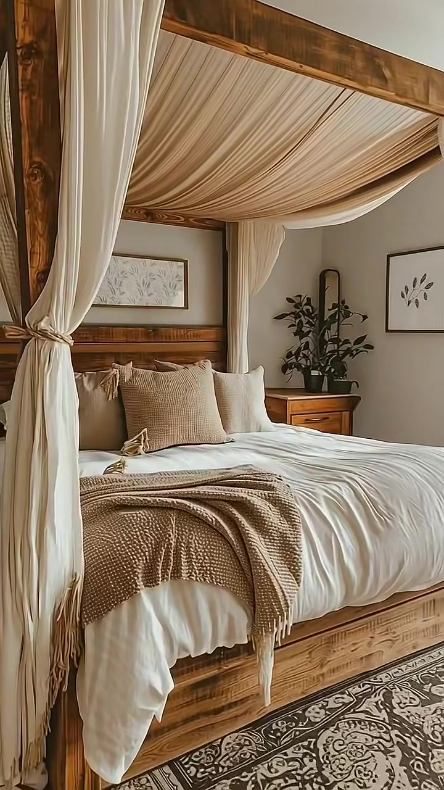
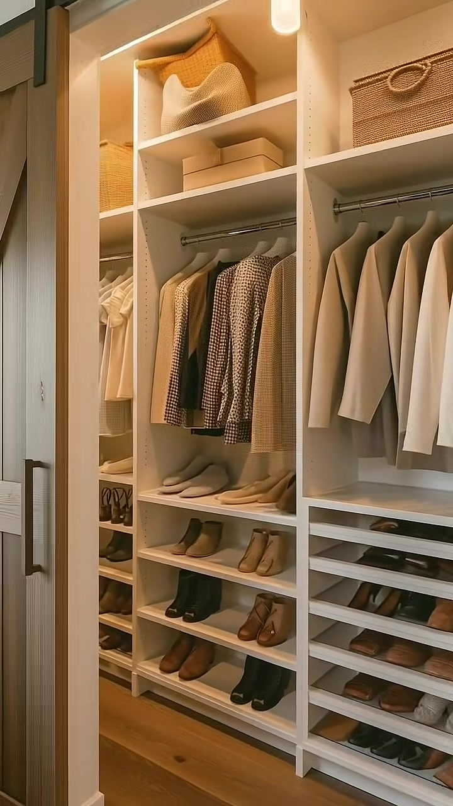

# edh045 — Contemporary Rustic Cottage

<!-- homeku_request_id: edh045-20261105-v14-01 -->

<!-- homeku_detail_narratives: chat-reviewed -->

**Sumber data:** [analysis.yaml](analysis.yaml) · **Status:** draft · **Diverifikasi manusia:** Tidak

## 1. Informasi Video

| Informasi | Nilai |
|---|---|
| ID | edh045 |
| File asli | edh045.mp4 |
| Durasi | 23.293 |
| Resolusi | 720x1280 |
| FPS | 60.018 |
| Rasio | 9:16 |
| Jumlah shot | 5 |

## 2. Storyboard Gabungan

## 3. Identitas Desain

| Aspek | Hasil analisis |
|---|---|
| Gaya utama | contemporary rustic cottage |
| Wilayah terkait gaya desain | europe, north america |
| Pengaruh gaya | modern farmhouse, european country house, contemporary minimalism |
| Ciri eksterior | off white stucco appearance facade, stone clad left vertical feature, low slope dark roof, black framed grid glazing, arched front entry, upper metal rail balcony, wall mounted black lanterns |
| Gaya interior | warm modern farmhouse, rustic wood accents, neutral cozy textiles, natural fiber decor |
| Confidence gaya | medium |

## 4. Ukuran & Proporsi Bangunan

| Aspek | Estimasi visual |
|---|---|
| Ukuran yang terlihat | medium |
| Bentuk bangunan | compact rectangular |
| Skala vertikal | two story |
| Tapak bangunan | compact |
| Perkiraan luas lantai | 80–140 m² |
| Confidence | low |

> Luas adalah perkiraan visual, bukan ukuran terukur.

## 5. Warna, Pencahayaan, dan Atmosfer

| Warna dominan | HEX (perkiraan) |
|---|---|
| warm off white | #EEE9DF |
| natural honey wood | #A77A4B |
| soft beige | #CDBDA8 |
| charcoal black | #282522 |
| muted stone taupe | #9C8D78 |
| forest green | #31533B |

| Aspek | Hasil analisis |
|---|---|
| Pencahayaan | soft overcast exterior daylight, warm exterior lanterns, soft interior window light, warm pendant and recessed lighting |
| Lingkungan | wooded green hillside, tall conifer backdrop, landscaped lawn and flowerbeds, paved front walkway |
| Musim yang tampak | Tidak diketahui |
| Mood | cozy, calm, warm, refined rustic |

## 6. Struktur dan Timeline Video

**Jenis:** home tour · **Tempo:** slow · **Transisi:** hard cuts

| Shot | Waktu (detik) | Durasi | Area/Scene | Gerakan Kamera |
|---|---|---|---|---|
| Shot 01 | 0.0–5.9 | 5.90 | exterior front | dolly in, subtle tracking right |
| Shot 02 | 5.9–10.3 | 4.40 | living room | pan left, dolly in |
| Shot 03 | 10.3–14.6 | 4.30 | kitchen | pan right, subtle dolly in |
| Shot 04 | 14.6–18.9 | 4.30 | bedroom | dolly in, subtle pan right |
| Shot 05 | 18.9–23.293 | 4.39 | walk in closet | tracking right, dolly in |

## 7. Analisis per Shot

### Shot 01 — exterior front

**Waktu:** 0.0–5.9 detik

| Komponen | Pengamatan |
|---|---|
| Fokus utama | two story compact white cottage front facade |
| Framing awal → akhir | wide three quarter front exterior → medium wide front facade |
| Sudut pandang | slightly elevated front left three quarter |
| Gerakan kamera | dolly in, subtle tracking right |
| Kecepatan kamera | slow |
| Pencahayaan | soft overcast daylight with warm glowing sconces and windows |
| Transisi keluar | hard cut |

**Detail yang terlihat**

**Arsitektur**

Massa rumah berbentuk persegi panjang yang kompak dengan dua lantai. Dinding luarnya tampak berfinishing stucco putih gading dan dinaungi atap gelap berkemiringan rendah dengan tepian menjorok. Pada sisi kiri fasad berdiri bidang vertikal tinggi berlapis batu tak beraturan berwarna pucat. Lantai atas memiliki jendela persegi berbingkai hitam di kiri serta pintu kaca ganda berbingkai hitam menuju balkon kecil di kanan, lengkap dengan pagar logam hitam. Di lantai dasar tampak pintu masuk melengkung berbingkai hitam di atas beberapa anak tangga pucat, jendela ramping di sebelahnya, serta pintu kaca lebar berkisi hitam di sisi kanan. Lampu dinding bergaya lentera hitam terpasang di dekat bukaan\-bukaan depan.

**Furnitur dan properti**

Di balik pagar balkon lantai atas tampak kursi\-kursi teras dengan meja bundar kecil. Di sekitar tangga masuk terdapat pot semak hijau dan beberapa lentera lilin, sementara pot tanaman berdaun rimbun diletakkan dekat sudut kanan depan rumah.

**Lingkungan**

Halaman rumput hijau terpangkas membentang di depan dan kiri bangunan. Jalur pejalan kaki berwarna terang melintas diagonal di bagian depan, berdekatan dengan area pijakan batu pucat dan kerikil kecil di luar pintu kaca. Bunga\-bunga putih rendah tumbuh di sepanjang dinding batu sebelah kiri; rumpun bunga merah muda dan semak hijau mengisi bagian kanan depan. Di belakang rumah tampak konifer tinggi berwarna hijau gelap serta pepohonan berbatang ramping dengan daun hijau muda pada lahan berhutan yang sedikit menanjak, di bawah langit kelabu berawan.

**Catatan pengamatan:** The left stone-clad element resembles a chimney tower, but its functional role is not established visually.

**Confidence:** Kamera medium · Detail visual high

### Shot 02 — living room

**Waktu:** 5.9–10.3 detik

| Komponen | Pengamatan |
|---|---|
| Fokus utama | cream sofa and stone fireplace living room |
| Framing awal → akhir | medium wide living room with sofa and staircase → closer view across sofa toward stone fireplace |
| Sudut pandang | interior eye level three quarter |
| Gerakan kamera | pan left, dolly in |
| Kecepatan kamera | slow |
| Pencahayaan | soft window daylight and warm interior lighting |
| Transisi keluar | hard cut |

**Detail yang terlihat**

**Arsitektur**

Dinding ruang keluarga berwarna putih dengan lis kayu hangat. Balok kayu alami terlihat melintang pada plafon putih yang miring. Perapian tinggi dari susunan batu beraneka warna berdiri di sebelah kiri, dengan ambang mantel kayu tebal dan lubang api persegi panjang berdinding ubin gelap. Lantai papan bernuansa kayu hangat terlihat di tepi karpet. Di sebelah kanan perapian ada jendela vertikal berbingkai kayu, sedangkan bagian awal shot juga memperlihatkan tangga kayu dengan jeruji logam gelap dan pintu kaca berkusen kayu di dekat tangga.

**Furnitur dan properti**

Sofa besar berlapis kain krem memenuhi sisi kanan depan dengan bantal\-bantal netral dan selimut rajut krem berumbai. Di bawahnya terbentang karpet krem muda dengan pola bingkai persegi halus. Di depan sofa terdapat meja berbentuk keranjang anyaman bundar dengan vas berisi tangkai tanaman hijau. Di kanan perapian berdiri lemari pajangan kayu dengan pintu kaca yang berisi mangkuk putih, buku, dan hiasan kecil; bagian atasnya menampung keranjang anyaman dan tanaman pot hijau. Dekorasi anyaman bundar tergantung di dinding dekat lemari, lilin\-lilin putih berada di mantel perapian, dan penyangga logam gelap menampung kayu bakar di dalam bukaan perapian.

**Lingkungan**

Tidak ada detail yang tercatat.

**Catatan pengamatan:** A narrow window appears bright, but exterior landscape details are not sufficiently legible.

**Confidence:** Kamera medium · Detail visual high

### Shot 03 — kitchen

**Waktu:** 10.3–14.6 detik

| Komponen | Pengamatan |
|---|---|
| Fokus utama | rustic wood kitchen island and white range hood |
| Framing awal → akhir | medium wide island and stove view → closer view of stove hood shelves and right cabinets |
| Sudut pandang | interior eye level front oblique |
| Gerakan kamera | pan right, subtle dolly in |
| Kecepatan kamera | slow |
| Pencahayaan | warm glass pendant bulbs recessed ceiling lights and window daylight |
| Transisi keluar | hard cut |

**Detail yang terlihat**

**Arsitektur**

Dapur memiliki lantai papan bernuansa kayu hangat serta plafon berlapis papan kayu dengan balok terekspos dan lampu tanam kecil. Kabinet atas dan bawah bergaya shaker berwarna putih gading memakai kenop gelap. Pengisap asap berpanel putih berada tepat di atas kompor logam lebar, dengan backsplash ubin persegi panjang warna taupe muda. Rak kayu terbuka berada di kiri dan kanan pengisap asap. Di sisi kiri terdapat kabinet berpintu kaca dan jendela di atas wastafel dengan lis kayu; kabinet tinggi berpanel terlihat di sisi kanan. Permukaan meja kerja di sekeliling kompor dan wastafel tampak menyerupai batu berwarna terang.

**Furnitur dan properti**

Sebuah island persegi panjang dari papan kayu tebal bertekstur rustic mengisi bagian depan, dengan deretan bangku tinggi rangka logam dan dudukan kayu di sisinya. Lampu gantung berkap kaca bening besar dengan bohlam hangat menggantung di atas island. Pada ujung island ada nampan kayu berisi mangkuk buah kuning dan hijau. Rak\-rak terbuka menampilkan mangkuk, stoples, dan wadah keramik krem, ditemani talenan kayu yang disandarkan dekat kompor. Tanaman herba pot dan benda keramik kecil menghiasi meja kiri, sementara mangkuk berisi buah kuning dan stoples keramik putih berada di meja kanan. Sebuah lap piring putih tergantung pada bagian depan kabinet bawah.

**Lingkungan**

Melalui jendela dapur di sisi kiri tampak samar dedaunan hijau di luar.

**Catatan pengamatan:** Material finishes are named by visible appearance; wood species and stone composition cannot be verified.

**Confidence:** Kamera high · Detail visual high

### Shot 04 — bedroom

**Waktu:** 14.6–18.9 detik

| Komponen | Pengamatan |
|---|---|
| Fokus utama | wooden four poster canopy bed with cream drapery |
| Framing awal → akhir | medium wide four poster bed and rug → close view of canopy bedding and right nightstand |
| Sudut pandang | interior eye level front left oblique |
| Gerakan kamera | dolly in, subtle pan right |
| Kecepatan kamera | slow |
| Pencahayaan | soft warm diffuse interior light |
| Transisi keluar | hard cut |

**Detail yang terlihat**

**Arsitektur**

Kamar tidur memiliki dinding polos bernuansa taupe hangat, plafon putih di atas kanopi tempat tidur, lantai papan berpenampilan kayu hangat.

**Furnitur dan properti**

Tempat tidur besar berangka kayu alami dengan empat tiang persegi menjadi pusat ruang. Kain kanopi krem dilengkungkan di atasnya, dengan panel tirai yang diikat ke tiang. Sprei dan selimut duvet putih tersusun agak berlipat, dipadukan bantal krem, beige, dan cokelat muda serta selimut rajut tan di ujung kasur. Karpet besar bermotif ornamen netral terbentang di bawah ranjang. Di kanan tempat tidur ada nakas kayu berlaci dengan tanaman hijau dalam pot gelap; di dinding belakang tergantung karya botani horizontal panjang, sedangkan sisi kanan memiliki gambar daun berbingkai dan cermin vertikal berbingkai hitam. Sandaran kepala ranjang tersusun dari papan kayu horizontal.

**Lingkungan**

Tidak ada detail yang tercatat.

**Catatan pengamatan:** The bed canopy occupies much of the view, so the overall bedroom footprint is not visible.

**Confidence:** Kamera medium · Detail visual high

### Shot 05 — walk in closet

**Waktu:** 18.9–23.293 detik

| Komponen | Pengamatan |
|---|---|
| Fokus utama | white open wardrobe system with neutral clothing and shoes |
| Framing awal → akhir | medium wide open closet storage with barn door → close view of hanging clothes and shoe shelves |
| Sudut pandang | interior eye level slight right oblique |
| Gerakan kamera | tracking right, dolly in |
| Kecepatan kamera | slow |
| Pencahayaan | warm wardrobe recessed spotlighting |
| Transisi keluar | video end |

**Detail yang terlihat**

**Arsitektur**

Ruang penyimpanan pakaian memiliki sistem lemari built\-in putih setinggi dinding dengan rak dan kompartemen terbuka. Batang gantungan logam melintang di bawah rak atas, sedangkan lantainya berupa papan berwarna kayu. Pada sisi kiri terlihat pintu geser bergaya barn door dari papan kayu vertikal yang terbuka sebagian, tergantung pada rel hitam di atasnya. Lampu tanam kecil bernuansa hangat menerangi rak\-rak bagian atas.

**Furnitur dan properti**

Pakaian ditata rapi pada gantungan seragam berwarna terang: kemeja, sweter, dan jaket krem, beige, cokelat, serta motif kotak\-kotak. Kompartemen atas memuat keranjang penyimpanan anyaman tan, beberapa kotak beige bertutup, dan tas kain krem bertekstur. Di bagian bawah tersusun beberapa baris sepatu dan bot berwarna cokelat, beige, serta gelap.

**Lingkungan**

Tidak ada detail yang tercatat.

**Catatan pengamatan:** No exterior environment is visible in this shot.

**Confidence:** Kamera high · Detail visual high

## 8. Kualitas dan Ketidakpastian Analisis

| Parameter | Hasil |
|---|---|
| Status | draft |
| Verifikasi manusia | Tidak |
| Ketepatan timestamp | estimated |
| Ketidakpastian | architectural style and common regions are interpretations not verified origin, floor area 80 to 140 m2 is rough visual estimate without floor plan, left exterior stone feature may not be functional chimney, exact wood species and stone composition not verifiable, camera movements inferred from apparent image motion, season and real geographic location not determinable from video |

**Catatan:** Analyzed entire 23.293-second video visually using multi-frame sampling and ten-fps scene-change inspection. Every visible shot represented; no claims from soundtrack. Raw video uploaded to chat was byte-identical to main/video/edh045.mp4 at Git blob SHA 02b7cb570b17664ce9249118266f4560ba3373ef.

---

*Laporan ini diturunkan dari [analysis.yaml](analysis.yaml).*
