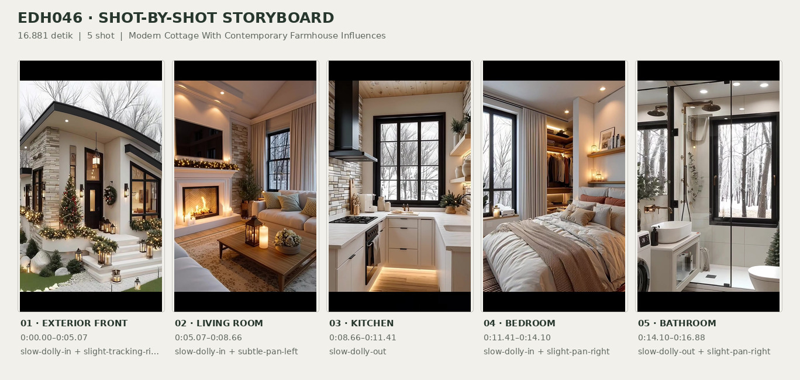
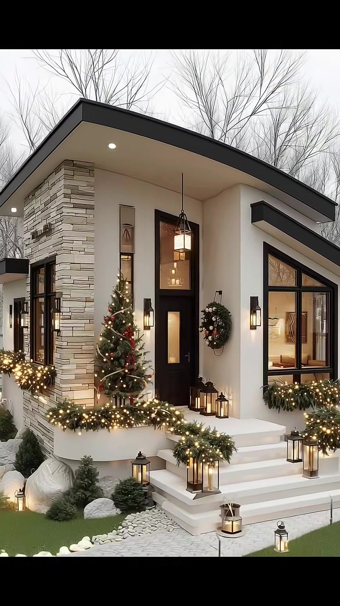
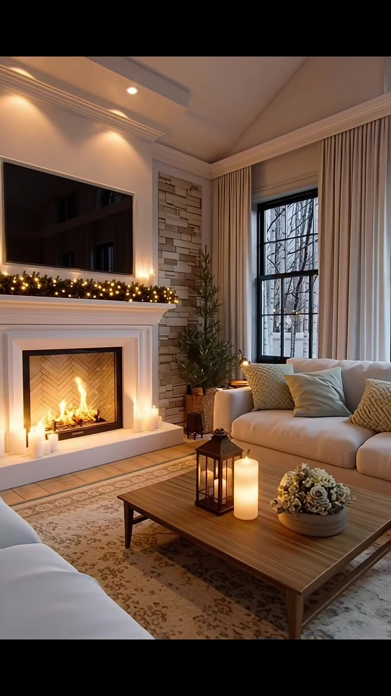
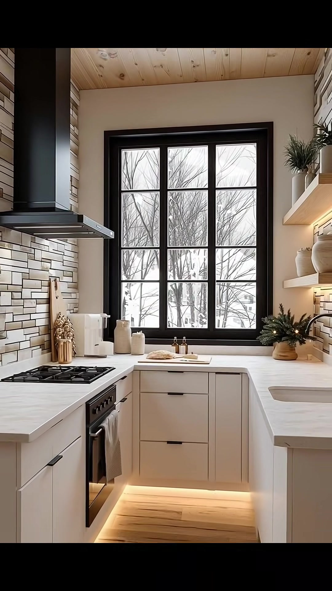
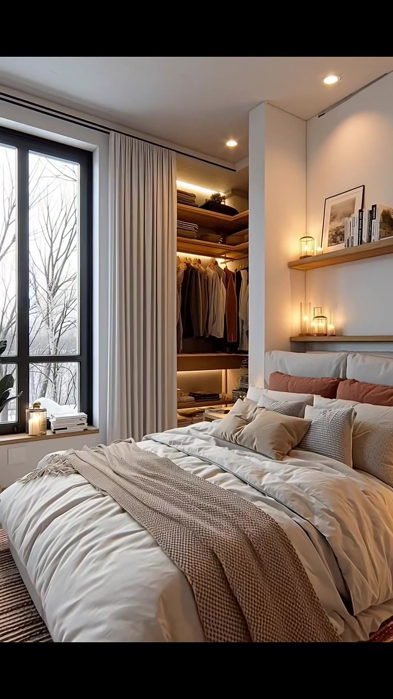
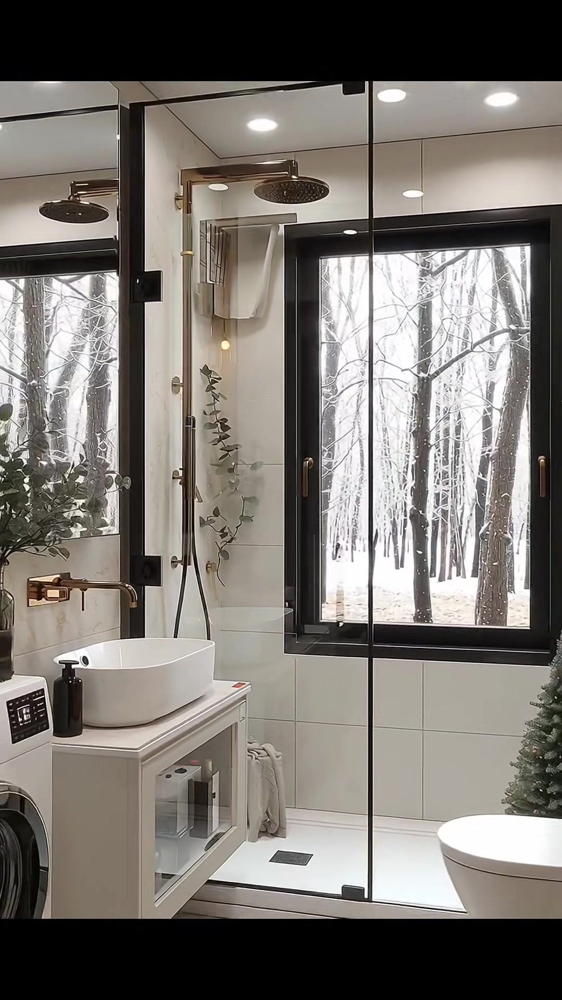

# edh046 — Modern Cottage With Contemporary Farmhouse Influences

<!-- homeku_request_id: edh046-20261106-1019-v14-01 -->

<!-- homeku_detail_narratives: chat-reviewed -->

**Sumber data:** [analysis.yaml](analysis.yaml) · **Status:** draft · **Diverifikasi manusia:** Tidak

## 1. Informasi Video

| Informasi | Nilai |
|---|---|
| ID | edh046 |
| File asli | edh046.mp4 |
| Durasi | 16.881 |
| Resolusi | 1080x1920 |
| FPS | 60.015 |
| Rasio | 9:16 |
| Jumlah shot | 5 |

## 2. Storyboard Gabungan

## 3. Identitas Desain

| Aspek | Hasil analisis |
|---|---|
| Gaya utama | modern cottage with contemporary farmhouse influences |
| Wilayah terkait gaya desain | north america, europe |
| Pengaruh gaya | contemporary farmhouse, scandinavian inspired minimalism, modern rustic |
| Ciri eksterior | asymmetric pitched dark roof with wide eaves, off white smooth appearance walls, light beige stacked stone appearance accent column, black framed windows and tall entry door, raised white entry porch with broad steps, warm exterior sconces and pendant lantern |
| Gaya interior | warm neutral modern cottage, white and wood minimalist kitchen, cozy fireplace living room, soft textile layered bedroom, bright black accented bathroom |
| Confidence gaya | medium |

## 4. Ukuran & Proporsi Bangunan

| Aspek | Estimasi visual |
|---|---|
| Ukuran yang terlihat | small |
| Bentuk bangunan | compact rectangular with offset roof planes |
| Skala vertikal | single story appearance |
| Tapak bangunan | compact |
| Perkiraan luas lantai | 45–90 m² |
| Confidence | low |

> Luas adalah perkiraan visual, bukan ukuran terukur.

## 5. Warna, Pencahayaan, dan Atmosfer

| Warna dominan | HEX (perkiraan) |
|---|---|
| warm ivory | #E9E4DA |
| charcoal black | #262728 |
| light stone beige | #C4B9A9 |
| natural wood brown | #957252 |
| deep evergreen | #40513E |
| warm amber | #D3AA6F |

| Aspek | Hasil analisis |
|---|---|
| Pencahayaan | soft overcast exterior daylight, warm interior recessed lights, fireplace firelight, warm decorative string lights, diffused window daylight |
| Lingkungan | leafless trees around house, small maintained green lawn, light stone path and boulders, pale bright outdoor ground visible through some windows |
| Musim yang tampak | winter like |
| Mood | cozy, warm, calm, festive, tidy |

## 6. Struktur dan Timeline Video

**Jenis:** home tour · **Tempo:** moderate · **Transisi:** mostly hard cuts with subtle in shot camera motion

| Shot | Waktu (detik) | Durasi | Area/Scene | Gerakan Kamera |
|---|---|---|---|---|
| Shot 01 | 0.0–5.065 | 5.07 | exterior front | slow dolly in, slight tracking right |
| Shot 02 | 5.065–8.665 | 3.60 | living room | slow dolly in, subtle pan left |
| Shot 03 | 8.665–11.414 | 2.75 | kitchen | slow dolly out |
| Shot 04 | 11.414–14.097 | 2.68 | bedroom | slow dolly in, slight pan right |
| Shot 05 | 14.097–16.881 | 2.78 | bathroom | slow dolly out, slight pan right |

## 7. Analisis per Shot

### Shot 01 — exterior front

**Waktu:** 0.0–5.065 detik

| Komponen | Pengamatan |
|---|---|
| Fokus utama | compact modern cottage front entry and festive landscaping |
| Framing awal → akhir | wide front left three quarter view → medium front entry view |
| Sudut pandang | slightly low front left angle |
| Gerakan kamera | slow dolly in, slight tracking right |
| Kecepatan kamera | slow |
| Pencahayaan | soft overcast daylight with warm decorative lighting |
| Transisi keluar | hard cut |

**Detail yang terlihat**

**Arsitektur**

Rumah tampak satu lantai dengan massa kompak dan atap miring asimetris berwarna gelap. Bidang bawah atap yang menjorok di area masuk berwarna putih dan dilengkapi lampu tanam bulat. Fasadnya tampak berlapis finishing halus putih gading, sedangkan sudut depan kiri diberi aksen menyerupai susunan batu beige. Pintu masuk tinggi berwarna hitam memiliki panel kaca atas dan bawah, ditemani kaca vertikal ramping di sebelah kirinya. Jendela besar berbingkai hitam di sisi kanan berada di bawah bidang atap miring tambahan, sementara sisi kiri rumah memiliki jendela hitam serupa. Teras masuk putih ditinggikan dengan tiga anak tangga lebar; lampu dinding hitam mengapit pintu dan sebuah lentera gantung hitam berada di atasnya.

**Furnitur dan properti**

Di kiri pintu terdapat pohon Natal hijau dengan ornamen merah dan lampu hangat. Di dinding kanan pintu tergantung karangan daun melingkar beraksen merah. Rangkaian daun hijau dengan lampu putih hangat membingkai tepian teras dan menghiasi bawah jendela kanan. Beberapa lentera kaca berbingkai logam hitam diletakkan di atas teras, anak tangga, dan sepanjang jalur masuk. Pot kecil berisi gugus bunga putih tampak di kanan tangga.

**Lingkungan**

Pepohonan tinggi yang meranggas berdiri di belakang rumah, dengan langit pucat mendung di sela ranting. Di kiri tangga depan tampak semak hijau rendah dan bongkahan batu terang berukuran besar. Hamparan rumput hijau berukuran kecil mengelilingi jalur masuk yang dibatasi kerikil atau batu putih.

**Catatan pengamatan:** The camera slowly approaches the entrance; white landscaping stones should not be treated as confirmed snow.

**Confidence:** Kamera medium · Detail visual high

### Shot 02 — living room

**Waktu:** 5.065–8.665 detik

| Komponen | Pengamatan |
|---|---|
| Fokus utama | lit fireplace coffee table and cream seating |
| Framing awal → akhir | medium wide seating area view → closer fireplace and coffee table view |
| Sudut pandang | eye level slightly oblique |
| Gerakan kamera | slow dolly in, subtle pan left |
| Kecepatan kamera | slow |
| Pencahayaan | warm recessed ceiling lights firelight and window daylight |
| Transisi keluar | hard cut |

**Detail yang terlihat**

**Arsitektur**

Perapian persegi panjang tertanam dalam bingkai putih di dinding kiri, dengan layar hitam besar terpasang di atasnya. Bagian sudut kanan perapian berlapis aksen menyerupai susunan batu beige. Dinding krem memiliki lis sederhana, sedangkan plafon putih yang miring memuat titik\-titik lampu tanam hangat. Jendela besar berbingkai hitam berkisi berada di sisi kanan dan diapit tirai beige panjang hingga lantai. Area duduk menggunakan karpet besar bermotif lembut bernuansa netral.

**Furnitur dan properti**

Sofa kain krem di bawah jendela kanan memiliki bantalan beige dan biru muda, sementara sebagian sofa pucat lain terlihat di depan kiri. Meja kopi kayu persegi panjang yang rendah berada di antara tempat duduk dan perapian. Di atas meja ada lentera logam hitam berisi lilin, lilin pilar krem menyala, serta mangkuk bulat kecil dengan bunga berwarna pucat. Rangkaian daun hijau dan lampu hangat membentang di ambang perapian, sementara sebuah pohon hijau kecil dalam pot berada di kanan perapian. Lilin\-lilin kecil tambahan terlihat di sekitar perapian.

**Lingkungan**

Cabang\-cabang pohon tanpa daun tampak di luar jendela kanan, dengan cahaya siang pucat menembus kisi\-kisi jendela.

**Catatan pengamatan:** A slowly tightening view emphasizes the flames, low table, sofa fabrics, and holiday mantel decorations.

**Confidence:** Kamera medium · Detail visual high

### Shot 03 — kitchen

**Waktu:** 8.665–11.414 detik

| Komponen | Pengamatan |
|---|---|
| Fokus utama | compact light colored kitchen with black window and range hood |
| Framing awal → akhir | medium view into compact cooking space → slightly wider view of counters and floor |
| Sudut pandang | eye level frontal |
| Gerakan kamera | slow dolly out |
| Kecepatan kamera | slow |
| Pencahayaan | cool diffused window daylight and warm under cabinet lights |
| Transisi keluar | hard cut |

**Detail yang terlihat**

**Arsitektur**

Dapur kecil memakai susunan meja kerja menyerupai huruf U yang mengitari jendela belakang. Kabinet bawah berwarna putih gading memiliki profil seperti shaker dan pegangan logam gelap, dipadukan dengan countertop menyerupai batu krem terang. Backsplash sisi kiri tampak seperti susunan batu memanjang berwarna beige dan abu\-abu. Plafon dilapisi papan berpenampilan kayu pucat; pengisap asap hitam berada di atas area memasak kiri. Jendela besar berkisi hitam menempati dinding ujung. Di kanan ada rak dinding terbuka berwarna terang dengan lampu hangat di bawahnya. Lantai tampak seperti papan kayu pucat dan bagian kaki kabinet disinari lampu hangat.

**Furnitur dan properti**

Kompor tanam empat tungku berwarna hitam dan oven berpenampilan baja berada di meja kiri. Di sebelah kiri jendela tersusun talenan kayu dan wadah keramik putih. Keran berwarna keemasan terpasang di atas bak cuci di bawah jendela. Rak terbuka di kanan menampilkan vas dan mangkuk putih serta pot tanaman hijau kecil. Di atas meja kanan tampak rangkaian hijau kecil dengan buah pinus, sedangkan di dekat bak cuci ada nampan kecil dengan benda menyerupai roti.

**Lingkungan**

Batang\-batang pohon tanpa daun terlihat melalui jendela belakang dapur, di atas permukaan luar yang tampak berwarna putih pucat.

**Catatan pengamatan:** A subtle widening camera movement reveals more of the lower cabinetry and toe-kick illumination.

**Confidence:** Kamera medium · Detail visual high

### Shot 04 — bedroom

**Waktu:** 11.414–14.097 detik

| Komponen | Pengamatan |
|---|---|
| Fokus utama | layered neutral bedding and illuminated open wardrobe |
| Framing awal → akhir | medium wide bed and window view → closer bed and open wardrobe view |
| Sudut pandang | eye level slightly oblique |
| Gerakan kamera | slow dolly in, slight pan right |
| Kecepatan kamera | slow |
| Pencahayaan | soft window daylight and warm shelf and closet lighting |
| Transisi keluar | hard cut |

**Detail yang terlihat**

**Arsitektur**

Kamar tidur mempunyai dinding krem terang serta plafon putih dengan titik lampu tanam. Di kiri terdapat jendela tinggi berbingkai hitam dan tirai beige panjang. Ceruk lemari terbuka menyatu dengan dinding di belakang area kanan tempat tidur; bagian dalamnya memiliki rak dan batang gantungan berpenampilan kayu hangat. Dua rak kayu terang melayang terpasang di atas kepala tempat tidur, dengan pencahayaan keemasan di bagian bawah rak dan dalam lemari. Lantai berpenampilan kayu terang dipadukan dengan karpet kecil tenun bernuansa lembut.

**Furnitur dan properti**

Tempat tidur ganda yang rendah memiliki sandaran empuk warna taupe muda. Seprai dan duvet putih berlapis bantal krem serta bantalan aksen terakota, dengan selimut rajut cokelat muda terhampar di bagian kaki. Pakaian warna netral tergantung rapi di lemari terbuka. Di rak atas terlihat karya seni berbingkai kecil dan benda pajangan, sementara dua lampu dekoratif mungil menyala di rak dinding. Pot tanaman kecil dan tumpukan buku ditempatkan di ambang jendela kiri.

**Lingkungan**

Ranting pohon yang tidak berdaun terlihat dari jendela kamar, berlatar luar ruangan yang terang dan pucat.

**Catatan pengamatan:** The frame moves slightly toward the bed and right-side open closet; the view does not establish room dimensions.

**Confidence:** Kamera medium · Detail visual high

### Shot 05 — bathroom

**Waktu:** 14.097–16.881 detik

| Komponen | Pengamatan |
|---|---|
| Fokus utama | bright compact bathroom with black framed shower glass |
| Framing awal → akhir | medium view of shower window and vanity → wider view of vanity shower and toilet |
| Sudut pandang | eye level frontal |
| Gerakan kamera | slow dolly out, slight pan right |
| Kecepatan kamera | slow |
| Pencahayaan | bright cool window daylight and white recessed ceiling lights |
| Transisi keluar | end of video |

**Detail yang terlihat**

**Arsitektur**

Kamar mandi berukuran kompak dilapisi ubin dinding putih berbentuk persegi. Area pancuran di tengah dibatasi partisi kaca berbingkai hitam, dengan kepala pancuran hujan dan pancuran tangan berlogam gelap di dalamnya. Jendela besar berbingkai hitam berada di belakang area pancuran. Plafon putih memiliki beberapa lampu tanam bulat. Di kiri pancuran terpasang kabinet wastafel putih dengan penyimpanan terbuka di bagian bawah. Lantai menggunakan ubin abu\-putih terang dan terdapat floor drain persegi di area pancuran.

**Furnitur dan properti**

Wastafel mangkuk oval putih diletakkan di atas meja kabinet, dengan keran dinding warna emas kusam dan dispenser sabun gelap di sisinya. Mesin cuci bukaan depan terlihat di bawah meja sebelah kiri, sedangkan handuk putih disimpan pada rak terbuka kabinet. Kloset putih berada di sisi kanan ruangan, berdekatan dengan pohon hijau hias berukuran kecil. Ranting daun hijau ditempatkan di dekat kaca pancuran dan sebuah handuk putih menggantung di dekat perangkat pancuran.

**Lingkungan**

Melalui jendela besar terlihat kumpulan batang pohon tanpa daun yang rapat, dengan permukaan luar berwarna putih terang di bagian bawahnya.

**Catatan pengamatan:** The image widens slightly toward the right; the white landscape outside may resemble snow but is not verified as such.

**Confidence:** Kamera medium · Detail visual medium

## 8. Kualitas dan Ketidakpastian Analisis

| Parameter | Hasil |
|---|---|
| Status | draft |
| Verifikasi manusia | Tidak |
| Ketepatan timestamp | estimated |
| Ketidakpastian | architecture style and regions are interpretive not verified location, roof and exact materials inferred from appearance only, floor area visual estimate has low confidence, outdoor white ground not confirmed to be snow, camera movement interpreted from frame motion, cut points are estimated to nearest few frames |

**Catatan:** Visual-only analysis of the entire 16.88-second video; representative keyframes at 2.6, 6.8, 9.9, 12.8, and 15.6 seconds. Uploaded bytes match the Git blob in main/video/edh046.mp4. No GitHub writes were made.

---

*Laporan ini diturunkan dari [analysis.yaml](analysis.yaml).*
