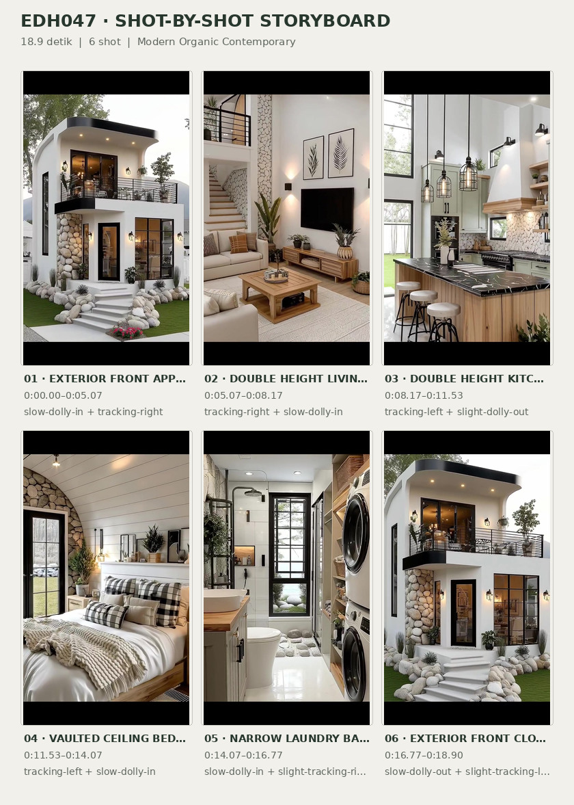
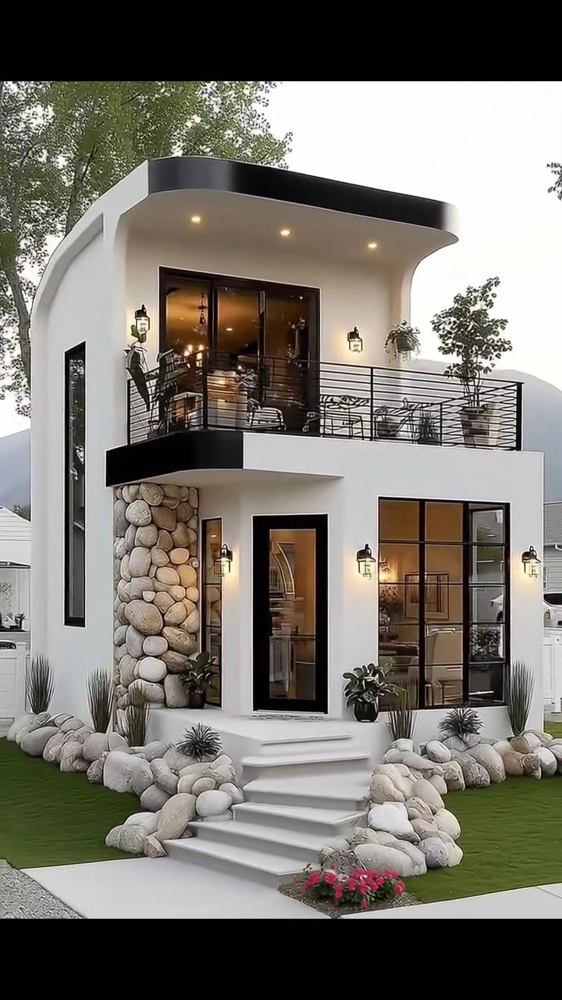
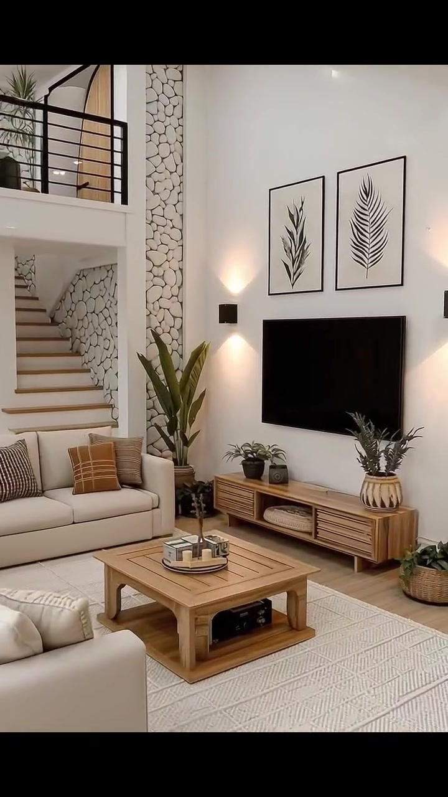
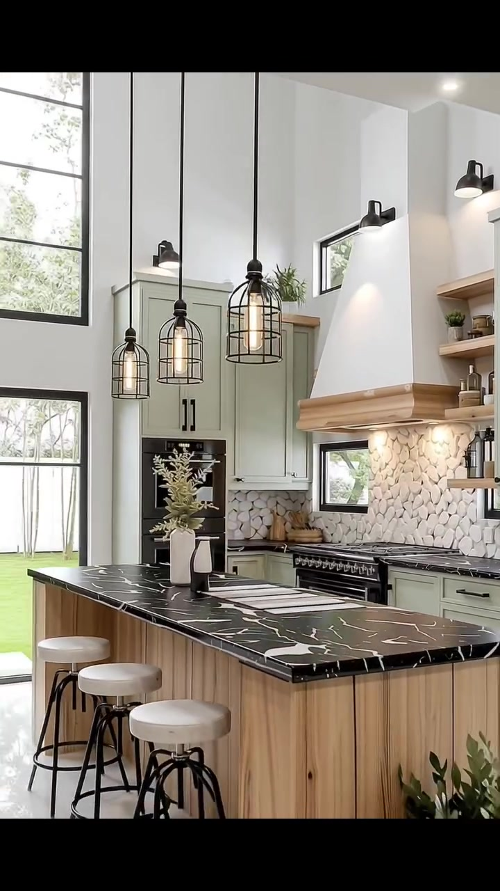
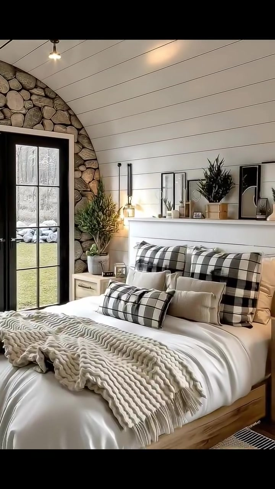
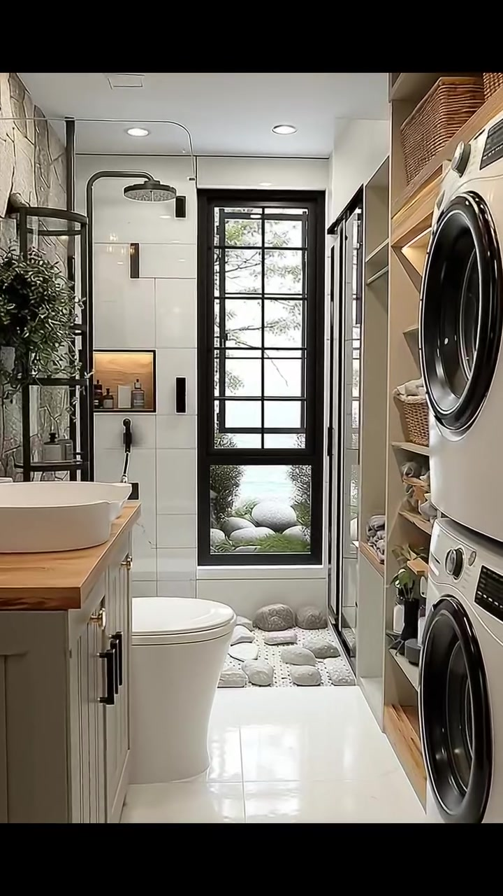
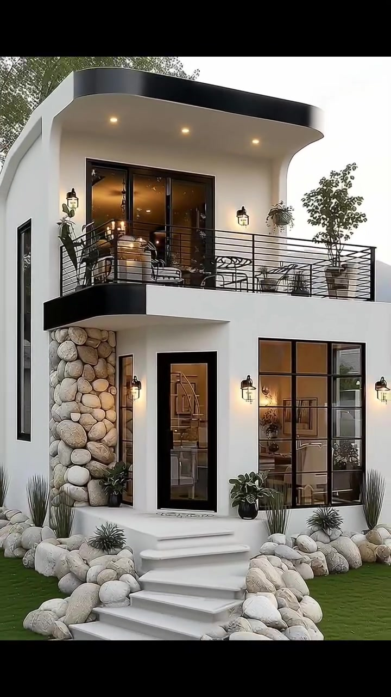

# edh047 — Modern Organic Contemporary

<!-- homeku_request_id: edh047_20261106_1019_c448e517_v1 -->

<!-- homeku_detail_narratives: chat-reviewed -->

**Sumber data:** [analysis.yaml](analysis.yaml) · **Status:** draft · **Diverifikasi manusia:** Tidak

## 1. Informasi Video

| Informasi | Nilai |
|---|---|
| ID | edh047 |
| File asli | edh047.mp4 |
| Durasi | 18.9 |
| Resolusi | 720x1280 |
| FPS | 30 |
| Rasio | 9:16 |
| Jumlah shot | 6 |

## 2. Storyboard Gabungan

## 3. Identitas Desain

| Aspek | Hasil analisis |
|---|---|
| Gaya utama | modern organic contemporary |
| Wilayah terkait gaya desain | north america |
| Pengaruh gaya | modern farmhouse interior, rustic contemporary, soft minimalist |
| Ciri eksterior | smooth white stucco appearance facade with softly curved edges, low slope flat appearance roof with black fascia and deep overhang, black horizontal metal front balcony railing, rounded light gray stone clad entry feature pier, large black framed windows and glazed doors, wide white entry steps and warm exterior wall lanterns |
| Gaya interior | double height warm neutral living room with black iron accents, natural wood furniture and light textured fabrics, sage green shaker kitchen cabinets with wood island, curved white plank ceiling and rounded stone wall in bedroom, white tile black fixtures and wood shelving in laundry bathroom |
| Confidence gaya | medium |

## 4. Ukuran & Proporsi Bangunan

| Aspek | Estimasi visual |
|---|---|
| Ukuran yang terlihat | medium |
| Bentuk bangunan | compact rectangular two story with front balcony |
| Skala vertikal | two story |
| Tapak bangunan | moderate |
| Perkiraan luas lantai | 100–180 m² |
| Confidence | low |

> Luas adalah perkiraan visual, bukan ukuran terukur.

## 5. Warna, Pencahayaan, dan Atmosfer

| Warna dominan | HEX (perkiraan) |
|---|---|
| warm white | #F1EFE9 |
| matte black | #262626 |
| light natural wood | #B9956C |
| soft sage green | #A5AA99 |
| warm gray stone | #B9B5AA |
| cream beige | #D9D1C3 |
| lawn green | #667D4C |

| Aspek | Hasil analisis |
|---|---|
| Pencahayaan | soft daylight through large black framed glazing, warm exterior wall sconces and soffit downlights, warm interior wall and pendant lamps, white recessed ceiling spotlights |
| Lingkungan | mature trees near front of house, maintained green lawn, rounded pale rocks beside entry stair, ornamental grasses and flowering plants, pale gravel and concrete front walkway |
| Musim yang tampak | Tidak diketahui |
| Mood | warm, calm, welcoming, refined, nature connected |

## 6. Struktur dan Timeline Video

**Jenis:** house exterior and interior tour · **Tempo:** moderate · **Transisi:** five hard cuts between six scenes

| Shot | Waktu (detik) | Durasi | Area/Scene | Gerakan Kamera |
|---|---|---|---|---|
| Shot 01 | 0–5.067 | 5.07 | exterior front approach | slow dolly in, tracking right |
| Shot 02 | 5.067–8.167 | 3.10 | double height living room | tracking right, slow dolly in |
| Shot 03 | 8.167–11.533 | 3.37 | double height kitchen | tracking left, slight dolly out |
| Shot 04 | 11.533–14.067 | 2.53 | vaulted ceiling bedroom | tracking left, slow dolly in |
| Shot 05 | 14.067–16.767 | 2.70 | narrow laundry bathroom | slow dolly in, slight tracking right |
| Shot 06 | 16.767–18.9 | 2.13 | exterior front closing view | slow dolly out, slight tracking left |

## 7. Analisis per Shot

### Shot 01 — exterior front approach

**Waktu:** 0–5.067 detik

| Komponen | Pengamatan |
|---|---|
| Fokus utama | white two story house with upper balcony and stone accent pier |
| Framing awal → akhir | wide three quarter view with tree trunks in left foreground → medium close front elevation centered on balcony and entry |
| Sudut pandang | slightly low front left three quarter |
| Gerakan kamera | slow dolly in, tracking right |
| Kecepatan kamera | slow |
| Pencahayaan | soft daylight with warm soffit downlights and wall lanterns |
| Transisi keluar | hard cut |

**Detail yang terlihat**

**Arsitektur**

Rumah tampak terdiri dari dua lantai dengan permukaan dinding putih yang halus serta sudut dinding dan tepian atap yang sedikit melengkung. Atap berprofil hampir datar memiliki lis hitam dan overhang lebar dengan lampu tanam hangat di bawahnya. Balkon depan lantai atas dikelilingi pagar logam hitam horizontal dan diakses melalui pintu kaca lebar berbingkai hitam. Di lantai bawah terlihat pilar aksen batu bulat abu\-abu terang di sebelah kiri pintu masuk kaca yang tinggi dan sempit. Jendela besar bersekat hitam berada di kanan pintu, sedangkan jendela vertikal sempit tampak pada dinding samping kiri. Beberapa anak tangga putih menuju pintu masuk dan lampu dinding hitam bernuansa hangat dipasang di sekitar bukaan.

**Furnitur dan properti**

Di balkon atas terlihat sejumlah kursi berangka logam gelap dan meja bundar kecil, dengan pohon kecil dalam pot di sisi paling kanan serta pot gantung di dekat pagar. Di dekat pintu masuk bawah terdapat pot\-pot gelap berisi tanaman berdaun hijau.

**Lingkungan**

Pada awal shot, dua batang pohon besar berkulit abu\-abu menutupi sebagian sisi kiri fasad; dedaunan hijau tampak di belakang dan di atas rumah. Rumput hijau terpangkas rapi membentang di kedua sisi tangga masuk. Batu\-batu bulat besar berwarna terang membingkai kedua tepi tangga, diselingi semak hias pendek berdaun runcing. Kelompok bunga kecil merah muda hingga merah berada di kanan jalur depan, sedangkan sisi kiri depan menampilkan hamparan kerikil terang dan jalan beton pucat. Langit terang berwarna pucat terlihat di belakang tepian atap.

**Catatan pengamatan:** Trees initially obscure the left edge of the facade; the closer view reveals balcony furniture, stone pier, entry steps, planted borders and glazing.

**Confidence:** Kamera medium · Detail visual high

### Shot 02 — double height living room

**Waktu:** 5.067–8.167 detik

| Komponen | Pengamatan |
|---|---|
| Fokus utama | double height living room seating area facing black television |
| Framing awal → akhir | wide living room view including mezzanine staircase seating and tv → closer composition emphasizing television wall and wood media furniture |
| Sudut pandang | eye level slightly upward |
| Gerakan kamera | tracking right, slow dolly in |
| Kecepatan kamera | slow |
| Pencahayaan | soft daylight combined with warm wall sconces and ceiling downlights |
| Transisi keluar | hard cut |

**Detail yang terlihat**

**Arsitektur**

Ruang keluarga memiliki dinding putih yang menjulang hingga dua lantai dan bagian mezanin dengan pagar logam hitam horizontal di kiri atas. Tangga di kiri belakang memakai anak tangga berpenampilan kayu terang, berdekatan dengan bukaan melengkung berbingkai hitam pada area lantai atas. Sebidang aksen batu bulat berwarna terang memanjang vertikal di antara tangga dan dinding televisi. Lantai terlihat seperti papan kayu pucat, dengan bukaan kaca berbingkai hitam di sisi kiri belakang serta plafon putih berlampu tanam kecil. Dua lampu dinding gelap di sekitar televisi memancarkan cahaya hangat ke atas dan bawah.

**Furnitur dan properti**

Dua sofa berlapis kain krem mengelilingi meja kopi kayu rendah berbentuk persegi panjang, dilengkapi bantal bermotif krem, cokelat muda dan hitam. Di depan dinding utama, televisi hitam terpasang di atas kabinet media kayu rendah dengan laci berbilah dan ruang terbuka. Dua karya seni botani monokrom berbingkai hitam menggantung di atasnya. Sebuah karpet besar bertekstur warna netral menjadi alas meja, sementara pouf anyaman bundar berada dekat sofa depan kiri. Tanaman tinggi dalam pot berdiri di antara sofa dan kabinet; tanaman berdaun kecil dalam keranjang ditempatkan dekat kabinet. Di meja kopi ada nampan berisi dekorasi kecil, dan di ujung kanan kabinet terdapat vas krem berisi tangkai kering.

**Lingkungan**

Melalui bukaan kaca di belakang kiri terlihat cahaya luar yang terang dan sedikit kehijauan, tetapi lanskap di luarnya tidak cukup jelas untuk diidentifikasi lebih terperinci.

**Catatan pengamatan:** The view shifts from the mezzanine and seating arrangement toward the TV, botanical artwork, media console and decor.

**Confidence:** Kamera medium · Detail visual high

### Shot 03 — double height kitchen

**Waktu:** 8.167–11.533 detik

| Komponen | Pengamatan |
|---|---|
| Fokus utama | black veined island and sage green cabinets beneath tall kitchen walls |
| Framing awal → akhir | medium view of range hood cabinets and veined island → wider leftward view showing full island stools and tall windows |
| Sudut pandang | eye level with slight downward view of island |
| Gerakan kamera | tracking left, slight dolly out |
| Kecepatan kamera | slow |
| Pencahayaan | bright natural window light warm pendant lights and illuminated backsplash |
| Transisi keluar | hard cut |

**Detail yang terlihat**

**Arsitektur**

Dapur memiliki dinding dan plafon putih yang tinggi, dengan susunan jendela besar bertingkat berbingkai hitam pada sisi kiri. Kabinet atas dan bawah bergaya Shaker berwarna hijau sage redup mengapit tudung kompor putih berbentuk meruncing dengan lis kayu hangat. Area backsplash di belakang kompor menyerupai susunan batu terang berbentuk membulat dan memiliki jendela horizontal pendek berbingkai hitam. Island di depan memakai countertop gelap bermotif urat putih serta panel dasar berbilah kayu terang. Rak kayu terbuka berada di kanan tudung kompor, lantai keramik pucat terlihat mengilap, dan beberapa lampu dinding hitam kecil dipasang di atas kabinet.

**Furnitur dan properti**

Sekelompok lampu gantung hitam berbentuk sangkar menggantung di atas island. Di salah satu sisi island terlihat tiga bangku dengan dudukan bundar terang dan kaki logam hitam. Kompor\-oven besar berwarna hitam berada di bawah tudung, oven hitam lain terintegrasi dalam kabinet belakang kiri, dan unit peralatan hitam tinggi berada di sisi kanan. Di countertop island ada baki atau papan potong persegi panjang berwarna putih dan vas keramik terang berisi ranting kering. Rak terbuka memajang tanaman pot serta benda keramik kecil, sedangkan meja belakang berisi papan potong dan wadah dapur. Keranjang tanaman hijau ditempatkan pada ujung kanan island.

**Lingkungan**

Di luar jendela kiri terlihat hamparan rumput hijau, ranting pohon yang berdaun, dan pagar tegak berwarna terang di belakangnya.

**Catatan pengamatan:** The leftward reveal shows double-height glazing and lawn outside, while the island, stools, hood, cabinetry and appliances remain visible.

**Confidence:** Kamera medium · Detail visual high

### Shot 04 — vaulted ceiling bedroom

**Waktu:** 11.533–14.067 detik

| Komponen | Pengamatan |
|---|---|
| Fokus utama | wood platform bed below white curved plank ceiling and stone arch |
| Framing awal → akhir | wide view of bed vaulted ceiling and left glazed opening → closer bed and black grid glazed door view |
| Sudut pandang | eye level slightly upward to curved ceiling |
| Gerakan kamera | tracking left, slow dolly in |
| Kecepatan kamera | slow |
| Pencahayaan | soft daylight from black glazed door and warm bedside and cove lighting |
| Transisi keluar | hard cut |

**Detail yang terlihat**

**Arsitektur**

Kamar tidur menampilkan plafon papan putih horizontal yang melengkung membentuk vault di atas tempat tidur. Dinding ujung kiri mempunyai bidang lengkung berlapis batu bulat abu\-abu krem yang mengelilingi pintu kaca tinggi bersekat hitam. Dinding belakang tempat tidur menggunakan papan horizontal putih, sementara strip cahaya hangat mengikuti tepian atas plafon sebelah kanan. Lantai berpenampilan papan kayu pucat dan lampu dinding ramping berwarna gelap dengan aksen hangat berada di kedua sisi tempat tidur.

**Furnitur dan properti**

Tempat tidur rendah dengan rangka kayu alami berada di tengah dinding belakang, ditata memakai selimut putih, bantal\-bantal putih dan rajutan tebal krem pada bagian kaki. Bantal kotak\-kotak hitam putih ditempatkan di belakang bantal netral, disertai bantal lumbar kotak\-kotak yang lebih kecil. Kedua sisi ranjang dilengkapi meja nakas kayu terang. Di atas kepala ranjang ada rak pajang putih panjang yang memuat gambar berbingkai hitam, pot tanaman kecil serta vas. Tanaman hijau tinggi dalam pot terang berdiri dekat pintu kaca. Karpet bergaris hitam\-krem terhampar dekat kaki ranjang, bersama sebuah bantalan lantai kecil berwarna putih lembut.

**Lingkungan**

Melalui pintu kaca kiri terlihat halaman rumput hijau, batu\-batu lanskap bulat terang, dan batang\-batang pohon tinggi berwarna abu\-abu.

**Catatan pengamatan:** The camera moves closer toward the bed and left opening, keeping the stone arch and curved white-plank ceiling visible.

**Confidence:** Kamera medium · Detail visual high

### Shot 05 — narrow laundry bathroom

**Waktu:** 14.067–16.767 detik

| Komponen | Pengamatan |
|---|---|
| Fokus utama | compact combined laundry bathroom with shower and stacked front load machines |
| Framing awal → akhir | long narrow view from entry with vanity left and stackable machines right → closer view toward far black framed window shower and toilet |
| Sudut pandang | eye level toward back of room |
| Gerakan kamera | slow dolly in, slight tracking right |
| Kecepatan kamera | slow |
| Pencahayaan | diffuse daylight from far window with warm vanity and shower niche lighting |
| Transisi keluar | hard cut |

**Detail yang terlihat**

**Arsitektur**

Ruangan berbentuk memanjang dan sempit, dengan plafon putih berlampu tanam. Area pancuran di ujung ruangan menggunakan ubin dinding putih berukuran besar dan lantai berbatu koral bulat, berbeda dari lantai keramik terang mengilap di bagian depan. Jendela tinggi bersekat hitam berada di dinding paling belakang, dengan partisi shower kaca dan logam hitam di sebelah kanannya. Pipa serta kepala pancuran bundar hitam terlihat di kiri jendela, di dekat relung dinding kecil yang memiliki lampu hangat. Di sepanjang sisi kiri terdapat kabinet wastafel hijau sage berpanel vertikal dengan permukaan meja berpenampilan kayu hangat; dinding belakang cerminnya bertekstur menyerupai batu terang.

**Furnitur dan properti**

Dua mesin cuci dan pengering bukaan depan berwarna putih disusun bertingkat pada sisi kanan, berdampingan dengan rak kayu terbuka sampai mendekati plafon. Rak itu berisi keranjang anyaman dan handuk yang terlipat rapi. Sisi kiri memiliki wastafel mangkuk putih di atas countertop kayu, keran hitam tinggi serta cermin bundar besar berbingkai hitam. Kloset putih berada di antara kabinet dan pancuran. Lampu gantung sangkar hitam menerangi area wastafel; tanaman hijau dalam pot berada di dekat pancuran, dan botol perlengkapan mandi menempati relung dinding bercahaya.

**Lingkungan**

Melalui bagian atas jendela belakang terlihat pepohonan hijau, sedangkan bagian bawahnya memperlihatkan batu\-batu bundar terang dan semak hijau di luar.

**Catatan pengamatan:** The forward movement crops the left mirror and right washer while sharpening the tiled shower, pebble floor, niche and window.

**Confidence:** Kamera medium · Detail visual high

### Shot 06 — exterior front closing view

**Waktu:** 16.767–18.9 detik

| Komponen | Pengamatan |
|---|---|
| Fokus utama | white stone accented two story facade and front balcony |
| Framing awal → akhir | medium close view of upper balcony entry and right ground floor window → wider front three quarter view with stairs and front landscaping |
| Sudut pandang | slightly low front three quarter |
| Gerakan kamera | slow dolly out, slight tracking left |
| Kecepatan kamera | slow |
| Pencahayaan | soft daylight with warm exterior sconces and soffit lights |
| Transisi keluar | video end |

**Detail yang terlihat**

**Arsitektur**

Fasad kembali tampak sebagai rumah putih dua lantai dengan tepi dinding yang sedikit membulat. Atap berpenampilan hampir datar memiliki lis gelap dan overhang putih lebar dengan beberapa lampu tanam hangat. Balkon di atas pintu masuk memakai pagar logam hitam bergaris horizontal dan pintu kaca besar berbingkai hitam. Pada lantai dasar terlihat pintu masuk kaca sempit yang tinggi, jendela besar bersekat hitam di kanannya, serta pilar batu bulat abu\-abu terang di sebelah kiri pintu. Tangga masuk putih yang lebar terdiri dari beberapa anak tangga rendah. Lampu dinding hitam menyala hangat di samping bukaan atas dan bawah, sementara jendela vertikal sempit tampak pada dinding samping kiri.

**Furnitur dan properti**

Kursi\-kursi balkon berangka logam hitam ditemani sebuah meja bundar kecil. Pohon kecil dalam pot menempati sudut kanan balkon, dengan pot tanaman gantung di dekat pagarnya. Beberapa pot berwarna gelap berisi tanaman berdaun hijau berada di sekitar pintu masuk lantai bawah.

**Lingkungan**

Batu\-batu lanskap bulat berwarna pucat tersusun di kedua sisi tangga masuk, diselingi semak pendek dengan daun meruncing. Hamparan rumput hijau mengapit jalur depan dan bunga kecil merah muda hingga merah tumbuh di sisi kanannya. Pohon\-pohon besar berdaun hijau terlihat di belakang atap, dengan sebatang pohon berkulit abu\-abu memasuki sisi kiri atas bingkai. Jalur beton pucat tampak di bagian bawah tangga.

**Catatan pengamatan:** The shot reverses to the exterior facade from a closer balcony-and-entry view, ending wider with front steps and landscape rock beds.

**Confidence:** Kamera medium · Detail visual high

## 8. Kualitas dan Ketidakpastian Analisis

| Parameter | Hasil |
|---|---|
| Status | draft |
| Verifikasi manusia | Tidak |
| Ketepatan timestamp | estimated |
| Ketidakpastian | style label and north america region are visual interpretations not verified place, exact facade stone wood countertop tile and upholstery materials not physically verified, visual floor area range has no blueprint or measured scale reference, original geographic location date and season unknown, camera moves are inferred from relative framing and may be digital, container duration includes audio tail longer than 18 9 second video stream |

**Catatan:** Visual-only review across all 567 video frames at 30 fps. Six shots separated near 5.067, 8.167, 11.533, 14.067 and 16.767 seconds. Source Git blob SHA matches main/video/edh047.mp4: c448e5176161748ec275c82ae8dad1e7810118f5. Selected representative keyframe times: 2.45, 6.55, 9.65, 12.75, 15.35, 17.80 seconds. Not human verified.

---

*Laporan ini diturunkan dari [analysis.yaml](analysis.yaml).*
