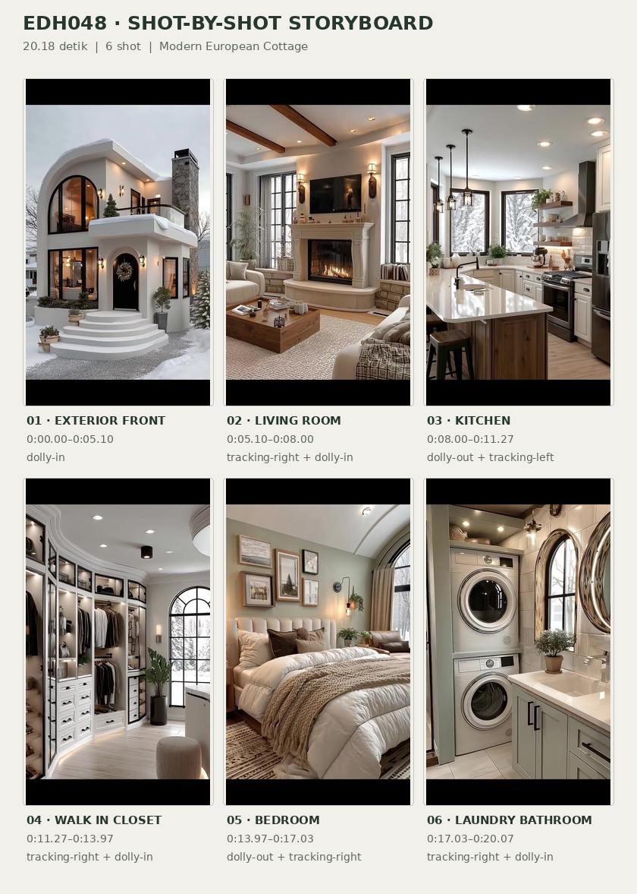
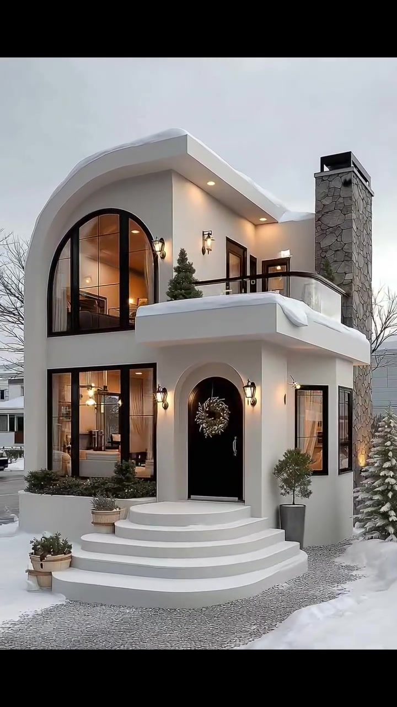
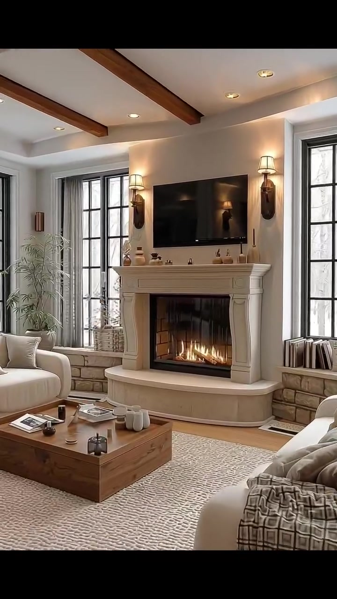
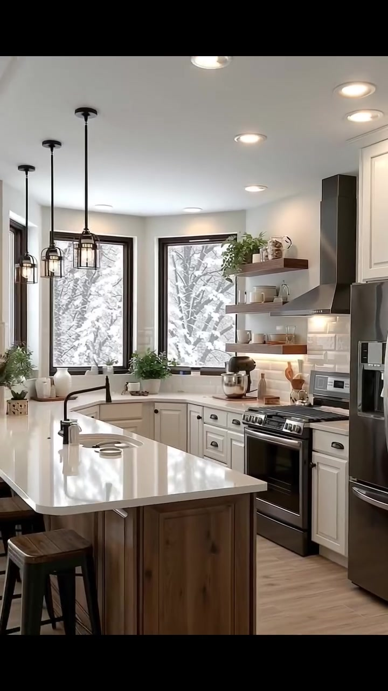
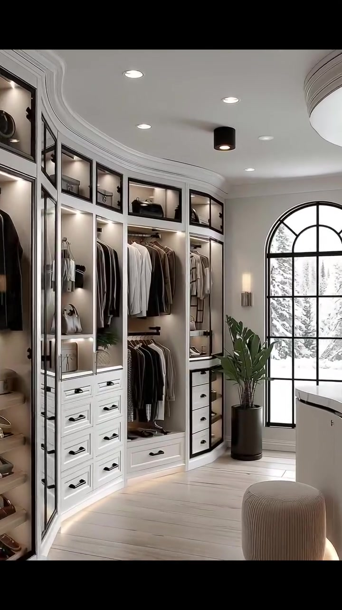
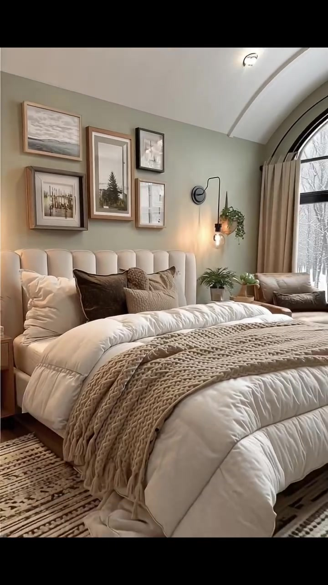
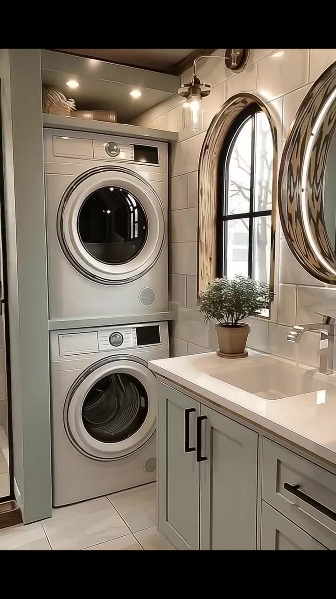

# edh048 — Modern European Cottage

<!-- homeku_request_id: edh048-20261106-3a5c7f42bc9d418e -->

<!-- homeku_detail_narratives: chat-reviewed -->

**Sumber data:** [analysis.yaml](analysis.yaml) · **Status:** draft · **Diverifikasi manusia:** Tidak

## 1. Informasi Video

| Informasi | Nilai |
|---|---|
| ID | edh048 |
| File asli | edh048.mp4 |
| Durasi | 20.18 |
| Resolusi | 720x1280 |
| FPS | 30 |
| Rasio | 9:16 |
| Jumlah shot | 6 |

## 2. Storyboard Gabungan

## 3. Identitas Desain

| Aspek | Hasil analisis |
|---|---|
| Gaya utama | modern european cottage |
| Wilayah terkait gaya desain | europe, north america |
| Pengaruh gaya | contemporary transitional, french country inspired arches, soft modern classic |
| Ciri eksterior | smooth warm white stucco appearance walls, asymmetric soft curved roof profile, tall black framed arched glazing, projecting second floor balcony with glass rail, arched recessed black entry door, tall irregular gray stone chimney, white rounded front entry steps |
| Gaya interior | warm contemporary transitional, soft modern classic, natural wood and neutral textile accents |
| Confidence gaya | medium |

## 4. Ukuran & Proporsi Bangunan

| Aspek | Estimasi visual |
|---|---|
| Ukuran yang terlihat | medium |
| Bentuk bangunan | compact rectangular two story massing with projecting balcony |
| Skala vertikal | two story |
| Tapak bangunan | moderate |
| Perkiraan luas lantai | 150–260 m² |
| Confidence | low |

> Luas adalah perkiraan visual, bukan ukuran terukur.

## 5. Warna, Pencahayaan, dan Atmosfer

| Warna dominan | HEX (perkiraan) |
|---|---|
| warm white | #F1EDE5 |
| charcoal black | #252422 |
| stone gray | #89877F |
| light beige | #D5C8B5 |
| warm wood brown | #9A7658 |
| pale sage green | #A7B0A2 |

| Aspek | Hasil analisis |
|---|---|
| Pencahayaan | soft overcast daylight, warm interior wall sconces, warm recessed ceiling lights, fireplace glow |
| Lingkungan | snow covered suburban front yard, leafless trees, nearby pale colored houses, snowy tree views through windows |
| Musim yang tampak | winter like snowy conditions |
| Mood | cozy, calm, warm inviting, soft elegance |

## 6. Struktur dan Timeline Video

**Jenis:** home tour · **Tempo:** moderate · **Transisi:** hard cuts between scenes

| Shot | Waktu (detik) | Durasi | Area/Scene | Gerakan Kamera |
|---|---|---|---|---|
| Shot 01 | 0.0–5.1 | 5.10 | exterior front | dolly in |
| Shot 02 | 5.1–8.0 | 2.90 | living room | tracking right, dolly in |
| Shot 03 | 8.0–11.27 | 3.27 | kitchen | dolly out, tracking left |
| Shot 04 | 11.27–13.97 | 2.70 | walk in closet | tracking right, dolly in |
| Shot 05 | 13.97–17.03 | 3.06 | bedroom | dolly out, tracking right |
| Shot 06 | 17.03–20.07 | 3.04 | laundry bathroom | tracking right, dolly in |

## 7. Analisis per Shot

### Shot 01 — exterior front

**Waktu:** 0.0–5.1 detik

| Komponen | Pengamatan |
|---|---|
| Fokus utama | white two story house with archways and front balcony |
| Framing awal → akhir | wide frontal view of two story house → medium close view of front entry and balcony |
| Sudut pandang | slightly low frontal three quarter angle |
| Gerakan kamera | dolly in |
| Kecepatan kamera | slow |
| Pencahayaan | soft overcast daylight with warm entrance and interior lamps |
| Transisi keluar | hard cut |

**Detail yang terlihat**

**Arsitektur**

Rumah dua lantai ini memiliki massa depan yang relatif kompak dengan garis atap melengkung dan tidak simetris, serta fasad halus berpenampilan plester putih hangat. Sebuah jendela lengkung besar berbingkai hitam mendominasi sisi kiri lantai atas. Balkon di atas pintu masuk memakai bidang kaca dan pegangan logam gelap. Di bawahnya terdapat pintu depan hitam yang masuk ke dalam ceruk lengkung, dicapai melalui anak tangga putih melengkung dan lebar. Cerobong tinggi berlapis batu abu\-abu tidak beraturan tampak di kanan, sementara jendela lantai bawah berbingkai hitam mengapit pintu. Lampu dinding bernuansa hangat terpasang di sekitar pintu dan teras atas, dan cahaya hangat dari dalam terlihat melalui jendela.

**Furnitur dan properti**

Pintu depan dihias karangan tanaman berbentuk lingkaran. Sebuah pohon cemara kecil berbentuk kerucut berada di pot pada balkon atas, tanaman topiary dalam pot tinggi ada di sebelah kanan pintu, dan beberapa pot bundar kecil ditempatkan di dekat kaki tangga.

**Lingkungan**

Salju terlihat menutupi tepian balkon dan permukaan tanah di sekitar rumah. Jalur masuk berpermukaan kerikil abu\-abu mengarah ke tangga, dengan pohon konifer bersalju di kanan bangunan. Di belakang terlihat pepohonan gugur tanpa daun; rumah tetangga berwarna terang tampak di kedua sisi, di bawah langit pucat yang tertutup awan.

**Catatan pengamatan:** Camera steadily approaches the facade and crops tighter on the arched doorway; snowfall is not visibly occurring.

**Confidence:** Kamera medium · Detail visual high

### Shot 02 — living room

**Waktu:** 5.1–8.0 detik

| Komponen | Pengamatan |
|---|---|
| Fokus utama | lit fireplace and television between black grid windows |
| Framing awal → akhir | wide living room showing stair corner and seating → medium fireplace tv and mantel view |
| Sudut pandang | eye level |
| Gerakan kamera | tracking right, dolly in |
| Kecepatan kamera | slow |
| Pencahayaan | diffuse window daylight mixed with firelight and warm wall sconces |
| Transisi keluar | hard cut |

**Detail yang terlihat**

**Arsitektur**

Plafon putih memiliki balok dekoratif kayu berwarna hangat. Dinding putih hangat disinari cahaya tidak langsung di tepi plafon. Perapian yang menyala dibingkai mantel bergaya klasik berwarna krem, diapit jendela tinggi berkisi hitam. Di bawah jendela tampak pelapis dinding batu pucat tidak beraturan. Lantai berpenampilan papan kayu berwarna hangat, sedangkan anak tangga kayu dengan pagar gelap terlihat di sisi kiri pada awal shot. Lampu tanam kecil tersebar di plafon.

**Furnitur dan properti**

Televisi layar datar hitam terpasang di atas perapian, dengan sepasang lampu dinding hangat di kiri dan kanan. Sofa berlapis kain putih gading berada di depan kanan dan kursi berlengan krem berada di kiri meja. Meja kopi kayu rendah berbentuk persegi menempati tengah area duduk di atas karpet besar bertekstur pucat. Bantal netral dan selimut berpola cokelat melengkapi dudukan. Tanaman berdaun tinggi ada dekat jendela kiri, sementara vas keramik kecil, buku, dan dekorasi berada di mantel serta meja.

**Lingkungan**

Melalui jendela\-jendela tinggi terlihat pepohonan tanpa daun di lingkungan bersalju. Cahaya siang yang pucat dan menyebar masuk dari luar.

**Catatan pengamatan:** Camera moves gradually toward the right and closer to the fireplace, leaving some seating out of frame.

**Confidence:** Kamera medium · Detail visual high

### Shot 03 — kitchen

**Waktu:** 8.0–11.27 detik

| Komponen | Pengamatan |
|---|---|
| Fokus utama | white kitchen with stainless range and wood based island |
| Framing awal → akhir | medium kitchen range and wall shelves → wide view of island stools and cabinets |
| Sudut pandang | eye level |
| Gerakan kamera | dolly out, tracking left |
| Kecepatan kamera | slow |
| Pencahayaan | bright window daylight and warm recessed and pendant lighting |
| Transisi keluar | hard cut |

**Detail yang terlihat**

**Arsitektur**

Dapur menggunakan kabinet model shaker putih dengan tarikan logam gelap. Di belakang kompor terdapat backsplash ubin putih mengilap berbentuk persegi panjang. Kompor berpenampilan baja nirkarat memiliki pintu oven hitam, dengan kap pengisap logam bersudut di atasnya. Meja kerja di sepanjang dinding tampak seperti batu putih pucat, sementara pulau dapur berbentuk persegi panjang memiliki permukaan putih dan panel dasar kayu hangat. Dua jendela tinggi berbingkai hitam terlihat pada dinding belakang dan kiri. Lantai berpenampilan papan kayu terang, dan plafon putih dilengkapi banyak lampu tanam bundar.

**Furnitur dan properti**

Kursi bar kayu gelap berada pada sisi pulau dapur, di bawah lampu gantung berbingkai logam hitam dan kaca. Lemari pendingin berpenampilan baja nirkarat berdiri di kanan kompor. Keran bak cuci berleher angsa berwarna gelap berada di depan jendela kiri. Rak kayu melayang memajang cangkir serta peralatan makan putih, sementara mixer berwarna terang berada di meja sebelah kiri kompor. Pot tanaman kecil terlihat di rak dan dekat jendela, serta wadah dan peralatan masak kayu diletakkan di sekitar kompor.

**Lingkungan**

Cabang pepohonan tanpa daun yang tertutup salju tampak melalui jendela berbingkai hitam. Cahaya siang mendung yang terang menyebar pada meja dapur.

**Catatan pengamatan:** The view widens while shifting left, revealing the island surface and stools after initially emphasizing the range.

**Confidence:** Kamera medium · Detail visual high

### Shot 04 — walk in closet

**Waktu:** 11.27–13.97 detik

| Komponen | Pengamatan |
|---|---|
| Fokus utama | curved built in wardrobe with arched window |
| Framing awal → akhir | wide curved wardrobe and arched window view → medium illuminated wardrobe and window view |
| Sudut pandang | eye level |
| Gerakan kamera | tracking right, dolly in |
| Kecepatan kamera | slow |
| Pencahayaan | soft natural window light with warm wardrobe leds and ceiling spots |
| Transisi keluar | hard cut |

**Detail yang terlihat**

**Arsitektur**

Sepanjang sisi ruangan terdapat lemari pakaian built\-in putih mengikuti dinding melengkung, dengan deretan laci putih berpegangan logam hitam. Kabinet pajang tinggi berbingkai gelap dan berpintu kaca tampak di kiri, sedangkan jendela tinggi melengkung dengan kisi hitam berada di ujung ruang. Plafon putih memiliki soffit turun yang membulat dan profil lengkung. Lantainya berpenampilan papan kayu terang. Lampu terintegrasi menerangi kompartemen lemari; lampu tanam serta sebuah lampu silinder hitam terpasang di plafon.

**Furnitur dan properti**

Berbagai kemeja, jaket, dan mantel bernuansa netral tergantung pada rel terbuka. Sepatu tersusun pada rak kabinet kaca di kiri, sedangkan tas dan kotak penyimpanan berada di kompartemen atas. Pouf kecil bundar berlapis kain krem berada dekat tengah lantai. Tanaman berdaun lebar ditempatkan dalam pot tinggi gelap di samping jendela, dan terdapat unit penyimpanan putih rendah atau pulau kecil dekat jendela.

**Lingkungan**

Melalui jendela lengkung besar terlihat dahan pepohonan tanpa daun dengan salju di luar. Cahaya siang pucat masuk dari sisi ujung ruangan.

**Catatan pengamatan:** The camera slides right and slightly closer, highlighting the drawers and hanging wardrobe while the display shelves leave frame.

**Confidence:** Kamera medium · Detail visual high

### Shot 05 — bedroom

**Waktu:** 13.97–17.03 detik

| Komponen | Pengamatan |
|---|---|
| Fokus utama | cream upholstered bed against sage wall near arched window |
| Framing awal → akhir | medium close bed headboard and gallery wall → wide bedroom showing full bed and arch window |
| Sudut pandang | eye level |
| Gerakan kamera | dolly out, tracking right |
| Kecepatan kamera | slow |
| Pencahayaan | soft diffuse window daylight with warm bedside wall lamp and spots |
| Transisi keluar | hard cut |

**Detail yang terlihat**

**Arsitektur**

Dinding aksen di belakang ranjang berwarna hijau sage pucat. Plafon tinggi putih memiliki garis profil lengkung, sementara jendela besar melengkung dengan bingkai hitam berada di sisi kanan. Lantai berpenampilan papan kayu berwarna hangat, dengan tirai panjang krem di kedua sisi jendela. Lampu sorot kecil mengikuti garis plafon dan sebuah lampu dinding hitam dengan bohlam hangat terpasang di samping ranjang.

**Furnitur dan properti**

Ranjang besar memiliki sandaran kepala krem berlapis kain dengan jahitan saluran vertikal. Selimut duvet tebal putih dan bantal putih dipadukan dengan bantal dekoratif cokelat gelap serta taupe. Selimut rajut beige bertekstur tebal membentang pada bagian bawah ranjang. Karpet lebar bernuansa netral dengan garis geometris hitam\-cokelat menutupi sebagian lantai. Beberapa gambar pemandangan dan alam berbingkai tersusun di dinding atas sandaran. Meja samping tempat tidur dari kayu hangat membawa tanaman dan benda kecil; tanaman menjuntai tergantung dekat lampu dinding, sementara kursi berlengan dengan bantalan cokelat ditempatkan di dekat jendela kanan.

**Lingkungan**

Dari jendela lengkung terlihat pepohonan tanpa daun dan permukaan tanah bersalju di luar. Cahaya siang yang menyebar masuk melalui bukaan besar tersebut.

**Catatan pengamatan:** The camera pulls back and slightly right so the arched window, bedside tables, and larger rug become more visible.

**Confidence:** Kamera medium · Detail visual high

### Shot 06 — laundry bathroom

**Waktu:** 17.03–20.07 detik

| Komponen | Pengamatan |
|---|---|
| Fokus utama | bathroom vanity and stacked laundry near arched window |
| Framing awal → akhir | wide bathroom showing shower toilet and stacked laundry → close vanity sink mirror and arch window |
| Sudut pandang | eye level |
| Gerakan kamera | tracking right, dolly in |
| Kecepatan kamera | slow |
| Pencahayaan | window daylight with warm ceiling and vanity lights |
| Transisi keluar | video end |

**Detail yang terlihat**

**Arsitektur**

Lantai kamar mandi memakai ubin besar berbentuk persegi berwarna beige pucat, sementara area dinding dan shower dilapis ubin persegi panjang bernuansa terang. Di sebelah kiri ada ruang shower dengan kaca bening berbingkai hitam dan perlengkapan pancuran berwarna gelap; kloset putih tampak di kiri depan. Dua mesin laundry dengan pintu bukaan depan dan permukaan keperakan ditumpuk pada ceruk khusus. Di kanan terdapat kabinet wastafel model shaker berwarna sage keabu\-abuan dengan pegangan hitam, permukaan putih dengan bak persegi panjang terintegrasi, dan cermin besar bundar berbingkai tebal dengan motif pusaran cokelat metalik. Jendela tinggi melengkung berbingkai hitam berada di samping meja wastafel. Tepi plafon bernada kayu gelap dan lampu tanam hangat melengkapi ruangan.

**Furnitur dan properti**

Sebuah tanaman hijau kecil dalam pot berada di meja wastafel dekat jendela. Keranjang anyaman tersimpan di rak atas mesin laundry, lampu meja wastafel berbahan kaca dan logam gelap terpasang di atas cermin, sedangkan keran berbentuk siku berfinishing metalik ada di bak cuci.

**Lingkungan**

Pepohonan tanpa daun dan permukaan luar bersalju tampak melalui jendela kamar mandi. Cahaya siang lembut masuk dari jendela area shower dan jendela lengkung.

**Catatan pengamatan:** Camera glides right and closer to the vanity; shower and toilet disappear from view toward the end.

**Confidence:** Kamera medium · Detail visual high

## 8. Kualitas dan Ketidakpastian Analisis

| Parameter | Hasil |
|---|---|
| Status | draft |
| Verifikasi manusia | Tidak |
| Ketepatan timestamp | estimated |
| Ketidakpastian | architectural style and common regions are interpretations not verified geographic origin, exact built materials not verified from visual appearance, floor area is rough visual range without floor plan or reference dimensions, camera movements may mix physical translation and digital zoom, video visual stream ends at about 20 07s while container duration is about 20 18s, snow suggests winter like conditions but actual season and location are unknown |

**Catatan:** Six visually distinct scenes were reviewed across their full time spans. Draft keyframe timestamps: 2.25, 6.55, 10.20, 12.60, 15.65, 18.85 seconds. Audio was not analyzed.

---

*Laporan ini diturunkan dari [analysis.yaml](analysis.yaml).*
