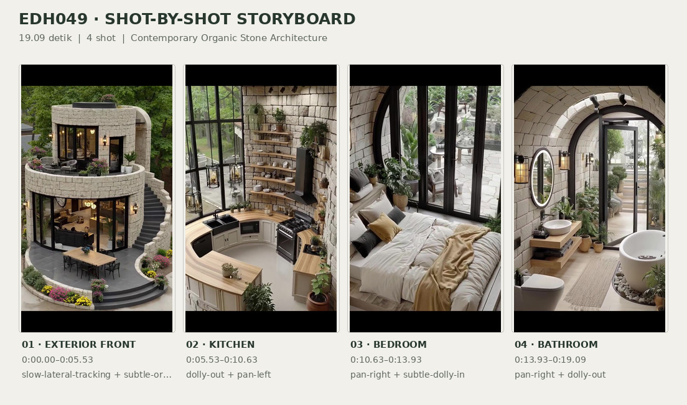
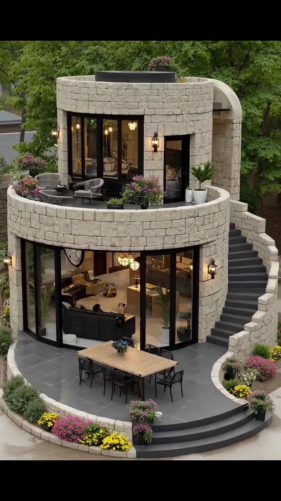
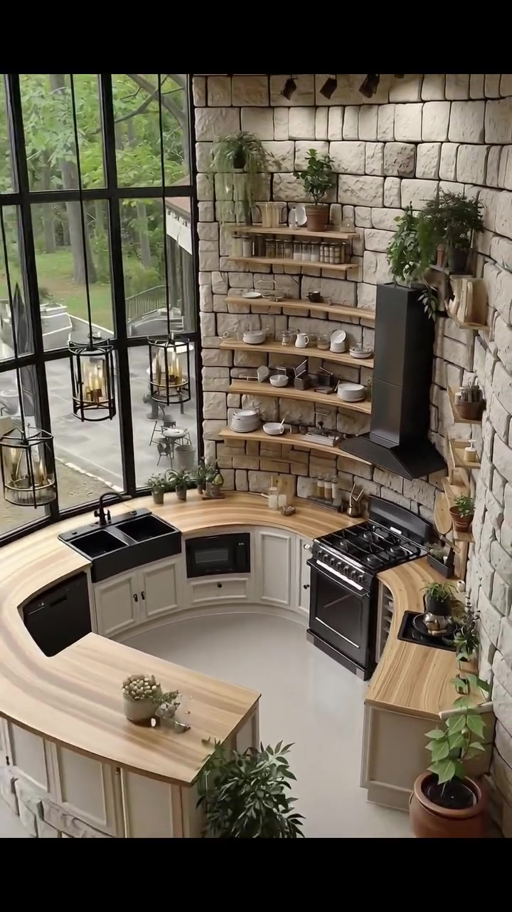
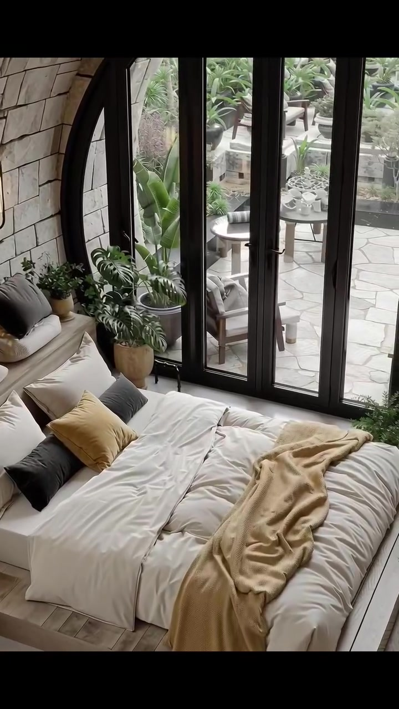
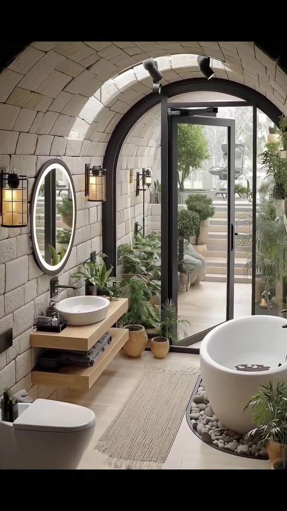

# edh049 — Contemporary Organic Stone Architecture

<!-- homeku_request_id: edh049-20261106-v14-01 -->

<!-- homeku_detail_narratives: chat-reviewed -->

**Sumber data:** [analysis.yaml](analysis.yaml) · **Status:** draft · **Diverifikasi manusia:** Tidak

## 1. Informasi Video

| Informasi | Nilai |
|---|---|
| ID | edh049 |
| File asli | edh049.mp4 |
| Durasi | 19.09 |
| Resolusi | 720x1280 |
| FPS | 30 |
| Rasio | 9:16 |
| Jumlah shot | 4 |

## 2. Storyboard Gabungan

## 3. Identitas Desain

| Aspek | Hasil analisis |
|---|---|
| Gaya utama | contemporary organic stone architecture |
| Wilayah terkait gaya desain | europe |
| Pengaruh gaya | modern rustic, mediterranean influenced stone architecture, curvilinear modernism |
| Ciri eksterior | rounded two level masonry appearance mass, light beige stone block appearance facade, curved upper balcony with stone parapet, flat appearing roof with dark inset, tall black metal framed glazing, curved exterior staircase with stone balustrade, large archway next to staircase, warm black metal wall lanterns, curved gray paved ground terrace |
| Gaya interior | contemporary rustic, warm organic interior, stone vaulted rooms, pale wood appearance finishes, black metal details |
| Confidence gaya | medium |

## 4. Ukuran & Proporsi Bangunan

| Aspek | Estimasi visual |
|---|---|
| Ukuran yang terlihat | medium |
| Bentuk bangunan | rounded two story volume with curved terraces |
| Skala vertikal | two story |
| Tapak bangunan | moderate |
| Perkiraan luas lantai | 80–140 m² |
| Confidence | low |

> Luas adalah perkiraan visual, bukan ukuran terukur.

## 5. Warna, Pencahayaan, dan Atmosfer

| Warna dominan | HEX (perkiraan) |
|---|---|
| warm limestone beige | #C9C0AC |
| light wood tan | #BE9E71 |
| charcoal black | #292B2A |
| soft cream white | #EEEAE1 |
| leafy green | #61764F |
| muted mustard | #BC9C59 |

| Aspek | Hasil analisis |
|---|---|
| Pencahayaan | soft overcast daylight, warm black metal wall lanterns, warm interior practical lights, daylight through large glazing, illuminated bathroom mirror |
| Lingkungan | house surrounded by mature green trees, pink and yellow flower beds around curved terrace, paved outdoor patio and stone steps, potted ornamental tropical greenery |
| Musim yang tampak | Tidak diketahui |
| Mood | cozy, serene, organic, warm, refined |

## 6. Struktur dan Timeline Video

**Jenis:** architectural home tour · **Tempo:** slow · **Transisi:** hard cuts between four slow moving shots

| Shot | Waktu (detik) | Durasi | Area/Scene | Gerakan Kamera |
|---|---|---|---|---|
| Shot 01 | 0.0–5.53 | 5.53 | exterior front | slow lateral tracking, subtle orbit |
| Shot 02 | 5.53–10.63 | 5.10 | kitchen | dolly out, pan left |
| Shot 03 | 10.63–13.93 | 3.30 | bedroom | pan right, subtle dolly in |
| Shot 04 | 13.93–19.09 | 5.16 | bathroom | pan right, dolly out |

## 7. Analisis per Shot

### Shot 01 — exterior front

**Waktu:** 0.0–5.53 detik

| Komponen | Pengamatan |
|---|---|
| Fokus utama | curved two story light stone house with rooftop terrace |
| Framing awal → akhir | elevated medium wide three quarter view → elevated medium three quarter view |
| Sudut pandang | slightly downward from front left |
| Gerakan kamera | slow lateral tracking, subtle orbit |
| Kecepatan kamera | slow |
| Pencahayaan | soft daylight with warm wall lanterns and interior lighting |
| Transisi keluar | hard cut |

**Detail yang terlihat**

**Arsitektur**

Rumah terdiri dari dua tingkat dengan massa depan membulat menyerupai silinder. Fasadnya tampak tersusun dari balok batu persegi panjang tidak beraturan berwarna krem muda. Di lantai atas terdapat balkon melengkung berpagar dinding batu masif, dengan garis atap yang terlihat datar di balik parapet. Pintu\-pintu kaca tinggi berbingkai logam gelap membuka ke balkon, sedangkan lantai dasar memiliki kaca lebar dari lantai hingga dekat plafon. Di sisi kanan, tangga luar melengkung dengan pijakan abu\-abu gelap dan pembatas batu terang naik ke bagian atas, berdekatan dengan bukaan lengkung tinggi. Teras bawah berlapis paving abu\-abu gelap dan memiliki anak tangga depan setengah lingkaran. Lentera dinding logam hitam menyala hangat di dekat bukaan kedua lantai, sementara tepian planter batu mengikuti lengkungan teras.

**Furnitur dan properti**

Di balkon atas, beberapa kursi anyaman abu\-abu mengelilingi meja samping bundar kecil. Pot\-pot bunga merah muda berkelompok di tepi balkon, sementara dua pot putih berisi semak hijau kecil berada di sisi kanan. Teras bawah menampung meja makan luar ruang persegi panjang berbahan kayu terang beserta kursi berangka logam gelap dan rangkaian bunga biru kecil di atas meja. Melalui kaca lantai dasar terlihat sofa gelap dengan bantal terang dan lampu gantung interior bercahaya hangat.

**Lingkungan**

Pepohonan dewasa yang rimbun dan berdaun hijau menjadi latar rumah. Di sisi teras bawah tumbuh hamparan bunga kuning dan merah muda, diselingi semak hijau kecil di sepanjang tepian taman melengkung. Jalur paving abu\-abu terang membentang di depan teras; dekat tangga terlihat sebagian tanah berwarna cokelat. Secara keseluruhan rumah dikelilingi taman dan pepohonan.

**Catatan pengamatan:** Camera berada di posisi lebih tinggi daripada teras, dengan pergeseran lateral perlahan; tidak ada bukti lokasi geografis atau jenis batu asli.

**Confidence:** Kamera medium · Detail visual high

### Shot 02 — kitchen

**Waktu:** 5.53–10.63 detik

| Komponen | Pengamatan |
|---|---|
| Fokus utama | curved kitchen countertop with stone wall and black cooker hood |
| Framing awal → akhir | medium view toward range wall → wide view of curved kitchen and window |
| Sudut pandang | eye level to slightly elevated |
| Gerakan kamera | dolly out, pan left |
| Kecepatan kamera | slow |
| Pencahayaan | diffuse daylight through tall window with soft indoor light |
| Transisi keluar | hard cut |

**Detail yang terlihat**

**Arsitektur**

Dinding dapur menampilkan susunan blok menyerupai batu krem muda bertekstur kasar dengan nat gelap yang menjorok. Tata ruang dapur berbentuk U melengkung mengikuti dinding bundar, dengan lantai halus berwarna terang. Di sisi kiri terdapat jendela tinggi bersekat\-sekat bingkai hitam. Countertop berpenampilan kayu terang menerus mengikuti lekukan kabinet bawah berpanel abu\-abu pucat dan pegangan gelap. Sejumlah rak terbuka berpenampilan kayu terang dipasang pada dinding di atas area kerja.

**Furnitur dan properti**

Kompor berdiri berwarna hitam dan baja mengilap memiliki beberapa tungku, tepat di bawah cooker hood hitam matte berbentuk cerobong. Rak\-rak kayu memuat mangkuk, piring, cangkir putih, gelas, toples bening, dan wadah bumbu. Di kanan hood tergantung talenan kayu bundar dan persegi panjang. Microwave hitam tertanam di kabinet bawah pada sisi kiri kompor, sementara ceruk rak sempit untuk botol berada di samping kompor. Di bawah jendela terlihat bak cuci gelap dua bagian dengan keran hitam melengkung. Tanaman hijau dalam pot tersebar di rak dan sudut countertop, dan lentera gantung berkaca berangka gelap terlihat di depan jendela. Peninsula yang melengkung memiliki permukaan kayu dan kabinet bawah berpanel pucat, dengan sukulen kecil di atasnya. Wadah perkakas serta peralatan makan keramik juga memenuhi area countertop.

**Lingkungan**

Melalui jendela berbingkai hitam tampak pepohonan berdaun hijau, jalur teras berlapis batu di luar, dan sebagian tempat duduk luar ruang.

**Catatan pengamatan:** Awal shot menonjolkan kompor dan rak, lalu framing melebar hingga terlihat jendela besar, bak cuci, serta peninsula melengkung.

**Confidence:** Kamera medium · Detail visual high

### Shot 03 — bedroom

**Waktu:** 10.63–13.93 detik

| Komponen | Pengamatan |
|---|---|
| Fokus utama | low platform bed beside tall black framed arch glazing |
| Framing awal → akhir | wide view of bed and arch window → medium wide view centered on bed and glazing |
| Sudut pandang | eye level slightly downward |
| Gerakan kamera | pan right, subtle dolly in |
| Kecepatan kamera | slow |
| Pencahayaan | soft natural daylight through large glazing with warm wall lamp |
| Transisi keluar | hard cut |

**Detail yang terlihat**

**Arsitektur**

Ruang tidur dibatasi dinding berpenampilan balok batu krem yang membentuk lengkungan pada tepi langit\-langit. Bukaan kaca tinggi memiliki bingkai logam hitam dan bagian puncak berbentuk lengkung, dipisahkan beberapa profil vertikal dengan gagang pintu kaca yang terlihat. Alas lantai atau platform di area tempat tidur berpenampilan kayu terang. Lengkungan berlapis batu ini menghadap ke teras luar.

**Furnitur dan properti**

Tempat tidur ganda bergaya platform rendah beralas kayu terang ditata dengan seprai dan selimut putih krem. Selimut lempar bertekstur kuning\-beige terhampar memanjang, sedangkan bantal berlapis warna krem, abu\-abu arang, dan mustard memenuhi bagian kepala ranjang. Bangku atau daybed berlapis kain beige muda berada di sepanjang dinding kiri. Lentera dinding logam hitam memancarkan cahaya hangat di dinding batu. Tanaman tropis berdaun terbelah dalam pot cokelat muda berdiri dekat kaca, ditemani tanaman\-tanaman kecil di antara bangku dan jendela. Sebagian karpet netral berpola terlihat di sisi kiri bawah tempat tidur.

**Lingkungan**

Di balik kaca tampak teras dengan paving batu pucat tidak beraturan, meja bundar dan kursi kayu luar ruang. Dinding planter batu rendah berisi semak hijau, dengan pot tanaman berdaun tropis di dekat pintu teras dan tanaman kebun hijau lembut lebih jauh di belakang.

**Catatan pengamatan:** Kamera bergerak perlahan ke kanan; jendela dan bedding mendominasi. Pemandangan teras adalah yang terlihat melalui kaca, bukan indikasi lokasi geografis.

**Confidence:** Kamera medium · Detail visual high

### Shot 04 — bathroom

**Waktu:** 13.93–19.09 detik

| Komponen | Pengamatan |
|---|---|
| Fokus utama | arched stone bathroom with floating vanity and freestanding bathtub |
| Framing awal → akhir | medium view of vanity and glazed archway → wide view of vanity toilet bathtub and archway |
| Sudut pandang | eye level slightly elevated |
| Gerakan kamera | pan right, dolly out |
| Kecepatan kamera | slow |
| Pencahayaan | bright indirect daylight with warm sconces and oval mirror light |
| Transisi keluar | none |

**Detail yang terlihat**

**Arsitektur**

Kamar mandi memiliki dinding serta langit\-langit berkubah melengkung berpenampilan blok batu krem terang; lapisan batu itu berlanjut mengitari bukaan lengkung besar. Pintu kaca menuju luar memiliki rangka logam hitam, sementara lantainya tampak seperti papan kayu berwarna pucat. Keran wastafel hitam terpasang pada dinding di atas basin. Cermin oval berbingkai hitam menyala terang di tepinya, didampingi lampu dinding logam hitam bercahaya hangat. Dasar bathtub dikelilingi hamparan kerikil hias terang dan gelap. Lampu sorot plafon berwarna gelap tampak di atas bukaan lengkung.

**Furnitur dan properti**

Di dinding kiri tergantung meja vanity memanjang berbentuk rak kayu terang, menopang wastafel mangkuk bundar berwarna putih. Rak kayu terbuka di bawahnya memuat handuk lipat abu\-abu gelap, sedangkan wadah perlengkapan mandi kecil berwarna gelap berada di atas vanity. Di depan kiri bathtub terlihat kloset putih berdesain modern. Bathtub oval putih berdiri bebas di sisi kanan, dengan keran berwarna gelap di sisi bathtub. Karpet anyaman persegi panjang berwarna beige terhampar di tengah lantai. Kelompok pakis serta tanaman berdaun lebar memenuhi area dekat pintu, sebagian dalam pot cokelat tanah liat dan pot batu terang. Rak dinding kayu kecil di ujung kanan turut menopang tanaman hijau.

**Lingkungan**

Melalui pintu kaca terlihat area luar berlapis paving batu pucat dan beberapa anak tangga yang naik ke bagian lebih tinggi. Semak serta pohon kecil dalam planter berada di dekatnya, diterangi cahaya siang lembut dengan kehijauan taman di latar.

**Catatan pengamatan:** Pandangan melebar dari wastafel ke seluruh kamar mandi, memperlihatkan toilet, bathtub, dan pintu kaca lengkung. Warna/material merupakan kesan visual.

**Confidence:** Kamera medium · Detail visual high

## 8. Kualitas dan Ketidakpastian Analisis

| Parameter | Hasil |
|---|---|
| Status | draft |
| Verifikasi manusia | Tidak |
| Ketepatan timestamp | frame based approximately 0 03 s |
| Ketidakpastian | actual geographic location not identifiable from video, europe is a stylistic association not a verified location, stone and wood materials described from visible appearance only, building floor area estimated without reliable scale reference, subtle camera movements inferred from viewpoint change, format duration includes about 0 12 s beyond last video frame, specific season cannot be established from green foliage |

**Catatan:** Analisis visual empat shot; tidak menyimpulkan negara, jenis batu asli, atau ukuran terukur. Seluruh detail dari pengamatan awal hingga akhir shot.

---

*Laporan ini diturunkan dari [analysis.yaml](analysis.yaml).*
