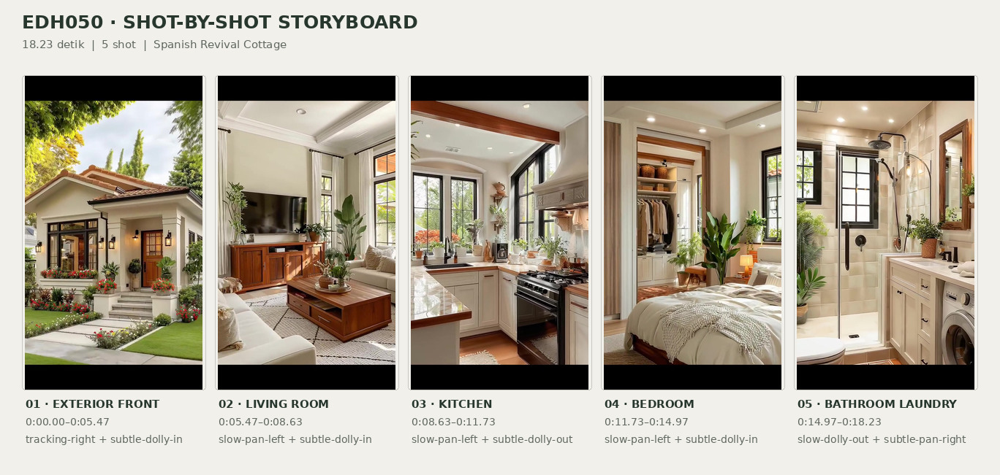
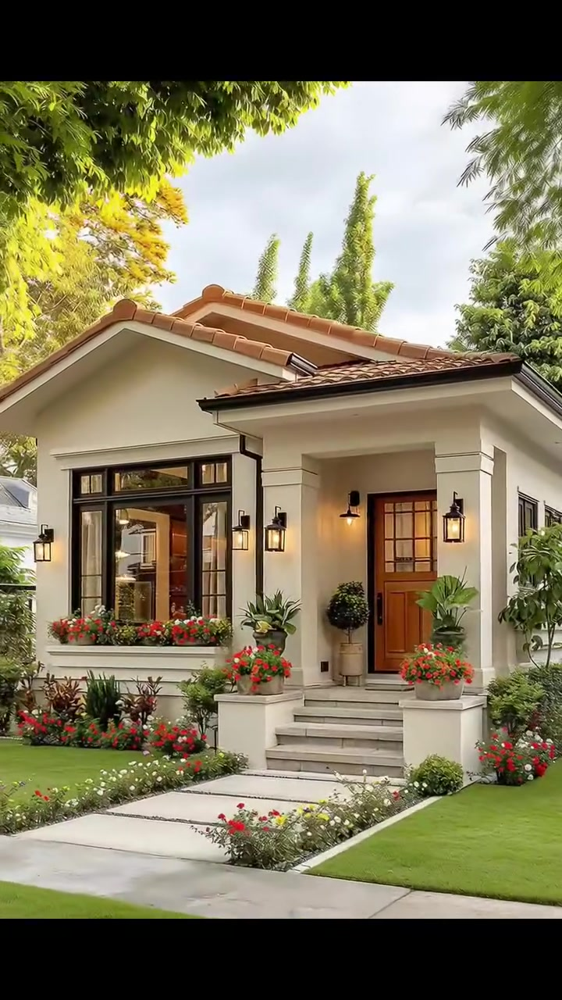
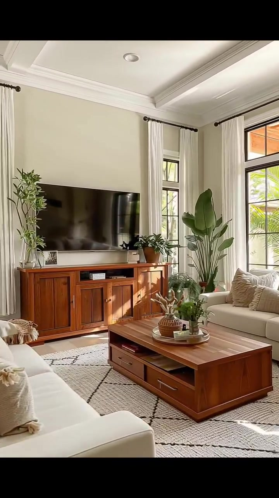
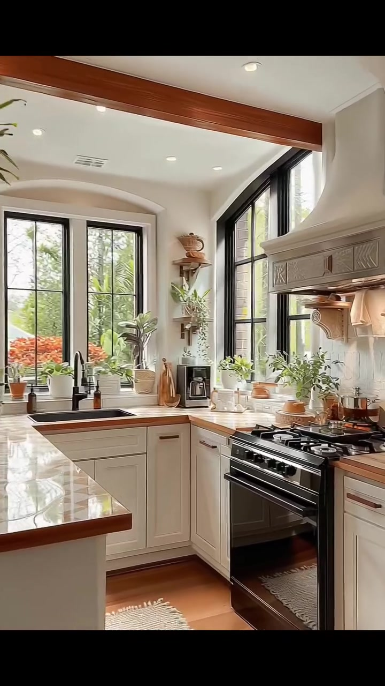
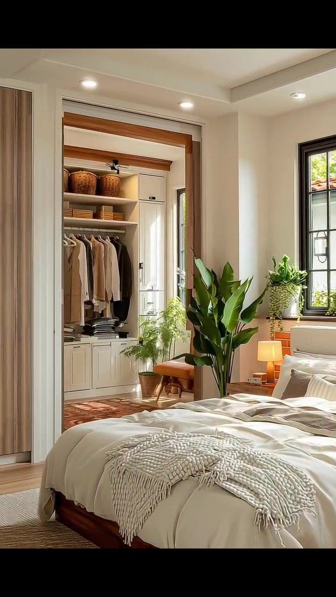
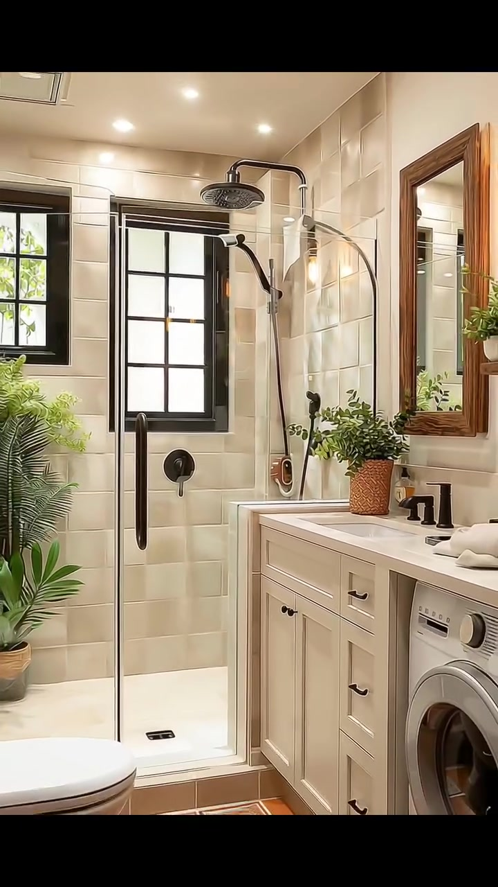

# edh050 — Spanish Revival Cottage

<!-- homeku_request_id: edh050-20261106-v14-01 -->

<!-- homeku_detail_narratives: chat-reviewed -->

**Sumber data:** [analysis.yaml](analysis.yaml) · **Status:** draft · **Diverifikasi manusia:** Tidak

## 1. Informasi Video

| Informasi | Nilai |
|---|---|
| ID | edh050 |
| File asli | edh050.mp4 |
| Durasi | 18.23 |
| Resolusi | 720x1280 |
| FPS | 30 |
| Rasio | 9:16 |
| Jumlah shot | 5 |

## 2. Storyboard Gabungan

## 3. Identitas Desain

| Aspek | Hasil analisis |
|---|---|
| Gaya utama | spanish revival cottage |
| Wilayah terkait gaya desain | north america, europe |
| Pengaruh gaya | mediterranean revival, california cottage, warm transitional interior |
| Ciri eksterior | cream stucco appearance facade, low pitched terracotta tile roof, front gabled roofline, recessed columned entrance porch, dark mullioned windows, warm brown glazed wood front door, black lantern style wall lights, light stone entry steps |
| Gaya interior | warm transitional, mediterranean influenced, contemporary cottage, light neutral palette, warm wood accents, indoor greenery |
| Confidence gaya | medium |

## 4. Ukuran & Proporsi Bangunan

| Aspek | Estimasi visual |
|---|---|
| Ukuran yang terlihat | medium |
| Bentuk bangunan | compact rectangular with intersecting front gables |
| Skala vertikal | single story |
| Tapak bangunan | compact |
| Perkiraan luas lantai | 70–130 m² |
| Confidence | low |

> Luas adalah perkiraan visual, bukan ukuran terukur.

## 5. Warna, Pencahayaan, dan Atmosfer

| Warna dominan | HEX (perkiraan) |
|---|---|
| warm cream | #E8DDCB |
| off white | #F5F1E8 |
| terracotta orange | #BE6C41 |
| warm wood brown | #986338 |
| soft leaf green | #6B8457 |
| dark charcoal | #262924 |

| Aspek | Hasil analisis |
|---|---|
| Pencahayaan | soft bright daylight, sunlight through black framed windows, warm wall sconces and table lamp, recessed ceiling downlights |
| Lingkungan | maintained front lawn, flower bordered paved entry path, large mature shade tree, dense green shrubs and tall trees, garden views through interior windows |
| Musim yang tampak | Tidak diketahui |
| Mood | warm, inviting, cozy, light filled, well kept |

## 6. Struktur dan Timeline Video

**Jenis:** home tour · **Tempo:** moderate · **Transisi:** four hard cuts between five slow moving shots

| Shot | Waktu (detik) | Durasi | Area/Scene | Gerakan Kamera |
|---|---|---|---|---|
| Shot 01 | 0.0–5.47 | 5.47 | exterior front | tracking right, subtle dolly in |
| Shot 02 | 5.47–8.63 | 3.16 | living room | slow pan left, subtle dolly in |
| Shot 03 | 8.63–11.73 | 3.10 | kitchen | slow pan left, subtle dolly out |
| Shot 04 | 11.73–14.97 | 3.24 | bedroom | slow pan left, subtle dolly in |
| Shot 05 | 14.97–18.23 | 3.26 | bathroom laundry | slow dolly out, subtle pan right |

## 7. Analisis per Shot

### Shot 01 — exterior front

**Waktu:** 0.0–5.47 detik

| Komponen | Pengamatan |
|---|---|
| Fokus utama | front entry and cream stucco cottage |
| Framing awal → akhir | wide front yard view partially obscured by large foreground tree → medium front facade and entry view |
| Sudut pandang | eye level three quarter front |
| Gerakan kamera | tracking right, subtle dolly in |
| Kecepatan kamera | slow |
| Pencahayaan | soft bright daylight with glowing warm entrance sconces |
| Transisi keluar | hard cut |

**Detail yang terlihat**

**Arsitektur**

Rumah satu lantai berukuran ringkas tampak memiliki dinding krem berpenampilan plester, atap pelana depan yang bertemu massa atap landai lain, serta genteng melengkung berwarna terakota. Tepian atapnya menjorok, dilengkapi talang dan pipa turun berwarna gelap. Serambi masuk agak menjorok ke dalam dengan dua kolom persegi krem; pintu kayu cokelat hangat memiliki kisi kaca pada bagian atas. Di sisi depan ada jendela besar berbingkai gelap dengan kisi persegi dan bagian transom atas, sementara anak tangga batu berwarna pucat mengarah ke pintu. Lampu dinding logam hitam bergaya lentera terpasang pada fasad dan serambi.

**Furnitur dan properti**

Kotak tanaman memanjang di bawah jendela dipenuhi bunga merah\-jingga. Dua pot besar berpenampilan batu yang berisi dedaunan hijau dan bunga merah mengapit tangga. Dekat pintu tampak dua semak berbentuk bulat pada pot berkaki, disertai beberapa pot tanaman hijau kecil.

**Lingkungan**

Sebuah pohon besar dengan batang tebal dan tajuk hijau rimbun mendominasi latar depan sebelah kiri. Halaman terdiri atas rumput hijau rapi dengan belang cahaya matahari dan jalur lurus dari lempeng pijakan pucat menuju tangga. Tepi jalur dihiasi bunga rendah merah, putih, dan kuning, sedangkan semak rapat serta pepohonan kecil mengisi sisi rumah. Beberapa pohon tinggi ramping muncul di belakang garis atap, di bawah langit cerah berawan tipis.

**Catatan pengamatan:** Kamera bergeser ke kanan sambil mendekati fasad sehingga batang pohon besar di depan rumah perlahan keluar dari bidang pandang; bentuk konstruksi dan material dinilai dari penampakannya, bukan verifikasi fisik.

**Confidence:** Kamera medium · Detail visual high

### Shot 02 — living room

**Waktu:** 5.47–8.63 detik

| Komponen | Pengamatan |
|---|---|
| Fokus utama | cream seating arrangement and wood media console |
| Framing awal → akhir | wide living room from corner showing seating and windows → medium view emphasizing tv console and coffee table |
| Sudut pandang | eye level oblique interior |
| Gerakan kamera | slow pan left, subtle dolly in |
| Kecepatan kamera | slow |
| Pencahayaan | strong window daylight with subtle warm downlights |
| Transisi keluar | hard cut |

**Detail yang terlihat**

**Arsitektur**

Ruang keluarga memiliki dinding putih gading hangat dengan lis mahkota putih yang lebar dan plafon cekung berpetak dengan lampu tanam kecil. Jendela tinggi berkisi hitam berada di dua sisi ruangan; gorden putih panjang digantung pada batang logam gelap. Sebagian besar permukaan lantai yang tampak berwarna pucat dan tertutup karpet luas.

**Furnitur dan properti**

Dua sofa berlapis kain krem dengan bantal netral mengelilingi meja kopi kayu cokelat berukuran besar yang rendah, memiliki laci dan ruang simpan terbuka di bawah. Di hadapannya berdiri kabinet televisi kayu cokelat berpintu panel dan rak tengah terbuka, dengan televisi layar datar hitam berukuran besar di atasnya. Karpet krem berpola garis wajik tipis gelap menutupi lantai. Tanaman berdaun lebar yang tinggi berdiri di kanan kabinet TV dan tanaman bercabang yang lebih kecil di sebelah kiri. Di meja kopi terdapat baki berisi vas kecil dan tanaman hijau, sedangkan meja samping kayu dengan pot tanaman berada di dekat sofa.

**Lingkungan**

Dedaunan pohon hijau yang terkena cahaya terlihat melalui jendela tinggi. Dari bagian atas jendela kanan tampak pula bidang atap luar berwarna terakota hangat.

**Catatan pengamatan:** Kamera bergerak perlahan ke kiri dan sedikit maju sehingga televisi serta kabinet kayu lebih dominan; jenis kayu, bahan sofa, dan permukaan lantai hanya dinilai dari tampilan.

**Confidence:** Kamera medium · Detail visual high

### Shot 03 — kitchen

**Waktu:** 8.63–11.73 detik

| Komponen | Pengamatan |
|---|---|
| Fokus utama | bright compact kitchen with white cabinets and black range |
| Framing awal → akhir | medium close view of range hood and right counter → wider view of l shaped worktops and sink windows |
| Sudut pandang | eye level slightly high interior |
| Gerakan kamera | slow pan left, subtle dolly out |
| Kecepatan kamera | slow |
| Pencahayaan | bright daylight from multiple windows with recessed downlights |
| Transisi keluar | hard cut |

**Detail yang terlihat**

**Arsitektur**

Dapur dibatasi bukaan lengkung dengan balok kayu hangat yang melintang di bawah plafon. Kabinet dan laci bawah berpanel shaker berwarna krem\-putih menopang meja dapur berpola batu terang dengan pinggiran bernuansa kayu cokelat. Tudung kompor krem melengkung memiliki detail ukiran dan penyangga kayu. Jendela\-jendela besar berkisi hitam berada di atas bak cuci serta di sisi kompor. Dinding belakang area memasak memakai ubin krem muda, lantai berpenampilan kayu cokelat hangat, dan plafon putih memiliki lampu downlight bundar.

**Furnitur dan properti**

Di bawah tudung ada kompor sekaligus oven hitam dan logam perak dengan beberapa tungku. Bak cuci gelap berbentuk persegi panjang serta keran hitam berleher tinggi terletak di bawah jendela. Kulkas berwarna baja tahan karat berada di ujung kanan, mesin kopi hitam kecil ada di sudut meja dapur, dan pemanggang roti keperakan berada di meja sebelah kiri. Rak kayu terbuka memajang keranjang kecil serta pot tanaman; beberapa pot daun hijau lain memenuhi ambang jendela dan meja. Karpet tenun terang berbentuk persegi panjang menempati lantai dekat area kerja, dan talenan kayu disandarkan di sudut meja.

**Lingkungan**

Pohon berdaun hijau tampak di luar jendela berkisi hitam, dengan semak rendah berwarna jingga\-kemerahan terlihat melalui jendela utama di atas bak cuci.

**Catatan pengamatan:** Bukaan lengkung dan balok kayu tampak saat frame melebar; permukaan countertop hanya diidentifikasi sebagai berpola batu, bukan jenis batu pasti.

**Confidence:** Kamera medium · Detail visual high

### Shot 04 — bedroom

**Waktu:** 11.73–14.97 detik

| Komponen | Pengamatan |
|---|---|
| Fokus utama | cream bedded wood frame bed and open built in wardrobe |
| Framing awal → akhir | wide bedroom showing bed right window and open closet left → closer view of open wardrobe with bed in foreground |
| Sudut pandang | eye level oblique interior |
| Gerakan kamera | slow pan left, subtle dolly in |
| Kecepatan kamera | slow |
| Pencahayaan | soft daylight from right window with warm bedside lamp and ceiling downlights |
| Transisi keluar | hard cut |

**Detail yang terlihat**

**Arsitektur**

Kamar tidur berdinding krem dengan plafon putih dan lampu tanam. Jendela besar berkisi hitam terpasang di samping kepala tempat tidur. Area lemari terbuka yang lebar dibingkai balok atas serta trim bernuansa kayu hangat, dengan kabinet, laci, dan rak terbuka berwarna krem. Di ambang masuk lemari terlihat lantai berpenampilan kayu hangat serta panel gorden panjang warna beige netral di sisi kiri.

**Furnitur dan properti**

Tempat tidur rendah berbingkai kayu ditata dengan selimut tebal putih\-krem, bantal krem bertumpuk, dan lemparan kain bertekstur tebal dengan rumbai. Di sisi tempat tidur ada meja kayu kecil dan lampu berkap hangat yang menyala, sementara tanaman pot berdaun lebar yang tinggi berdiri di antara ranjang dan lemari. Lemari terbuka memuat pakaian gantung warna beige, putih, dan gelap, tiga keranjang anyaman pada rak atas, serta tumpukan kain terlipat dan kotak kecil. Sebuah bangku kayu kecil berwarna cokelat muda berdiri dekat bukaan lemari, dan karpet bermotif merah\-cokelat hangat menutupi lantai lemari.

**Lingkungan**

Dari jendela kamar tampak dedaunan hijau serta sebagian permukaan atap genteng berwarna terakota.

**Catatan pengamatan:** Gerakan kamera mengalihkan fokus dari tempat tidur menuju lemari pakaian terbuka di sisi kiri; material lantai dan ranjang tidak diverifikasi secara fisik.

**Confidence:** Kamera medium · Detail visual high

### Shot 05 — bathroom laundry

**Waktu:** 14.97–18.23 detik

| Komponen | Pengamatan |
|---|---|
| Fokus utama | glass shower cream vanity toilet and integrated washer |
| Framing awal → akhir | tight view of shower and vanity → wide bathroom view including toilet and washing machine |
| Sudut pandang | eye level oblique interior |
| Gerakan kamera | slow dolly out, subtle pan right |
| Kecepatan kamera | slow |
| Pencahayaan | warm recessed spotlights and wall lamp with daylight at windows |
| Transisi keluar | end of video |

**Detail yang terlihat**

**Arsitektur**

Kamar mandi yang tampak ringkas menggunakan ubin dinding krem berbentuk persegi panjang serta lantai berubin kotak terakota\-jingga dengan sisipan pola hias kecil. Balok gelap membentang pada bagian plafon dan dua jendela berkisi hitam berada dekat area mandi. Sekat shower kaca memakai pegangan vertikal gelap dan alas mandi terang dengan lubang pembuangan kecil. Kabinet wastafel berpanel shaker krem memiliki permukaan meja pucat; di atasnya terpasang cermin persegi panjang berbingkai kayu. Beberapa lampu sorot tanam terlihat pada plafon putih.

**Furnitur dan properti**

Shower memiliki kepala pancuran hujan hitam dengan lengan melengkung, pancuran tangan hitam, dan pengatur air bundar di dinding. Kloset putih bertutup tampak di kiri depan, sementara mesin cuci bukaan depan berwarna perak terpasang di bawah meja sisi kanan. Sejumlah pot tanaman pakis dan tanaman berdaun hijau ditempatkan di sekitar shower serta wastafel. Di meja wastafel terdapat keran hitam dan handuk putih terlipat; lampu dinding bercahaya hangat terlihat di dekat cermin kayu.

**Lingkungan**

Daun\-daun hijau yang terang tampak melalui jendela kamar mandi.

**Catatan pengamatan:** Kamera mundur perlahan hingga kloset dan mesin cuci tampak bersamaan; ruang ini menggabungkan kamar mandi dan fungsi laundry. Bidang kaca shower memiliki gagang gelap; detail pemasangan tidak dapat diverifikasi.

**Confidence:** Kamera medium · Detail visual high

## 8. Kualitas dan Ketidakpastian Analisis

| Parameter | Hasil |
|---|---|
| Status | draft |
| Verifikasi manusia | Tidak |
| Ketepatan timestamp | estimated |
| Ketidakpastian | regional association is style interpretation not property location, exact stucco wood stone and tile materials not verified, camera motion type inferred from onscreen parallax, building floor area and footprint are low confidence visual estimates, season and actual geographic location cannot be determined, video stream ends near 18 23 s while container audio extends to near 18 37 s |

**Catatan:** Pengamatan visual pada lima shot dari frame sepanjang video; tidak dilakukan analisis audio. Semua detail berbahan spesifik menggambarkan tampilan, bukan uji material. Timestamp diperkirakan hingga sekitar satu frame.

---

*Laporan ini diturunkan dari [analysis.yaml](analysis.yaml).*
