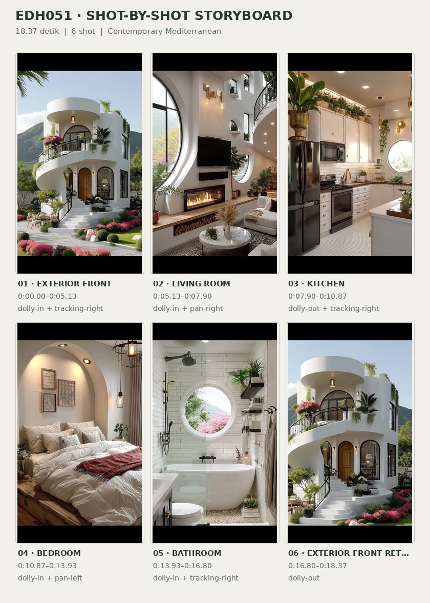
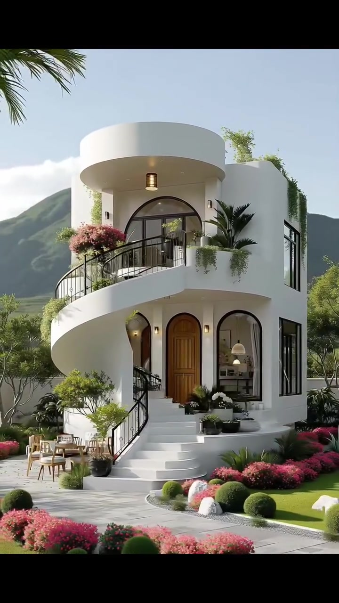
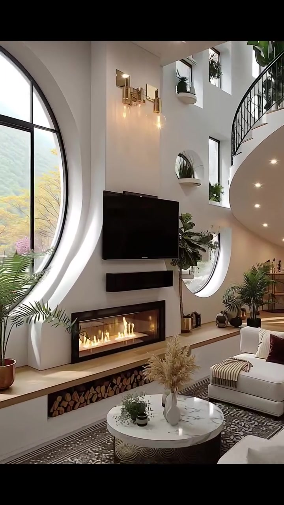
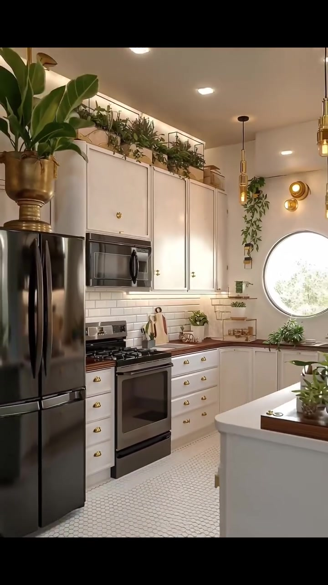
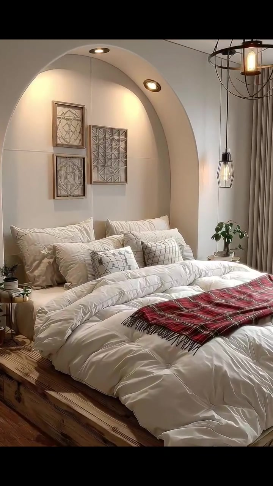
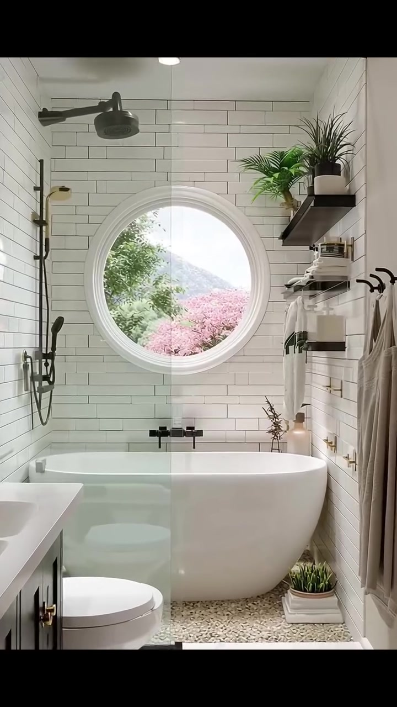
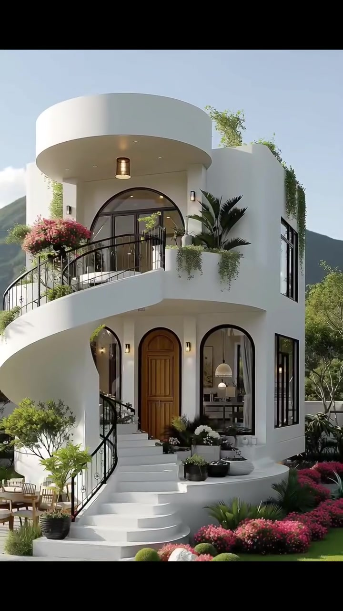

# edh051 — Contemporary Mediterranean

<!-- homeku_request_id: edh051-20261106-3e4b92fa -->

<!-- homeku_detail_narratives: chat-reviewed -->

**Sumber data:** [analysis.yaml](analysis.yaml) · **Status:** draft · **Diverifikasi manusia:** Tidak

## 1. Informasi Video

| Informasi | Nilai |
|---|---|
| ID | edh051 |
| File asli | edh051.mp4 |
| Durasi | 18.37 |
| Resolusi | 720x1280 |
| FPS | 30 |
| Rasio | 9:16 |
| Jumlah shot | 6 |

## 2. Storyboard Gabungan

## 3. Identitas Desain

| Aspek | Hasil analisis |
|---|---|
| Gaya utama | contemporary mediterranean |
| Wilayah terkait gaya desain | europe, north america |
| Pengaruh gaya | organic modern, mediterranean revival, soft contemporary |
| Ciri eksterior | smooth white stucco appearance walls, sculptural circular flat roof canopy, rounded upper floor balcony, black metal railings, arched black framed windows, arched brown wood appearance entry door, curved white entry stairs, vegetated balcony edges |
| Gaya interior | warm contemporary, mediterranean inspired arches, transitional white shaker kitchen, rustic wood bed accents |
| Confidence gaya | medium |

## 4. Ukuran & Proporsi Bangunan

| Aspek | Estimasi visual |
|---|---|
| Ukuran yang terlihat | medium |
| Bentuk bangunan | compact rounded two story |
| Skala vertikal | two story |
| Tapak bangunan | compact |
| Perkiraan luas lantai | 95–165 m² |
| Confidence | low |

> Luas adalah perkiraan visual, bukan ukuran terukur.

## 5. Warna, Pencahayaan, dan Atmosfer

| Warna dominan | HEX (perkiraan) |
|---|---|
| warm off white | #EDECE6 |
| matte charcoal black | #262727 |
| natural wood brown | #947353 |
| sage and leaf green | #63784F |
| soft floral pink | #D78398 |
| warm gold | #B99B57 |

| Aspek | Hasil analisis |
|---|---|
| Pencahayaan | bright clear daylight exterior, soft window daylight interior, warm recessed and pendant fixtures |
| Lingkungan | landscaped house with curved paving, layered green mountain backdrop, palms and mixed leafy plants, dense pink flowering garden |
| Musim yang tampak | Tidak diketahui |
| Mood | bright, airy, elegant, welcoming, calm |

## 6. Struktur dan Timeline Video

**Jenis:** architectural home tour · **Tempo:** moderate · **Transisi:** hard cuts between distinct rooms and return to exterior

| Shot | Waktu (detik) | Durasi | Area/Scene | Gerakan Kamera |
|---|---|---|---|---|
| Shot 01 | 0.0–5.133 | 5.13 | exterior front | dolly in, tracking right |
| Shot 02 | 5.133–7.9 | 2.77 | living room | dolly in, pan right |
| Shot 03 | 7.9–10.867 | 2.97 | kitchen | dolly out, tracking right |
| Shot 04 | 10.867–13.933 | 3.07 | bedroom | dolly in, pan left |
| Shot 05 | 13.933–16.8 | 2.87 | bathroom | dolly in, tracking right |
| Shot 06 | 16.8–18.37 | 1.57 | exterior front return | dolly out |

## 7. Analisis per Shot

### Shot 01 — exterior front

**Waktu:** 0.0–5.133 detik

| Komponen | Pengamatan |
|---|---|
| Fokus utama | two story white curved facade and front entrance |
| Framing awal → akhir | wide full facade with foreground palm → medium full facade closer view |
| Sudut pandang | slightly low front three quarter view |
| Gerakan kamera | dolly in, tracking right |
| Kecepatan kamera | slow |
| Pencahayaan | bright natural daylight with warm entry fixture |
| Transisi keluar | hard cut |

**Detail yang terlihat**

**Arsitektur**

Bangunan kompak dua tingkat tampak berlapis plester putih dengan sudut\-sudut membulat. Di puncak terdapat kanopi putih bundar dan besar, di bawahnya bukaan kaca lengkung berbingkai logam hitam. Balkon lantai atas melengkung dengan pagar besi hitam tipis; pelat putih yang membulat menjorok di atas akses masuk. Pintu utama melengkung berpenampilan kayu cokelat sedang berada di tengah, diapit jendela lantai dasar yang tinggi, melengkung, dan berbingkai hitam. Tangga masuk putih yang melengkung memiliki railing hitam di kiri; sisi kanan bangunan memiliki jendela tegak persegi panjang berbingkai hitam. Lampu dinding kecil bernuansa hangat tampak di bawah kanopi atas.

**Furnitur dan properti**

Di sebelah kiri tangga terdapat sebuah meja bistro kecil berpenampilan kayu pucat dengan dua kursi berwarna terang. Sejumlah pot tanaman gelap dikelompokkan dekat anak tangga pintu masuk, sementara kotak\-kotak tanaman kecil berjajar di sepanjang balkon atas.

**Lingkungan**

Batang pohon palem tinggi menutupi sebagian sisi kiri depan pada awal shot. Semak berbunga merah muda yang rapat membingkai jalur depan, diselingi beberapa semak hijau bulat yang dipangkas rapi. Jalan setapak berpenampilan batu abu\-abu pucat melengkung melintasi bagian depan, dengan rumput hijau di kanan tangga. Tanaman menjuntai dan bunga merah muda menghiasi balkon atas. Di belakang rumah terlihat lapisan punggungan pegunungan hijau, langit biru muda berawan putih, serta pepohonan dan tanaman tinggi berdaun di sisi kanan.

**Catatan pengamatan:** Fasad terlihat sepanjang gerak kamera mendekat; jenis material dinding hanya berdasarkan tampilan visual.

**Confidence:** Kamera medium · Detail visual high

### Shot 02 — living room

**Waktu:** 5.133–7.9 detik

| Komponen | Pengamatan |
|---|---|
| Fokus utama | double height living room with fireplace and curved stair |
| Framing awal → akhir | wide double height living room → medium view of television fireplace and stairs |
| Sudut pandang | interior eye level slightly upward |
| Gerakan kamera | dolly in, pan right |
| Kecepatan kamera | moderate |
| Pencahayaan | mixed bright window daylight warm sconces and recessed spotlights |
| Transisi keluar | hard cut |

**Detail yang terlihat**

**Arsitektur**

Ruang keluarga berdinding putih gading memiliki volume tinggi dua lantai dan jendela lengkung sangat besar berbingkai hitam di kiri. Sebuah perapian linear berlapis kaca memanjang di bawah televisi, di atas ambang berpenampilan kayu terang dengan ruang terbuka penyimpan kayu bakar. Di kanan tampak balkon tangga lantai atas yang melengkung dengan pagar logam hitam. Bagian bawah tangga membulat dan dilengkapi lampu tanam. Pada dinding tinggi sebelah kanan terdapat bukaan kecil berbentuk lengkung dan oval; lantai di bawah area duduk tampak bernuansa netral terang.

**Furnitur dan properti**

Televisi layar datar hitam berukuran besar terpasang di atas perapian. Sofa\-sofa berlapis kain krem mengelilingi meja kopi bundar berpenampilan batu putih dengan dekorasi kecil, semuanya berada di atas karpet besar bermotif abu\-abu dan krem. Lampu dinding berwarna keemasan menghiasi dinding tinggi. Palem dan tanaman hijau dalam pot ditempatkan dekat jendela serta tangga, sementara potongan kayu bakar tersusun di kompartemen ambang perapian. Bangku kecil beranyam warna krem berada dekat kelompok tempat duduk.

**Lingkungan**

Melalui jendela lengkung sebelah kiri terlihat lereng bukit hijau yang terkena matahari, dedaunan kuning kehijauan, dan semak merah muda di bagian bawah pandangan.

**Catatan pengamatan:** Sudut kamera bergeser mendekati televisi dan perapian, membuat sofa makin terpotong di akhir shot.

**Confidence:** Kamera medium · Detail visual high

### Shot 03 — kitchen

**Waktu:** 7.9–10.867 detik

| Komponen | Pengamatan |
|---|---|
| Fokus utama | white shaker cabinet kitchen with dark appliances |
| Framing awal → akhir | medium view of range and cabinetry → wider kitchen view including refrigerator island and round window |
| Sudut pandang | eye level slightly oblique |
| Gerakan kamera | dolly out, tracking right |
| Kecepatan kamera | slow |
| Pencahayaan | warm recessed ceiling spotlights and daylight from round window |
| Transisi keluar | hard cut |

**Detail yang terlihat**

**Arsitektur**

Dapur menggunakan kabinet model shaker putih hangat yang tinggi memenuhi dinding belakang, dengan kenop dan pegangan laci bundar bernuansa emas. Backsplash tersusun dari ubin putih persegi panjang horizontal. Countertop berpenampilan kayu cokelat hangat membentuk area kerja seperti huruf L. Dinding jauh sebelah kanan memiliki jendela bundar berbingkai putih. Lantainya menggunakan ubin terang bermotif geometris kecil. Pulau dapur putih di tengah memakai permukaan berpenampilan kayu hangat, sedangkan plafon datar terang memiliki lampu sorot tanam.

**Furnitur dan properti**

Kulkas logam gelap berdiri di kiri kompor, sementara kompor gas serta oven berwarna hitam dan baja tahan karat berada di bawah microwave logam. Lampu gantung ramping berwarna emas menggantung dari plafon. Deretan tanaman hijau dalam pot menghiasi bagian atas kabinet; tanaman lain serta papan potong tampak di atas meja kerja. Di sisi kanan jauh terlihat rak terbuka gelap berisi benda\-benda kecil, sedangkan pulau dapur memuat tanaman kecil dan dekorasi.

**Lingkungan**

Melalui jendela bundar dapur terlihat dedaunan hijau yang diterangi cahaya matahari.

**Catatan pengamatan:** Pemandangan semakin lebar memperlihatkan kulkas di kiri, pulau dapur di kanan, dan jendela bundar.

**Confidence:** Kamera medium · Detail visual high

### Shot 04 — bedroom

**Waktu:** 10.867–13.933 detik

| Komponen | Pengamatan |
|---|---|
| Fokus utama | low rustic wood bed inside large arched recess |
| Framing awal → akhir | wide bedroom with window and bed → medium close view of bed and recessed arch |
| Sudut pandang | eye level three quarter from bed foot |
| Gerakan kamera | dolly in, pan left |
| Kecepatan kamera | slow |
| Pencahayaan | soft warm recessed and pendant lights with window daylight |
| Transisi keluar | hard cut |

**Detail yang terlihat**

**Arsitektur**

Di belakang kepala ranjang terdapat ceruk dinding lengkung besar berwarna putih krem, dilengkapi lampu sorot kecil bernuansa hangat. Dinding kamar lainnya tampak putih hangat dan halus. Di kanan terdapat bukaan kaca tinggi berbingkai hitam, yang tampak seperti jendela atau pintu kaca, dengan gorden panjang abu\-abu lembut di sisinya. Permukaan lantai berpenampilan kayu cokelat sedang yang hangat.

**Furnitur dan properti**

Ranjang platform rendah memiliki rangka kayu alami berkesan rustic yang tebal. Kasur tertutup selimut putih mengembang dan beberapa bantal putih serta krem, dengan kain plaid merah, hitam, dan krem melintang di bagian bawah. Tiga karya seni berbingkai bernuansa netral terpasang di dalam ceruk lengkung. Di dekat bukaan kaca menggantung lampu sangkar logam hitam; lampu gantung kecil berwarna hitam dan kuningan berada di sisi ranjang. Meja samping kecil memuat tanaman berdaun, sementara tepi karpet bertekstur krem muda tampak di bawah ranjang.

**Lingkungan**

Di luar bukaan kaca kanan terlihat pohon hijau tua berbentuk kerucut dan semak berbunga merah muda. Cahaya siang yang terang masuk dari arah bukaan kaca tersebut.

**Catatan pengamatan:** Kamera memperbesar area lengkung di belakang ranjang; jenis kayu dan tekstil spesifik tidak dapat dipastikan.

**Confidence:** Kamera medium · Detail visual high

### Shot 05 — bathroom

**Waktu:** 13.933–16.8 detik

| Komponen | Pengamatan |
|---|---|
| Fokus utama | white freestanding tub below large round bathroom window |
| Framing awal → akhir | wide view down narrow bathroom to bathtub → medium close view of round window and bathtub |
| Sudut pandang | eye level straight into tub alcove |
| Gerakan kamera | dolly in, tracking right |
| Kecepatan kamera | slow |
| Pencahayaan | natural window daylight and soft recessed ceiling lights |
| Transisi keluar | hard cut |

**Detail yang terlihat**

**Arsitektur**

Kamar mandi berdenah memanjang dengan dinding berlapis ubin putih persegi panjang horizontal dan garis nat gelap. Jendela bundar besar berbingkai putih berada tepat di atas bathtub putih berdiri bebas berbentuk oval di ujung ruangan. Sebuah sekat shower kaca bening berada di depan bathtub. Di kiri terdapat kabinet wastafel putih dengan permukaan wastafel putih terang. Lantai berpenampilan mosaik batu kecil berwarna terang, sedangkan plafon putih dilengkapi lampu tanam.

**Furnitur dan properti**

Kepala shower hujan berwarna gelap terpasang tinggi di sisi kiri, bersama shower genggam hitam dan pengatur air pada dinding yang sama. Keran bathtub hitam menempel di dinding di bawah jendela bundar. Cermin oval berbingkai warna emas berada di atas meja wastafel; kloset putih terlihat di depan kiri bathtub. Dua rak gantung gelap di dinding kanan memuat tanaman hijau dalam pot dan perlengkapan mandi. Handuk netral terang tergantung di sisi kanan, dan tanaman hijau kecil dalam pot putih persegi ditempatkan di samping bathtub.

**Lingkungan**

Melalui jendela bundar terlihat pohon berdaun hijau serta semak berbunga merah muda di bagian bawah pandangan. Cahaya siang masuk melalui bukaan tersebut dan menerangi area bathtub berubin.

**Catatan pengamatan:** Pemandangan bergerak mendekati jendela bundar dan bathtub; lantai bertekstur batu hanya dari tampilan.

**Confidence:** Kamera medium · Detail visual high

### Shot 06 — exterior front return

**Waktu:** 16.8–18.37 detik

| Komponen | Pengamatan |
|---|---|
| Fokus utama | rounded white house facade and curved entry stair |
| Framing awal → akhir | medium front three quarter exterior view → wider front three quarter exterior view |
| Sudut pandang | slightly low front right three quarter view |
| Gerakan kamera | dolly out |
| Kecepatan kamera | slow |
| Pencahayaan | bright natural daylight with small warm upper wall light |
| Transisi keluar | video end |

**Detail yang terlihat**

**Arsitektur**

Shot penutup kembali memperlihatkan rumah dua tingkat berpenampilan plester putih dengan massa membulat. Kanopi atap bundar putih yang lebar menaungi jendela lengkung besar berbingkai hitam di lantai atas. Balkon depan melengkung dengan pagar logam hitam. Pintu depan cokelat berbentuk lengkung diapit jendela lengkung berbingkai hitam. Tangga masuk putih yang melengkung dilengkapi pegangan hitam di sisi kiri, sementara jendela persegi panjang tinggi berbingkai hitam berjajar di fasad kanan.

**Furnitur dan properti**

Beberapa pot gelap berkelompok di dekat pintu masuk dan tangga. Sepasang kursi luar ruangan berwarna terang beserta meja kecil terlihat di kiri tangga.

**Lingkungan**

Semak berbunga merah muda memenuhi taman depan dan sisi kanan, dengan semak hijau bulat terpangkas rapi di tepi jalur. Jalan depan beraspal batu abu\-abu terang berbatasan dengan rumput hijau. Tanaman merambat menjuntai dari balkon atas dan sisi kanan dinding; dedaunan mirip palem muncul di sisi kanan teras atas. Di belakang rumah membentang punggungan bukit hijau, di bawah langit biru pucat dengan awan tersebar.

**Catatan pengamatan:** Shot penutup mengulangi fasad dengan gerak kamera sangat ringan; bukan bangunan baru.

**Confidence:** Kamera medium · Detail visual high

## 8. Kualitas dan Ketidakpastian Analisis

| Parameter | Hasil |
|---|---|
| Status | draft |
| Verifikasi manusia | Tidak |
| Ketepatan timestamp | frame based approximate |
| Ketidakpastian | architectural style and associated regions are interpretive not verified location, floor area range is a low confidence visual estimate without measured scale, stated materials refer to visible appearance not lab verified composition, camera translation and digital zoom cannot be fully distinguished, visible green mountains and pink blooms do not establish geographic location or season, container runtime is approximately 18 50 s while video frames cover 18 37 s |

**Catatan:** Visual-only review of all 551 video frames at 30 fps; five hard cuts observed at frames 154, 237, 326, 418 and 504. All statements describe visible appearance; no audio analysis.

---

*Laporan ini diturunkan dari [analysis.yaml](analysis.yaml).*
