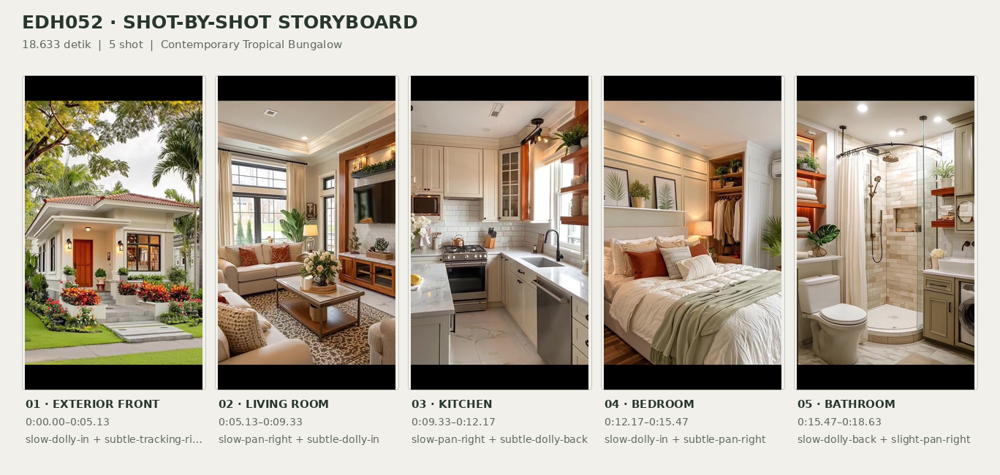
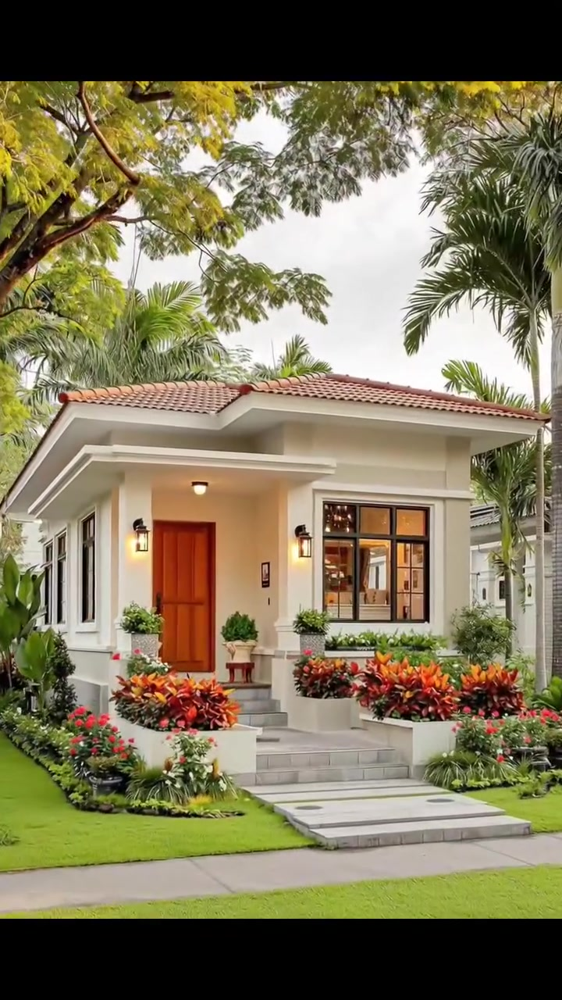
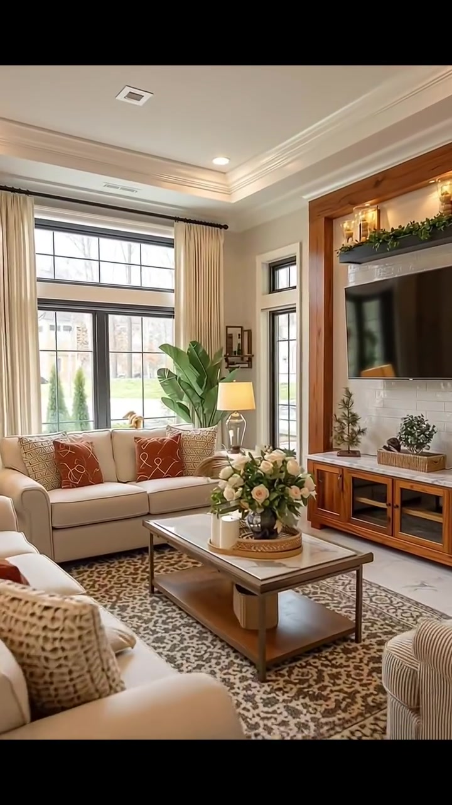
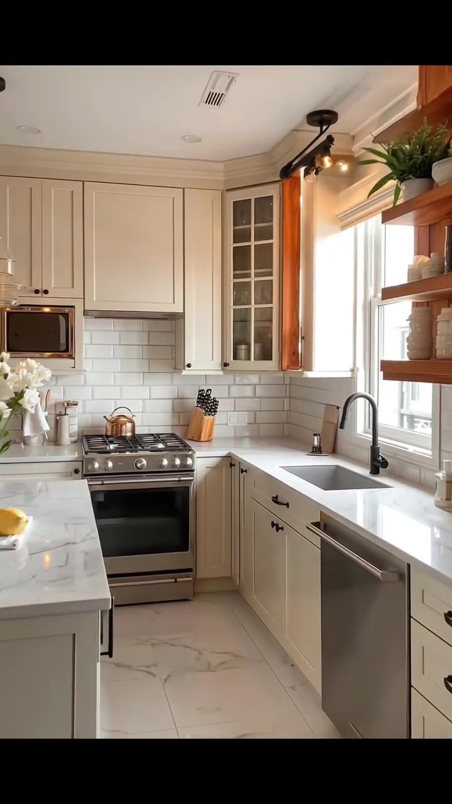
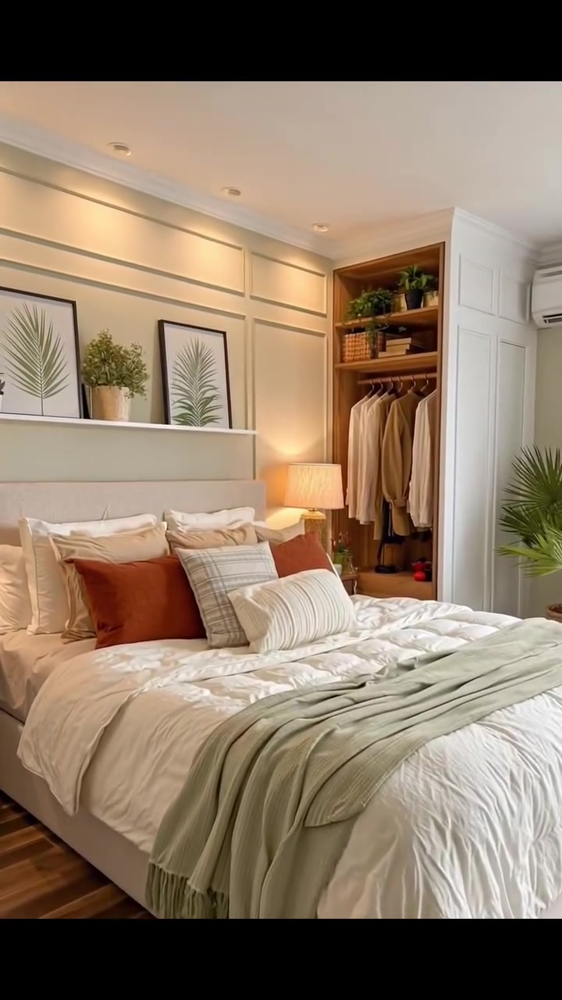
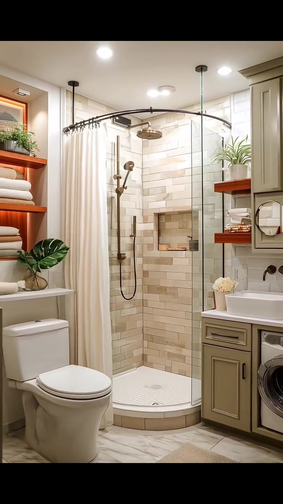

# edh052 — Contemporary Tropical Bungalow

<!-- homeku_request_id: edh052_f9c04aace6b2 -->

<!-- homeku_detail_narratives: chat-reviewed -->

**Sumber data:** [analysis.yaml](analysis.yaml) · **Status:** draft · **Diverifikasi manusia:** Tidak

## 1. Informasi Video

| Informasi | Nilai |
|---|---|
| ID | edh052 |
| File asli | edh052.mp4 |
| Durasi | 18.633 |
| Resolusi | 720x1280 |
| FPS | 30.0 |
| Rasio | 9:16 |
| Jumlah shot | 5 |

## 2. Storyboard Gabungan

## 3. Identitas Desain

| Aspek | Hasil analisis |
|---|---|
| Gaya utama | contemporary tropical bungalow |
| Wilayah terkait gaya desain | asia, north america |
| Pengaruh gaya | modern traditional, transitional interior, farmhouse inspired shaker details |
| Ciri eksterior | low pitched reddish tiled hip roof, warm cream wall finish, deep white eaves and recessed porch, dark mullioned windows, warm wood tone entry door, raised gray stone appearance entry steps, ornamental lantern sconces |
| Gaya interior | warm transitional, modern traditional, neutral soft furnishings, natural wood accents |
| Confidence gaya | medium |

## 4. Ukuran & Proporsi Bangunan

| Aspek | Estimasi visual |
|---|---|
| Ukuran yang terlihat | medium |
| Bentuk bangunan | rectangular main mass |
| Skala vertikal | single story |
| Tapak bangunan | moderate |
| Perkiraan luas lantai | 90–150 m² |
| Confidence | low |

> Luas adalah perkiraan visual, bukan ukuran terukur.

## 5. Warna, Pencahayaan, dan Atmosfer

| Warna dominan | HEX (perkiraan) |
|---|---|
| warm cream | #E8DFD2 |
| soft ivory white | #F4F0E7 |
| warm honey wood | #A6754B |
| terracotta red | #BE7651 |
| muted sage green | #A4A48B |
| dark charcoal | #2E3030 |
| rust orange | #AD603C |

| Aspek | Hasil analisis |
|---|---|
| Pencahayaan | soft daylight, warm wall sconces, warm recessed lighting, warm table lamp lighting |
| Lingkungan | suburban residential streetscape, lush tropical landscaping, neatly trimmed lawn, flowering front garden |
| Musim yang tampak | lush green vegetation with some yellow leaf canopy |
| Mood | welcoming, warm, cozy, bright, orderly |

## 6. Struktur dan Timeline Video

**Jenis:** home tour · **Tempo:** slow · **Transisi:** hard cuts between five scenes

| Shot | Waktu (detik) | Durasi | Area/Scene | Gerakan Kamera |
|---|---|---|---|---|
| Shot 01 | 0.0–5.133 | 5.13 | exterior front | slow dolly in, subtle tracking right |
| Shot 02 | 5.133–9.333 | 4.20 | living room | slow pan right, subtle dolly in |
| Shot 03 | 9.333–12.167 | 2.83 | kitchen | slow pan right, subtle dolly back |
| Shot 04 | 12.167–15.467 | 3.30 | bedroom | slow dolly in, subtle pan right |
| Shot 05 | 15.467–18.633 | 3.17 | bathroom | slow dolly back, slight pan right |

## 7. Analisis per Shot

### Shot 01 — exterior front

**Waktu:** 0.0–5.133 detik

| Komponen | Pengamatan |
|---|---|
| Fokus utama | cream single story bungalow and landscaped front entry |
| Framing awal → akhir | wide front left three quarter view → medium front entrance view |
| Sudut pandang | street level slightly low front left |
| Gerakan kamera | slow dolly in, subtle tracking right |
| Kecepatan kamera | slow |
| Pencahayaan | soft bright daylight with warm entry lanterns |
| Transisi keluar | hard cut |

**Detail yang terlihat**

**Arsitektur**

Rumah bergaya bungalow ini tampak satu lantai dengan massa utama berbentuk persegi panjang dan dinding krem keputihan. Atap miring landainya terlihat memakai genteng bernuansa merah terakota, dengan teritis putih lebar dan kanopi datar yang menjorok di depan. Teras masuk dibuat agak masuk ke dalam dan ditopang kolom persegi berwarna krem. Pintu depan berpanel cokelat kayu hangat berada di sebelah kiri jendela utama besar berkisi hitam, sedangkan beberapa jendela ramping dengan bingkai gelap terlihat sepanjang sisi kiri rumah. Dua lampu dinding hitam menyala hangat di sekitar fasad masuk. Tangga abu\-abu menyerupai batu naik ke teras dan tersambung dengan jalur masuk lurus berwarna abu\-abu muda menuju trotoar. Tepian tanam rendah berwarna krem mengapit tangga, sementara lis sederhana menghias area jendela dan pintu.

**Furnitur dan properti**

Di dekat pintu tampak tanaman pangkas hijau dalam pot pada sisi kiri dan semak berbentuk bulat dalam pot di atas dudukan kayu kemerahan di sisi kanan. Beberapa pot tanaman berdaun hijau lainnya ditempatkan di tepi teras.

**Lingkungan**

Kanopi pohon besar berdaun hijau kekuningan menaungi bagian atas kiri pandangan, sedangkan beberapa palem tinggi tumbuh di belakang dan samping rumah. Rumput hijau terang dipangkas rapi pada halaman depan dan kiri. Sisi kiri dan kanan tangga dipenuhi tanaman hias merah jingga, dengan rumpun bunga kecil merah dan merah muda di bagian depan. Tanaman berdaun lebar dan semak rendah menyusuri sisi kiri bangunan. Di depan rumah terlihat trotoar abu\-abu serta jalan aspal gelap; sebagian bangunan tetangga berwarna terang tampak di kanan. Langit terlihat pucat dan cerah di sela dedaunan.

**Catatan pengamatan:** Bentuk genteng dan material dinding dijelaskan berdasarkan tampilan; tidak ada pengukuran atau identifikasi lokasi.

**Confidence:** Kamera medium · Detail visual high

### Shot 02 — living room

**Waktu:** 5.133–9.333 detik

| Komponen | Pengamatan |
|---|---|
| Fokus utama | warm neutral seating area and wood framed television wall |
| Framing awal → akhir | wide living room view from seating area → medium television wall and coffee table view |
| Sudut pandang | eye level oblique from left |
| Gerakan kamera | slow pan right, subtle dolly in |
| Kecepatan kamera | slow |
| Pencahayaan | bright window daylight with warm recessed and table lighting |
| Transisi keluar | hard cut |

**Detail yang terlihat**

**Arsitektur**

Ruang keluarga memiliki dinding putih gading, lis plafon bertingkat, dan plafon dengan cekungan dangkal. Lampu sorot tanam serta pencahayaan tidak langsung bernuansa hangat menerangi tepinya. Pada dinding kiri terdapat jendela tinggi berkisi hitam dengan kaca transom di atas, dilengkapi gorden krem panjang pada batang gelap. Jendela samping yang lebih ramping berada di antara area duduk dan dinding televisi. Area televisi dibingkai kayu bernuansa hangat dan memiliki bidang belakang bermotif bata persegi panjang putih. Di bawahnya terpasang kabinet media kayu rendah memanjang dengan beberapa pintu kaca, sementara lantai tampak seperti batu terang berurat abu\-abu.

**Furnitur dan properti**

Sofa tiga dudukan krem terletak di bawah jendela utama dengan bantal dekorasi jingga bata dan krem berpola. Sofa krem lain tampak sebagian di kiri depan dan sebuah kursi berlengan bergaris krem berada di kanan bawah. Meja kopi persegi panjang berangka kayu, berpermukaan menyerupai batu terang, memiliki rak di bagian bawah. Di atasnya ada nampan anyaman bundar berisi rangkaian mawar putih\-krem dan wadah kecil putih. Karpet besar bermotif cokelat\-krem menjadi alas area duduk. Di dekat sofa berdiri tanaman daun lebar dalam pot dan lampu meja berkaki kaca dengan kap krem. Televisi layar datar hitam dipasang pada dinding aksen. Rak gelap di atasnya dihiasi sulur tanaman hijau serta titik\-titik lampu hangat, sementara kabinet bawah memajang pohon dekoratif kecil dan tanaman hijau.

**Lingkungan**

Melalui jendela berkisi hitam, terlihat halaman berumput hijau dan batang\-batang pohon di luar. Cahaya siang terang masuk dari jendela\-jendela tersebut.

**Catatan pengamatan:** Pergerakan memperlihatkan keseluruhan area duduk sebelum menekankan dinding televisi.

**Confidence:** Kamera medium · Detail visual high

### Shot 03 — kitchen

**Waktu:** 9.333–12.167 detik

| Komponen | Pengamatan |
|---|---|
| Fokus utama | compact cream shaker kitchen with range sink and window |
| Framing awal → akhir | medium stove and corner cabinet view → wide sink counter and left peninsula view |
| Sudut pandang | eye level corner view |
| Gerakan kamera | slow pan right, subtle dolly back |
| Kecepatan kamera | slow |
| Pencahayaan | bright side window daylight and small warm spotlights |
| Transisi keluar | hard cut |

**Detail yang terlihat**

**Arsitektur**

Dapur berukuran kompak ini memiliki susunan meja kerja berbentuk U pada tiga sisi. Kabinet atas dan bawah berprofil shaker berwarna krem dengan tarikan logam gelap. Dinding belakang meja kerja menggunakan ubin putih persegi panjang berpola subway dengan garis nat abu\-abu, sementara countertop berwarna terang tampak menyerupai batu berurat abu\-abu dan lantainya memakai ubin besar bercorak serupa. Lis putih membingkai batas plafon yang memiliki lampu tanam bundar dan ventilasi persegi panjang. Ada kabinet atas bersisipan kaca di kanan kompor, serta jendela berbingkai putih di atas bak cuci dengan aksen sisi kayu hangat. Rak terbuka kayu terletak di kanan jendela, peninsula pendek berada di kiri depan dengan dua lampu gantung kaca berwarna hangat di atasnya, dan lampu sorot pada rel hitam dipasang di atas jendela. Di ambang masuk dapur tampak peralihan lantai menuju papan berwarna cokelat kayu.

**Furnitur dan properti**

Kompor gas dengan oven berpintu gelap dan badan baja tahan karat berada di sudut belakang kiri; teko berwarna tembaga diletakkan di atasnya. Microwave tanam berpanel depan hitam tampak di sebelah kiri area memasak. Bak cuci persegi panjang berada tepat di bawah jendela dengan keran tinggi melengkung berwarna hitam doff. Mesin pencuci piring berwarna logam terpasang di bawah countertop kanan bak cuci. Di sudut meja dekat kompor terdapat blok pisau kayu berisi gagang\-gagang hitam. Rak terbuka memajang wadah keramik dan tanaman hijau, sedangkan peninsula kiri dihiasi vas bunga putih serta mangkuk kecil berisi buah kekuningan yang tampak seperti jeruk.

**Lingkungan**

Cahaya siang terang masuk dari jendela di atas bak cuci.

**Catatan pengamatan:** Permukaan bercorak batu dan kabinet dideskripsikan dari penampilan, bukan komposisi material pasti.

**Confidence:** Kamera medium · Detail visual high

### Shot 04 — bedroom

**Waktu:** 12.167–15.467 detik

| Komponen | Pengamatan |
|---|---|
| Fokus utama | layered neutral bed with built in wardrobe and botanical decor |
| Framing awal → akhir | wide bedroom from open doorway → medium close view of bed and wardrobe |
| Sudut pandang | eye level from front left |
| Gerakan kamera | slow dolly in, subtle pan right |
| Kecepatan kamera | slow |
| Pencahayaan | warm ceiling and bedside lighting with soft daylight |
| Transisi keluar | hard cut |

**Detail yang terlihat**

**Arsitektur**

Di belakang ranjang, dinding krem hangat dihiasi panel lis persegi panjang. Plafon memiliki lis putih dan beberapa lampu sorot tanam kecil. Kepala ranjang tampak berlapis bahan seperti kain berwarna beige pucat. Sebelah kanan ranjang terdapat ceruk lemari terbuka berfinishing menyerupai kayu hangat, dengan rak simpan atas dan batang gantungan pakaian. Di sampingnya berdiri kabinet tinggi berpanel putih, sedangkan unit AC split putih berada di bagian atas dinding kanan. Lantai terlihat berupa papan menyerupai kayu cokelat sedang. Kusen dan pintu masuk berwarna putih muncul di tepi kiri; di sisi kanan ada jendela terang dengan tirai tipis krem. Lampu gantung berkap anyaman tampak menggantung dari ornamen plafon bundar.

**Furnitur dan properti**

Ranjang ganda besar ditata dengan duvet putih gading dan tumpukan bantal putih. Di depannya terdapat bantal aksen jingga bata dan bantal bermotif kotak beige. Selimut lempar hijau sage dibentangkan di kaki ranjang. Pada ambalan sempit di atas kepala ranjang berdiri dua bingkai gambar daun hijau dan sebuah pot tanaman kecil di antaranya. Lampu samping berkap kain beige menyala di kanan. Baju warna putih, krem, dan cokelat muda tergantung rapi di lemari terbuka; bagian rak atas menyimpan keranjang anyaman, buku, serta tanaman pot. Tanaman berdaun seperti palem berdiri dekat jendela kanan, dan karpet besar bermotif beige, abu\-abu, serta jingga kemerahan terbentang di sisi dan kaki ranjang.

**Lingkungan**

Cahaya siang lembut tersaring melalui tirai tipis pada jendela sebelah kanan.

**Catatan pengamatan:** Bentuk ruang terlihat dari sisi pintu; bagian ruang di luar framing tidak diasumsikan.

**Confidence:** Kamera medium · Detail visual high

### Shot 05 — bathroom

**Waktu:** 15.467–18.633 detik

| Komponen | Pengamatan |
|---|---|
| Fokus utama | compact corner shower with toilet vanity and integrated laundry |
| Framing awal → akhir | medium close shower wall and curtain view → wider shower toilet vanity and washer view |
| Sudut pandang | eye level nearly frontal |
| Gerakan kamera | slow dolly back, slight pan right |
| Kecepatan kamera | slow |
| Pencahayaan | bright recessed ceiling lighting with warm shelf accent |
| Transisi keluar | end of video |

**Detail yang terlihat**

**Arsitektur**

Kamar mandi kompak menempatkan bilik mandi sudut di antara kloset sebelah kiri dan meja wastafel sebelah kanan. Alas shower putih melengkung di sisi depan menggunakan ubin mosaik kecil berwarna terang. Dinding bilik dilapisi ubin persegi panjang bernuansa krem, beige, dan cokelat muda dengan tampilan menyerupai batu. Partisi kaca bening berdiri pada tepi depan kanan; di kiri terpasang rel tirai hitam melengkung yang ditahan dari plafon dengan tirai putih. Dinding belakang memiliki ceruk simpan persegi panjang. Kabinet wastafel berprofil shaker berwarna sage\-beige berada di kanan, dengan countertop putih dan baskom putih model di atas meja. Rak kayu terbuka berada di kedua sisi shower, plafon putih memiliki lampu tanam bundar, dan lantai luar bilik bercorak urat abu\-abu. Di atas kloset terdapat ceruk penyimpanan dengan tepian kayu hangat.

**Furnitur dan properti**

Shower memiliki kepala hujan bundar berwarna seperti perunggu dan pancuran genggam serasi pada rel vertikal di dinding kiri. Kloset putih dengan tangki persegi berada di kiri bilik. Rak\-rak terbuka memuat tumpukan handuk putih, tanaman hijau berdaun lancip di kanan, serta vas bening dengan satu daun hijau lebar di atas kloset. Bunga putih menghias sisi wastafel. Sebuah cermin bulat kecil menempel di area kabinet kanan, sementara mesin cuci bukaan depan berpintu gelap berada di bawah meja paling kanan. Cerat keran dinding berwarna logam gelap terpasang di atas baskom dan beberapa botol atau wadah kecil terlihat di ceruk shower.

**Lingkungan**

Tidak ada detail yang tercatat.

**Catatan pengamatan:** Material ubin, logam, dan dinding diidentifikasi menurut tampilan; tidak terlihat pemandangan luar.

**Confidence:** Kamera medium · Detail visual high

## 8. Kualitas dan Ketidakpastian Analisis

| Parameter | Hasil |
|---|---|
| Status | draft |
| Verifikasi manusia | Tidak |
| Ketepatan timestamp | estimated |
| Ketidakpastian | geographic location is not identifiable from architectural style, common regions are stylistic associations only, estimated floor area has no measured scale reference, material composition cannot be confirmed from video, camera translation cannot be fully distinguished from virtual zoom, yellow green foliage does not confirm calendar season |

**Catatan:** Visual-only review of the full 18.633-second video. Cut boundaries estimated to within one frame from scene-change frames; keyframes are proposals for extraction, not existing GitHub files.

---

*Laporan ini diturunkan dari [analysis.yaml](analysis.yaml).*
