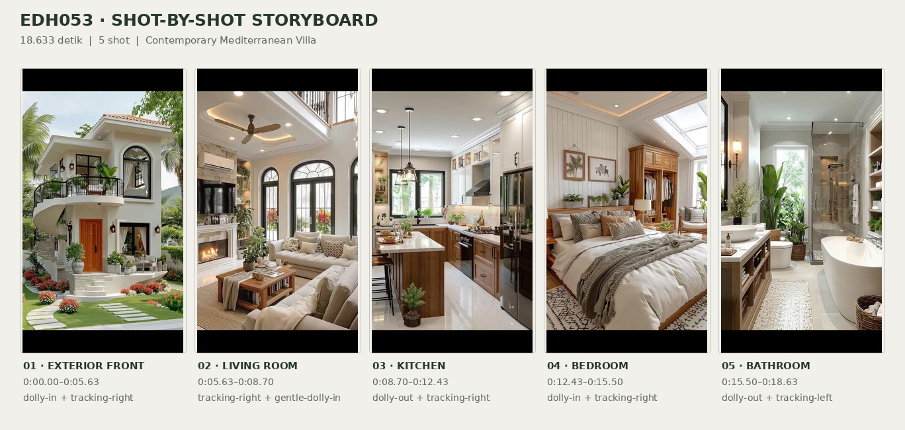
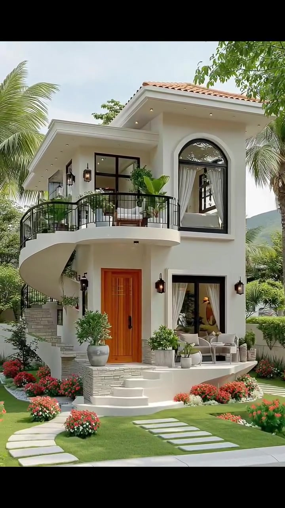
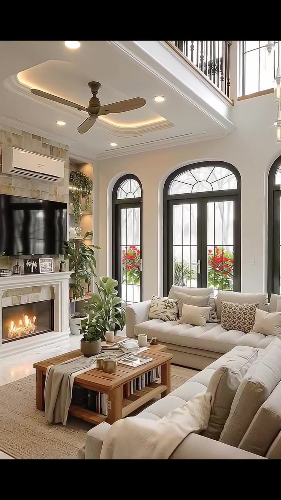
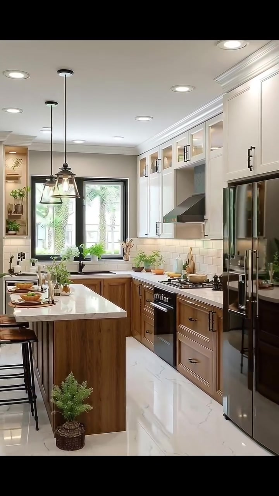
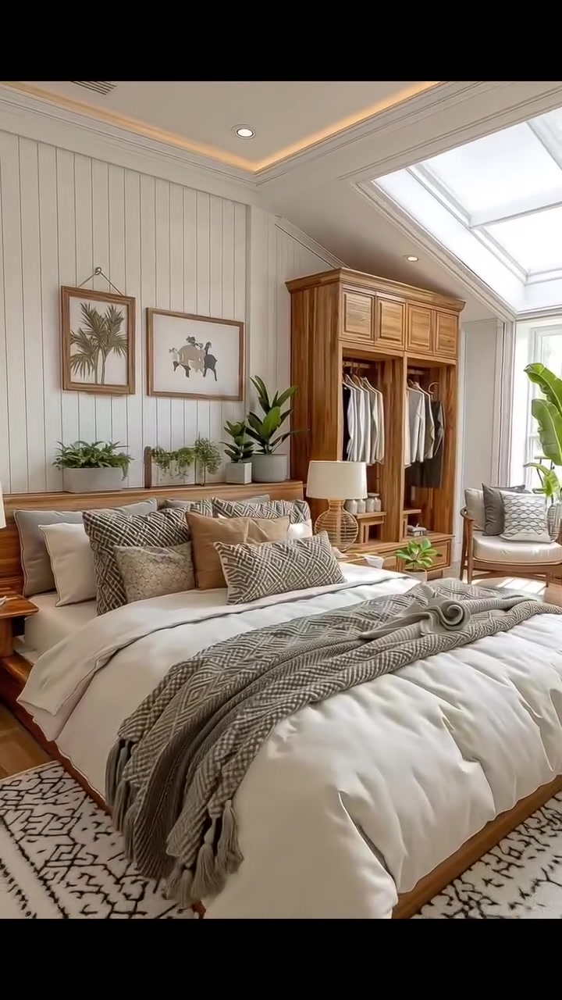
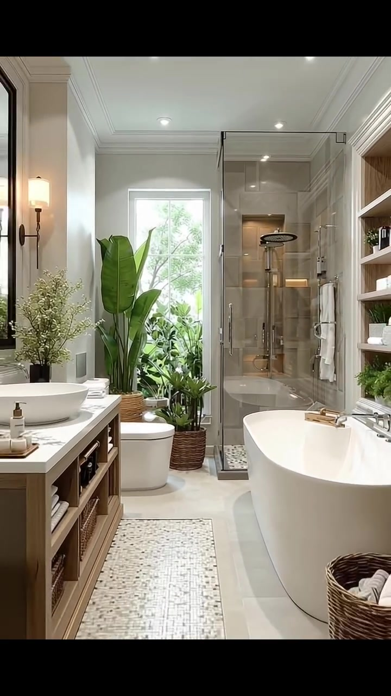

# edh053 — Contemporary Mediterranean Villa

<!-- homeku_request_id: edh053-20261106-e428b0f70b8f2f5c -->

<!-- homeku_detail_narratives: chat-reviewed -->

**Sumber data:** [analysis.yaml](analysis.yaml) · **Status:** draft · **Diverifikasi manusia:** Tidak

## 1. Informasi Video

| Informasi | Nilai |
|---|---|
| ID | edh053 |
| File asli | edh053.mp4 |
| Durasi | 18.633 |
| Resolusi | 720x1280 |
| FPS | 30 |
| Rasio | 9:16 |
| Jumlah shot | 5 |

## 2. Storyboard Gabungan

## 3. Identitas Desain

| Aspek | Hasil analisis |
|---|---|
| Gaya utama | contemporary mediterranean villa |
| Wilayah terkait gaya desain | europe, north america |
| Pengaruh gaya | tropical resort villa, transitional classic interior |
| Ciri eksterior | white stucco like two story facade, low pitched terracotta tile roof, wide overhanging white eaves, curved upper level balcony with black metal railing, external curved staircase with black metal railing, tall black framed arched window, warm wood appearance front entry door, gray stone look cladding at entry base |
| Gaya interior | warm transitional living room, classic shaker and wood kitchen, soft natural wood bedroom, contemporary spa like bathroom |
| Confidence gaya | medium |

## 4. Ukuran & Proporsi Bangunan

| Aspek | Estimasi visual |
|---|---|
| Ukuran yang terlihat | medium |
| Bentuk bangunan | compact rectangular with curved front balcony |
| Skala vertikal | two story |
| Tapak bangunan | moderate |
| Perkiraan luas lantai | 140–230 m² |
| Confidence | low |

> Luas adalah perkiraan visual, bukan ukuran terukur.

## 5. Warna, Pencahayaan, dan Atmosfer

| Warna dominan | HEX (perkiraan) |
|---|---|
| warm off white | #F2EFE7 |
| light beige | #D6C9B4 |
| natural wood brown | #A77B52 |
| charcoal black | #292D2B |
| terracotta orange | #BD784E |
| garden green | #4C7B45 |

| Aspek | Hasil analisis |
|---|---|
| Pencahayaan | soft daylight through large windows, warm recessed ceiling lighting, warm decorative wall and pendant lights |
| Lingkungan | landscaped front garden with green lawn, palm trees and leafy tropical plants, red and orange flowering beds, distant green hill partial view |
| Musim yang tampak | green growing vegetation no reliable season identification |
| Mood | bright, airy, warm, orderly, calm |

## 6. Struktur dan Timeline Video

**Jenis:** residential exterior to interior tour · **Tempo:** slow · **Transisi:** straight cuts between five smooth moving shots

| Shot | Waktu (detik) | Durasi | Area/Scene | Gerakan Kamera |
|---|---|---|---|---|
| Shot 01 | 0.0–5.633 | 5.63 | exterior front | dolly in, tracking right |
| Shot 02 | 5.633–8.7 | 3.07 | living room | tracking right, gentle dolly in |
| Shot 03 | 8.7–12.433 | 3.73 | kitchen | dolly out, tracking right |
| Shot 04 | 12.433–15.5 | 3.07 | bedroom | dolly in, tracking right |
| Shot 05 | 15.5–18.633 | 3.13 | bathroom | dolly out, tracking left |

## 7. Analisis per Shot

### Shot 01 — exterior front

**Waktu:** 0.0–5.633 detik

| Komponen | Pengamatan |
|---|---|
| Fokus utama | curved balcony and wood entry of two story white villa |
| Framing awal → akhir | wide front left three quarter view → medium front entry and upper balcony view |
| Sudut pandang | slightly low front three quarter |
| Gerakan kamera | dolly in, tracking right |
| Kecepatan kamera | slow |
| Pencahayaan | bright soft outdoor daylight with shaded eaves |
| Transisi keluar | hard cut |

**Detail yang terlihat**

**Arsitektur**

Rumah dua lantai ini menampilkan fasad putih berpenampilan plester, dengan atap genteng berwarna terakota yang landai dan teritisan putih lebar berisi lampu tanam kecil. Pada lantai atas sebelah kanan terdapat jendela tinggi berbentuk lengkung dengan kusen hitam serta tirai putih di baliknya; bukaan berkaca berkisi hitam berbentuk persegi berada di sebelah kiri. Balkon putih melengkung menjorok di atas pintu masuk dan dipagari besi hitam mengikuti lengkungannya. Di sisi kiri rumah, tangga luar berbentuk melengkung dilengkapi pegangan besi hitam; bagian bawah tangga serta dasar teras pintu masuk berlapis material berpenampilan batu susun abu\-abu muda. Di tengah fasad ada pintu berpenampilan kayu jingga hangat dengan sisipan kaca persegi panjang kecil di dekat bagian atasnya dan beberapa anak tangga putih melengkung di depannya. Di kanan pintu terdapat jendela besar berbingkai hitam dengan tirai tipis putih; lampu dinding hitam berbentuk lentera terpasang di dekat bukaan\-bukaan fasad, sedangkan teras berlapis ubin putih memanjang ke kanan.

**Furnitur dan properti**

Di balkon atas terlihat tanaman hijau berdaun lebar di dalam pot. Di sebelah kiri pintu masuk berdiri pot besar abu\-abu berisi semak hijau. Teras kanan memiliki dua kursi luar ruang berlapis bantalan terang dengan meja bundar kecil di antaranya, dikelilingi sejumlah pot kecil berisi tanaman hijau.

**Lingkungan**

Halaman depan berupa rumput hijau yang tertata rapi, dengan batu pijakan persegi panjang berwarna pucat menuju pintu masuk serta jalur batu pucat yang melengkung dari jalan ke anak tangga depan. Hamparan bunga merah dan jingga terlihat padat di taman. Pohon\-pohon palem tinggi berada di sisi kanan rumah; pepohonan rimbun dan pelepah palem muncul di belakang garis atap kiri. Sepanjang sisi kanan tampak pagar tanaman yang dipangkas rapi, sementara jalan beraspal abu\-abu melintang di latar depan. Di kejauhan sebelah kanan tampak samar perbukitan hijau; langit siang yang pucat berada di atas atap dan sebagian bangunan berwarna terang terlihat di latar belakang kanan.

**Catatan pengamatan:** Kamera bergerak mendekati fasad sambil menggeser komposisi ke kanan; detail pintu dan teras semakin dominan pada akhir shot. Material eksterior dinyatakan berdasarkan penampilan visual.

**Confidence:** Kamera medium · Detail visual high

### Shot 02 — living room

**Waktu:** 5.633–8.7 detik

| Komponen | Pengamatan |
|---|---|
| Fokus utama | cream sofa seating group beneath double height gallery |
| Framing awal → akhir | wide left corner room view → medium wide seating and arched windows view |
| Sudut pandang | eye level slightly upward |
| Gerakan kamera | tracking right, gentle dolly in |
| Kecepatan kamera | slow |
| Pencahayaan | mixed window daylight and warm ceiling accent lights |
| Transisi keluar | hard cut |

**Detail yang terlihat**

**Arsitektur**

Ruang keluarga memiliki langit\-langit tinggi dua tingkat dengan galeri terbuka di bagian atas. Plafon putih berbentuk bidang cekung dihiasi pencahayaan tersembunyi bernuansa hangat, sejumlah lampu tanam bundar, dan kipas plafon cokelat tiga bilah di tengahnya. Tepi galeri atas memakai deretan baluster logam hitam; pada sisi kiri terdapat tangga beranak tangga kayu terbuka dan pegangan kayu. Dinding berwarna krem dipadukan dengan lis plafon putih. Bagian dinding perapian di kiri berlapis ubin berpenampilan batu dengan variasi warna beige, menampung televisi hitam lebar di atas perapian berbingkai putih dengan nyala api terlihat. Unit pendingin udara putih terpasang di atas televisi. Di bagian belakang ruang terdapat pintu kaca ganda tinggi berlengkung berbingkai hitam, diapit jendela lengkung hitam yang lebih sempit. Lantainya memakai ubin besar berpenampilan marmer pucat.

**Furnitur dan properti**

Sebuah sofa panjang berlapis kain krem menempati sisi belakang dekat jendela, sementara sofa besar krem lainnya berada di latar depan kanan. Keduanya ditata dengan bantal\-bantal krem dan cokelat bermotif, serta selimut tipis warna terang yang menjuntai dari sofa depan. Di tengahnya terdapat meja kopi persegi panjang berbahan kayu berpenampilan alami, dengan buku di rak bawah terbuka, majalah dan aksesori keramik kecil pada permukaan, serta satu pot tanaman hijau kecil. Karpet bertekstur warna netral mengalasi kelompok duduk. Sejumlah tanaman hijau berpot berada di dekat perapian dan jendela, sedangkan satu rangkaian tanaman kecil menghiasi rak dinding bercahaya di samping televisi.

**Lingkungan**

Melalui pintu dan jendela kaca berbingkai hitam di belakang sofa, terlihat bunga\-bunga merah serta dedaunan taman yang hijau.

**Catatan pengamatan:** Pergerakan ke kanan mengurangi tampilan tangga di kiri dan memusatkan sofa, bukaan lengkung, serta plafon galeri.

**Confidence:** Kamera medium · Detail visual high

### Shot 03 — kitchen

**Waktu:** 8.7–12.433 detik

| Komponen | Pengamatan |
|---|---|
| Fokus utama | white and wood kitchen cabinetry with island |
| Framing awal → akhir | medium close range and counter view → wide full kitchen with island view |
| Sudut pandang | eye level slightly downward |
| Gerakan kamera | dolly out, tracking right |
| Kecepatan kamera | slow |
| Pencahayaan | bright window daylight with recessed pendants and under cabinet lights |
| Transisi keluar | hard cut |

**Detail yang terlihat**

**Arsitektur**

Dapur ini menggunakan kabinet perimeter berbentuk U dan pulau dapur kayu di tengah. Deretan kabinet atas putih bergaya shaker memakai pegangan hitam, sedangkan kabinet pajangan paling atas berpintu kaca dan memiliki penerangan di dalamnya. Kabinet bawah berpenampilan kayu cokelat sedang, berpadu dengan countertop putih bercorak urat abu\-abu pada meja pinggir dan pulau. Dinding antar\-kabinet dilapisi ubin persegi panjang putih bergaya subway, dan cerobong pengisap asap berbentuk bersudut dengan warna gelap terpasang di atas kompor. Plafon putih memiliki lis profil dan lampu tanam bundar. Jendela persegi panjang berkusen hitam berada di atas wastafel belakang. Ubin lantai berukuran besar tampak putih mengilap dengan corak marmer abu\-abu, sementara sisi pulau dapur ditutup panel vertikal berpenampilan kayu. Di bawah kabinet atas tampak lampu kerja berwarna hangat.

**Furnitur dan properti**

Di bawah pengisap asap terdapat kompor gas sekaligus oven berwarna hitam. Lemari es tinggi dengan permukaan gelap mengilap berdiri di dinding kanan, berdekatan dengan oven tanam hitam pada deretan kabinet kanan. Wastafel di bawah jendela belakang memiliki keran berwarna gelap. Tiga lampu gantung berkerangka logam gelap berbentuk lentera menggantung di atas pulau dapur, yang dilengkapi dua kursi bar berkaki logam dan dudukan cokelat. Permukaan meja dihiasi pot tanaman hijau kecil, talenan kayu serta perlengkapan persiapan makanan; ada nampan berisi peralatan makan di pulau. Dekat dasar pulau terletak semak pot dalam keranjang anyaman. Sepasang penggiling hitam berada di sisi kompor dan wadah alat masak berisi sendok kayu ditempatkan dekat meja belakang.

**Lingkungan**

Tanaman hijau berdaun lebat terlihat di luar melalui jendela belakang dapur.

**Catatan pengamatan:** Bidang pandang melebar saat kamera menjauh; kulkas, jendela belakang, sisi pulau, dan bangku baru terlihat jelas menjelang akhir shot.

**Confidence:** Kamera medium · Detail visual high

### Shot 04 — bedroom

**Waktu:** 12.433–15.5 detik

| Komponen | Pengamatan |
|---|---|
| Fokus utama | low wood bed with white bedding beneath sloped skylight |
| Framing awal → akhir | wide bedroom view → medium close bed and headboard view |
| Sudut pandang | eye level front three quarter |
| Gerakan kamera | dolly in, tracking right |
| Kecepatan kamera | slow |
| Pencahayaan | skylight and window daylight with warm ceiling cove lighting |
| Transisi keluar | hard cut |

**Detail yang terlihat**

**Arsitektur**

Dinding di belakang tempat tidur memakai pelapis papan vertikal berwarna putih. Plafon putih memiliki bidang cekung dengan lampu tersembunyi hangat di tepinya, beberapa lampu tanam bundar, dan lis dekoratif putih. Langit\-langit sisi kanan miring dengan panel jendela atap besar berbingkai putih, sedangkan jendela tinggi berbingkai putih berada pada ujung kanan ruang. Lantai berpenampilan kayu berwarna pucat dan kisi ventilasi sempit tampak di plafon dekat sisi kiri.

**Furnitur dan properti**

Tempat tidur besar bertumpu pada rangka kayu alami rendah dengan kepala ranjang senada, menggunakan duvet tebal putih dan bantal tidur putih. Bantal dekorasi bertumpuk dalam warna cokelat dan abu\-abu dengan motif geometris, sementara selimut lempar abu\-abu bermotif terlipat menyilang di bagian kaki ranjang. Di bawah tempat tidur terhampar karpet besar berwarna krem dengan batas geometris gelap. Di sisi kanan terdapat lemari kayu terbuka berisi pakaian gantung berwarna terang, sedangkan meja samping tempat tidur kayu berdiri di kedua sisi ranjang dengan lampu bertekstur anyaman dan kap putih. Dua gambar dinding berbingkai kayu menampilkan ilustrasi tumbuhan dan hewan di atas kepala ranjang; rak tipis pada kepala ranjang memuat sejumlah pot tanaman hijau kecil. Dekat jendela kanan terdapat kursi santai berlapis kain terang dengan rangka kayu dan satu tanaman tinggi berdaun lebar di dalam pot.

**Lingkungan**

Dedaunan hijau di luar rumah terlihat melalui jendela sisi kanan kamar.

**Catatan pengamatan:** Kamera mendekat ke area tempat tidur; sebagian lantai dan sudut ruangan keluar dari bingkai, sedangkan dekorasi pada kepala ranjang membesar.

**Confidence:** Kamera medium · Detail visual high

### Shot 05 — bathroom

**Waktu:** 15.5–18.633 detik

| Komponen | Pengamatan |
|---|---|
| Fokus utama | glass shower with rainhead and white freestanding bathtub |
| Framing awal → akhir | medium shower and bathtub view → wide bathroom view with vanity and tub |
| Sudut pandang | eye level front three quarter |
| Gerakan kamera | dolly out, tracking left |
| Kecepatan kamera | slow |
| Pencahayaan | diffused window daylight with ceiling spots and warm shower niche light |
| Transisi keluar | end of video |

**Detail yang terlihat**

**Arsitektur**

Kamar mandi ini menggunakan dinding netral pucat dengan lis plafon putih dan sejumlah lampu tanam kecil pada plafon putih. Dinding area shower dilapisi ubin besar berpenampilan batu abu\-abu beige, dibatasi partisi kaca bening dan pintu berengsel dengan gagang serta pengikat logam ramping. Lantai shower memakai mosaik kecil hitam\-putih, sedangkan lantai di luarnya berlapis ubin besar berpenampilan batu pucat. Jendela belakang yang tinggi memiliki bingkai putih dan berada di kiri shower; ceruk pada dinding shower dilengkapi lampu garis hangat. Deretan rak terbuka berpenampilan kayu dibangun di sepanjang sisi kanan ruang. Inset lantai mosaik hitam\-putih memanjang di antara meja wastafel dan bak mandi.

**Furnitur dan properti**

Di dalam shower tampak kepala pancuran hujan bundar berwarna gelap yang menggantung dari plafon, serta pancuran genggam perak dan pengatur air pada dindingnya. Bak mandi berdiri bebas berwarna putih dengan bentuk oval berada di kanan, sedangkan toilet putih satu bagian berada di bawah jendela belakang. Bagian kiri ruangan berisi meja wastafel berpenampilan kayu hangat dengan rak terbuka, wastafel mangkuk putih dan keran gelap. Tanaman berdaun lebar tinggi di pot anyaman ditempatkan dekat jendela; beberapa tanaman hijau kecil lain ada di dekat toilet dan shower. Di atas meja wastafel terdapat lampu dinding ramping bernuansa hangat dan cermin tinggi berbingkai hitam. Handuk putih tersampir di rel shower serta tersusun di rak meja wastafel, baki kayu kecil diletakkan di bibir bak mandi, dan keranjang anyaman gelap berisi gulungan handuk terang berada di dekat bak. Perlengkapan mandi dan vas berisi bunga kecil putih menghiasi permukaan meja wastafel.

**Lingkungan**

Melalui jendela belakang kamar mandi terlihat vegetasi taman hijau yang rimbun.

**Catatan pengamatan:** Kamera menjauh, memperlihatkan toilet dan tanaman dahulu lalu kabinet wastafel di kiri serta bak mandi yang lebih utuh di kanan.

**Confidence:** Kamera medium · Detail visual high

## 8. Kualitas dan Ketidakpastian Analisis

| Parameter | Hasil |
|---|---|
| Status | draft |
| Verifikasi manusia | Tidak |
| Ketepatan timestamp | frame based |
| Ketidakpastian | exact materials not confirmed from video, roof profile and full building depth partially obscured, floor area is visual estimate without measured scale, style regions indicate association not actual location, apparent greenery does not confirm season or geography, camera translation vs digital zoom not always distinguishable |

**Catatan:** Observasi dari seluruh rentang lima shot. Durasi frame video 559/30=18.633 s; container termasuk audio berakhir sekitar 18.784 s. Pemotongan adegan berbasis perbedaan antarframe pada 169, 261, 373, dan 465. Tidak ada informasi audio yang dianalisis.

---

*Laporan ini diturunkan dari [analysis.yaml](analysis.yaml).*
