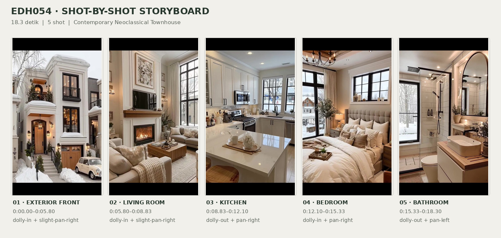
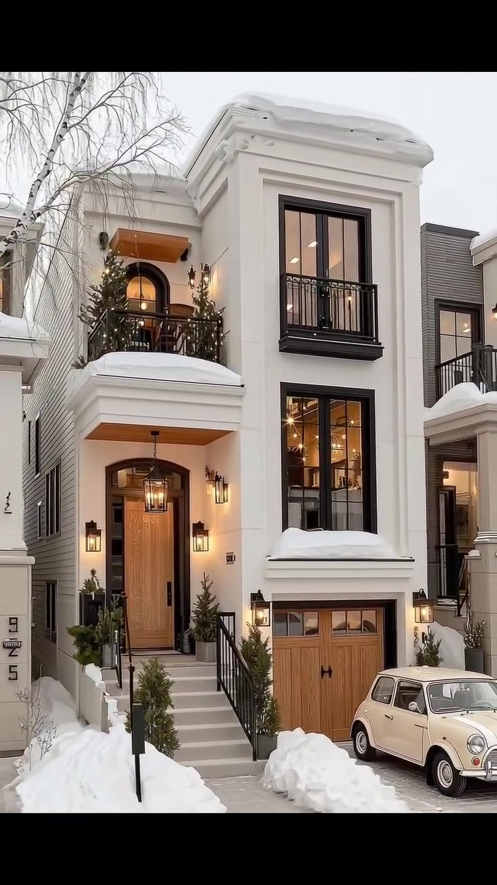
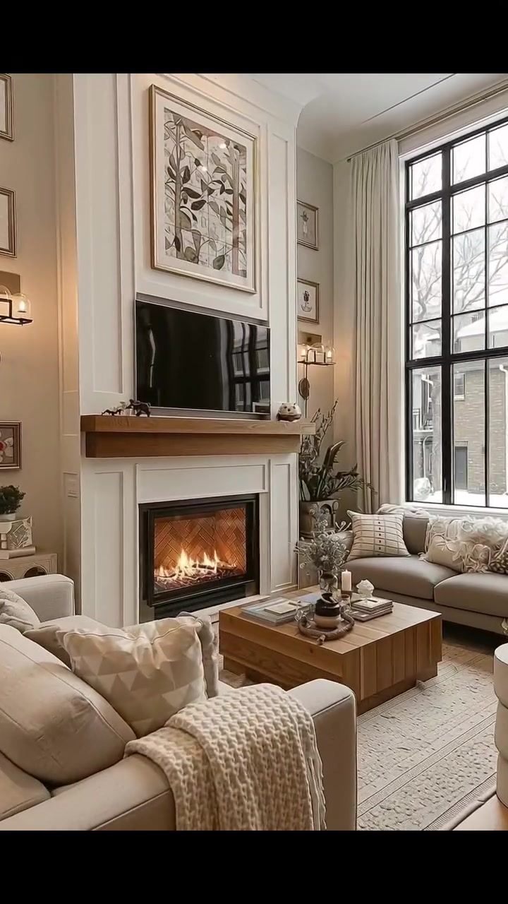
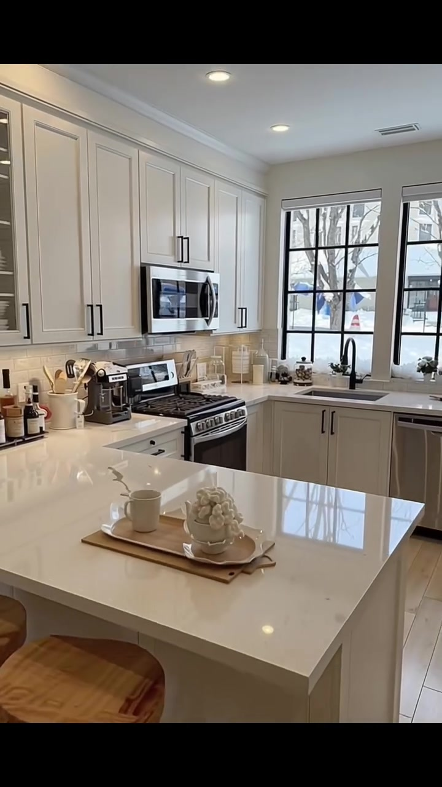
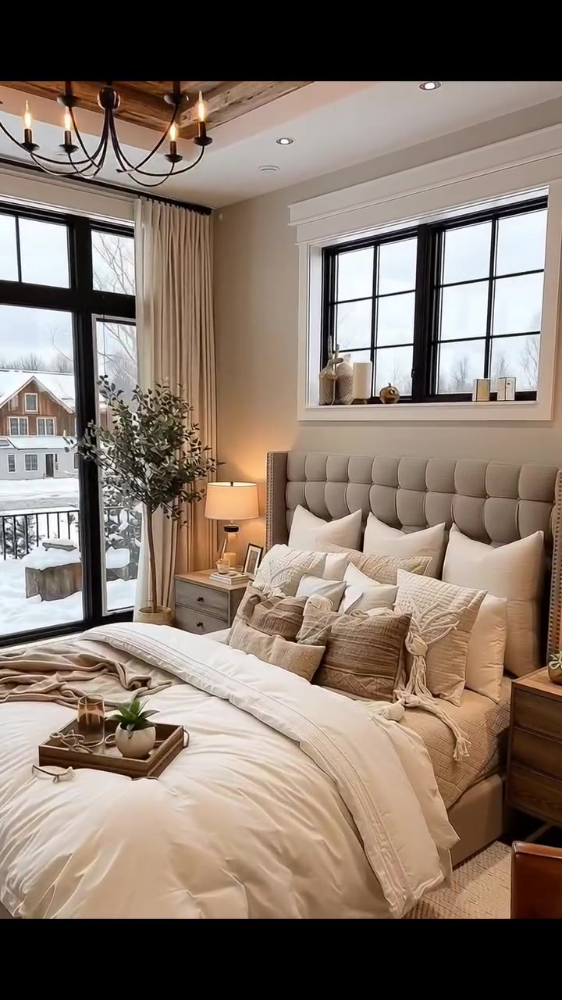
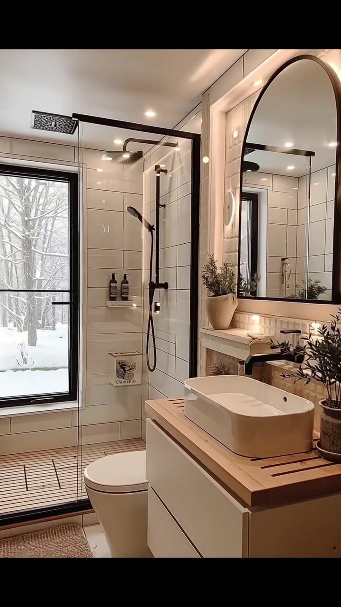

# edh054 — Contemporary Neoclassical Townhouse

<!-- homeku_request_id: edh054_20261106_f6095149 -->

<!-- homeku_detail_narratives: chat-reviewed -->

**Sumber data:** [analysis.yaml](analysis.yaml) · **Status:** draft · **Diverifikasi manusia:** Tidak

## 1. Informasi Video

| Informasi | Nilai |
|---|---|
| ID | edh054 |
| File asli | edh054.mp4 |
| Durasi | 18.3 |
| Resolusi | 720x1280 |
| FPS | 30.0 |
| Rasio | 9:16 |
| Jumlah shot | 5 |

## 2. Storyboard Gabungan

## 3. Identitas Desain

| Aspek | Hasil analisis |
|---|---|
| Gaya utama | contemporary neoclassical townhouse |
| Wilayah terkait gaya desain | europe, north america |
| Pengaruh gaya | french classical details, modern traditional residential design, warm transitional interior |
| Ciri eksterior | cream white stucco appearance front facade, prominent classical molded cornice and parapet, black metal french style windows and balustrades, arched wood front door and raised stair entry, small upper terrace with black iron railing, light wood appearance garage door at lower front level, warm wall mounted entry lanterns |
| Gaya interior | cream neutral transitional living room, white shaker style kitchen, warm traditional bedroom with rustic wood accents, black and white contemporary bathroom |
| Confidence gaya | medium |

## 4. Ukuran & Proporsi Bangunan

| Aspek | Estimasi visual |
|---|---|
| Ukuran yang terlihat | medium |
| Bentuk bangunan | narrow vertical rectangular townhouse |
| Skala vertikal | two main stories with lower garage level |
| Tapak bangunan | compact |
| Perkiraan luas lantai | 160–300 m² |
| Confidence | low |

> Luas adalah perkiraan visual, bukan ukuran terukur.

## 5. Warna, Pencahayaan, dan Atmosfer

| Warna dominan | HEX (perkiraan) |
|---|---|
| warm cream white | #EEE9E0 |
| soft beige | #CFC1AF |
| charcoal black | #2C2C2B |
| natural honey wood | #AA794C |
| snow white | #F4F5F4 |

| Aspek | Hasil analisis |
|---|---|
| Pencahayaan | diffuse overcast daylight, warm amber exterior lanterns, warm interior practical lights, recessed ceiling downlights, fireplace flame glow |
| Lingkungan | snow covered residential street, adjacent townhouses, leafless white bark tree, small evergreen landscape plants, snow visible through interior windows |
| Musim yang tampak | snowy winter appearance |
| Mood | cozy, elegant, warm, calm |

## 6. Struktur dan Timeline Video

**Jenis:** exterior to interior home tour · **Tempo:** slow · **Transisi:** hard cuts between rooms

| Shot | Waktu (detik) | Durasi | Area/Scene | Gerakan Kamera |
|---|---|---|---|---|
| Shot 01 | 0.0–5.8 | 5.80 | exterior front | dolly in, slight pan right |
| Shot 02 | 5.8–8.833333 | 3.03 | living room | dolly in, slight pan right |
| Shot 03 | 8.833333–12.1 | 3.27 | kitchen | dolly out, pan right |
| Shot 04 | 12.1–15.333333 | 3.23 | bedroom | dolly in, pan right |
| Shot 05 | 15.333333–18.3 | 2.97 | bathroom | dolly out, pan left |

## 7. Analisis per Shot

### Shot 01 — exterior front

**Waktu:** 0.0–5.8 detik

| Komponen | Pengamatan |
|---|---|
| Fokus utama | cream white narrow townhouse front facade |
| Framing awal → akhir | wide front three quarter view → medium close front facade view |
| Sudut pandang | slightly low front three quarter |
| Gerakan kamera | dolly in, slight pan right |
| Kecepatan kamera | slow |
| Pencahayaan | overcast cool daylight with warm entry lantern glow |
| Transisi keluar | hard cut to living room |

**Detail yang terlihat**

**Arsitektur**

Fasad rumah berbentuk massa tinggi dan sempit dengan tampilan plester putih krem. Lis dinding klasik dan cornice atap yang menonjol membingkai bagian depan. Di sisi kanan terdapat jendela\-jendela tinggi berbingkai hitam bergaya Prancis, dengan pagar pengaman besi hitam pada jendela atas. Di kiri atas tampak pintu teras melengkung dengan kaca di bawah kanopi bernuansa kayu, menghadap teras kecil berpagar besi hitam. Pintu utama kayu dengan kaca atas berbentuk lengkung dicapai melalui anak tangga berwarna terang dengan pegangan besi hitam di kedua sisi. Di bawah jendela kanan terdapat pintu garasi bernuansa kayu terang, sementara lampu dinding logam hitam bercahaya hangat terpasang di sekitar pintu masuk dan garasi.

**Furnitur dan properti**

Sebuah mobil kompak antik berwarna krem terparkir di sisi kanan garasi. Lampu gantung hitam terlihat di ceruk pintu masuk utama, sementara pot tanaman berwarna gelap diletakkan di kedua sisi pintu.

**Lingkungan**

Pohon besar berkulit batang putih dengan ranting tanpa daun berdiri di sisi kiri fasad. Salju menutupi bagian cornice, teras dan ambang jendela; gundukan salju tebal mengapit tangga serta jalur kendaraan. Konifer hijau kecil tumbuh di sekitar tangga dan teras atas. Di kanan terlihat sebagian rumah bertutup dinding abu\-abu, dengan langit pucat mendung di atas lingkungan permukiman bersalju.

**Catatan pengamatan:** Fasad dipantau sepanjang gerakan mendekat; sisi dan kedalaman bangunan tidak terlihat utuh. Material plester dan kayu ditulis berdasarkan tampilan.

**Confidence:** Kamera medium · Detail visual high

### Shot 02 — living room

**Waktu:** 5.8–8.833333 detik

| Komponen | Pengamatan |
|---|---|
| Fokus utama | white mantled lit fireplace between cream sofas |
| Framing awal → akhir | medium wide room view from stair side → closer fireplace and seating view |
| Sudut pandang | eye level slight rightward angle |
| Gerakan kamera | dolly in, slight pan right |
| Kecepatan kamera | slow |
| Pencahayaan | soft cool window daylight with warm fireplace and wall sconces |
| Transisi keluar | hard cut to kitchen |

**Detail yang terlihat**

**Arsitektur**

Dinding ruang keluarga yang tinggi berwarna putih krem dihiasi lis panel persegi panjang. Perapian berbingkai putih memiliki ruang api berkaca hitam; di dalamnya terlihat nyala jingga di depan susunan bata bermotif tulang ikan. Rak mantel tebal bernuansa kayu berada tepat di atas perapian. Jendela tinggi dengan kisi\-kisi hitam berada di kanan perapian. Lantai tepi ruangan memperlihatkan papan bernuansa kayu terang. Pada bagian depan kanan tampak tangga kayu pendek dengan jeruji pagar logam hitam. Sudut atas ruangan dibuat melengkung lembut, dan beberapa downlight tertanam di plafon putih.

**Furnitur dan properti**

Sofa berlapis kain krem di depan kiri dilengkapi selimut rajut tebal, sementara sofa beige terang di bawah jendela berisi beberapa bantal bermotif. Meja kopi kayu persegi yang rendah berada di antara tempat duduk, di atas karpet beige berpola halus. Televisi layar datar hitam dipasang di atas mantel, dengan lukisan botani berbingkai di atasnya. Tirai krem menjuntai di samping jendela. Buku, nampan, vas dan tanaman hijau kecil menghias meja maupun sekitar perapian; lampu dinding bernuansa kuningan hangat berada di kedua sisi dinding perapian.

**Lingkungan**

Dari jendela kanan terlihat lingkungan hunian yang tertutup salju, ranting pohon tanpa daun, dan bangunan tetangga berwarna abu\-abu di luar ruangan.

**Catatan pengamatan:** Televisi, karya seni, susunan sofa, tangga, jendela, dan dekorasi teramati pada bagian berbeda dalam shot; cahaya dari perapian terlihat menyala.

**Confidence:** Kamera medium · Detail visual high

### Shot 03 — kitchen

**Waktu:** 8.833333–12.1 detik

| Komponen | Pengamatan |
|---|---|
| Fokus utama | white shaker kitchen with large white island |
| Framing awal → akhir | medium close counter stove and sink view → wider island and kitchen view |
| Sudut pandang | eye level slightly elevated across island |
| Gerakan kamera | dolly out, pan right |
| Kecepatan kamera | slow |
| Pencahayaan | diffuse winter daylight from windows with recessed ceiling lights |
| Transisi keluar | hard cut to bedroom |

**Detail yang terlihat**

**Arsitektur**

Dapur memakai kabinet panel gaya Shaker berwarna putih krem pada bagian atas dan bawah, dengan gagang vertikal hitam yang ramping. Backsplash di belakang meja menggunakan ubin kecil persegi panjang berwarna abu\-abu pucat. Permukaan countertop putih mengilap menampilkan guratan abu\-abu lembut, dan pulau dapur besar berbentuk persegi panjang memiliki sisi menjorok untuk duduk. Dua jendela berkisi hitam berada di atas area wastafel sudut. Di bawahnya terdapat keran lengkung tinggi hitam dan bak cuci logam yang tertanam. Lantainya berupa papan bernuansa kayu alami terang, sementara beberapa downlight hangat menempel pada plafon putih.

**Furnitur dan properti**

Kompor gas berdiri sendiri dengan tampilan baja tahan karat dan hitam berada tepat di bawah microwave baja tahan karat yang terpasang dalam kabinet. Mesin pencuci piring berpanel metalik berada di kanan wastafel, sedangkan mesin kopi hitam\-perak ditempatkan di meja sisi kiri. Dua bangku bar dengan dudukan kayu bundar dan kaki besi hitam berada di sisi pulau. Di atas pulau terdapat nampan kayu kecil berisi cangkir putih dan dekorasi bunga keramik pucat. Wadah perkakas, botol, dan stoples putih tersusun di countertop belakang.

**Lingkungan**

Melalui jendela dapur terlihat halaman depan bersalju, batang serta ranting pohon yang gundul, dan beberapa rumah tetangga di seberangnya.

**Catatan pengamatan:** Pulau dapur dan bangku tampak lebih jelas pada paruh akhir, sedangkan kompor, microwave, dan wastafel lebih menonjol di awal.

**Confidence:** Kamera medium · Detail visual high

### Shot 04 — bedroom

**Waktu:** 12.1–15.333333 detik

| Komponen | Pengamatan |
|---|---|
| Fokus utama | large cream bed with tufted headboard under black window |
| Framing awal → akhir | medium wide bedroom view including bed and balcony door → closer headboard and window view |
| Sudut pandang | eye level front left three quarter |
| Gerakan kamera | dolly in, pan right |
| Kecepatan kamera | slow |
| Pencahayaan | soft daylight from black framed windows with warm bedside lamps and chandelier |
| Transisi keluar | hard cut to bathroom |

**Detail yang terlihat**

**Arsitektur**

Dinding kamar berwarna beige hangat dibatasi lis plafon putih. Langit\-langit memiliki cekungan persegi panjang dengan pinggiran balok berpenampilan kayu rustic. Pintu kaca tinggi berkisi hitam menuju balkon berada di kiri tempat tidur, sedangkan jendela horizontal lebar berkisi hitam terletak di atas kepala ranjang. Bingkai putih berlis cukup tebal mengelilingi jendela atas. Plafon putih juga memuat beberapa downlight kecil.

**Furnitur dan properti**

Tempat tidur besar berlapis kain krem memiliki sandaran tinggi berbentuk persegi panjang dengan jahitan berpetak. Selimut putih dan tumpukan bantal putih, krem, serta beige bertekstur memenuhi ranjang, dengan selimut rajut taupe terlipat di kaki ranjang. Meja nakas kayu di kedua sisi dilengkapi lampu meja bernyala hangat. Lampu gantung logam hitam bercabang dengan bohlam mirip lilin menggantung dari plafon. Pohon hias berdaun hijau berdiri di dekat pintu balkon, sedangkan nampan kayu kecil dengan sukulen berada di atas selimut. Karpet anyaman beige membentang di bawah tempat tidur; sebagian kursi berlengan kulit cokelat terlihat di kanan bawah, dan tirai panjang krem mengapit pintu balkon.

**Lingkungan**

Dari pintu kaca kiri tampak rumah\-rumah tetangga dengan permukaan bersalju dan pagar balkon logam hitam tepat di luar pintu. Pohon tanpa daun serta tanah bersalju terlihat melalui bukaan; cahaya siang berawan yang pucat masuk melalui kaca berbingkai hitam.

**Catatan pengamatan:** Kesan ukuran king berasal dari proporsi bantal dan headboard, bukan pengukuran ranjang. Atap rumah tetangga yang tertutup salju terlihat melalui bukaan.

**Confidence:** Kamera medium · Detail visual high

### Shot 05 — bathroom

**Waktu:** 15.333333–18.3 detik

| Komponen | Pengamatan |
|---|---|
| Fokus utama | white and black tiled shower and wood topped vanity |
| Framing awal → akhir | close vanity mirror and shower view → wider bathroom view showing toilet and window |
| Sudut pandang | eye level slight angle toward shower |
| Gerakan kamera | dolly out, pan left |
| Kecepatan kamera | slow |
| Pencahayaan | warm recessed ceiling and mirror lighting mixed with cool snow daylight |
| Transisi keluar | end of video |

**Detail yang terlihat**

**Arsitektur**

Dinding kamar mandi dilapisi ubin putih persegi panjang yang dipasang horizontal dengan garis nat abu\-abu muda. Area pancuran memiliki panel kaca walk\-in dengan rangka dan ambang logam hitam. Di dalamnya terlihat shower hujan atas dan shower genggam dinding, keduanya berwarna hitam dof. Jendela tegak sempit berbingkai hitam berada di bagian belakang area shower. Cermin besar berbingkai hitam berbentuk lengkung di bagian atas terpasang di atas wastafel kanan, dikelilingi pencahayaan hangat pada area cermin dan ceruk meja. Kabinet wastafel putih menggantung dengan countertop bernuansa bilah kayu; lantainya memakai ubin besar bercorak batu putih\-abu. Pada dinding shower terdapat rak ceruk kecil, dan plafon dilengkapi downlight tersembunyi.

**Furnitur dan properti**

Wastafel keramik putih berbentuk persegi panjang bersudut membulat diletakkan di atas countertop kayu, dengan cerat keran dan pengendali hitam dof terpasang di dinding. Kloset putih berada di antara jendela dan meja wastafel. Tanaman kecil dalam pot menghias meja serta rak dekat cermin; dua botol gelap tersusun di ceruk shower. Keset mandi beige beranyam berada di depan shower dan beberapa handuk berwarna terang tergulung pada rak kanan.

**Lingkungan**

Pemandangan melalui jendela kamar mandi memperlihatkan ranting pohon yang tertutup salju serta permukaan tanah putih bersalju.

**Catatan pengamatan:** Perlengkapan shower, wastafel, kloset, cermin, dan pemandangan bersalju baru tampak lengkap ketika sudut kamera melebar.

**Confidence:** Kamera medium · Detail visual high

## 8. Kualitas dan Ketidakpastian Analisis

| Parameter | Hasil |
|---|---|
| Status | draft |
| Verifikasi manusia | Tidak |
| Ketepatan timestamp | estimated |
| Ketidakpastian | building location and original geographic origin not identifiable from video, style region associations are interpretations not property location, full building depth and true floor area not visible, plaster wood stone and tile materials described by appearance only, camera motion could be digital zoom or simulated dolly, visible snow does not establish recording date or actual season |

**Catatan:** Analisis visual saja atas 549 frame (18,30 detik pada 30 fps); lima hard cut terdeteksi. Tidak ada verifikasi pengukuran fisik atau lokasi asli. Durasi video track 18,30 detik meski container memuat audio sedikit lebih panjang.

---

*Laporan ini diturunkan dari [analysis.yaml](analysis.yaml).*
