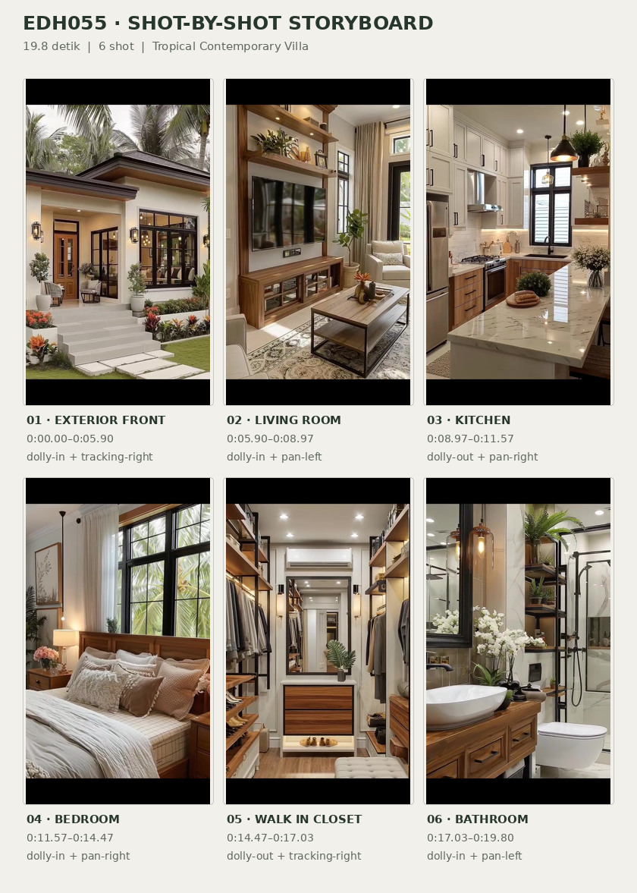
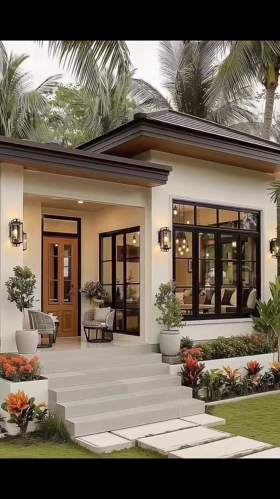
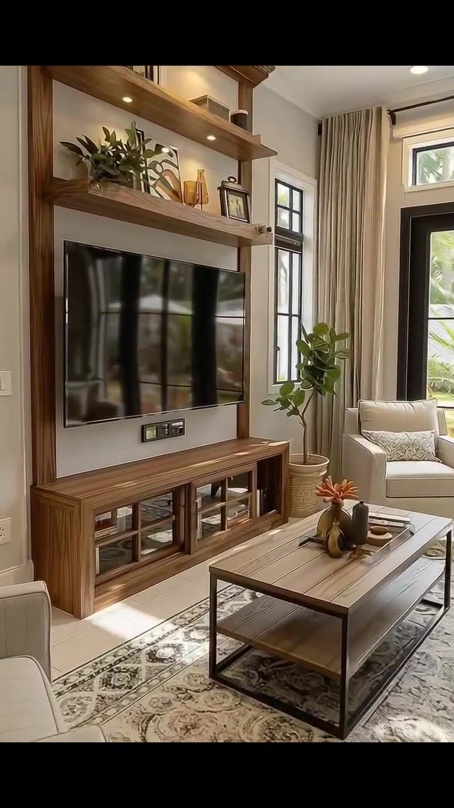
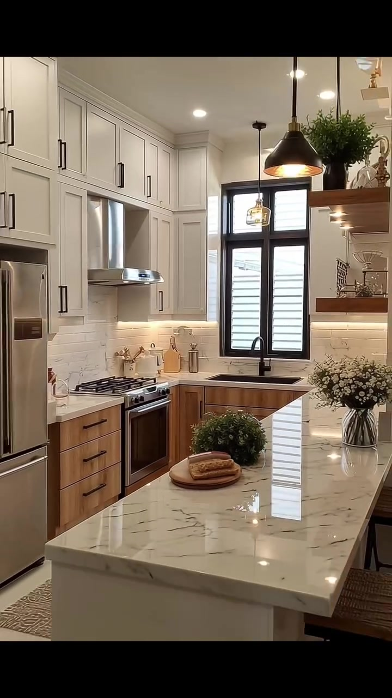
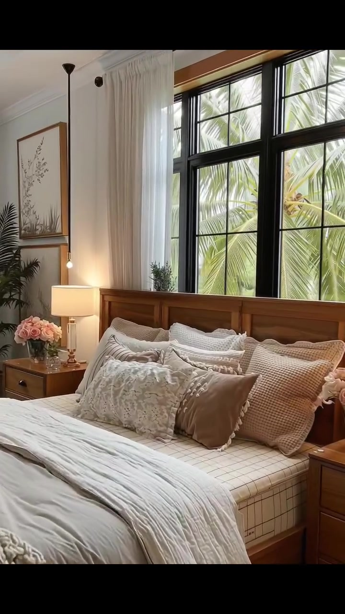
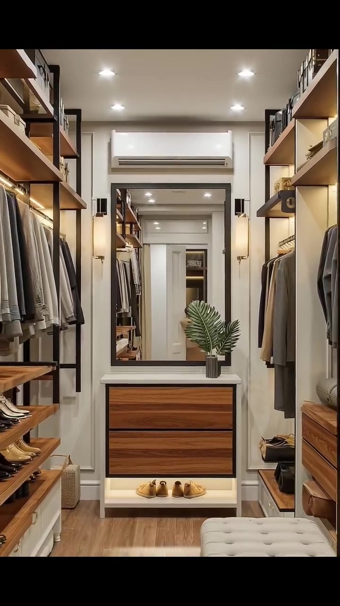
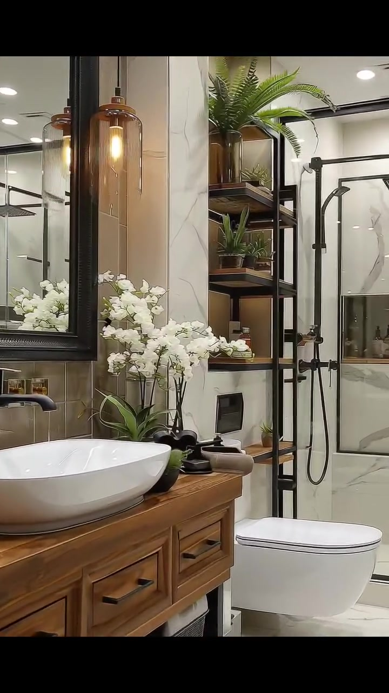

# edh055 — Tropical Contemporary Villa

<!-- homeku_request_id: edh055-20261106-v14-01 -->

<!-- homeku_detail_narratives: chat-reviewed -->

**Sumber data:** [analysis.yaml](analysis.yaml) · **Status:** draft · **Diverifikasi manusia:** Tidak

## 1. Informasi Video

| Informasi | Nilai |
|---|---|
| ID | edh055 |
| File asli | edh055.mp4 |
| Durasi | 19.8 |
| Resolusi | 720x1280 |
| FPS | 30 |
| Rasio | 9:16 |
| Jumlah shot | 6 |

## 2. Storyboard Gabungan

## 3. Identitas Desain

| Aspek | Hasil analisis |
|---|---|
| Gaya utama | tropical contemporary villa |
| Wilayah terkait gaya desain | asia, oceania, north america |
| Pengaruh gaya | modern tropical bungalow, transitional farmhouse interior, resort style garden design |
| Ciri eksterior | broad dark hipped roof with deep eaves, smooth cream plaster appearance facade, black mullioned glazing, recessed entry porch with cream stone look steps, warm wood entry doors and soffits, tropical palm framed landscape |
| Gaya interior | warm wood and white transitional, farmhouse inspired shaker kitchen, neutral soft furnished bedroom, black metal and wood closet system, wood and marble look bathroom |
| Confidence gaya | medium |

## 4. Ukuran & Proporsi Bangunan

| Aspek | Estimasi visual |
|---|---|
| Ukuran yang terlihat | large |
| Bentuk bangunan | wide low rectangular |
| Skala vertikal | single story |
| Tapak bangunan | expansive |
| Perkiraan luas lantai | 160–300 m² |
| Confidence | low |

> Luas adalah perkiraan visual, bukan ukuran terukur.

## 5. Warna, Pencahayaan, dan Atmosfer

| Warna dominan | HEX (perkiraan) |
|---|---|
| warm cream white | #EDE6DB |
| charcoal black | #292A29 |
| honey wood brown | #A2764F |
| sand beige | #C9BBA9 |
| tropical foliage green | #5F7851 |
| terracotta orange accents | #CD764D |

| Aspek | Hasil analisis |
|---|---|
| Pencahayaan | soft outdoor daylight, warm recessed indoor lighting, bright window daylight, decorative warm pendant lighting |
| Lingkungan | manicured grass lawn, mature coconut palms, tropical shrubs and flowerbeds, pale front path and stepping stones |
| Musim yang tampak | Tidak diketahui |
| Mood | calm, tropical, bright, welcoming, cozy, polished |

## 6. Struktur dan Timeline Video

**Jenis:** home tour · **Tempo:** moderate · **Transisi:** hard cuts between six slow camera moves

| Shot | Waktu (detik) | Durasi | Area/Scene | Gerakan Kamera |
|---|---|---|---|---|
| Shot 01 | 0.0–5.9 | 5.90 | exterior front | dolly in, tracking right |
| Shot 02 | 5.9–8.97 | 3.07 | living room | dolly in, pan left |
| Shot 03 | 8.97–11.57 | 2.60 | kitchen | dolly out, pan right |
| Shot 04 | 11.57–14.47 | 2.90 | bedroom | dolly in, pan right |
| Shot 05 | 14.47–17.03 | 2.56 | walk in closet | dolly out, tracking right |
| Shot 06 | 17.03–19.8 | 2.77 | bathroom | dolly in, pan left |

## 7. Analisis per Shot

### Shot 01 — exterior front

**Waktu:** 0.0–5.9 detik

| Komponen | Pengamatan |
|---|---|
| Fokus utama | single story tropical home front facade and entry |
| Framing awal → akhir | wide three quarter front view through palm trunks → medium front porch and entry view |
| Sudut pandang | eye level oblique front |
| Gerakan kamera | dolly in, tracking right |
| Kecepatan kamera | slow |
| Pencahayaan | soft daylight with warm entry lights |
| Transisi keluar | hard cut |

**Detail yang terlihat**

**Arsitektur**

Rumah tampak satu lantai dengan massa bangunan yang melebar dan rendah. Atap perisai bertingkat berwarna arang gelap memiliki teritisan lebar dengan bagian bawah bernuansa kayu hangat. Fasadnya berwarna krem\-putih dengan permukaan menyerupai plester halus. Kolom\-kolom persegi putih membingkai teras masuk yang menjorok ke dalam. Di tengahnya terdapat pintu masuk ganda berwarna cokelat dengan bidang kaca vertikal; jendela\-jendela besar berbingkai hitam terbagi kisi\-kisi, sementara sebuah pintu kaca hitam setinggi ruang berada di samping akses masuk. Anak tangga lebar berlapis ubin krem terang menuju teras yang lebih tinggi. Lampu tanam bernuansa hangat terpasang pada plafon teras, disertai lampu dinding hitam bergaya lentera di dekat pintu dan jendela.

**Furnitur dan properti**

Di teras terdapat dua kursi anyaman abu\-abu yang dipisahkan meja bundar kecil berwarna gelap. Pot\-pot besar berwarna terang berisi pohon hijau yang dipangkas ditempatkan dekat tangga, dan sebuah wadah dekoratif berisi rangkaian bunga terlihat di sekitar pintu masuk.

**Lingkungan**

Sejumlah pohon kelapa tinggi berdiri di halaman depan dan belakang rumah. Hamparan rumput hijau yang terawat dilintasi susunan batu pijakan persegi terang menuju anak tangga, sedangkan jalur berpaving pucat membentang di tepi halaman. Vegetasi tropis hijau yang rapat mengelilingi bangunan. Bedeng tanaman rendah dengan bunga oranye dan daun kemerahan\-hijau membatasi area tangga; tanaman tropis berdaun lebar terlihat di sisi kanan halaman. Langit abu\-abu terang tampak melalui sela\-sela daun palem.

**Catatan pengamatan:** Front garden and porch become clearer as camera glides right and moves closer; the back and sides of the house are not fully shown.

**Confidence:** Kamera medium · Detail visual high

### Shot 02 — living room

**Waktu:** 5.9–8.97 detik

| Komponen | Pengamatan |
|---|---|
| Fokus utama | warm wood media wall and living room seating |
| Framing awal → akhir | wide living area with seating and garden doors → medium close view of television wall and coffee table |
| Sudut pandang | eye level interior oblique |
| Gerakan kamera | dolly in, pan left |
| Kecepatan kamera | slow |
| Pencahayaan | mixed bright window daylight and warm recessed lights |
| Transisi keluar | hard cut |

**Detail yang terlihat**

**Arsitektur**

Ruang keluarga memiliki plafon bertingkat putih dengan lis bernuansa kayu dan lampu downlight bulat berwarna putih hangat. Dindingnya putih gading dengan bukaan pintu yang tinggi. Dinding televisi dibuat sebagai unit built\-in kayu hangat, lengkap dengan rak pajangan terbuka dan lampu kecil di bawah rak bagian atas, serta kabinet rendah berkaca. Di sisi belakang terdapat pintu kaca ganda berbingkai hitam, jendela transom persegi panjang di atasnya, dan jendela kisi hitam yang tinggi dan ramping di sampingnya. Tirai panjang berwarna beige membingkai pintu taman; lantai dekat ambang pintu tampak seperti ubin berwarna pucat.

**Furnitur dan properti**

Televisi layar datar hitam berukuran besar terpasang di unit kayu. Sofa berlapis kain krem menghadap televisi, didampingi kursi\-kursi berlengan krem di dekat sofa dan pintu. Meja kopi persegi panjang memiliki permukaan kayu dan rangka logam hitam, diletakkan di atas karpet besar berpola ornamental krem\-abu. Bantal bermotif netral menghiasi tempat duduk. Rak atas memuat tumpukan buku, tanaman kecil, dan dekorasi; meja kopi menampung vas pendek dengan rangkaian bunga oranye, sedangkan pohon berdaun hijau dalam pot berdiri dekat pintu taman.

**Lingkungan**

Melalui pintu kaca berbingkai hitam terlihat dedaunan tropis hijau dan bagian taman yang terang serta dipenuhi tanaman.

**Catatan pengamatan:** The view pushes toward the television cabinetry; the chairs and right-side garden glazing move partly out of frame.

**Confidence:** Kamera medium · Detail visual high

### Shot 03 — kitchen

**Waktu:** 8.97–11.57 detik

| Komponen | Pengamatan |
|---|---|
| Fokus utama | marble look center island and white wood kitchen cabinets |
| Framing awal → akhir | medium close kitchen counter and sink corner → wide island and l shaped kitchen view |
| Sudut pandang | eye level slightly elevated |
| Gerakan kamera | dolly out, pan right |
| Kecepatan kamera | slow |
| Pencahayaan | warm recessed and pendant lights with soft window daylight |
| Transisi keluar | hard cut |

**Detail yang terlihat**

**Arsitektur**

Dapur memiliki kabinet atas putih bergaya shaker hingga mendekati plafon dengan pegangan hitam, sementara kabinet dan laci bawah memperlihatkan serat kayu hangat. Backsplash disusun seperti ubin subway putih, berdampingan dengan permukaan meja putih bercorak urat abu\-abu menyerupai marmer. Sebuah island besar di tengah memakai meja tebal dengan corak serupa. Pengisap asap stainless steel terpasang di antara kabinet atas. Di atas bak cuci terdapat jendela persegi panjang berbingkai kisi hitam dan keran leher angsa hitam dof. Lampu kerja hangat menyinari backsplash dari bawah kabinet; plafon putih dilengkapi lampu sorot tanam. Rak pajang kayu melayang terlihat di dinding kanan, sedangkan lantainya tampak seperti ubin terang yang mengilap.

**Furnitur dan properti**

Di bawah pengisap asap terdapat kompor gas dan oven stainless steel; kulkas dua pintu dengan finishing serupa tampak di kiri. Di atas island tergantung lampu kubah hitam berbagian dalam metalik hangat, sementara lampu gantung kaca bening yang lebih kecil berada dekat jendela. Bangku sarapan dengan rangka gelap dan dudukan kayu berada di ujung island. Di permukaan island terlihat rangkaian bunga putih dalam vas kaca, tanaman hijau berbentuk bulat dalam pot, dan sepotong penganan di atas papan kayu bundar. Rak melayang kanan memuat tanaman dan gelas, sementara talenan, stoples, serta alat masak tersusun di meja belakang.

**Lingkungan**

Melalui jendela dapur terlihat permukaan luar berpola bilah horizontal berwarna pucat; cahaya siang juga masuk melalui bukaan berbingkai hitam tersebut.

**Catatan pengamatan:** View widens to include a stainless refrigerator and the far island stools; countertop stone is described by appearance rather than exact mineral.

**Confidence:** Kamera medium · Detail visual high

### Shot 04 — bedroom

**Waktu:** 11.57–14.47 detik

| Komponen | Pengamatan |
|---|---|
| Fokus utama | warm wood bed and black framed tropical garden window |
| Framing awal → akhir | wide bedroom view including bed and left corners → medium close bed headboard and window view |
| Sudut pandang | eye level three quarter bedside |
| Gerakan kamera | dolly in, pan right |
| Kecepatan kamera | slow |
| Pencahayaan | soft daylight and warm bedside lamp light |
| Transisi keluar | hard cut |

**Detail yang terlihat**

**Arsitektur**

Kamar tidur memiliki jendela besar dengan bingkai hitam berkisi di atas kepala ranjang. Tirai tipis krem\-putih tergantung dari batang gelap. Sisi kiri jendela berupa dinding aksen abu\-abu redup, sedangkan plafon putih dibatasi lis tepi putih sederhana. Lis bernuansa kayu hangat terpasang di atas bingkai jendela, dan permukaan lantai tampak tertutup pelapis bertekstur netral terang.

**Furnitur dan properti**

Ranjang besar menggunakan rangka kayu cokelat sedang dan headboard berpanel. Seprai serta selimut bertumpuk berwarna krem\-putih, dengan lemparan kain tebal bertekstur di ujungnya. Beberapa bantal dekoratif berwarna beige, putih, dan taupe menampilkan tekstur berbeda. Dua nakas berlaci kayu serasi berdiri di kedua sisi ranjang, masing\-masing dengan lampu meja berkubah krem yang menyala hangat; rangkaian bunga merah muda dalam vas kaca ditempatkan di area samping ranjang. Palem hijau tinggi dalam pot mengisi sudut kiri belakang, dengan kursi berlengan berlapis kain krem di sebelahnya. Gambar botani berbingkai terpasang pada dinding dekat jendela, dan lampu bohlam kecil menggantung di sekitar jendela.

**Lingkungan**

Pelepah palem hijau yang besar tampak sangat dekat di luar jendela. Cahaya siang masuk secara lembut melalui tirai tipis.

**Catatan pengamatan:** Frame moves closer to the upper bed and window; the full room footprint is not visible.

**Confidence:** Kamera medium · Detail visual high

### Shot 05 — walk in closet

**Waktu:** 14.47–17.03 detik

| Komponen | Pengamatan |
|---|---|
| Fokus utama | symmetrical open wardrobe and mirror end wall |
| Framing awal → akhir | centered wardrobe corridor and end mirror → wide wardrobe corridor with right foreground bench |
| Sudut pandang | eye level centered aisle |
| Gerakan kamera | dolly out, tracking right |
| Kecepatan kamera | slow |
| Pencahayaan | bright ceiling spotlights with warm shelf and wall lights |
| Transisi keluar | hard cut |

**Detail yang terlihat**

**Arsitektur**

Walk\-in closet berbentuk koridor sempit yang relatif simetris. Pada kedua sisinya terdapat sistem lemari terbuka dengan rangka logam hitam serta rak kayu hangat. Cermin persegi panjang tinggi berbingkai hitam terpasang di dinding ujung. Di bawahnya, dua muka laci bermotif serat kayu berada dalam kabinet berbingkai putih; sebuah unit AC putih menempel di atas cermin. Dinding berpanel dan plafonnya putih, dilengkapi deretan lampu sorot tanam. Lantai menyerupai papan kayu hangat, dengan pencahayaan aksen di bawah rak dan lampu dinding ramping vertikal di samping cermin.

**Furnitur dan properti**

Pakaian berwarna abu\-abu, taupe, dan krem menggantung pada rel di kedua sisi. Sepatu formal dan kasual tertata di rak bawah, sedangkan kotak penyimpanan gelap diletakkan di rak atas. Karpet runner anyaman pucat membujur di tengah lantai. Bangku berlapis kain abu\-abu muda dengan kancing tufted muncul di bagian depan kanan. Vas abu\-abu kecil dengan daun hijau menyerupai palem berada di atas kabinet ujung, dan keranjang anyaman tampak dekat dasar rak kiri.

**Lingkungan**

Tidak ada detail yang tercatat.

**Catatan pengamatan:** No exterior landscape is visible; apparent hallway depth is increased by the end-wall mirror reflection.

**Confidence:** Kamera medium · Detail visual high

### Shot 06 — bathroom

**Waktu:** 17.03–19.8 detik

| Komponen | Pengamatan |
|---|---|
| Fokus utama | wood vanity vessel sink and black framed shower |
| Framing awal → akhir | wide bathroom view with vanity toilet and shower → close vanity sink mirror and shower edge |
| Sudut pandang | eye level oblique from vanity side |
| Gerakan kamera | dolly in, pan left |
| Kecepatan kamera | slow |
| Pencahayaan | bright warm white ceiling spotlights with amber vanity pendant |
| Transisi keluar | end of video |

**Detail yang terlihat**

**Arsitektur**

Kamar mandi dilapisi bidang dinding besar bermotif marmer pucat dengan urat abu\-abu, diselingi ubin aksen vertikal taupe gelap di belakang area wastafel. Lantai memakai ubin terang yang juga menyerupai marmer. Sekat shower transparan memiliki aksen bingkai gelap; di dalamnya terlihat kepala rain shower persegi hitam pada pipa gelap, shower genggam hitam dengan jalur pipa vertikal, serta ceruk dinding yang menampung botol\-botol kecil. Cermin wastafel berbentuk persegi panjang dengan bingkai hitam tebal. Kabinet wastafel bernuansa kayu hangat memiliki laci dan rak bawah terbuka; keran gelap menempel pada dinding di atas baskom. Lampu sorot tertanam di plafon putih, sementara rak terbuka dari logam hitam dan kayu berdiri di samping area shower.

**Furnitur dan properti**

Wastafel mangkuk oval putih diletakkan di atas kabinet kayu. Kloset putih kompak berada dekat sekat shower. Pada awal shot terlihat sebagian perlengkapan saniter putih melengkung di depan kanan yang kemungkinan merupakan bak mandi. Lampu gantung kaca berwarna amber berada di samping cermin. Rangkaian bunga putih menyerupai anggrek dalam pot gelap menghiasi kabinet, bersama nampan gelap dan perlengkapan mandi kecil di dekat wastafel. Beberapa pakis serta tanaman hijau kecil diletakkan di rak terbuka, keranjang penyimpanan gelap berada di bawah kabinet, dan keset mandi persegi panjang abu\-abu bertekstur terbentang di lantai.

**Lingkungan**

Tidak ada detail yang tercatat.

**Catatan pengamatan:** A partial white curved fixture at the opening is interpreted as a tub with medium confidence; exact tile/wood materials and fixture construction cannot be established.

**Confidence:** Kamera medium · Detail visual medium

## 8. Kualitas dan Ketidakpastian Analisis

| Parameter | Hasil |
|---|---|
| Status | draft |
| Verifikasi manusia | Tidak |
| Ketepatan timestamp | estimated |
| Ketidakpastian | primary architectural style and stylistic regions are interpretations not a verified location, only front and selected rooms are shown so total footprint and floor area have low confidence, wood stone plaster and marble materials are described by visible appearance only, camera motion labels cannot distinguish physical dolly from digital reframing with certainty, season and exact geographic location cannot be identified from tropical vegetation, partially visible curved white bathroom fixture at start of final shot may be a bathtub |

**Catatan:** All six shots were reviewed across their durations using original video frames; the source MP4 Git blob SHA matches the video/edh055.mp4 blob in main. Keyframes are preview timestamps only; final JPEG paths are populated by GitHub Actions after approved save.

---

*Laporan ini diturunkan dari [analysis.yaml](analysis.yaml).*
