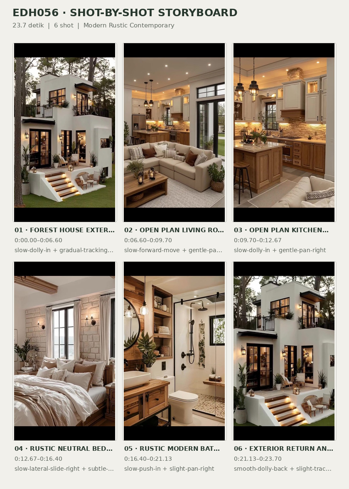
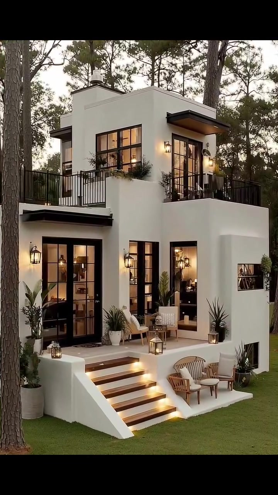
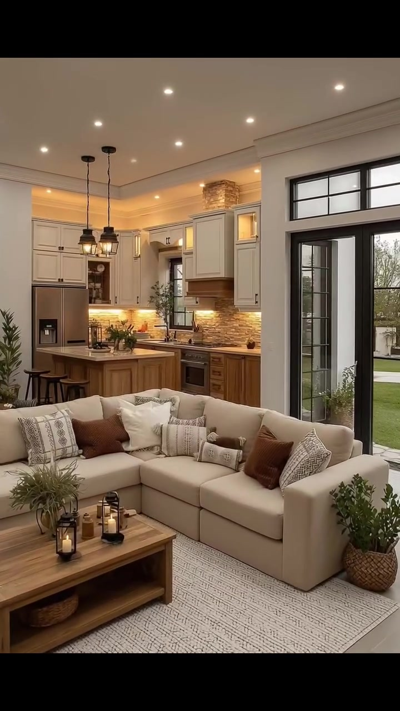
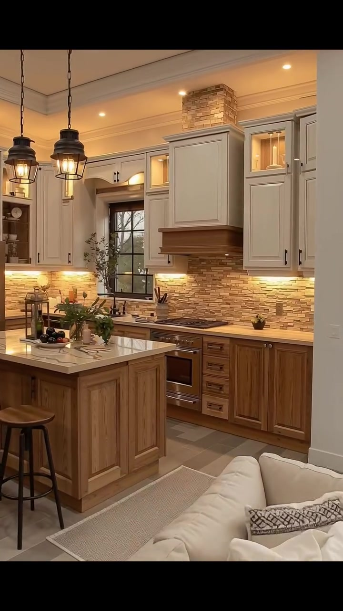
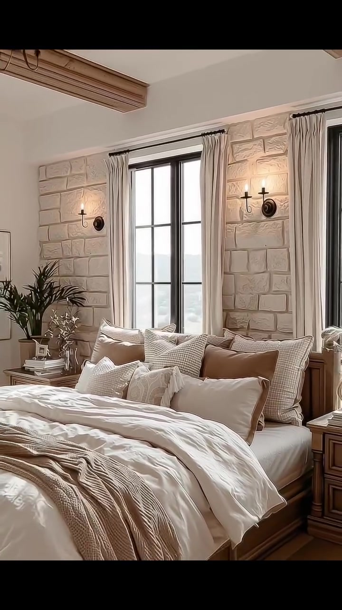
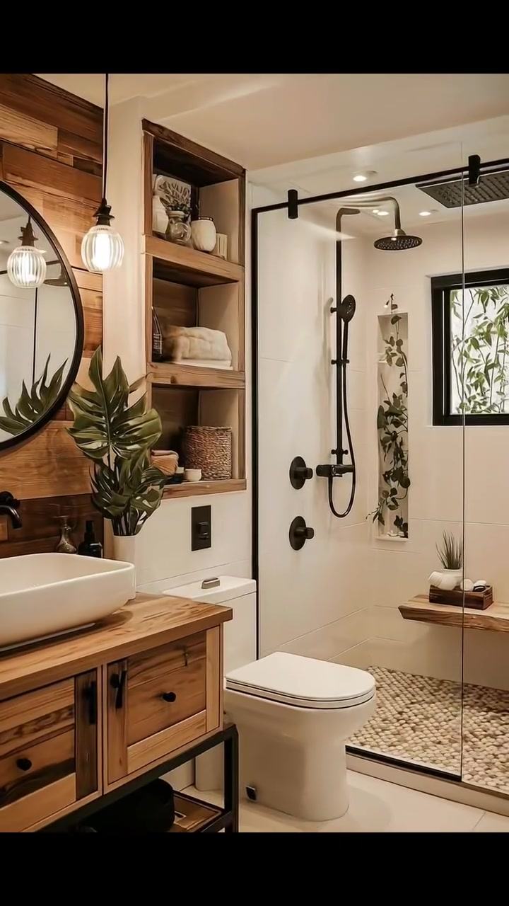
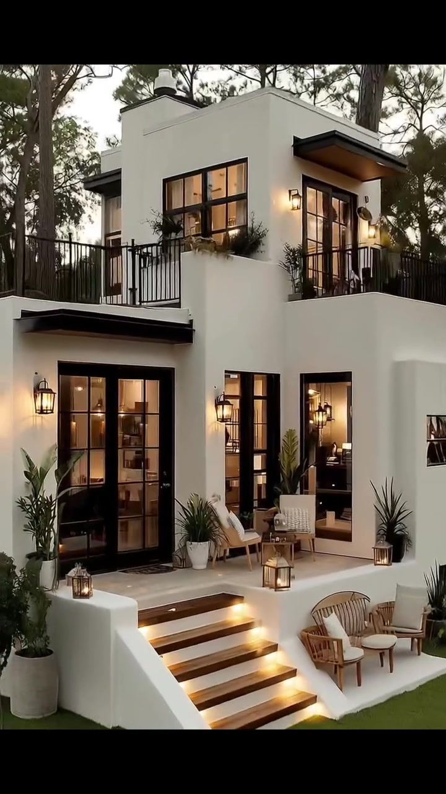

# edh056 — Modern Rustic Contemporary

<!-- homeku_request_id: edh056-20261106-chat-97b6d251 -->

<!-- homeku_detail_narratives: chat-reviewed -->

**Sumber data:** [analysis.yaml](analysis.yaml) · **Status:** draft · **Diverifikasi manusia:** Tidak

## 1. Informasi Video

| Informasi | Nilai |
|---|---|
| ID | edh056 |
| File asli | edh056.mp4 |
| Durasi | 23.7 |
| Resolusi | 720x1280 |
| FPS | 30.0 |
| Rasio | 9:16 |
| Jumlah shot | 6 |

## 2. Storyboard Gabungan

## 3. Identitas Desain

| Aspek | Hasil analisis |
|---|---|
| Gaya utama | modern rustic contemporary |
| Wilayah terkait gaya desain | north america, europe |
| Pengaruh gaya | modern farmhouse, contemporary minimalism, rustic cottage, transitional interior |
| Ciri eksterior | asymmetrical two story white plaster appearance masses, dark black mullioned glazed doors and windows, upper terrace with black metal railings, dark wood appearance entry steps with warm lights |
| Gaya interior | warm neutral open plan living area, cream shaker cabinets and honey wood accents, rustic stone appearance bedroom wall |
| Confidence gaya | medium |

## 4. Ukuran & Proporsi Bangunan

| Aspek | Estimasi visual |
|---|---|
| Ukuran yang terlihat | large |
| Bentuk bangunan | asymmetrical stacked volumes |
| Skala vertikal | two story |
| Tapak bangunan | moderate |
| Perkiraan luas lantai | 100–180 m² |
| Confidence | low |

> Luas adalah perkiraan visual, bukan ukuran terukur.

## 5. Warna, Pencahayaan, dan Atmosfer

| Warna dominan | HEX (perkiraan) |
|---|---|
| warm white | #EEE9DC |
| cream beige | #D9CEB9 |
| honey wood | #A9794F |
| natural tan stone | #BBA58D |
| matte black | #252322 |
| warm rust brown | #966041 |
| forest green | #566745 |

| Aspek | Hasil analisis |
|---|---|
| Pencahayaan | soft outdoor ambient daylight, warm wall lanterns, warm stair lights, warm under cabinet lighting, recessed spotlights, warm candle like accents |
| Lingkungan | pine like woodland, trimmed green lawn, raised front porch, black framed glazing |
| Musim yang tampak | Tidak diketahui |
| Mood | cozy, warm, quiet, rustic, upscale, welcoming |

## 6. Struktur dan Timeline Video

**Jenis:** residential architecture home tour · **Tempo:** slow to moderate · **Transisi:** three hard cuts with two continuous thematic shifts

| Shot | Waktu (detik) | Durasi | Area/Scene | Gerakan Kamera |
|---|---|---|---|---|
| Shot 01 | 0.0–6.6 | 6.60 | forest house exterior and porch | slow dolly in, gradual tracking right |
| Shot 02 | 6.6–9.7 | 3.10 | open plan living room | slow forward move, gentle pan right |
| Shot 03 | 9.7–12.667 | 2.97 | open plan kitchen detail | slow dolly in, gentle pan right |
| Shot 04 | 12.667–16.4 | 3.73 | rustic neutral bedroom | slow lateral slide right, subtle widening reveal |
| Shot 05 | 16.4–21.133 | 4.73 | rustic modern bathroom | slow push in, slight pan right |
| Shot 06 | 21.133–23.7 | 2.57 | exterior return and wide reveal | smooth dolly back, slight track left |

## 7. Analisis per Shot

### Shot 01 — forest house exterior and porch

**Waktu:** 0.0–6.6 detik

| Komponen | Pengamatan |
|---|---|
| Fokus utama | two story white modern rustic house in a pine forest |
| Framing awal → akhir | wide front left three quarter house view with foreground pines → medium porch doorway close view |
| Sudut pandang | eye level with slight upward view of upper floor |
| Gerakan kamera | slow dolly in, gradual tracking right |
| Kecepatan kamera | slow |
| Pencahayaan | soft external ambient light combined with warm wall lanterns and step lights |
| Transisi keluar | continuous camera movement from porch toward glazed doors |

**Detail yang terlihat**

**Arsitektur**

Bangunan berwarna putih tampak memiliki dua tingkat dengan massa lantai atas yang lebih kecil dan tersusun asimetris. Bentuk atapnya landai dan sebagian tertutup bidang tepian putih, sementara kanopi tipis berbingkai hitam dengan bagian bawah bernuansa kayu menaungi beberapa pintu. Di lantai atas ada jendela besar berkisi hitam, pintu kaca berbingkai gelap, serta teras atau balkon yang dipagari railing besi vertikal hitam dan menjorok di atas teras bawah. Pintu masuk utama lantai dasar menggunakan sepasang daun kaca berkisi hitam, dengan jendela samping vertikal ramping. Lampu dinding berbentuk lentera hitam menyala hangat pada sejumlah titik. Teras lantai dasar ditinggikan dan dilapisi bidang menyerupai batu terang. Tangga depan memiliki sekitar lima anak tangga dengan permukaan menyerupai kayu gelap dan lampu hangat di bawah bibir pijakan, diapit pembatas masif putih yang menurun miring. Di sebelah kanan tangga terdapat ceruk duduk terbuka pada level lebih rendah. Sebuah jendela kecil kisi hitam terlihat pada dinding putih sisi kanan.

**Furnitur dan properti**

Di teras tinggi diletakkan dua kursi santai berangka kayu terang dengan bantalan putih, didampingi meja kecil dan lampu dekoratif. Di area duduk bawah sebelah kanan ada sepasang kursi rotan melengkung berbantalan putih dengan meja bundar kecil berwarna terang di tengahnya. Lentera\-lentera kaca berbingkai hitam tersebar di anak tangga, sudut teras, dan tepian balkon. Beberapa tanaman berdaun lancip serta daun lebar ditempatkan dalam pot tinggi putih dan abu\-abu. Keset setengah lingkaran berpola gelap berada di depan pintu utama.

**Lingkungan**

Batang\-batang pohon tinggi yang menyerupai pinus berdiri sangat dekat dengan rumah, termasuk di bagian depan yang membingkai pandangan. Kanopi pepohonan tinggi membentuk suasana hutan rapat di belakang bangunan. Rumput hijau terpangkas rapi menutupi tanah di sekitar teras, sementara rumpun tanaman rendah tumbuh di tepi bangunan. Langit terlihat terang pucat, menyerupai kondisi mendung atau sore hari. Cahaya interior kuning hangat tampak dari balik jendela\-jendela berkisi hitam.

**Catatan pengamatan:** Two occupied-looking levels are visually apparent; location, exact roof structure, land measurements and construction materials are unverified.

**Confidence:** Kamera medium · Detail visual high

### Shot 02 — open plan living room

**Waktu:** 6.6–9.7 detik

| Komponen | Pengamatan |
|---|---|
| Fokus utama | cream sectional sofa and warm wood coffee table in open plan room |
| Framing awal → akhir | wide view through glass doors toward living room and kitchen → medium wide living seating group and kitchen background |
| Sudut pandang | eye level from entry |
| Gerakan kamera | slow forward move, gentle pan right |
| Kecepatan kamera | slow |
| Pencahayaan | daylight from glazed door with warm recessed and kitchen accent lights |
| Transisi keluar | continuous pan deeper toward kitchen |

**Detail yang terlihat**

**Arsitektur**

Area duduk menggunakan dinding krem\-putih dengan lis plafon putih tebal dan sejumlah lampu sorot tanam. Cahaya hangat dari tepi plafon dan area kabinet dapur tampak pada bagian belakang. Pintu kaca tinggi berkisi hitam dengan kaca transom persegi panjang berada di kanan, menghadap halaman. Tidak ada dinding penuh yang memisahkan ruang keluarga dari dapur; seluruhnya berada dalam satu tata ruang terbuka. Lantai di sekitar sofa terlihat berupa bidang ubin besar bernuansa beige terang, sedangkan area sofa dialasi karpet besar bertekstur krem dan abu\-abu muda.

**Furnitur dan properti**

Sofa sectional berbentuk L berwarna krem mendominasi area duduk. Di atasnya tersusun banyak bantal putih gading, beige, cokelat karat, dan beberapa bantal bermotif hitam. Meja kopi rendah persegi panjang berbahan menyerupai kayu alami memiliki rak terbuka di bawah. Meja memuat beberapa lentera kecil berwarna hitam dengan nyala lilin hangat serta tanaman hijau keabu\-abuan, sementara keranjang anyaman terlihat pada rak bawah. Di kanan sofa ada tanaman hijau dalam pot berbalut keranjang anyaman. Di belakang sofa terlihat kursi bar gelap dengan dudukan kayu, dua lampu gantung bergaya lentera logam hitam di atas kitchen island, dan kulkas berfinishing stainless di sudut kiri dapur.

**Lingkungan**

Halaman rumput hijau dan cabang pepohonan dapat dilihat melalui pintu kaca di sebelah kanan. Cahaya luar lembut masuk ke ruang keluarga dan berpadu dengan lampu interior hangat.

**Catatan pengamatan:** The living room and kitchen are part of one continuous interior camera view; their split is thematic, not an edit.

**Confidence:** Kamera medium · Detail visual high

### Shot 03 — open plan kitchen detail

**Waktu:** 9.7–12.667 detik

| Komponen | Pengamatan |
|---|---|
| Fokus utama | cream shaker upper cabinets oak tone lower cabinets and wood island |
| Framing awal → akhir | medium wide kitchen island behind sectional sofa → medium close kitchen cabinets stove island and window |
| Sudut pandang | eye level oblique toward kitchen work wall |
| Gerakan kamera | slow dolly in, gentle pan right |
| Kecepatan kamera | slow |
| Pencahayaan | warm amber under cabinet lighting and dark metal pendants with daylight |
| Transisi keluar | hard cut to bedroom at 12 667 s |

**Detail yang terlihat**

**Arsitektur**

Dapur melanjutkan konsep ruang terbuka yang sama. Kabinet bagian atas bergaya shaker berwarna krem dengan gagang hitam, sedangkan kabinet bawah dan kitchen island memakai tampilan kayu madu alami dengan panel berbingkai. Countertop pada kedua area berwarna terang. Backsplash tersusun dari kepingan ubin tidak beraturan menyerupai batu warna krem, beige, dan cokelat muda yang diterangi garis lampu di bawah kabinet. Bagian kompor dibingkai rumah cooker hood bernuansa kayu yang menonjol, dengan aksen kotak menyerupai susunan batu di atasnya. Beberapa pintu kabinet atas memakai kaca dan cahaya dalam lemari. Jendela kisi hitam di belakang bak cuci memiliki aksen tepian gelap. Plafon mempunyai lis putih berlapis dan lampu spot tanam, sementara lantai menggunakan ubin persegi panjang dengan variasi abu\-abu dan beige.

**Furnitur dan properti**

Dua lampu gantung menyerupai lentera logam hitam tergantung dengan rantai di atas island. Di sisi kiri island berdiri bangku bar kayu dengan kaki logam gelap. Kulkas stainless berpintu besar dengan dispenser terlihat di kiri belakang. Kompor berwarna logam ditanam di bawah cooker hood dan oven built\-in berada di bawahnya. Pada area bak cuci terdapat keran leher angsa tinggi berwarna hitam. Countertop memuat tanaman hijau, wadah keramik, talenan dan peralatan memasak. Di atas kitchen island terdapat nampan putih berisi benda bundar gelap menyerupai buah serta rangkaian tanaman atau bunga hijau. Dua bangku dudukan kayu bundar juga terlihat di sisi meja.

**Lingkungan**

Melalui jendela hitam di atas bak cuci terlihat cabang\-cabang pohon yang tipis. Cahaya luar yang terang juga datang dari pintu kaca tinggi pada area yang bersebelahan.

**Catatan pengamatan:** Stone and timber surfaces are descriptions of visual appearance, not material authentication.

**Confidence:** Kamera medium · Detail visual high

### Shot 04 — rustic neutral bedroom

**Waktu:** 12.667–16.4 detik

| Komponen | Pengamatan |
|---|---|
| Fokus utama | large bed with layered neutral textiles against light stone appearance wall |
| Framing awal → akhir | medium view of bed front and center black grid window → wide bed and twin window view |
| Sudut pandang | eye level nearly front facing |
| Gerakan kamera | slow lateral slide right, subtle widening reveal |
| Kecepatan kamera | slow |
| Pencahayaan | soft daylight behind bed and warm black wall sconce lamps |
| Transisi keluar | hard cut to bathroom at 16 400 s |

**Detail yang terlihat**

**Arsitektur**

Kamar tidur memiliki dinding aksen di belakang ranjang yang disusun seperti blok batu besar berwarna krem terang, diapit dua jendela tinggi berkisi hitam. Kedua jendela menggunakan tirai krem panjang pada batang gorden gelap. Lampu dinding hitam dengan lengan menyerupai tempat lilin menyala hangat di kedua sisi ranjang. Plafon putih dihiasi balok kayu ekspos melintang, sedangkan lantai berpenampilan papan kayu cokelat madu. Ranjang dengan kepala dan kerangka beraksen kayu berada di tengah, diapit meja nakas kayu dengan warna serasi.

**Furnitur dan properti**

Ranjang ganda besar ditata menggunakan selimut tebal putih gading yang terlipat longgar. Di bagian kepala tersusun bantal besar dengan sarung kotak\-kotak beige, bantal kecil putih bertekstur, dan bantal aksen warna cokelat muda hingga cokelat tua. Selimut lempar berwarna taupe\-beige diletakkan melintang tidak rapi di kaki ranjang. Di nakas kiri ada tanaman menyerupai palem, cabang tanaman dalam vas bening, beberapa buku, dan bingkai foto kecil. Di nakas kanan terlihat dekorasi kaca kecil yang sebagian tertutup framing kamera.

**Lingkungan**

Cahaya lembut masuk dari jendela\-jendela berkisi hitam di belakang ranjang. Pemandangan di luar tampak berkabut atau pucat, tetapi lokasinya tidak cukup jelas untuk diidentifikasi.

**Catatan pengamatan:** The large light blocks could be stone, textured cladding, or simulated panel finish; precise composition is unknown.

**Confidence:** Kamera medium · Detail visual high

### Shot 05 — rustic modern bathroom

**Waktu:** 16.4–21.133 detik

| Komponen | Pengamatan |
|---|---|
| Fokus utama | black shower fixtures glass partition and wood vanity storage |
| Framing awal → akhir | wide shower toilet vanity composition → tight wood storage niche and shower fixtures view |
| Sudut pandang | eye level nearly frontal |
| Gerakan kamera | slow push in, slight pan right |
| Kecepatan kamera | slow |
| Pencahayaan | warm pendant light and soft recessed spotlights with window daylight |
| Transisi keluar | hard cut back to exterior at 21 133 s |

**Detail yang terlihat**

**Arsitektur**

Kamar mandi memadukan bilik shower berdinding ubin putih besar dengan partisi kaca bening berbingkai sangat tipis. Rel horizontal hitam berada di atas partisi geser. Lantai shower memiliki tekstur mosaik kerikil bulat beige\-cokelat, sedangkan dinding shower memiliki ceruk vertikal dekoratif berisi tanaman merambat. Sebuah jendela kecil berbingkai hitam berada di atas bangku shower yang tampak menggunakan papan kayu bertepi alami. Dinding luar shower berwarna putih dengan bidang panel kayu hangat di sekitar wastafel. Kabinet wastafel kayu memiliki penopang kaki logam hitam, countertop kayu, serta baskom putih model vessel. Di atasnya terpasang cermin bulat berbingkai hitam. Rak terbuka vertikal dari kayu berada di kanan cermin. Area luar shower memakai ubin lantai putih besar dan beberapa lampu spot bundar tertanam pada plafon.

**Furnitur dan properti**

Bilik shower dilengkapi rain shower besar berwarna hitam pada pipa melengkung, pancuran genggam dengan rel vertikal, serta dua knop kontrol bundar hitam. Di depannya terlihat kloset putih modern berbentuk kompak. Rak\-rak kayu menampung handuk putih terlipat, keranjang anyaman cokelat, vas keramik krem, dan beberapa benda dekoratif kecil. Tanaman berdaun lebar dengan belahan menyerupai monstera berdiri dalam vas putih di dekat wastafel. Lampu gantung tunggal berkap kaca beralur menerangi area cermin. Botol kecil berwarna gelap tampak di sekitar baskom. Pada bangku shower terdapat handuk kecil yang digulung dan baki cokelat.

**Lingkungan**

Dari jendela kecil shower terlihat ranting serta dedaunan hijau di luar. Ruangan menerima cahaya dari jendela tersebut dan lampu plafon putih hangat.

**Catatan pengamatan:** Window vegetation is visible; precise outdoors and materials cannot be confirmed.

**Confidence:** Kamera medium · Detail visual high

### Shot 06 — exterior return and wide reveal

**Waktu:** 21.133–23.7 detik

| Komponen | Pengamatan |
|---|---|
| Fokus utama | white two story forest house revealed from entry back to full facade |
| Framing awal → akhir | medium entry porch detail → wide front three quarter house view with pine forest |
| Sudut pandang | eye level to slight low angle |
| Gerakan kamera | smooth dolly back, slight track left |
| Kecepatan kamera | moderate |
| Pencahayaan | warm indoor and exterior lights against soft outdoor ambient light |
| Transisi keluar | end of video |

**Detail yang terlihat**

**Arsitektur**

Sebagai penutup, kamera kembali memperlihatkan fasad rumah yang sama dari jarak dekat lalu menjauh. Pintu kaca utama berkisi hitam, dinding putih asimetris bertingkat, jendela besar lantai atas, pagar besi balkon vertikal hitam dan kanopi bertepi gelap dengan bagian bawah bernuansa kayu kembali terlihat. Pada bagian bawah, teras bertangga dengan lampu pijakan hangat, area duduk cekung di kanan, dan lampu dinding berbentuk lentera hitam menegaskan karakter desain eksterior.

**Furnitur dan properti**

Kursi teras berangka kayu dan bantalan terang tampak di dekat pintu. Sepasang kursi rotan dengan meja kecil putih berada di ceruk duduk sisi kanan bawah. Pot tanaman berdaun tegak dan berdaun lebar menghiasi tepian teras, sedangkan lentera kaca berbingkai hitam ditempatkan pada sudut\-sudut lantai serta anak tangga.

**Lingkungan**

Pada saat kamera menjauh, batang\-batang pohon tinggi menyerupai pinus, hutan di belakang rumah, serta halaman rumput yang terpangkas rapi kembali masuk ke dalam komposisi. Langit pucat dan pencahayaan hangat dari rumah memberi suasana teduh seperti menjelang petang, tetapi waktu nyata tidak dapat dipastikan.

**Catatan pengamatan:** This scene revisits the opening facade, not a second property.

**Confidence:** Kamera medium · Detail visual high

## 8. Kualitas dan Ketidakpastian Analisis

| Parameter | Hasil |
|---|---|
| Status | draft |
| Verifikasi manusia | Tidak |
| Ketepatan timestamp | boundary estimate |
| Ketidakpastian | split between living and kitchen is thematic not a hard cut, approximate area is not measured, real location cannot be derived from style, actual materials cannot be authenticated from pixels, time of day or season cannot be proven, possible generated or stylized video not verified |

**Catatan:** All visible camera content inspected across 711 video frames through time-indexed samples, with three major edit boundaries supported by scene-change analysis. Two additional focus segments are subdivisions of continuous movement.

---

*Laporan ini diturunkan dari [analysis.yaml](analysis.yaml).*
