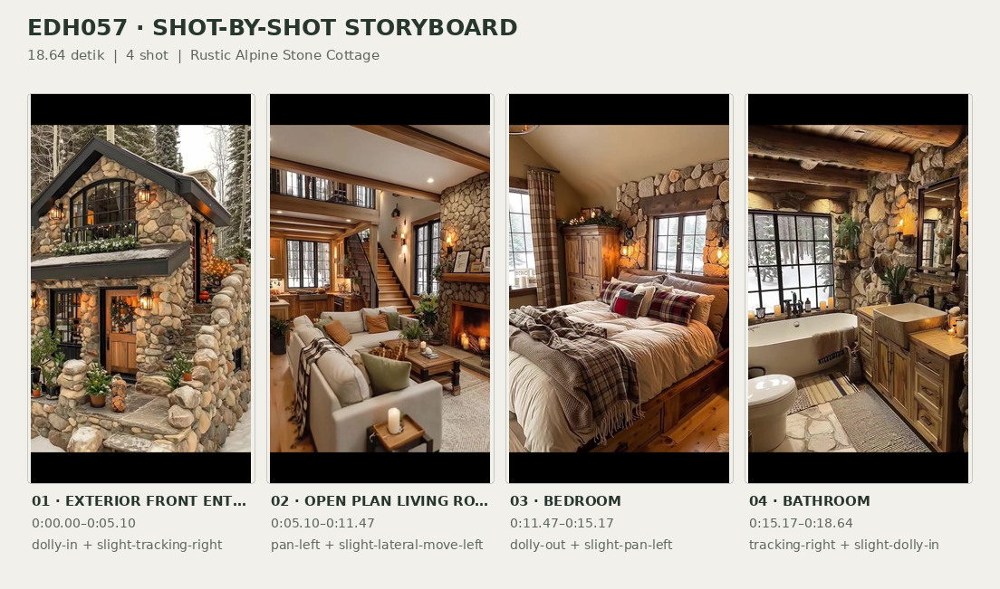
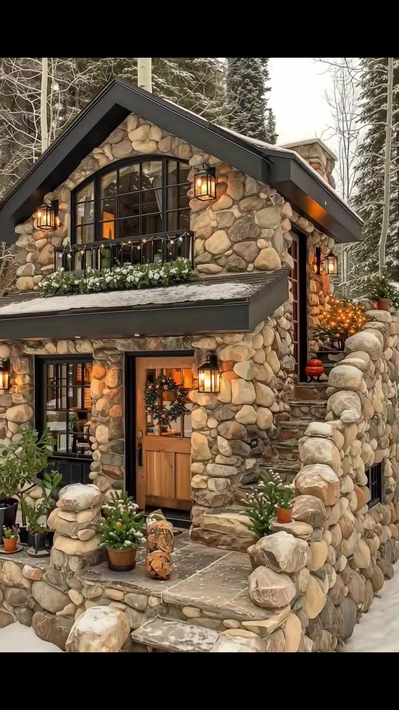
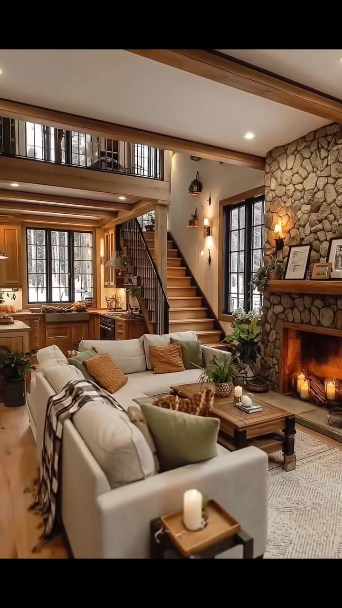
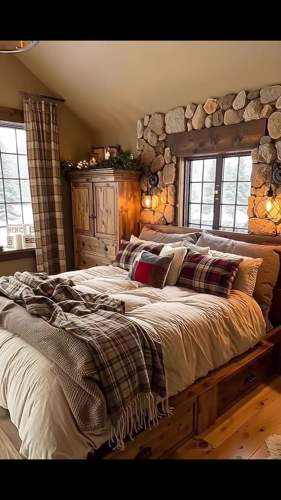
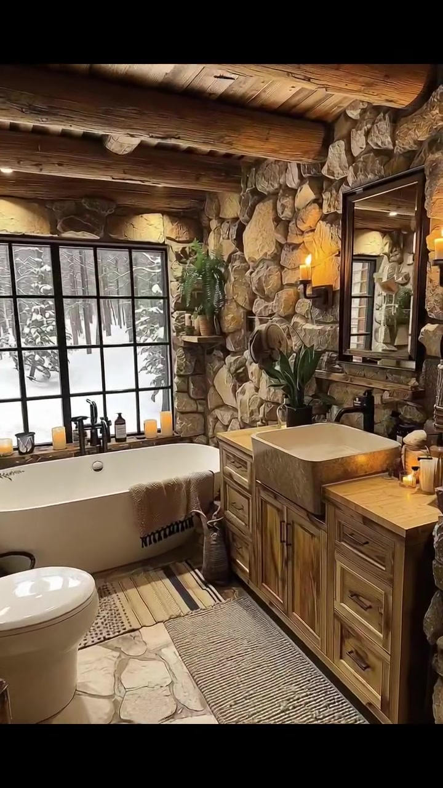

# edh057 — Rustic Alpine Stone Cottage

<!-- homeku_request_id: edh057-20261106-v14-01 -->

<!-- homeku_detail_narratives: chat-reviewed -->

**Sumber data:** [analysis.yaml](analysis.yaml) · **Status:** draft · **Diverifikasi manusia:** Tidak

## 1. Informasi Video

| Informasi | Nilai |
|---|---|
| ID | edh057 |
| File asli | edh057.mp4 |
| Durasi | 18.64 |
| Resolusi | 720x1280 |
| FPS | 30 |
| Rasio | 9:16 |
| Jumlah shot | 4 |

## 2. Storyboard Gabungan

## 3. Identitas Desain

| Aspek | Hasil analisis |
|---|---|
| Gaya utama | rustic alpine stone cottage |
| Wilayah terkait gaya desain | europe, north america |
| Pengaruh gaya | mountain lodge, traditional cottage, modern rustic |
| Ciri eksterior | round stone masonry facade, steep front gable with charcoal trim, large black arched upper window, dark window mullions, natural wood front door, stone stairway and entry parapets, small floral balcony rail, warm black wall lanterns |
| Gaya interior | rustic mountain lodge, warm country cottage, wood and stone interior |
| Confidence gaya | medium |

## 4. Ukuran & Proporsi Bangunan

| Aspek | Estimasi visual |
|---|---|
| Ukuran yang terlihat | medium |
| Bentuk bangunan | compact rectangular gabled mass |
| Skala vertikal | two story with possible partial lower level |
| Tapak bangunan | compact |
| Perkiraan luas lantai | 90–160 m² |
| Confidence | low |

> Luas adalah perkiraan visual, bukan ukuran terukur.

## 5. Warna, Pencahayaan, dan Atmosfer

| Warna dominan | HEX (perkiraan) |
|---|---|
| warm stone beige | #B5A28B |
| honey wood brown | #A8794A |
| charcoal black | #2B2E2B |
| soft cream | #E5DECF |
| snow white | #EBECE7 |
| warm amber | #DCA65E |
| forest green | #56684B |

| Aspek | Hasil analisis |
|---|---|
| Pencahayaan | diffuse cool daylight, warm wall sconces, warm recessed spotlights, fireplace glow |
| Lingkungan | snow covered forest clearing, conifer and bare tree backdrop, stone entry terrace with potted plants, snowy outdoor views through interior windows |
| Musim yang tampak | winter like snow cover |
| Mood | cozy, rustic, warm, sheltered, wintery |

## 6. Struktur dan Timeline Video

**Jenis:** home tour · **Tempo:** slow · **Transisi:** hard cuts between four slow moving shots

| Shot | Waktu (detik) | Durasi | Area/Scene | Gerakan Kamera |
|---|---|---|---|---|
| Shot 01 | 0.0–5.1 | 5.10 | exterior front entry | dolly in, slight tracking right |
| Shot 02 | 5.1–11.47 | 6.37 | open plan living room kitchen | pan left, slight lateral move left |
| Shot 03 | 11.47–15.17 | 3.70 | bedroom | dolly out, slight pan left |
| Shot 04 | 15.17–18.64 | 3.47 | bathroom | tracking right, slight dolly in |

## 7. Analisis per Shot

### Shot 01 — exterior front entry

**Waktu:** 0.0–5.1 detik

| Komponen | Pengamatan |
|---|---|
| Fokus utama | two level stone cottage front facade and wood entry door |
| Framing awal → akhir | wide three quarter front facade with stone steps → tight front entry and upper arched window detail |
| Sudut pandang | slightly elevated three quarter front view |
| Gerakan kamera | dolly in, slight tracking right |
| Kecepatan kamera | slow |
| Pencahayaan | diffuse cold outdoor daylight with warm wall lanterns |
| Transisi keluar | hard cut |

**Detail yang terlihat**

**Arsitektur**

Rumah tampak bermassa ringkas dua tingkat, dengan fasad dari susunan batu bulat tak beraturan. Atap pelana depan cukup curam, berlis arang gelap dan memiliki tepian yang menjorok; di bawahnya tampak bagian soffit gelap. Di bidang segitiga atas terdapat jendela lengkung besar berkisi hitam, dilengkapi pagar besi rendah dan wadah bunga. Atap miring pendek menaungi area masuk di lantai bawah. Pintu kayu muda memiliki panel kaca di bagian atas dan perangkat keras gelap, sementara bukaan berkisi hitam yang tinggi dan sempit berada di kirinya. Dua lentera dinding logam hitam menyala di sisi pintu. Beberapa anak tangga batu kasar mengarah ke teras tinggi yang diapit parapet dari batu bulat tebal. Tangga batu lain naik di sisi kanan rumah; tonjolan batu yang mirip cerobong tampak di belakang atap pelana depan.

**Furnitur dan properti**

Karangan daun hijau dengan aksen merah menghias kaca pintu. Beberapa pot tanah liat dan pot gelap berisi tanaman hijau tersusun di teras, berdampingan dengan dekorasi potongan gelondongan kayu kecil. Di depan jendela lengkung lantai atas terdapat deretan bunga putih. Lampu\-lampu dekoratif hangat terlihat di sekitar jendela tersebut dan tangga samping, bersama pot kecil bernuansa merah atau jingga di tangga kanan.

**Lingkungan**

Tanah di sekitar tangga masuk tertutup salju, dengan lapisan salju tipis juga pada tepi parapet teras dan atap depan yang landai. Di belakang rumah tumbuh konifer tinggi yang bercampur dengan batang pohon tanpa daun. Di dekat tangga kanan terdapat semak berdaun atau berbunga jingga, sedangkan semak\-semak hijau kecil mengelilingi teras masuk.

**Catatan pengamatan:** Eksterior terlihat dari sudut tiga perempat. Kamera mendekat sambil sedikit bergeser ke kanan, sehingga teras, pintu dan jendela lengkung di lantai atas semakin dominan.

**Confidence:** Kamera medium · Detail visual high

### Shot 02 — open plan living room kitchen

**Waktu:** 5.1–11.47 detik

| Komponen | Pengamatan |
|---|---|
| Fokus utama | living room stone fireplace transitioning to wood kitchen under loft |
| Framing awal → akhir | wide living room with fireplace and seating in foreground → medium wide kitchen cabinetry centered beyond sofa |
| Sudut pandang | interior eye level oblique view |
| Gerakan kamera | pan left, slight lateral move left |
| Kecepatan kamera | slow |
| Pencahayaan | soft window daylight with recessed spotlights warm sconces and fireplace glow |
| Transisi keluar | hard cut |

**Detail yang terlihat**

**Arsitektur**

Ruang keluarga tersambung langsung ke dapur di bagian belakang tanpa sekat masif. Dinding perapian menjulang dengan susunan batu tak beraturan, lubang api persegi panjang, dan ambalan kayu cokelat sedang yang tebal. Dinding lainnya tampak berplester putih krem dengan lis kayu gelap, lantai menyerupai papan kayu warna madu muda, dan plafon menampilkan balok serta lis kayu cokelat. Di atas ruang terdapat mezzanine berpagar bilah besi hitam; tangga kayu muda dengan railing logam hitam terlihat di kanan dapur. Jendela tinggi berkisi hitam berada di dekat perapian, dengan jendela sejenis di belakang countertop dapur. Kabinet dapur cokelat berpintu panel tersusun di tiga sisi, menggunakan countertop terang yang tampak menyerupai batu dan pulau dapur kecil. Lampu plafon tanam menerangi ruangan, sementara lampu gantung logam gelap berada di atas island. Wastafel beserta keran gelap tampak di bawah jendela dapur belakang.

**Furnitur dan properti**

Dua sofa besar berlapis kain krem mengapit area meja kopi kayu persegi panjang berwarna cokelat tua. Sofa dihiasi bantal bertekstur hijau sage dan oker; sofa terdekat memiliki selimut motif kotak cokelat\-krem. Di meja terdapat tanaman hijau kecil dalam pot metalik, lilin, dan baki kecil, di atas karpet tenun berwarna netral. Bingkai foto dan ornamen kecil menghiasi ambalan perapian, sementara lilin menyala tampak dalam bukaan perapian. Beberapa tanaman dalam pot ditempatkan dekat jendela dan dapur. Di dapur terlihat kulkas metalik di sisi kiri, permukaan memasak gelap pada countertop kanan, serta piring, buah dan wadah kecil di atas permukaan kerja. Hiasan dinding hitam berkaca kecil tergantung di area atas tangga.

**Lingkungan**

Melalui jendela berkisi hitam ruang keluarga terlihat pepohonan dengan latar terang oleh salju. Jendela belakang dapur juga menampilkan pemandangan luar bersalju.

**Catatan pengamatan:** Satu pergerakan kontinu menggeser pusat perhatian dari perapian dan sofa ke dapur berbentuk U di bawah mezzanine. Material yang tampak seperti kayu dan batu tidak diverifikasi sebagai material asli.

**Confidence:** Kamera medium · Detail visual high

### Shot 03 — bedroom

**Waktu:** 11.47–15.17 detik

| Komponen | Pengamatan |
|---|---|
| Fokus utama | wood storage bed with layered textiles against stone window wall |
| Framing awal → akhir | medium close bed and centered rear window → wider bedroom showing side window ceiling fixture and bed base |
| Sudut pandang | slightly elevated three quarter interior view |
| Gerakan kamera | dolly out, slight pan left |
| Kecepatan kamera | slow |
| Pencahayaan | cool diffuse snow reflected daylight with warm wall sconces and chandelier |
| Transisi keluar | hard cut |

**Detail yang terlihat**

**Arsitektur**

Dinding aksen berupa susunan batu mengelilingi jendela berkisi hitam di belakang ranjang; balok ambang kayu cokelat gelap yang lebar berada di atas jendela tersebut. Plafon krem miring menampakkan balok kayu gelap. Jendela berkisi hitam kedua berada pada dinding kiri, sementara lantainya tampak menyerupai papan kayu madu muda. Lis kayu dan lampu dinding bercahaya hangat melengkapi bidang batu.

**Furnitur dan properti**

Ranjang besar dari kayu alami memiliki laci penyimpanan pada bagian bawah, tertutup duvet krem\-putih dan susunan bantal. Selimut kotak cokelat\-abu dihamparkan di bagian kaki ranjang; dua bantal panjang bermotif kotak merah\-hijau berada dekat sandaran, dengan bantal aksen merah kecil di depannya. Lemari kayu madu berpenampilan agak usang berdiri di kiri ranjang dan di atasnya terdapat tanaman serta ornamen kecil. Gorden panjang bermotif kotak membingkai jendela kiri. Lampu gantung berbentuk lingkaran gelap dengan bohlam menyerupai lilin terlihat di dekat plafon. Pohon dekoratif kecil yang menyala berada dekat jendela kiri, sementara karpet berwarna netral membentang di samping ranjang. Sepasang lampu dinding hitam berpelindung kisi mengapit jendela belakang.

**Lingkungan**

Melalui jendela kamar terlihat permukaan tanah bersalju dan pepohonan di luar.

**Catatan pengamatan:** Kamera mundur sedikit dan membuka sudut ke kiri; bidang ranjang menjadi lebih utuh dan jendela kedua serta lampu gantung masuk ke frame.

**Confidence:** Kamera medium · Detail visual high

### Shot 04 — bathroom

**Waktu:** 15.17–18.64 detik

| Komponen | Pengamatan |
|---|---|
| Fokus utama | stone walled bathroom with freestanding tub and wood vanity |
| Framing awal → akhir | wide bathroom with bathtub under window and toilet left → closer view of vanity stone vessel sink and black framed mirror |
| Sudut pandang | eye level slightly oblique interior view |
| Gerakan kamera | tracking right, slight dolly in |
| Kecepatan kamera | slow |
| Pencahayaan | soft snow reflected daylight mixed with warm sconce light and small lantern |
| Transisi keluar | video end |

**Detail yang terlihat**

**Arsitektur**

Dinding kamar mandi dilapisi batu besar tak beraturan dengan warna bumi. Plafon berupa papan kayu dengan balok bulat besar yang terekspos; lantainya berpola kepingan batu pucat tak beraturan. Jendela berkisi hitam berada di atas bak rendam. Kabinet wastafel kayu cokelat sedang memiliki pintu panel dan laci, ditutup countertop terang berpenampilan kayu. Di atasnya terpasang cermin persegi panjang berbingkai hitam, diapit lampu dinding hangat berbentuk lilin; lampu plafon tanam kecil juga terlihat di atas bak rendam.

**Furnitur dan properti**

Bak rendam oval putih berdiri bebas tepat di bawah jendela, dengan keran hitam dan beberapa botol gelap pada ambang jendela. Kloset putih terletak di depan kiri dekat bak. Di atas kabinet kayu terpasang wastafel vessel persegi panjang abu\-abu yang tampak seperti batu, dengan keran logam gelap di belakangnya. Karpet tenun abu\-abu krem memanjang di depan kabinet, sementara karpet sempit bergaris berada di depan bak. Lentera hitam kecil yang menyala diletakkan di lantai dekat kloset. Tanaman pakis dan tanaman berdaun hijau menghias area bak dan wastafel. Lilin, botol serta wadah kecil tertata di countertop, dan handuk krem tersampir pada tepi bak.

**Lingkungan**

Dari jendela kamar mandi terlihat salju di permukaan tanah dan batang\-batang pohon gelap di luar.

**Catatan pengamatan:** Kamera bergeser ke kanan dan mendekat; bak rendam di kiri berangsur keluar dari fokus utama sementara wastafel dan cermin di sisi kanan menjadi lebih dominan.

**Confidence:** Kamera medium · Detail visual high

## 8. Kualitas dan Ketidakpastian Analisis

| Parameter | Hasil |
|---|---|
| Status | draft |
| Verifikasi manusia | Tidak |
| Ketepatan timestamp | estimated |
| Ketidakpastian | architectural style and related regions are interpretations not property location, building floor area 90 to 160 m2 is low confidence visual estimate, exact wall floor and sink materials cannot be confirmed from video, camera moves may mix physical tracking with digital zoom or synthetic motion, winter like appearance does not verify geographic location or recording season, final time range uses container duration while last video frame is around 18 53 seconds |

**Catatan:** Analisis hanya berdasarkan isi visual empat shot; tidak ada audio yang ditafsirkan. File yang diunggah cocok secara Git blob SHA dengan main/video/edh057.mp4.

---

*Laporan ini diturunkan dari [analysis.yaml](analysis.yaml).*
